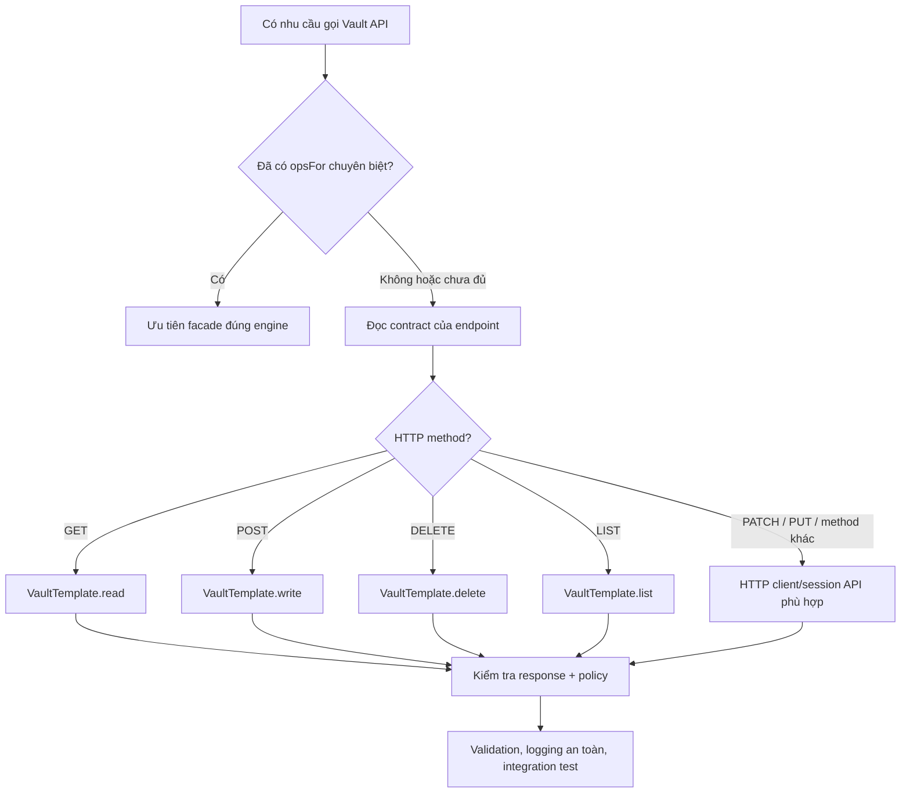

# Gọi endpoint chưa có abstraction chuyên biệt bằng `VaultTemplate`

Spring Vault cung cấp các nhóm thao tác thuận tiện như `opsForKeyValue()`, `opsForTransit()` và `opsForPki()`. Dù vậy, HashiCorp Vault còn có nhiều endpoint hệ thống, chức năng nâng cao, plugin tự phát triển hoặc tính năng mới mà **phiên bản Spring Vault trong dự án chưa có abstraction chuyên biệt**. Khi đó, ứng dụng Java vẫn có thể truy cập Vault an toàn qua các API mức thấp của **`VaultTemplate`**, miễn là người viết code hiểu chính xác HTTP method, đường dẫn, request body, response schema và quyền cần thiết.

Bài thuộc chương **VaultTemplate** của module **SPRING_VAULT**: ứng dụng Java truy cập HashiCorp Vault bằng `VaultTemplate`, xác thực theo workload, áp dụng policy phân quyền, thực hành KV secrets, vòng đời token/lease, Transit encryption, PKI, xử lý lỗi, giám sát và kiểm thử tích hợp. Trọng tâm bài này là **gọi endpoint chưa có abstraction chuyên biệt** mà không bỏ qua các bảo đảm về xác thực, bảo mật và tính đúng đắn của Vault API.

## Mục tiêu học tập

Sau khi hoàn thành bài, bạn có thể:

1. Quyết định khi nào nên dùng `opsFor...` và khi nào cần gọi endpoint trực tiếp bằng `VaultTemplate`.
2. Ghép đúng đường dẫn API tương đối, chọn thao tác `read()`, `write()`, `delete()` hoặc `list()` theo **HTTP contract của endpoint**.
3. Chuẩn bị JSON body, bóc `VaultResponse.getData()` và xử lý phản hồi thành công nhưng không có body.
4. Nhận diện giới hạn của API mức thấp, nhất là khi endpoint cần `PATCH`/`PUT`, raw HTTP response hoặc kiểu xác thực đặc biệt.
5. Viết Java service với validation, phân quyền tối thiểu, phân loại lỗi và kiểm thử tích hợp.

## 1. Khi nào cần gọi trực tiếp endpoint?

Một abstraction chuyên biệt giúp đóng gói các chi tiết lặp lại, chẳng hạn KV v2 có lớp JSON `data` và đường dẫn `/data/`, còn Transit có định dạng input/output mật mã. Tuy nhiên, có ít nhất bốn tình huống khiến code cần đi xuống mức HTTP endpoint:

- **Vault API mới hơn Spring Vault dependency:** Vault server cung cấp chức năng mới nhưng facade của phiên bản client chưa có method tương ứng.
- **Endpoint bổ sung của engine đã biết:** một thao tác metadata, cấu hình, kiểm tra hoặc quản trị cụ thể không được interface bạn đang dùng biểu diễn.
- **Custom secrets engine/plugin:** tổ chức triển khai plugin ở mount riêng, có API path và JSON schema do plugin công bố.
- **Cần kiểm soát request/response đặc biệt:** endpoint trả cấu trúc khác `data` chuẩn, yêu cầu HTTP method khác, header riêng hoặc mã trạng thái đặc biệt.

Không có abstraction không có nghĩa được phép tự đoán API. Cần dựa vào **contract của phiên bản Vault server hoặc plugin thực sự triển khai**, bao gồm path, method, dữ liệu và capability ACL.

| Tình huống | Lựa chọn trước tiên | Khi nào xuống API mức thấp? |
|---|---|---|
| KV v1/v2 cơ bản | `opsForKeyValue(mount, backend)` | Endpoint đặc biệt hoặc tính năng chưa được facade hỗ trợ |
| Transit encrypt/decrypt | `opsForTransit(mount)` | Operation/method không có trong facade đang dùng |
| PKI certificate operations | `opsForPki(mount)` | Endpoint PKI mới hoặc dữ liệu riêng của cấu hình |
| Token và hệ thống | `opsForToken()`, `opsForSys()` khi phù hợp | API chưa có method tương ứng hoặc cần raw response |
| Custom plugin | API của plugin qua `VaultTemplate` | Thường phải dùng mức thấp ngay từ đầu |
| Dynamic secrets | API read tương ứng hoặc cơ chế lease phù hợp | Endpoint/role không được abstraction cụ thể hỗ trợ |

**Không tự giả định** `opsFor<Engine>()` tồn tại với mọi secrets engine. Đồng thời, không nên chuyển tất cả hoạt động KV/Transit/PKI sang request thủ công chỉ vì `VaultTemplate` có thể gọi HTTP: facade có sẵn thường giúp giảm lỗi về path và serialization.

## 2. Bốn thao tác mức thấp thường dùng

`VaultTemplate` cung cấp các thao tác theo path tương đối. Bảng sau diễn giải **ý định chung** và ngữ nghĩa HTTP phổ biến; endpoint cụ thể quyết định phương thức nào được hỗ trợ.

| Lời gọi Java | HTTP tương ứng thường gặp | Vai trò | Kiểu kết quả |
|---|---|---|---|
| `read(path)` | `GET /v1/{path}` | Lấy thông tin từ endpoint | `VaultResponse` hoặc `null` |
| `read(path, Type.class)` | `GET /v1/{path}` | Đọc phần `data` vào kiểu Java | `VaultResponseSupport<Type>` hoặc `null` |
| `write(path, body)` | `POST /v1/{path}` | Gửi JSON body đến endpoint | `VaultResponse` hoặc `null` |
| `delete(path)` | `DELETE /v1/{path}` | Gọi thao tác xóa endpoint | `void` hoặc exception |
| `list(path)` | Vault `LIST` / biến thể list được hỗ trợ | Lấy tên các phần tử con | `List<String>` hoặc `null` |

Ví dụ:

```java
VaultResponse info = vaultTemplate.read("some-mount/object");

VaultResponse result = vaultTemplate.write(
        "some-mount/actions/run",
        Map.of("mode", "check"));

vaultTemplate.delete("some-mount/object");

List<String> names = vaultTemplate.list("some-mount/children");
```

Các path `some-mount/...` là **giả định minh họa**, không phải endpoint được HashiCorp Vault bảo đảm tồn tại. Trước khi đưa vào ứng dụng, phải thay chúng bằng endpoint có thật trên mount đã cấu hình và chỉ chọn method mà endpoint đó công bố.

### Path tương đối và key logic không giống nhau

Giả sử mount KV v2 tên `secret` và key logic `app/db`:

```java
// API mức thấp: bao gồm mount + đoạn /data/ bắt buộc của KV v2.
VaultResponse raw = vaultTemplate.read("secret/data/app/db");

// Facade KV v2: mount được truyền lúc tạo facade,
// còn get() nhận key logic.
VaultKeyValueOperations kv2 = vaultTemplate.opsForKeyValue(
        "secret", KeyValueBackend.KV_2);
VaultResponse logical = kv2.get("app/db");
```

Điều này đặc biệt quan trọng khi chuyển từ facade sang API mức thấp: **không bê nguyên đối số `get("app/db")` vào `read("app/db")`**, cũng không chuyển `secret/data/app/db` vào `kv2.get()`. Với endpoint khác KV, quy tắc đường dẫn có thể hoàn toàn khác.

### Không tự thêm hostname hoặc `/v1/`

`VaultTemplate` đã được cấu hình endpoint Vault và lớp HTTP phù hợp, nên `path` là chuỗi **tương đối** như `"sys/tools/random/16"` hoặc `"my-plugin/actions/check"`. Thông thường không truyền URL `https://vault.example/v1/...` vào `read()`/`write()` hay ghép thêm `/v1/` một lần nữa.

Khi tạo path động từ đầu vào bên ngoài, phải ràng buộc mount, prefix, tập ký tự hợp lệ và quyền nghiệp vụ; không ghép raw URL từ dữ liệu người dùng.

## 3. Chọn đúng HTTP contract trước khi gọi

Trước khi viết Java, hãy lập một bảng hợp đồng cho endpoint:

| Câu hỏi | Ví dụ cần xác định |
|---|---|
| Endpoint được mount ở đâu? | `sys/tools/random/16`, `secret/metadata/app/db` hoặc `plugin-name/actions/...` |
| HTTP method nào? | `GET`, `POST`, `DELETE`, `LIST`, hoặc `PATCH` |
| Request body có cấu trúc nào? | JSON với `input`, `format`, `versions`, `options`... |
| Phản hồi đặt kết quả ở đâu? | `data.random_bytes`, `data.metadata`, top-level field hoặc không có body |
| Cần policy nào? | `read`, `update`, `delete`, `list` theo path thực tế |
| Có tác dụng phụ không? | Tạo secret, thay đổi metadata, phát hành chứng chỉ, revoke lease |
| Có an toàn khi retry không? | Phụ thuộc idempotency và điều kiện cạnh tranh |
| Đối tượng được quản lý theo vòng đời nào? | KV version, dynamic lease, token, certificate hoặc hoàn toàn không có lease |

Ví dụ, một endpoint yêu cầu `POST` với JSON body **không thể** được gọi đúng bằng `read()` chỉ vì “mình muốn lấy kết quả”. Tác vụ có đầu ra là dữ liệu không đồng nghĩa với HTTP `GET`; một số phép tính từ phía Vault nhận input bằng `POST` và trả dữ liệu cho caller.



## 4. Ví dụ thực tế: gọi `sys/tools/random` qua `write()`

Vault có endpoint hệ thống **`sys/tools/random`** để sinh dữ liệu ngẫu nhiên. Ví dụ này minh họa cách gọi một endpoint trả dữ liệu bằng **`POST`**, thay vì sử dụng một abstraction giả định. Trong môi trường có policy phù hợp, yêu cầu:

```http
POST /v1/sys/tools/random/16
Content-Type: application/json

{
  "format": "base64"
}
```

Phản hồi thành công có thể chứa:

```json
{
  "data": {
    "random_bytes": "AAECAwQFBgcICQoLDA0ODw=="
  }
}
```

Giá trị Base64 trên là **chuỗi minh họa gồm các byte có quy luật**, không phải dữ liệu ngẫu nhiên thực và không nên dùng làm key bảo mật. Trong thực tế, giá trị `random_bytes` do Vault trả về sẽ khác nhau theo từng yêu cầu.

### Java service: validate cả request lẫn response

Ví dụ dùng Java 17+, `VaultTemplate` được inject từ cấu hình ứng dụng. Service chỉ cho phép lấy đúng **16 byte** để làm nonce trong luồng thử nghiệm; không nhận path từ caller và không log kết quả.

```java
import java.util.Base64;
import java.util.Map;

import org.springframework.stereotype.Service;
import org.springframework.vault.core.VaultTemplate;
import org.springframework.vault.support.VaultResponse;

@Service
public class VaultRandomService {

    private static final String ENDPOINT = "sys/tools/random/16";
    private static final int EXPECTED_SIZE = 16;

    private final VaultTemplate vaultTemplate;

    public VaultRandomService(VaultTemplate vaultTemplate) {
        this.vaultTemplate = vaultTemplate;
    }

    public byte[] nextNonce() {
        // Endpoint sử dụng POST, mặc dù mục tiêu là nhận output.
        VaultResponse response = vaultTemplate.write(
                ENDPOINT,
                Map.of("format", "base64"));

        if (response == null || response.getData() == null) {
            throw new IllegalStateException(
                    "Vault random endpoint không trả data");
        }

        Object raw = response.getData().get("random_bytes");
        if (!(raw instanceof String encoded) || encoded.isBlank()) {
            throw new IllegalStateException(
                    "Vault random endpoint thiếu random_bytes");
        }

        final byte[] bytes;
        try {
            bytes = Base64.getDecoder().decode(encoded);
        } catch (IllegalArgumentException ex) {
            // Không đưa Base64 đầu vào vào exception/log.
            throw new IllegalStateException(
                    "Vault random endpoint trả Base64 không hợp lệ");
        }

        if (bytes.length != EXPECTED_SIZE) {
            throw new IllegalStateException(
                    "Vault random endpoint trả sai số byte");
        }
        return bytes;
    }
}
```

Service này thực hiện đủ ba bước của một tích hợp endpoint mức thấp:

1. **Đúng contract:** `POST`, path `sys/tools/random/16` và body `{"format":"base64"}`.
2. **Đúng schema:** kiểm tra `response`, `data`, `random_bytes`, Base64 và độ dài sau giải mã; không coi mọi phản hồi HTTP thành công đều là dữ liệu đúng.
3. **Đúng ranh giới bảo mật:** không log output nhạy cảm, không nhận path tùy ý và không chuyển mọi lỗi sang `null`.

Trong môi trường sản xuất, phải xác định mục đích mật mã cụ thể, cách dùng byte sinh ra và yêu cầu entropy. Nếu chỉ cần số ngẫu nhiên trong JVM, `SecureRandom` có thể là giải pháp phù hợp hơn; ví dụ Vault ở đây dùng để minh họa **tích hợp API**, không nhằm khẳng định mọi ứng dụng đều cần gọi Vault để lấy nonce.

### Policy tương ứng

Yêu cầu `POST` tới endpoint này thường cần capability `update` trên path API:

```hcl
path "sys/tools/random/16" {
  capabilities = ["update"]
}
```

Đừng mở `sys/*` hoặc cấp `sudo` chỉ để dùng chức năng random. Nếu trong tổ chức có policy mặc định hoặc ràng buộc đặc biệt đối với `sys/tools`, hãy kiểm tra policy thực sự gắn với workload và audit path trước khi kết luận quyền bị thiếu.

## 5. Ví dụ khác: đọc metadata KV v2 bằng path mức thấp

Một facade KV giúp đọc/ghi key logic, nhưng khi một tác vụ cần đọc **metadata của key** và phiên bản thư viện đang sử dụng không bộc lộ đủ thuộc tính cần thiết, có thể gọi trực tiếp endpoint metadata.

```java
VaultResponse response =
        vaultTemplate.read("secret/metadata/app/database");

if (response == null || response.getData() == null) {
    throw new IllegalStateException(
            "Không có metadata KV v2 khả dụng");
}

Object rawCurrentVersion =
        response.getData().get("current_version");

if (!(rawCurrentVersion instanceof Number number)) {
    throw new IllegalStateException(
            "Metadata thiếu current_version hợp lệ");
}
```

Đối với endpoint metadata KV v2, `response.getData()` là **metadata của key**, không phải map dữ liệu secret `username`/`password`. Các trường có thể bao gồm `current_version`, `max_versions`, `cas_required`, `versions` và metadata tùy chỉnh. Cần kiểm tra schema cụ thể trước khi chuyển đổi sang DTO.

Lưu ý phân biệt:

| Mục tiêu | API path KV v2 | Capability thường dùng |
|---|---|---|
| Đọc giá trị phiên bản hiện hành | `secret/data/app/database` | `read` |
| Đọc metadata và lịch sử version | `secret/metadata/app/database` | `read` |
| Liệt kê tên các key dưới `app` | `secret/metadata/app` | `list` |
| Ghi nội dung secret | `secret/data/app/database` | `create`/`update` |
| Xóa mềm latest version | `secret/data/app/database` | `delete` |

Không cấp quyền đọc metadata chỉ để ứng dụng có thể đọc giá trị của một key. Ngược lại, nếu ứng dụng **thực sự** cần biết history/version/CAS, phải định nghĩa policy riêng cho thao tác metadata; không cho rằng quyền `read` trên `secret/data/...` tự bao gồm `secret/metadata/...`.

## 6. Trường hợp endpoint không khớp `read/write/delete/list`

Không phải mọi endpoint có thể mô hình hóa bằng bốn thao tác trên. Một số endpoint yêu cầu `PATCH`, `PUT`, header đặc biệt, query parameter, raw body hoặc phản hồi HTTP không nằm trong cấu trúc `VaultResponse.data`.

Ví dụ một endpoint theo contract yêu cầu:

```http
PATCH /v1/custom-mount/items/example
Content-Type: application/merge-patch+json

{
  "enabled": true
}
```

Đây là **endpoint giả định** chỉ để minh họa một yêu cầu `PATCH`; không phải API Vault mặc định. Gọi `vaultTemplate.write("custom-mount/items/example", body)` sẽ gửi `POST`, **không tự đổi thành `PATCH`**. Vì vậy code có thể nhận HTTP 405, 404 hoặc bị xử lý bởi một thao tác khác nếu endpoint dùng cùng path cho nhiều method.

Cách tiếp cận phù hợp:

1. Kiểm tra abstraction/hỗ trợ có sẵn của phiên bản Spring Vault, kể cả các nhóm operations khác hoặc API callback cho RestOperations.
2. Nếu cần HTTP method tùy chỉnh, sử dụng lớp **HTTP client gắn với Vault session** mà thư viện cung cấp (chẳng hạn callback `doWithSession(...)` ở phiên bản có hỗ trợ), hoặc một client được cấu hình TLS/xác thực đúng chuẩn. Xác nhận tên method/chữ ký theo dependency thực tế trước khi triển khai.
3. Với HTTP method thủ công, tạo URI từ **VaultEndpoint đã cấu hình**; không hardcode host, token hay xây URL từ input không được kiểm soát.
4. Đặt `HttpMethod`, `Content-Type`, body và kiểu response đúng contract của endpoint; nếu nhận raw response, kiểm tra cả mã HTTP lẫn JSON.
5. Không dùng `doWithVault(...)` hoặc HTTP client **không có session authentication** cho endpoint bảo vệ chỉ vì nó gọi được server. Phân biệt callback có session với callback chỉ thực hiện request đến Vault.
6. Tái sử dụng timeout, TLS trust, proxy, observability và error handling theo chính sách ứng dụng.

> **Nguyên tắc thực hành:** Chỉ dùng `VaultTemplate.write()` cho endpoint mà contract chấp nhận `POST`. Không nên đánh tráo HTTP method vì tên method Java là “write”, cũng không dựa vào `write()` để thực hiện PATCH/PUT.

### Phản hồi không theo cấu trúc `data`

Một số endpoint trả JSON với trường ở cấp cao nhất, trả text/binary, trả `204 No Content` hoặc có thông tin quan trọng trong header. `VaultResponse` không phải kiểu dữ liệu thích hợp cho **mọi** HTTP response có thể xuất hiện từ Vault hay plugin. Khi chọn HTTP client/callback mức thấp:

- Khai báo loại response tương ứng, ví dụ DTO riêng hoặc `ResponseEntity<byte[]>` nếu contract trả dữ liệu nhị phân.
- Xem HTTP 2xx và nội dung response một cách độc lập: thành công không body **không** có nghĩa lỗi.
- Không ép `response.getData()` nếu endpoint không có field JSON `data`.
- Ánh xạ lỗi chính xác; không coi mọi 404 là “key KV chưa tồn tại”.
- Hạn chế kích thước body, timeout và logging của response.

Ví dụ API `sys/health` có mục đích và cách biểu diễn khác với `secret/data/...`. Nếu cần các mã trạng thái sức khỏe đặc thù của Vault, hãy dùng API/client được thiết kế để quan sát **status code** thay vì giả định `VaultResponse.getData()` luôn mang ý nghĩa trạng thái máy chủ.

## 7. Thao tác có tác dụng phụ và vấn đề retry

Các endpoint `POST` có thể thực hiện nhiều loại hành động: sinh dữ liệu ngẫu nhiên, tạo/ghi secret, cấp phát credential động, phát hành chứng chỉ PKI, ký dữ liệu bằng Transit, thay đổi cấu hình hoặc thu hồi lease. Chúng **không đồng nhất về tính idempotent**.

| Tình huống | Rủi ro khi retry không kiểm soát | Hướng xử lý |
|---|---|---|
| POST sinh random | Mỗi retry có thể sinh output khác, không cùng nonce | Xác định lại mục tiêu; chỉ sử dụng response của lần hoàn tất |
| POST ghi KV v2 | Có thể tạo thêm version hoặc gây CAS conflict | Dùng CAS hoặc đọc lại metadata khi cần |
| POST phát hành PKI certificate | Có thể phát hành thêm certificate/serial mới | Kiểm tra kết quả/audit và quy trình issuance trước khi retry |
| POST tạo dynamic credentials | Có thể sinh credential và lease khác | Quản lý lease đã phát hành, tránh tạo tài nguyên rác |
| POST cập nhật plugin | Có thể có tác dụng phụ phụ thuộc endpoint | Dựa vào contract idempotency của plugin |
| DELETE xóa latest KV v2 | Retry sau khi writer khác tạo version mới có thể xóa nhầm | Dùng API version-specific nếu cần tính chính xác |

**Timeout sau khi gửi request không chứng minh rằng Vault chưa xử lý thao tác.** Tầng retry phải biết tác vụ thuộc loại đọc thuần, tạo tài nguyên, cập nhật có CAS hay tác vụ không idempotent. Không tự động retry mọi 400, 403, 404 hoặc mọi timeout bằng cùng một chính sách.

Nếu plugin hỗ trợ idempotency key hoặc điều kiện phiên bản theo contract riêng, sử dụng đúng cơ chế đó; đừng tự đặt header `Idempotency-Key` rồi cho rằng Vault mặc định xử lý nó trên mọi endpoint.

## 8. Phân quyền và xác thực theo workload

Một request thành công cần cả **danh tính hợp lệ** lẫn **policy phù hợp**. `VaultTemplate` thường sử dụng session manager được cấu hình trong ứng dụng để lấy token cho yêu cầu. Ví dụ Kubernetes Auth/AppRole giúp gắn identity với workload, còn Vault ACL kiểm tra capability trên **đường dẫn API đã gọi**.

Ví dụ ba quyền tách biệt:

```hcl
# Lấy random theo endpoint POST cụ thể.
path "sys/tools/random/16" {
  capabilities = ["update"]
}

# Đọc metadata KV v2, không đồng nghĩa đọc giá trị secret.
path "secret/metadata/app/database" {
  capabilities = ["read"]
}

# Đọc giá trị secret KV v2, không đồng nghĩa đọc metadata.
path "secret/data/app/database" {
  capabilities = ["read"]
}
```

Đây là **ví dụ các capability theo tác vụ**, không nhất thiết nên gộp tất cả vào một workload. Mỗi service chỉ nhận những path thực sự cần. Với custom plugin, capability thường phụ thuộc HTTP method và quy tắc plugin/API (GET tương ứng `read`, POST thường `update` hoặc `create` tùy endpoint; LIST dùng `list`, DELETE dùng `delete`). Kiểm tra policy và path thực tế bằng audit/kiểm thử, không đoán từ tên operation trong Java.

**Không cần quyền `sudo`** chỉ để giải quyết lỗi 403 một cách tùy tiện. Một số system endpoints có yêu cầu đặc biệt, và phải được quản trị theo nguyên tắc least privilege. Hạn chế wildcard rộng như `path "sys/*"` hoặc `path "+/*"` vì chúng có thể mở quyền ngoài mục đích ban đầu.

Cách xác thực cũng cần tách bạch: token dùng để gọi `VaultTemplate` có TTL và vòng đời riêng. Một endpoint sinh dynamic credentials có thể trả `lease_id`/`lease_duration` của **secret đã cấp**, không phải thời hạn token gọi API. KV v2 có versioning độc lập với cả hai.

## 9. Chuẩn hóa lỗi và xử lý phản hồi an toàn

Ứng dụng cần xử lý **trạng thái HTTP, schema và lỗi nghiệp vụ** như các lớp riêng biệt.

| Dấu hiệu | Khả năng | Ứng xử gợi ý |
|---|---|---|
| `response == null` sau `write()` | Endpoint thành công nhưng không trả body, hoặc tình huống riêng của client | Dựa vào contract/exception; không mặc định thất bại |
| Có `response` nhưng `data == null` | Endpoint không có dữ liệu hoặc schema khác kỳ vọng | Kiểm tra endpoint; không gọi `getData().get(...)` |
| `data.random_bytes` thiếu/sai kiểu | Phản hồi không đúng contract random | Báo lỗi tích hợp; không dùng giá trị mặc định |
| HTTP 400 | Body/field/method/điều kiện chưa đúng | Sửa request; thường không retry nguyên trạng |
| HTTP 403 | Token/policy không cho phép | Kiểm tra identity và ACL path; không tự nâng quyền |
| HTTP 404 | Mount/route/key không tồn tại, tùy API | Xác minh endpoint và path; phân biệt với dữ liệu KV vắng mặt |
| HTTP 405 | HTTP method không được endpoint chấp nhận | Kiểm tra `read/write/delete/list` và contract |
| HTTP 429/5xx | Hạn mức hoặc sự cố tạm thời | Retry có giới hạn/backoff theo operation và hướng dẫn server |
| Timeout/TLS/network | Có thể request chưa gửi hoặc đã được xử lý | Đối soát hậu trạng thái khi có tác dụng phụ |
| JSON không parse được | Contract, content type hoặc serializer sai | Báo lỗi schema, giới hạn log raw response |

Ví dụ kiểm tra response ngắn gọn:

```java
VaultResponse response = vaultTemplate.write(endpoint, requestBody);

if (response == null || response.getData() == null) {
    throw new IllegalStateException(
            "Endpoint không trả payload bắt buộc");
}

Object result = response.getData().get("result");
if (!(result instanceof String value) || value.isBlank()) {
    throw new IllegalStateException(
            "Endpoint trả result không hợp lệ");
}
```

Đoạn trên chỉ đúng **khi contract của endpoint bắt buộc trả `data.result` dạng chuỗi**. Không áp dụng kiểm tra này với endpoint thành công không body như nhiều thao tác cấu hình/xóa, hoặc endpoint có schema khác.

### Không lộ secret trong log và metric

Cần theo dõi operation, engine/mount đã chuẩn hóa, HTTP status class, độ trễ, tỷ lệ lỗi, số lần retry và correlation ID khi phù hợp. **Không log** raw token, password, khóa riêng PKI, plaintext Transit, raw JSON request/response hay lease ID không cần thiết. Tên path đôi khi cũng tiết lộ thông tin tenant và cấu trúc hệ thống; cân nhắc che tên động và hạn chế labels có cardinality cao.

Nếu `VaultResponse` chứa `request_id` hoặc `warnings`, chỉ trích xuất thông tin phục vụ điều tra sau khi cân nhắc mức độ nhạy cảm của dữ liệu. Warning không nhất thiết là lỗi; không nên phân nhánh nghiệp vụ dựa hoàn toàn vào chuỗi cảnh báo tự do.

## 10. Thiết kế lớp adapter thay vì rải path khắp code

API mức thấp mang tính linh hoạt nhưng cũng dễ khiến các chuỗi path và JSON field bị lặp ở nhiều service. Nên gom endpoint chưa có facade vào **adapter nhỏ**, đặt một contract rõ ràng và trả kiểu dữ liệu phù hợp.

```java
import java.util.Base64;
import java.util.Map;

import org.springframework.stereotype.Component;
import org.springframework.vault.core.VaultTemplate;
import org.springframework.vault.support.VaultResponse;

@Component
public class VaultRandomAdapter {

    private static final String RANDOM_16 = "sys/tools/random/16";
    private final VaultTemplate vaultTemplate;

    public VaultRandomAdapter(VaultTemplate vaultTemplate) {
        this.vaultTemplate = vaultTemplate;
    }

    public byte[] generateNonce() {
        VaultResponse response = vaultTemplate.write(
                RANDOM_16, Map.of("format", "base64"));

        if (response == null || response.getData() == null) {
            throw new VaultIntegrationException(
                    "Thiếu payload random");
        }

        Object raw = response.getData().get("random_bytes");
        if (!(raw instanceof String encoded)) {
            throw new VaultIntegrationException(
                    "Sai schema random_bytes");
        }

        byte[] result;
        try {
            result = Base64.getDecoder().decode(encoded);
        } catch (IllegalArgumentException ex) {
            throw new VaultIntegrationException(
                    "Dữ liệu random không phải Base64");
        }

        if (result.length != 16) {
            throw new VaultIntegrationException(
                    "Sai kích thước random");
        }
        return result;
    }

    public static final class VaultIntegrationException
            extends RuntimeException {
        public VaultIntegrationException(String message) {
            super(message);
        }
    }
}
```

Adapter ở trên chọn **một endpoint cố định**, body có cấu trúc rõ và validation dễ kiểm thử. Nếu ứng dụng cần gọi nhiều endpoint, có thể tạo các adapter chuyên biệt (ví dụ metadata reader, custom plugin client) thay vì một “generic Vault proxy” nhận bất kỳ URL/path/method nào từ HTTP request bên ngoài.

**Không đưa `VaultTemplate` thẳng vào controller như một proxy mở.** Nếu caller có thể điều khiển path tùy ý, một lỗi xác thực/phân quyền ở tầng ứng dụng có thể khiến service dùng token của chính nó để truy cập nhầm secret của tenant khác. Cần validation segment, kiểm tra quyền nghiệp vụ và ACL tại Vault.

## 11. Thực hành trong môi trường thử nghiệm

Thí nghiệm đầu tiên không cần tạo KV mount hay cấu hình plugin; chỉ cần Vault test với policy cho endpoint random. Dùng identity thử nghiệm được cấp đúng quyền và có thể kiểm tra response với Vault CLI:

```bash
# Chỉ dùng Vault thử nghiệm và token có policy phù hợp.
vault write sys/tools/random/16 format=base64
```

Sau đó gọi `VaultRandomService.nextNonce()` từ ứng dụng Java để xác minh:

- API path là `sys/tools/random/16` và dùng `write()` vì endpoint cần `POST`.
- `response.getData().get("random_bytes")` là chuỗi Base64 có thể giải mã.
- Kết quả sau giải mã có đúng 16 byte.
- Không có raw random bytes, token hay toàn bộ response trong log.

Để thử endpoint metadata KV v2, chỉ thực hiện trên mount `secret` phiên bản 2 trong môi trường tách biệt:

```bash
# Chỉ tạo mount khi chưa có; Vault dev có thể đã có secret.
vault secrets enable -path=secret -version=2 kv

# Dữ liệu demo; không nhập credential thật.
vault kv put -mount=secret app/database \
  username=demo_user password=demo-only

# Kiểm tra metadata bằng CLI.
vault kv metadata get -mount=secret app/database
```

Sau đó dùng `vaultTemplate.read("secret/metadata/app/database")` để truy xuất `data.current_version`. CLI có abstraction riêng nên lệnh `vault kv metadata get` nhận mount và key logic; Java raw API dùng đúng path metadata.

Trên Windows PowerShell, ký tự `\` cuối dòng của lệnh Bash không phải ký tự nối dòng của PowerShell; dùng lệnh một dòng hoặc cú pháp shell tương ứng.

### Ma trận kiểm thử

| Bài thử | Kết quả cần kiểm chứng |
|---|---|
| Random endpoint hợp lệ, policy có `update` | Trả `byte[16]`, không log nội dung |
| Response `null` hoặc `getData() == null` | Báo lỗi response khi contract yêu cầu payload |
| `random_bytes` thiếu, `null`, số hoặc Base64 lỗi | Báo lỗi schema an toàn |
| Random trả sai số byte | Phát hiện và từ chối |
| Token thiếu quyền `update` | Nhận lỗi 403, không coi là output rỗng |
| Sai endpoint hoặc sai HTTP method | Nhận lỗi 404/405 thích hợp, kiểm tra contract |
| Đọc KV v2 metadata đúng path | Lấy `current_version` từ map metadata |
| Cố tình dùng `secret/data/...` để hỏi metadata | Test phát hiện nhầm path/contract |
| Plugin trả HTTP 204 thành công không body | Adapter dựa vào contract, không báo lỗi chỉ vì `null` |
| PATCH yêu cầu mà gọi `write()` | Không giả định `POST` thay thế `PATCH` |
| Timeout sau POST có tác dụng phụ | Không retry mù; có phương án đối soát |
| TLS hoặc Vault không sẵn sàng | Phân loại lỗi hạ tầng và retry có giới hạn |
| Log/metrics | Không lộ secrets, token, lease ID hay dynamic path nhạy cảm |

**Unit test:** mock `VaultTemplate` để thử đúng path, body, các cấu trúc `VaultResponse` và validation, nhưng mock không chứng minh endpoint thực sự chấp nhận method hoặc policy. **Integration test:** dùng Vault test/container và policy thật để xác minh HTTP, serialization, response schema, auth/ACL, trạng thái 403/404 và hành vi có/không có body. Đối với custom plugin, phải triển khai chính plugin/phiên bản tương ứng trong môi trường kiểm thử.

## 12. Những lỗi thiết kế thường gặp

**“Không có `opsFor...` nghĩa là không thể dùng Spring Vault.”** Sai. `VaultTemplate` có các API mức thấp cho nhiều endpoint; với method/response đặc biệt có thể cần HTTP client được tích hợp đúng Vault session.

**“`write()` tương đương mọi thao tác ghi HTTP.”** Sai. `write()` thường dùng `POST`; endpoint yêu cầu `PATCH` hoặc `PUT` cần cách gọi tương ứng.

**“Endpoint trả output thì luôn dùng `read()`.”** Sai. Một số endpoint tính toán nhận input qua `POST` rồi trả dữ liệu, ví dụ sinh random qua `sys/tools/random`.

**“`response != null` chứng minh dữ liệu hợp lệ.”** Sai. Cần kiểm tra `data` và từng field theo contract; endpoint không có body còn phải được xử lý riêng.

**“Truyền key logic vào raw API sẽ được ghép mount tự động.”** Sai. `VaultTemplate.read/write` nhận **API path tương đối**; `opsForKeyValue` nhận mount và key logic theo các đối số khác nhau.

**“Dùng token của ứng dụng là đủ, không cần kiểm tra quyền caller.”** Sai. Nếu input quyết định path, service có thể trở thành proxy vượt phạm vi của caller. Bắt buộc kiểm tra authorization ở tầng nghiệp vụ và least-privilege ACL.

**“Mọi POST đều retry được nếu timeout.”** Sai. Vault có thể đã thực hiện thao tác; issuance, dynamic credentials và cập nhật cấu hình có hậu quả khác nhau.

**“Có thể in cả VaultResponse để debug.”** Sai. Response có thể chứa password, private key, ciphertext, đường dẫn nội bộ hoặc metadata nhạy cảm.

## Câu hỏi tự kiểm tra

1. Khi nào nên ưu tiên `opsForKeyValue()` thay vì `VaultTemplate.read()` trực tiếp?
2. Vì sao lệnh `vaultTemplate.write("sys/tools/random/16", body)` phù hợp dù kết quả mong đợi là dữ liệu ngẫu nhiên?
3. Với KV v2, đường dẫn `secret/data/app/database` và `secret/metadata/app/database` khác nhau về ý nghĩa và policy như thế nào?
4. Vì sao không thể gọi endpoint yêu cầu `PATCH` bằng `write()` rồi giả định Vault hiểu đúng?
5. Cần kiểm tra những trường hợp `null`/sai schema nào khi đọc `response.getData()`?
6. Tại sao token xác thực thành công vẫn có thể nhận HTTP 403?
7. Trường hợp timeout sau một POST tạo credential động cần xử lý khác ra sao so với một GET thuần?
8. Lợi ích của việc đóng gói raw endpoint trong adapter riêng thay vì cho caller nhập path tự do là gì?

**Gợi ý đối chiếu:** Khi không có abstraction chuyên biệt, hãy dùng `VaultTemplate` theo **contract thật của endpoint**: `read` cho GET, `write` cho POST, `delete` cho DELETE và `list` cho LIST. Với PATCH/PUT hoặc response đặc biệt, dùng API HTTP thích hợp gắn với Vault session; không đánh tráo method. Luôn xác minh path, body, schema, ACL, idempotency, cách xử lý lỗi và bảo vệ log. Nhờ đó, ứng dụng Java có thể tích hợp các chức năng Vault mới hoặc plugin riêng mà vẫn giữ nguyên tắc an toàn của Spring Vault.
