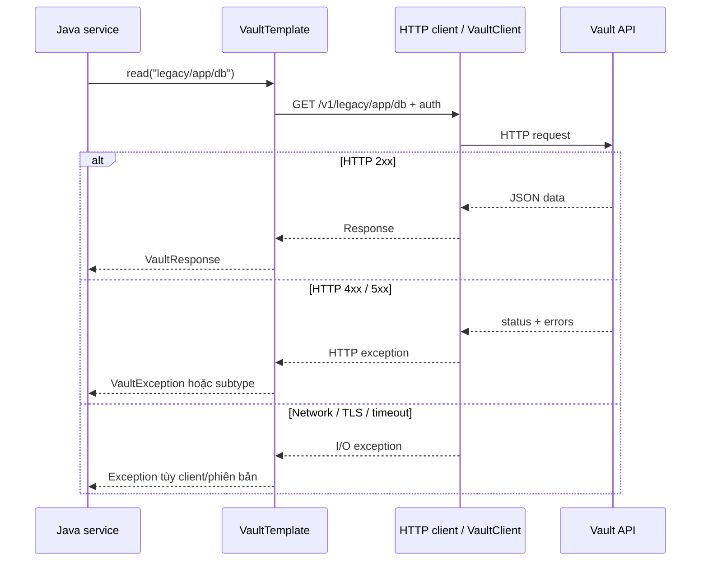
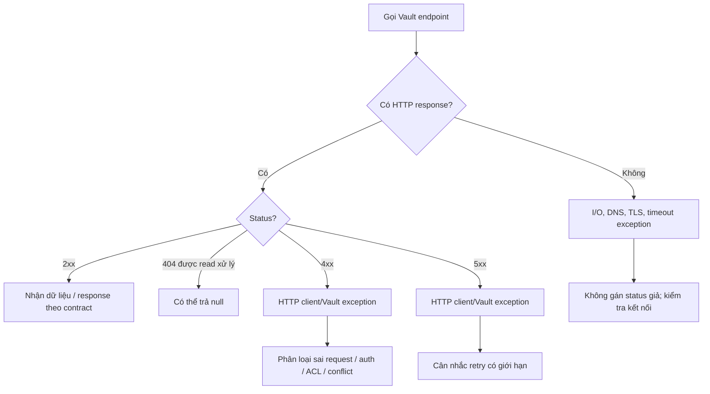

# Ánh xạ lỗi HTTP thành ngoại lệ của thư viện trong Spring Vault

Khi một ứng dụng Java gọi `VaultTemplate.read()`, `write()`, `delete()` hoặc những nhóm `opsFor...`, HashiCorp Vault có thể từ chối yêu cầu vì dữ liệu không hợp lệ, thiếu quyền, token hết hạn, sai API path hoặc dịch vụ không khả dụng. Ở phía Java, phần lớn các tình huống này không được trả về như một `VaultResponse` có trường `success=false`, mà **được tầng HTTP client và Spring Vault chuyển thành ngoại lệ (exception)**.

Biết được **lỗi HTTP nào đi vào exception nào, và khi nào không có exception**, giúp viết service an toàn: không biến HTTP 403 thành “không tìm thấy secret”, không retry mãi một yêu cầu sai schema, không log response chứa thông tin bí mật và không che mất nguyên nhân khi Vault gặp sự cố.

Bài thuộc chương **VaultTemplate** của module **SPRING_VAULT**. Toàn module tìm hiểu Java truy cập HashiCorp Vault thông qua `VaultTemplate`, xác thực theo workload, policy phân quyền, KV secrets, token/lease lifecycle, Transit encryption, PKI, xử lý lỗi, giám sát và kiểm thử tích hợp. Bài này tập trung vào **cơ chế ánh xạ HTTP error sang exception**, đồng thời nêu rõ khác biệt đáng lưu ý giữa các thế hệ Spring Vault.

## Mục tiêu học tập

Sau bài này, bạn có thể:

1. Giải thích chuỗi **HTTP response → Spring HTTP client → exception của Spring Vault → lỗi nghiệp vụ**.
2. Nhận biết `VaultException`, `VaultClientResponseException` và các exception HTTP có thể nằm trong cause chain; hiểu yếu tố phiên bản thư viện.
3. Phân biệt HTTP 400/401/403/404/409/429/5xx với lỗi TLS, timeout, JSON mapping và phản hồi rỗng.
4. Thiết kế tầng adapter để phân loại lỗi nhưng vẫn giữ được ngữ nghĩa **not found**, **permission denied**, **invalid request** và **unavailable**.
5. Kiểm thử thực tế với policy Vault, đồng thời không để rò rỉ secret trong exception hoặc logging.

## 1. Luồng xử lý từ Vault HTTP đến Java exception

Khi có yêu cầu như:

```java
VaultResponse response = vaultTemplate.read("legacy/app/db");
```

thì Spring Vault sử dụng HTTP client đã cấu hình để gọi Vault API tương ứng. Nếu server trả kết quả thành công, response được chuyển thành object Java. Nếu server trả lỗi, client và tầng Vault có thể chuyển lỗi thành một exception.



Ví dụ response lỗi của Vault có thể là:

```http
HTTP/1.1 403 Forbidden
Content-Type: application/json

{
  "errors": ["permission denied"]
}
```

JSON `errors` trên **không phải cấu trúc `data` thông thường của secret**. Ứng dụng không nên chờ `response.getData()` trả `{"errors": ...}` để tự kiểm tra lỗi 403; đó là công việc của tầng xử lý status/exception.

Một số thao tác `read()` có xử lý đặc biệt đối với 404 (trả `null` thay vì ném exception). Vì vậy **không thể khẳng định mọi HTTP status khác 2xx đều luôn tạo cùng một kiểu exception**. Cần xem contract của method cụ thể và phiên bản Spring Vault.

## 2. Phân biệt các lớp exception và phiên bản thư viện

### `VaultException`: loại exception chung của Spring Vault

Spring Vault định nghĩa `org.springframework.vault.VaultException`, một runtime exception đặc thù cho các lỗi khi làm việc với Vault. Đây là tầng abstraction ở trên lỗi HTTP thô.

Ví dụ:

```java
import org.springframework.vault.VaultException;

try {
    vaultTemplate.write("secret/data/app/db", requestBody);
} catch (VaultException ex) {
    // Lỗi liên quan tương tác Vault.
    // Phân loại trước khi quyết định retry hoặc thông báo nghiệp vụ.
    throw ex;
}
```

**Không mặc định mọi `VaultException` là HTTP 403.** Lỗi có thể liên quan xác thực, response từ server, client hoặc nhiều trạng thái khác; thông tin cụ thể phụ thuộc subtype và cause.

### Spring Vault 3.x: `VaultResponses.buildException(...)`

Ở các phiên bản Spring Vault dùng `RestTemplate`, Spring HTTP có thể tạo các exception như `HttpClientErrorException` (4xx), `HttpServerErrorException` (5xx) và lớp cha `HttpStatusCodeException`. Spring Vault cung cấp utility `org.springframework.vault.client.VaultResponses` có phương thức `buildException(HttpStatusCodeException)` và những overload khác để chuyển lỗi HTTP thành `VaultException`.

```text
RestTemplate
   → HttpStatusCodeException
   → VaultResponses.buildException(...)
   → VaultException
   → Java service
```

Đây là **mô hình xử lý của những phiên bản/nhánh code phù hợp**, không phải lời hứa rằng mọi `VaultTemplate` ở mọi bản đều tạo cause chain giống hệt. Ứng dụng thông thường **không cần gọi `VaultResponses.buildException()` thủ công** sau mỗi lần `VaultTemplate.read/write()`; bản thân thư viện phụ trách dịch lỗi tại ranh giới client.

### Spring Vault 4.1+: `VaultClientResponseException`

Trong API Spring Vault 4.1+, `VaultClient` và `ReactiveVaultClient` có lớp `org.springframework.vault.client.VaultClientResponseException` kế thừa `VaultException`. Với lỗi phản hồi HTTP, lớp này cung cấp các method như:

- `getStatusCode()`: lấy `HttpStatusCode` của response.
- `getResponseHeaders()`: lấy headers nếu có.
- `getResponseBodyAsString()` hoặc `getResponseBodyAsByteArray()`: truy cập body lỗi.
- `getResponseBodyAs(Class<T>)`: thử giải mã body thành kiểu Java cụ thể.

```java
import org.springframework.vault.client.VaultClientResponseException;

try {
    vaultTemplate.write("secret/data/app/db", requestBody);
} catch (VaultClientResponseException ex) {
    int httpStatus = ex.getStatusCode().value();
    // Chỉ sử dụng status để phân loại,
    // không đưa raw response body vào log/API.
}
```

Theo API tham khảo, mặc định khi `VaultClient` nhận HTTP 4xx/5xx, exception có thể bao bọc `HttpClientErrorException`/`HttpServerErrorException` ở phần cause. `VaultTemplate` cũng chuyển lỗi HTTP thành exception thuộc hệ Spring Vault; tuy nhiên một lỗi I/O hoặc lỗi giải mã không nên bị suy diễn là HTTP response có status hợp lệ.

| Nhóm | API/kiểu nên biết | Lưu ý |
|---|---|---|
| Lỗi tổng quát Vault | `VaultException` | Không trực tiếp bảo đảm có HTTP status |
| Lỗi response trong Spring Vault 4.1+ | `VaultClientResponseException` | Có API xem status/headers/body; chỉ dựa vào status khi thực sự có HTTP response |
| Lỗi status từ Spring HTTP | `HttpStatusCodeException` và các subtype | Có thể là cause được bọc hoặc xuất hiện khi gọi client thấp hơn |
| Lỗi I/O, kết nối, timeout | `ResourceAccessException` hoặc exception client/Vault bọc cause | Không mặc nhiên có HTTP status |
| Lỗi xác thực/session | Exception thuộc cơ chế authentication/session | Không nhất thiết là cùng loại với lỗi path KV |

> **Quan trọng về tương thích:** Ví dụ dùng `VaultClientResponseException` yêu cầu dependency Spring Vault có lớp này (4.1+). Nếu ứng dụng chạy 3.x hoặc dòng trước 4.1, dùng `VaultException` cùng cơ chế cause/status được phiên bản thực tế hỗ trợ; không nhập class 4.1+ vào source thuộc 3.x.

## 3. Bảng chuyển HTTP status thành quyết định nghiệp vụ

Một HTTP status là tín hiệu ban đầu, **chưa tự giải thích mọi nguyên nhân**. Ví dụ 403 có thể do policy thiếu quyền, token hết hạn, hoặc điều kiện authorization khác. 404 có thể do key không tồn tại, mount/path sai hoặc endpoint không hiện diện.

| HTTP status | Tình huống thường gặp | Nhóm lỗi ứng dụng đề xuất | Có retry nguyên trạng? |
|---|---|---|---|
| `400 Bad Request` | Thiếu `data` KV v2, sai request JSON, CAS mismatch | `INVALID_REQUEST` hoặc `CONFLICT` khi đã xác nhận CAS | Không; sửa payload/version |
| `401 Unauthorized` | Danh tính/token không được chấp nhận (tùy endpoint) | `AUTHENTICATION_FAILED` | Không retry cùng token vô hạn |
| `403 Forbidden` | ACL policy không cho phép; có thể liên quan token | `ACCESS_DENIED` | Không retry nguyên trạng khi chưa sửa auth/policy |
| `404 Not Found` | Key, endpoint hoặc mount không tồn tại | `NOT_FOUND` **nếu đúng contract** | Không mặc định retry; kiểm tra path |
| `405 Method Not Allowed` | Dùng `write()` POST vào endpoint chỉ nhận PATCH/GET | `METHOD_NOT_ALLOWED` | Không; sửa HTTP method |
| `409 Conflict` | Tranh chấp theo contract endpoint (nếu engine dùng mã này) | `CONFLICT` | Giải quyết điều kiện tranh chấp trước |
| `429 Too Many Requests` | Bị hạn chế tần suất hoặc quá tải | `RATE_LIMITED` | Có thể backoff theo hướng dẫn và giới hạn |
| `500/502/503/504` | Vault server/gateway tạm lỗi | `VAULT_UNAVAILABLE` | Cân nhắc backoff theo loại thao tác |
| Status khác | Engine/plugin có contract riêng | `UNEXPECTED_HTTP_STATUS` | Phải hiểu endpoint trước |

Không viết quy tắc “400 luôn là request lỗi cú pháp” cho mọi engine. Trong KV v2, **CAS mismatch** có thể được biểu hiện bằng HTTP 400 và yêu cầu ứng dụng đọc lại version, xử lý xung đột. Với các endpoint Transit/PKI, validation failure cũng có thể là 400 nhưng hướng sửa khác nhau.

### 401 và 403 không luôn đủ để chẩn đoán token

Một workload có thể sử dụng Kubernetes Auth hoặc AppRole để lấy token rồi thực hiện thao tác KV. Khi nhận 403, nguyên nhân có thể là:

1. Identity có token nhưng thiếu capability `read` trên path cần đọc.
2. Token đã không còn hiệu lực và Vault từ chối quyền.
3. Yêu cầu đi vào namespace/mount không mong đợi.
4. Policy path khác API path thật, ví dụ khai báo `secret/app/db` thay vì `secret/data/app/db` cho KV v2.

Hãy kiểm tra loại identity, endpoint và policy gắn với workload. Không khắc phục bằng cách cấp `sudo` hoặc `path "*"` cho production token.

## 4. Ngoại lệ quan trọng: đọc key không tồn tại có thể trả `null`

Giả sử key logic `app/db` không tồn tại ở mount KV v1 `legacy`:

```java
VaultResponse response = vaultTemplate.read("legacy/app/db");

if (response == null) {
    // Không tìm thấy tài nguyên theo ngữ nghĩa của method đọc.
}
```

Một số overload/method của `VaultTemplate.read()` cố ý **chấp nhận HTTP 404 như trạng thái không tìm thấy và trả `null`**, thay vì ném `VaultException`. Với `VaultClient` mức thấp, mặc định HTTP 404 có thể vẫn sinh `VaultClientResponseException` nếu không cấu hình xử lý status khác. Hai API không nhất thiết thống nhất hành vi 404.

Điều đó dẫn tới ba quy tắc:

- **`null` không phải exception.** Hãy kiểm tra giá trị trả về trước khi gọi `getData()`.
- **404 không luôn là key chưa tồn tại.** Sai mount/endpoint cũng có thể cho 404. Chỉ diễn giải thành `NOT_FOUND` khi path và contract đã được xác nhận.
- **Dữ liệu rỗng không phải “not found”.** Một `VaultResponse` tồn tại nhưng thiếu `data` hoặc field bắt buộc là lỗi cấu trúc/schema theo nghiệp vụ, không được tự chuyển thành “không có secret”.

Đặc biệt, KV v2 dùng path `secret/data/app/db` để đọc nội dung nhưng metadata key nằm ở `secret/metadata/app/db`. Nếu latest version bị xóa mềm, dữ liệu có thể không còn đọc được dù metadata và phiên bản cũ vẫn tồn tại. Không suy ra “đã xóa vĩnh viễn” từ một lần đọc trả `null`.

## 5. Code Java: ánh xạ lỗi thành exception nghiệp vụ (Spring Vault 4.1+)

Ví dụ dưới đây sử dụng Java 17+, API `VaultClientResponseException` của Spring Vault 4.1+, và một mount **KV v1** tên `legacy` để giữ phần xử lý dữ liệu đơn giản. Bean `VaultTemplate` đã được cấu hình endpoint HTTPS, TLS và workload authentication. Code cố ý tách **thiếu secret**, **secret sai schema**, **lỗi HTTP** và **lỗi Vault khác**.

```java
import java.util.Map;

import org.springframework.stereotype.Service;
import org.springframework.vault.VaultException;
import org.springframework.vault.client.VaultClientResponseException;
import org.springframework.vault.core.VaultTemplate;
import org.springframework.vault.support.VaultResponse;

@Service
public class DatabaseSecretGateway {

    private final VaultTemplate vaultTemplate;

    public DatabaseSecretGateway(VaultTemplate vaultTemplate) {
        this.vaultTemplate = vaultTemplate;
    }

    public DbCredentials loadRequiredCredentials() {
        try {
            VaultResponse response =
                    vaultTemplate.read("legacy/app/db");

            if (response == null) {
                throw new VaultDomainException(
                        FailureKind.NOT_FOUND,
                        "Database secret không tồn tại");
            }

            Map<String, Object> data = response.getData();
            if (data == null) {
                throw new VaultDomainException(
                        FailureKind.INVALID_SECRET,
                        "Database secret thiếu data");
            }

            String username = requiredString(data, "username");
            String password = requiredString(data, "password");
            return new DbCredentials(username, password);

        } catch (VaultClientResponseException ex) {
            // Lỗi HTTP khi endpoint trả status 4xx/5xx.
            throw fromHttpStatus(ex.getStatusCode().value());

        } catch (VaultException ex) {
            // Không giả định mọi VaultException đều có HTTP status.
            throw new VaultDomainException(
                    FailureKind.VAULT_CLIENT_FAILURE,
                    "Không thể hoàn tất yêu cầu tới Vault");
        }
    }

    private static String requiredString(
            Map<String, Object> data, String field) {

        Object value = data.get(field);
        if (!(value instanceof String text) || text.isBlank()) {
            throw new VaultDomainException(
                    FailureKind.INVALID_SECRET,
                    "Database secret có trường không hợp lệ: " + field);
        }
        return text;
    }

    private static VaultDomainException fromHttpStatus(int status) {
        FailureKind kind = switch (status) {
            case 400, 422 -> FailureKind.INVALID_REQUEST;
            case 401 -> FailureKind.AUTHENTICATION_FAILED;
            case 403 -> FailureKind.ACCESS_DENIED;
            case 404 -> FailureKind.NOT_FOUND;
            case 405 -> FailureKind.METHOD_NOT_ALLOWED;
            case 409 -> FailureKind.CONFLICT;
            case 429 -> FailureKind.RATE_LIMITED;
            case 500, 502, 503, 504 -> FailureKind.VAULT_UNAVAILABLE;
            default -> FailureKind.UNEXPECTED_HTTP_STATUS;
        };

        // Chỉ dùng mã trạng thái; tránh nhúng raw body vào message.
        return new VaultDomainException(
                kind, "Vault HTTP request thất bại (status=" + status + ")");
    }

    public enum FailureKind {
        NOT_FOUND,
        INVALID_SECRET,
        INVALID_REQUEST,
        AUTHENTICATION_FAILED,
        ACCESS_DENIED,
        METHOD_NOT_ALLOWED,
        CONFLICT,
        RATE_LIMITED,
        VAULT_UNAVAILABLE,
        UNEXPECTED_HTTP_STATUS,
        VAULT_CLIENT_FAILURE
    }

    public static final class VaultDomainException
            extends RuntimeException {

        private final FailureKind kind;

        public VaultDomainException(
                FailureKind kind, String safeMessage) {
            super(safeMessage);
            this.kind = kind;
        }

        public FailureKind kind() {
            return kind;
        }
    }

    public record DbCredentials(
            String username, String password) {

        @Override
        public String toString() {
            return "DbCredentials[REDACTED]";
        }
    }
}
```

**Hạn chế có chủ đích của ví dụ:** Khi bắt `VaultException` nhưng không có HTTP status, code trả `VAULT_CLIENT_FAILURE` chứ **không tự phán đoán là Vault đang 503**. Tầng production có thể mở rộng phân loại theo nguyên nhân đã xác minh (I/O, authentication session, JSON conversion), nhưng không được dựa vào cách dò chuỗi trong `ex.getMessage()` để đoán mã status.

**Không log nguyên văn `ex` hay `response` trong ví dụ.** Thông điệp từ exception thô có thể chứa path, chi tiết server hoặc body lỗi. Một hệ thống vận hành tốt nên có log nội bộ được khử dữ liệu nhạy cảm, correlation ID phù hợp và policy lưu giữ riêng; mã lỗi nghiệp vụ trả ra ngoài không nên chứa token, password hoặc raw Vault error JSON.

### Vì sao exception của ứng dụng không kế thừa trực tiếp `VaultException`?

Tầng nghiệp vụ thường muốn một **contract ổn định** như `ACCESS_DENIED`, `NOT_FOUND`, `VAULT_UNAVAILABLE`, không phụ thuộc mọi thay đổi exception giữa Spring Vault 3.x và 4.1+. Việc chuyển đổi ở ranh giới adapter giúp:

- REST controller hoặc service khác xử lý cùng một enum lỗi nhất quán.
- Không để chi tiết thư viện và HTTP body nhạy cảm lọt vào API bên ngoài.
- Dễ xác định nhóm lỗi nào được retry, nhóm nào cần can thiệp cấu hình.
- Giữ được tính chính xác khi thay Spring Vault dependency.

Tuy nhiên, không biến mọi exception thành `NOT_FOUND` hoặc `null`. Exception nghiệp vụ phải giữ được ý nghĩa thực tế; nhóm không xác định cần được ghi nhận riêng trong giám sát.

## 6. Tương thích Spring Vault 3.x và cách lấy status từ cause

Nếu dependency chưa có `VaultClientResponseException`, **không sao chép nguyên đoạn code 4.1+**. Ở những phiên bản dùng `RestTemplate`, có thể bắt `VaultException` và khảo sát cause chain **nếu** Spring HTTP exception thực sự được giữ làm nguyên nhân.

Ví dụ mang tính kỹ thuật cho **Spring Framework 6+**:

```java
import org.springframework.vault.VaultException;
import org.springframework.web.client.HttpStatusCodeException;

public static Integer findHttpStatus(VaultException error) {
    Throwable current = error;

    // Giới hạn số cấp để tránh duyệt cause chain không kiểm soát.
    for (int depth = 0; current != null && depth < 16; depth++) {
        if (current instanceof HttpStatusCodeException http) {
            return http.getStatusCode().value();
        }
        Throwable next = current.getCause();
        if (next == current) {
            break;
        }
        current = next;
    }
    return null; // Chưa xác định được HTTP status.
}
```

Trong một số dòng Spring Framework cũ, API đọc status có khác biệt (ví dụ từng có `getRawStatusCode()`). **Điều quan trọng là kiểm thử phiên bản thực tế** và chỉ phân loại khi có bằng chứng status. Trường hợp cause đã bị thay thế, hoặc exception không phát sinh từ HTTP response, `findHttpStatus(...)` có thể trả `null`; không nên dựng status giả.

`VaultResponses.buildException(...)` là utility của thư viện, thường đã được `VaultTemplate` sử dụng trong luồng request tương ứng. Đừng bắt một `VaultException` rồi **gọi `buildException()` thêm lần nữa** nếu không có đối tượng `HttpStatusCodeException` phù hợp; điều đó không làm thông tin lỗi tự đầy đủ hơn.

### API client thô không nhất thiết giống `VaultTemplate`

Nếu lập trình viên gọi `RestClient` hoặc `RestTemplate` trực tiếp, lỗi 4xx/5xx thường được biểu diễn theo các lớp HTTP của Spring, chẳng hạn `HttpClientErrorException` hoặc `HttpServerErrorException`. Nếu gọi `VaultClient`, lớp ngoại lệ được đưa về hệ Spring Vault. Nếu gọi `VaultTemplate`, tầng abstraction có thể thêm xử lý đặc biệt cho endpoint và 404.

Vì vậy, khi viết test, cần xác định **điểm gọi nào đang được test**:

- Test `VaultTemplate.read()` với key thiếu không nhất thiết mong exception.
- Test một `VaultClient` GET mức thấp có thể mong `VaultClientResponseException` cho 404.
- Test client HTTP thuần có thể mong `HttpClientErrorException.NotFound`.
- Nếu đã có handler `onStatus(...)` tùy chỉnh, ánh xạ lỗi có thể khác mặc định.

## 7. Lỗi HTTP và lỗi transport là hai nhóm khác nhau

Một lỗi HTTP có nghĩa **có phản hồi HTTP** để đánh giá status. Nhưng khi DNS lỗi, TCP không kết nối, TLS handshake thất bại hoặc timeout trước khi đọc response, có thể **không tồn tại status code**.



Trong code production:

1. Đặt connect timeout/read timeout phù hợp với workload.
2. Phân biệt lỗi có response status với lỗi không có response.
3. Không dựa vào `message.contains("403")` hoặc `message.contains("timeout")` để xác định class lỗi.
4. Hạn chế retry và log đã khử dữ liệu nhạy cảm.
5. Nếu lỗi xảy ra sau request có tác dụng phụ (`write()` KV v2, Transit/PKI, cấp dynamic credentials), **timeout không chứng minh thao tác chưa được xử lý**; cần cơ chế CAS, đối soát hoặc idempotency theo contract endpoint.

Một lời gọi GET đọc key tĩnh thường dễ retry hơn POST cấp credential mới hoặc PKI issue. Không dùng một retry policy cho mọi method.

## 8. Phân quyền, workload authentication và status 403

Giả sử `legacy` là mount KV v1, `secret` là KV v2. Policy HCL đọc đúng một secret:

```hcl
# KV v1
path "legacy/app/db" {
  capabilities = ["read"]
}

# KV v2
path "secret/data/app/db" {
  capabilities = ["read"]
}
```

Token của workload có quyền `read` **không mặc nhiên có** quyền `write`, `delete` hoặc `list`. Khi phương thức Java đổi từ `read()` sang `write()`, policy cần phản ánh đúng capability của endpoint.

| Yêu cầu Java | API path thực tế | Capability tương ứng |
|---|---|---|
| `read("legacy/app/db")` | `legacy/app/db` | `read` |
| `read("secret/data/app/db")` | `secret/data/app/db` | `read` |
| `write("secret/data/app/db", body)` | `secret/data/app/db` | `create` hoặc `update` theo trạng thái/engine |
| `list("secret/metadata/app")` | `secret/metadata/app` | `list` |
| `delete("secret/data/app/db")` | `secret/data/app/db` | `delete` |

Nếu dùng Kubernetes Auth hoặc AppRole, session manager có thể quản lý token theo cấu hình. **Authentication failure** có thể xảy ra trước khi gửi request tới path KV (ví dụ login endpoint thất bại), hoặc tại request KV do token không còn hợp lệ. Hai nơi này có log/audit và exception có thể khác nhau. Khi phân loại 401/403, kiểm tra cả giai đoạn login, token lifecycle và policy path.

Không tự gắn token thật vào exception, HTTP response gửi cho client hoặc nhãn metric. Token TTL khác với lease TTL của dynamic secret; lỗi đọc KV không được chẩn đoán bằng `lease_duration` của secret.

## 9. Retry, fallback và xử lý sự cố theo loại lỗi

Một sơ đồ quyết định thực tế:

| Loại lỗi đã xác minh | Retry tự động? | Hành động ưu tiên |
|---|---|---|
| Sai JSON/path, HTTP 400/405 | Không | Sửa contract/request |
| CAS mismatch | Không retry cùng version | Đọc lại current version, xử lý tranh chấp |
| 401/403 | Không retry token y nguyên vô hạn | Sửa login/token/policy |
| 404 trên key tùy chọn | Không cần retry ngay | Trả `Optional.empty()` theo contract |
| 404 trên key bắt buộc | Không im lặng | Báo thiếu cấu hình, chặn khởi động nếu cần |
| 429 | Có điều kiện | Backoff có giới hạn, tôn trọng hướng dẫn server nếu có |
| 5xx | Có điều kiện | Retry/breaker với ngưỡng giới hạn; xem idempotency |
| Mất mạng/TLS/timeout | Có điều kiện | Kiểm tra kết nối, TLS và trạng thái hậu tác vụ |
| Secret tồn tại nhưng field bắt buộc thiếu | Không | Sửa secret/schema; fail closed |
| JSON mapping exception | Không retry mù | Kiểm tra DTO/converter và payload contract |

**Fallback chỉ hợp lý khi được thiết kế trước.** Ví dụ một feature không bắt buộc có thể tạm tắt nếu secret tùy chọn không tồn tại, nhưng không nên dùng username/password mặc định vì một exception 403 đã bị bắt và chuyển thành `null`. Với cấu hình database quan trọng, hành vi an toàn thường là **báo lỗi rõ ràng hoặc dừng khởi động** khi không lấy được credential hợp lệ.

Một chiến lược vận hành hợp lý có thể gồm:

- Timeout cho lời gọi Vault, hạn mức retry và exponential backoff.
- Circuit breaker hoặc giới hạn số request đồng thời khi Vault gặp lỗi.
- Chỉ refresh token theo cơ chế session manager và cấu hình auth, không tự login lại vô hạn khi nhận 403.
- Giám sát số lượng lỗi theo **loại** (`access_denied`, `bad_request`, `unavailable`, `not_found`).
- Tách client-facing error khỏi dữ liệu chẩn đoán nội bộ; cảnh báo khi lỗi 403/5xx tăng đột biến.

## 10. Kiểm thử các ánh xạ lỗi

Sử dụng Vault thử nghiệm/container cô lập, không dùng secret thật. Chuẩn bị mount test `legacy` KV v1 và hai identity khác nhau: một identity có quyền `read` và một identity không có quyền đọc key.

```bash
# Chỉ thực hiện trên Vault thử nghiệm; bỏ nếu mount đã có.
vault secrets enable -path=legacy -version=1 kv

# Dữ liệu giả, không phải credential production.
vault kv put -mount=legacy app/db \
  username=demo_user password=demo-only

# Kiểm tra bằng token test được cấp quyền.
vault kv get -mount=legacy app/db
```

Không đưa token vào dòng lệnh hiển thị trong log hoặc history. Việc cấu hình identity/policy và kiểm thử denied nên dùng quy trình riêng trong Vault test; không cấp quyền quản trị cho workload chỉ để đơn giản hóa test.

### Ma trận kiểm thử khuyến nghị

| Kịch bản | Kỳ vọng |
|---|---|
| `read("legacy/app/db")` với quyền đúng | Trả dữ liệu; schema hợp lệ |
| Key không tồn tại trên path đúng | `read()` có thể trả `null`; adapter phân loại `NOT_FOUND` |
| Có response nhưng thiếu `password` | `INVALID_SECRET`, không phải `NOT_FOUND` |
| Token thiếu `read` trên path | HTTP 403 hoặc exception quyền tương ứng, không chuyển thành `null` |
| Token hết hạn hoặc login thất bại | Phân biệt lỗi auth/session và lỗi policy path |
| Sai KV v2 API path | Có thể 400/404; không cho rằng mọi 404 là secret thiếu |
| POST KV v2 thiếu body `data` | HTTP 400; nhóm invalid request |
| Ghi KV v2 với CAS cũ | Nhận lỗi điều kiện ghi, không retry nguyên trạng |
| Lỗi HTTP 5xx giả lập | Adapter gán `VAULT_UNAVAILABLE` khi có status thật |
| Mất mạng/timeout giả lập | Không gán status giả, không nuốt exception |
| Client phiên bản 3.x/4.1+ | Test đúng loại exception/cause chain theo phiên bản đang dùng |
| Log và metric | Không có token, password, raw error JSON hoặc body bí mật |

**Unit test** có thể kiểm tra `fromHttpStatus(403)` trả `ACCESS_DENIED`, `fromHttpStatus(503)` trả `VAULT_UNAVAILABLE` và logic schema cho response `null`/data rỗng. Tuy nhiên unit test không thể chứng minh HTTP client thực sự chuyển 403 thành `VaultClientResponseException`. **Integration test** cần Vault test thực và dependency Spring Vault đúng phiên bản để kiểm tra mapping, auth/session, ACL, 404 và lỗi transport.

Đối với HTTP error body chứa `errors`, chỉ kiểm tra thông tin ở môi trường test có kiểm soát; không đẩy raw body vào log sản xuất để debug. Nếu đã tùy biến `onStatus` hoặc error handler, thêm test cho mapping đã tùy biến để tránh lệ thuộc hành vi mặc định.

## 11. Sai lầm phổ biến

**“Lỗi 403 sẽ trả `VaultResponse` có `data.errors`.”** Thông thường Spring HTTP/Vault client chuyển lỗi 4xx/5xx thành exception. Không chờ dữ liệu trong `VaultResponse` để xử lý lỗi quyền.

**“Mọi 404 đều tạo exception.”** Một số phương thức `VaultTemplate.read()` xử lý 404 thành `null`. Hành vi của `VaultClient`/HTTP client khác có thể không giống; phải kiểm tra method cụ thể.

**“Mọi `VaultException` đều có status 503 hoặc 403.”** Không. Ngoài lỗi HTTP còn có lỗi session, mapping, I/O hoặc những tình huống không có HTTP response.

**“Có thể bắt `VaultClientResponseException` trong mọi Spring Vault.”** Lớp này được giới thiệu ở 4.1; với phiên bản cũ, cần adapter tương thích thay vì import không tồn tại.

**“Trên cùng một endpoint, 400 luôn có cùng nguyên nhân.”** KV v2 CAS mismatch, sai JSON và các điều kiện validation khác có thể cùng xuất hiện dưới 400. Muốn xử lý cụ thể cần hiểu contract, không suy đoán chỉ từ status.

**“Retry bất kỳ exception nào là an toàn.”** Nếu server đã thực hiện POST/DELETE trước timeout, retry có thể gây tác dụng phụ mới. Phải cân nhắc CAS, lease, certificate issuance và idempotency.

**“Chỉ cần log `ex.getMessage()` để có đủ thông tin.”** Thông điệp hoặc response body có thể chứa thông tin nội bộ. Tách mã lỗi vận hành an toàn khỏi chi tiết nhạy cảm.

**“HTTP 403 nghĩa là nên cấp `sudo`.”** Không. Sửa đúng policy path, capability, workload identity và namespace. Ưu tiên đặc quyền tối thiểu.

## Câu hỏi tự kiểm tra

1. `VaultException` và `VaultClientResponseException` khác nhau thế nào, và vì sao phải quan tâm phiên bản Spring Vault?
2. Khi nào một lời gọi `VaultTemplate.read()` có thể trả `null` thay vì ném exception cho 404?
3. Vì sao không được coi 403 là “key không tồn tại” hoặc tự động sử dụng credential mặc định?
4. Có thể gán status HTTP cho một timeout/TLS handshake failure không? Vì sao?
5. Nếu `write()` KV v2 nhận HTTP 400 do CAS mismatch, retry cùng version có giải quyết vấn đề không?
6. Sự khác biệt giữa `VaultTemplate`, `VaultClient` và `RestClient` trong chuyển lỗi HTTP là gì?
7. Tầng adapter nên phân loại những nhóm lỗi nào trước khi quyết định retry, fallback hoặc trả lỗi ra ngoài?
8. Kiểm thử nào chứng minh ACL và exception mapping hoạt động thật, thay vì chỉ chứng minh mock đã được cấu hình?

**Gợi ý đối chiếu:** HTTP 4xx/5xx thường được HTTP client và Spring Vault chuyển thành exception, với `VaultException` là loại chung; Spring Vault 4.1+ có `VaultClientResponseException` hỗ trợ xem HTTP status. Một số `read()` xử lý 404 thành `null`. Lỗi mạng/TLS không nhất thiết có status. Hãy phân loại theo method và contract của endpoint, bảo vệ log, xử lý token/policy riêng và kiểm thử bằng Vault thực tế để xây dựng ứng dụng Java ổn định.

## Tài liệu tham khảo

- [Spring Vault Reference — Vault Client Access](https://docs.spring.io/spring-vault/reference/vault/vault-client.html): các lớp `RestClient`, `VaultClient`, `VaultTemplate` và cơ chế xử lý lỗi.
- [Spring Vault API — VaultClientResponseException](https://docs.spring.io/spring-vault/reference/api/java/org/springframework/vault/client/VaultClientResponseException.html): phân cấp exception và API lấy HTTP status (4.1+).
- [Spring Vault API — VaultResponses](https://docs.spring.io/spring-vault/docs/current/api/org/springframework/vault/client/VaultResponses.html): utility tạo `VaultException` từ `HttpStatusCodeException` ở các phiên bản dùng cơ chế này.

Khi triển khai, hãy chọn tài liệu API khớp **chính xác phiên bản Spring Vault, Spring Framework và Vault server đang chạy**; không lấy chữ ký hoặc hành vi của 4.1 áp dụng nguyên xi cho dự án 3.x.
