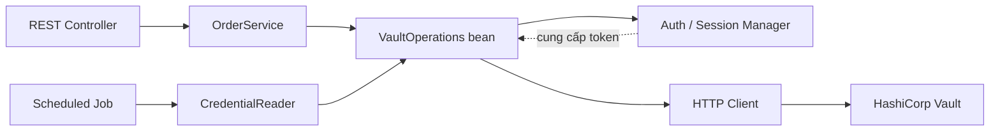

# Tái sử dụng VaultTemplate và giữ cấu hình ổn định

`VaultTemplate` là điểm vào chính của Spring Vault khi ứng dụng Java cần đọc/ghi secret, gọi Transit hoặc sử dụng các API khác của HashiCorp Vault. Trong một ứng dụng chạy lâu dài, cách dùng phổ biến là cấu hình một `VaultTemplate` (hoặc giao diện `VaultOperations`) dưới dạng Spring bean và tiêm vào các service cần truy cập Vault. Các request dùng lại client đã cấu hình, còn việc xác thực và quản lý phiên do các thành phần tương ứng đảm nhiệm.

Bài này tập trung vào **tái sử dụng đúng vòng đời của template** và **giữ endpoint, phương thức xác thực, TLS, KV mount và đường dẫn secret nhất quán** giữa các lần gọi. Đây là nền tảng để tránh tạo nhiều client dư thừa, khó kiểm soát token và lỗi cấu hình theo môi trường.

## 1. Cần tái sử dụng những gì?

Hãy phân biệt ba lớp trách nhiệm:

| Thành phần | Trách nhiệm | Cách quản lý hợp lý |
| --- | --- | --- |
| `VaultTemplate` / `VaultOperations` | Cung cấp các thao tác trên Vault, điều phối HTTP và xác thực thông qua các thành phần được cấu hình | Dùng chung theo vòng đời Spring application context |
| `ClientAuthentication` / `VaultSessionManager` | Xác thực workload, cấp token để gọi Vault; tùy cấu hình có thể hỗ trợ gia hạn hoặc xác thực lại | Tạo cùng cấu hình ứng dụng, để cơ chế quản lý phiên phụ trách vòng đời token |
| `VaultKeyValueOperations` | Giao diện thao tác KV theo mount và phiên bản engine đã chọn | Có thể giữ như một dependency của service khi mount và phiên bản cố định |

Ví dụ, một service đọc secret trong nhiều HTTP request không cần khởi tạo `new VaultTemplate(...)` ở mỗi lần xử lý. Việc tạo template mới liên tục có thể nhân bản cấu hình HTTP, phiên và xác thực, làm truy vết lỗi khó hơn. **Tái sử dụng template không có nghĩa là cache nội dung secret**: một lần gọi `get(...)` vẫn cần được xem là thao tác truy cập Vault, trừ khi ứng dụng chủ động thiết kế tầng cache riêng.

`VaultTemplate` thường được sử dụng như một bean singleton cho các tác vụ đồng thời. Điều kiện là các thành phần HTTP, xác thực và session manager đi cùng phải được cấu hình đúng; không thay đổi các đối tượng cấu hình dùng chung khi các request đang chạy. Không lưu token hiện tại hay dữ liệu secret vào trường mutable của service chỉ để “tăng tốc”.

## 2. Dòng chảy khi nhiều service dùng chung template



Mỗi thành phần nghiệp vụ phụ thuộc vào `VaultOperations`, thay vì tự dựng endpoint và token. Khi cần thay đổi Vault URI, CA tin cậy hoặc cơ chế xác thực cho một môi trường, ta điều chỉnh cấu hình khởi tạo và triển khai lại ứng dụng theo quy trình kiểm soát thay đổi. Mã nghiệp vụ không cần biết token được cấp từ Kubernetes, AppRole hay phương pháp khác.

Nếu các nhóm tác vụ thực sự cần **chính sách, namespace hoặc Vault cluster khác nhau**, hãy tạo các bean có tên rõ ràng và tiêm bằng `@Qualifier`. Không dùng một template rồi thay đổi endpoint, namespace hoặc token theo từng request để “đổi danh tính” của client dùng chung.

## 3. Cấu hình nhất quán từ một nơi

### 3.1. Ưu tiên bean được framework quản lý

Khi ứng dụng đã tích hợp **Spring Cloud Vault**, hãy tận dụng cấu hình và bean Vault mà framework cung cấp. Ví dụ dưới đây minh họa workload chạy trong Kubernetes; các biến môi trường phải được cấp tại thời điểm deploy:

```yaml
spring:
  cloud:
    vault:
      uri: ${VAULT_URI}
      authentication: KUBERNETES
      kubernetes:
        role: ${VAULT_K8S_ROLE}

app:
  vault:
    kv-mount: ${VAULT_KV_MOUNT:secret}
    config-path: ${VAULT_CONFIG_PATH:apps/order-service}
```

Đoạn `spring.cloud.vault` chỉ có hiệu lực khi ứng dụng dùng tích hợp Spring Cloud Vault tương ứng. Xác thực Kubernetes còn đòi hỏi Vault Kubernetes auth được cấu hình đúng, service account token của Pod có thể truy cập và policy được gắn với role. Thực tế cũng cần thiết lập TLS/truststore, HTTP timeout và cách khởi tạo cấu hình theo phiên bản thư viện đang dùng.

Nếu chỉ dùng **Spring Vault thuần**, có thể cấu hình một lớp mở rộng `AbstractVaultConfiguration`. Ví dụ tối giản sau dùng token từ môi trường để thực hành local, **không đại diện cho chiến lược cấp và gia hạn token production**:

```java
import java.net.URI;
import java.util.Objects;

import org.springframework.context.annotation.Configuration;
import org.springframework.vault.authentication.ClientAuthentication;
import org.springframework.vault.authentication.TokenAuthentication;
import org.springframework.vault.client.VaultEndpoint;
import org.springframework.vault.config.AbstractVaultConfiguration;

@Configuration
public class VaultClientConfiguration extends AbstractVaultConfiguration {

    @Override
    public VaultEndpoint vaultEndpoint() {
        return VaultEndpoint.from(URI.create(requiredEnv("VAULT_URI")));
    }

    @Override
    public ClientAuthentication clientAuthentication() {
        return new TokenAuthentication(requiredEnv("VAULT_TOKEN"));
    }

    private static String requiredEnv(String name) {
        String value = Objects.requireNonNull(
                System.getenv(name), name + " is missing");
        if (value.isBlank()) {
            throw new IllegalStateException(name + " is blank");
        }
        return value;
    }
}
```

Lớp cấu hình tạo các bean theo vòng đời Spring context; code nghiệp vụ chỉ cần tiêm `VaultOperations`. Trong workload thật, thay `TokenAuthentication` cố định bằng cơ chế xác thực thích hợp như Kubernetes/AppRole cùng `VaultSessionManager` được cấu hình để đáp ứng nhu cầu tái xác thực/gia hạn. Nếu framework đã tạo `VaultTemplate`, tránh đăng ký một bean trùng vai trò chỉ vì muốn “tái sử dụng” — hãy chọn một nguồn cấu hình chính.

### 3.2. Đóng gói thao tác KV trong một service

Giả sử KV secrets engine **v2** được mount ở `secret/`, và ứng dụng lưu cấu hình tại key `apps/order-service`. Một service có thể giữ giao diện KV theo mount cố định:

```java
import org.springframework.beans.factory.annotation.Value;
import org.springframework.stereotype.Service;
import org.springframework.vault.core.VaultKeyValueOperations;
import org.springframework.vault.core.VaultKeyValueOperationsSupport;
import org.springframework.vault.core.VaultOperations;
import org.springframework.vault.support.VaultResponse;

@Service
public final class OrderSecretReader {

    private final VaultKeyValueOperations kv;
    private final String secretPath;

    public OrderSecretReader(
            VaultOperations vault,
            @Value("${app.vault.kv-mount}") String mount,
            @Value("${app.vault.config-path}") String secretPath) {

        this.kv = vault.opsForKeyValue(
                mount,
                VaultKeyValueOperationsSupport.KeyValueBackend.KV_2);
        this.secretPath = secretPath;
    }

    public String readWebhookSigningKey() {
        VaultResponse response = kv.get(secretPath);

        if (response == null || response.getData() == null) {
            throw new IllegalStateException("Vault configuration is unavailable");
        }

        Object value = response.getData().get("webhookSigningKey");
        if (!(value instanceof String key) || key.isBlank()) {
            throw new IllegalStateException("Required Vault key is missing");
        }

        return key;
    }
}
```

Điểm đáng chú ý:

- `VaultOperations` được Spring tiêm vào constructor, không tạo trong `readWebhookSigningKey()`.
- `opsForKeyValue(mount, KV_2)` chọn **mount path** và kiểu KV v2 một lần cho service. `secretPath` là **đường dẫn logic bên trong mount**; không tự chèn `data/` vào đường dẫn khi dùng API KV v2 này.
- Mỗi lần gọi `kv.get(...)` đọc dữ liệu tương ứng từ Vault. Dữ liệu đọc được chỉ sử dụng trong phạm vi cần thiết; không ghi giá trị secret vào log, metric label hoặc thông báo lỗi.
- Ví dụ giả định key chứa chuỗi `webhookSigningKey`. Định dạng thực tế cần được xác nhận cùng schema secret của ứng dụng.

Với các ứng dụng có nhiều loại backend, có thể tạo các service chuyên biệt (`OrderSecretReader`, `TransitCryptoService`, `CertificateIssuer`) cùng chia sẻ `VaultOperations`. Mỗi service chỉ sở hữu thao tác nghiệp vụ và cấu hình path mà nó thực sự cần.

## 4. Cấu hình “ổn định” có nghĩa là gì?

Ổn định không có nghĩa là token hoặc secret không bao giờ thay đổi. Nó có nghĩa là **nguồn cấu hình và ranh giới trách nhiệm rõ ràng**, để một request không tự ý thay đổi danh tính client hay backend đang được dùng.

| Cấu hình | Nên đặt ở đâu? | Quy tắc vận hành |
| --- | --- | --- |
| Vault URI và TLS trust | Deployment / application configuration | Thống nhất theo môi trường; dùng HTTPS, xác minh chứng chỉ máy chủ |
| Phương thức xác thực và role | Cấu hình workload | Áp dụng quyền tối thiểu; tránh hard-code token trong source |
| KV mount và KV v1/v2 | Properties của ứng dụng | Khớp mount đã bật trên Vault; không nhầm `secret/data/foo` với path `foo` của KV v2 API |
| Logical secret path | Properties hoặc lớp cấu hình nghiệp vụ | Đặt tên ổn định, có owner; tránh nối path từ input không được kiểm soát |
| Timeout và cơ chế retry | Cấu hình HTTP/client policy | Có giới hạn thời gian và số lần thử; đo lường lỗi |
| Token TTL, renewal và re-auth | Cơ chế session/authentication | Cho phép token luân chuyển mà không phải tạo template mỗi request |
| TTL/lease của dynamic secret | Thành phần quản lý lease/secret | Theo dõi renew/revoke riêng; không cho rằng template tự quản lý mọi lease |

Một chiến lược triển khai dễ duy trì là cố định tên biến cấu hình giữa `dev`, `staging` và `production`, chỉ thay **giá trị** qua secret store hoặc cấu hình deployment. Ví dụ, cùng mã service có thể dùng mount `secret` ở dev và mount `kv-apps` ở production nếu cấu hình rõ ràng. Không “đoán” KV v1/v2 từ tên mount.

Nếu cần thay đổi endpoint/role/CA tại runtime, hãy có quy trình cập nhật application context hoặc rollout thay thế Pod có kiểm thử. Không gọi setter trên đối tượng dùng chung trong lúc các thread đang truy cập Vault.

## 5. Vòng đời token và lease khi template được tái sử dụng

`VaultTemplate` là lớp thao tác; cơ chế tạo/gia hạn token thuộc về cách bạn cấu hình authentication/session manager. Khi một workload chạy lâu, hãy kiểm tra:

1. **Bootstrap:** ứng dụng lấy danh tính ban đầu bằng Kubernetes auth, AppRole hoặc cơ chế được Vault cho phép; không lưu root token trong image.
2. **Session:** khi token sắp hết hạn hoặc không còn hợp lệ, cơ chế quản lý phiên phải có cách gia hạn hoặc xác thực lại phù hợp với auth method và token policy.
3. **Revocation:** token có thể bị thu hồi trước TTL; ứng dụng phải xử lý lỗi và cho cơ chế xác thực phục hồi khi phù hợp.
4. **Dynamic secret lease:** thông tin database credentials hoặc chứng chỉ được cấp động có lease/TTL riêng. Tái sử dụng template **không tự động làm mới** các secret đã trả về; dùng thành phần quản lý lease và kế hoạch thay thế credential phù hợp.

Với `TokenAuthentication` cố định trong ví dụ local, đừng giả định tự động lấy được token mới sau khi token hết hạn. Việc dùng chung template chỉ làm giảm việc khởi tạo lặp; khả năng duy trì phiên phụ thuộc vào thiết kế auth/session cụ thể.

**Nguyên tắc bảo mật:** token cấp cho workload nên có policy chỉ cho phép các path/phương thức cần dùng, thời hạn phù hợp, TLS bắt buộc và quy trình rotation/revocation. Tách vai trò đọc KV, mã hóa Transit và phát hành PKI khi chúng có yêu cầu quyền khác nhau.

## 6. Những lỗi thường gặp khi dùng chung VaultTemplate

| Hiện tượng | Khả năng cần kiểm tra | Hướng xử lý |
| --- | --- | --- |
| Lúc chạy được, lúc lỗi xác thực | Token hết hạn/bị thu hồi; session manager không gia hạn hoặc không xác thực lại được | Xem cấu hình auth và thời gian sống token; kiểm tra luồng re-auth |
| `403 permission denied` | Policy không cho phép path hoặc operation; role workload sai | Kiểm tra mount, policy và danh tính; không retry vô hạn lỗi quyền |
| Key không tồn tại / dữ liệu rỗng | Sai logical path, mount, KV v1/v2 hoặc key chưa được cấp | Xác nhận mount/version/path; xử lý dữ liệu thiếu một cách tường minh |
| Lỗi TLS hoặc kết nối | Endpoint/CA/hostname/timeout không khớp | Sửa cấu hình trust, URI và kết nối mạng |
| `429` hoặc `5xx` gián đoạn | Giới hạn tải hoặc lỗi tạm thời phía Vault | Retry có giới hạn và backoff phù hợp; kiểm soát tính idempotent |
| Kết quả dùng secret cũ | Ứng dụng tự cache hoặc giữ secret quá lâu | Định nghĩa TTL/cache invalidation và cập nhật khi rotate |
| Khi tải cao tạo quá nhiều kết nối/auth request | Dựng `VaultTemplate` trong vòng lặp/request hoặc cấu hình session không hợp lý | Chia sẻ bean, xem lại HTTP client/session manager và đo số lần auth |

Ví dụ **không nên** dùng:

```java
// Anti-pattern: dựng client mới mỗi lần xử lý yêu cầu.
String readSecretForRequest() {
    VaultTemplate template = new VaultTemplate(endpoint, clientAuthentication);
    return String.valueOf(template.read("secret/example"));
}
```

Đoạn mã này còn phụ thuộc field `endpoint`/`clientAuthentication` không được thể hiện, dùng API đọc path thô và không xử lý null. Nó chỉ minh họa anti-pattern về **vòng đời client**. Cách chuẩn là tiêm một `VaultOperations` đã cấu hình vào lớp xử lý, sau đó sử dụng API backend phù hợp.

Về retry, chỉ nên tự động lặp các thao tác có thể thử lại an toàn; các lệnh phát hành chứng chỉ, tạo credential hoặc thao tác có side effect cần đánh giá riêng. Đừng retry mọi lỗi bằng một cơ chế chung vì `403` và cấu hình sai không thể tự hồi phục bằng retry.

## 7. Quan sát và kiểm thử cấu hình chia sẻ

Để biết việc tái sử dụng có hiệu quả, hãy thu thập **thời gian phản hồi, tỷ lệ lỗi theo loại thao tác/backend, số lần xác thực lại và tình trạng session/lease**. Gắn nhãn bằng tên operation, tên backend và trạng thái HTTP nếu phù hợp; không đưa token, ciphertext, secret path nhạy cảm hoặc giá trị secret vào log/metric. Phân biệt lỗi kết nối, quyền truy cập và thiếu dữ liệu.

Nên kiểm thử ở hai mức:

- **Unit test:** mock `VaultOperations`/`VaultKeyValueOperations` để kiểm tra cách service xử lý secret thiếu, kiểu dữ liệu không đúng và ngoại lệ từ Vault.
- **Integration test:** chạy một Vault test instance cô lập (ví dụ Testcontainers), bật KV v2, gắn policy tối thiểu và xác thực như workload sẽ dùng. Kiểm tra đọc cùng một key qua nhiều request, đọc song song, lỗi `403`, key không tồn tại, token hết hạn/thu hồi, TLS và path sai. Không sử dụng root token làm bằng chứng rằng policy production đúng.
- **Configuration test:** xác minh app context có đúng số lượng bean Vault cần thiết; cùng service dùng chung dependency, property đúng mount/version/URI. Nếu có nhiều Vault cluster, xác minh `@Qualifier` đưa đúng client vào mỗi service.

Một bài thực hành ngắn:

1. Tạo một secret KV v2 tại `secret/apps/order-service` với trường `webhookSigningKey` trong Vault thử nghiệm.
2. Cấu hình Vault URI, workload auth và các properties `app.vault.*`; chạy nhiều lần `readWebhookSigningKey()` trên cùng instance service.
3. Thay nội dung key trong Vault và đọc lại để quan sát khác biệt giữa **gọi Vault** và **cache tại ứng dụng**.
4. Thu hồi quyền đọc path rồi thử lại; ghi nhận ứng dụng xử lý `403` ra sao mà không lộ nội dung secret.
5. Khôi phục policy, kiểm tra kết nối đồng thời và số lần tạo session/auth trong metric/log an toàn.

## 8. Checklist trước khi triển khai

- Một nguồn cấu hình rõ ràng tạo `VaultOperations`/`VaultTemplate`; service sử dụng constructor injection và không khởi tạo client trong mỗi request.
- URI, TLS, timeout, workload role, namespace (nếu dùng), KV mount và version được xác định theo môi trường, có validation khi khởi động.
- Danh tính Vault có policy tối thiểu; token và thông tin cấp quyền không được hard-code, in log hay dùng chung không cần thiết.
- Vòng đời token/re-auth và vòng đời **dynamic secret lease** được thiết kế, theo dõi và kiểm thử riêng.
- Retry chỉ áp dụng cho lỗi tạm thời và thao tác an toàn; có timeout, backoff và chỉ số quan sát.
- Luồng đọc KV xử lý rõ dữ liệu thiếu/sai định dạng, không trả secret vào lỗi hoặc response không được cấp phép.
- Có kiểm thử đồng thời, cấu hình theo môi trường và tình huống rotate/thu hồi quyền trên Vault thử nghiệm.

**Ghi nhớ:** Tái sử dụng `VaultTemplate` giúp mã nghiệp vụ nhất quán và tránh tạo lại client; độ ổn định thực tế đến từ quản lý cấu hình tập trung, authentication/session đúng vòng đời, chính sách quyền tối thiểu và kiểm thử lỗi vận hành.
