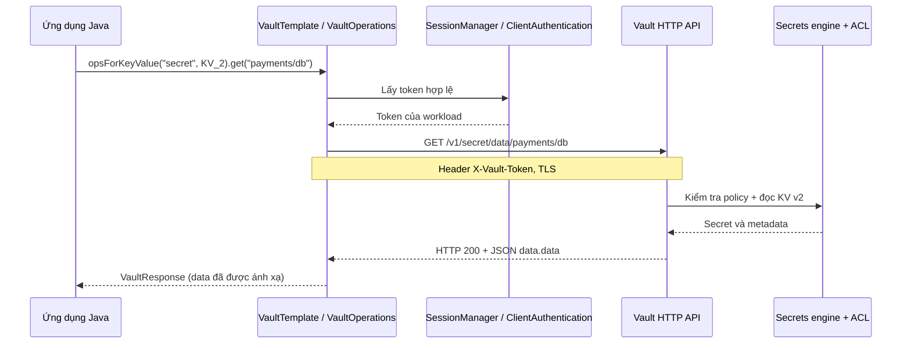

# Đối chiếu yêu cầu từ template với HTTP API của Vault

## 1. Mục tiêu và phạm vi

Khi dùng **Spring Vault**, ứng dụng Java thường gọi `VaultTemplate` (hoặc giao diện `VaultOperations`) để đọc bí mật, mã hóa dữ liệu hay xin chứng chỉ. Tuy nhiên, quyền truy cập, đường dẫn, dữ liệu gửi đi và kết quả cuối cùng đều do **HTTP API của HashiCorp Vault** quyết định. Hiểu được phép đối chiếu này giúp trả lời những câu hỏi thực tế: một lệnh Java gọi endpoint nào, payload nào được gửi, Vault kiểm tra policy nào, và vì sao cùng một đường dẫn lại hoạt động khác nhau giữa KV v1 với KV v2.

Sau bài này, bạn có thể:

- Đối chiếu phương thức của `VaultTemplate` với HTTP method, API path và định dạng request/response tương ứng.
- Phân biệt đường dẫn **mount của secrets engine**, đường dẫn **logic của secret** và tiền tố `/v1/` của HTTP API.
- Giải thích việc xác thực theo workload, Vault token, ACL policy, token renewal và secret lease ảnh hưởng đến một request ra sao.
- Theo dấu các thao tác KV, Transit, PKI và chẩn đoán lỗi từ Java xuống Vault API.

> **Phạm vi:** Tập trung vào cách Spring Vault gọi Vault qua HTTP, không thay thế tài liệu cấu hình của từng phiên bản Spring Vault/Vault. Tên mount, role, policy và endpoint minh họa dưới đây phải được điều chỉnh theo Vault thực tế.

## 2. Từ lệnh Java đến HTTP request

`VaultTemplate` là lớp triển khai `VaultOperations`. Nó phối hợp lớp HTTP client của Spring, thông tin endpoint và cơ chế xác thực (ví dụ AppRole hoặc Kubernetes authentication). Khi ứng dụng gọi một thao tác, request HTTP sẽ mang thông tin xác thực thích hợp, Vault kiểm tra quyền trên **API path thực tế**, rồi secrets engine xử lý và trả về JSON hoặc mã trạng thái HTTP.



Phân biệt ba lớp đường dẫn:

| Lớp | Ví dụ | Ý nghĩa |
| --- | --- | --- |
| URL HTTP | `https://vault.example.internal:8200/v1/secret/data/payments/db` | Địa chỉ máy chủ, API version `/v1/`, đường dẫn engine. |
| Vault API path | `secret/data/payments/db` | Đường dẫn dùng để đối chiếu policy; **không** chứa `/v1/`. |
| Đường dẫn logic cho KV v2 | mount `secret`, key `payments/db` | Tham số dễ đọc của `opsForKeyValue`; lớp KV v2 tự chèn `data/` hoặc `metadata/` theo thao tác. |

Với các lời gọi mức thấp như `vaultTemplate.read("secret/data/payments/db")`, đường dẫn truyền vào là API path. Không tự thêm `https://.../v1/` và cũng không mặc định rằng `read("secret/payments/db")` sẽ hiểu đó là KV v2.

## 3. Bảng đối chiếu `VaultTemplate` và HTTP API

| Nhu cầu ở Java | Lời gọi Spring Vault | HTTP API tương ứng | Điểm cần lưu ý |
| --- | --- | --- | --- |
| Đọc dữ liệu tại một path cụ thể | `vault.read(path)` | `GET /v1/{path}` | `path` cần đúng với engine; dữ liệu trả về thường nằm trong `data`. |
| Ghi dữ liệu tại path cụ thể | `vault.write(path, body)` | `POST /v1/{path}` | HTTP payload do người gọi tạo; không tự thêm lớp `data` cho KV v2. |
| Xóa tại path cụ thể | `vault.delete(path)` | `DELETE /v1/{path}` | Xóa nghĩa là gì phụ thuộc engine và API path. |
| Liệt kê tên key | `vault.list(path)` | `LIST /v1/{path}` hoặc dạng tương thích `GET /v1/{path}?list=true` | Cần quyền `list` trên path dùng để liệt kê. |
| Đọc/ghi KV v1 | `vault.opsForKeyValue(mount, KV_1)` | `/v1/{mount}/{key}` | `data` trong phản hồi thường chứa trực tiếp các field bí mật. |
| Đọc/ghi KV v2 | `vault.opsForKeyValue(mount, KV_2)` | `/v1/{mount}/data/{key}` | Ghi yêu cầu JSON `{"data":{...}}`; đọc có `data.data` và `data.metadata`. |
| Xử lý version KV v2 | `vault.opsForVersionedKeyValue(mount)` | `/v1/{mount}/data/{key}`, `/delete/`, `/undelete/`, `/destroy/` | Các thao tác với version và trạng thái xóa có ý nghĩa khác nhau. |
| Mã hóa/giải mã bằng Transit | `vault.opsForTransit()` | `/v1/transit/encrypt/{key}`, `/decrypt/{key}` | `plaintext` là chuỗi base64; `ciphertext` có định dạng do Vault tạo. |
| Cấp chứng chỉ qua PKI | `vault.opsForPki(mount)` | `/v1/{mount}/issue/{role}` hoặc `/sign/{role}` | PKI role và quyền `update` trên endpoint quyết định thao tác được phép. |
| Quản lý token/lease | Thao tác token, session và lease phù hợp | `/v1/auth/token/...`, `/v1/sys/leases/...` | **Token của ứng dụng** và **lease của dynamic secret** có vòng đời riêng. |

Các method ở hàng KV/Transit/PKI là các nhóm thao tác; tên method con, kiểu trả về và khả năng hỗ trợ có thể khác nhau giữa các phiên bản Spring Vault. Khi kiểm tra một lỗi ở tầng HTTP, luôn bắt đầu từ **endpoint thực sự được gọi**, thay vì suy luận chỉ từ tên method Java.

## 4. Trường hợp quan trọng nhất: KV v1 và KV v2

Giả sử Vault có hai mount: `kv1/` dùng KV v1 và `secret/` dùng KV v2. Cùng một secret logic là `payments/db`, nhưng API path sẽ khác nhau.

| Thao tác | KV v1 (`kv1/`) | KV v2 (`secret/`) |
| --- | --- | --- |
| Đọc | `GET /v1/kv1/payments/db` | `GET /v1/secret/data/payments/db` |
| Ghi | `POST /v1/kv1/payments/db` | `POST /v1/secret/data/payments/db` |
| Liệt kê key trong `payments/` | `LIST /v1/kv1/payments` | `LIST /v1/secret/metadata/payments` |
| Xóa phiên bản mới nhất | Xóa key bằng `DELETE /v1/kv1/payments/db` | `DELETE /v1/secret/data/payments/db` (soft delete phiên bản hiện tại) |
| Metadata/version | Không có cơ chế version KV v2 | Có `/metadata/`, `/delete/`, `/undelete/`, `/destroy/` |

Ví dụ **HTTP request đọc KV v2**:

```http
GET /v1/secret/data/payments/db HTTP/1.1
Host: vault.example.internal:8200
X-Vault-Token: <workload-token>
Accept: application/json
```

Phản hồi đã giản lược:

```json
{
  "lease_id": "",
  "renewable": false,
  "lease_duration": 0,
  "data": {
    "data": {
      "username": "payments_service",
      "password": "example-only"
    },
    "metadata": {
      "version": 2,
      "destroyed": false,
      "deletion_time": ""
    }
  }
}
```

Ở đây `data.data` mới chứa các field nghiệp vụ; `data.metadata.version` cho biết version của secret. `lease_duration: 0` trong ví dụ KV này **không có nghĩa** ứng dụng sở hữu một dynamic lease cần renew sau mỗi lần đọc.

**Mã Java tương đương** khi đã cấu hình một bean `VaultOperations` với xác thực an toàn:

```java
import java.util.Map;
import org.springframework.stereotype.Service;
import org.springframework.vault.core.VaultOperations;
import org.springframework.vault.core.VaultKeyValueOperationsSupport.KeyValueBackend;
import org.springframework.vault.support.VaultResponse;

@Service
public class PaymentSecretReader {
    private final VaultOperations vault;

    public PaymentSecretReader(VaultOperations vault) {
        this.vault = vault;
    }

    public String databaseUser() {
        VaultResponse response = vault
                .opsForKeyValue("secret", KeyValueBackend.KV_2)
                .get("payments/db");

        Map<String, Object> data = response == null ? null : response.getData();
        if (data == null || !(data.get("username") instanceof String username)) {
            throw new IllegalStateException("Secret payments/db không tồn tại hoặc thiếu username");
        }
        return username;
    }
}
```

Lớp KV v2 chịu trách nhiệm chuyển `payments/db` thành `secret/data/payments/db` và ánh xạ dữ liệu phù hợp. Để ghi qua lớp này, có thể dùng:

```java
vault.opsForKeyValue("secret", KeyValueBackend.KV_2)
     .put("payments/db", Map.of("username", "payments_service", "password", newPassword));
```

HTTP payload tương ứng có cấu trúc:

```http
POST /v1/secret/data/payments/db HTTP/1.1
X-Vault-Token: <workload-token>
Content-Type: application/json

{"data":{"username":"payments_service","password":"<new-secret>"}}
```

Nếu gọi trực tiếp `vault.write("secret/data/payments/db", Map.of("username", ...))`, request sẽ thiếu lớp `data` mà KV v2 yêu cầu. Với ghi đồng thời, KV v2 còn hỗ trợ kiểm soát version bằng `options.cas`, ví dụ `{"options":{"cas":2},"data":{...}}` chỉ thành công khi version hiện tại khớp 2.

Phân biệt rõ các kiểu xóa của KV v2: `DELETE .../data/{key}` ẩn version hiện hành; `POST .../delete/{key}` xóa mềm những version chỉ định; `POST .../undelete/{key}` khôi phục version bị xóa mềm; `POST .../destroy/{key}` phá hủy dữ liệu các version được chỉ định; `DELETE .../metadata/{key}` xóa toàn bộ key cùng metadata/version history. Không đánh đồng các endpoint này khi thiết kế quyền.

## 5. Đối chiếu các yêu cầu ngoài KV

### Transit: ứng dụng yêu cầu mã hóa, Vault giữ khóa

Khi cần mã hóa một giá trị, ứng dụng gọi nhóm Transit thay vì đọc khóa bí mật khỏi Vault. Một vòng mã hóa/giải mã tương ứng:

```http
POST /v1/transit/encrypt/payment-key
Content-Type: application/json
X-Vault-Token: <workload-token>

{"plaintext":"aGVsbG8="}
```

`aGVsbG8=` là base64 của `hello`. Vault trả `data.ciphertext`, ví dụ chuỗi bắt đầu bằng `vault:v1:...`; để giải mã, ứng dụng `POST /v1/transit/decrypt/payment-key` với JSON `{"ciphertext":"vault:v1:..."}`. Kết quả `data.plaintext` vẫn là base64 nên cần decode trước khi sử dụng. Không so sánh hai ciphertext để kết luận plaintext bằng nhau vì mã hóa có thể tạo ciphertext khác nhau qua các lần gọi.

Spring Vault cung cấp nhóm `opsForTransit()` để diễn đạt nhu cầu ở Java; Vault kiểm soát quyền trên `transit/encrypt/payment-key` và `transit/decrypt/payment-key`. Khả năng mã hóa không mặc nhiên cấp quyền giải mã. Quay vòng khóa Transit cũng là thao tác quản trị riêng (`POST /v1/transit/keys/{key}/rotate`), không phát sinh từ mỗi lần `encrypt`.

### PKI: yêu cầu cấp hoặc ký chứng chỉ

Với mount `pki/` và role `services`, hai tình huống phổ biến là:

| Mục đích | HTTP API | Đầu vào/đầu ra cốt lõi |
| --- | --- | --- |
| Vault phát hành chứng chỉ và sinh khóa | `POST /v1/pki/issue/services` | Gửi `common_name`, `ttl` và các tùy chọn; nhận certificate, chain và có thể có private key. |
| Vault ký CSR do ứng dụng sinh | `POST /v1/pki/sign/services` | Gửi CSR; nhận chứng chỉ đã ký, ứng dụng giữ private key của mình. |
| Thu hồi chứng chỉ | `POST /v1/pki/revoke` | Gửi serial number theo API và quyền được cấp. |

Nhóm `opsForPki("pki")` diễn đạt tác vụ PKI từ Java; role PKI ràng buộc tên miền, TTL và chính sách phát hành. Đối với `issue`, cần bảo vệ private key trong response như một bí mật: không đưa nó vào log hoặc báo cáo lỗi.

### Dynamic secrets: đọc kết quả có lease

Một database secrets engine có thể cấp tài khoản tạm khi ứng dụng gọi:

```http
GET /v1/database/creds/payments-readonly
X-Vault-Token: <workload-token>
```

Response chứa `data.username`, `data.password` cùng `lease_id`, `lease_duration`, `renewable` ở cấp ngoài. Đây là bí mật **có thời hạn thuê**. Khi được phép, lease có thể gia hạn qua `POST /v1/sys/leases/renew` với `lease_id`; khi không cần nữa có thể thu hồi qua `POST /v1/sys/leases/revoke`. `VaultTemplate.read(...)` chỉ là thao tác đọc; muốn tự động quản lý vòng đời bí mật thuê, cần cấu hình thành phần như `SecretLeaseContainer` và xác định cách ứng dụng cập nhật connection pool khi thông tin đăng nhập bị xoay vòng.

## 6. Workload authentication, ACL và vòng đời token

Spring Vault có thể đăng nhập theo danh tính workload, ví dụ `POST /v1/auth/kubernetes/login` với Kubernetes service-account JWT hoặc `POST /v1/auth/approle/login` với AppRole credentials. Vault trả thông tin đăng nhập, trong đó có token cho những request tiếp theo. Các thành phần xác thực/session của Spring Vault giữ và cung cấp token theo cấu hình; request đọc secret thường mang header `X-Vault-Token`. Khi Vault Enterprise namespace được sử dụng, có thể cần `X-Vault-Namespace` theo cấu hình môi trường.

Token renewal và secret lease renewal là **hai việc riêng**:

| Đối tượng | Điều gì hết hạn? | API tiêu biểu | Trách nhiệm ứng dụng |
| --- | --- | --- | --- |
| Workload token | Khả năng gọi các API được policy cho phép | `POST /v1/auth/token/renew-self`, `GET /v1/auth/token/lookup-self` | Dùng cơ chế session phù hợp; xử lý token không thể renew hoặc cần đăng nhập lại. |
| Dynamic-secret lease | Quyền sử dụng một bí mật được cấp tạm, như database credentials | `POST /v1/sys/leases/renew`, `/revoke` | Theo dõi TTL, renew/revoke hoặc lấy secret mới và cập nhật đối tượng phụ thuộc. |
| KV v2 secret version | Version và trạng thái xóa của dữ liệu tĩnh | `GET /v1/secret/data/{key}?version=N` | Quản lý phiên bản và đồng bộ dữ liệu theo ứng dụng; không suy ra lease từ version. |

**Policy mẫu chỉ đọc KV v2** cho workload `payments`:

```hcl
path "secret/data/payments/db" {
  capabilities = ["read"]
}

path "secret/metadata/payments" {
  capabilities = ["list"]
}
```

Nếu ứng dụng chỉ đọc một key, quyền `list` có thể không cần. Để cho phép ghi, policy cần `create`/`update` theo thao tác và trạng thái key; để gọi Transit encrypt/decrypt, cấp `update` tại chính endpoint `transit/encrypt/...` hoặc `transit/decrypt/...`. Không cấp quyền trên `secret/payments/db` rồi kỳ vọng Vault tự chuyển thành `secret/data/payments/db`: **ACL xét API path sau khi đã được ánh xạ**.

## 7. Từ lỗi Java suy ngược về HTTP và Vault

| Triệu chứng | Khả năng ở tầng Vault HTTP | Cách kiểm tra |
| --- | --- | --- |
| `403 permission denied` | Token hợp lệ nhưng policy không cho phép path/method, hoặc quyền trong namespace không đúng. | Xác minh token của đúng workload, policy, mount, path `data/` hay `metadata/` và capability tương ứng. |
| `404` hoặc giá trị trả về rỗng | Secret/key không tồn tại; sai mount, sai engine version, sai đường dẫn, hoặc version đã bị xóa. | Đối chiếu chính xác URL `/v1/...`, xác nhận KV v1/v2, kiểm tra version và metadata. |
| `400` khi ghi KV v2 | JSON thiếu lớp `data`, tùy chọn `cas` sai hoặc payload không đáp ứng API. | So sánh body thực tế với schema của endpoint và CAS hiện tại. |
| `401`/`403` liên quan token | Token thiếu, hết hạn, đã revoke, hoặc workload login thất bại. | Kiểm tra flow AppRole/Kubernetes, session/renewal và log Vault được phép xem. |
| `429`, `5xx`, timeout | Vault quá tải, rate limit, standby/sealed, sự cố mạng/TLS hoặc service chưa sẵn sàng. | Đọc response code và endpoint health phù hợp; kiểm tra timeout, CA certificate và trạng thái cluster. |
| Có HTTP 200 nhưng kết quả Java đọc sai | Hiểu nhầm `data.data`, hoặc dùng phương thức thô cho KV v2. | Ghi lại **cấu trúc khóa** của JSON mẫu đã khử bí mật; dùng `opsForKeyValue(..., KV_2)` nếu phù hợp. |

Vault có thể trả `404` trong nhiều tình huống; phía Spring Vault có thể biểu diễn thành kết quả `null` hoặc exception tùy phương thức và phiên bản. Vì vậy, một chiến lược xử lý lỗi đúng cần phân biệt **secret thực sự không tồn tại**, **cấu hình sai** và **truy cập bị cấm**, thay vì bắt mọi exception và coi đó là “chưa có secret”.

Để quan sát có ích mà vẫn bảo vệ dữ liệu, log **loại thao tác, mount/path đã được cho phép hiển thị, thời gian, HTTP status, request ID và nhóm lỗi**. Không log `X-Vault-Token`, AppRole secret ID, Kubernetes JWT, private key, ciphertext/plaintext nhạy cảm hoặc giá trị bí mật. Chỉ retry có kiểm soát với lỗi tạm thời; các thao tác tạo tài khoản, cấp chứng chỉ hoặc ghi dữ liệu cần đánh giá khả năng lặp lại trước khi retry.

## 8. Thực hành đối chiếu request và kiểm thử tích hợp

**Tình huống:** ứng dụng Java cần đọc `payments/db` từ mount KV v2 `secret/` bằng workload token; sau đó chỉ được mã hóa với Transit key `payment-key`.

1. Xác định **logic operation**: `opsForKeyValue("secret", KV_2).get("payments/db")` và thao tác Transit encrypt.
2. Suy ra **API request**: `GET /v1/secret/data/payments/db` và `POST /v1/transit/encrypt/payment-key`.
3. So khớp **policy**: `read` trên `secret/data/payments/db`, `update` trên `transit/encrypt/payment-key`; không cấp `decrypt` nếu workload không cần.
4. So khớp **payload/response**: KV v2 đọc `data.data`, Transit gửi `plaintext` base64 và nhận `data.ciphertext`.
5. Kiểm tra **vòng đời**: workload token còn hiệu lực; secret KV tĩnh không được nhầm với lease của dynamic secret.

Có thể kiểm tra HTTP độc lập bằng `curl` với token lấy từ cơ chế xác thực của môi trường thử nghiệm (không in token ra màn hình):

```bash
curl --fail-with-body --silent --show-error \
  --header "X-Vault-Token: ${VAULT_TOKEN}" \
  "${VAULT_ADDR}/v1/secret/data/payments/db"
```

Đối với kiểm thử tích hợp Java, dùng một Vault thử nghiệm tách biệt có KV v2 và Transit được mount, tạo policy/token giới hạn quyền, rồi đối chiếu theo ma trận:

| Kịch bản | Kỳ vọng |
| --- | --- |
| Đọc KV v2 bằng operation chuyên biệt | Đọc đúng field trong dữ liệu secret; không có thêm tầng `data` bị hiểu sai. |
| Đọc cùng key qua raw path sai `secret/payments/db` | Lỗi hoặc không có dữ liệu; sửa sang `secret/data/payments/db` thì đọc được. |
| Token chỉ có `read` KV, thử ghi | Bị từ chối theo policy (`403`). |
| List KV v2 khi chỉ được `read` trên `/data/` | Không có quyền list; phải cấp `list` trên `/metadata/` tương ứng. |
| Transit encrypt rồi decrypt bằng workload có đủ hai quyền | Giải mã được đúng plaintext ban đầu; ciphertext không bị coi là khóa. |
| Đọc dynamic database credentials | Nhận lease metadata và xử lý TTL; test renew/revoke bằng lease test riêng. |
| Request với token hết hạn hoặc Vault không sẵn sàng | Ứng dụng phân loại lỗi auth, retry tạm thời và fail-fast đúng tình huống. |

**Câu hỏi tự kiểm tra:** Một request Java `vault.read("secret/payments/db")` trả `404` dù key xuất hiện trong giao diện Vault. Bạn nên kiểm tra điều gì trước? Hãy xác định engine version, URL thật được gọi, `data/` cần có của KV v2 và policy `secret/data/payments/db`; sau đó quyết định có nên dùng `opsForKeyValue("secret", KV_2)` để tránh lặp lại sai sót này.

## 9. Nguyên tắc áp dụng

Luôn truy vết theo thứ tự **yêu cầu nghiệp vụ → thao tác Spring Vault → HTTP method + API path → ACL capability → request/response schema → token hoặc lease lifecycle**. Đường dẫn được xem là đúng khi khớp với **secrets engine và phiên bản đang mount**, không chỉ khi tên key có vẻ hợp lý. Cách đối chiếu này áp dụng nhất quán cho KV secrets, Transit encryption, PKI, workload authentication và cả việc xử lý lỗi, giám sát, kiểm thử tích hợp.
