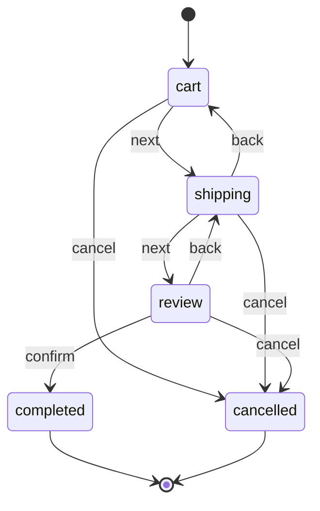
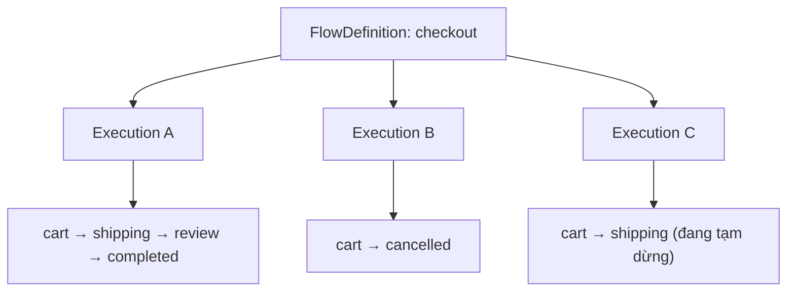
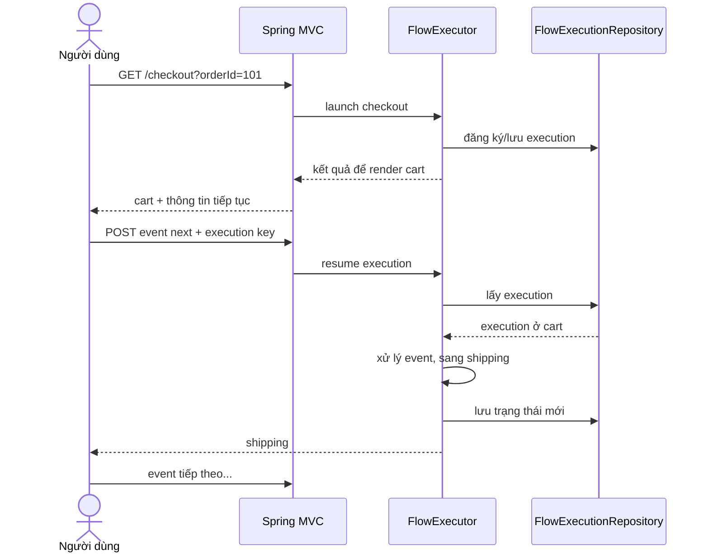

# Định nghĩa luồng (flow definition) và từng lần thực thi (flow execution)

## 1. Hai khái niệm nền tảng của Spring Web Flow

**Spring Web Flow (SWF)** tổ chức một hành trình web nhiều bước thành các **state**, **event** và **transition**. Một hành trình như đăng ký tài khoản, đặt vé, điền hồ sơ hoặc thanh toán không kết thúc sau một HTTP request: người dùng xem màn hình, gửi form, quay lại sửa dữ liệu rồi tiếp tục ở request khác.

Để diễn tả và vận hành hành trình đó, Web Flow phân biệt hai đối tượng:

- **Flow definition (định nghĩa luồng):** bản mô tả *hành trình có thể diễn ra như thế nào*, gồm các state, transition, event, action, input/output, subflow và các quy tắc liên quan.
- **Flow execution (lần thực thi luồng):** *một hành trình cụ thể đang diễn ra*, với state hiện tại, dữ liệu đã nhập, ngữ cảnh và lịch sử/snapshot được quản lý theo cơ chế repository.

Một định nghĩa `checkout` có thể phục vụ hàng nghìn khách hàng. Mỗi lần một khách hàng bắt đầu một hành trình checkout mới, ứng dụng cần một execution riêng để không trộn dữ liệu và tiến độ của các khách hàng.

Hãy hình dung **flow definition là bản đồ tuyến đường**, còn **flow execution là chuyến đi đang đi trên bản đồ**. Bản đồ chỉ rõ các ngã rẽ hợp lệ; chuyến đi biết vị trí hiện tại và những gì người đi đường đã chọn. Một bản đồ có thể phục vụ nhiều chuyến đi độc lập.

| Câu hỏi | Flow definition trả lời | Flow execution trả lời |
|---|---|---|
| Có những bước nào? | `cart`, `shipping`, `review`, `done` | Người dùng hiện ở `shipping` |
| Event `next` từ `cart` đi đâu? | Quy tắc `cart --next--> shipping` | Đã nhận event và chuyển thành công hay chưa |
| Cần dữ liệu gì để khởi chạy? | Khai báo `<input name="orderId" .../>` | Giá trị `orderId` riêng của lượt chạy |
| Dữ liệu form đang có là gì? | Kiểu/biểu thức model và quy tắc binding | Dữ liệu đã chọn, đã nhập trong scope |
| Có thể gọi flow con không? | `subflow-state` và mapping input/output | Flow session con đang hoạt động hoặc đã kết thúc |
| Đã hoàn tất chưa? | Định nghĩa `end-state` | Execution này đã kết thúc hay vẫn chờ request tiếp theo |

**Điểm quan trọng:** definition là cấu hình dùng chung; execution là trạng thái runtime theo từng lượt chạy. Việc sửa một định nghĩa không đồng nghĩa tự động đổi cấu trúc của mọi execution cũ đang được lưu.

## 2. Flow definition là gì?

Trong API Web Flow, `org.springframework.webflow.definition.FlowDefinition` đại diện cho một định nghĩa flow đã được engine xây dựng. Với cách cấu hình XML phổ biến, ứng dụng có file định nghĩa như `checkout.xml`. `FlowDefinitionRegistry` giữ/cung cấp các definition theo ID để executor có thể tìm thấy flow cần khởi chạy.

Một flow definition thường gồm:

1. **ID của flow:** ví dụ `checkout`, dùng khi khởi chạy hoặc tham chiếu từ một subflow.
2. **Input contract:** những giá trị flow cần nhận lúc bắt đầu, như `orderId`.
3. **Start state:** điểm bắt đầu khi flow được khởi chạy.
4. **States:** các điểm thực hiện action, quyết định, hiển thị view, gọi subflow hoặc kết thúc.
5. **Transitions:** event/điều kiện nào dẫn từ một state sang state khác.
6. **Actions:** các thao tác được gọi khi start, vào state, render hoặc xử lý nghiệp vụ.
7. **Output/end states:** kết quả flow công bố khi kết thúc.
8. **Cấu hình bổ sung:** exception handlers, security, attributes hoặc inheritance nếu ứng dụng cần.

Ví dụ một định nghĩa flow checkout tối giản:

```xml
<?xml version="1.0" encoding="UTF-8"?>
<flow xmlns="http://www.springframework.org/schema/webflow"
      xmlns:xsi="http://www.w3.org/2001/XMLSchema-instance"
      xsi:schemaLocation="
          http://www.springframework.org/schema/webflow
          http://www.springframework.org/schema/webflow/spring-webflow.xsd"
      start-state="cart">

    <input name="orderId" type="long" required="true" />

    <view-state id="cart">
        <transition on="next" to="shipping" />
        <transition on="cancel" to="cancelled" />
    </view-state>

    <view-state id="shipping">
        <transition on="back" to="cart" />
        <transition on="next" to="review" />
        <transition on="cancel" to="cancelled" />
    </view-state>

    <view-state id="review">
        <transition on="back" to="shipping" />
        <transition on="confirm" to="completed" />
        <transition on="cancel" to="cancelled" />
    </view-state>

    <end-state id="completed" />
    <end-state id="cancelled" />
</flow>
```

File XML mô tả các đường đi hợp lệ, **chưa chứa trạng thái của bất kỳ người dùng nào**. Các view `cart`, `shipping`, `review` cần được view resolver của ứng dụng ánh xạ tới template thực tế; ví dụ lược bỏ phần form model, validation và hành động tạo đơn hàng để tập trung vào mô hình flow. Trong hệ thống thật, không nên coi riêng event `confirm` là bằng chứng thanh toán hoặc đặt hàng đã hoàn tất: cần action/service xác nhận nghiệp vụ rồi mới chuyển tới `completed`.

Sơ đồ luồng tương ứng:



Flow definition được xây dựng từ cấu hình (ví dụ XML) và được dùng như metadata của engine. Cách biểu diễn cụ thể có thể là XML hoặc cấu hình Java tùy phiên bản/dự án; bản chất **định nghĩa điều hướng** vẫn giống nhau.

## 3. Flow execution là gì?

Một `org.springframework.webflow.execution.FlowExecution` là đối tượng runtime đại diện cho **một lần đang chạy flow**. Nó liên kết đến định nghĩa flow được dùng, chứa ngữ cảnh thực thi, biết state đang hoạt động và cho phép engine phản ứng với event.

Giả sử hai người bắt đầu `checkout` vào cùng thời điểm:

| Nội dung | Khách hàng A | Khách hàng B |
|---|---|---|
| Definition | `checkout` | `checkout` |
| Execution | Lượt checkout A | Lượt checkout B |
| `orderId` đầu vào | `101` | `205` |
| State hiện tại | `review` | `cart` |
| Phương thức giao hàng đã chọn | `express` | Chưa chọn |
| Event tiếp theo | `confirm` hoặc `back` | `next` |

Hai execution dùng **cùng một định nghĩa**, nhưng tiến độ và dữ liệu được tách biệt. Hành động `back` ở A không làm B quay lại. A kết thúc không làm definition `checkout` biến mất; B vẫn có thể tiếp tục hành trình riêng.

Với mỗi lượt chạy, Web Flow cần quản lý ít nhất các thông tin mang ý nghĩa:

- Flow gốc đã được chọn khi khởi chạy.
- State đang hoạt động và các `FlowSession` nếu đang ở subflow.
- Các scope chứa dữ liệu của lượt chạy theo vòng đời.
- Kết quả xử lý event và trạng thái tạm dừng/tiếp tục.
- Thông tin phục vụ lưu/khôi phục execution tùy repository.

Execution **không phải HTTP request**. Một execution có thể đi qua nhiều request khác nhau, đôi khi cách nhau nhiều phút. Execution cũng **không phải HTTP session**: cùng một HTTP session có thể có nhiều flow execution đang hoạt động.

## 4. Một definition, nhiều execution: ví dụ theo thời gian



Ví dụ trace của ba người dùng:

```text
Definition checkout:
  cart --next--> shipping --next--> review --confirm--> completed

Execution A:
  t0: launch checkout(orderId=101)
  t1: cart
  t2: event next     -> shipping
  t3: event next     -> review
  t4: event confirm  -> completed (kết thúc)

Execution B:
  t0: launch checkout(orderId=205)
  t1: cart
  t2: event cancel   -> cancelled (kết thúc)

Execution C:
  t0: launch checkout(orderId=307)
  t1: cart
  t2: event next     -> shipping
  t3: chờ người dùng điền địa chỉ (execution chưa kết thúc)
```

Definition vẫn là `checkout` trong cả ba trường hợp. Điều khác nhau là execution, dữ liệu input, các event đã nhận, state hiện tại và outcome cuối cùng.

Khi định nghĩa thay đổi, ví dụ thêm `discount` giữa `shipping` và `review`, các **lượt khởi chạy mới** sẽ sử dụng cấu hình mới sau khi ứng dụng nạp lại/triển khai định nghĩa. Với execution đang tạm dừng, khả năng tiếp tục tương thích hay không phụ thuộc cấu hình lưu trạng thái, bản triển khai và sự thay đổi của definition; cần kiểm thử trước khi rollout.

## 5. Flow session: lớp trung gian dễ bị nhầm

Spring Web Flow còn có `org.springframework.webflow.execution.FlowSession`. Khi một execution chạy qua một flow definition, engine quản lý một flow session cho lượt vào flow đó. Khi flow cha gọi **subflow**, engine có thể tạo flow session con trong **cùng execution**.

Ví dụ `checkout` gọi `payment` ở state `takePayment`:

```text
FlowExecution #A
└── FlowSession: checkout
    ├── state review
    └── state takePayment
        └── FlowSession: payment
            ├── state enterCard
            └── state authorize

payment kết thúc với outcome=paid
→ quay lại FlowSession checkout
→ checkout chuyển tới end-state completed
```

Có ba tên cần phân biệt:

| Tên | Đại diện cho | Có tạo mới khi gọi subflow? |
|---|---|---|
| `FlowDefinition` | Bản thiết kế một flow | Không; engine tra cứu definition của subflow |
| `FlowExecution` | Lượt chạy toàn hành trình | Thông thường vẫn là execution hiện tại |
| `FlowSession` | Lần đi vào một flow definition trong execution | Có; subflow có session riêng |

`flowScope` gắn với **flow session** đang chạy. Trong khi đó, `conversationScope` thường dùng cho dữ liệu cần tồn tại trong conversation xuyên qua lời gọi subflow. Đây là lý do `flowScope` của flow cha không nên được xem là `flowScope` của subflow; dữ liệu phải được truyền có chủ đích bằng `<input>` và trả về qua output/outcome.

**Đếm session không bằng đếm execution:** một execution có thể lần lượt hoặc lặp lại việc đi vào nhiều subflow, khiến số session lớn hơn một.

## 6. HTTP request, FlowExecutor và vòng đời execution

Trong tích hợp Spring MVC phổ biến, browser gửi HTTP request đến ứng dụng; `FlowHandlerMapping`/`FlowHandlerAdapter` dẫn request tới `FlowExecutor`. Executor phối hợp khởi chạy flow mới, tiếp tục flow đang chờ hoặc render lại flow hiện tại.

### 6.1. Request đầu tiên: khởi chạy execution

Ví dụ người dùng mở:

```text
GET /checkout?orderId=101
```

Trong cấu hình MVC tương ứng, executor tìm definition `checkout`, nhận input map có `orderId`, tạo execution, vào `start-state="cart"` rồi render màn hình. Đây là một request nhưng tạo ra một lượt execution có thể tồn tại lâu hơn request đó.

### 6.2. Request tiếp theo: tiếp tục execution

Khi người dùng nhấn Next ở `cart`, request thường mang thông tin định vị execution và event. Một URL minh họa (cú pháp chính xác tùy tích hợp/cấu hình):

```text
POST /checkout?execution=e1s1

_eventId=next
```

Engine dùng execution key để lấy execution tương ứng, xử lý `next` theo transition của state hiện tại, chuyển sang `shipping` và lưu/trả lại ngữ cảnh cần thiết cho tương tác tiếp theo.

**Giá trị `e1s1` chỉ là ví dụ quen thuộc ở một số triển khai**, không phải định dạng key được bảo đảm cho mọi ứng dụng. Execution key có thể thay đổi theo snapshot/request. Không nên tự parse hay tự chế key để xác định người dùng hoặc đơn hàng.

### 6.3. Request kết thúc execution

Khi transition tới `end-state` của root flow, execution kết thúc. Repository có thể giải phóng execution/snapshot liên quan theo chính sách của nó. Khi đó, cố sử dụng lại key cũ có thể dẫn tới lỗi execution hết hạn/không còn tồn tại; không nên coi lỗi này là một event hợp lệ để chuyển tiếp flow đã kết thúc.

Sơ đồ vòng đời:



Đây là sơ đồ **logic**: chi tiết thời điểm `put/get` vào repository, `pause`, render và các adapter phụ thuộc đường thực thi và phiên bản. Không có bảo đảm rằng **mỗi** HTTP request tạo mới hoặc serialize toàn bộ execution theo một sơ đồ cố định.

## 7. Các thành phần kỹ thuật đứng quanh definition và execution

| Thành phần | Vai trò |
|---|---|
| `FlowDefinition` | API mô tả một flow |
| `FlowDefinitionRegistry` | Đăng ký/tra cứu definition theo ID |
| `FlowExecutor` | Cổng API launch, resume/refresh execution |
| `FlowExecution` | Đối tượng runtime xử lý state/event cho một lượt chạy |
| `FlowSession` | Session của flow gốc hoặc subflow trong execution |
| `RequestContext` | Ngữ cảnh của một request khi engine đang xử lý execution |
| `FlowExecutionRepository` | Lưu/khôi phục hoặc quản lý các execution theo key |
| `FlowExecutionKey` | Định danh dùng để truy xuất execution theo cơ chế repository |
| `FlowHandlerMapping` / `FlowHandlerAdapter` | Kết nối request Spring MVC với Web Flow |

Một flow XML đứng riêng trên đĩa **chưa phải một execution**. Tương tự, một Spring bean `FlowExecutor` đã khai báo nhưng chưa gắn với đúng MVC adapter cũng không bảo đảm các request đi vào flow mong muốn.

### 7.1. Cách nhìn từ API Java

API `FlowExecutor` trong SWF 2.x công bố các thao tác theo ý nghĩa:

```java
// Chữ ký minh họa của FlowExecutor trên nhánh SWF 2.x:
FlowExecutionResult launchExecution(
        String flowId,
        MutableAttributeMap<?> input,
        ExternalContext context);

FlowExecutionResult resumeExecution(
        String flowExecutionKey,
        String eventId,
        ExternalContext context);
```

Các kiểu đến từ package Web Flow tương ứng, chẳng hạn `org.springframework.webflow.executor.FlowExecutor`. `ExternalContext` do tầng tích hợp cung cấp, nên không nên tự khởi tạo bừa trong controller. Ví dụ nhấn mạnh **hai thao tác khác nhau**: `launchExecution` chọn definition theo flow ID để tạo lượt chạy mới; `resumeExecution` chọn một lượt chạy đã tồn tại theo execution key và xử lý event.

Khi một execution đang active, engine không cần “chạy lại XML từ đầu” cho mỗi request; nó xử lý theo state hiện tại và các quy tắc đã định nghĩa.

## 8. Scope: definition biết nơi đặt dữ liệu, execution giữ giá trị

Trong flow XML, bạn có thể khai báo action đưa dữ liệu vào `flowScope`:

```xml
<input name="orderId" type="long" required="true" />

<on-start>
    <evaluate expression="checkoutService.loadDraft(orderId)"
              result="flowScope.checkoutDraft" />
</on-start>
```

**Definition** diễn tả rằng, khi bắt đầu một flow session, engine sẽ gọi `checkoutService.loadDraft(orderId)` và đặt kết quả vào `flowScope.checkoutDraft`. **Execution** của khách hàng A có thể giữ draft A, trong khi execution của B giữ draft B.

Các scope thường gặp:

| Scope | Vòng đời khái quát | Ví dụ |
|---|---|---|
| `requestScope` | Trong một lượt request | Kết quả tra cứu tạm để render |
| `flashScope` | Ngắn hạn qua chu kỳ tương tác/render | Thông báo “Đã lưu” |
| `viewScope` | Trong `view-state` hiện tại | Form model của màn hình |
| `flowScope` | Trong flow session tương ứng | Các lựa chọn nhiều bước |
| `conversationScope` | Trong conversation của execution, chia sẻ khi qua subflow | Metadata thật sự cần cho nhiều flow session |

**Không gắn dữ liệu một người dùng vào biến mutable của Spring singleton service** rồi tưởng đó là flowScope. Service là thành phần dùng chung; các scope của SWF có vòng đời riêng do execution quản lý. Một object graph lớn trong `flowScope` còn có thể làm tăng chi phí lưu/khôi phục execution; nên lưu DTO gọn hoặc ID và tải dữ liệu nghiệp vụ đúng thời điểm.

## 9. Flow definition không phải controller, route hoặc URL

Khi viết ứng dụng Spring MVC thông thường, controller định tuyến mỗi request tới một view hoặc service. Với SWF, definition gom **hành trình qua nhiều request** thành state machine.

So sánh:

| Spring MVC controller thuần | Spring Web Flow |
|---|---|
| Request đi vào handler theo URL/method | Request được định tuyến tới FlowExecutor và một execution |
| Controller quyết định trả view/redirect | State và event/transition quyết định đường đi |
| Trạng thái nhiều bước thường phải tự tổ chức | Execution và scope hỗ trợ trạng thái qua nhiều bước |
| Bean controller thường dùng chung cho các request | Definition dùng chung, execution tách theo lượt chạy |
| URL/method có thể là điều kiện điều hướng chính | Event `next`, `back`, `cancel` chuyển state |

SWF vẫn **tích hợp với Spring MVC**, và controller/service có thể tham gia xử lý nghiệp vụ. Flow definition không phải một URL; `checkout` là flow ID, còn `/checkout` chỉ trở thành URL khi mapping của ứng dụng được cấu hình tương ứng.

## 10. Điều gì xảy ra khi mở hai tab hoặc bắt đầu lại?

Giả sử người dùng đã đăng nhập mở hai tab:

- Tab 1 bắt đầu `checkout(orderId=101)`.
- Tab 2 bắt đầu `checkout(orderId=205)`.

Khi hai tab **launch riêng**, ta có hai execution, dù có thể dùng chung HTTP session. Mỗi tab có trạng thái riêng nếu frontend gửi đúng key tương ứng. Tuy nhiên, nếu người dùng nhân bản tab hoặc URL continuation của tab 1, cả hai tab có thể **tham chiếu tới cùng execution/snapshot**, tùy cách repository và browser history hoạt động.

Vì thế:

1. Đừng xem “mỗi tab chắc chắn là một execution” như quy luật tuyệt đối.
2. Đừng dùng mỗi `HttpSession.getId()` để phân biệt các flow execution.
3. Đừng lưu “current checkout” trong một biến session chung nếu cần nhiều execution độc lập.
4. Cần thử trường hợp stale execution key, hai request đồng thời, refresh và nút Back.
5. Khi thao tác nghiệp vụ quan trọng như đặt hàng/thanh toán, service cần kiểm soát idempotency và transaction, không chỉ dựa vào state `completed`.

Mục tiêu là mỗi request tìm đúng execution hoặc báo lỗi phục hồi rõ ràng. **Definition không giải quyết tự động vấn đề người dùng mở nhiều tab**; repository và cách phát sinh key mới là phần cần kiểm thử.

## 11. State của execution và event có quan hệ thế nào?

Definition nói rõ event nào có transition hợp lệ ở từng state. Execution biết state hiện tại nên mới xác định có thể đi đâu với event đó.

Với definition:

```text
cart:
  next   -> shipping
  cancel -> cancelled

shipping:
  back   -> cart
  next   -> review
  cancel -> cancelled

review:
  back    -> shipping
  confirm -> completed
  cancel  -> cancelled
```

Nếu execution đang ở `cart` và nhận event `next`, nó có thể chuyển sang `shipping`. Nếu cũng đang ở `cart` nhưng nhận `confirm`, definition này **không có transition `confirm` tại `cart`**. Không thể kết luận “confirm sẽ nhảy thẳng đến completed”; cách xử lý event không được chấp nhận phụ thuộc engine/config/error handling.

Một transition cũng có thể có guard/condition, và action có thể phát event outcome `success` hoặc `error`. Vì vậy cùng definition và cùng event từ hai execution vẫn có thể dẫn đến đường đi khác nhau khi **dữ liệu của hai execution khác nhau** hoặc condition có kết quả khác.

## 12. Kết thúc flow: end-state của definition và outcome của execution

`end-state` là một thành phần thuộc **definition**. Khi một execution đi tới `end-state` của flow gốc, lượt thực thi đó kết thúc.

Ví dụ:

```xml
<end-state id="completed" />
<end-state id="cancelled" />
```

Hai state này định nghĩa các loại kết quả có thể có. Execution A có thể kết thúc bằng `completed`, execution B bằng `cancelled`. Cả hai không thay đổi definition.

Nếu đó là `end-state` của **subflow**, engine kết thúc `FlowSession` của subflow và trả outcome/output cho flow cha; root execution có thể **tiếp tục**. Không đếm mỗi lần subflow kết thúc như một lần kết thúc toàn bộ hành trình.

Bảng trạng thái:

| Sự kiện runtime | Kết luận đúng |
|---|---|
| Vừa render `review` | Execution đang chờ/tiếp tục, chưa hoàn tất |
| `payment` subflow tới `paid` | Session payment kết thúc; flow cha có thể tiếp tục |
| Root flow tới `completed` | Execution gốc kết thúc theo outcome thành công thiết kế |
| Root flow tới `cancelled` | Execution gốc kết thúc theo outcome hủy |
| HTTP request trả `200 OK` | Chỉ xác nhận HTTP response; không chứng minh flow đã hoàn tất |
| Người dùng đóng browser | Chưa chắc execution được giải phóng tức thời; phụ thuộc repository và expiry |

## 13. Repository, snapshot và execution key

Một lần chạy qua nhiều HTTP request cần được **giữ lại** giữa các lượt tương tác. `FlowExecutionRepository` là abstraction chịu trách nhiệm quản lý trạng thái có thể lưu và khôi phục; `FlowExecutionKey` là khóa mà tầng tích hợp dùng để định vị lượt chạy.

Mô hình khái niệm:

```text
Browser (continuation key)
        |
        v
FlowHandlerAdapter / FlowExecutor
        |
        v
FlowExecutionRepository
        |
        +-- execution A: checkout @ review
        +-- execution B: checkout @ shipping
        +-- execution C: registration @ enterProfile
```

Chi tiết implementation khác nhau theo phiên bản/configuration:

- Repository có thể lưu execution trong bộ nhớ của session, tạo snapshot hoặc tích hợp cơ chế lưu trữ khác theo thiết kế ứng dụng.
- Số execution và số snapshot có thể bị giới hạn để tránh tăng bộ nhớ không kiểm soát.
- Khi người dùng gửi key cũ, execution có thể đã kết thúc, hết hạn hoặc snapshot tương ứng không còn.
- Việc snapshot/restore có thể liên quan serialization, copy object graph và tương thích dữ liệu sau deploy; một object lưu trong scope không phù hợp có thể làm lưu/khôi phục thất bại.

**Không nhầm `FlowDefinitionRegistry` với `FlowExecutionRepository`:** registry tìm **bản thiết kế** theo ID, repository tìm **lượt chạy** theo execution key. Đây là hai nhiệm vụ độc lập.

### 13.1. Flow ID và execution key khác nhau ở đâu?

| | Flow ID | Execution key |
|---|---|---|
| Ví dụ | `checkout` | `e1s1` *(chỉ minh họa)* |
| Đại diện | Definition | Execution/snapshot theo repository |
| Mục đích | Launch flow mới hoặc tham chiếu definition/subflow | Resume hoặc refresh lượt chạy có sẵn |
| Do ai quản lý? | Registry/configuration | Execution repository |
| Có dùng chung giữa người dùng? | Có thể có cùng flow ID | Không được dùng key để giả định identity hoặc quyền |
| Có ổn định qua mọi lần tương tác? | Thường ổn định theo cấu hình | Không có bảo đảm; có thể thay theo snapshot |

Execution key **không thay thế kiểm soát quyền truy cập**. Nếu ứng dụng dùng execution key trong URL hoặc form, cần bảo vệ session, chống CSRF theo kiến trúc đang dùng và kiểm tra quyền tại service cho nghiệp vụ nhạy cảm.

## 14. Các bài kiểm thử giúp phân biệt definition với execution

Hãy dựng flow `checkout` tối giản ở phần 2, rồi tạo các tình huống:

| Kịch bản | Cách thực hiện | Điều cần xác minh |
|---|---|---|
| Một definition, hai execution | Launch `checkout` hai lần với hai `orderId` | Hai execution có tiến độ độc lập |
| Nhiều request, một execution | Ở một execution, gửi `next` hai lần | Tới `review` theo đúng state machine |
| Event không hợp lệ ở state | Gửi `confirm` khi đang ở `cart` | Không được coi là hoàn tất hợp lệ |
| Quay lại state | Gửi `back` ở `shipping` | Trở lại `cart` trong chính execution đó |
| Kết thúc root flow | Gửi `cancel` ở `review` | Execution kết thúc với `cancelled` |
| Gọi subflow | Checkout gọi `payment` | Có flow session con, không tạo root execution mới |
| Quay lại sau hết hạn | Dùng continuation key cũ | Hệ thống xử lý expired/stale execution rõ ràng |
| Hai tab | Launch độc lập rồi clone URL của một tab | Phân biệt hai execution và trường hợp dùng chung key |
| Thay đổi definition khi còn execution cũ | Deploy thêm state sau khi có execution tạm dừng | Kiểm tra tương thích resume, snapshot và recovery |

Nếu dùng `spring-webflow-test`, có thể kiểm thử state hiện tại sau event và outcome của end state. Với kiểm thử tích hợp Spring MVC, cần đi qua cùng `FlowExecutor`, registry và repository mà ứng dụng sẽ sử dụng. Kiểm thử chỉ đọc XML chưa đủ để khẳng định một execution thực sự đi qua các state đúng như mong đợi.

### 14.1. Bài tập ngắn

Cho definition:

```text
start=choose
choose --next--> review
review --back--> choose
review --submit--> done
choose --cancel--> cancelled
review --cancel--> cancelled
```

Ba người dùng chạy:

- A: `choose → review → choose` và đang chờ.
- B: `choose → review → done`.
- C: `choose → cancelled`.

Hãy trả lời: có **bao nhiêu flow definition**, **bao nhiêu flow execution đã được tạo**, execution nào còn hoạt động, và khi có subflow `verifyIdentity` ở nhánh A thì cần bổ sung đối tượng runtime nào?

Đáp án: **1 definition**, **3 execution**; A còn hoạt động, B và C đã kết thúc. Khi A gọi subflow, cần có **FlowSession mới** cho `verifyIdentity` trong execution của A. Definition của `verifyIdentity` là một definition khác, được tra cứu để chạy subflow; nếu bổ sung definition đó vào tập thiết kế, tổng số definition của hệ thống tăng thành hai.

## 15. Những hiểu nhầm hay gặp

**“Mỗi request là một flow execution.”** Sai trong hành trình nhiều bước. Request đầu tạo execution; các request sau có thể tiếp tục cùng lượt chạy.

**“FlowDefinition giữ dữ liệu form của người dùng.”** Sai. Definition nêu cấu trúc; dữ liệu runtime ở execution/scope, không đặt vào một bản XML dùng chung.

**“Một HTTP session chỉ có một execution.”** Không đúng. Người dùng có thể khởi chạy nhiều flow độc lập trong cùng HTTP session.

**“Gọi subflow là tạo một execution mới.”** Không phải mặc định. Nó thường tạo một `FlowSession` của flow con trong execution hiện tại.

**“Kết thúc subflow đồng nghĩa hoàn tất checkout.”** Sai. Flow cha có thể vẫn cần xác nhận, ghi đơn hoặc xử lý kết quả.

**“Có execution key là đã được phép sửa đơn hàng.”** Sai. Execution key phục vụ tiếp tục lượt chạy, không thay thế authentication/authorization.

**“Nút Back chắc chắn quay về state trước.”** Hành vi phụ thuộc history, snapshot, cấu hình repository và logic flow. Back của browser có thể đưa về URL/response cũ mà execution tương ứng không còn hợp lệ.

**“Cập nhật XML sẽ thay thế an toàn mọi execution cũ.”** Không thể suy ra như vậy. Cần kiểm thử trường hợp execution được lưu từ phiên bản trước rồi phục hồi trên phiên bản mới.

## 16. Khi thiết kế flow thực tế, nên quyết định gì?

Trước khi dựng một hành trình Web Flow, hãy định nghĩa **bản đồ các state/event/transition**; đây là trách nhiệm của flow definition. Sau đó xác định **dữ liệu mỗi execution cần giữ qua các bước**, tức phạm vi và vòng đời của model. Ví dụ đặt hàng:

1. Định nghĩa các state `cart`, `shipping`, `review` và kết quả `completed`/`cancelled`.
2. Quy định event `next`, `back`, `confirm` chỉ hợp lệ ở những state nào.
3. Khai báo input tối thiểu như `orderId` và các kiểm tra nghiệp vụ bắt buộc.
4. Chọn `flowScope` cho draft gọn cần giữ qua bước; chọn `viewScope`/`requestScope` cho dữ liệu có vòng đời ngắn hơn.
5. Khi gọi `payment`, truyền input/output rõ ràng, không dựa vào việc hai flow ngầm chia sẻ toàn bộ state.
6. Thiết kế xử lý execution hết hạn, stale key, refresh, nhiều tab và retry.
7. Đảm bảo action nghiệp vụ idempotent và kiểm tra quyền, độc lập với URL hoặc state đang hiển thị.

### Ghi nhớ

**Flow definition trả lời “hành trình được phép diễn ra như thế nào”; flow execution trả lời “lượt hành trình này đang ở đâu và có dữ liệu gì”.** Flow session giúp execution đi vào flow gốc hoặc subflow. Registry quản lý definition; repository quản lý execution; execution key dùng để tiếp tục lượt chạy. Nắm rõ sự phân biệt này giúp đọc cấu hình Web Flow đúng, kiểm thử chuyển trạng thái chính xác và tránh làm lẫn dữ liệu giữa các người dùng.

### Tài liệu tham khảo

- [Spring Web Flow 2.5.x — Reference Manual](https://docs.spring.io/spring-webflow/docs/2.5.x/reference/html/) — định nghĩa flow, state, event, transition, scope và vòng đời.
- [Spring Web Flow 2.5.x — FlowDefinition API](https://docs.spring.io/spring-webflow/docs/2.5.x/api/org/springframework/webflow/definition/FlowDefinition.html) — hợp đồng định nghĩa flow.
- [Spring Web Flow 2.5.x — FlowExecution API](https://docs.spring.io/spring-webflow/docs/2.5.x/api/org/springframework/webflow/execution/FlowExecution.html) — đối tượng execution ở runtime.
- [Spring Web Flow 2.5.x — FlowExecutor API](https://docs.spring.io/spring-webflow/docs/2.5.x/api/org/springframework/webflow/executor/FlowExecutor.html) — launch/resume các execution.
- [Spring Web Flow 2.5.x — FlowExecutionRepository API](https://docs.spring.io/spring-webflow/docs/2.5.x/api/org/springframework/webflow/execution/repository/FlowExecutionRepository.html) — lưu và khôi phục execution.
