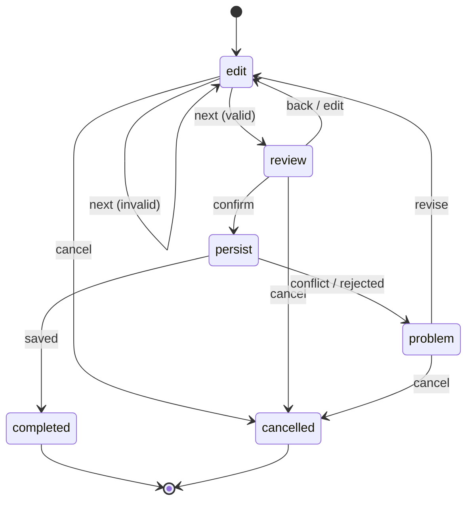
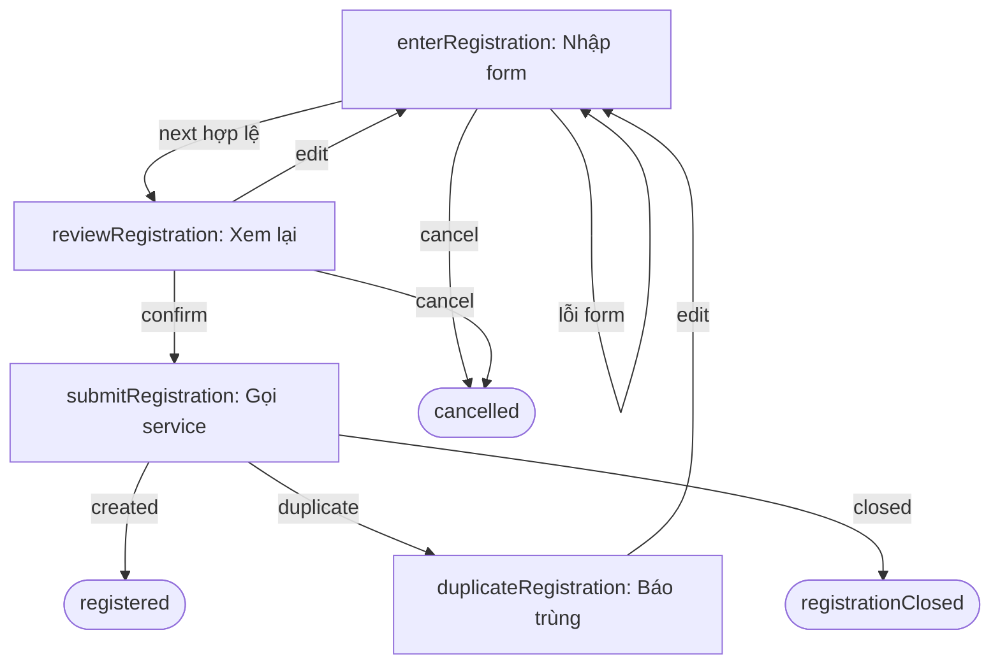

# Kịch bản đăng ký, đặt chỗ và xác nhận trước khi lưu với Spring Web Flow

## Mục tiêu bài học

Trong module **Spring Web Flow**, chúng ta học cách mô hình hóa một hành trình web có nhiều bước bằng **state**, **event**, **transition** và **subflow**, thay vì để các controller tự kiểm tra nhiều tham số rồi quyết định màn hình tiếp theo. Chương **Bản đồ Web Flow** tập trung nhận diện những tình huống nên dùng mô hình này.

Ba kịch bản rất gần với ứng dụng thực tế là **đăng ký**, **đặt chỗ** và **yêu cầu người dùng xác nhận trước khi lưu**. Chúng có chung một nguyên tắc: người dùng có thể đi qua nhiều màn hình và thay đổi dữ liệu tạm, nhưng thao tác ghi dữ liệu nghiệp vụ chỉ xảy ra tại bước đã được thiết kế rõ ràng.

Sau khi hoàn thành bài, bạn có thể:

1. Phác họa các state và event cho một luồng đăng ký hoặc đặt chỗ.
2. Phân biệt **dữ liệu bản nháp trong flow** với **bản ghi đã commit trong database**.
3. Thiết kế bước **Review/Confirm** trước khi gọi service lưu, bao gồm quay lại sửa và hủy.
4. Chọn `view-state`, `action-state`, `decision-state`, `end-state` và `subflow-state` đúng vai trò.
5. Đặt form binding, validation, kiểm tra quyền, transaction và xử lý trùng lặp đúng tầng.
6. Giải thích vì sao “còn chỗ lúc xem lại” không bảo đảm “còn chỗ lúc nhấn Đặt”.
7. Xây dựng các kịch bản kiểm thử thành công, thất bại, hết phiên, gửi trùng và tranh chấp đồng thời.

## 1. Nhận diện điểm chung giữa ba kịch bản

Một trang có đúng một thao tác đơn giản thường chỉ cần Spring MVC controller và service. Nhưng với hành trình có nhiều bước, người dùng có thể gửi các event như **Next**, **Back**, **Edit**, **Confirm**, **Cancel** và cần quay lại đúng vị trí với dữ liệu đã nhập.

| Kịch bản | Các bước điển hình | Quyết định quan trọng | Thời điểm ghi bền vững |
| --- | --- | --- | --- |
| **Đăng ký tham gia sự kiện** | Nhập thông tin → Xem lại → Xác nhận | Email hợp lệ? Đã đăng ký chưa? Sự kiện còn nhận đăng ký? | Khi service xử lý event `confirm` thành công |
| **Đặt chỗ** | Chọn khung giờ → Nhập số người → Xem lại → Đặt | Số người hợp lệ? Còn chỗ **ở thời điểm commit**? | Khi service giữ/ghi chỗ thành công trong transaction |
| **Xác nhận trước khi lưu** | Chỉnh sửa → Xem lại khác biệt → Xác nhận → Kết quả | Dữ liệu có đổi? Người dùng có quyền? Có xung đột phiên bản? | Khi action lưu được chạy và transaction commit |

Mỗi kịch bản có thể có thêm bước phụ như xác minh danh tính, kiểm tra điều khoản hoặc thanh toán. Điều quyết định có dùng Web Flow hay không không phải số lượng form, mà là **độ phức tạp của hành trình, trạng thái tạm và các đường điều hướng**.

### Mẫu chung: nhập → xem lại → lưu



`edit`, `review` và `problem` thường là **`view-state`** vì người dùng cần nhìn màn hình và phát event. `persist` thường là **`action-state`** vì nó gọi service rồi chọn đường đi theo kết quả. `completed` và `cancelled` là **`end-state`** vì luồng đã kết thúc.

**Điểm cần khắc sâu:** transition `review → completed` chỉ là điều hướng. Nếu không có một action hoặc service ghi dữ liệu nằm trên đường đi, việc chuyển tới `end-state` có tên `completed` **không tự tạo bản ghi trong database**.

## 2. Bản đồ các khái niệm Spring Web Flow cần dùng

Trước khi viết XML, hãy tách bốn loại thông tin:

- **Flow definition**: bản thiết kế hành trình, mô tả các state và transition.
- **Flow execution**: một lần chạy cụ thể cho người dùng/tab, với state hiện tại và dữ liệu bản nháp.
- **Event**: tín hiệu như `next`, `confirm`, `back`, thường đến từ người dùng hoặc kết quả action.
- **Transition**: quy tắc di chuyển từ state này tới state khác theo event.

| Thành phần | Chức năng | Ví dụ |
| --- | --- | --- |
| `<view-state>` | Render màn hình và chờ event | Nhập thông tin đăng ký, xem lại đơn |
| `<transition on="next" to="review">` | Di chuyển khi event `next` được nhận | Từ form sang Review |
| `<action-state>` | Chạy action/service và chọn nhánh theo outcome | Ghi đăng ký, giữ chỗ |
| `<decision-state>` | Chọn nhánh dựa trên điều kiện Boolean | Có cần bước xác minh bổ sung không? |
| `<subflow-state>` | Gọi một flow con có input/output/outcome | Thêm khách tham dự, xác minh địa chỉ |
| `<end-state>` | Kết thúc execution với một outcome | `registered`, `cancelled`, `soldOut` |
| `flowScope` | Giữ dữ liệu qua các bước của cùng flow | `registrationDraft`, `bookingDraft` |
| `viewScope` | Giữ dữ liệu thuộc màn hình hiện tại | Danh sách slot còn chỗ đang hiển thị |
| `FlowExecutionRepository` | Lưu và khôi phục lần chạy giữa các HTTP request | Tiếp tục đúng bước Review sau khi bấm Confirm |

Một lưu ý quan trọng: **HTTP request không mở liên tục trong thời gian người dùng suy nghĩ**. Khi render `view-state`, server trả response, sau đó đợi một request mới. Web Flow lưu trạng thái execution bằng repository để resume, nhưng database transaction không cần giữ mở trong thời gian chờ.

### Dòng thời gian của một execution

```mermaid
sequenceDiagram
    participant U as Trình duyệt
    participant W as Spring Web Flow
    participant S as Service nghiệp vụ
    participant DB as Database
    U->>W: Mở luồng đăng ký
    W->>W: Tạo bản nháp trong flowScope
    W-->>U: Render form
    Note over U,W: Request kết thúc; flow execution vẫn còn
    U->>W: Gửi event next + dữ liệu form
    W->>W: Bind, validate, tới review
    W-->>U: Render bản xem lại
    Note over U,W: Chưa ghi hồ sơ chính thức
    U->>W: Gửi event confirm
    W->>S: submit(draft)
    S->>DB: Kiểm tra + INSERT/UPDATE trong transaction
    DB-->>S: Commit thành công
    S-->>W: Outcome saved
    W-->>U: Kết thúc flow / trang kết quả
```

Đây là mô hình khái niệm. Chi tiết redirect, URL execution, view resolver và cơ chế lưu bản nháp phụ thuộc cấu hình ứng dụng.

## 3. Quy tắc thiết kế: “Xem lại” chưa phải “Đã lưu”

Hãy phân biệt ba trạng thái nghiệp vụ:

| Trạng thái | Ý nghĩa | Có bản ghi nghiệp vụ bền vững? |
| --- | --- | --- |
| **Draft trong flow** | Dữ liệu người dùng đang nhập/sửa, có thể bỏ dở | Không bắt buộc |
| **Review** | Người dùng nhìn thấy bản tóm tắt và quyết định Confirm/Edit/Cancel | Không tự động |
| **Committed** | Service đã xác nhận các điều kiện và commit dữ liệu | Có, theo contract nghiệp vụ |

Ví dụ:

```text
Nhấn Next       → chỉ đổi state, đưa dữ liệu sang Review.
Nhấn Edit       → quay về form, không phải rollback database.
Nhấn Cancel     → kết thúc flow, có thể bỏ bản nháp.
Nhấn Confirm    → bắt đầu thao tác lưu qua service.
Service success → kết thúc ở trạng thái thành công.
Service conflict/reject → sang màn hình giải quyết lỗi.
```

Không nên kết luận rằng mọi nhấn Confirm luôn thành công. Dữ liệu có thể đã thay đổi trong khi người dùng xem lại; quyền có thể bị thu hồi; slot có thể hết chỗ. Do đó service phải kiểm tra lại **ngay thời điểm thực hiện transaction**.

Đối với ứng dụng cần **autosave bản nháp** hoặc **tạm giữ ghế trước Confirm**, đó là một yêu cầu nghiệp vụ riêng: phải có database/cache, thời gian hết hạn, chính sách giải phóng và thao tác phục hồi riêng. `flowScope` đơn thuần không tạo một lệnh giữ chỗ hay một bản nháp có thể sống qua việc hết HTTP session.

## 4. Kịch bản A: đăng ký tham gia sự kiện

### 4.1. Yêu cầu nghiệp vụ

Người dùng đăng ký một buổi hội thảo:

1. Nhập tên, email và chọn phiên hội thảo.
2. Hệ thống kiểm tra cú pháp form và yêu cầu trường bắt buộc.
3. Người dùng xem lại các thông tin.
4. Người dùng có thể quay lại sửa hoặc hủy.
5. Chỉ khi nhấn **Xác nhận**, service mới kiểm tra còn nhận đăng ký hay không, chống đăng ký trùng và ghi dữ liệu.



### 4.2. Flow XML mẫu

```xml
<?xml version="1.0" encoding="UTF-8"?>
<flow xmlns="http://www.springframework.org/schema/webflow"
      xmlns:xsi="http://www.w3.org/2001/XMLSchema-instance"
      xsi:schemaLocation="http://www.springframework.org/schema/webflow
                          https://www.springframework.org/schema/webflow/spring-webflow.xsd">

    <on-start>
        <evaluate expression="registrationDraftFactory.newDraft()"
                  result="flowScope.registrationDraft" />
    </on-start>

    <view-state id="enterRegistration"
                view="registration/edit"
                model="registrationDraft">
        <binder>
            <binding property="attendeeName" required="true" />
            <binding property="attendeeEmail" required="true" />
            <binding property="sessionId" required="true" />
        </binder>
        <transition on="next" to="reviewRegistration" />
        <transition on="cancel" to="cancelled" bind="false" />
    </view-state>

    <view-state id="reviewRegistration"
                view="registration/review">
        <transition on="edit" to="enterRegistration" bind="false" />
        <transition on="confirm" to="submitRegistration" bind="false" />
        <transition on="cancel" to="cancelled" bind="false" />
    </view-state>

    <action-state id="submitRegistration">
        <evaluate expression="registrationFlowAction.submit(registrationDraft)" />
        <transition on="created" to="registered" />
        <transition on="duplicate" to="duplicateRegistration" />
        <transition on="closed" to="registrationClosed" />
    </action-state>

    <view-state id="duplicateRegistration"
                view="registration/duplicate">
        <transition on="edit" to="enterRegistration" />
        <transition on="cancel" to="cancelled" />
    </view-state>

    <end-state id="registered" />
    <end-state id="registrationClosed" />
    <end-state id="cancelled" />
</flow>
```

Đây là **ví dụ định hướng**, giả định có các bean `registrationDraftFactory` và `registrationFlowAction`, DTO `RegistrationDraft`, validator, view resolver và template tương ứng. `registrationFlowAction.submit(...)` được thiết kế trả về một trong ba `String` outcome: `created`, `duplicate`, `closed`. Những kết quả này phải đúng với tên event `on="..."` trong XML.

### 4.3. Tại sao chia thành hai view-state và một action-state?

**`enterRegistration`** có `model="registrationDraft"`: khi event `next` được xử lý, Web Flow thực hiện binding và validation theo cấu hình trước khi chuyển state. Các `binding` giới hạn trường được nhận từ form. Trong ví dụ, service/validator vẫn cần kiểm tra định dạng email và việc `sessionId` có hợp lệ hay không.

**`reviewRegistration`** chỉ hiển thị lại DTO đã có; nó **không gọi INSERT**. Người dùng có thể đi `edit` về màn hình trước và tiếp tục sửa dữ liệu đang ở `flowScope`.

**`submitRegistration`** là điểm ghi dữ liệu. Service phía server cần:

- Lấy người dùng đã xác thực nếu nghiệp vụ yêu cầu đăng nhập.
- Xác định phiên hội thảo tồn tại và còn mở.
- Kiểm tra email/đăng ký trùng theo quy tắc nghiệp vụ.
- Ghi bản đăng ký trong một transaction.
- Dùng unique constraint/idempotency để phòng hai request hoặc hai tab cùng tạo một bản ghi trùng.
- Chỉ trả outcome `created` khi thao tác ghi đã thành công.

**Cảnh báo:** `@NotBlank`, `@Email` trong DTO hoặc validate ở view là hữu ích nhưng không đủ bảo vệ toàn bộ service. Client có thể tự tạo request; do đó mọi ràng buộc quan trọng cần được áp dụng ở tầng nghiệp vụ và database.

### 4.4. Ví dụ DTO để giữ trong flow

```java
import java.io.Serializable;
import jakarta.validation.constraints.Email;
import jakarta.validation.constraints.NotBlank;
import jakarta.validation.constraints.NotNull;

public class RegistrationDraft implements Serializable {
    private static final long serialVersionUID = 1L;

    @NotBlank
    private String attendeeName;

    @NotBlank
    @Email
    private String attendeeEmail;

    @NotNull
    private Long sessionId;

    // Getter/setter cho các trường được phép nhập.
}
```

DTO được dùng thay vì giữ `EntityManager`, kết nối database hay toàn bộ object graph JPA trong flow scope. Với repository/snapshot mặc định của Web Flow, dữ liệu lưu trong `flowScope` thường cần serializable. Không đặt thông tin bí mật không cần thiết như mật khẩu hay token thanh toán thô vào bản nháp.

## 5. Kịch bản B: đặt chỗ với sức chứa thay đổi liên tục

### 5.1. Đặt chỗ không giống đăng ký chỉ có trường hợp trùng

Giả sử đặt bàn nhà hàng hoặc đặt chỗ lớp học. Người dùng cần chọn thời gian và số người. Ở thời điểm mở trang:

```text
10:00 — còn 3 chỗ
11:00 — còn 5 chỗ
14:00 — còn 1 chỗ
```

Hai người có thể cùng thấy slot 10:00 còn 3 chỗ rồi cùng đặt 2 chỗ. Nếu chỉ kiểm tra trong màn hình Review, cả hai request có thể đều nghĩ rằng hợp lệ, dẫn tới **overbooking**.

```mermaid
sequenceDiagram
    participant A as Người A
    participant B as Người B
    participant DB as Database
    A->>DB: Xem slot 10:00: còn 3
    B->>DB: Xem slot 10:00: còn 3
    Note over A,B: Mỗi người yêu cầu 2 chỗ
    A->>DB: Confirm → giữ 2 chỗ trong transaction
    DB-->>A: Thành công; còn 1
    B->>DB: Confirm → kiểm tra/giữ chỗ atomically
    DB-->>B: Không đủ chỗ; không ghi quá sức chứa
```

**Bài học:** hiển thị số chỗ còn lại là một thông tin tại thời điểm đọc. **Việc giữ chỗ phải được bảo vệ bởi transaction và cơ chế đồng thời ở thời điểm Confirm**.

### 5.2. XML mẫu cho flow đặt chỗ

```xml
<?xml version="1.0" encoding="UTF-8"?>
<flow xmlns="http://www.springframework.org/schema/webflow"
      xmlns:xsi="http://www.w3.org/2001/XMLSchema-instance"
      xsi:schemaLocation="http://www.springframework.org/schema/webflow
                          https://www.springframework.org/schema/webflow/spring-webflow.xsd">

    <on-start>
        <evaluate expression="bookingDraftFactory.newDraft()"
                  result="flowScope.bookingDraft" />
    </on-start>

    <view-state id="selectSlot"
                view="booking/select"
                model="bookingDraft">
        <binder>
            <binding property="slotId" required="true" />
            <binding property="guestCount" required="true" />
        </binder>
        <on-render>
            <evaluate expression="bookingQueryService.listAvailableSlots()"
                      result="viewScope.availableSlots" />
        </on-render>
        <transition on="next" to="reviewBooking" />
        <transition on="cancel" to="cancelled" bind="false" />
    </view-state>

    <view-state id="reviewBooking"
                view="booking/review">
        <on-render>
            <evaluate expression="bookingQueryService.preview(bookingDraft)"
                      result="viewScope.bookingPreview" />
        </on-render>
        <transition on="change" to="selectSlot" bind="false" />
        <transition on="confirm" to="reserveSlot" bind="false" />
        <transition on="cancel" to="cancelled" bind="false" />
    </view-state>

    <action-state id="reserveSlot">
        <evaluate expression="bookingFlowAction.reserve(bookingDraft)" />
        <transition on="reserved" to="confirmed" />
        <transition on="full" to="slotFull" />
        <transition on="invalid" to="slotFull" />
    </action-state>

    <view-state id="slotFull" view="booking/full">
        <transition on="chooseAgain" to="selectSlot" />
        <transition on="cancel" to="cancelled" />
    </view-state>

    <end-state id="confirmed" />
    <end-state id="cancelled" />
</flow>
```

Trong ví dụ, `bookingFlowAction.reserve(...)` trả event `reserved`, `full` hoặc `invalid`. Phần xử lý slot không hợp lệ có thể được thiết kế thành view riêng thay vì dùng chung `slotFull`; ở đây hai outcome cùng tới một view để giữ sơ đồ ngắn gọn. Điều quan trọng là ứng dụng thật phải cung cấp thông báo rõ ràng và không coi dữ liệu preview là quyết định giữ chỗ cuối.

### 5.3. Ba chỗ đặt logic khác nhau

| Vị trí | Được phép làm gì? | Không nên làm gì? |
| --- | --- | --- |
| `selectSlot/on-render` | Đọc slot khả dụng cho màn hình | Giữ chỗ hoặc tạo reservation mỗi lần render |
| `reviewBooking/on-render` | Tính lại tên slot, khung giờ, mức giá tham khảo | Cam kết còn chỗ đến lúc Confirm |
| `reserveSlot/action-state` | Gọi service ghi có transaction để giữ chỗ | Dựa hoàn toàn trên giá trị `available=true` đã lưu trong flowScope |

`on-render` có thể chạy nhiều lần khi người dùng refresh hoặc lỗi form; vì vậy không nên chứa lệnh ghi không thể lặp. Transaction ghi thuộc service được gọi khi event `confirm` dẫn đến action-state.

### 5.4. Bảo vệ số chỗ trong service

Một cách làm có thể sử dụng cập nhật có điều kiện trong database. Pseudocode:

```java
@Transactional
public String reserve(BookingDraft draft, String operationKey) {
    // 1. Xác thực người dùng và kiểm tra input ở server.
    // 2. Nếu operationKey đã có reservation, trả cùng kết quả cũ.
    // 3. Cập nhật sức chứa một cách nguyên tử:
    //    UPDATE slot
    //       SET reserved = reserved + :guestCount
    //     WHERE id = :slotId
    //       AND capacity - reserved >= :guestCount
    // 4. Chỉ khi có đúng 1 dòng cập nhật, tạo Reservation
    //    với unique constraint trên operationKey.
    // 5. Commit cả hai thay đổi trong cùng transaction.
    // 6. Nếu không đủ sức chứa, trả "full".
    return "reserved";
}
```

Đoạn trên **chỉ là thuật toán minh họa**, không phải code hoàn chỉnh chạy được: các bước kiểm tra, repository và error handling cần được triển khai. Với JPA, có thể dùng **optimistic locking `@Version`**, **pessimistic lock**, cập nhật có điều kiện hoặc cơ chế đồng thời tương ứng với database và nghiệp vụ.

Quan trọng là:

- Không kiểm tra `remainingSeats > 0` rồi INSERT độc lập **mà không có bảo vệ đồng thời**.
- Thao tác điều chỉnh sức chứa và ghi reservation phải có tính nhất quán giao dịch.
- Nếu dùng `operationKey` để chống submit trùng, nó phải được tạo/kiểm soát ở server và được ràng buộc duy nhất theo quy tắc nghiệp vụ.
- Nếu việc đặt chỗ kéo theo gọi dịch vụ thanh toán bên ngoài, cần thêm idempotency hoặc quy trình bù trừ; rollback DB cục bộ không tự rollback thao tác ngoài hệ thống.

### 5.5. Khi nào cần “giữ chỗ tạm” trước Confirm?

Một hệ thống vé có thể yêu cầu giữ chỗ 5 phút ngay khi người dùng chọn ghế. Khi đó, **giữ chỗ tạm là một thao tác nghiệp vụ thực sự**, khác với chỉ lưu `bookingDraft` trong flow:

```text
Chọn chỗ → tạo hold có expiresAt → Review/Thanh toán
     ├── Confirm hợp lệ trước hạn → chuyển hold thành booking
     ├── Cancel → giải phóng hold
     └── Hết hạn → tác vụ hệ thống giải phóng hold
```

`FlowExecutionRepository` không tự thực thi việc giải phóng ghế khi flow hết hạn. Bạn phải thiết kế bảng hold, `expiresAt`, điều kiện chuyển trạng thái, cleanup/reconciliation và hành vi khi người dùng quay lại sau timeout.

## 6. Kịch bản C: xác nhận trước khi lưu thay đổi

Không chỉ đăng ký hay booking, nhiều hệ thống quản trị cần bước **“Bạn có chắc muốn lưu?”**. Ví dụ người dùng sửa hồ sơ doanh nghiệp, cấu hình một chiến dịch hoặc thay địa chỉ giao hàng.

### 6.1. Mẫu luồng với màn hình xem khác biệt

```text
editSettings
  ├── next → reviewChanges
  │             ├── back → editSettings
  │             ├── cancel → cancelled
  │             └── confirm → persistChanges
  │                                 ├── saved → completed
  │                                 └── stale → resolveConflict
  └── cancel → cancelled
```

Ở `reviewChanges`, template có thể hiển thị bảng **trước/sau**:

| Trường | Giá trị hiện tại khi mở form | Giá trị người dùng muốn lưu |
| --- | --- | --- |
| Tên hiển thị | `Cửa hàng A` | `Cửa hàng A Plus` |
| Email liên hệ | `old@example.com` | `new@example.com` |
| Phiên bản dữ liệu | `version=7` | Bản nháp dựa trên `version=7` |

Đây vẫn chỉ là **bản xem lại**. Nếu người khác sửa dữ liệu thành `version=8` trước khi bạn nhấn Confirm, service ghi phải phát hiện xung đột thay vì âm thầm ghi đè.

### 6.2. Phần XML cốt lõi

```xml
<view-state id="reviewChanges" view="settings/review">
    <transition on="back" to="editSettings" bind="false" />
    <transition on="confirm" to="persistChanges" bind="false" />
    <transition on="cancel" to="cancelled" bind="false" />
</view-state>

<action-state id="persistChanges">
    <evaluate expression="settingsFlowAction.save(settingsDraft)" />
    <transition on="saved" to="completed" />
    <transition on="stale" to="resolveConflict" />
    <transition on="forbidden" to="accessDenied" />
</action-state>

<view-state id="resolveConflict" view="settings/conflict">
    <transition on="reload" to="editSettings" />
</view-state>

<end-state id="completed" />
<end-state id="accessDenied" />
<end-state id="cancelled" />
```

Đây là **đoạn ghép trong một flow đầy đủ**, không phải một file XML độc lập; flow phải định nghĩa thêm `editSettings`, khởi tạo `settingsDraft` và các bean/action. Khi `reload` về `editSettings`, ứng dụng cần có action tải dữ liệu mới và cách xử lý thay đổi người dùng đã nhập; chỉ chuyển state không tự giải quyết xung đột.

### 6.3. Tại sao cần DTO và version?

Nếu flow giữ nguyên entity JPA trong `flowScope`, entity đó thường trở thành **detached** sau khi transaction đọc kết thúc. Khi xác nhận, service không nên trông chờ dirty checking của entity từ request trước.

Mô hình nên ưu tiên:

```text
Request đầu tiên:
  Service đọc entity → tạo SettingsDraft {id, expectedVersion, fields}
  → lưu DTO trong flowScope

Request Confirm:
  Service @Transactional
  → load lại managed entity
  → kiểm tra quyền và expectedVersion
  → chỉ cập nhật field cho phép
  → commit
```

JPA `@Version` giúp phát hiện thay đổi đồng thời. Service cần xử lý xung đột có chủ đích; đừng tự `merge` một detached entity từ form mà không xem xét quyền, danh sách trường được cập nhật và dữ liệu đã bị người khác sửa.

## 7. Lựa chọn thành phần flow đúng với yêu cầu

### Khi nào dùng `view-state`?

Dùng khi cần **render và chờ người dùng**. Những state như `editRegistration`, `selectSlot`, `reviewBooking`, `resolveConflict` có giao diện và nhận event.

### Khi nào dùng `decision-state`?

Dùng để chọn nhánh theo điều kiện Boolean, thường không đòi hỏi hiển thị màn hình riêng:

```xml
<decision-state id="routeRegistration">
    <if test="registrationPolicy.requiresVerification(registrationDraft)"
        then="verifyIdentity"
        else="reviewRegistration" />
</decision-state>
```

Điều kiện trên giúp điều hướng, nhưng nếu quyết định tác động tới quyền hoặc tiền bạc, service ghi vẫn phải kiểm tra lại tại thời điểm commit.

### Khi nào dùng `action-state`?

Dùng khi cần gọi logic nghiệp vụ và xử lý outcome:

```xml
<action-state id="persistBooking">
    <evaluate expression="bookingFlowAction.reserve(bookingDraft)" />
    <transition on="reserved" to="confirmed" />
    <transition on="full" to="slotFull" />
</action-state>
```

`bookingFlowAction` trả chuỗi event được định nghĩa rõ, không nhận event `reserved` do client tùy ý gửi để bỏ qua kiểm tra server.

### Khi nào dùng `subflow-state`?

Khi một bước là **hành trình con độc lập**, có kết quả riêng, ví dụ thêm khách vào booking hoặc xác minh người liên hệ:

```xml
<subflow-state id="addGuest" subflow="guestDetails">
    <transition on="guestAdded" to="reviewBooking" />
    <transition on="guestCancelled" to="reviewBooking" />
</subflow-state>
```

Flow `guestDetails` phải tồn tại, có input/output phù hợp. `end-state id="guestAdded"` của subflow phát outcome cho flow cha; đây không phải cách kết thúc toàn bộ booking flow.

### Khi nào dùng `end-state`?

Khi một execution đã đạt outcome cuối cùng. Ví dụ `registered`, `confirmed`, `cancelled`. Nếu nghiệp vụ đòi hỏi ghi bản đăng ký, phải **ghi thành công trước khi vào end-state thành công**.

## 8. Truyền dữ liệu form và tránh lưu sớm

### 8.1. `flowScope` là nơi giữ bản nháp giữa các bước

Khai báo trong `<on-start>`:

```xml
<on-start>
    <evaluate expression="draftFactory.newDraft()"
              result="flowScope.registrationDraft" />
</on-start>
```

`registrationDraft` có thể được truy cập trong các state cùng flow. Khi quay lại từ Review, dữ liệu có thể còn đó. Nhưng `flowScope` **không phải database** và mặc định không bảo đảm bản nháp sống qua session timeout hoặc flow execution bị loại bỏ.

Với default repository/snapshot, nên dùng DTO nhỏ có thể serialize. Không đưa file upload stream, JPA connection, `EntityManager` hoặc secret không cần thiết vào flow scope.

### 8.2. `viewScope` dành cho dữ liệu cần hiển thị riêng ở state

Ví dụ danh sách khung giờ:

```xml
<on-render>
    <evaluate expression="bookingQueryService.listAvailableSlots()"
              result="viewScope.availableSlots" />
</on-render>
```

`viewScope.availableSlots` tồn tại khi đang ở `selectSlot`, và có thể được chuẩn bị lại mỗi lần render. Khi rời state, view scope cũ kết thúc. Điều này tốt cho danh sách tham khảo vì hệ thống nên đọc lại, không phải giữ vĩnh viễn một ảnh chụp “còn chỗ”.

### 8.3. Form binding và validation cần định nghĩa rõ

Ví dụ:

```xml
<view-state id="enterRegistration"
            view="registration/edit"
            model="registrationDraft">
    <binder>
        <binding property="attendeeName" required="true" />
        <binding property="attendeeEmail" required="true" />
        <binding property="sessionId" required="true" />
    </binder>
    <transition on="next" to="reviewRegistration" />
    <transition on="cancel" to="cancelled" bind="false" />
</view-state>
```

Khi event `next` xảy ra, Web Flow có thể bind và validate model theo cơ chế đã cấu hình. Nếu binding/validation lỗi, trang được render lại để người dùng sửa. `bind="false"` ở `cancel` thể hiện việc hủy không cần bind dữ liệu form dở dang.

Nên dùng Bean Validation hoặc validator ứng dụng để kiểm tra định dạng, giới hạn, quy tắc liên quan nhiều trường. Những điều kiện như sự kiện đã đóng, còn ghế hay quyền ghi phải được kiểm tra lại trong service transaction.

## 9. Tầng service là ranh giới lưu dữ liệu thực tế

Một pattern đơn giản:

```java
@Service
public class RegistrationCommandService {
    private final RegistrationRepository repository;

    public RegistrationCommandService(RegistrationRepository repository) {
        this.repository = repository;
    }

    @Transactional
    public RegistrationReceipt register(RegistrationDraft draft) {
        // Kiểm tra sự kiện còn nhận đăng ký.
        // Kiểm tra người dùng, email, dữ liệu nghiệp vụ.
        // Chống đăng ký trùng bằng ràng buộc unique phù hợp.
        // Tạo entity và ghi qua repository.
        // Trả receipt sau khi lời gọi service qua transaction proxy thành công.
        return receipt;
    }
}
```

`RegistrationRepository`, `RegistrationReceipt` và biến `receipt` là những thành phần **minh họa cần được ứng dụng triển khai**, không phải code hoàn chỉnh có thể biên dịch ngay. Trách nhiệm cốt lõi là transaction và nghiệp vụ nằm ở service, không rải lệnh SQL trong view-state hoặc template.

Khi `action-state` gọi bean service được quản lý bởi Spring, một method `@Transactional` chạy qua Spring transaction proxy thường có transaction ngắn cho thao tác ghi. Đừng đặt transaction kéo dài xuyên qua nhiều request giữa màn hình nhập và màn hình xác nhận.

### Đảm bảo chỉ báo thành công sau khi commit

Nếu service ném exception do ràng buộc unique, optimistic lock hoặc lỗi database, không được âm thầm trả outcome `created`/`reserved`. Một action adapter có thể chuyển **lỗi nghiệp vụ dự kiến** thành event như `duplicate` hoặc `full`, nhưng phải để lỗi transaction được rollback đúng cách và không che các lỗi hạ tầng thành thành công.

Với thanh toán hay gọi hệ thống bên ngoài, transaction trong một database **không tự động bao phủ** mọi API remote; nếu cần, thiết kế idempotency, outbox, retry và compensation phù hợp.

## 10. Xử lý các tình huống mà demo thường bỏ qua

### 10.1. Người dùng nhấn Confirm hai lần

Kể cả khi Web Flow khóa một flow execution và xóa nó khi hoàn tất, hệ thống không nên xem đó là bảo đảm **exactly-once** cho nghiệp vụ. Một request có thể bị retry, hoặc cùng thao tác được gọi qua đường API khác.

Giải pháp: đặt idempotency key nghiệp vụ, unique constraint và transaction ở service. Nếu operation đã hoàn tất, service trả lại kết quả phù hợp thay vì tạo bản ghi thứ hai.

### 10.2. Hai người cùng đặt chỗ còn lại

Không tin dữ liệu `availableSlots` đã render. Trong transaction ghi, sử dụng locking/cập nhật có điều kiện để tránh overbooking. Khi hết chỗ, trả outcome `full` và cho người dùng chọn lại.

### 10.3. Form hợp lệ nhưng dữ liệu nghiệp vụ đã lỗi thời

Ví dụ người dùng mở form khi sự kiện chưa đóng, nhưng đến lúc Confirm thì sự kiện đã đóng. Validation cú pháp trước đó không giải quyết được. Service phải đọc trạng thái mới và từ chối ghi bằng outcome `closed`.

### 10.4. Người dùng quay lại bằng nút Back của trình duyệt

Browser history có thể chứa execution key hoặc snapshot cũ. Không mặc định rằng Back là lệnh undo dữ liệu database. Các event `edit`/`back` do flow định nghĩa dễ kiểm soát hơn. Với snapshot cũ, cần xử lý phiên hết hạn và trường hợp state không thể khôi phục.

### 10.5. Session hoặc flow execution hết hạn

Nếu người dùng để form quá lâu, repository có thể không còn execution để resume. Ứng dụng nên thông báo hết hạn, cho khởi chạy lại hoặc khôi phục bản nháp **đã lưu riêng** nếu nghiệp vụ có chức năng đó. Không tự tạo flow execution key để “đi tiếp” từ dữ liệu không còn.

### 10.6. Người dùng không còn quyền ghi

Kiểm tra phân quyền lúc mở form chỉ cải thiện trải nghiệm. Khi thực hiện action lưu, service cần kiểm tra lại quyền trên bản ghi và người dùng đã xác thực. Dữ liệu form hoặc hidden field `userId`, `canConfirm` không phải nguồn quyền đáng tin cậy.

### 10.7. Kết thúc flow nhưng người dùng vẫn muốn xem kết quả

Sau khi flow đã kết thúc, không nên dựa vào `flowScope` để hiển thị hồ sơ vĩnh viễn. Service có thể trả mã đăng ký/booking ID; trang kết quả hoặc endpoint tra cứu nên đọc bản ghi đã commit theo ID với kiểm tra quyền. Với subflow, end-state có thể xuất **output** cho flow cha; với top-level flow, cách hiển thị kết quả phụ thuộc cấu hình handler/view.

## 11. Checklist chọn thiết kế cho từng kịch bản

| Câu hỏi | Đăng ký sự kiện | Đặt chỗ | Cập nhật cấu hình |
| --- | --- | --- | --- |
| Form chứa dữ liệu tạm? | `RegistrationDraft` | `BookingDraft` | `SettingsDraft` |
| Có màn hình Review? | Có, để xác nhận thông tin | Có, để xem giờ/chỗ/giá | Có, để so sánh trước–sau |
| Cần kiểm tra lại lúc Confirm? | Sự kiện mở, không đăng ký trùng | Sức chứa/giá/slot/hold | Quyền, version dữ liệu |
| Ghi trong `view-state`? | **Không** | **Không** | **Không** |
| Action ghi ở đâu? | `submitRegistration` | `reserveSlot` | `persistChanges` |
| Biến động đồng thời quan trọng? | Trùng email/suất đăng ký | **Overbooking** | **Lost update** |
| Ràng buộc backend cần có | Unique constraint/transaction | Lock hoặc cập nhật có điều kiện | `@Version`, ACL, transaction |
| Hủy trước Confirm | Bỏ bản nháp flow | Bỏ bản nháp; nếu có hold phải giải phóng | Không ghi các thay đổi |
| Kết quả thành công | Registration ID | Reservation ID | ID/version mới |

**Kết luận của bảng:** cùng một sơ đồ Web Flow có thể tái sử dụng ý tưởng UI, nhưng **chính sách dữ liệu, transaction và concurrency khác nhau**. Không nên sao chép service đăng ký đơn giản sang booking rồi cho rằng đã có chống overbooking.

## 12. Thiết kế lỗi và trạng thái kết thúc

Các outcome nên rõ ngữ nghĩa:

| Outcome | Ý nghĩa | Cách xử lý |
| --- | --- | --- |
| `created` / `reserved` / `saved` | Lệnh ghi đã hoàn thành theo contract | Đi tới end-state thành công |
| `duplicate` | Bản ghi đã tồn tại | Hiển thị lỗi/cho kiểm tra đăng ký cũ |
| `full` | Không còn đủ sức chứa | Cho chọn khung giờ hoặc số lượng khác |
| `closed` | Không còn nhận đăng ký | Giải thích và kết thúc theo nghiệp vụ |
| `stale` | Dữ liệu thay đổi kể từ khi mở form | Nạp bản mới và xử lý xung đột |
| `forbidden` | Người dùng không có quyền | Từ chối và không ghi |
| `cancelled` | Người dùng chủ động hủy trước bước lưu | Kết thúc và giải phóng dữ liệu tạm theo chính sách |

Đừng bắt mọi lỗi kỹ thuật rồi trả `saved`: khi database không khả dụng, server cần xử lý ngoại lệ và có thể cho retry **có kiểm soát**. Nếu không chắc một giao dịch đã hoàn tất hay chưa (ví dụ mất response), cần dùng idempotency key để xác định tình trạng thực.

Đặc biệt, `end-state` mang tên `confirmed` không chứng minh đã ghi thành công. **Đường đi vào nó phải có bằng chứng service thành công**.

## 13. Kiểm thử theo đường đi, không chỉ theo màn hình

Trong Web Flow có thể kiểm thử state/event bằng các công cụ kiểm thử flow và kiểm thử tích hợp Spring MVC để xem form, binding, validation và HTTP execution key hoạt động thực tế.

### Ma trận kiểm thử tối thiểu

| Kịch bản | Thao tác | Kỳ vọng |
| --- | --- | --- |
| Đăng ký hợp lệ | Next → Review → Confirm | Service ghi **một** đăng ký; flow kết thúc `registered` |
| Đăng ký chưa Confirm | Next → Review → Edit | Không có bản ghi mới; form giữ dữ liệu |
| Đăng ký hủy | Cancel ở form hoặc Review | Không gọi service lưu |
| Email sai định dạng | Submit form không hợp lệ | Ở lại `enterRegistration`, có thông báo field |
| Đăng ký trùng | Service trả `duplicate` | Sang view thông báo trùng, không tạo bản ghi thứ hai |
| Sự kiện đóng lúc Confirm | Service trả `closed` | Không ghi; kết thúc/hiển thị trạng thái đóng |
| Booking còn chỗ | Select → Review → Confirm | Reservation được tạo, sức chứa cập nhật đúng |
| Booking hết chỗ | Hai người cùng Confirm suất cuối | Chỉ số booking hợp lệ được ghi; không overbook |
| Booking chọn lại | Service trả `full` → chooseAgain | Về chọn slot, bản nháp còn theo thiết kế |
| Nhấn Confirm hai lần | Gửi hai request gần nhau | Không tạo hai bản ghi từ một thao tác nghiệp vụ |
| Cập nhật dữ liệu version cũ | Người khác sửa trước Confirm | Service trả `stale`, không ghi đè |
| Người dùng bị thu hồi quyền | Confirm sau khi quyền đổi | Service từ chối tại thời điểm ghi |
| Flow hết hạn | Gửi key cũ | Hiển thị lỗi phiên/cho bắt đầu lại, không giả lập execution |
| DB commit thất bại | Service ném exception | Không đi nhánh thành công; transaction rollback theo contract |
| Trở về form bằng event Back | Review → Edit | Dữ liệu DTO còn và có thể sửa |

### Nên kiểm tra ở những tầng nào?

1. **Unit test cho policy/validator:** kiểm tra email, số người, giới hạn, rule cần xác minh.
2. **Flow tests:** kiểm tra `state ID`, transition/event và các outcome action, không cần database thật cho mọi trường hợp.
3. **Service integration tests:** kiểm tra transaction, unique constraint, optimistic locking hoặc atomic capacity update bằng database phù hợp.
4. **HTTP/view tests:** kiểm tra form binding, CSRF, execution key, redirect, session timeout và xử lý lỗi trên giao diện.
5. **Concurrency tests:** mô phỏng hai request cùng đặt suất cuối, nhiều tab, retry Confirm; không suy ra tính an toàn đồng thời chỉ từ một unit test happy path.

Một bài test chỉ khẳng định flow tới `end-state id="registered"` **chưa đủ** để chứng minh database đã được ghi, không có đăng ký trùng hay transaction không bị lỗi.

## 14. Bài tập áp dụng

Bạn được giao triển khai flow **đặt lịch tư vấn**. Yêu cầu:

- Người dùng nhập `customerName`, `email`, `slotId` và ghi chú.
- `next` dẫn tới `reviewAppointment`, `back` trở lại form.
- `confirm` mới được phép tạo lịch.
- Service có thể trả `booked`, `slotTaken` hoặc `invalid`.
- Người dùng được phép `cancel` trước Confirm.
- Hai khách không thể cùng giữ một slot chỉ cho phép một lịch.

Hãy thực hiện:

1. Vẽ sơ đồ state, event và transition.
2. Viết một `AppointmentDraft` (ưu tiên DTO đơn giản, `Serializable`).
3. Khai báo form `view-state` có binder và validation.
4. Tạo `reviewAppointment` với event `back`, `confirm`, `cancel`.
5. Tạo `action-state` gọi `appointmentFlowAction.book(draft)`, nối đủ ba outcome.
6. Giải thích cơ chế database nào sẽ ngăn hai người cùng đặt một slot.
7. Xây dựng ba kiểm thử: đặt thành công, slot vừa bị người khác lấy và gửi Confirm trùng.

**Gợi ý XML phần cốt lõi:**

```xml
<view-state id="reviewAppointment" view="appointment/review">
    <transition on="back" to="enterAppointment" bind="false" />
    <transition on="confirm" to="bookAppointment" bind="false" />
    <transition on="cancel" to="cancelled" bind="false" />
</view-state>

<action-state id="bookAppointment">
    <evaluate expression="appointmentFlowAction.book(appointmentDraft)" />
    <transition on="booked" to="completed" />
    <transition on="slotTaken" to="chooseAnotherSlot" />
    <transition on="invalid" to="enterAppointment" />
</action-state>
```

Hãy bổ sung các state còn thiếu, model, service và một unique constraint/locking strategy ở database; đừng dùng một biến `flowScope.slotAvailable=true` để thay thế kiểm tra đồng thời.

## 15. Tổng kết

Đăng ký, đặt chỗ và xác nhận trước khi lưu đều có thể biểu đạt rõ bằng mẫu:

```text
view-state (nhập)
   → binding/validation
view-state (xem lại)
   ├── back / edit → quay về nhập
   ├── cancel → end-state hủy
   └── confirm → action-state gọi service ghi
                      ├── success → end-state thành công
                      └── conflict / rejected → nhánh phục hồi
```

Spring Web Flow quản lý **tiến trình điều hướng và bản nháp giữa các request**. Service và database quyết định **khi nào dữ liệu thực sự được commit**, có còn chỗ hay không, người dùng có quyền không và làm thế nào ngăn ghi trùng. Bước Review nâng chất lượng trải nghiệm, nhưng không thay thế kiểm tra nghiệp vụ ở thời điểm Confirm.

Khi hiểu được ranh giới này, bạn có thể mở rộng hành trình bằng `decision-state`, `subflow-state`, xác thực, phân quyền, kiểm thử và phục hồi lỗi mà không biến controller thành một tập hợp các câu lệnh `if/else` khó bảo trì.

### Tài liệu tham khảo

- [Spring Web Flow 3.0.2 Reference Guide — Essential Language Elements](https://docs.spring.io/spring-webflow/docs/3.0.2/reference/): `flow`, `view-state`, `transition`, `end-state` và checkpoint booking.
- [Spring Web Flow 3.0.2 Reference Guide — Variables, Scopes, Calling Sub-flows](https://docs.spring.io/spring-webflow/docs/3.0.2/reference/): `flowScope`, `viewScope`, snapshot và subflow input/output.
- [Spring Web Flow 3.0.2 Reference Guide — Rendering Views](https://docs.spring.io/spring-webflow/docs/3.0.2/reference/): model binding, validation và render action.
- [Spring Framework Reference — Transaction Management](https://docs.spring.io/spring-framework/reference/data-access/transaction.html): transaction ngắn ở tầng service.
- [Jakarta Persistence Specification](https://jakarta.ee/specifications/persistence/): entity lifecycle, optimistic locking và giao dịch JPA.
