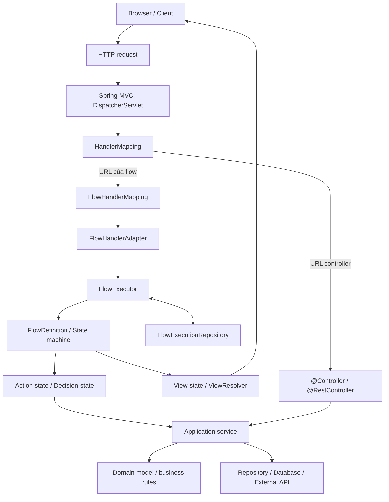
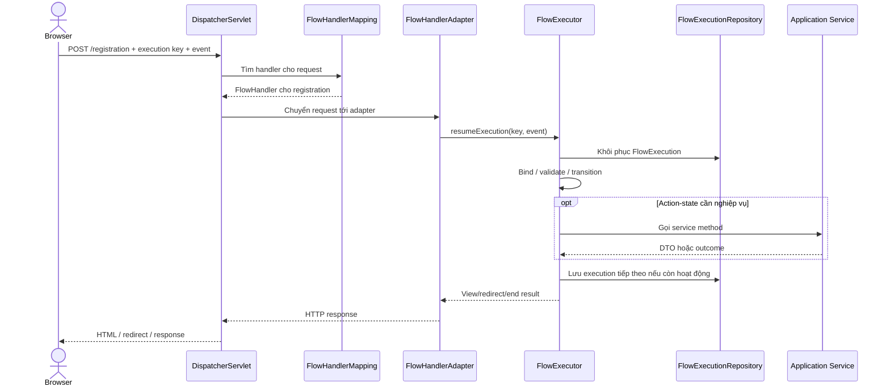

# Trách nhiệm của Web Flow, Spring MVC và tầng nghiệp vụ

## 1. Vì sao cần phân định trách nhiệm?

Một ứng dụng Spring có thể chứa nhiều loại tương tác: mở một trang thông tin, gửi một biểu mẫu, gọi REST API, thực hiện quy trình đăng ký nhiều bước, xác nhận đơn hàng hoặc gọi một dịch vụ bên ngoài. Nếu mọi quyết định điều hướng, xử lý form và nghiệp vụ đều được viết trong controller, controller dễ trở thành nơi chứa quá nhiều trách nhiệm.

**Spring Web Flow** giúp mô hình hóa những hành trình web có nhiều bước bằng **state**, **event**, **transition** và **subflow**. Nó quản lý trạng thái của một lần tương tác qua nhiều HTTP request. **Spring MVC** tiếp nhận request, định tuyến tới handler và tích hợp với view/HTTP. **Tầng nghiệp vụ** thực hiện quy tắc domain, kiểm tra dữ liệu, transaction và truy cập hệ thống bên ngoài.

Ba phần phối hợp với nhau nhưng giải quyết ba câu hỏi khác nhau:

- **Spring MVC:** Request này đi vào ứng dụng qua URL nào và được handler nào tiếp nhận?
- **Spring Web Flow:** Người dùng đang ở bước nào của hành trình, event hiện tại có hợp lệ không và cần chuyển tới state nào?
- **Tầng nghiệp vụ:** Nghiệp vụ thực sự cần làm gì, dữ liệu có hợp lệ theo quy tắc domain không và thay đổi dữ liệu có được commit không?

> **Nguyên tắc thiết kế:** Spring MVC quản lý biên HTTP và routing; Spring Web Flow quản lý vòng đời của hành trình nhiều bước; service/domain quản lý nghiệp vụ. Flow có thể gọi service và yêu cầu MVC render view, nhưng không nên biến XML flow thành nơi viết toàn bộ quy tắc kinh doanh.

Bài thuộc chương **Bản đồ Web Flow** của module `SPRING_WEB_FLOW`. Module học cách mô hình hóa hành trình nhiều bước qua state, event, transition và subflow, đồng thời thực hành form binding, validation, quản lý scope/phiên, tích hợp Spring MVC, kiểm thử và phục hồi lỗi. Vì vậy, việc hiểu ranh giới trách nhiệm là nền tảng để lựa chọn đúng thành phần cho từng việc.

### Mục tiêu học tập

Sau bài này, bạn có thể:

1. Giải thích vai trò của Spring MVC, Spring Web Flow và tầng nghiệp vụ.
2. Mô tả request đi qua `DispatcherServlet`, `FlowHandlerMapping`, `FlowHandlerAdapter` và `FlowExecutor`.
3. Phân biệt flow definition, flow execution, HTTP session và business transaction.
4. Chọn khi nào dùng controller thông thường, khi nào dùng Web Flow.
5. Thiết kế flow XML gọi service mà không nhúng quy tắc domain vào transition.
6. Đặt binding/validation, scope, security, transaction và exception handling ở đúng tầng.
7. Kiểm thử từng lớp và xử lý lỗi execution/session có chủ đích.

## 2. Bản đồ trách nhiệm tổng thể



Sơ đồ thể hiện các đường đi chính:

- Request tới URL được quản lý bởi Web Flow được MVC định tuyến tới flow handler.
- Request tới endpoint thông thường được MVC chuyển tới controller.
- Cả flow và controller có thể gọi cùng application service.
- Service thực hiện nghiệp vụ và làm việc với repository/database hoặc hệ thống ngoài.
- Flow executor sử dụng flow definition và execution repository để tiếp tục một hành trình đã bắt đầu.

**Không phải mọi request Spring MVC đều đi qua Web Flow.** Web Flow là một integration trong Spring MVC, không phải một tầng bắt buộc cho mọi URL.

## 3. Trách nhiệm của Spring MVC

Spring MVC là framework web của Spring, tổ chức việc xử lý HTTP request/response và kết nối handler với view hoặc response body. Trong kiến trúc này, MVC chịu trách nhiệm ở **biên giao tiếp web**.

Các nhiệm vụ thường thuộc Spring MVC:

- Tiếp nhận request qua `DispatcherServlet`.
- Chọn handler dựa trên URL, HTTP method và các điều kiện mapping.
- Chạy controller, handler adapter và các interceptor phù hợp.
- Đọc request parameter, header, path variable và body theo cơ chế MVC.
- Kết nối view resolver với view công nghệ đang sử dụng.
- Trả HTML, JSON, redirect hoặc HTTP status.
- Phối hợp với filter/security, multipart và các thành phần servlet.

Ví dụ controller thông thường:

```java
package com.example.web;

import com.example.registration.RegistrationService;
import org.springframework.stereotype.Controller;
import org.springframework.ui.Model;
import org.springframework.web.bind.annotation.GetMapping;
import org.springframework.web.bind.annotation.PostMapping;
import org.springframework.web.bind.annotation.RequestMapping;

@Controller
@RequestMapping("/help")
public class HelpController {

    private final RegistrationService registrationService;

    public HelpController(RegistrationService registrationService) {
        this.registrationService = registrationService;
    }

    @GetMapping
    public String showHelp(Model model) {
        model.addAttribute("topics", registrationService.helpTopics());
        return "help/index";
    }
}
```

Controller trên nhận một request trang trợ giúp và trả logical view name. Nó không cần flow execution vì tương tác này chỉ có một trang và không có hành trình nhiều bước cần giữ trạng thái.

Một endpoint REST cũng thuộc Spring MVC:

```java
@RestController
@RequestMapping("/api/registrations")
class RegistrationApiController {

    private final RegistrationService registrationService;

    RegistrationApiController(RegistrationService registrationService) {
        this.registrationService = registrationService;
    }

    @PostMapping
    RegistrationReceipt create(@RequestBody RegistrationCommand command) {
        return registrationService.register(command);
    }
}
```

Controller REST chuyển request DTO sang application service và trả response. Không cần biến REST request thành `view-state` chỉ vì ứng dụng có sử dụng Web Flow ở một phần khác.

### 3.1. MVC không tự quản lý hành trình wizard

Spring MVC có thể xử lý nhiều endpoint:

```text
GET  /registration/details
POST /registration/details
GET  /registration/review
POST /registration/review
```

Nhưng nếu tự triển khai wizard bằng nhiều controller, ứng dụng phải tự quản lý bước hiện tại, dữ liệu bản nháp, quyền truy cập bước, back/refresh, session, validation và cách phục hồi khi người dùng gửi URL cũ.

Spring Web Flow cung cấp mô hình state machine và execution để quản lý những vấn đề này tập trung hơn. MVC vẫn là tầng nhận request và phát response; flow handler là integration point để MVC chuyển request vào Web Flow.

## 4. Trách nhiệm của Spring Web Flow

Spring Web Flow tập trung vào **conversation-oriented navigation**: một hành trình có trạng thái và kéo dài qua nhiều HTTP request.

Các nhiệm vụ chính:

- Đọc flow definition đã đăng ký trong `FlowDefinitionRegistry`.
- Tạo hoặc tiếp tục một `FlowExecution`.
- Theo dõi current state, event và transition.
- Xử lý view-state, action-state, decision-state, subflow-state và end-state.
- Phối hợp form binding/validation với view-state.
- Quản lý flow variables và các scope của execution.
- Lưu/khôi phục execution thông qua `FlowExecutionRepository`.
- Tạo view/flow URL và điều phối việc hiển thị sau event.
- Hỗ trợ kiểm thử flow như một state machine.

Ví dụ flow:

```xml
<?xml version="1.0" encoding="UTF-8"?>
<flow xmlns="http://www.springframework.org/schema/webflow"
      xmlns:xsi="http://www.w3.org/2001/XMLSchema-instance"
      xsi:schemaLocation="
        http://www.springframework.org/schema/webflow
        https://www.springframework.org/schema/webflow/spring-webflow.xsd">

    <var name="registration"
         class="com.example.registration.RegistrationDraft" />

    <view-state id="enterDetails"
                view="registration/details"
                model="registration">
        <transition on="next" to="review" />
        <transition on="cancel" to="cancelled" bind="false" />
    </view-state>

    <view-state id="review" view="registration/review">
        <transition on="back" to="enterDetails" validate="false" />
        <transition on="confirm" to="saveRegistration" />
    </view-state>

    <action-state id="saveRegistration">
        <evaluate expression="registrationService.register(registration)"
                  result="flowScope.receipt" />
        <transition on="success" to="completed" />
    </action-state>

    <end-state id="completed" />
    <end-state id="cancelled" />
</flow>
```

Flow này mô tả hành trình:

1. Hiển thị form `enterDetails`.
2. Nhận event `next`, bind và validate dữ liệu rồi tới `review`.
3. Cho phép quay lại bằng `back`.
4. Nhận `confirm` và gọi service trong `saveRegistration`.
5. Nếu action trả outcome thành công, kết thúc ở `completed`.

Web Flow quyết định **khi nào gọi** `registrationService.register(...)` theo hành trình. Service mới quyết định **đăng ký có hợp lệ và được ghi nhận hay không**.

### 4.1. Flow definition không phải flow execution

| Khái niệm | Ý nghĩa | Ví dụ |
| --- | --- | --- |
| `FlowDefinition` | Bản mô tả state/transition, có thể dùng lại | Definition `registration` |
| `FlowExecution` | Một lần chạy cụ thể của definition | Người A đang ở `review` |
| `FlowExecutor` | API điều phối launch/resume/refresh | Tiếp tục execution sau POST |
| `FlowExecutionRepository` | Lưu và khôi phục execution/key/snapshot theo cấu hình | Resume wizard từ request sau |
| `FlowDefinitionRegistry` | Đăng ký và tra cứu definition theo flow ID | ID `registration` |

Hai người dùng cùng chạy `registration` có hai flow executions riêng, dù cùng dùng một definition. Dữ liệu trong flow scope của người này không được chia sẻ với người kia chỉ vì cùng flow ID.

## 5. Tầng nghiệp vụ: nơi quyết định dữ liệu và hành động thật

Tầng nghiệp vụ thường bao gồm:

- **Application service:** điều phối use case như đăng ký, đặt hàng, thanh toán.
- **Domain model/domain service:** quy tắc nghiệp vụ và invariant.
- **Repository:** lưu/đọc dữ liệu nghiệp vụ.
- **Integration adapter:** giao tiếp với payment gateway, email, CRM hoặc dịch vụ khác.
- **Transaction boundary:** xác định phạm vi commit/rollback cho một thao tác nghiệp vụ.

Ví dụ service:

```java
package com.example.registration;

import org.springframework.stereotype.Service;
import org.springframework.transaction.annotation.Transactional;

@Service
public class RegistrationService {

    private final RegistrationRepository repository;

    public RegistrationService(RegistrationRepository repository) {
        this.repository = repository;
    }

    @Transactional
    public RegistrationReceipt register(RegistrationDraft draft) {
        validateBusinessRules(draft);

        Registration registration = Registration.from(draft);
        Registration saved = repository.save(registration);

        return new RegistrationReceipt(saved.getId());
    }

    private void validateBusinessRules(RegistrationDraft draft) {
        if (repository.existsByEmail(draft.getEmail())) {
            throw new DuplicateRegistrationException(draft.getEmail());
        }
    }
}
```

Đây là ví dụ minh họa: class repository, domain object, DTO và exception phải được ứng dụng định nghĩa. Điểm quan trọng là service:

- Kiểm tra quy tắc nghiệp vụ, ví dụ email đã đăng ký hay chưa.
- Tạo domain object và lưu dữ liệu.
- Đặt transaction tại ranh giới thao tác ghi.
- Trả kết quả để flow quyết định bước giao diện tiếp theo.

### 5.1. Không đưa quy tắc domain vào flow XML

Không nên biến flow thành nơi viết những biểu thức dài như:

```xml
<!-- Không nên nhúng nhiều quy tắc nghiệp vụ vào flow definition. -->
<decision-state id="checkEligibility">
    <if test="registration.age >= 18
              and registration.country == 'VN'
              and registrationService.hasQuota(registration.email)
              and registration.creditScore > 650"
        then="review"
        else="rejected" />
</decision-state>
```

Cấu hình này trộn nhiều chính sách nghiệp vụ, truy cập service và điều kiện điều hướng. Khi quy tắc thay đổi, XML khó kiểm thử đơn vị và khó tái sử dụng ở REST, batch hoặc một luồng khác.

Nên chuyển việc đánh giá thành một service/domain operation:

```java
public enum Eligibility {
    APPROVED,
    NEEDS_REVIEW,
    REJECTED
}

@Service
public class EligibilityService {
    public Eligibility assess(RegistrationDraft draft) {
        // Tập trung chính sách nghiệp vụ ở đây.
        // Ví dụ này chỉ minh họa vị trí của quy tắc.
        return Eligibility.APPROVED;
    }
}
```

Sau đó flow chỉ điều phối outcome:

```xml
<action-state id="assessEligibility">
    <evaluate expression="eligibilityService.assess(registration)" />
    <transition on="APPROVED" to="review" />
    <transition on="NEEDS_REVIEW" to="manualReview" />
    <transition on="REJECTED" to="rejected" />
</action-state>
```

Flow vẫn có thể chứa một điều kiện đơn giản như `registration.isBusinessCustomer()` để chọn trang. Tuy nhiên, những quy tắc domain quan trọng nên có tên, test và hợp đồng rõ trong tầng nghiệp vụ.

## 6. Request đi từ Spring MVC tới Web Flow như thế nào?

Khi Web Flow được tích hợp với Spring MVC, một flow request đi qua các thành phần chính:



### Vai trò từng thành phần

| Thành phần | Trách nhiệm |
| --- | --- |
| `DispatcherServlet` | Điểm vào của Spring MVC cho HTTP request |
| `FlowHandlerMapping` | Nhận diện URL và tìm flow handler dựa trên flow registry |
| `FlowHandlerAdapter` | Chuyển request/response thành thao tác với Web Flow |
| `FlowExecutor` | Launch, resume hoặc refresh execution |
| `FlowDefinitionRegistry` | Cung cấp definition theo flow ID |
| `FlowExecutionRepository` | Lưu/khôi phục execution theo key và snapshot policy |
| `ViewResolver` | Tìm view template khi flow yêu cầu render |
| Spring service | Thực thi use case và quy tắc nghiệp vụ |

`FlowHandlerMapping` và `FlowHandlerAdapter` là hai phần integration riêng: một phần **chọn handler**, phần còn lại **thực thi handler**. Không nên nhầm chúng với `FlowExecutor`, vốn điều phối state machine.

### 6.1. Cấu hình XML tối thiểu

Một cấu hình minh họa:

```xml
<webflow:flow-registry id="flowRegistry"
                       base-path="/WEB-INF/flows">
    <webflow:flow-location
        id="registration"
        path="/WEB-INF/flows/registration/registration-flow.xml" />
</webflow:flow-registry>

<webflow:flow-executor id="flowExecutor"
                       flow-registry="flowRegistry" />

<bean class="org.springframework.webflow.mvc.servlet.FlowHandlerMapping">
    <property name="flowRegistry" ref="flowRegistry" />
    <property name="order" value="0" />
</bean>

<bean class="org.springframework.webflow.mvc.servlet.FlowHandlerAdapter">
    <property name="flowExecutor" ref="flowExecutor" />
</bean>
```

Đoạn cấu hình cần đặt trong Spring bean context có khai báo namespace/schema `webflow`. Ứng dụng cũng phải cấu hình `DispatcherServlet`, view resolver và các bean nghiệp vụ. Giá trị `order` cần được chọn sao cho flow mapping được kiểm tra trước các mapping rộng có thể bắt cùng URL; không sao chép máy móc khi ứng dụng có routing riêng.

### 6.2. Không phải mỗi state là một MVC handler

URL `/registration` thường xác định **flow ID**. Các state `enterDetails`, `review` và `saveRegistration` là nội bộ definition. Khi người dùng bấm nút, request gửi execution key và event để engine tiếp tục state hiện hành.

Vì thế không cần viết ba controller method riêng chỉ để đi từ nhập thông tin sang xem lại rồi xác nhận. Một flow handler xử lý hành trình; flow definition xác định state transition.

## 7. Ai chịu trách nhiệm form binding và validation?

Cần phân biệt **validation đầu vào giao diện** và **validation nghiệp vụ**.

### 7.1. View-state và binding

Một `view-state` có thể chỉ định model:

```xml
<view-state id="enterDetails"
            view="registration/details"
            model="registration">
    <binder>
        <binding property="fullName" required="true" />
        <binding property="email" required="true" />
    </binder>
    <transition on="next" to="review" />
</view-state>
```

Web Flow phối hợp binding/conversion/validation với view-state. Khi người dùng submit event `next`:

1. Request parameters được bind vào model theo binder.
2. Converter chuyển kiểu nếu cần.
3. Validation kiểm tra dữ liệu theo cấu hình.
4. Nếu hợp lệ, transition có thể được thực hiện.
5. Nếu không hợp lệ, flow thường giữ ở view-state và render lỗi để người dùng sửa.

`required="true"` chỉ là một phần của kiểm tra field; không thay thế mọi constraint hoặc quy tắc domain. Ví dụ email có đúng định dạng hay không cần converter/validator phù hợp.

### 7.2. Spring MVC binding và Web Flow binding có liên hệ nhưng không đồng nhất

Controller MVC có thể dùng `@ModelAttribute`, `@Valid` và `BindingResult` để bind/validate một request handler. Web Flow có binder và lifecycle gắn với view-state, model của flow và execution.

Cả hai có thể dùng các converter/validator của Spring tùy cấu hình, nhưng không nên nghĩ rằng mỗi request flow sẽ đi qua một method `@PostMapping` để dùng `BindingResult` của controller. Flow adapter tiếp nhận request và Web Flow quản lý event/state.

### 7.3. Validation nghiệp vụ thuộc service/domain

Ví dụ email đã tồn tại hoặc người dùng không được phép đăng ký một loại dịch vụ là quy tắc nghiệp vụ. Cần kiểm tra trong service/domain trước khi ghi, ngay cả khi form đã validate thành công.

Không dựa vào hidden field, JavaScript validation hoặc binder để bảo vệ invariant dữ liệu. Người dùng có thể bỏ qua UI và gửi HTTP request trực tiếp.

## 8. Ai quản lý state và dữ liệu qua nhiều request?

Web Flow quản lý **trạng thái của hành trình**, còn session là cơ chế phiên ở tầng servlet và database là nơi lưu dữ liệu nghiệp vụ bền vững. Ba thứ này không đồng nhất.

| Khái niệm | Phạm vi | Ví dụ |
| --- | --- | --- |
| HTTP session | Phiên của người dùng trong servlet container | Authentication/session attributes |
| Flow execution | Một lần chạy flow | Người A đang ở bước review |
| `flowScope` | Dữ liệu trong flow session | Bản nháp đăng ký qua nhiều bước |
| `viewScope` | Dữ liệu của view-state hiện hành | Danh sách lựa chọn của trang |
| `requestScope` | Một request | Giá trị tạm trong lần xử lý |
| `flashScope` | Dữ liệu ngắn hạn theo cơ chế Web Flow | Thông báo sau thao tác |
| `conversationScope` | Conversation có thể gồm flow và subflow | Dữ liệu cần chia sẻ trong một hành trình lớn |

Ví dụ flow variable:

```xml
<var name="registration"
     class="com.example.registration.RegistrationDraft" />
```

Biến `registration` thuộc execution cụ thể. Khi người dùng chuyển từ `enterDetails` sang `review`, dữ liệu vẫn còn trong flow scope nếu execution còn hoạt động.

**Không nên lưu connection, EntityManager, stream hoặc object graph khổng lồ trong flow scope.** Repository có thể cần serialize/snapshot execution. Chỉ giữ DTO/bản nháp vừa phải hoặc ID tham chiếu; dữ liệu cần tồn tại lâu nên lưu qua application service/database.

## 9. Transaction thuộc service, không kéo dài suốt wizard

Một hành trình đăng ký có thể kéo dài nhiều phút hoặc lâu hơn:

```text
HTTP request 1: mở form
   -> pause tại enterDetails
   -> response trả về browser

HTTP request 2: người dùng bấm next
   -> resume
   -> pause tại review
   -> response trả về browser

HTTP request 3: người dùng bấm confirm
   -> resume
   -> gọi RegistrationService.register()
   -> commit transaction
   -> end-state completed
```

**Không mở một database transaction kéo dài từ lúc vào flow cho tới lúc người dùng xác nhận.** Người dùng có thể đóng browser, mất mạng hoặc để form mở hàng giờ. Giữ transaction/connection xuyên khoảng thời gian đó sẽ gây khóa, tiêu tốn tài nguyên và làm hệ thống khó mở rộng.

Đặt transaction ở service method thực hiện một thao tác nghiệp vụ có ranh giới rõ:

```java
@Service
public class RegistrationService {

    @Transactional
    public RegistrationReceipt register(RegistrationCommand command) {
        // Kiểm tra invariant, ghi dữ liệu và commit/rollback
        // trong một transaction ngắn.
        return performRegistration(command);
    }
}
```

Flow chỉ điều phối **khi nào gọi** service. Service chịu trách nhiệm **phạm vi transaction**. Nếu một quy trình cần giữ trạng thái nghiệp vụ lâu, dùng draft/status record, reservation, timeout hoặc saga/process manager tùy domain; không giữ transaction database mở trong lúc chờ form.

### 9.1. Retry và side effect

Một event `confirm` có thể được gửi lại do double-click, browser retry, nhiều tab hoặc snapshot cũ. PRG giúp giảm form resubmission sau Refresh nhưng không bảo đảm exactly-once.

Với thao tác tạo đơn/thanh toán:

- Tạo operation/idempotency key ở tầng ứng dụng.
- Lưu kết quả lệnh và áp dụng unique constraint phù hợp.
- Gửi idempotency key tới payment provider nếu API hỗ trợ.
- Dùng transactional outbox hoặc cơ chế chống lặp cho email/event ngoài database.
- Nếu response bị mất, tra cứu trạng thái command trước khi thực hiện lại.

Không dùng flow execution key làm idempotency key mặc định; execution key phục vụ khôi phục state, không phải định danh nghiệp vụ bền vững.

## 10. Security: ai kiểm tra quyền và ở đâu?

Spring Security thường nằm ở tầng filter/security chain và có thể kết hợp method security ở service. Web Flow điều phối state nhưng **không thay thế authorization**.

| Nhu cầu | Nơi xử lý thích hợp |
| --- | --- |
| Xác thực người dùng | Spring Security / identity provider |
| Bảo vệ URL entry point của flow | HTTP security rules |
| Kiểm tra quyền thao tác nghiệp vụ | Service/domain authorization |
| Bảo vệ request POST | CSRF protection theo cấu hình |
| Kiểm tra quyền với bản ghi cụ thể | Service/repository theo principal và resource |
| Ẩn/hiện nút theo UI | Có thể hỗ trợ UX, không thay thế kiểm tra server |

Ví dụ: flow `editProfile` có thể chỉ hiển thị profile của người đang đăng nhập, nhưng service `profileService.update(userId, command)` vẫn phải kiểm tra người đó có quyền cập nhật user ID tương ứng.

Không coi flow ID hoặc execution key là bí mật đủ để cấp quyền. Người dùng có thể chỉnh request parameter; server phải kiểm tra quyền trên mỗi thao tác quan trọng.

## 11. Exception và phục hồi: phân chia đúng tầng

Có nhiều loại lỗi với cách xử lý khác nhau:

| Loại lỗi | Nơi phát hiện/chịu trách nhiệm chính | Hướng xử lý |
| --- | --- | --- |
| Form thiếu field hoặc sai kiểu | Binding/conversion/validation của view-state | Giữ form, hiển thị message |
| Quy tắc domain không thỏa | Service/domain | Trả outcome nghiệp vụ hoặc validation result |
| Database lỗi trong transaction | Repository/service | Rollback, log và xử lý exception |
| Payment timeout | Integration service | Tra cứu trạng thái, retry có idempotency |
| Không có transition cho event | Flow definition/execution | Từ chối event, kiểm tra state và request |
| Execution key hết hạn | Execution repository/handler | Thông báo phiên hết hạn, khôi phục an toàn |
| View template không tồn tại | MVC view resolution | Sửa view ID/resolver hoặc error page |
| User không có quyền | Security/service authorization | Từ chối truy cập, không tiết lộ dữ liệu |

**Exception không tự động trở thành event `error`.** Nếu service ném exception, cần exception handler hoặc contract action rõ ràng. Một transition `on="error"` chỉ phù hợp khi action thực sự phát outcome đó theo cách đã cấu hình.

### 11.1. Không khởi động lại nghiệp vụ một cách mù quáng

Nếu execution key cũ không còn tồn tại, handler có thể trả lỗi hoặc áp dụng chính sách khởi chạy flow mới tùy cấu hình. Đối với form nhập thông tin, bắt đầu lại có thể chấp nhận. Với thao tác thanh toán/đặt hàng, trước tiên phải kiểm tra database/provider xem command trước đã thành công chưa.

Flow phục hồi UI; service/database phục hồi tính đúng đắn nghiệp vụ.

## 12. Khi nào dùng controller, khi nào dùng Web Flow?

Không cần dùng Web Flow cho mọi trang. Lựa chọn phụ thuộc vào **độ dài và tính trạng thái của hành trình**, không phải chỉ số lượng URL.

| Tình huống | Spring MVC controller | Spring Web Flow |
| --- | --- | --- |
| Trang thông tin tĩnh/đơn giản | Phù hợp | Thường không cần |
| REST API trả JSON | Phù hợp | Thường không phù hợp |
| CRUD một màn hình | Phù hợp | Có thể quá nặng |
| Form đơn giản, submit một lần | Phù hợp | Không nhất thiết |
| Wizard nhiều bước có Back/Cancel | Có thể tự làm nhưng phải quản lý state | Rất phù hợp |
| Quy trình cần giữ bản nháp qua nhiều request | Có thể dùng session/service | Phù hợp nếu hành trình cần state machine |
| Quy trình có nhánh theo lựa chọn | Controller có thể xử lý | Decision/action/subflow thể hiện rõ hơn |
| Subflow dùng lại nhiều bước | Tự tổ chức phức tạp | Có hỗ trợ subflow |
| Công việc nền kéo dài nhiều giờ/ngày | Không giữ HTTP request | Web Flow cũng không thay thế job/workflow engine bền vững |

### 12.1. Dùng controller khi tương tác đơn giản

Ví dụ cập nhật một preference:

```java
@PostMapping("/preferences")
public String updatePreferences(
        @Valid @ModelAttribute PreferencesForm form,
        BindingResult bindingResult) {

    if (bindingResult.hasErrors()) {
        return "preferences/edit";
    }

    preferencesService.update(form);
    return "redirect:/preferences";
}
```

Một request, một model form, một thao tác cập nhật và redirect. Không cần tạo flow chỉ để quản lý hai state.

### 12.2. Dùng Web Flow khi hành trình có nhiều bước thực sự

Ví dụ onboarding:

- Bước 1: nhập thông tin cá nhân.
- Bước 2: chọn gói dịch vụ.
- Bước 3: xác minh thông tin.
- Bước 4: xem lại.
- Bước 5: xác nhận.
- Các nhánh có thể quay lại, hủy, yêu cầu bổ sung hoặc đi qua subflow.

Flow definition diễn tả rõ state machine và execution repository giúp khôi phục hành trình giữa các request. Service vẫn xử lý nghiệp vụ ở từng bước.

### 12.3. Kết hợp controller và flow trong cùng ứng dụng

Một ứng dụng có thể dùng:

```text
GET /home                 -> HomeController
GET /help                 -> HelpController
GET /api/accounts         -> RestController
GET /registration         -> Web Flow: registration
GET /checkout             -> Web Flow: checkout
GET /receipts/{id}        -> ReceiptController
```

Controller phục vụ các trang/endpoint độc lập và trang tra cứu kết quả. Web Flow quản lý các wizard. Cả hai có thể gọi chung application services, nhưng không nên có hai nơi triển khai cùng một quy tắc nghiệp vụ.

## 13. Subflow: Web Flow chia nhỏ hành trình ra sao?

Khi một quy trình lớn có bước con tái sử dụng, Web Flow hỗ trợ `subflow-state`. Ví dụ checkout cần chọn địa chỉ giao hàng; registration cũng cần xác minh địa chỉ.

Flow cha:

```xml
<subflow-state id="collectAddress" subflow="address">
    <input name="customerId" value="flowScope.customerId" />
    <transition on="addressSaved" to="review" />
    <transition on="cancelled" to="enterDetails" />
</subflow-state>
```

Flow con `address` thực hiện các bước nhập/chọn địa chỉ và kết thúc bằng outcome `addressSaved` hoặc `cancelled`. Flow cha nhận outcome và tiếp tục transition tương ứng.

Phân chia trách nhiệm:

- **Parent flow:** điều phối hành trình lớn và quyết định khi nào gọi quy trình địa chỉ.
- **Subflow:** sở hữu các state của bước địa chỉ và trả outcome.
- **Service:** kiểm tra/lưu địa chỉ thật, áp dụng quyền và transaction.
- **Spring MVC:** tiếp nhận HTTP request cho conversation đang hoạt động.

Subflow không phải một request/controller riêng cho mỗi bước. Nó là một flow session con trong conversation của Web Flow.

## 14. Cấu trúc dự án và cách tổ chức code

Một cấu trúc tham khảo:

```text
src/main/java/
└── com/example/
    ├── config/
    │   └── WebFlowConfig.java
    ├── web/
    │   ├── HelpController.java
    │   └── ReceiptController.java
    ├── registration/
    │   ├── RegistrationService.java
    │   ├── RegistrationDraft.java
    │   ├── Registration.java
    │   └── RegistrationRepository.java
    └── checkout/
        ├── CheckoutService.java
        ├── CheckoutDraft.java
        └── OrderRepository.java

src/main/webapp/WEB-INF/
├── flows/
│   ├── registration/
│   │   ├── registration-flow.xml
│   │   ├── details.jsp
│   │   └── review.jsp
│   └── checkout/
│       ├── checkout-flow.xml
│       └── review.jsp
└── views/
    ├── help/
    └── receipts/
```

Một số quy tắc tổ chức:

- Đặt flow XML gần các view mà nó điều phối để dễ bảo trì.
- Giữ model form/draft đơn giản, có thể lưu trong execution.
- Giữ service ở package nghiệp vụ, không đặt logic vào controller hoặc XML.
- Dùng repository cho persistence, không truy cập database trực tiếp từ view.
- Dùng DTO/command cho dữ liệu qua ranh giới web và service.
- Giữ cấu hình flow/MVC ở package config.
- Nếu nhiều flow dùng chung một service, để service làm nơi giữ quy tắc domain dùng chung.

Không bắt buộc dùng đúng cấu trúc thư mục trên. Quan trọng là ranh giới phụ thuộc rõ ràng và không để view/XML gọi trực tiếp persistence implementation.

## 15. Kiểm thử theo từng trách nhiệm

Không một test đơn lẻ nào chứng minh toàn bộ kiến trúc đúng. Chia kiểm thử theo lớp:

### 15.1. Test service/domain

Kiểm tra quy tắc nghiệp vụ độc lập với Web Flow:

- Đăng ký thành công khi dữ liệu hợp lệ.
- Từ chối email đã tồn tại.
- Transaction rollback khi repository thất bại.
- Authorization ngăn người dùng cập nhật tài nguyên không thuộc quyền.
- Cùng idempotency key không tạo bản ghi trùng khi retry.

Service test không cần tạo HTTP request hoặc flow execution.

### 15.2. Test flow definition/execution

Kiểm tra state machine:

- Launch flow vào state ban đầu.
- Event `next` chuyển đúng state khi dữ liệu hợp lệ.
- Validation failure giữ người dùng ở view-state.
- Event `back`/`cancel` hoạt động theo transition.
- Action-state gọi service với tham số phù hợp.
- Decision-state chọn nhánh đúng.
- Subflow trả outcome mà parent xử lý đúng.
- End-state kết thúc execution.

Mock service giúp test outcome mà không cần database thật trong mọi ca.

### 15.3. Test Spring MVC integration

Kiểm tra các thành phần HTTP:

- URL flow được `FlowHandlerMapping` nhận diện.
- URL controller vẫn tới đúng controller.
- `FlowHandlerAdapter` sử dụng đúng `FlowExecutor`.
- Form action giữ execution key hiện hành.
- POST/redirect/GET hoạt động theo cấu hình.
- View resolver tìm được template.
- CSRF, session timeout và exception mapping có hành vi đúng.

### 15.4. Test end-to-end

Dùng browser hoặc HTTP client để mô phỏng hành trình thật:

1. Mở flow.
2. Nhập dữ liệu sai và xác nhận thông báo.
3. Sửa dữ liệu rồi đi tiếp.
4. Quay lại, chỉnh một field và xem kết quả được cập nhật.
5. Xác nhận và kiểm tra bản ghi nghiệp vụ.
6. Refresh/back hoặc submit lại để xác minh không tạo dữ liệu trùng.
7. Hết session và kiểm tra trang phục hồi.
8. Thử truy cập tài nguyên bằng user không có quyền.

### Bảng phân loại nhanh

| Test | Thành phần chính | Điều cần chứng minh |
| --- | --- | --- |
| Unit test domain/service | Tầng nghiệp vụ | Quy tắc và transaction |
| Flow execution test | Web Flow | State/event/transition |
| MVC integration test | Spring MVC + Web Flow | Routing, adapter, view |
| Repository test | Persistence | Lưu/khôi phục execution và dữ liệu |
| Browser E2E | Toàn ứng dụng | Hành trình người dùng thực tế |

## 16. Các sai lầm kiến trúc thường gặp

| Sai lầm | Hệ quả | Cách sửa |
| --- | --- | --- |
| Viết mọi bước wizard thành controller methods | Lặp logic điều hướng, quản lý session thủ công | Dùng flow definition khi hành trình đủ phức tạp |
| Dùng Web Flow cho REST API đơn giản | Tăng độ phức tạp không cần thiết | Dùng Spring MVC REST controller |
| Nhúng quy tắc domain dài vào XML | Khó test/tái sử dụng | Chuyển vào service/domain |
| Để controller trực tiếp truy cập nhiều repository | Controller biết quá nhiều về nghiệp vụ | Gọi application service |
| Giữ transaction suốt thời gian người dùng điền form | Khóa/tài nguyên kéo dài, khó mở rộng | Transaction ngắn trong service method |
| Lưu EntityManager/connection trong flowScope | Lỗi serialization và vòng đời | Lưu DTO/ID, mở transaction theo service call |
| Dùng execution key làm authorization | Có thể lộ dữ liệu nếu kiểm tra quyền không đầy đủ | Kiểm tra principal và quyền ở service/security |
| Nghĩ validation UI là đủ | Request trực tiếp có thể bỏ qua UI | Kiểm tra invariant trong service |
| Gọi payment trong on-render | Refresh/render lại có thể thu tiền lặp | Action rõ ràng và idempotent |
| Nghĩ exception tự trở thành event error | Transition không chạy như kỳ vọng | Exception handler/outcome contract |
| Không test handler mapping order | URL flow bị controller khác bắt trước | Kiểm tra MVC mappings và order |
| Dùng flow scope làm database | Mất draft khi session/execution hết hạn | Persistence nghiệp vụ bền vững |

## 17. Quy trình lựa chọn và triển khai

Khi bắt đầu một chức năng mới:

1. **Mô tả hành trình người dùng.** Có bao nhiêu bước, event, nhánh, subflow và điểm kết thúc?
2. **Chọn HTTP entry point.** Trang đơn giản/API dùng controller; wizard nhiều bước có state dùng flow.
3. **Thiết kế flow definition.** Đặt view-state, action-state, decision-state, subflow-state và end-state.
4. **Xác định model/scope.** Dữ liệu nào chỉ cần trong view, dữ liệu nào qua cả flow, dữ liệu nào phải lưu database?
5. **Thiết kế service contract.** Mỗi action gọi một use case rõ, trả DTO/outcome có ý nghĩa.
6. **Đặt transaction boundary.** Không kéo dài transaction qua thời gian pause; commit theo thao tác nghiệp vụ.
7. **Đặt validation/security.** Kiểm tra form ở view-state và kiểm tra invariant/authorization ở service.
8. **Thiết kế phục hồi.** Xử lý stale execution, session timeout, retry và side effect idempotent.
9. **Kiểm thử từng lớp.** Domain, flow execution, MVC integration, persistence và end-to-end.
10. **Quan sát production.** Log flow ID, state, event và correlation ID an toàn; đo thời gian service và lỗi repository.

### Câu hỏi tự luyện

1. Spring MVC và Spring Web Flow cùng tham gia một request theo thứ tự nào?
2. `FlowHandlerMapping` khác `FlowHandlerAdapter` ở điểm nào?
3. `FlowExecutor` và `FlowExecutionRepository` có cùng nhiệm vụ không?
4. Tại sao flow definition có thể dùng chung nhưng hai người dùng phải có execution riêng?
5. Nên đặt quy tắc “email đã tồn tại” ở binder, flow XML hay service? Vì sao?
6. Một flow có thể gọi cùng service với REST controller không?
7. Tại sao không giữ database transaction trong lúc execution tạm dừng ở view-state?
8. `flowScope` khác HTTP session và database ở điểm nào?
9. Khi service ném exception, vì sao không thể mặc định mong transition `on="error"` chạy?
10. Execution key có thay thế authorization hoặc idempotency key không?
11. Khi nào dùng subflow thay vì copy một vài state vào flow cha?
12. Một wizard có Back/Cancel, validation và nhiều nhánh có lợi ích gì khi mô hình hóa bằng Web Flow?
13. Những test nào chứng minh state machine đúng, những test nào chứng minh routing HTTP đúng?
14. Nếu người dùng refresh sau khi xác nhận, service phải làm gì để không tạo bản ghi trùng?

## Tài liệu tham khảo

- [Spring Web Flow 3.0.2 Reference Guide](https://docs.spring.io/spring-webflow/docs/3.0.2/reference/)
- [Spring Web Flow 3.0.2 — Spring MVC Integration](https://docs.spring.io/spring-webflow/docs/3.0.2/reference/#_spring_mvc_integration)
- [Spring Web Flow 3.0.2 — Flow Executor](https://docs.spring.io/spring-webflow/docs/3.0.2/reference/#_flow_executor)
- [Spring Web Flow 3.0.2 — Flow Registry](https://docs.spring.io/spring-webflow/docs/3.0.2/reference/#_flow_registry_options)
- [Spring Web Flow 3.0.2 — Flow Execution Lifecycle](https://docs.spring.io/spring-webflow/docs/3.0.2/reference/#_flow_execution_lifecycle)
- [Spring Framework Reference — Web MVC](https://docs.spring.io/spring-framework/reference/web/webmvc.html)
- [Spring Framework Reference — Declarative Transaction Management](https://docs.spring.io/spring-framework/reference/data-access/transaction/declarative.html)
- [Spring Security Reference](https://docs.spring.io/spring-security/reference/)

Các ví dụ tập trung vào cách phân chia trách nhiệm trong ứng dụng Spring Web Flow tích hợp Spring MVC. Khi áp dụng vào dự án, cần đối chiếu phiên bản framework, view technology, security configuration, repository implementation và các quy tắc nghiệp vụ thực tế.
