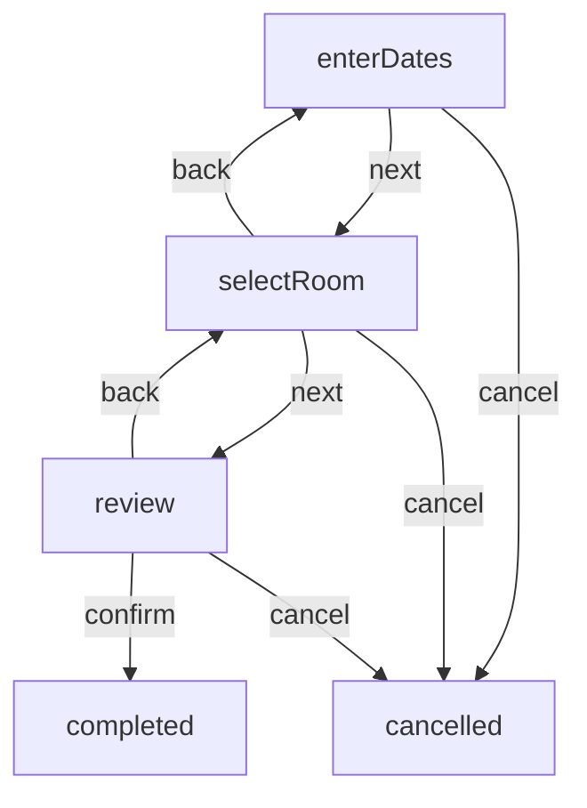

# Đối chiếu với điều khiển các bước bằng controller và HTTP session

## 1. Cùng một bài toán, hai cách tổ chức

Một ứng dụng đặt lịch có thể yêu cầu người dùng đi qua các bước: chọn ngày và số khách, chọn phòng, xem lại thông tin rồi xác nhận hoặc hủy. Spring MVC có thể triển khai hành trình này bằng nhiều controller endpoint và lưu bản nháp trong **HTTP session**. Spring Web Flow (SWF) cũng giải quyết được bài toán đó, nhưng mô hình hóa hành trình như một **state machine** gồm state, event và transition.

Hai cách đều có thể đúng. Khác biệt chính nằm ở nơi lưu trạng thái điều hướng và cách mô tả các đường đi:

- Với **controller + HTTP session**, lập trình viên tự quyết định endpoint nào được gọi tiếp theo, thuộc tính session nào cần giữ, khi nào xóa và làm sao ngăn người dùng bỏ qua bước.
- Với **Spring Web Flow**, flow definition khai báo state, event, transition và scope; flow execution giữ ngữ cảnh của một lần chạy, còn execution repository hỗ trợ tiếp tục hành trình qua nhiều request.

Bài này đối chiếu hai cách bằng cùng một ví dụ đặt lịch. Mục tiêu không phải chọn một công nghệ cho mọi ứng dụng, mà là nhận diện **độ phức tạp điều phối** nào khiến Web Flow có lợi và khi nào controller thông thường vẫn là giải pháp gọn hơn.

## 2. Controller và HTTP session: trạng thái được quản lý thủ công

Trong mô hình controller, mỗi bước thường tương ứng với một endpoint. Controller đọc dữ liệu từ request, kiểm tra bước hiện tại, cập nhật bản nháp và redirect sang endpoint tiếp theo.

```text
GET  /booking/dates
POST /booking/dates
GET  /booking/room
POST /booking/room
GET  /booking/review
POST /booking/confirm
POST /booking/cancel
```

Một cách phổ biến là dùng `@SessionAttributes` để giữ form object giữa các request của cùng controller:

```java
@Controller
@RequestMapping("/booking")
@SessionAttributes("bookingForm")
public class BookingWizardController {

    private final BookingService bookingService;

    public BookingWizardController(BookingService bookingService) {
        this.bookingService = bookingService;
    }

    @ModelAttribute("bookingForm")
    public BookingForm newBookingForm() {
        return new BookingForm();
    }

    @GetMapping("/dates")
    public String dates() {
        return "booking/dates";
    }

    @PostMapping("/dates")
    public String saveDates(
            @Valid @ModelAttribute("bookingForm") BookingForm form,
            BindingResult errors) {
        if (errors.hasErrors()) {
            return "booking/dates";
        }
        return "redirect:/booking/room";
    }

    @GetMapping("/room")
    public String room() {
        return "booking/room";
    }

    @PostMapping("/room")
    public String saveRoom(
            @Valid @ModelAttribute("bookingForm") BookingForm form,
            BindingResult errors) {
        if (errors.hasErrors()) {
            return "booking/room";
        }
        return "redirect:/booking/review";
    }

    @GetMapping("/review")
    public String review() {
        return "booking/review";
    }

    @PostMapping("/confirm")
    public String confirm(
            @ModelAttribute("bookingForm") BookingForm form,
            SessionStatus sessionStatus,
            Principal principal) {
        bookingService.confirm(form, principal.getName());
        sessionStatus.setComplete();
        return "redirect:/booking/success";
    }

    @PostMapping("/cancel")
    public String cancel(SessionStatus sessionStatus) {
        sessionStatus.setComplete();
        return "redirect:/booking/cancelled";
    }
}
```

Đây là skeleton để thấy cách tổ chức. Ứng dụng thật cần kiểm tra dữ liệu và quyền sở hữu ở mỗi endpoint, bổ sung CSRF, giới hạn thời gian bản nháp, xử lý lỗi service và tránh xác nhận trùng.

### 2.1. HTTP session không tự hiểu các bước nghiệp vụ

`@SessionAttributes("bookingForm")` giúp Spring MVC giữ model attribute trong session qua các request của controller. `SessionStatus.setComplete()` báo rằng controller đã hoàn thành việc sử dụng các session attributes được quản lý bởi `@SessionAttributes`.

Nhưng session attribute chỉ là **dữ liệu**. Nó không tự biết:

- Người dùng đang ở bước nào.
- Event `next` có hợp lệ ở bước hiện tại không.
- Có được quay lại bước trước hay không.
- URL review có được truy cập trước khi chọn phòng hay không.
- Hai tab có đang chỉnh sửa cùng một bản nháp hay không.
- Khi nào một nhánh kết thúc và dữ liệu cần được dọn dẹp.

Lập trình viên phải tự mô hình hóa các quy tắc này bằng endpoint, field trạng thái, service và kiểm tra điều kiện.

### 2.2. Cách thủ công thường phát triển theo thời gian

Khi quy trình thêm nhánh, controller có thể cần một thuộc tính `currentStep`/`wizardStatus`, điều kiện xác minh bước trước, endpoint Back/Next/Cancel/Retry, logic khôi phục khi session hết hạn, cơ chế phân biệt hai bản nháp và quy tắc dọn session attribute. Chi phí duy trì tăng theo số nhánh và trạng thái cần phối hợp.

Đây không phải lỗi của Spring MVC. Controller cho phép lập trình viên tự do xây dựng những quy tắc đó; vấn đề là các quy tắc điều hướng có thể bị phân tán qua nhiều endpoint.

## 3. Spring Web Flow: trạng thái điều hướng được mô tả trong flow

Trong Web Flow, hành trình được định nghĩa thành các state. Một state có thể hiển thị view, thực hiện action, rẽ nhánh, gọi subflow hoặc kết thúc flow.



Flow XML thể hiện trực tiếp các đường đi:

```xml
<flow xmlns="http://www.springframework.org/schema/webflow">
    <var name="bookingForm"
         class="com.example.booking.BookingForm" />

    <view-state id="enterDates"
                view="booking/dates"
                model="bookingForm">
        <transition on="next" to="selectRoom" />
        <transition on="cancel" to="cancelled"
                    bind="false" validate="false" />
    </view-state>

    <view-state id="selectRoom"
                view="booking/room"
                model="bookingForm">
        <transition on="next" to="review" />
        <transition on="back" to="enterDates"
                    bind="false" validate="false" />
        <transition on="cancel" to="cancelled"
                    bind="false" validate="false" />
    </view-state>

    <view-state id="review"
                view="booking/review"
                model="bookingForm">
        <transition on="back" to="selectRoom"
                    bind="false" validate="false" />
        <transition on="confirm" to="completed">
            <evaluate
                expression="bookingService.confirm(bookingForm)" />
        </transition>
        <transition on="cancel" to="cancelled"
                    bind="false" validate="false" />
    </view-state>

    <end-state id="completed"
               view="externalRedirect:contextRelative:/booking/success" />
    <end-state id="cancelled"
               view="externalRedirect:contextRelative:/booking/cancelled" />
</flow>
```

Ví dụ giả định flow registry, flow executor, Spring MVC integration, view resolver, `bookingService` và các view đã được cấu hình. Khi event `next` được gửi ở `enterDates`, flow chỉ có transition đã khai báo để đi tới `selectRoom`. Người dùng không tự chọn state đích bằng cách gửi một tham số `step` tùy ý.

### 3.1. State machine thay cho bộ điều phối rải trong controller

Trong flow definition, `view-state` biểu diễn màn hình cần tương tác; `on` xác định event; `to` xác định state đích; `action-state`/`decision-state` thực hiện xử lý hoặc rẽ nhánh; `subflow-state` gọi flow con; `end-state` xác định điểm kết thúc.

Nhờ vậy, đường đi của hành trình tập trung trong một flow definition. Service vẫn đảm nhận nghiệp vụ như kiểm tra tồn kho, tính giá và tạo booking; Web Flow điều phối **khi nào** những service đó được gọi theo state/event.

## 4. Đối chiếu cùng một bước: nhận dữ liệu và chuyển tiếp

| Việc cần làm | Controller + session | Spring Web Flow |
| --- | --- | --- |
| Hiển thị bước nhập ngày | GET endpoint `/booking/dates` | `view-state id="enterDates"` |
| Nhận submit | POST method trong controller | Event gửi tới flow execution |
| Kiểm tra dữ liệu | `@Valid`, `BindingResult`, service | Binding/validator của view-state và service |
| Chuyển tới bước phòng | Redirect URL `/booking/room` | Transition `on="next" to="selectRoom"` |
| Giữ form qua request | `@SessionAttributes` hoặc session store tự quản | Flow scope của execution |
| Quay lại | Endpoint Back và kiểm tra trạng thái thủ công | Transition `on="back"` |
| Kết thúc/hủy | Dọn session attribute bằng quy tắc ứng dụng | End-state và lifecycle của flow execution |

Điểm khác biệt không nằm ở việc bên nào “có session”. Cả hai có thể sử dụng HTTP session. Khác biệt là **Web Flow có execution model và repository chuyên biệt cho vòng đời của một hành trình**, trong khi controller thường phải tự kết hợp session data với logic endpoint.

## 5. Execution repository khác với một session attribute tự quản

Khi flow được khởi chạy, Web Flow tạo một **flow execution**. Execution chứa thông tin về flow đang chạy, state hiện tại và dữ liệu trong các scope của flow. Qua mỗi request, trình duyệt tiếp tục execution bằng URL/continuation key do Web Flow cấp.

Repository chịu trách nhiệm lưu và khôi phục execution theo implementation được cấu hình. Với repository dựa trên HTTP session, session của trình duyệt là nơi lưu trạng thái execution; các repository khác có thể có cách lưu trữ khác.

```text
Controller tự quản:
  HTTP session
    └── bookingForm
    └── currentStep
    └── flags do ứng dụng tự định nghĩa

Spring Web Flow:
  Flow execution repository
    └── execution key
    └── flow execution
         ├── active state
         ├── flowScope
         ├── view/conversation context
         └── thông tin cần để resume
```

### 5.1. Execution key là gì?

Một continuation URL của Web Flow thường có tham số execution, ví dụ:

```text
/booking?execution=e1s2
```

`e1s2` chỉ là giá trị minh họa. Ứng dụng phải dùng URL do Web Flow cung cấp trong view, chẳng hạn `flowExecutionUrl`, thay vì tự ghép hoặc tự tăng key.

Execution key giúp repository xác định execution/snapshot cần tiếp tục. Nó không phải booking ID trong database, ID người dùng, bằng chứng xác thực, giá trị step do client được quyền thay đổi hay URL có thể giữ làm bookmark lâu dài sau khi flow kết thúc/session hết hạn.

Controller + session có thể tự tạo draft ID/token, nhưng khi đó ứng dụng phải tự triển khai quy tắc tra cứu, quyền truy cập, hết hạn, phiên bản và concurrency.

### 5.2. Snapshot và browser Back

Tùy repository và chính sách retention, Web Flow có thể giữ các mốc execution để hỗ trợ khôi phục một trạng thái trước đó. Browser Back vì vậy có thể tương tác với execution key cũ; khả năng resume còn phụ thuộc snapshot có tồn tại và session còn hợp lệ.

Controller + session không tự có snapshot lịch sử. Nếu muốn Back quay lại đúng dữ liệu trước đó, ứng dụng phải lưu bản nháp/version hoặc định nghĩa cách khôi phục trạng thái. Chỉ giữ một mutable object trong session thường có nghĩa các giá trị cũ đã bị ghi đè.

**Không nên coi snapshot Web Flow là transaction database hoặc bản nháp lưu bền vững.** Khôi phục execution không rollback side effect đã commit ở service.

## 6. Scope: dữ liệu thuộc hành trình hay thuộc cả HTTP session?

Trong controller approach, `@SessionAttributes` hoặc `HttpSession` thường lưu form object theo session. Nếu một người dùng mở hai wizard cùng lúc và cả hai dùng cùng key `bookingForm`, dữ liệu có thể bị dùng chung hoặc ghi đè nếu ứng dụng không phân biệt từng draft.

Web Flow cung cấp các scope có vòng đời khác nhau:

| Scope | Vòng đời | Ví dụ |
| --- | --- | --- |
| `requestScope` | Một request | Thông tin tạm khi xử lý request |
| `viewScope` | Một view-state hiện tại | Danh sách lựa chọn và dữ liệu render riêng cho màn hình |
| `flowScope` | Một flow execution | `bookingForm`, `bookingId` của một wizard |
| `conversationScope` | Root flow và các subflow trong conversation | Ngữ cảnh được chia sẻ có chủ đích giữa các flow con |
| HTTP session | Phiên trình duyệt | Danh tính đăng nhập và dữ liệu session-wide |

### 6.1. Nhiều tab và nhiều execution

Giả sử người dùng mở hai lần `/booking` trong cùng browser session:

- Execution A có `flowScope.bookingForm` cho ngày 10/12.
- Execution B có `flowScope.bookingForm` cho ngày 15/12.

Hai form thuộc hai flow execution riêng. Chúng không nên ghi đè nhau chỉ vì cùng tên biến. Khi dùng controller + một session attribute duy nhất, ứng dụng cần tự tạo key theo draft ID hoặc dùng một map có quản lý vòng đời để đạt sự cô lập tương tự.

Tuy nhiên, không nên đưa toàn bộ entity graph hoặc file lớn vào flow scope. Chọn DTO nhỏ và ID; dữ liệu nghiệp vụ bền vững vẫn nên ở database.

### 6.2. Dữ liệu nào nên nằm ở đâu?

- Dữ liệu cần qua các bước của một wizard: flow scope hoặc draft record.
- Dữ liệu chỉ phục vụ một màn hình: view scope.
- Dữ liệu dùng chung có chủ đích giữa root flow và subflow: conversation scope.
- Thông tin đăng nhập/thuộc tính phiên dùng chung: HTTP session theo cơ chế bảo mật của ứng dụng.
- Dữ liệu cần tồn tại sau timeout/deploy: database hoặc kho lưu bền vững, không phải flow scope.

## 7. Back, Next và kiểm soát đường đi

Trong controller approach, mỗi endpoint phải tự kiểm tra người dùng đã hoàn tất bước trước hay chưa. Ví dụ:

```java
@PostMapping("/review")
public String review(
        @ModelAttribute("bookingForm") BookingForm form,
        HttpSession session) {

    BookingProgress progress =
        (BookingProgress) session.getAttribute("bookingProgress");

    if (progress == null || !progress.isRoomSelected()) {
        return "redirect:/booking/room";
    }

    return "booking/review";
}
```

Nếu quên kiểm tra ở một endpoint, người dùng có thể truy cập trực tiếp URL và bỏ qua bước. Khi thêm nhánh, nhiều endpoint cần giữ quy tắc nhất quán.

Trong Web Flow, event chỉ được xử lý theo transition được khai báo ở active state. Ví dụ `confirm` chỉ tồn tại trong state `review`. Gửi `confirm` khi flow đang ở `enterDates` không tự động làm flow chuyển tới completed.

### 7.1. Web Flow không thay thế authorization

Transition giới hạn **đường đi của flow**, không chứng minh người dùng có quyền với booking. Service vẫn phải kiểm tra booking thuộc người dùng hiện tại, quyền thay đổi ngày/số khách, tình trạng phòng và giá/chính sách hủy còn hiệu lực.

Một người dùng có thể gửi HTTP request thủ công, không nhất thiết phải thao tác theo nút trên giao diện. Vì vậy, kiểm tra quyền và invariant nghiệp vụ luôn phải nằm ở phía server.

## 8. Validation và xử lý lỗi

Controller + session có thể dùng Bean Validation:

```java
@PostMapping("/dates")
public String saveDates(
        @Valid @ModelAttribute("bookingForm") BookingForm form,
        BindingResult errors) {
    if (errors.hasErrors()) {
        return "booking/dates";
    }
    return "redirect:/booking/room";
}
```

Web Flow gắn model với view-state và có thể thực hiện binding/validation trước transition theo cấu hình:

```xml
<view-state id="enterDates"
            view="booking/dates"
            model="bookingForm">
    <binder>
        <binding property="checkIn" required="true" />
        <binding property="checkOut" required="true" />
        <binding property="guestCount" required="true" />
    </binder>
    <transition on="next" to="selectRoom" />
    <transition on="cancel" to="cancelled"
                bind="false" validate="false" />
</view-state>
```

Ở cả hai cách, validation ở form không thay thế kiểm tra nghiệp vụ trong service. Ngày có thể hợp lệ về định dạng nhưng phòng đã hết chỗ; người dùng có thể có quyền xem booking nhưng không có quyền sửa booking đó.

### 8.1. Khác biệt khi xử lý exception

Controller approach thường dùng `@ExceptionHandler`, `@ControllerAdvice`, redirect/error page hoặc exception resolver. Flow có thể cấu hình exception handler ở flow/state hoặc xử lý lỗi trong action/service rồi đi tới recovery state.

Không nên biến mọi lỗi thành validation error:

- Lỗi input: giữ form và chỉ rõ field cần sửa.
- Xung đột dữ liệu: tải lại dữ liệu mới hoặc yêu cầu người dùng xác nhận lại.
- Lỗi hạ tầng: hiển thị thông báo an toàn và ghi log có correlation ID.
- Hủy do người dùng: kết thúc nhánh hủy, không ghi giao dịch.

## 9. HTTP session, flow execution và transaction là ba vòng đời khác nhau

Một nhầm lẫn thường gặp là cho rằng vì Web Flow giữ execution qua nhiều request nên nó cũng giữ transaction database mở trong cùng khoảng thời gian. Điều đó không đúng.

| Thành phần | Mục đích | Vòng đời điển hình |
| --- | --- | --- |
| HTTP session | Gắn request với phiên người dùng | Có thể tồn tại lâu hơn một flow |
| Flow execution | Giữ state và ngữ cảnh của một hành trình | Từ launch tới end-state hoặc hết hạn |
| Database transaction | Đảm bảo một nhóm thao tác đọc/ghi nhất quán | Nên ngắn, thường trong một lần gọi service |

Với controller + session, không nên mở transaction ở endpoint đầu rồi giữ nó trong lúc người dùng chuyển trang. Với Web Flow cũng vậy. Dù dùng flow-managed persistence context, không nên giữ database transaction hoặc connection mở qua thời gian người dùng chờ.

Một mô hình service-layer an toàn cho cả hai cách là:

1. Load dữ liệu bằng transaction đọc.
2. Giữ DTO/ID trong session hoặc flow scope.
3. Khi submit, service mở transaction mới.
4. Tải lại entity, kiểm tra quyền và version.
5. Ghi thay đổi và commit.

Nếu chọn Flow Managed Persistence Context, phải hiểu rõ listener, persistence context và end-state `commit="true"` theo phiên bản SWF/Hibernate. Đây là một lựa chọn riêng, không phải hệ quả tự động của việc dùng flow execution.

## 10. Kiểm thử: controller nhiều endpoint và flow execution

Hai cách đều cần kiểm thử theo hành vi người dùng, nhưng trọng tâm khác nhau.

### 10.1. Controller + session

Các ca thử nên bao gồm:

- Gọi trực tiếp URL review khi chưa chọn phòng.
- Gửi POST hai lần hoặc gửi event sai thứ tự.
- Hai tab cùng dùng một session attribute.
- Session hết hạn giữa bước nhập và bước xác nhận.
- Cancel có dọn đúng session attributes không.
- Validation lỗi có giữ dữ liệu hợp lệ đã nhập không.
- Người dùng sửa booking không thuộc sở hữu của mình.

Test thường dùng MockMvc, MockHttpSession và service mock hoặc database test.

### 10.2. Spring Web Flow

Các ca thử nên bao gồm:

- Launch flow vào đúng initial state.
- Event next/back đi đúng transition.
- Event không được khai báo không thể bỏ qua state.
- Model trong flow scope còn sau nhiều request.
- Execution key được lấy từ response/view hiện hành.
- Session timeout hoặc snapshot bị loại được xử lý rõ ràng.
- Subflow trả đúng outcome cho parent.
- End-state chỉ gọi commit/ghi dữ liệu ở nhánh thành công.

Có thể kết hợp flow-level test support với HTTP integration test qua Spring MVC. Test HTTP cần giữ cookie/session xuyên request; không hardcode execution key.

### 10.3. Ma trận so sánh

| Tình huống | Controller + session | Spring Web Flow |
| --- | --- | --- |
| Bỏ qua bước bằng URL trực tiếp | Tự kiểm tra progress ở endpoint | Event/transition chỉ hợp lệ tại active state |
| Hai wizard trong một session | Tự quản lý draft ID/key riêng | Mỗi lần launch có flow execution riêng |
| Back/Next | Tự viết endpoint và quy tắc | Khai báo transition |
| Nhiều nhánh nghiệp vụ | Điều kiện rải trong controller/service | State/decision/action/subflow trong flow definition |
| Session timeout | Tự khôi phục hoặc báo hết hạn | Repository không thể resume execution đã hết hạn; cần recovery |
| Kiểm thử | Test từng endpoint và session | Test state/event cùng integration request |
| API stateless | Phù hợp nếu thiết kế theo request/resource | Thường không phải lựa chọn tự nhiên cho API stateless |

## 11. Khi nào controller + HTTP session là lựa chọn tốt?

Không phải mọi biểu mẫu nhiều trang đều cần Web Flow. Controller thông thường thường phù hợp khi:

- Quy trình chỉ có hai hoặc ba bước tuyến tính.
- Mỗi bước có endpoint độc lập và không có nhiều nhánh.
- Dữ liệu được lưu ngay sau mỗi thao tác, không cần giữ một conversation tạm.
- Hành trình là CRUD đơn giản, wizard ngắn hoặc trang cấu hình.
- Ứng dụng cần API REST stateless, nơi client gửi resource ID và mỗi request có thể xử lý độc lập.
- Nhóm đã có quy ước controller/service rõ ràng và chi phí state machine lớn hơn lợi ích.

Trong trường hợp này, dùng `@SessionAttributes` hoặc draft ID có thể đủ. Hãy thiết kế dọn dẹp session rõ ràng và kiểm tra progress ở server.

### 11.1. Không nên lưu quá nhiều vào session

HTTP session thường được giữ lâu hơn một request và có thể được replicate giữa node. Lưu nhiều entity, collection lớn hoặc file bytes vào session làm tăng heap, băng thông replication và rủi ro serialization. Nên giữ ID/DTO nhỏ và tải dữ liệu qua service.

## 12. Khi nào Spring Web Flow đáng cân nhắc?

Web Flow có lợi khi quy trình có **nhiều state và đường đi thực sự cần được quản lý**:

- Nhiều nhánh theo kết quả validation hoặc loại hồ sơ.
- Back/Next/Cancel có semantics rõ ràng.
- Một màn hình có các event ở cùng state như tìm kiếm/phân trang.
- Có subflow dùng lại giữa nhiều hành trình.
- Cần quản lý riêng nhiều flow execution trong cùng HTTP session.
- Cần kiểm soát resume, browser history và execution lifecycle.
- Flow có bước tương tác kéo dài nhưng vẫn cần giữ ngữ cảnh của một lần chạy.

Ví dụ quy trình cấp tín dụng: nhập hồ sơ, kiểm tra tự động, yêu cầu bổ sung tài liệu, thẩm định thủ công, phê duyệt hoặc từ chối. Khi các nhánh và bước phục hồi nhiều, flow definition giúp nhìn thấy cấu trúc điều phối rõ hơn.

### 12.1. Chi phí của Web Flow

Web Flow thêm các khái niệm cần học và vận hành:

- Flow registry, flow executor, handler mapping/adapter.
- State, event, transition, scope và execution key.
- Snapshot/retention tùy repository.
- Cấu hình view integration, binding và validation.
- Cách xử lý lỗi khi flow/session hết hạn.

Nếu quy trình đơn giản, những khái niệm này có thể làm ứng dụng phức tạp hơn mức cần thiết. Chỉ nên chọn Web Flow khi lợi ích từ việc mô hình hóa state machine đủ lớn.

## 13. Bảng quyết định lựa chọn

| Câu hỏi | Nghiêng về controller + session | Nghiêng về Spring Web Flow |
| --- | --- | --- |
| Có bao nhiêu bước? | Ít, tuyến tính | Nhiều, có nhiều nhánh |
| Back/Next có quy tắc phức tạp? | Không, chỉ redirect đơn giản | Có, cần ràng buộc theo state |
| Nhiều flow con dùng lại? | Ít hoặc không có | Có subflow dùng chung |
| Dữ liệu cần giữ? | Có thể lưu draft/resource ngay | Cần giữ ngữ cảnh một execution qua các state |
| Nhiều tab/wizard song song? | Tự triển khai draft key/cô lập dữ liệu | Execution riêng cho từng lần launch |
| API cần stateless? | Phù hợp tự nhiên hơn | Thường không phù hợp bằng |
| Nhóm muốn điều phối trong XML/state machine? | Không cần | Có |
| Hệ thống đã có quy ước MVC đơn giản? | Giữ controller nếu đáp ứng tốt | Chỉ bổ sung khi độ phức tạp tăng |

Một nguyên tắc thực tế: **đếm số nhánh và số quy tắc chuyển bước**, không chỉ đếm số trang. Một wizard mười trang tuyến tính có thể vẫn làm tốt bằng controller; một quy trình bốn trang nhưng có nhiều nhánh, subflow và recovery có thể phù hợp với Web Flow hơn.

## 14. Các lỗi thiết kế thường gặp ở cả hai cách

| Lỗi | Controller + session | Spring Web Flow |
| --- | --- | --- |
| Tin dữ liệu client | Tin hidden field `step` hoặc ID | Tin event hoặc execution key như quyền truy cập |
| Dữ liệu dùng chung giữa tab | Dùng một session attribute mutable | Đặt dữ liệu theo session scope thay vì flow scope |
| Side effect lặp | POST bị retry tạo booking hai lần | Event/confirm được gửi lặp hoặc resume snapshot cũ |
| Transaction dài | Giữ transaction qua redirect/request | Nhầm flow execution với transaction |
| Không dọn dữ liệu | Quên `SessionStatus.setComplete()`/TTL | Flow execution và dữ liệu draft có vòng đời khác nhau |
| Lỗi quyền truy cập | Chỉ kiểm tra ở trang đầu | Cho rằng transition thay authorization |
| Bản nháp không bền vững | Chỉ lưu session | Chỉ lưu flow scope/execution snapshot |

### 14.1. Nguyên tắc dùng chung

- Dùng DTO/form object có các field được phép chỉnh sửa.
- Kiểm tra quyền sở hữu dữ liệu trong service.
- Giữ transaction ngắn và xác định rõ điểm commit.
- Bảo vệ thao tác tạo/cập nhật bằng idempotency hoặc ràng buộc database.
- Không tin hidden field, URL parameter hay event do client gửi.
- Dùng database cho dữ liệu cần tồn tại sau session timeout.
- Kiểm thử nhiều tab, retry, Back/Refresh và session hết hạn.

## 15. Bài tập thực hành

### Bài 1 — Nhận diện trạng thái điều hướng

Một controller lưu `bookingForm` trong HTTP session và có các endpoint `/dates`, `/room`, `/review`. Session object tự cho biết người dùng được đi tới bước nào không?

**Đáp án:** không. Nó chỉ giữ dữ liệu form. Ứng dụng cần thêm progress/state hoặc kiểm tra điều kiện trong từng endpoint. Trong Web Flow, active state và transition thuộc flow execution.

### Bài 2 — Chọn cách triển khai

Một form có ba bước tuyến tính, mỗi bước lưu ngay dữ liệu vào database và không có nhánh Back phức tạp.

**Gợi ý:** controller + service thường đủ và ít khái niệm hơn. Web Flow vẫn có thể dùng nhưng chưa chắc đem lại lợi ích tương xứng.

### Bài 3 — Quy trình nhiều nhánh

Hồ sơ có thể đi tới duyệt tự động, duyệt thủ công hoặc yêu cầu bổ sung giấy tờ; mỗi nhánh có thể quay lại một bước trước.

**Gợi ý:** Web Flow đáng cân nhắc vì state machine thể hiện rõ các nhánh và transition. Service vẫn xử lý quyết định nghiệp vụ và authorization.

### Bài 4 — Hai tab cùng một session

Người dùng mở hai wizard đặt phòng. Với controller approach chỉ có một session attribute `bookingForm`, chuyện gì có thể xảy ra?

**Đáp án:** hai wizard có thể ghi đè cùng object. Cần draft ID/key riêng và quản lý map/lifecycle. Web Flow tạo flow execution riêng cho từng lần launch, giúp tách dữ liệu theo flow scope.

### Bài 5 — Execution key có phải quyền truy cập?

Người dùng có một URL chứa `execution=...`. Có thể coi họ được phép sửa booking tương ứng không?

**Đáp án:** không. Key chỉ phục vụ tra cứu execution theo repository; service vẫn phải xác thực và kiểm tra quyền sở hữu booking.

### Bài 6 — Chọn nơi lưu bản nháp dài hạn

Một quy trình phê duyệt có thể mở lại sau một tuần hoặc từ thiết bị khác.

**Gợi ý:** lưu draft bền vững trong database và giữ draft ID. Không phụ thuộc HTTP session hoặc flow execution còn tồn tại sau timeout/deploy.

## 16. Tiêu chí hoàn thành

- [ ] Phân biệt được session attribute với flow execution.
- [ ] Giải thích được controller phải tự kiểm tra progress/step ở từng endpoint.
- [ ] Đọc được state, event và transition trong flow XML.
- [ ] Hiểu execution repository/key dùng để resume một flow execution.
- [ ] Phân biệt flow scope, view scope, conversation scope và HTTP session.
- [ ] Biết giới hạn của browser Back, snapshot và session timeout.
- [ ] Không nhầm flow execution với database transaction.
- [ ] Biết khi nào controller đơn giản phù hợp hơn và khi nào Web Flow có lợi.
- [ ] Có thể kiểm thử nhiều tab, retry, quyền truy cập và cleanup.

## 17. Ghi nhớ

- Controller + HTTP session là cách tự tổ chức wizard bằng endpoint, session attribute, progress flag và redirect; Spring MVC không tự cung cấp state machine cho toàn bộ hành trình.
- Spring Web Flow mô hình hóa hành trình bằng **flow execution, state, event, transition và scope**, đồng thời dùng execution repository để tiếp tục qua nhiều request.
- Cả hai cách có thể dùng HTTP session. Khác biệt là Web Flow quản lý execution của từng hành trình; controller approach phải tự xây dựng cơ chế tương ứng nếu cần.
- `@SessionAttributes` giữ model attribute cho controller và `SessionStatus.setComplete()` kết thúc việc dùng các attribute được quản lý; nó không tự kiểm soát thứ tự bước.
- Flow scope tách dữ liệu theo execution; session scope thuộc phiên người dùng. Chọn scope sai có thể làm dữ liệu hai tab bị trộn.
- Transition giới hạn đường đi trong flow nhưng không thay authorization, validation nghiệp vụ hoặc idempotency ở service.
- Flow execution không phải database transaction. Hãy giữ transaction ngắn và lưu draft bền vững ở database nếu cần mở lại sau timeout.
- Chọn công nghệ theo số nhánh và quy tắc điều phối thực tế: controller tốt cho quy trình đơn giản; Web Flow hữu ích khi state machine giúp giảm độ phức tạp.

## Tài liệu tham khảo

- [Spring Web Flow 3.0 Reference Guide — Introduction and Flow Execution](https://docs.spring.io/spring-webflow/docs/3.0.0/reference/)
- [Spring Web Flow 3.0 Reference Guide — Flow Scope and Other Scopes](https://docs.spring.io/spring-webflow/docs/3.0.0/reference/)
- [Spring Framework Reference — Annotated Controllers and Session Attributes](https://docs.spring.io/spring-framework/reference/web/webmvc/mvc-controller/ann-methods/sessionattributes.html)
- [Spring Framework Reference — HTTP Session and Web MVC](https://docs.spring.io/spring-framework/reference/web/webmvc.html)
