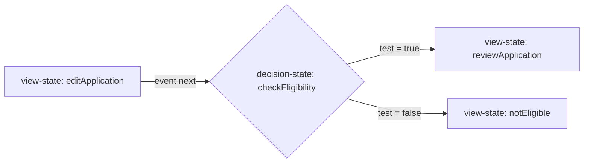
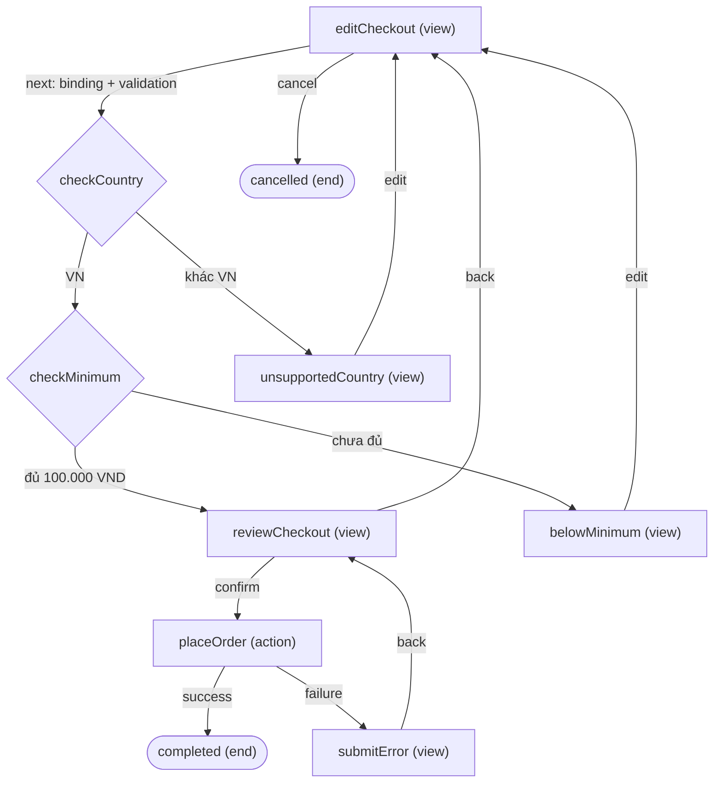

# Decision-state và điều kiện kiểm tra bằng `if` trong Spring Web Flow

Trong một hành trình web nhiều bước, không phải quyết định điều hướng nào cũng đến từ nút bấm. Sau khi người dùng nhập thông tin giao hàng, ứng dụng có thể phải tự kiểm tra khu vực phục vụ; sau khi nhận hồ sơ, hệ thống có thể tự chọn giữa bước xét duyệt và màn hình yêu cầu bổ sung giấy tờ. **Spring Web Flow (SWF)** mô hình hóa kiểu rẽ nhánh đó bằng `decision-state`: một state điều khiển, đọc một điều kiện và tự chuyển sang state tiếp theo.

Chủ đề này thuộc chương **Rẽ nhánh và kết thúc**. Bài học sẽ giải thích cách viết `<decision-state>` với `<if>`, thời điểm điều kiện được đánh giá, cách kết hợp với form binding, validation, `action-state` và `end-state`, cũng như cách kiểm thử các nhánh đúng, sai và lỗi. Mục tiêu là thể hiện rõ logic điều hướng ngay trong định nghĩa flow khi tích hợp Spring Web Flow với Spring MVC.

## 1. `decision-state` giải quyết vấn đề gì?

Hãy xét luồng đặt hàng:

1. Người mua nhập địa chỉ và chọn hình thức giao hàng.
2. Hệ thống kiểm tra địa chỉ có nằm trong khu vực phục vụ không.
3. Nếu hợp lệ, hệ thống kiểm tra tổng tiền tối thiểu; nếu không, hiển thị hướng dẫn sửa địa chỉ.
4. Nếu cả hai điều kiện đạt, người mua được xem lại và xác nhận đơn hàng.

Trong controller truyền thống, những quy tắc trên dễ bị phân tán qua nhiều nhánh `if/else` và nhiều URL. Với Spring Web Flow, **điều hướng** được biểu diễn bằng state và transition, còn **quy tắc nghiệp vụ** có thể được đặt trong service hoặc model riêng.

| Khái niệm | Trách nhiệm | Có chờ người dùng tương tác? |
|---|---|---|
| `view-state` | Hiển thị giao diện, nhận sự kiện từ form/nút bấm, binding và validation | Có |
| `action-state` | Thực thi action/service và chuyển tiếp theo kết quả action | Không |
| `decision-state` | Đánh giá điều kiện Boolean để chọn state đích | Không |
| `subflow-state` | Gọi luồng con, chờ luồng con kết thúc và trả outcome | Có thể, thông qua luồng con |
| `end-state` | Kết thúc flow và có thể trả outcome cho flow cha | Không |

**Đặc điểm cốt lõi:** `decision-state` không render một trang nhập liệu. Khi flow đi vào state này, SWF đánh giá biểu thức điều kiện rồi **chuyển tiếp ngay** theo nhánh tương ứng.

## 2. Cú pháp `<decision-state>` và `<if>`

Ví dụ tối giản:

```xml
<decision-state id="checkEligibility">
    <if test="eligibilityService.isEligible(flowScope.application)"
        then="reviewApplication"
        else="notEligible" />
</decision-state>
```

Trong ví dụ, `eligibilityService` là Spring bean do ứng dụng cung cấp, `application` là đối tượng đã được lưu trong `flowScope`, còn `reviewApplication` và `notEligible` là ID của các state khác trong cùng flow.

| Thành phần | Ý nghĩa |
|---|---|
| `<decision-state id="checkEligibility">` | Khai báo state quyết định có ID `checkEligibility` |
| `<if .../>` | Khai báo phép kiểm tra điều kiện để điều hướng |
| `test="..."` | Biểu thức trả về giá trị Boolean |
| `then="reviewApplication"` | State đích khi điều kiện đúng |
| `else="notEligible"` | State đích khi điều kiện sai |

Đọc thành câu: *Khi đến `checkEligibility`, nếu `eligibilityService.isEligible(...)` đúng thì chuyển tới `reviewApplication`, ngược lại tới `notEligible`.*

### 2.1. Khi nào điều kiện được đánh giá?

Điều kiện trong `test` được đánh giá **khi flow đi vào `decision-state`**. Nó không được tự động đánh giá lại liên tục trong lúc người dùng đang xem một `view-state` trước đó.

Một chuỗi xử lý điển hình:



Nút `next` phát sinh **event ID** để rời khỏi `editApplication`; `checkEligibility` sau đó dựa trên **Boolean** để chọn nhánh. Hai cơ chế này có thể nối tiếp nhau nhưng không phải là một.

### 2.2. Viết biểu thức `test`

Trong cấu hình SWF sử dụng SpEL, điều kiện có thể so sánh thuộc tính của model hoặc gọi phương thức chỉ đọc trên Spring bean:

```xml
<!-- So sánh giá trị chuỗi -->
<if test="flowScope.application.type == 'BUSINESS'"
    then="companyDetails" else="personalDetails" />

<!-- So sánh số, dùng toán tử dạng từ để dễ đọc trong XML -->
<if test="flowScope.cart.totalAmount ge 100000"
    then="reviewOrder" else="belowMinimum" />

<!-- Gọi quy tắc nghiệp vụ của service -->
<if test="permissionService.canProceed(flowScope.application)"
    then="reviewApplication" else="accessDenied" />
```

Ba đoạn trên là **các ví dụ độc lập**, không phải ba thẻ `<if>` để dán vào cùng một decision-state. Các tên `application`, `cart`, `permissionService` và những state đích là các thành phần mẫu do ứng dụng định nghĩa.

Các toán tử thường gặp trong biểu thức SpEL:

| Nhu cầu | Ví dụ |
|---|---|
| Bằng / khác | `flowScope.user.role == 'ADMIN'`, `flowScope.user.status != 'LOCKED'` |
| Lớn hơn, nhỏ hơn | `flowScope.cart.itemCount gt 0`, `flowScope.cart.itemCount le 10` |
| Kết hợp điều kiện | `flowScope.person.age ge 18 and flowScope.person.verified == true` |
| Một trong nhiều điều kiện | `flowScope.order.channel == 'WEB' or flowScope.order.channel == 'MOBILE'` |
| Kiểm tra `null` | `flowScope.application != null` |
| Gọi hàm trả Boolean | `approvalService.isAllowed(flowScope.application)` |

Trong thuộc tính XML, ký tự `<` phải escape thành `&lt;`; dấu `&` trong `&&` cũng phải escape. Để giảm lỗi cú pháp, có thể dùng `lt`, `le`, `gt`, `ge`, `and` và `or`.

```xml
<!-- Viết đúng cú pháp XML khi cần dấu nhỏ hơn -->
<if test="flowScope.customer.age &lt; 18"
    then="underAge" else="adult" />
```

Giá trị của `test` phải là Boolean hoặc biểu thức có thể được bộ đánh giá biểu thức chuyển hợp lệ thành Boolean. Biểu thức sai tên biến, null không được xử lý, hoặc lỗi khi gọi service có thể làm flow phát sinh exception. **Nhánh `else` không phải nơi tự động bắt exception**.

### 2.3. Bảo vệ trước dữ liệu `null`

Ví dụ `flowScope.application.customer.age ge 18` giả định `application` và `customer` luôn tồn tại. Nếu một giá trị trung gian là `null`, truy cập thuộc tính tiếp theo có thể lỗi.

Có thể kiểm tra điều kiện theo thứ tự:

```xml
<decision-state id="checkAdult">
    <if test="flowScope.application != null and
              flowScope.application.customer != null and
              flowScope.application.customer.age ge 18"
        then="adultReview"
        else="completeInformation" />
</decision-state>
```

Ngoài kiểm tra trong `test`, cần bảo đảm model đã được khởi tạo và form được validation từ bước trước. Guard như trên giúp xử lý dữ liệu thiếu theo nhánh dự kiến; nó không thay thế validation của biểu mẫu.

## 3. Ví dụ hoàn chỉnh: rẽ nhánh trong checkout

Giả sử ứng dụng có lớp `com.example.checkout.CheckoutDraft` với hai thuộc tính `shippingCountry` (chuỗi mã quốc gia) và `totalAmount` (`BigDecimal`). Quy tắc demo:

- Chỉ hỗ trợ giao hàng tại Việt Nam: `shippingCountry == 'VN'`.
- Đơn hàng phải có tổng tiền ít nhất 100.000 VND.
- Người mua xem lại thông tin trước khi xác nhận.
- Khi service đặt hàng báo thành công, flow kết thúc; khi thất bại, cho phép xem lỗi và quay lại.

Sơ đồ toàn bộ nhánh:



Định nghĩa flow XML minh họa:

```xml
<flow xmlns="http://www.springframework.org/schema/webflow"
      xmlns:xsi="http://www.w3.org/2001/XMLSchema-instance"
      xsi:schemaLocation="http://www.springframework.org/schema/webflow
                          http://www.springframework.org/schema/webflow/spring-webflow-2.0.xsd">

    <!-- Khởi tạo một model cho flow, dùng lại qua nhiều màn hình. -->
    <var name="checkout" class="com.example.checkout.CheckoutDraft" />

    <view-state id="editCheckout"
                view="checkout/edit"
                model="checkout">
        <transition on="next" to="checkCountry"
                    bind="true" validate="true" />
        <transition on="cancel" to="cancelled" bind="false" />
    </view-state>

    <!-- Quyết định thứ nhất: có hỗ trợ quốc gia giao hàng không? -->
    <decision-state id="checkCountry">
        <if test="flowScope.checkout.shippingCountry == 'VN'"
            then="checkMinimum"
            else="unsupportedCountry" />
    </decision-state>

    <!-- Quyết định thứ hai: tổng tiền đã đạt mức tối thiểu? -->
    <decision-state id="checkMinimum">
        <if test="flowScope.checkout.totalAmount ge 100000"
            then="reviewCheckout"
            else="belowMinimum" />
    </decision-state>

    <view-state id="unsupportedCountry"
                view="checkout/unsupported-country">
        <transition on="edit" to="editCheckout" />
        <transition on="cancel" to="cancelled" />
    </view-state>

    <view-state id="belowMinimum"
                view="checkout/below-minimum">
        <transition on="edit" to="editCheckout" />
        <transition on="cancel" to="cancelled" />
    </view-state>

    <view-state id="reviewCheckout" view="checkout/review">
        <transition on="back" to="editCheckout" />
        <transition on="confirm" to="placeOrder" />
    </view-state>

    <!-- Action trả về outcome success hoặc failure. -->
    <action-state id="placeOrder">
        <evaluate expression="checkoutService.placeOrder(flowScope.checkout)" />
        <transition on="success" to="completed" />
        <transition on="failure" to="submitError" />
    </action-state>

    <view-state id="submitError" view="checkout/error">
        <transition on="back" to="reviewCheckout" />
    </view-state>

    <end-state id="completed" view="checkout/completed" />
    <end-state id="cancelled" />
</flow>
```

Đây là flow minh họa để thực hành, cần các view template, model, validator, Spring bean và cấu hình tích hợp MVC/Web Flow tương ứng để chạy trong ứng dụng thực tế. `checkoutService.placeOrder(...)` phải trả về outcome tương thích với các transition (chẳng hạn chuỗi `success` hoặc `failure`). Exception phát sinh từ service cần được xử lý riêng, không tự động biến thành `failure`.

### 3.1. Điểm nối giữa form và decision-state

Giao diện `checkout/edit` có thể gửi event bằng nút submit:

```jsp
<form:form method="post"
           action="${flowExecutionUrl}"
           modelAttribute="checkout">
    <label for="shippingCountry">Quốc gia nhận hàng</label>
    <form:input path="shippingCountry" id="shippingCountry" />
    <form:errors path="shippingCountry" />

    <button type="submit" name="_eventId_next">Tiếp tục</button>
    <button type="submit" name="_eventId_cancel">Hủy</button>
</form:form>
```

Request gửi `_eventId_next` là tín hiệu kích hoạt transition `on="next"`. Nếu binding/validation thành công, SWF chuyển vào `checkCountry` và đánh giá điều kiện. Nếu dữ liệu form không hợp lệ, bước chuyển có thể bị chặn để render lại view cùng lỗi validation, trước khi đến decision-state.

Lưu ý `totalAmount` không nên được chấp nhận trực tiếp từ một trường giá tiền tự do do người dùng gửi rồi dùng ngay để xác nhận đơn. Trong ứng dụng thật, hãy tính hoặc xác minh tổng tiền ở phía server; minh họa này giả định model đã chứa số tiền hợp lệ.

### 3.2. Tại sao dùng hai decision-state?

Hai quy tắc có ưu tiên rõ ràng: **kiểm tra quốc gia trước, rồi mới kiểm tra tổng tiền**. Việc dùng `checkCountry` và `checkMinimum` cho phép:

1. Đọc sơ đồ flow là thấy thứ tự xử lý.
2. Có state ID ổn định để log, kiểm thử và tìm nguyên nhân rẽ sai nhánh.
3. Tái cấu trúc hoặc thay thế từng quy tắc mà không sửa màn hình nhập liệu.
4. Tránh một biểu thức Boolean rất dài khó đọc và khó xác định điều kiện nào bị sai.

Với một quy tắc đơn giản, một `decision-state` và một `<if>` thường đã đủ. Với nhiều nhánh độc lập, có thể nối nhiều decision-state theo thứ tự hoặc chuyển việc tính **kết quả nghiệp vụ nhiều trạng thái** sang `action-state`.

## 4. Dữ liệu nào được dùng để rẽ nhánh?

Biểu thức `test` được đánh giá trong ngữ cảnh của flow. Một số nguồn dữ liệu thường gặp:

| Nguồn | Cách dùng điển hình | Lưu ý |
|---|---|---|
| `flowScope` | Đọc model đã được tích lũy qua nhiều bước | Phù hợp cho trạng thái wizard; dữ liệu phải được khởi tạo |
| `viewScope` | Đọc dữ liệu chỉ thuộc một view-state | Không dựa vào viewScope cũ sau khi rời view |
| `requestParameters` | Đọc tham số request hiện tại | Do client kiểm soát, cần kiểm tra trước |
| Spring bean/service | `eligibilityService.isEligible(...)` | Nên là phép kiểm tra rõ ràng, ít tác dụng phụ |
| Kết quả action lưu trong scope | Đọc flag/result được action tính trước | Hữu ích khi kiểm tra phức tạp hoặc gọi hệ thống ngoài |

Một thiết kế tốt là **form nhập → binding/validation → kiểm tra bằng decision-state → chuyển tới view/action/end-state phù hợp**. Thông tin nhạy cảm và các quyết định như cấp quyền, duyệt giao dịch vẫn phải được xác minh ở tầng nghiệp vụ trước khi thực hiện tác động thật.

### 4.1. Dùng kết quả tính sẵn thay vì gọi service liên tục

Không phải điều kiện nào cũng nên thực thi trực tiếp trong `test`. Ví dụ, quy trình xét duyệt phụ thuộc nhiều dịch vụ ngoài hoặc phải ghi nhận lý do từ chối có thể được tách ra:

```xml
<action-state id="evaluateApplication">
    <evaluate expression="approvalEvaluationAction.execute(flowRequestContext)" />
    <transition on="success" to="routeApproval" />
    <transition on="error" to="evaluationFailed" />
</action-state>

<decision-state id="routeApproval">
    <if test="flowScope.approvalResult.approved"
        then="approvalReview"
        else="rejectionReview" />
</decision-state>
```

Trong đoạn XML, `approvalEvaluationAction` là action bean đã đăng ký với Spring và có phương thức `execute(RequestContext)` trả về một `Event`. Có thể triển khai phần cốt lõi của phương thức như sau:

```java
@Override
public Event execute(RequestContext context) {
    Application application =
            (Application) context.getFlowScope().get("application");
    try {
        ApprovalResult result = approvalService.evaluate(application);
        context.getFlowScope().put("approvalResult", result);
        return new Event(this, "success");
    } catch (ApprovalServiceUnavailableException ex) {
        return new Event(this, "error");
    }
}
```

Khi action trả `success`, transition mới đi tới `routeApproval`. Quy tắc then/else tiếp tục dựa trên Boolean `approvalResult.approved` đã tính. Nếu service không khả dụng, action chuyển sang `evaluationFailed` qua outcome `error`. Các kiểu `Application`, `ApprovalResult`, `ApprovalServiceUnavailableException` và bean `approvalEvaluationAction` là thành phần nghiệp vụ minh họa, cần được định nghĩa và cấu hình bởi ứng dụng; exception không được bắt sẽ tiếp tục đi theo cơ chế xử lý lỗi của SWF.

### 4.2. Kiểm tra quyền truy cập và dữ liệu tin cậy

Một URL hay tham số `_eventId` có thể được client tự gửi. Các kiểm tra quan trọng phải nằm ở server và được thực hiện tại thời điểm hành động nghiệp vụ. Ví dụ, `permissionService.canProceed(...)` dùng để chọn view có thể giúp giao diện rõ ràng hơn, nhưng `placeOrder` hoặc `approveApplication` vẫn cần xác minh người dùng, đối tượng và quyền truy cập trước khi ghi dữ liệu.

Đặc biệt, không dùng một field client nhập như `isAdmin=true` làm điều kiện phân quyền. Hãy lấy vai trò, quyền và trạng thái hồ sơ từ nguồn tin cậy ở phía server.

## 5. `decision-state`, `action-state` và event khác nhau ở đâu?

Nhìn bề ngoài, cả ba đều có thể đưa flow tới state kế tiếp. Tuy nhiên, tín hiệu điều hướng không giống nhau:

| Trường hợp | Cơ chế chọn nhánh | Ví dụ |
|---|---|---|
| Người dùng nhấn nút trong `view-state` | Transition khớp **event ID** | `on="next"`, `on="cancel"` |
| Flow đi vào `decision-state` | Đánh giá **Boolean** trong `<if test="...">` | `then="approved"`, `else="rejected"` |
| `action-state` gọi Java action | Kết quả action được ánh xạ thành **outcome event** | `on="success"`, `on="failure"` |
| Flow con kết thúc | ID của `end-state` trong flow con trở thành outcome cho flow cha | `on="verified"`, `on="cancelled"` |

**Khi chọn state:** dùng `decision-state` cho câu hỏi đúng/sai không cần hiển thị màn hình; dùng `action-state` khi phải thực thi nghiệp vụ và rẽ theo kết quả; dùng `view-state` khi cần người dùng nhập hoặc xác nhận thông tin.

Đừng cố tạo event ID `true`/`false` chỉ để thay thế một `decision-state`. Ngược lại, đừng nhét lệnh cập nhật cơ sở dữ liệu vào biểu thức `test`: khi flow được thực thi lại hoặc có request lặp, phép kiểm tra có tác dụng phụ sẽ khó kiểm soát.

## 6. Rẽ nhánh và kết thúc flow

Decision-state tự nó **không kết thúc flow**. Nó chỉ đưa điều khiển tới state đích. Nếu nhánh phải dừng quy trình, hãy trỏ tới `end-state`:

```xml
<decision-state id="checkApplicationState">
    <if test="flowScope.application.cancelled"
        then="cancelled"
        else="reviewApplication" />
</decision-state>

<end-state id="cancelled" />
```

Khi đi vào `end-state`, flow execution kết thúc và dữ liệu trong các scope gắn với flow không còn được dùng như trạng thái của một luồng đang chạy. Nếu flow là **subflow**, ID của `end-state` còn có ý nghĩa như outcome để flow cha chọn transition:

```xml
<!-- Định nghĩa trong flow cha -->
<subflow-state id="verifyAddress" subflow="addressVerification">
    <transition on="verified" to="reviewOrder" />
    <transition on="rejected" to="editAddress" />
</subflow-state>
```

```xml
<!-- Các state kết thúc trong flow con -->
<end-state id="verified" />
<end-state id="rejected" />
```

Việc thiết lập `end-state` đúng chỗ giúp hạn chế flow lơ lửng. Tuy nhiên, **không nên kết thúc ngay tại mọi nhánh từ chối**. Nếu người dùng có thể chỉnh sửa hồ sơ, nên đưa tới một `view-state` hiển thị lý do và có transition quay lại; chỉ dùng end-state cho trường hợp thực sự kết thúc.

## 7. Xử lý lỗi, vòng lặp và tính nhất quán

### 7.1. Điều kiện trả về `false` khác lỗi thực thi

`false` là kết quả kiểm tra hợp lệ: `then` không được chọn, hệ thống đi theo `else`. Nhưng nếu biểu thức `test` lỗi vì thuộc tính sai, model `null`, hoặc service ném exception thì đó là **lỗi xử lý**. Không nên xem lỗi đó như một kết quả từ chối nghiệp vụ.

Cách triển khai an toàn là kiểm tra dữ liệu đầu vào, tách lời gọi phức tạp sang action/service, và thiết lập cơ chế exception handling phù hợp với ứng dụng. Nếu flow cần hiển thị thông báo, hãy chuẩn hóa mã lỗi nghiệp vụ trong scope rồi điều hướng tới view có thể phục hồi.

### 7.2. Tránh vòng lặp tự động

Ví dụ có lỗi thiết kế:

```xml
<decision-state id="checkStock">
    <if test="flowScope.item.inStock"
        then="reviewItem"
        else="checkStock" />
</decision-state>
```

Nếu `inStock` luôn là `false`, state này chuyển về chính nó liên tục, không đợi người dùng thay đổi dữ liệu. Sửa bằng cách đưa nhánh thất bại tới `view-state` cho phép chọn sản phẩm khác hoặc `end-state` nếu hành trình phải dừng.

### 7.3. Dữ liệu thay đổi giữa lúc kiểm tra và xác nhận

Một quyết định như `stockService.isAvailable(...)` chỉ đúng tại thời điểm đánh giá. Hàng tồn kho, quyền người dùng và số dư có thể thay đổi trước khi người dùng bấm xác nhận.

Vì vậy:

- `decision-state` giúp điều hướng dựa trên trạng thái hiện tại.
- Tầng service phải **kiểm tra lại điều kiện quan trọng** khi đặt hàng, thanh toán hoặc phê duyệt.
- Các thao tác ghi cần có cơ chế chống gửi trùng hoặc tính lặp an toàn (idempotency) khi phù hợp.
- Không lưu đối tượng kết nối, transaction đang mở hoặc dữ liệu session không cần thiết trong `flowScope`.

### 7.4. Quay lại, refresh và nhiều tab

Flow thường giữ dữ liệu của wizard trong execution/session theo cấu hình repository của SWF. Khi người dùng quay lại rồi tiếp tục, biểu thức quyết định được đánh giá theo dữ liệu hiện có ở lần đi vào state đó. Hãy thử các trường hợp submit lại form, refresh trang, mở cùng hành trình ở nhiều tab và sử dụng flow execution URL đã cũ; một số trường hợp có thể cần thông báo khôi phục hoặc khởi động lại flow thay vì điều hướng bình thường.

## 8. Kiểm thử các nhánh bằng bảng quyết định

Một bảng case nhỏ giúp tránh sót nhánh và giúp xác minh cả binding/validation trước khi vào decision-state:

| Tình huống | Dữ liệu đầu vào | State mong đợi | Điều cần xác minh |
|---|---|---|---|
| Quốc gia được hỗ trợ, đủ tiền | `VN`, `150000` | `reviewCheckout` | Đi qua cả `checkCountry` và `checkMinimum` |
| Quốc gia không được hỗ trợ | `US`, `150000` | `unsupportedCountry` | Không đi tới `checkMinimum` |
| Quốc gia hợp lệ, tiền thấp | `VN`, `50000` | `belowMinimum` | Nhánh sai của `checkMinimum` |
| Thiếu quốc gia | Chuỗi rỗng | `editCheckout` nếu form validator chặn | Có lỗi validation, chưa vào decision-state |
| Thiếu số tiền | `VN`, `totalAmount=null` | Màn hình lỗi validation hoặc nhánh xử lý đã thiết kế | Không xảy ra lỗi null ngoài dự kiến |
| Người dùng bấm hủy | Event `cancel` | `cancelled` | Không bắt buộc binding form đang dở |
| Đặt hàng thành công | Action outcome `success` | `completed` | Flow kết thúc |
| Service báo thất bại nghiệp vụ | Action outcome `failure` | `submitError` | Hiển thị thông tin phục hồi phù hợp |
| Điều kiện gọi service ném exception | Ví dụ timeout hệ thống ngoài | Error handling đã cấu hình | Không nhầm với nhánh `else` |

Khi dùng bộ hỗ trợ kiểm thử flow của Spring Web Flow (chẳng hạn lớp kiểm thử XML flow phù hợp phiên bản), hãy khởi động flow với model thử nghiệm, gửi event `next` từ `editCheckout` và kiểm tra state cuối cùng sau các decision-state. Ngoài đường đi thành công, cần có test riêng cho mọi nhánh `else`, đầu vào `null` và lỗi service. Với kiểm thử tích hợp Spring MVC, kiểm tra thêm request có execution key, lỗi binding/validation và điều hướng khi refresh/quay lại.

Một checklist ngắn khi thấy flow đi sai nhánh:

1. Xác nhận state hiện tại và event ID từ form có đúng như transition khai báo không.
2. Kiểm tra form đã binding và validation thành công trước lúc vào `decision-state` chưa.
3. Ghi nhận giá trị thực sự của các thuộc tính trong `flowScope` được `test` đọc.
4. Xác định biểu thức trả `true`, `false` hay ném exception.
5. Đối chiếu ID trong `then`/`else` với state đích và kiểm tra xem có vòng lặp không chủ ý.
6. Kiểm thử lại các trường hợp dữ liệu đổi giữa lúc kiểm tra và lúc thực hiện action cuối.

## 9. Bài tập thực hành

Xây dựng một flow đăng ký tài khoản doanh nghiệp với những bước sau:

1. `view-state` `enterProfile` cho phép nhập tên doanh nghiệp, quốc gia và số lượng nhân viên; binding dữ liệu vào model được giữ trong `flowScope`.
2. `decision-state` `checkCountry` dùng `<if>` phân nhánh quốc gia hỗ trợ và quốc gia chưa hỗ trợ.
3. Sau đó `decision-state` `checkTeamSize` kiểm tra ngưỡng số nhân viên; người dùng đạt điều kiện đi tới `reviewProfile`, còn trường hợp thiếu điều kiện được yêu cầu điều chỉnh gói đăng ký.
4. `action-state` `createAccount` gọi service thực hiện, phát outcome `success`/`failure`. Nhánh thành công dẫn tới `end-state` `completed`; nhánh thất bại dẫn tới view giải thích và cách phục hồi.
5. Viết kiểm thử cho bốn đường đi: cả hai điều kiện đúng; quốc gia sai; số nhân viên ngoài phạm vi; binding/validation lỗi. Thêm test về exception trong service và về việc flow không tự quay vòng.

**Tiêu chí hoàn thành:** đọc riêng định nghĩa flow có thể xác định rõ *điều kiện nào được kiểm tra, khi nào nó được kiểm tra, dữ liệu lấy từ đâu, state đích là gì và trường hợp nào thực sự kết thúc flow*. Khi quy tắc nghiệp vụ thay đổi, phần điều hướng vẫn rõ ràng và đủ điểm tựa để bổ sung kiểm thử hoặc xử lý phục hồi.
