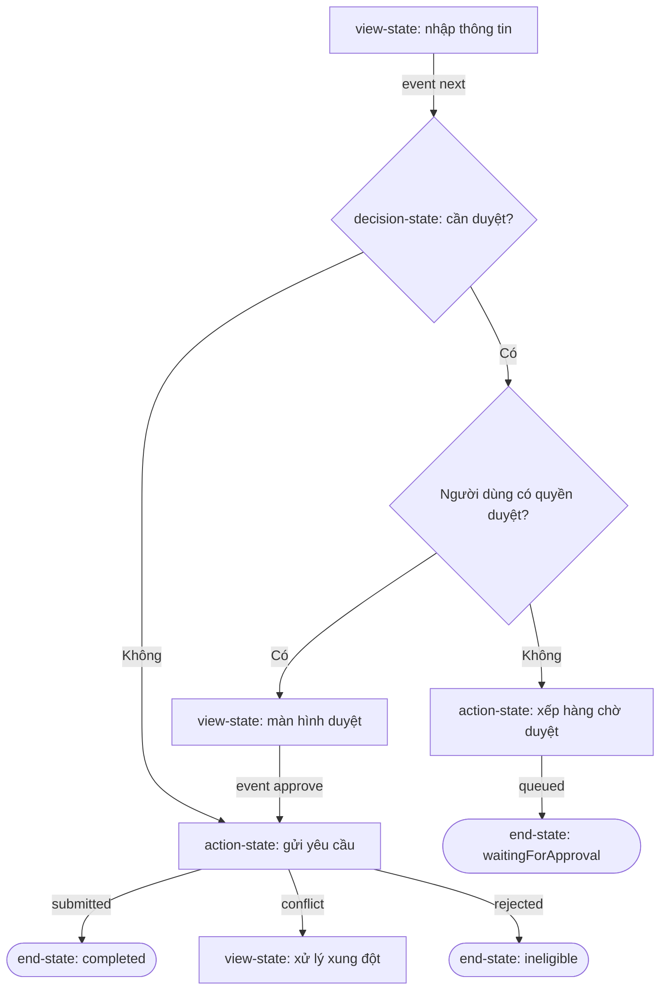
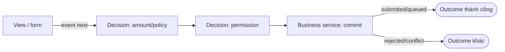

# Rẽ nhánh theo dữ liệu, kết quả nghiệp vụ hoặc quyền người dùng

## Mục tiêu học tập

Trong Spring Web Flow, một hành trình nhiều bước không phải lúc nào cũng đi theo một đường cố định. Cùng một màn hình, người dùng có thể được chuyển đến bước xác minh bổ sung, vào quy trình xét duyệt hoặc kết thúc với kết quả khác nhau. Chương **Rẽ nhánh và kết thúc** giúp mô tả các quyết định này bằng state, event và transition thay vì phân tán chúng trong nhiều Spring MVC controller.

Sau bài này, bạn có thể:

- Phân biệt **event từ giao diện**, **điều kiện dựa trên dữ liệu**, **kết quả service** và **quyết định phân quyền**.
- Dùng `<decision-state>` và `<if test="..." then="..." else="..." />` để rẽ nhánh theo dữ liệu.
- Dùng `<action-state>`, `<evaluate>` và outcome event để rẽ nhánh theo kết quả nghiệp vụ.
- Thiết kế nhánh cho người dùng có quyền và không có quyền mà vẫn bảo vệ state/transition và lệnh ghi ở server.
- Kết hợp các nhánh với `view-state`, `subflow-state` và `end-state` để kết thúc flow đúng outcome.
- Kiểm thử đầy đủ các trường hợp thành công, bị từ chối, cần xét duyệt, xung đột dữ liệu hoặc session hết hạn.

## 1. Có ba nguồn quyết định khác nhau

Giả sử website có quy trình gửi yêu cầu mua thiết bị:

1. Người dùng nhập thông tin và số tiền dự kiến.
2. Yêu cầu giá trị nhỏ có thể được gửi ngay.
3. Yêu cầu vượt ngưỡng phải qua bước xét duyệt.
4. Người có quyền duyệt có thể xem màn hình duyệt; người không có quyền chỉ được gửi yêu cầu vào hàng đợi.
5. Khi lưu, hệ thống còn có thể trả kết quả `submitted`, `conflict` hoặc `rejected`.

Nhìn từ Web Flow, ta có ba loại câu hỏi:

| Câu hỏi | Nguồn dữ liệu để quyết định | Thành phần thường dùng |
| --- | --- | --- |
| “Yêu cầu có vượt ngưỡng xét duyệt không?” | Dữ liệu form và quy tắc nghiệp vụ | `decision-state` với biểu thức Boolean |
| “Service có gửi thành công, có xung đột hay bị từ chối?” | Kết quả xử lý nghiệp vụ | `action-state` với các transition theo outcome |
| “Người đang đăng nhập được phép duyệt yêu cầu này không?” | Danh tính, quyền, quan hệ với tài nguyên | Policy service, `decision-state` cho UX; Spring Security và kiểm tra phía service cho bảo vệ thực sự |

Đó là những quyết định **khác bản chất**. Một nhánh chỉ để chọn giao diện không thể thay thế kiểm tra phân quyền; một nhánh theo kết quả service cũng không có nghĩa người dùng được tự chỉ định kết quả đó từ request.

Một số thành phần quan trọng:



`view-state` cần HTTP request và thường chờ người dùng tương tác. Ngược lại, `decision-state` và `action-state` thường **thực thi ngay khi được vào**, chọn transition tiếp theo mà không hiển thị một màn hình chờ riêng.

## 2. Rẽ nhánh theo dữ liệu với `decision-state`

### 2.1. Cú pháp `if / then / else`

Ví dụ đơn giản: yêu cầu giao hàng tới nhà cần điền địa chỉ; yêu cầu nhận tại cửa hàng đi thẳng sang bước xem lại.

```xml
<decision-state id="chooseDeliveryPath">
    <if test="deliveryRules.needsShippingAddress(orderDraft)"
        then="enterShippingAddress"
        else="reviewOrder" />
</decision-state>
```

Giải thích:

- `id="chooseDeliveryPath"` đặt tên cho state chịu trách nhiệm **ra quyết định**.
- `test` là biểu thức cần trả về giá trị Boolean.
- Khi `test` là `true`, flow đi tới state `enterShippingAddress`.
- Khi `test` là `false`, flow đi tới state `reviewOrder`.
- `then` và `else` tham chiếu **state ID**, không phải URL và không phải tên template.

Giả sử một `view-state` trước đó đã bind các trường từ form vào `flowScope.orderDraft`:

```xml
<view-state id="chooseDelivery" view="checkout/delivery"
            model="orderDraft">
    <transition on="next" to="chooseDeliveryPath" />
</view-state>
```

Khi người dùng gửi event `next`, Web Flow xử lý việc binding/validation của `view-state` theo cấu hình. Nếu transition được thực hiện, nó đi vào `chooseDeliveryPath`; `decision-state` đọc dữ liệu đã có trong flow và lựa chọn nhánh thích hợp.

Một quyết định như vậy nên **nhanh, có đầu ra rõ ràng và không gây tác dụng phụ**. Nếu cần gọi dữ liệu từ database, hãy đặt logic trong bean/service chuyên trách; đừng giấu những thao tác ghi hoặc gọi API thanh toán bên trong một biểu thức Boolean.

### 2.2. Vì sao nên gọi method thay vì nhét mọi điều kiện vào XML?

Có thể viết điều kiện đơn giản dựa trên thuộc tính dữ liệu. Nhưng quy tắc thực tế thường có thêm loại khách hàng, hạn mức, sản phẩm bị hạn chế hoặc chính sách thay đổi theo thời gian.

Thay vì điều kiện XML dài:

```text
số tiền > ngưỡng && loại tài khoản == ... && khu vực == ... && ...
```

hãy đưa quy tắc vào một bean:

```java
import org.springframework.stereotype.Component;
import java.math.BigDecimal;

@Component("purchaseRouting")
public class PurchaseRouting {
    private static final BigDecimal APPROVAL_LIMIT =
            new BigDecimal("10000000");

    public boolean requiresApproval(PurchaseDraft draft) {
        if (draft == null || draft.getAmount() == null) {
            throw new IllegalArgumentException(
                    "Purchase draft must be validated before routing");
        }
        return draft.getAmount().compareTo(APPROVAL_LIMIT) > 0;
    }
}
```

`PurchaseDraft` là model/DTO minh họa do ứng dụng cung cấp, với `getAmount()` trả về `BigDecimal`. Nếu giá trị bằng `10.000.000`, `compareTo(...) > 0` trả `false`; nếu lớn hơn, trả `true`. Quy tắc “lớn hơn hay lớn hơn hoặc bằng” phải được xác định rõ với nghiệp vụ.

XML trở nên dễ đọc:

```xml
<decision-state id="routeByAmount">
    <if test="purchaseRouting.requiresApproval(purchaseDraft)"
        then="checkApprovalPermission"
        else="submitPurchase" />
</decision-state>
```

Lợi ích là bạn có thể unit test `PurchaseRouting` không cần khởi chạy toàn bộ flow. Ngoài ra, thay đổi quy tắc có thể thực hiện ở một nơi mà không nhân bản cùng điều kiện trong nhiều XML.

### 2.3. Một `decision-state` không tự thay thế validation

Giả sử người dùng tự thêm vào request:

```text
amount=-1
deliveryType=UNEXPECTED_VALUE
```

Nếu `routeByAmount` chạy khi chưa xác minh dữ liệu, nó có thể chọn nhánh không hợp lệ. Do đó:

1. Form model có Bean Validation hoặc validator phù hợp.
2. Binder chỉ chấp nhận những thuộc tính được phép sửa.
3. Transition `next` chỉ thực hiện khi binding/validation hợp lệ.
4. Các hành động có tác dụng ghi vẫn kiểm tra lại điều kiện nghiệp vụ tại thời điểm ghi.

**Không được xem kết quả của `decision-state` như bằng chứng dữ liệu vĩnh viễn hợp lệ**: giữa lúc người dùng nhập và lúc gửi xác nhận, dữ liệu trong database hoặc quyền người dùng có thể thay đổi.

## 3. Rẽ nhánh theo kết quả nghiệp vụ với `action-state`

### 3.1. Khi nào `action-state` hợp lý hơn?

Nếu cần thực hiện một thao tác, rồi quyết định tiếp theo dựa trên **kết quả thao tác đó**, hãy dùng `action-state`.

```xml
<action-state id="checkAvailability">
    <evaluate expression="inventoryPolicy.checkAvailability(orderDraft)" />
    <transition on="available" to="reviewOrder" />
    <transition on="insufficient" to="outOfStock" />
    <transition on="discontinued" to="chooseAnotherProduct" />
</action-state>
```

Trong ví dụ, `inventoryPolicy.checkAvailability(...)` là method Java **trả chuỗi** (`String`) đúng một trong ba giá trị: `available`, `insufficient` hoặc `discontinued`. Spring Web Flow chuyển giá trị trả về thành outcome event, rồi so khớp với thuộc tính `on` của transition.

Điểm khác với `decision-state`:

- `decision-state` thích hợp với phép chọn nhánh Boolean rõ ràng.
- `action-state` thích hợp khi phải **gọi nghiệp vụ** và nhận các outcome như `approved`, `rejected`, `needsReview`, `conflict`.
- Không có bước render tạm sau mỗi action nếu nó đã tìm thấy transition; framework tiếp tục đến state kế tiếp.

### 3.2. Kiểu trả về Java được đổi thành event ra sao?

Spring Web Flow chuyển kết quả action thành event theo quy ước:

| Kiểu trả về từ Java | Event được tạo |
| --- | --- |
| `String` | Giá trị chuỗi đó, ví dụ `"approved"` → `approved` |
| `Boolean` | `true` → `yes`; `false` → `no` |
| `Enum` | Tên enum, ví dụ `NEEDS_REVIEW` → `NEEDS_REVIEW` |
| Các kiểu khác | Thông thường event `success` |

Ví dụ với Boolean:

```xml
<action-state id="checkMoreDocuments">
    <evaluate expression="documentPolicy.requiresMoreDocuments(application)" />
    <transition on="yes" to="uploadDocuments" />
    <transition on="no" to="reviewApplication" />
</action-state>
```

Ví dụ với enum:

```java
public enum RiskDecision {
    APPROVED,
    NEEDS_REVIEW,
    DECLINED
}
```

```xml
<action-state id="assessRisk">
    <evaluate expression="riskService.assess(application)" />
    <transition on="APPROVED" to="confirmApplication" />
    <transition on="NEEDS_REVIEW" to="manualReview" />
    <transition on="DECLINED" to="showDecline" />
</action-state>
```

**Đồng nhất tên outcome** là điều bắt buộc. Nếu Java trả `NEEDS_REVIEW` nhưng XML khai báo `on="needsReview"`, transition này không khớp. Khi dùng String event, nên đặt các giá trị hợp lệ thành hằng số hoặc enum tại tầng nghiệp vụ thay vì rải literal ở nhiều nơi.

### 3.3. Phân biệt outcome nghiệp vụ với exception kỹ thuật

Ví dụ:

- `outOfStock`: kết quả nghiệp vụ có thể dự kiến, nên cho chọn sản phẩm khác.
- `rejected`: chính sách không cho phép giao dịch, nên có màn hình giải thích hoặc kết thúc thích hợp.
- `conflict`: người khác vừa cập nhật dữ liệu, nên cho xem bản mới.
- `databaseUnavailable`: lỗi hạ tầng, có thể cần retry có kiểm soát hoặc trả lỗi hệ thống.

Không nên bắt mọi `Exception` rồi trả `"approved"` hoặc `"success"` để flow tự đi tiếp. Một action có thể bắt **ngoại lệ nghiệp vụ đã định nghĩa** và chuyển thành outcome rõ nghĩa, nhưng lỗi bất thường cần được xử lý theo chính sách lỗi của ứng dụng.

Ví dụ action wrapper:

```java
import org.springframework.stereotype.Component;

@Component("requestFlowAction")
public class RequestFlowAction {
    private final RequestCommandService commandService;

    public RequestFlowAction(RequestCommandService commandService) {
        this.commandService = commandService;
    }

    public String submit(PurchaseDraft draft) {
        try {
            commandService.submit(draft); // service @Transactional
            return "submitted";
        } catch (StaleDraftException ex) {
            return "conflict";
        } catch (BusinessRejectedException ex) {
            return "rejected";
        }
    }
}
```

`RequestCommandService`, `StaleDraftException` và `BusinessRejectedException` là các thành phần minh họa do ứng dụng định nghĩa. `RequestFlowAction` nằm **ngoài** transaction của service để khi lời gọi service kết thúc, commit/rollback đã được transaction interceptor xử lý trước khi action trả outcome. Không nên nuốt exception trong transaction rồi vô tình commit dữ liệu nửa chừng.

Tương ứng trong XML:

```xml
<action-state id="submitPurchase">
    <evaluate expression="requestFlowAction.submit(purchaseDraft)" />
    <transition on="submitted" to="completed" />
    <transition on="conflict" to="resolveConflict" />
    <transition on="rejected" to="ineligible" />
</action-state>
```

Khi kết quả có nhiều ý nghĩa nghiệp vụ, cách này thường rõ ràng hơn một chuỗi `if/else` trong controller hoặc trong biểu thức XML.

## 4. Rẽ nhánh theo quyền người dùng: điều hướng và bảo mật là hai lớp

### 4.1. Quyết định giao diện dựa trên quyền

Giả sử yêu cầu cần người có vai trò **người duyệt**. Người có quyền có thể thấy màn hình xét duyệt; người bình thường sẽ thấy lựa chọn gửi yêu cầu chờ duyệt:

```xml
<decision-state id="chooseApprovalRoute">
    <if test="approvalAccess.canCurrentUserApprove(purchaseDraft)"
        then="managerReview"
        else="requestApproval" />
</decision-state>
```

`approvalAccess` là bean phía server: nó đọc người dùng **đã xác thực** từ security context và kiểm tra quyền đối với **yêu cầu cụ thể**. Không lấy `role=ADMIN`, `canApprove=true` hoặc `userId` từ một trường form để coi là quyền đã xác thực.

Nhánh trên cải thiện UX nhưng chưa tạo ra rào chắn bảo mật đầy đủ. Một người dùng có thể gửi event giả mạo, sử dụng execution key cũ hoặc có quyền bị thu hồi sau khi flow bắt đầu. Bởi vậy, những thao tác đặc quyền phải được bảo vệ **ở chính state/transition và tại service xử lý dữ liệu**.

### 4.2. Bảo vệ state bằng `<secured>`

Spring Web Flow có thể tích hợp Spring Security qua `SecurityFlowExecutionListener`. Ví dụ:

```xml
<view-state id="managerReview" view="purchases/manager-review">
    <secured attributes="ROLE_APPROVER" />
    <transition on="approve" to="submitPurchase">
        <secured attributes="ROLE_APPROVER" />
    </transition>
    <transition on="back" to="enterPurchase" />
</view-state>
```

`<secured attributes="ROLE_APPROVER" />` khai báo yêu cầu quyền cho state; phần đặt trong transition khai báo bảo vệ thêm hành động `approve`. Cơ chế bảo vệ này có hiệu lực khi listener bảo mật đã được đăng ký và Spring Security đã cấu hình xác thực/phân quyền phù hợp.

Ví dụ XML phần cấu hình **ứng dụng**, nằm ngoài file định nghĩa flow:

```xml
<webflow:flow-executor id="flowExecutor" flow-registry="flowRegistry">
    <webflow:flow-execution-listeners>
        <webflow:listener ref="securityFlowExecutionListener" />
    </webflow:flow-execution-listeners>
</webflow:flow-executor>

<bean id="securityFlowExecutionListener"
      class="org.springframework.webflow.security.SecurityFlowExecutionListener" />
```

Đoạn trên giả định application context đã khai báo namespace `webflow` cùng Spring beans. **Chỉ thêm `<secured>` vào flow mà không gắn `SecurityFlowExecutionListener` sẽ không thực thi đầy đủ các rule bảo vệ**. Khi bị từ chối quyền, Spring Security có thể xử lý `AccessDeniedException`; không nên bắt rồi âm thầm cho flow chuyển sang nhánh thành công.

### 4.3. Role khác quyền trên một đối tượng cụ thể

`ROLE_APPROVER` có thể là điều kiện cần để mở màn hình, nhưng **chưa chắc đủ** để duyệt một yêu cầu nhất định. Ví dụ:

- Người duyệt chỉ được duyệt yêu cầu của phòng ban mình.
- Người tạo yêu cầu không được tự duyệt yêu cầu của chính mình.
- Yêu cầu đã hủy không được duyệt dù người dùng có role phù hợp.
- Chính sách hạn mức áp dụng khác nhau cho từng nhóm.

Vì thế, service thực hiện `approve`/`submit` phải **tải lại dữ liệu từ nguồn đáng tin cậy** và kiểm tra quyền, trạng thái và version trong transaction ghi:

```java
@Transactional
public void approvePurchase(long requestId) {
    PurchaseRequest managed = repository.findById(requestId)
            .orElseThrow(RequestNotFoundException::new);

    approvalPolicy.requireCanApprove(
            currentUserProvider.requireAuthenticatedUser(),
            managed
    );
    managed.approve();
}
```

`PurchaseRequest`, `repository`, `approvalPolicy` và `currentUserProvider` là thành phần minh họa; ứng dụng phải triển khai và wire bean tương ứng. Đừng tin một cờ `wasApproved=true` đã lưu trong `flowScope` từ request trước như căn cứ duy nhất để ghi database.

### 4.4. Khi nào rẽ nhánh, khi nào từ chối?

| Tình huống | Lựa chọn hợp lý |
| --- | --- |
| Người dùng không có quyền duyệt nhưng được phép **gửi yêu cầu chờ duyệt** | Dẫn tới nhánh `requestApproval` |
| Người dùng không được xem dữ liệu của yêu cầu | Chặn truy cập ở server, không chỉ chuyển sang view khác |
| Người dùng là người duyệt hợp lệ của yêu cầu cụ thể | Cho vào `managerReview`, nhưng kiểm tra lại trước khi ghi |
| Quyền bị thu hồi khi flow đang mở | Từ chối hành động tại thời điểm submit/approve |
| Client tự gửi event `approve` | Không mặc định cho phép; bảo vệ state, transition và service |

Một nhánh UX có thể thông báo “cần yêu cầu người quản lý duyệt”; một **kiểm tra bảo mật** phải quyết định thực sự người dùng có được phép thực hiện tác vụ nhạy cảm hay không.

## 5. Ví dụ hoàn chỉnh: phân nhánh một yêu cầu mua hàng

Ví dụ dưới đây kết hợp cả ba nguồn quyết định. Quy trình:

1. Người dùng nhập số tiền và mục đích.
2. Policy phân loại yêu cầu có cần duyệt hay không.
3. Nếu cần duyệt, hệ thống phân nhánh theo quyền của người đang đăng nhập.
4. Nếu không có quyền duyệt, service xếp hàng chờ xét duyệt.
5. Nếu được phép gửi trực tiếp, action xử lý kết quả `submitted`, `conflict` hoặc `rejected`.
6. Flow kết thúc ở `completed`, `waitingForApproval`, `ineligible` hoặc `cancelled`.

```xml
<?xml version="1.0" encoding="UTF-8"?>
<flow xmlns="http://www.springframework.org/schema/webflow"
      xmlns:xsi="http://www.w3.org/2001/XMLSchema-instance"
      xsi:schemaLocation="http://www.springframework.org/schema/webflow
                          https://www.springframework.org/schema/webflow/spring-webflow.xsd">

    <on-start>
        <evaluate expression="purchaseFlowService.newDraft()"
                  result="flowScope.purchaseDraft" />
    </on-start>

    <!-- Bước đầu để người dùng nhập dữ liệu. -->
    <view-state id="enterPurchase"
                view="purchases/edit"
                model="purchaseDraft">
        <binder>
            <binding property="amount" required="true" />
            <binding property="purpose" required="true" />
        </binder>
        <transition on="next" to="routeByAmount" />
        <transition on="cancel" to="cancelled" bind="false" />
    </view-state>

    <!-- Rẽ nhánh theo dữ liệu và quy tắc nghiệp vụ. -->
    <decision-state id="routeByAmount">
        <if test="purchaseRouting.requiresApproval(purchaseDraft)"
            then="checkApprovalPermission"
            else="submitPurchase" />
    </decision-state>

    <!-- Điều hướng theo quyền của người hiện đang đăng nhập. -->
    <decision-state id="checkApprovalPermission">
        <if test="approvalAccess.canCurrentUserApprove(purchaseDraft)"
            then="managerReview"
            else="queueApproval" />
    </decision-state>

    <!-- Bảo vệ state và hành động đặc quyền. -->
    <view-state id="managerReview"
                view="purchases/manager-review">
        <secured attributes="ROLE_APPROVER" />
        <transition on="approve" to="submitPurchase">
            <secured attributes="ROLE_APPROVER" />
        </transition>
        <transition on="back" to="enterPurchase" />
    </view-state>

    <!-- Action xếp hàng khi người dùng không được duyệt trực tiếp. -->
    <action-state id="queueApproval">
        <evaluate expression="purchaseFlowAction.queue(purchaseDraft)" />
        <transition on="queued" to="waitingForApproval" />
        <transition on="conflict" to="resolveConflict" />
        <transition on="rejected" to="ineligible" />
    </action-state>

    <!-- Action gửi yêu cầu; outcome do service phía server quyết định. -->
    <action-state id="submitPurchase">
        <evaluate expression="purchaseFlowAction.submit(purchaseDraft)" />
        <transition on="submitted" to="completed" />
        <transition on="conflict" to="resolveConflict" />
        <transition on="rejected" to="ineligible" />
    </action-state>

    <view-state id="resolveConflict"
                view="purchases/conflict">
        <transition on="startOver" to="cancelled" />
    </view-state>

    <end-state id="completed" />
    <end-state id="waitingForApproval" />
    <end-state id="ineligible" />
    <end-state id="cancelled" />
</flow>
```

### 5.1. Những gì ví dụ đã biểu đạt

| Điều kiện/kết quả | Đường đi | Outcome |
| --- | --- | --- |
| Giá trị không vượt ngưỡng, service cho phép gửi | `enterPurchase` → `routeByAmount` → `submitPurchase` | `completed` |
| Giá trị vượt ngưỡng và người hiện tại có quyền duyệt | `routeByAmount` → `checkApprovalPermission` → `managerReview` → `submitPurchase` | `completed` nếu lưu thành công |
| Giá trị vượt ngưỡng và người hiện tại không có quyền duyệt | `checkApprovalPermission` → `queueApproval` | `waitingForApproval` nếu xếp hàng thành công |
| Service phát hiện dữ liệu đã thay đổi | Một `action-state` → `resolveConflict` | Chờ người dùng xử lý xung đột |
| Service xác định yêu cầu không hợp lệ | Một `action-state` → `ineligible` | Kết thúc với outcome bị từ chối |
| Người dùng nhấn `cancel` | `enterPurchase` → `cancelled` | Kết thúc do hủy |

Tại `enterPurchase`, `purchaseDraft` tồn tại trong `flowScope` nên còn khi flow chuyển sang `managerReview`. Các `end-state` kết thúc lần chạy và trả outcome. **Các tên `view`, bean và DTO là ví dụ**: để chạy cần cấu hình Web Flow với Spring MVC, `ViewResolver`, Spring Security, validator, service và template thực tế.

### 5.2. Contract giữa flow và service

Để flow trên nhất quán, hai method của `purchaseFlowAction` cần trả các outcome sau:

```text
purchaseFlowAction.queue(PurchaseDraft):
  "queued" | "conflict" | "rejected"

purchaseFlowAction.submit(PurchaseDraft):
  "submitted" | "conflict" | "rejected"
```

Khi method trả `"submitted"`, thao tác ghi đã phải thành công theo contract của service. Khi trả `"conflict"`, service phải tránh ghi đè bản dữ liệu mới hơn; khi trả `"rejected"`, nguyên nhân phải là điều kiện nghiệp vụ được định nghĩa rõ.

Đối với operation `submit`, server phải kiểm tra lại **giá trị và quyền tại thời điểm ghi**. Ví dụ yêu cầu vượt ngưỡng chỉ được gửi trực tiếp nếu người thực hiện thật sự có quyền phê duyệt; việc điều hướng tới `managerReview` trước đó không bảo đảm quyền vẫn còn khi event `approve` được gửi. Với `queue`, server phải kiểm tra người dùng có quyền tạo yêu cầu xét duyệt và yêu cầu chưa được xếp hàng trùng.

### 5.3. Ba nơi sở hữu ba quyết định



- View gửi **ý định** như `next`, `approve`, `cancel`.
- `decision-state` gọi policy phía server để xác định đường đi.
- Service transactional kiểm tra điều kiện tại thời điểm ghi và trả **kết quả thực**.

Một `decision-state` không tự động thực hiện transaction ghi. Một `action-state` có thể gọi service ghi; giữ transaction ngắn và ở tầng service. Form không quyết định outcome `submitted` bằng hidden input.

## 6. Rẽ nhánh và kết thúc flow

### 6.1. `end-state` thể hiện kết quả cuối cùng

Trong ví dụ:

```xml
<end-state id="completed" />
<end-state id="waitingForApproval" />
<end-state id="ineligible" />
<end-state id="cancelled" />
```

Mỗi end-state biểu thị **một outcome khác nhau** của flow. Khi đi tới end-state, lần thực thi flow kết thúc; đây không chỉ là “đổi sang một view khác”. Repository quản lý vòng đời execution sẽ loại bỏ hoặc vô hiệu hóa execution theo cơ chế được cấu hình.

Đặt outcome theo ngữ nghĩa:

- `completed`: yêu cầu đã được gửi/lưu theo contract.
- `waitingForApproval`: yêu cầu đã được xếp vào hàng chờ duyệt.
- `ineligible`: yêu cầu bị từ chối theo chính sách.
- `cancelled`: người dùng chủ động hủy.

Nếu flow là một **subflow**, end-state ID của flow con là outcome event để flow cha có thể chọn transition tiếp theo:

```xml
<subflow-state id="collectDocuments" subflow="documentFlow">
    <transition on="documentsCompleted" to="reviewApplication" />
    <transition on="documentsCancelled" to="cancelled" />
</subflow-state>
```

Ví dụ giả định flow `documentFlow` có các end-state `documentsCompleted` và `documentsCancelled`. Flow cha có thể xử lý outcome thay vì kiểm tra URL hay chi tiết view của flow con. Nếu cần trả thêm dữ liệu, flow con có thể khai báo `<output>` trong end-state để flow cha đọc ở transition.

### 6.2. Không kết thúc trước khi tác vụ nghiệp vụ cần thiết hoàn thành

Khai báo này có vẻ ngắn:

```xml
<view-state id="reviewPurchase">
    <transition on="confirm" to="completed" />
</view-state>
```

Nhưng nó **chỉ điều hướng**, không tự tạo đơn hàng hoặc ghi database. Nếu nghiệp vụ yêu cầu lưu trước khi hoàn tất, cần một action-state hoặc transition action gọi service, rồi chỉ chuyển tới `completed` khi service trả outcome thành công.

Với thao tác nhạy cảm, phải xét khả năng double submit/retry. Việc end-state kết thúc flow **không phải bảo đảm exactly-once** cho thanh toán hoặc tạo đơn; hãy thiết kế idempotency key, unique constraint và transaction ở tầng nghiệp vụ.

## 7. Khi nào dùng `decision-state`, `action-state` hay transition?

| Mục tiêu | Thành phần nên cân nhắc | Ví dụ |
| --- | --- | --- |
| Đợi người dùng chọn một hành động | `view-state` + `<transition on="...">` | `next`, `back`, `cancel` |
| Chọn nhanh một trong hai nhánh bằng điều kiện Boolean | `decision-state` + `<if>` | Có cần bước giao hàng không? |
| Gọi service rồi chọn theo outcome | `action-state` + `<evaluate>` + `<transition>` | `approved`, `rejected`, `conflict` |
| Gọi một quy trình con có outcome riêng | `subflow-state` | Xác minh danh tính, nhập thông tin bổ sung |
| Đóng quy trình với một kết quả rõ ràng | `end-state` | `completed`, `cancelled`, `ineligible` |
| Chặn thao tác vì quyền hoặc chính sách | Spring Security + kiểm tra ở service | Từ chối người không có quyền duyệt |

Nếu chỉ cần đổi màn hình sau event, không cần thêm `decision-state` vô ích. Nếu một quy tắc có nhiều điều kiện phức tạp, hãy đưa vào policy Java và để XML biểu đạt **đường đi**. Nếu action có side effect, hãy đặt trong service chịu trách nhiệm transaction, validation và idempotency.

### So sánh hai cách diễn tả cùng một quyết định Boolean

Với `decision-state`:

```xml
<decision-state id="moreQuestions">
    <if test="interview.moreAnswersNeeded()"
        then="answerQuestions"
        else="finishInterview" />
</decision-state>
```

Với `action-state`:

```xml
<action-state id="moreQuestions">
    <evaluate expression="interview.moreAnswersNeeded()" />
    <transition on="yes" to="answerQuestions" />
    <transition on="no" to="finishInterview" />
</action-state>
```

Nếu `moreAnswersNeeded()` trả Boolean, cả hai cách đều có thể điều hướng theo đúng quy tắc. `decision-state` nêu điều kiện `if/else` rõ hơn; `action-state` hữu ích khi cần đọc outcome của một lời gọi action. Chỉ chọn một cách cho một state; không khai báo cùng ID ở hai state.

## 8. Các lỗi thường gặp khi rẽ nhánh

### 8.1. Rẽ nhánh trước khi dữ liệu được validate

Nếu flow chuyển từ form sang `decision-state` khi dữ liệu âm, trống hoặc sai kiểu, policy có thể chọn nhầm nhánh hoặc ném exception. Hãy cấu hình binder/validator đúng cho `view-state`, đưa các biến bất biến và điều kiện nghiệp vụ quan trọng về server.

### 8.2. Outcome Java không có transition phù hợp

Ví dụ action trả `"needsManualReview"` nhưng XML chỉ khai báo `approved` và `rejected`. Flow không thể tìm transition phù hợp với outcome đó. Hãy làm rõ danh sách outcome hợp lệ, đối chiếu tên chính xác và có test cho mỗi giá trị.

```xml
<action-state id="assessPurchase">
    <evaluate expression="purchaseAssessment.assess(purchaseDraft)" />
    <transition on="approved" to="submitPurchase" />
    <transition on="needsManualReview" to="managerReview" />
    <transition on="rejected" to="ineligible" />
</action-state>
```

Không nên viết một nhánh mặc định vô điều kiện dẫn đến **thành công** khi có outcome lạ; một outcome không nhận diện được cần được phát hiện và xử lý rõ.

### 8.3. Dùng điều kiện quyền chỉ để ẩn nút

Ẩn nút “Approve” trong HTML không chặn HTTP request tự tạo. Phải có kiểm tra tại state/transition và tại service. `currentUser` phải được lấy từ ngữ cảnh xác thực phía server; không lấy từ hidden field làm nguồn quyền.

### 8.4. Nhầm “không có quyền duyệt” với “không được tham gia flow”

Trong nhiều quy trình, người bình thường **được gửi yêu cầu chờ xét duyệt**. Việc điều hướng họ tới `waitingForApproval` là hành vi nghiệp vụ hợp lệ. Tuy nhiên, nếu họ không có quyền đọc chính yêu cầu hoặc cố truy cập state đặc quyền, server phải từ chối thật sự.

### 8.5. Dùng snapshot/Back làm cơ chế rollback nghiệp vụ

Browser Back có thể dẫn về snapshot cũ của flow khi được repository hỗ trợ, nhưng **không hoàn tác** các thao tác đã commit. Nếu một action đã gửi yêu cầu, xếp hàng hay trừ tồn kho, người dùng quay lại một view cũ không có nghĩa những việc đó đã được rollback.

### 8.6. Dựa vào kết quả policy cũ sau nhiều phút

Người dùng mở màn hình duyệt, rồi quyền bị thu hồi hoặc trạng thái yêu cầu thay đổi. Đến lúc nhấn Approve, service phải kiểm tra lại quyền, version và trạng thái. Quyết định ở `decision-state` giúp điều hướng tại thời điểm đó; nó không cấp quyền vĩnh viễn.

### 8.7. Bắt lỗi hệ thống và biến thành outcome thành công

`DataAccessException`, timeout hay sự cố transaction không nên biến thành `"submitted"` chỉ để flow đi tới `completed`. Giữ outcome nghiệp vụ phân biệt với lỗi hạ tầng. Nếu cần cho retry, phải bảo vệ thao tác khỏi tạo trùng.

## 9. Cách kiểm thử các nhánh

Với flow mua hàng ở mục 5, nên xác định ma trận kiểm thử thay vì chỉ kiểm một đường thành công:

| Dữ liệu/quyền/kết quả | State hoặc đường đi mong đợi |
| --- | --- |
| Số tiền dưới hoặc bằng ngưỡng; service trả `submitted` | `routeByAmount` → `submitPurchase` → `completed` |
| Số tiền trên ngưỡng; người dùng có quyền duyệt yêu cầu | `checkApprovalPermission` → `managerReview` |
| Số tiền trên ngưỡng; người dùng không có quyền duyệt nhưng được gửi duyệt | `checkApprovalPermission` → `queueApproval` → `waitingForApproval` |
| Người dùng không có `ROLE_APPROVER` cố vào `managerReview` | Spring Security từ chối quyền |
| Client giả mạo event `approve` hoặc tự gửi dữ liệu vai trò | Service và rule bảo mật vẫn từ chối |
| Service trả `conflict` | `resolveConflict`, không báo thành công |
| Service trả `rejected` | `ineligible` |
| Số tiền sai định dạng hoặc âm | Validation ngăn nhánh lưu; form hiển thị lỗi |
| Request lỗi hạ tầng khi lưu | Xử lý exception/rollback, không đi nhánh thành công |
| Người dùng nhấn `cancel` ở form | `cancelled`, không gọi service gửi yêu cầu |
| Double submit hoặc retry sau khi response mất | Tầng service tránh tạo nghiệp vụ trùng theo idempotency/transaction |
| Quyền bị thu hồi giữa lúc mở form và nhấn Approve | Lệnh ghi bị từ chối khi server kiểm tra lại |

### 9.1. Kiểm thử logic flow

Sử dụng kiểm thử flow để xác nhận:

1. State khởi đầu là `enterPurchase`.
2. Event `next` đưa vào `routeByAmount` khi dữ liệu hợp lệ.
3. Policy `requiresApproval(...)` trả `true`/`false` tạo đúng nhánh.
4. Outcome của action được ánh xạ đúng với `on` ở transition.
5. Các nhánh kết thúc ở end-state đúng mục đích.

Ví dụ kiểm thử Java ở mức ý tưởng:

```java
// Pseudocode: API cụ thể tùy test framework/cấu hình Spring Web Flow.
given(purchaseRouting.requiresApproval(draft)).willReturn(true);
given(approvalAccess.canCurrentUserApprove(draft)).willReturn(false);
given(purchaseFlowAction.queue(draft)).willReturn("queued");

// startFlow → submit event next → assert flow outcome waitingForApproval.
```

Đừng chỉ dựa vào mock trả kết quả thuận lợi. Kiểm tra cả trường hợp `rejected`, `conflict` và outcome không có transition để phát hiện cấu hình thiếu.

### 9.2. Kiểm thử tích hợp bảo mật và transaction

Ngoài kiểm thử flow, cần kiểm thử Spring Security listener thực sự được đăng ký, `ROLE_APPROVER` có hiệu lực và các luật theo đối tượng được áp dụng trong service. Dùng hai người dùng với vai trò khác nhau, một yêu cầu thuộc phòng ban khác và tình huống bị thu hồi quyền trước lúc gửi event.

Kiểm thử transaction phải quan sát **database sau commit/rollback**. Nếu giao dịch có nguy cơ retry, kiểm tra một idempotency key không tạo hai bản ghi. Một bài kiểm thử chỉ assert state đi tới `completed` chưa chứng minh rằng dữ liệu đã được lưu an toàn.

## 10. Gỡ lỗi bằng cách theo dõi đúng quyết định

Khi người dùng phản ánh “đi nhầm màn hình”, hãy lần theo:

```text
flow ID
  → state hiện tại
  → event đầu vào
  → kết quả binding/validation
  → decision-state: test trả true/false?
  → quyền người dùng: được kiểm tra ở đâu?
  → action-state: outcome thực tế là gì?
  → transition nào được chọn?
  → state hoặc end-state kế tiếp
```

Ví dụ sự cố:

**Triệu chứng:** người dùng đã nhập số tiền nhỏ nhưng vẫn vào `managerReview`.

**Điểm kiểm tra:** DTO `purchaseDraft.amount` sau binding có đúng số không? Bean `purchaseRouting` có đang đọc ngưỡng đúng không? `requiresApproval(...)` có tính cả chi phí phát sinh hoặc điều kiện đặc biệt khác không? Flow đã thật sự chuyển vào `routeByAmount` hay đang khôi phục một snapshot cũ?

**Triệu chứng:** tài khoản không có quyền vẫn gửi Approve thành công.

**Điểm kiểm tra:** Spring Security và `SecurityFlowExecutionListener` đã cấu hình chưa? `<secured>` có đặt tại state/transition nhạy cảm không? `approvalPolicy.requireCanApprove(...)` có được gọi trong service transactional không? Service có vô tình tin cờ `canApprove` từ form không?

**Triệu chứng:** service trả `conflict` nhưng trang báo thành công.

**Điểm kiểm tra:** action wrapper có thực sự trả đúng `"conflict"` không? Transaction có rollback không? Trong XML có nhầm `on` hoặc `to` không? Có một transition/global rule quá rộng khiến đi sang `completed` không?

Khi ghi log, chỉ log thông tin đủ để chẩn đoán (flow/state/event, loại outcome, ID nghiệp vụ đã che nếu cần). Không log token xác thực, flow execution key đầy đủ hoặc dữ liệu nhạy cảm từ form một cách không cần thiết.

## 11. Bài tập thực hành

Thiết kế flow nộp đơn nghỉ phép với các yêu cầu:

1. Người dùng nhập số ngày nghỉ và chọn loại nghỉ; sau khi hợp lệ, nếu số ngày nghỉ vượt 3 ngày thì phải xin duyệt.
2. Người dùng có quyền `ROLE_MANAGER` và được phân công duyệt đơn có thể vào màn hình duyệt; những người còn lại chỉ được gửi đơn vào hàng đợi.
3. Service gửi đơn trả một trong các outcome `submitted`, `conflict`, `rejected`.
4. Flow có end-state `completed`, `waitingApproval`, `cancelled` và `ineligible`.
5. Nếu quyền bị thu hồi sau khi màn hình duyệt đã hiện, nút Approve không được ghi thành công.

Hãy viết phần XML tối thiểu cho `view-state`, `decision-state`, `action-state`, `end-state`; định nghĩa contract Java của policy và service; sau đó lập ma trận kiểm thử cho bốn mức dữ liệu/quyền cơ bản.

**Gợi ý cấu trúc:**

```text
enterLeaveRequest
    └─ next → routeByDays
                 ├─ không cần duyệt → submitLeave
                 └─ cần duyệt → checkManagerPermission
                                    ├─ được quyền → managerReview
                                    └─ không được → queueLeave
```

Hãy nhớ rằng role chỉ là một phần của quyền duyệt. Service vẫn phải kiểm tra người đang đăng nhập có quyền đối với **đơn nghỉ phép cụ thể**, kiểm tra trạng thái và version trước khi ghi.

## 12. Ghi nhớ

Trong Spring Web Flow, quyết định rẽ nhánh nên được biểu đạt bằng state chuyên trách và kết quả rõ ràng:

- **Theo dữ liệu:** `decision-state` dùng `if / then / else` để hỏi một policy Boolean.
- **Theo kết quả nghiệp vụ:** `action-state` gọi service/action và chọn transition bằng outcome event.
- **Theo quyền người dùng:** dùng điều kiện policy để chọn trải nghiệm phù hợp, kết hợp Spring Security và kiểm tra service để bảo vệ thao tác thực sự.
- **Kết thúc:** `end-state` cho biết outcome của flow; với subflow, outcome đó có thể trở thành event cho flow cha.

Sự rõ ràng của các nhánh giúp kiểm thử từng con đường, xử lý lỗi đúng nơi và tránh để một yêu cầu bị từ chối vô tình đi sang nhánh thành công.

### Tài liệu tham khảo

- [Spring Web Flow Reference Guide 3.0.2 — Executing Actions](https://docs.spring.io/spring-webflow/docs/3.0.2/reference/#executing-actions): `action-state`, `decision-state`, ánh xạ kiểu trả về sang event.
- [Spring Web Flow Reference Guide 3.0.2 — Securing Flows](https://docs.spring.io/spring-webflow/docs/3.0.2/reference/#securing-flows): `secured`, `SecurityFlowExecutionListener`, Spring Security.
- [Spring Web Flow Reference Guide 3.0.2 — Essential Language Elements](https://docs.spring.io/spring-webflow/docs/3.0.2/reference/#essential-language-elements): `view-state`, `transition`, `end-state`.
- [Spring Security Reference — Authorization Architecture](https://docs.spring.io/spring-security/reference/servlet/authorization/architecture.html): kiểm tra quyền trong ứng dụng Spring.
