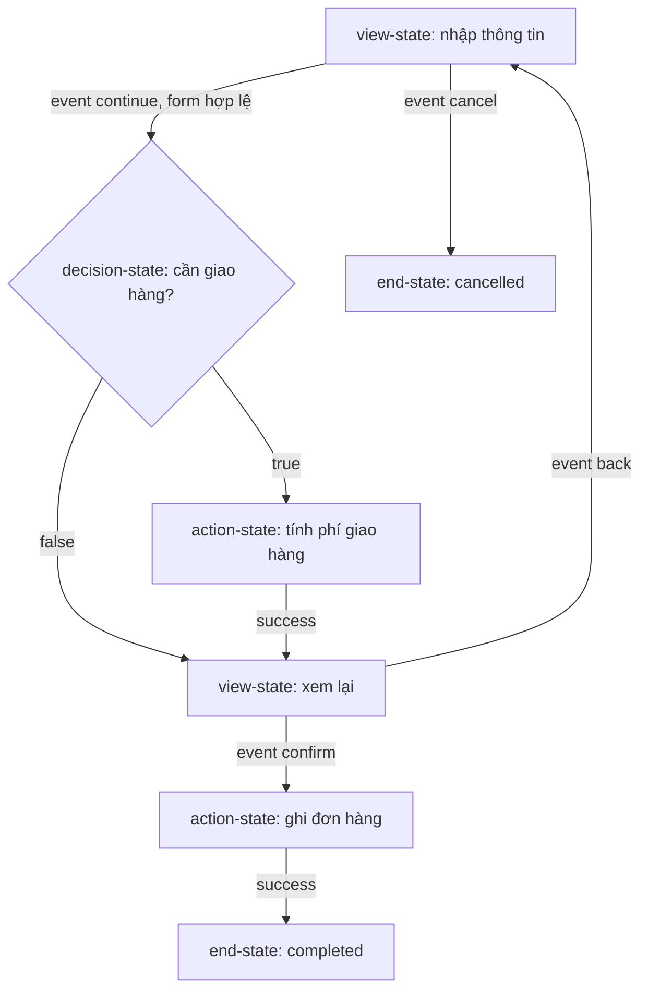
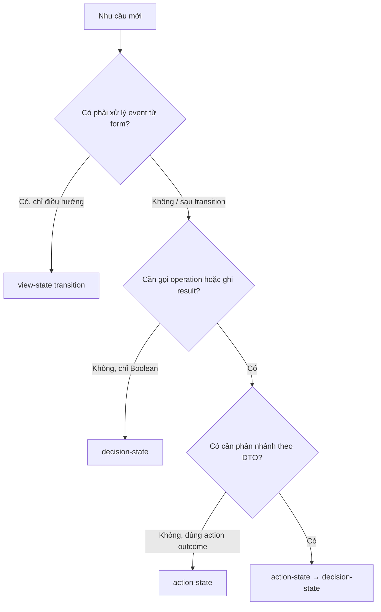
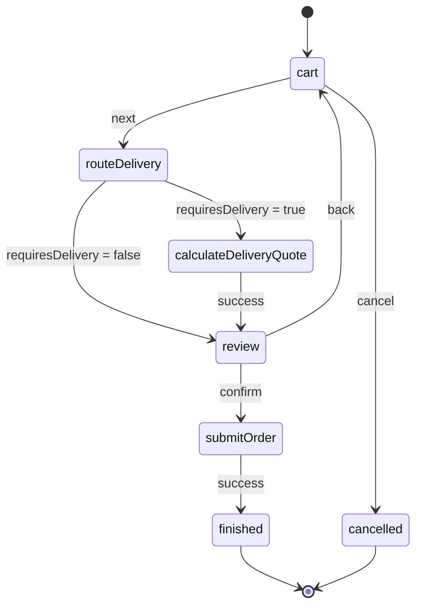
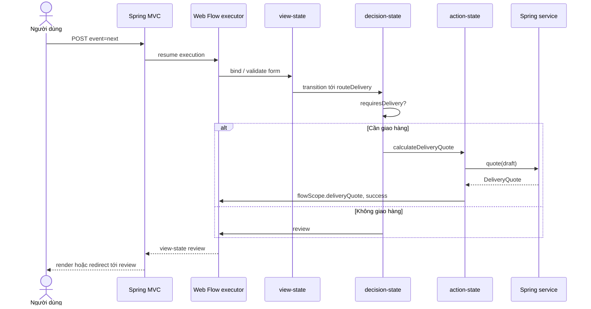

# Lựa chọn decision-state hay action-state theo trách nhiệm

## 1. Vấn đề: cùng rẽ nhánh nhưng không cùng trách nhiệm

Trong **Spring Web Flow** (`SPRING_WEB_FLOW`), một hành trình web nhiều bước được mô hình hóa bằng **state**, **event**, **transition** và **subflow** thay vì để logic điều hướng rải rác trong controller. Trong chương **Rẽ nhánh và kết thúc**, hai loại state dễ gây nhầm lẫn nhất là `decision-state` và `action-state`.

Giả sử người dùng gửi form đăng ký dịch vụ. Ứng dụng phải quyết định:

- Nếu đã có thông tin định danh hợp lệ, đi tới bước xem lại.
- Nếu cần thêm giấy tờ, mở bước bổ sung hồ sơ.
- Khi bấm **Xác nhận**, gọi service để ghi nhận đăng ký và chuyển tới màn hình hoàn tất.
- Nếu service không thành công, hiển thị lỗi phù hợp mà không tạo bản ghi trùng.

Cả hai loại state đều có thể dẫn đến state kế tiếp, nhưng mục đích thiết kế khác nhau:

- **`decision-state`:** diễn đạt **quy tắc chọn đường đi**, thường là một phép kiểm tra điều kiện đơn giản, chỉ đọc dữ liệu hiện có.
- **`action-state`:** **thực thi một hay nhiều action** rồi phản ứng với **event kết quả** của action đó, ví dụ gọi service, chuẩn bị dữ liệu, thực hiện command hoặc nhận trạng thái nghiệp vụ.

> **Quy tắc thực hành:** Nếu câu hỏi chính là “**nên đi nhánh nào dựa trên dữ liệu đã có?**”, hãy cân nhắc `decision-state`. Nếu câu hỏi chính là “**cần thực hiện công việc gì rồi mới biết kết quả để đi tiếp?**”, hãy cân nhắc `action-state`.

Đây là **quy ước thiết kế**, không phải giới hạn kỹ thuật tuyệt đối: `action-state` vẫn có thể gọi một phương thức Boolean thuần để chọn `yes/no`. Tuy vậy, dùng đúng state theo trách nhiệm giúp flow dễ đọc, dễ kiểm thử, ít side effect ngoài ý muốn và dễ phục hồi khi lỗi.

### Mục tiêu học tập

Sau bài này, bạn có thể:

1. Giải thích cơ chế `<decision-state>` với `<if test="..." then="..." else="..."/>`.
2. Giải thích `<action-state>`, `<evaluate>` và transition dựa trên event kết quả.
3. Đọc đúng mapping từ `Boolean`, `String`, `Enum` và các kiểu kết quả khác.
4. Tách bước **thực hiện** khỏi bước **quyết định** trong cùng một flow.
5. Áp dụng form binding, validation, flow scope, exception handling và end-state đúng vị trí.
6. Chọn cách kiểm thử nhằm tránh lỗi chọn sai nhánh và thực thi nghiệp vụ lặp lại.

## 2. Bản đồ điều hướng của một flow



Trong sơ đồ:

- `view-state` **render UI và tạm dừng** flow để chờ event của người dùng.
- `decision-state` đọc điều kiện rồi chuyển sang một state khác **không tự render form**.
- `action-state` thực thi action rồi chuyển state theo outcome **không tự render form**.
- `end-state` kết thúc flow, trả outcome cho handler hoặc flow gọi nó dưới dạng subflow.

Một HTTP request có thể đi xuyên qua **nhiều** decision/action states trước khi tạm dừng tại view-state hoặc kết thúc. Không nên hiểu “mỗi state tương ứng một trang” hay “mỗi state tương ứng một request”.

## 3. decision-state: chỉ cần quyết định đi nhánh nào

Cú pháp cơ bản:

```xml
<decision-state id="routeDelivery">
    <if test="checkoutDraft.requiresDelivery()"
        then="prepareDelivery"
        else="reviewOrder" />
</decision-state>
```

Ý nghĩa:

| Thuộc tính | Chức năng |
| --- | --- |
| `id` của `decision-state` | Tên state cho các transition khác trỏ tới |
| `test` | Biểu thức trả giá trị Boolean để xét nhánh |
| `then` | State đích khi điều kiện đúng |
| `else` | State đích khi điều kiện sai |

Trong ví dụ, `checkoutDraft` là model của flow, và `requiresDelivery()` là một phương thức thuộc model. Nếu trả `true`, Web Flow vào `prepareDelivery`; nếu `false`, đi thẳng tới `reviewOrder`.

Cơ chế này thích hợp khi dữ liệu cần ra quyết định **đã sẵn có** và việc kiểm tra có thể thực hiện tức thời.

### 3.1. Ưu điểm của decision-state

- Biểu thức điều kiện được thể hiện **trực tiếp** trong XML: người đọc nhìn thấy ngay nhánh `then` và `else`.
- Không phải tự quy đổi `true` thành một tên event `yes` rồi viết hai `transition`.
- Tách việc lựa chọn đường đi khỏi form/view, action nghiệp vụ và dữ liệu request.
- Một state có thể được dùng làm điểm phân luồng chung sau nhiều nguồn vào.

### 3.2. Điều kiện nên thuần và ít tốn kém

Một phương thức được gọi trong `test` có thể về kỹ thuật thực hiện I/O, gửi email hoặc ghi database, nhưng đây là **mùi thiết kế không tốt**:

```xml
<!-- Tránh: predicate có side effect và tên hàm đánh lừa người đọc. -->
<decision-state id="routePayment">
    <if test="paymentService.chargeCardAndReturnSuccess(draft)"
        then="finished"
        else="paymentFailed" />
</decision-state>
```

Vấn đề không phải Web Flow cấm expression gọi service; vấn đề là “kiểm tra điều kiện” lại có **tác dụng phụ**. Nếu flow được thử lại hay snapshot cũ được khôi phục, operation có thể chạy lại mà người bảo trì không nhận ra.

Nên chọn:

```xml
<action-state id="chargePayment">
    <evaluate expression="paymentService.charge(draft, operationKey)" />
    <transition on="APPROVED" to="finished" />
    <transition on="DECLINED" to="paymentFailed" />
</action-state>
```

Ví dụ này giả định phương thức `charge` trả về enum có các hằng `APPROVED` và `DECLINED`. Trong dự án thật vẫn phải xử lý timeout, exception, trạng thái chưa xác định và idempotency.

### 3.3. Khi có nhiều hơn hai nhánh

Cách dễ kiểm thử là chia thành nhiều decision states nhỏ, mỗi state thể hiện một câu hỏi:

```xml
<decision-state id="checkAccount">
    <if test="registration.existingCustomer"
        then="checkVerification"
        else="createAccount" />
</decision-state>

<decision-state id="checkVerification">
    <if test="registration.verified"
        then="review"
        else="verifyIdentity" />
</decision-state>
```

Lợi ích là mỗi điều kiện có tên, câu hỏi và đích rành mạch. Khi số nhánh nhiều hoặc logic phức tạp, có thể chuyển quy tắc sang một **domain service** trả về kết quả kiểu enum, rồi dùng `action-state` để dispatch theo outcome, hoặc tính result rồi dùng các decision-state riêng.

## 4. action-state: thực hiện action rồi chọn transition

Cú pháp thông dụng:

```xml
<action-state id="calculateDeliveryFee">
    <evaluate expression="deliveryService.quote(checkoutDraft)"
              result="flowScope.deliveryQuote" />
    <transition on="success" to="reviewOrder" />
</action-state>
```

Ở đây có **hai kết quả khác nhau**:

1. **Dữ liệu kết quả:** `deliveryService.quote(...)` trả về DTO, được lưu tại `flowScope.deliveryQuote` nhờ `result`.
2. **Event điều hướng:** outcome của action được Web Flow chuyển thành event, rồi so với `<transition on="...">`. Với kết quả DTO thông thường, event là `success`.

`action-state` không phải trang UI; nó chạy action khi được đi vào và tìm transition phù hợp. Thao tác có thể là phép tính thuần, truy vấn dữ liệu, gửi command nghiệp vụ hoặc gọi một integration service.

### 4.1. Các trường hợp thích hợp với action-state

- Cần gọi `orderService.submit(...)` để ghi đơn, rồi tùy kết quả đi tiếp.
- Cần đọc dữ liệu từ API hoặc database và lưu kết quả vào `flowScope`.
- Cần tính giá, kiểm tra hạn mức bằng service rồi sử dụng DTO kết quả ở view kế tiếp.
- Cần thực thi một action rồi chọn nhánh theo trạng thái trả về `Enum`/`String`/`Boolean`.
- Cần tách một thao tác nghiệp vụ rõ ràng để log, đo thời gian và kiểm thử độc lập.

### 4.2. Action-state có thể xử lý điều kiện Boolean

Ví dụ từ tài liệu Spring Web Flow:

```xml
<action-state id="moreAnswersNeeded">
    <evaluate expression="interview.moreAnswersNeeded()" />
    <transition on="yes" to="answerQuestions" />
    <transition on="no" to="finish" />
</action-state>
```

Nếu `moreAnswersNeeded()` trả về `true`, event là `yes`; nếu trả về `false`, event là `no`.

Cùng ý tưởng có thể diễn đạt ngắn gọn hơn bằng `decision-state`:

```xml
<decision-state id="moreAnswersNeeded">
    <if test="interview.moreAnswersNeeded()"
        then="answerQuestions"
        else="finish" />
</decision-state>
```

**Hai cấu hình có thể đạt cùng kết quả điều hướng.** Nếu không cần lưu kết quả hay làm thêm công việc, `decision-state` thường cho thấy mục đích “đang quyết định” rõ hơn. Nếu action trả về nhiều outcome hoặc phải lưu dữ liệu, `action-state` có thể phù hợp hơn.

## 5. So sánh theo trách nhiệm, không chỉ theo cú pháp

| Tiêu chí | `decision-state` | `action-state` |
| --- | --- | --- |
| Ý định chính | Chọn nhánh | Thực thi action rồi xử lý outcome |
| Cú pháp trung tâm | `<if test="..." then="..." else="..."/>` | `<evaluate .../>` và `<transition on="...">` |
| Đầu vào thường gặp | Boolean condition từ state/model sẵn có | Service/POJO action và context |
| Kết quả chuyển state | Theo điều kiện `true/false` | Theo event ID của action |
| Lưu DTO trả về vào scope | Không phải trọng tâm | Rất tự nhiên qua `result="flowScope.x"` |
| Gọi database hoặc external service | Có thể về kỹ thuật nhưng nên tránh trong predicate | Đúng vị trí khi cần thao tác thật |
| Cần xử lý nhiều trạng thái `Enum` | Phải biến đổi thành nhiều điều kiện | Có thể map enum thành các transition |
| Side effect | Nên không có | Có thể có, nhưng phải quản lý idempotency |
| Mức dễ đọc | Cao cho một câu hỏi Boolean | Cao cho một hành động có kết quả |
| Dễ kiểm thử | Test true/false → đích | Mock action outcome, dữ liệu và side effect |
| Có render giao diện? | Không | Không |
| Có tự kết thúc flow? | Không; phải chuyển tới `end-state` | Không; phải chuyển tới `end-state` |

**Không có quy tắc “decision-state nhanh hơn action-state”.** Chi phí đáng kể thường đến từ expression/service, database và network, không phải tên loại state. Lựa chọn nên dựa vào trách nhiệm, observability, tính dễ đọc và khả năng kiểm thử.

## 6. Hiểu đúng event mapping của action-state

Một action thường gọi phương thức Java thông qua `<evaluate>`. Web Flow chuyển kết quả của action thành một `Event` để so với các `transition`.

| Kiểu kết quả Java | Event ID thông dụng | Ví dụ |
| --- | --- | --- |
| `String` | Nội dung chuỗi | `"approved"` → `on="approved"` |
| `Boolean` | `yes` cho `true`, `no` cho `false` | `true` → `on="yes"` |
| `Enum` | Tên hằng enum | `APPROVED` → `on="APPROVED"` |
| Kiểu khác, ví dụ DTO | `success` | `OrderReceipt` → `on="success"` |

Ví dụ theo trạng thái enum:

```java
package com.example.checkout;

public enum EligibilityStatus {
    APPROVED,
    NEEDS_REVIEW,
    REJECTED
}
```

```xml
<action-state id="checkEligibility">
    <evaluate expression="eligibilityService.assess(draft)" />
    <transition on="APPROVED" to="review" />
    <transition on="NEEDS_REVIEW" to="manualReview" />
    <transition on="REJECTED" to="rejected" />
</action-state>
```

Ở đây `assess` cần có hợp đồng trả về `EligibilityStatus` (hoặc kết quả được ánh xạ thành event tương ứng). Nếu đổi enum constant trong Java, các `on` trong XML cũng phải được cập nhật.

### 6.1. Event kết quả không phải exception

Nếu `eligibilityService.assess(draft)` ném `SQLException` hoặc exception mạng, framework **không mặc nhiên chuyển nó thành event `error`**. Một transition `on="error"` chỉ hoạt động khi action có kết quả event `error` theo hợp đồng hoặc exception handler tương ứng đã xử lý để tạo outcome phù hợp.

Phân biệt:

- **Outcome dự kiến:** hồ sơ không đủ điều kiện → có thể trả `REJECTED`.
- **Lỗi kỹ thuật:** database không truy cập được → exception cần log, retry/rollback/handler phù hợp.
- **Form không hợp lệ:** validation báo lỗi ở `view-state`, thường giữ nguyên view chứ chưa đến bước `checkEligibility`.

### 6.2. Chuỗi nhiều action trong action-state

`action-state` có thể chứa nhiều action. Theo tài liệu Spring Web Flow, engine thực hiện chúng theo thứ tự và sau **mỗi action** kiểm tra outcome có khớp một transition hay không. Khi có transition khớp, engine rời state và **những action phía sau không tiếp tục chạy**.

```xml
<action-state id="prepareData">
    <evaluate expression="dataService.normalize(draft)">
        <attribute name="name" value="normalize" />
    </evaluate>
    <evaluate expression="dataService.loadOptions(draft)"
              result="flowScope.options">
        <attribute name="name" value="loadOptions" />
    </evaluate>

    <transition on="loadOptions.success" to="review" />
</action-state>
```

`name` trên từng action có thể được dùng để định danh outcome với tên đủ điều kiện, ví dụ `loadOptions.success`. Ví dụ giả định `normalize` thành công và không có transition bắt event của nó; engine tiếp tục chạy action thứ hai.

Đây là dạng **Chain of Responsibility**, không phải pipeline luôn chạy hết mọi action. Khi công việc có side effect cần thực hiện cùng một transaction, thường nên gom chúng vào **một service method** có hợp đồng rõ ràng thay vì phụ thuộc chuỗi action XML dài.

## 7. Bốn câu hỏi quyết định chọn state

Trước khi thêm state, hãy trả lời:

1. **Chỉ cần kiểm tra dữ liệu đã có?** Ưu tiên `decision-state` với Boolean condition thuần.
2. **Cần gọi một operation để tạo/thay đổi dữ liệu?** Dùng `action-state` hoặc action ở transition phù hợp.
3. **Cần lưu DTO rồi dựa vào thuộc tính của DTO để rẽ nhánh?** Kết hợp `action-state` để tính/lưu và `decision-state` để quyết định.
4. **Chỉ cần chuyển trang khi người dùng bấm nút?** Có thể dùng trực tiếp `view-state` cùng `transition on="event"`, không cần thêm state trung gian.



Đây là một **decision aid**, không phải luật bắt buộc của parser. Có thể chọn kiến trúc khác khi domain logic phức tạp, nhưng lựa chọn phải có lý do rõ và được test.

### 7.1. Ví dụ chỉ cần rẽ nhánh

```xml
<view-state id="choosePlan" model="draft">
    <transition on="next" to="routePlan" />
</view-state>

<decision-state id="routePlan">
    <if test="draft.isBusinessPlan()"
        then="businessDetails"
        else="personalDetails" />
</decision-state>
```

Đây là tình huống phù hợp với `decision-state` vì không cần gọi service có side effect và chỉ đọc một thuộc tính của model đã được bind/validate.

### 7.2. Ví dụ cần làm công việc

```xml
<action-state id="reserveInventory">
    <evaluate expression="inventoryService.reserve(draft, operationKey)" />
    <transition on="RESERVED" to="payment" />
    <transition on="OUT_OF_STOCK" to="outOfStock" />
</action-state>
```

Ở đây `reserve(...)` cần trả enum `RESERVED`/`OUT_OF_STOCK` hoặc kết quả được chuyển thành event tương ứng. Đó là một **operation nghiệp vụ**, không nên giấu trong `<if test="...">`.

`operationKey` là mã idempotency nghiệp vụ do server tạo, không phải Web Flow execution key.

## 8. Ví dụ hoàn chỉnh: checkout có cả decision và action

Giả sử ứng dụng bán hàng hỗ trợ **nhận tại cửa hàng** hoặc **giao hàng**. Khi người dùng gửi giỏ hàng:

- Nếu cần giao hàng, tính báo giá giao hàng và lưu vào `flowScope`.
- Nếu nhận tại cửa hàng, bỏ qua bước tính phí giao hàng.
- Người dùng xem lại toàn bộ thông tin.
- Khi xác nhận, service tạo đơn và trả receipt, sau đó kết thúc flow.
- Có thể quay lại sửa draft trước khi xác nhận.

Sơ đồ:



### 8.1. XML flow definition

```xml
<?xml version="1.0" encoding="UTF-8"?>
<flow xmlns="http://www.springframework.org/schema/webflow"
      xmlns:xsi="http://www.w3.org/2001/XMLSchema-instance"
      xsi:schemaLocation="
          http://www.springframework.org/schema/webflow
          https://www.springframework.org/schema/webflow/spring-webflow.xsd">

    <!-- DTO của từng flow execution. -->
    <var name="draft" class="com.example.checkout.CheckoutDraft" />

    <on-start>
        <!-- Key nghiệp vụ ổn định trong cùng ý định tạo đơn. -->
        <evaluate expression="checkoutService.createOperationKey()"
                  result="flowScope.operationKey" />
    </on-start>

    <view-state id="cart" model="draft" view="checkout/cart">
        <transition on="next" to="routeDelivery" />
        <transition on="cancel" to="cancelled" bind="false" />
    </view-state>

    <!-- Quy tắc chọn nhánh: không tự thực hiện ghi đơn. -->
    <decision-state id="routeDelivery">
        <if test="draft.requiresDelivery()"
            then="calculateDeliveryQuote"
            else="review" />
    </decision-state>

    <!-- Tạo dữ liệu phục vụ bước xem lại. -->
    <action-state id="calculateDeliveryQuote">
        <evaluate expression="deliveryService.quote(draft)"
                  result="flowScope.deliveryQuote" />
        <transition on="success" to="review" />
    </action-state>

    <view-state id="review" view="checkout/review">
        <transition on="back" to="cart" />
        <transition on="confirm" to="submitOrder"
                    history="invalidate" />
    </view-state>

    <!-- Operation có side effect: phải idempotent. -->
    <action-state id="submitOrder">
        <evaluate expression="orderService.submit(draft, operationKey)"
                  result="flowScope.receipt" />
        <transition on="success" to="finished" />
    </action-state>

    <end-state id="finished" />
    <end-state id="cancelled" />
</flow>
```

Các bean `checkoutService`, `deliveryService` và `orderService` phải tồn tại trong Spring application context. `CheckoutDraft` là một JavaBean của ứng dụng, có thuộc tính cần thiết cho form binding, validation và phương thức `requiresDelivery()`.

**Giới hạn minh họa:** `finished` ở đây chỉ cho thấy điểm kết thúc state machine; cấu hình trang receipt, redirect sau khi hoàn tất và nghiệp vụ thật cần được xây dựng riêng. Giá/khuyến mại phải được service kiểm tra lại lúc submit; không tin một `deliveryQuote` hay tổng tiền do client gửi.

### 8.2. Java domain model và service hỗ trợ

```java
package com.example.checkout;

import java.io.Serializable;

public class CheckoutDraft implements Serializable {
    private static final long serialVersionUID = 1L;

    private String deliveryMethod; // "DELIVERY" hoặc "PICKUP"
    private String recipientName;

    public boolean requiresDelivery() {
        return "DELIVERY".equals(deliveryMethod);
    }

    public String getDeliveryMethod() {
        return deliveryMethod;
    }

    public void setDeliveryMethod(String deliveryMethod) {
        this.deliveryMethod = deliveryMethod;
    }

    public String getRecipientName() {
        return recipientName;
    }

    public void setRecipientName(String recipientName) {
        this.recipientName = recipientName;
    }
}
```

Đây là model rút gọn để minh họa định tuyến. Trong ứng dụng thật nên dùng enum được bind qua converter, constraint phù hợp, kiểm tra dữ liệu hợp lệ và chỉ chấp nhận các lựa chọn được server hỗ trợ.

```java
package com.example.checkout;

import java.math.BigDecimal;
import org.springframework.stereotype.Service;

@Service
public class DeliveryService {

    public DeliveryQuote quote(CheckoutDraft draft) {
        // Ví dụ minh họa, cần công thức định giá thật.
        return new DeliveryQuote(new BigDecimal("30000"));
    }
}
```

`DeliveryQuote` là DTO do ứng dụng định nghĩa, ví dụ có thuộc tính `fee` kiểu `BigDecimal`, getter và khả năng serialization nếu repository cần snapshot. `orderService.submit(...)` cần được hiện thực bằng transaction/idempotency phù hợp; không phải API có sẵn của Web Flow.

### 8.3. Điều gì xảy ra khi người dùng đổi phương thức nhận hàng?

Nếu người dùng đã chọn **giao hàng**, `flowScope.deliveryQuote` được tạo. Khi quay lại `cart` và đổi thành **nhận tại cửa hàng**, flow bỏ qua `calculateDeliveryQuote`. **Giá trị quote cũ vẫn có thể còn trong flowScope**; `decision-state` không tự xóa nó.

Đó là lý do:

- View `review` phải dựa vào `draft.requiresDelivery()` khi hiển thị phí.
- Service submit phải tự tính/kiểm tra phí thực tế thay vì mặc nhiên tin `deliveryQuote` cũ.
- Nếu muốn loại bỏ dữ liệu dư, thêm một bước cập nhật/clear quote rõ ràng, chẳng hạn trong action hoặc transition với đúng scope.
- Viết test cho đường **giao hàng → quay lại → nhận tại cửa hàng**.

Đây là ví dụ cho thấy `decision-state` chỉ chọn nhánh; **quản lý tính nhất quán của dữ liệu** vẫn thuộc action/service/model.

## 9. Mẫu kết hợp: thực hiện trước, quyết định sau

Có những quyết định không thể đưa ra từ dữ liệu đã có vì phải gọi một service bên ngoài. Ví dụ: đánh giá điều kiện đăng ký dựa trên thông tin hiện tại của tài khoản.

Thay vì giấu service call bên trong `test`, tách làm hai bước:

```xml
<action-state id="loadEligibility">
    <evaluate expression="eligibilityService.assess(draft)"
              result="flowScope.assessment" />
    <transition on="success" to="routeEligibility" />
</action-state>

<decision-state id="routeEligibility">
    <if test="assessment.approved"
        then="review"
        else="notEligible" />
</decision-state>
```

Mô hình này có ba lợi ích:

1. `loadEligibility` thể hiện rõ nơi gọi external service và nơi lưu dữ liệu.
2. `routeEligibility` chỉ đọc kết quả đã được tính, không có side effect.
3. Khi test, có thể kiểm tra độc lập: service có được gọi đúng một lần không, và với `approved=true/false` thì đi đâu.

**Chú ý:** Nếu `eligibilityService.assess(...)` trả về DTO, event action thường là `success`; lỗi kỹ thuật có exception riêng và cần đường xử lý riêng. `assessment.approved` là một property Boolean mà DTO phải cung cấp.

### Khi nào không cần tách hai state?

Nếu action trả enum `APPROVED`/`REJECTED` và **không cần lưu DTO**, một `action-state` với hai transition có thể rõ ràng hơn:

```xml
<action-state id="assessEligibility">
    <evaluate expression="eligibilityService.assessStatus(draft)" />
    <transition on="APPROVED" to="review" />
    <transition on="REJECTED" to="notEligible" />
</action-state>
```

Không nên thêm `decision-state` chỉ vì muốn “đúng mẫu” khi nó không làm nội dung rõ hơn.

## 10. View-state, form binding và validation đứng ở đâu?

Một lỗi kiến trúc thường gặp là chuyển tới `decision-state` trước khi **dữ liệu form được bind và validate**. Nếu `test` đọc model cũ hoặc model chưa hợp lệ, nhánh có thể sai.

Giả sử người dùng chọn một phương thức giao hàng trong form. Quy trình chuẩn thường là:

```text
User POST event=next
    → view-state cart: bind field deliveryMethod
    → validate draft
    → nếu hợp lệ: transition tới routeDelivery
    → decision-state đọc draft.requiresDelivery()
    → action-state tính quote hoặc đi tới review
```

Nếu binding/validation thất bại, Web Flow thường **giữ tại view-state** và hiển thị lỗi. `routeDelivery` và `calculateDeliveryQuote` chưa nhất thiết được thực thi.

Ví dụ:

```xml
<view-state id="cart" model="draft">
    <binder>
        <binding property="deliveryMethod" required="true" />
        <binding property="recipientName" required="true" />
    </binder>
    <transition on="next" to="routeDelivery" />
    <transition on="cancel" to="cancelled" bind="false" />
</view-state>
```

`bind="false"` trên transition `cancel` giúp việc hủy không bị chặn bởi dữ liệu nhập sai. Nếu người dùng có event `back`, có thể dùng `validate="false"` tùy yêu cầu nghiệp vụ.

**Decision/action-state không phải chỗ thay thế toàn bộ validator.** Domain service có thể kiểm tra quy tắc nghiệp vụ tại lúc submit; form validation thông thường nên ở state tương ứng để trả lỗi cho người dùng.

## 11. Scope, execution và tính đúng đắn dữ liệu

Với flow nhiều bước, chọn scope quyết định dữ liệu có sẵn ở state nào:

| Scope | Vòng đời | Ví dụ |
| --- | --- | --- |
| `requestScope` | Một request | Dữ liệu tạm chỉ phục vụ một lần xử lý |
| `viewScope` | View-state hiện tại | Danh sách option nạp cho trang |
| `flashScope` | Dữ liệu ngắn hạn qua render theo quy tắc Web Flow | Thông báo thành công/thất bại |
| `flowScope` | Trong flow hiện tại | `draft`, `assessment`, `deliveryQuote` |
| `conversationScope` | Qua root flow và các subflow trong conversation | Context dùng chung các quy trình con |

`action-state` có thể gán kết quả:

```xml
<evaluate expression="deliveryService.quote(draft)"
          result="flowScope.deliveryQuote" />
```

`decision-state` sau đó có thể đọc dữ liệu này:

```xml
<decision-state id="checkQuote">
    <if test="deliveryQuote.fee.signum() > 0"
        then="reviewWithFee"
        else="reviewFreeDelivery" />
</decision-state>
```

Ví dụ giả định `DeliveryQuote` có property `fee` kiểu `BigDecimal` và đối tượng đã được tạo trước khi vào state `checkQuote`. Nếu `deliveryQuote` bằng `null` hoặc chưa có, expression có thể lỗi; cần bảo đảm các đường vào state có đủ dữ liệu.

**Không đặt state riêng của người dùng vào singleton Spring bean.** Service nên stateless hoặc kiểm soát trạng thái phù hợp; dữ liệu mỗi execution ở Web Flow scope hoặc persistence nghiệp vụ. Nếu repository snapshot/serialize execution, DTO cần kích thước hợp lý và tương thích với cơ chế lưu trữ.

## 12. Rẽ nhánh lỗi: outcome nghiệp vụ không phải exception

Một action `paymentService.charge(...)` có thể đưa ra ba loại kết quả:

- **Thành công:** thanh toán được xác nhận.
- **Bị từ chối theo nghiệp vụ:** không đủ hạn mức, phương thức thanh toán bị chặn.
- **Lỗi hệ thống:** timeout, kết nối gián đoạn, backend không phản hồi.

Chỉ nên mô tả hai loại đầu như các **outcome nghiệp vụ có chủ đích**, chẳng hạn `APPROVED` và `DECLINED`. Timeout không có nghĩa thanh toán thất bại: provider có thể đã xử lý thành công nhưng response bị mất.

```xml
<action-state id="authorizePayment">
    <evaluate expression="paymentService.authorize(draft, operationKey)" />
    <transition on="APPROVED" to="paymentComplete" />
    <transition on="DECLINED" to="changePaymentMethod" />
</action-state>
```

Nếu service có thể trả `PENDING`, phải xử lý thêm outcome này hoặc một cơ chế phục hồi cụ thể. Khi service ném exception, cần exception handler, retry có điều kiện hoặc màn hình thông báo kiểm tra trạng thái giao dịch.

### 12.1. Vì sao không gọi payment trong decision-state?

Một đoạn như:

```xml
<decision-state id="shouldFinish">
    <if test="paymentService.authorize(draft, operationKey)"
        then="finished"
        else="paymentRejected" />
</decision-state>
```

có thể khiến người đọc nghĩ `authorize` là predicate không có tác dụng phụ, trong khi thực tế nó gọi cổng thanh toán. Việc gọi lại state, khôi phục snapshot hoặc retry có thể gây phát sinh lệnh mới nếu service không idempotent.

**Đưa operation vào action-state để diễn tả đúng ý định**, rồi giải quyết concurrency/idempotency tại service/database/gateway. Bản thân action-state **không** tự bảo đảm exactly-once.

### 12.2. Có thể dùng decision-state cho lỗi được chuẩn hóa

Nếu action đã trả về một `PaymentAssessment` không có side effect ở bước sau, decision-state đọc kết quả để chọn nhánh là hợp lý:

```xml
<action-state id="loadPaymentAssessment">
    <evaluate expression="paymentService.assess(draft)"
              result="flowScope.paymentAssessment" />
    <transition on="success" to="routePaymentAssessment" />
</action-state>

<decision-state id="routePaymentAssessment">
    <if test="paymentAssessment.approved"
        then="paymentOptions"
        else="paymentUnavailable" />
</decision-state>
```

Không dùng tên `approved` để khẳng định tiền đã được trừ; đó chỉ là một nhận định về khả năng thanh toán khi chưa gọi lệnh thu tiền.

## 13. End-state, subflow và việc kết thúc hành trình

Cả `decision-state` và `action-state` đều **không tự động kết thúc flow**. Muốn hoàn tất hành trình, chuyển tới một `end-state`:

```xml
<decision-state id="hasMoreQuestions">
    <if test="interview.moreAnswersNeeded()"
        then="answerQuestions"
        else="finished" />
</decision-state>

<end-state id="finished" />
```

Khi đạt `finished`, flow kết thúc và trả outcome. Nếu flow đang chạy như **subflow**, outcome có thể được flow cha xử lý qua transition ở `subflow-state`:

```xml
<subflow-state id="collectAddress" subflow="addressFlow">
    <transition on="addressSaved" to="reviewOrder" />
    <transition on="cancelled" to="cart" />
</subflow-state>
```

Ở đây `addressSaved` và `cancelled` là các outcome của flow `addressFlow`, không phải Boolean test của `decision-state` cấp cha.

Không để view có tên `finished` mà không có `end-state` tương ứng nếu chủ đích là **kết thúc execution**. Để render trang thành công sau khi flow end, cần thiết kế phù hợp với handler, redirect/outcome và dữ liệu nghiệp vụ bền vững; không trông đợi `flowScope` của execution đã kết thúc vẫn tồn tại mãi.

## 14. Tích hợp Spring MVC: nơi nhận event không phải nơi quyết định route

Một request HTTP đến flow qua `DispatcherServlet` thường được `FlowHandlerMapping` và `FlowHandlerAdapter` đưa vào `FlowExecutor`. Executor khôi phục hoặc khởi chạy một `FlowExecution`, còn **definition** quyết định đường đi qua decision/action states.



**Không cần tạo một Spring MVC `@PostMapping` riêng cho từng `decision-state`.** Các state trung gian thuộc nội bộ Web Flow; HTTP mapping chỉ định entry point/flow handler. Điều này là một lợi ích chính của framework khi xây dựng wizard nhiều bước.

### Khi nào phải kiểm tra request/phiên?

- Người dùng gửi event không tồn tại ở state hiện hành.
- Dùng execution key cũ sau browser Back/Refresh.
- Session hết hạn trước khi action hoặc decision chạy.
- Hai tab cùng submit event `confirm`.

Trong những tình huống này, route có thể không được thực thi như dự kiến hoặc service có thể bị gọi lại. Cần test repository/history policy và bảo vệ operation nghiệp vụ; đổi `decision-state` sang `action-state` **không tự chữa** vấn đề session/concurrency.

## 15. Kiểm thử theo trách nhiệm

### 15.1. Test decision-state

Ví dụ với `routeDelivery`, các ca kiểm thử cần thiết:

| Dữ liệu `draft` | Điều kiện | State mong đợi |
| --- | --- | --- |
| `deliveryMethod=DELIVERY` | `requiresDelivery() = true` | `calculateDeliveryQuote` |
| `deliveryMethod=PICKUP` | `requiresDelivery() = false` | `review` |
| Dữ liệu thiếu/không hợp lệ | Validation ở `cart` không thành công | Giữ `cart` và hiển thị lỗi |
| Model bị thay đổi sau khi quay lại | Điều kiện được đánh giá từ dữ liệu mới | Nhánh tương ứng với dữ liệu mới |

Với predicate thuần, test domain method `requiresDelivery()` riêng sẽ nhanh và ổn định. Test Web Flow cần xác nhận transition thật để phát hiện sai `then/else` hoặc sai state ID.

### 15.2. Test action-state

Với `calculateDeliveryQuote` và `submitOrder`:

| Tình huống | Điều cần kiểm tra |
| --- | --- |
| Service trả DTO | `result` lưu đúng đối tượng ở `flowScope` |
| Service trả Enum | `transition on` khớp tên enum |
| Service trả `Boolean` | Route dùng `yes/no`, không nhầm `true/false` |
| Service ném exception | Không bị biến thành event `error` ngoài ý muốn |
| Service tạo dữ liệu | Chỉ ghi một lần cho cùng operation key dù event bị retry |
| Action có nhiều bước | Chạy đúng thứ tự và dừng khi outcome khớp transition |
| Execution snapshot cũ | Side effect không bị lặp khi resume/retry |

Dùng test support của Spring Web Flow phù hợp phiên bản (ví dụ các lớp kiểm thử flow XML) để bắt đầu flow, phát event và assert current state. Mock service để chủ động trả outcome, đồng thời có integration test với repository và database cho các thao tác có side effect.

Pseudo-code mục tiêu kiểm thử:

```java
// Pseudocode: flowTestHarness là fixture do dự án dựng.
flowTestHarness.startFlow("checkout", validDraft);

flowTestHarness.signalEvent("next");
flowTestHarness.assertCurrentState("review");
flowTestHarness.assertFlowScopeContains("deliveryQuote");
```

Đây là **mã giả minh họa** vì các phương thức `flowTestHarness` không phải API Spring Web Flow có sẵn. Hãy dùng test fixture thực của version đang chạy hoặc `RequestContext`/`FlowExecution` được test support cung cấp.

### 15.3. Test chuỗi end-to-end

Với checkout, kiểm tra ít nhất:

1. Mở flow, submit `next` hợp lệ, rẽ nhánh không giao hàng đến `review`.
2. Chọn giao hàng, tính quote một lần và hiển thị ở `review`.
3. Quay lại đổi loại nhận hàng, chắc chắn không sử dụng quote cũ như dữ liệu bắt buộc.
4. Submit dữ liệu sai, bảo đảm chưa tới decision/action-state và chưa ghi đơn.
5. Xác nhận từ `review`, tạo đơn rồi kết thúc ở `finished`.
6. Cố gửi lại cùng event hoặc dùng key cũ, service không tạo đơn trùng.
7. Service mất mạng hoặc timeout, UI có đường phục hồi và không gọi lại lệnh bất chấp trạng thái chưa rõ.
8. Flow chạy như subflow, outcome kết thúc được parent xử lý đúng.

## 16. Sai lầm thường gặp và cách sửa

| Sai lầm | Hậu quả | Thiết kế nên cân nhắc |
| --- | --- | --- |
| Dùng `decision-state` để thu tiền | Side effect bị giấu trong condition | `action-state` gọi service idempotent |
| Dùng `action-state` chỉ để kiểm tra `isBusiness()` | Cấu hình dài, phải map `yes/no` | `decision-state` với `if/else` |
| Mong action trả `Boolean true` sẽ kích hoạt `on="success"` | Không có transition tương ứng | Dùng `on="yes"` hoặc đổi kiểu kết quả |
| Mong DTO trả về dùng làm event ID | Không hiểu mapping `success` | Gán DTO vào scope, dùng `on="success"` |
| Viết `on="error"` và nghĩ bắt được mọi exception | Lỗi vẫn có thể propagate | Exception handler/contract outcome rõ |
| Gọi service có side effect trong `if test` | Rủi ro retry tạo tác dụng phụ lặp | Tách action và operation idempotency |
| Đọc property chưa được bind/validate | Chọn sai nhánh | Đặt decision sau view transition hợp lệ |
| Truy cập `viewScope` từ action-state | Scope không tồn tại theo vòng đời mong đợi | Ghi `flowScope` hoặc nạp ở view-state |
| Nhầm `end-state` với view-state | Execution không kết thúc như mong muốn | Chuyển rõ tới `end-state` |
| Nhiều action trong action-state nhưng nghĩ tất cả luôn chạy | Một action outcome có thể kết thúc chain sớm | Test thứ tự, gom transaction vào service |
| Dựa vào execution key để chống duplicate | Key có thể đổi giữa snapshot/flow | Dùng operation key riêng, unique constraint |
| Copy XML 2.x vào dự án Jakarta/Spring 6 | Xung đột API và cấu hình | Kiểm tra version/chữ ký API/XSD đúng dự án |

## 17. Checklist lựa chọn và bài tập

Trước khi commit một state mới:

1. Viết một câu mô tả trách nhiệm, ví dụ “**quyết định có cần giao hàng**” hoặc “**tạo đơn và nhận receipt**”.
2. Xác định input đã có hay phải gọi service mới có.
3. Nếu chỉ là Boolean decision thuần, ưu tiên `decision-state`.
4. Nếu cần thực hiện một action hoặc lưu giá trị trả về, ưu tiên `action-state`.
5. Nếu action tạo DTO và route theo DTO, xem xét tách **action → decision**.
6. Xác nhận mapping từ kiểu giá trị Java sang event ID khi dùng action-state.
7. Phân biệt outcome nghiệp vụ với exception kỹ thuật.
8. Kiểm tra binding/validation trước khi route; dùng scope phù hợp cho dữ liệu trung gian.
9. Đưa thao tác có side effect vào service với transaction, authorization và idempotency.
10. Test cả đường hợp lệ, không hợp lệ, retry, browser history và kết thúc flow.

### Câu hỏi tự luyện

1. Khi nào `decision-state` diễn đạt ý định tốt hơn `action-state` dù cả hai đều có thể kiểm tra Boolean?
2. `<if test="draft.requiresDelivery()" then="A" else="B"/>` có tương đương một `action-state` nhận Boolean và hai transition `yes/no` không?
3. Vì sao không nên gọi `paymentService.charge(...)` trực tiếp trong `test`?
4. Nếu action trả `Enum APPROVED`, phải dùng `on="APPROVED"` hay `on="success"`?
5. Nếu action trả `DeliveryQuote` và cần hiển thị ở view tiếp theo, cần cấu hình `result` thế nào?
6. Một action-state gồm hai `evaluate` có luôn chạy cả hai không?
7. Khi nào nên tách `loadEligibility` và `routeEligibility` thành hai states?
8. Binding lỗi tại `cart` có thể làm `routeDelivery` chưa được thực thi không?
9. Vì sao `flowScope.deliveryQuote` có thể trở nên lỗi thời khi người dùng quay lại sửa lựa chọn?
10. Nếu service ném exception, Web Flow có tự tạo event `error` không?
11. Sự khác nhau giữa chuyển tới `end-state` và chuyển tới `view-state` có ID tên gần giống nhau?
12. Cần kiểm thử điều gì khi một event có side effect bị gửi lại từ browser history?

## Tài liệu tham khảo

- [Spring Web Flow 3.0.0 Reference Guide — Executing Actions](https://docs.spring.io/spring-webflow/docs/3.0.0/reference/#_executing_actions)
- [Spring Web Flow 3.0.0 Reference Guide — Defining Action States](https://docs.spring.io/spring-webflow/docs/3.0.0/reference/#_defining_action_states)
- [Spring Web Flow 3.0.0 Reference Guide — Defining Decision States](https://docs.spring.io/spring-webflow/docs/3.0.0/reference/#_defining_decision_states)
- [Spring Web Flow 3.0.0 Reference Guide — Action Outcome Event Mappings](https://docs.spring.io/spring-webflow/docs/3.0.0/reference/#_action_outcome_event_mappings)
- [Spring Web Flow 3.0.1 Javadoc — DecisionState](https://docs.spring.io/spring-webflow/docs/3.0.1/api/org/springframework/webflow/engine/DecisionState.html)
- [Spring Web Flow 3.0.1 Javadoc — ActionState](https://docs.spring.io/spring-webflow/docs/3.0.1/api/org/springframework/webflow/engine/ActionState.html)

Các ví dụ minh họa kiến trúc và cú pháp phổ biến của Spring Web Flow 3.x. Trước khi đưa vào ứng dụng thực tế, cần kiểm tra dependency, phiên bản Spring Framework/Web Flow, XSD, view resolver, Bean Validation, repository và các API nghiệp vụ cụ thể của dự án.
