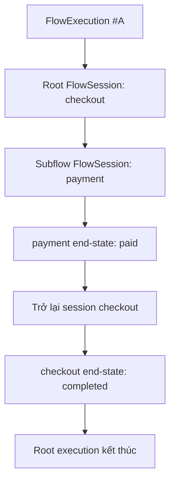
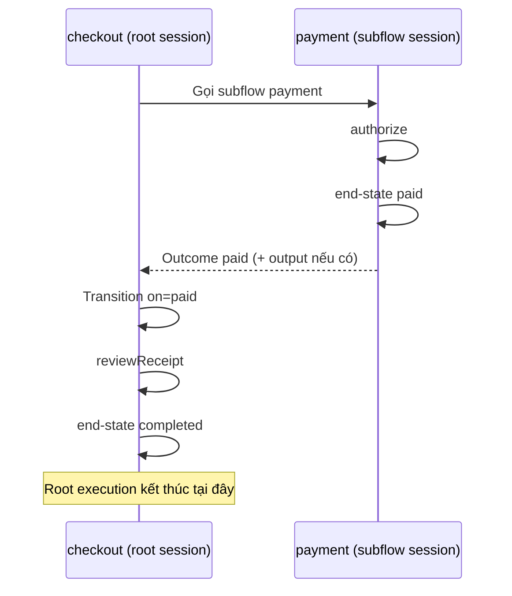

# End-state và thời điểm kết thúc một flow session

## 1. End-state đánh dấu điểm kết thúc của một flow session

Trong **Spring Web Flow (SWF)**, flow definition mô tả các `state`, `event` và `transition` tạo nên hành trình nhiều bước. Một lượt thực thi đi từ state này sang state khác cho đến khi gặp một **`end-state`**. Đây là loại state biểu thị rằng flow session hiện tại đã hoàn tất.

Ví dụ, hành trình đặt hàng có thể gồm:

```text
cart → shipping → review → completed
                           ↘ cancelled
```

`completed` và `cancelled` đều là end-state. Chúng biểu diễn hai kết quả khác nhau, nhưng đều kết thúc **flow session đang chạy**. End-state không phải màn hình chờ người dùng nhập thêm dữ liệu; nó là điểm cuối của session đó.

Một khai báo tối giản:

```xml
<end-state id="completed" />
```

Khi execution chuyển vào end-state, engine hoàn tất flow session tương ứng và công bố outcome mang ID của end-state. Nếu đó là session gốc, flow execution gốc cũng kết thúc. Nếu đó là session của subflow, chỉ session con kết thúc và flow cha có thể tiếp tục.

**Điểm cần nhớ:** end-state kết thúc một **flow session**. Nó không tự động kết thúc HTTP session, đăng xuất người dùng, đóng trình duyệt hay quyết định transaction nghiệp vụ phải commit/rollback.

## 2. Flow session nằm trong flow execution như thế nào?

Cần phân biệt ba khái niệm trước khi phân tích thời điểm kết thúc:

| Khái niệm | Vai trò | Ví dụ |
|---|---|---|
| `FlowDefinition` | Bản thiết kế có state, transition và end-state | Definition `checkout` |
| `FlowExecution` | Một lượt thực thi toàn hành trình | Lượt checkout của khách hàng A |
| `FlowSession` | Một lần đi vào một flow definition trong execution | Session `checkout` hoặc session `payment` |

Một execution bắt đầu bằng root flow session. Khi root flow gọi subflow, Web Flow tạo một flow session con trong cùng execution. Vì vậy, một execution có thể chứa một chuỗi session theo quan hệ cha/con.



Trong sơ đồ:

- Khi `payment` vào end-state `paid`, session `payment` kết thúc.
- Flow cha `checkout` nhận outcome `paid` và có thể chuyển tiếp.
- Chỉ khi `checkout` đi tới end-state của chính nó, root session mới kết thúc và execution gốc hoàn tất.

Do đó, không thể đếm mỗi end-state được vào như một hành trình người dùng đã kết thúc. Một flow cha có thể gọi nhiều subflow và mỗi subflow có thể kết thúc trước root flow.

## 3. Khai báo end-state và outcome

Thuộc tính `id` của `<end-state>` là **outcome** được công bố khi flow session kết thúc. Tên ID do ứng dụng chọn theo ý nghĩa nghiệp vụ, chẳng hạn:

```xml
<end-state id="completed" />
<end-state id="cancelled" />
<end-state id="rejected" />
<end-state id="expired" />
```

Các ID trên không phải từ khóa bắt buộc của framework. Web Flow không tự hiểu `cancelled` có nghĩa là hủy đơn hàng trong cơ sở dữ liệu hoặc `rejected` là từ chối tín dụng. Chúng chỉ là outcome mà caller/flow cha có thể dùng để chọn nhánh xử lý.

Một flow có thể đi vào end-state qua transition:

```xml
<flow xmlns="http://www.springframework.org/schema/webflow"
      xmlns:xsi="http://www.w3.org/2001/XMLSchema-instance"
      xsi:schemaLocation="
          http://www.springframework.org/schema/webflow
          http://www.springframework.org/schema/webflow/spring-webflow.xsd"
      start-state="review">

    <view-state id="review">
        <transition on="confirm" to="completed" />
        <transition on="cancel" to="cancelled" />
    </view-state>

    <end-state id="completed" />
    <end-state id="cancelled" />
</flow>
```

Khi người dùng phát event `confirm`, transition dẫn đến `completed`. Khi phát `cancel`, transition dẫn đến `cancelled`. Cả hai đều là đường kết thúc của session, nhưng outcome khác nhau.

Trong ứng dụng thật, event `confirm` thường cần gọi action/service để kiểm tra dữ liệu, quyền, trạng thái đơn hàng và ghi nhận nghiệp vụ trước khi flow đi đến `completed`. Việc chuyển state thành công không tự chứng minh giao dịch đã thành công.

## 4. Thời điểm kết thúc: từ transition đến session teardown

Một flow session kết thúc khi engine thực sự chuyển vào end-state của flow definition đó. Có thể hình dung các mốc theo trình tự:

```text
1. Flow đang ở state chưa kết thúc (ví dụ review).
2. Event hoặc action tạo kết quả phù hợp.
3. Engine chọn transition có đích là end-state.
4. Engine vào end-state và xác định outcome.
5. Flow session kết thúc; output được công bố theo mapping.
6. Nếu là root session, flow execution gốc kết thúc.
   Nếu là subflow session, flow cha nhận outcome/output và tiếp tục.
```

Điểm phân biệt quan trọng là **transition được chọn** và **session đã kết thúc** không phải cùng một sự kiện. Listener có thể quan sát `transitionExecuting` trước khi transition hoàn tất. Nếu action hoặc một xử lý khác phát sinh exception, flow có thể không tới end-state như dự kiến.

Tương tự, state trước end-state không nhất thiết là view-state. Flow có thể đi qua `action-state` hoặc `decision-state` rồi kết thúc mà không render thêm màn hình.

### 4.1. Không phải chờ HTTP response mới kết thúc session

End-state là trạng thái của **engine**, không phải một HTTP status code. Khi engine hoàn tất session, tầng tích hợp MVC mới tạo kết quả/response phù hợp với ứng dụng. HTTP response có thể là redirect, render kết quả hoặc phản hồi khác theo cấu hình.

Ngược lại, HTTP request trả `200 OK` không chứng minh root flow đã kết thúc: request có thể chỉ render một view-state và execution được pause để chờ tương tác kế tiếp.

## 5. Root flow kết thúc khác subflow kết thúc

Đây là khác biệt quan trọng nhất khi làm việc với `end-state`.

### 5.1. End-state của root flow

Nếu flow gốc `checkout` đi vào `completed`:

- Root `FlowSession` kết thúc.
- `FlowExecution` gốc không còn active.
- Không có flow cha trong execution hiện tại để nhận outcome.
- Repository quản lý việc loại bỏ execution/snapshot theo cơ chế và chính sách của nó.
- Continuation key cũ không còn là cách hợp lệ để tiếp tục một execution đã kết thúc; request dùng key cũ có thể bị từ chối hoặc được xử lý theo cơ chế expired/stale execution của ứng dụng.

Kết quả cuối cùng có thể được tầng gọi `FlowExecutor` hoặc MVC adapter sử dụng để trả response cho người dùng. Không nhầm việc kết thúc execution với việc hủy HTTP session đăng nhập.

### 5.2. End-state của subflow

Giả sử `checkout` gọi flow `payment` qua `subflow-state`. Khi `payment` vào `paid`:

- Chỉ `FlowSession` của `payment` kết thúc.
- Outcome `paid` được trả về cho `subflow-state` của flow cha.
- Flow cha chọn transition theo outcome.
- Root execution vẫn hoạt động, trừ khi flow cha sau đó cũng đi vào end-state.



Một flow cha có thể tiếp tục sau khi subflow kết thúc với `paid`, `declined` hoặc `cancelled`. Việc một subflow trả outcome không tự quyết định flow cha phải kết thúc.

## 6. Truyền outcome và output từ subflow về flow cha

**Outcome** và **output data** là hai khái niệm liên quan nhưng khác nhau:

- Outcome là ID của end-state mà subflow đã kết thúc, ví dụ `paid`.
- Output là các giá trị mà end-state công bố để flow cha sử dụng, ví dụ `paymentReference` hoặc `approvedAmount`.

Trong flow con, có thể khai báo output trên end-state:

```xml
<end-state id="paid">
    <output name="paymentReference"
            value="flowScope.paymentReference" />
    <output name="approvedAmount"
            value="flowScope.approvedAmount" />
</end-state>

<end-state id="declined" />
```

Ở flow cha:

```xml
<subflow-state id="takePayment" subflow="payment">
    <input name="orderId" value="flowScope.orderId" />

    <transition on="paid" to="receipt">
        <set name="flowScope.paymentReference"
             value="currentEvent.attributes.paymentReference" />
        <set name="flowScope.approvedAmount"
             value="currentEvent.attributes.approvedAmount" />
    </transition>

    <transition on="declined" to="paymentDeclined" />
</subflow-state>

<view-state id="receipt">
    <transition on="finish" to="completed" />
</view-state>

<end-state id="paymentDeclined" />
<end-state id="completed" />
```

Ở flow cha, event tương ứng với outcome của subflow. Các giá trị output được đưa vào attributes của event để transition có thể đọc qua `currentEvent.attributes`. Hợp đồng cần khớp tên và kiểu giữa `<output>` bên con và nơi đọc bên cha.

Nếu subflow kết thúc bằng `declined` mà không khai báo output, flow cha vẫn có thể xử lý outcome `declined` mà không truy cập attributes không tồn tại.

**Không truyền toàn bộ entity/payment object nếu chỉ cần reference và trạng thái.** Output nên gọn và không chứa dữ liệu nhạy cảm không cần thiết.

## 7. Listener quan sát thời điểm kết thúc session

`FlowExecutionListener` cung cấp hai callback liên quan:

```java
void sessionEnding(
    RequestContext context,
    FlowSession session,
    String outcome,
    MutableAttributeMap<?> output);

void sessionEnded(
    RequestContext context,
    FlowSession session,
    String outcome,
    AttributeMap<?> output);
```

Ý nghĩa:

- `sessionEnding` được gọi khi session chuẩn bị kết thúc. Tham số `outcome` cho biết end-state/outcome đang kết thúc; output map được cung cấp ở dạng mutable theo API.
- `sessionEnded` được gọi sau khi session đã kết thúc. Output map ở callback này được cung cấp qua giao diện `AttributeMap` để đọc.
- Hai callback này áp dụng cho flow session, vì vậy subflow cũng có thể tạo ra các lần callback riêng.
- Dùng `session.isRoot()` để phân biệt root session với session con khi cần thống kê.

Ví dụ listener chỉ ghi metadata:

```java
package com.example.checkout.observability;

import org.slf4j.Logger;
import org.slf4j.LoggerFactory;
import org.springframework.webflow.execution.FlowExecutionListenerAdapter;
import org.springframework.webflow.execution.FlowSession;
import org.springframework.webflow.execution.RequestContext;
import org.springframework.binding.collection.AttributeMap;
import org.springframework.binding.collection.MutableAttributeMap;

public final class SessionEndListener extends FlowExecutionListenerAdapter {

    private static final Logger log =
            LoggerFactory.getLogger(SessionEndListener.class);

    @Override
    public void sessionEnding(
            RequestContext context,
            FlowSession session,
            String outcome,
            MutableAttributeMap<?> output) {

        log.info("flow session ending: flow={}, root={}, outcome={}",
                session.getDefinition().getId(),
                session.isRoot(),
                outcome);
    }

    @Override
    public void sessionEnded(
            RequestContext context,
            FlowSession session,
            String outcome,
            AttributeMap<?> output) {

        log.info("flow session ended: flow={}, root={}, outcome={}, outputKeys={}",
                session.getDefinition().getId(),
                session.isRoot(),
                outcome,
                output == null ? 0 : output.size());
    }
}
```

Ví dụ trên dùng API kiểu Web Flow 2.x với `FlowExecutionListenerAdapter`. Nếu phiên bản dự án dùng interface có default methods hoặc adapter khác, hãy đối chiếu dependency/Javadoc thực tế.

Listener nên quan sát nhanh và ít side effect. Không dùng callback để gửi thanh toán, xóa dữ liệu nghiệp vụ, commit transaction hoặc gọi API mạng chậm. Nếu cần audit đáng tin cậy, ghi ở service/transaction nghiệp vụ; listener hỗ trợ telemetry và chẩn đoán.

## 8. Đăng ký listener với FlowExecutor

Một listener không tự được gọi chỉ vì bean đã tồn tại. Nó phải được đăng ký với `FlowExecutor` mà ứng dụng thực sự sử dụng.

Ví dụ cấu hình XML:

```xml
<bean id="sessionEndListener"
      class="com.example.checkout.observability.SessionEndListener" />

<webflow:flow-executor id="flowExecutor"
                       flow-registry="flowRegistry">
    <webflow:flow-execution-listeners>
        <webflow:listener ref="sessionEndListener"
                          criteria="checkout,payment" />
    </webflow:flow-execution-listeners>
</webflow:flow-executor>
```

`criteria` xác định các flow definition áp dụng listener theo cấu hình. Nếu muốn quan sát cả root flow và subflow, cần bảo đảm listener được gắn theo phạm vi đúng và kiểm tra callback session con trong execution. Một listener gắn với execution checkout có thể thấy vòng đời session subflow của execution đó; nếu subflow cũng được chạy như root ở nơi khác, cần đăng ký criteria phù hợp cho trường hợp đó.

Với Java configuration theo kiểu `AbstractFlowConfiguration` ở Web Flow 2.x, có thể cấu hình listener qua builder:

```java
@Bean
public SessionEndListener sessionEndListener() {
    return new SessionEndListener();
}

@Bean
public FlowExecutor flowExecutor() {
    return getFlowExecutorBuilder(flowRegistry())
            .addFlowExecutionListener(sessionEndListener(), "checkout,payment")
            .build();
}
```

Đây là đoạn trích, giả định class cấu hình đã có `flowRegistry()` và các bean MVC dùng đúng executor này. Cú pháp builder cụ thể có thể khác giữa các phiên bản; kiểm tra Javadoc của phiên bản đang dùng.

## 9. End-state không đồng nghĩa với cleanup nghiệp vụ

Một end-state đóng flow session về mặt điều khiển. Nó **không tự thực hiện** những việc sau:

- Rollback một giao dịch database đã commit.
- Hủy đơn hàng, giải phóng vé hoặc trả lại tồn kho.
- Hủy authorization/hold ở cổng thanh toán.
- Xóa file upload hoặc tài nguyên tạm ở object storage.
- Gửi email thông báo hoặc phát sự kiện sang hệ thống khác.
- Xóa HTTP session, đăng xuất hoặc xóa dữ liệu của flow khác.

Nếu người dùng nhấn `cancel` trước khi xác nhận, ứng dụng có thể cần một action gọi service hủy reservation hoặc release hold trước khi đi đến end-state `cancelled`. Nếu payment đã commit, không thể “rollback” chỉ bằng cách đi tới một end-state khác; cần quy trình hoàn tiền/compensation theo nghiệp vụ.

Một thiết kế thường dùng:

```xml
<action-state id="releaseReservation">
    <evaluate expression="reservationService.release(flowScope.reservationId)" />
    <transition on="success" to="cancelled" />
    <transition on="error" to="cancellationFailed" />
</action-state>

<end-state id="cancelled" />
<end-state id="cancellationFailed" />
```

Đây là ví dụ rút gọn: trong ứng dụng thực, cần xử lý retry/idempotency và không để action hủy bị thực hiện lặp gây sai lệch. End-state chỉ nên được vào khi hành động nghiệp vụ có kết quả phù hợp với outcome mà flow công bố.

## 10. End-state và các trạng thái khác

| Thành phần | Có kết thúc flow session? | Ý nghĩa |
|---|---|---|
| `view-state` | Không | Hiển thị view, thường pause chờ event |
| `action-state` | Không tự thân | Chạy action rồi chuyển theo event kết quả |
| `decision-state` | Không tự thân | Rẽ nhánh theo điều kiện |
| `subflow-state` | Không kết thúc root session | Gọi flow con; khi con kết thúc, flow cha tiếp tục |
| `end-state` | **Có** | Kết thúc flow session hiện tại |

`subflow-state` không phải end-state: nó là một state điều khiển flow cha tạm chuyển sang flow con. Khi subflow trả kết quả, parent transition được xử lý. Ngược lại, end-state của root flow kết thúc hành trình hiện tại.

Cũng cần phân biệt `end-state` với `paused`: pause nghĩa là execution đang chờ một request/event tiếp theo; end nghĩa là session đã hoàn tất. Một response render view không làm session kết thúc.

## 11. Thời điểm kết thúc qua các tình huống điển hình

| Tình huống | Flow session nào kết thúc? | Execution gốc |
|---|---|---|
| Root checkout vào `completed` | Root checkout | Kết thúc |
| Root checkout vào `cancelled` | Root checkout | Kết thúc |
| Subflow payment vào `paid` | Session payment | Vẫn hoạt động; checkout nhận outcome |
| Subflow payment vào `declined` | Session payment | Vẫn hoạt động; checkout có thể cho thử lại |
| Người dùng đang ở view-state | Chưa có session kết thúc | Đang paused/chờ tiếp tục |
| Action phát exception trước khi vào end-state | Chưa thể kết luận session đã kết thúc | Phụ thuộc exception handler/recovery |
| HTTP session hết hạn | Không đồng nghĩa engine đã vào end-state | Execution có thể không còn khôi phục được |
| Browser đóng tab | Không tự động đi vào end-state | Có thể còn tồn tại đến khi repository/session hết hạn |

Điều này giúp phân loại metric và log chính xác: số `sessionEnded` không nhất thiết là số root execution đã hoàn tất, và số HTTP session hết hạn không nhất thiết là số flow kết thúc có outcome nghiệp vụ.

## 12. Kiểm thử thời điểm kết thúc

Dùng một flow cha `checkout` và subflow `payment` như ví dụ phần 6. Hãy kiểm tra cả outcome và loại session kết thúc.

| Kịch bản | Kỳ vọng |
|---|---|
| Checkout vào `completed` | Root session kết thúc, outcome `completed` |
| Checkout vào `cancelled` | Root session kết thúc, outcome `cancelled` |
| Payment vào `paid` | Session payment kết thúc; checkout nhận `paid` và tiếp tục |
| Payment vào `declined` | Session payment kết thúc; checkout có thể quay lại review |
| Output `paymentReference` được khai báo | Parent nhận đúng attribute theo tên và kiểu |
| Output bị thiếu | Parent không được giả định key tồn tại |
| Exception trước end-state | Listener không ghi nhầm outcome thành completed |
| Browser refresh ở view-state | Session chưa kết thúc chỉ vì refresh |
| HTTP session timeout | Không báo outcome `cancelled` nếu không có flow end-state tương ứng |

Trong kiểm thử listener, có thể ghi lại các tuple:

```text
(session.isRoot(), session.getDefinition().getId(), outcome)
(true,  "checkout", "completed")
(false, "payment",  "paid")
```

Các tuple này minh họa sự khác biệt giữa root và subflow session. Với test thực tế, khởi chạy execution, gửi event và assert outcome/state; không chỉ gọi listener trực tiếp mà không có flow runtime nếu mục tiêu là kiểm tra lifecycle.

Các điểm kiểm thử quan trọng:

1. Root end-state thực sự kết thúc execution.
2. Subflow end-state chỉ kết thúc session con.
3. Parent transition nhận đúng outcome.
4. Output mapping chỉ cung cấp dữ liệu đã khai báo.
5. `sessionEnding` xuất hiện trước `sessionEnded` theo contract lifecycle.
6. Không có side effect nghiệp vụ bị thực hiện lặp khi retry.
7. Continuation key của root execution đã kết thúc không được dùng như execution đang active.

## 13. Lỗi thiết kế thường gặp

**Lỗi 1 — Nghĩ mọi end-state đều kết thúc toàn bộ execution.** Chỉ end-state của root session kết thúc execution gốc. End-state của subflow trả outcome về flow cha.

**Lỗi 2 — Dùng `completed` như một trạng thái mặc định cho mọi kết quả.** Outcome nên phân biệt thành công, hủy và từ chối để flow cha/caller có thể xử lý đúng.

**Lỗi 3 — Không khai báo output nhưng vẫn đọc attribute ở parent.** Outcome và output khác nhau; chỉ đọc key mà end-state thực sự công bố.

**Lỗi 4 — Cho rằng end-state tự rollback database.** Transaction thuộc service/transaction manager; end-state chỉ đóng flow session.

**Lỗi 5 — Dùng `sessionEnded` để đếm root completion mà không kiểm tra root.** Subflow cũng kết thúc session và tạo callback riêng.

**Lỗi 6 — Gọi API thanh toán trong listener `sessionEnding`.** Callback lifecycle không phải nơi thay thế action nghiệp vụ có transaction, retry và idempotency.

**Lỗi 7 — Coi HTTP session timeout là flow outcome cancelled.** Hết hạn hạ tầng và kết thúc theo end-state là hai sự kiện khác nhau.

**Lỗi 8 — Xóa dữ liệu scope quá sớm.** Output expression có thể cần dữ liệu trước khi session đóng; phải kiểm thử mapping và thứ tự action/teardown.

**Lỗi 9 — Kết thúc flow cha ngay khi subflow trả kết quả.** Chỉ làm vậy khi hành trình nghiệp vụ đã hoàn tất; nếu còn bước receipt/confirmation, để parent tiếp tục.

## 14. Bài tập thực hành

Xây flow `checkout` có `review`, gọi subflow `payment`. Subflow có hai end-state `paid` và `declined`. Root flow có hai end-state `completed` và `cancelled`.

Thực hiện:

1. Khi người dùng xác nhận, chuyển vào subflow payment.
2. Nếu payment trả `paid`, nhận `paymentReference` và chuyển tới view `receipt`.
3. Từ receipt, người dùng nhấn `finish` để root flow vào `completed`.
4. Nếu payment trả `declined`, quay lại `review` để chọn phương thức khác.
5. Nếu người dùng hủy ở review, chạy action release reservation rồi mới tới `cancelled`.
6. Gắn listener ghi `sessionEnding`/`sessionEnded`, phân biệt `session.isRoot()`.
7. Kiểm tra sau `paid`, session payment đã kết thúc nhưng execution checkout vẫn hoạt động; chỉ sau `completed` root execution mới kết thúc.

Câu hỏi tự kiểm tra:

- Có bao nhiêu flow definition?
- Có bao nhiêu flow session được tạo khi checkout gọi payment một lần?
- Outcome `paid` có đồng nghĩa root execution hoàn tất không?
- HTTP session đăng nhập có bị kết thúc khi checkout vào `completed` không?
- Callback nào phù hợp để ghi nhận session sắp kết thúc và session đã kết thúc?

**Gợi ý:** có hai definition (checkout và payment); khi payment được gọi, có root session checkout và child session payment; `paid` chỉ kết thúc child; HTTP session đăng nhập độc lập; dùng `sessionEnding` và `sessionEnded` theo mục đích.

## 15. Ghi nhớ

`end-state` là điểm kết thúc của **flow session đang hoạt động** và ID của nó trở thành outcome. Nếu session là root, flow execution kết thúc; nếu là subflow, flow cha nhận outcome/output và tiếp tục theo transition đã khai báo. Listener có thể quan sát thời điểm trước/sau khi session kết thúc qua `sessionEnding` và `sessionEnded`.

Khi thiết kế, hãy tách bạch bốn điều: **kết thúc flow session**, **kết thúc flow execution**, **kết thúc HTTP session**, và **hoàn tất transaction nghiệp vụ**. Chúng có thể liên quan trong một hành trình nhưng không tự động đồng nghĩa. Outcome rõ ràng, output mapping tối thiểu và kiểm thử root/subflow giúp ứng dụng kết thúc đúng lúc mà vẫn giữ được khả năng tiếp tục của flow cha.

### Tài liệu tham khảo

- [Spring Web Flow 2.5.x — Defining flows: End states](https://docs.spring.io/spring-webflow/docs/2.5.x/reference/html/defining-flows.html) — khai báo end-state và output mapping.
- [Spring Web Flow 2.5.x — FlowExecutionListener API](https://docs.spring.io/spring-webflow/docs/2.5.x/api/org/springframework/webflow/execution/FlowExecutionListener.html) — callback `sessionEnding` và `sessionEnded`.
- [Spring Web Flow 2.5.x — FlowSession API](https://docs.spring.io/spring-webflow/docs/2.5.x/api/org/springframework/webflow/execution/FlowSession.html) — root/subflow session và trạng thái session.
- [Spring Web Flow 2.5.x — FlowExecution API](https://docs.spring.io/spring-webflow/docs/2.5.x/api/org/springframework/webflow/execution/FlowExecution.html) — trạng thái của một lượt thực thi.
- [Spring Web Flow 2.5.x — Subflow state](https://docs.spring.io/spring-webflow/docs/2.5.x/reference/html/defining-flows.html) — truyền input, nhận outcome và output của subflow.
