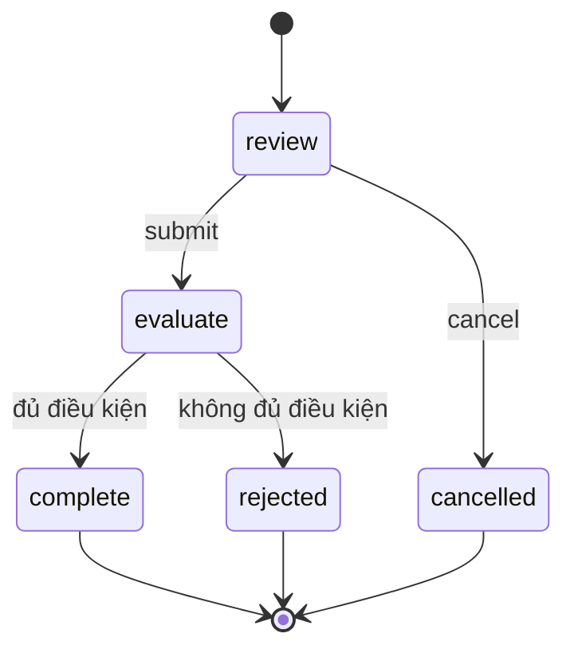

# Nhiều end-state cho hoàn thành, từ chối và hủy

## 1. Một flow có thể kết thúc theo nhiều kết quả nghiệp vụ

Trong **Spring Web Flow**, một hành trình như đăng ký dịch vụ, xét duyệt hồ sơ hoặc đặt hàng thường có nhiều đường đi. Người dùng có thể gửi thông tin hợp lệ và hoàn tất, không đáp ứng điều kiện nghiệp vụ và bị từ chối, hoặc chủ động hủy trước khi xác nhận. Các đường đi này có thể dùng chung nhiều **state**, nhưng kết thúc bằng những kết quả khác nhau.

Ví dụ một quy trình xét duyệt:

- **Hoàn thành:** hồ sơ đủ điều kiện, hệ thống ghi nhận và cấp mã tham chiếu.
- **Từ chối:** hồ sơ được đánh giá nhưng không đáp ứng điều kiện; hệ thống lưu lý do từ chối.
- **Hủy:** người dùng chủ động dừng quy trình trước khi gửi hồ sơ.

Spring Web Flow biểu diễn các kết quả cuối bằng nhiều phần tử **`<end-state>`** trong cùng một flow. Mỗi end-state có một `id` riêng; khi execution đi vào end-state, flow kết thúc và ID đó trở thành **outcome** của flow.



Điểm quan trọng là **hoàn thành, từ chối và hủy là ba kết quả nghiệp vụ khác nhau**. Chúng có thể cần thông báo, audit, điều hướng và xử lý tiếp theo khác nhau. Nếu mọi đường đi đều kết thúc ở một end-state chung, caller sẽ khó biết flow thực sự kết thúc theo cách nào.

## 2. end-state và outcome có quan hệ như thế nào?

`<end-state>` là state kết thúc một flow session. Khi flow đi vào end-state:

1. Flow session hiện tại kết thúc.
2. ID của end-state được dùng làm **outcome ID**.
3. Các output được khai báo trong end-state được đưa vào outcome output map.
4. Nếu đây là root flow, toàn bộ flow execution kết thúc và hạ tầng bên ngoài xử lý response cuối.
5. Nếu đây là subflow, flow cha được tiếp tục tại `<subflow-state>` và nhận outcome ID như event để chọn transition.

| Khái niệm | Ví dụ | Vai trò |
| --- | --- | --- |
| Flow ID | `applicationReview` | Định danh flow definition trong registry |
| State ID | `review`, `evaluate`, `complete` | Định danh state bên trong flow |
| Event ID | `submit`, `cancel` | Sự kiện kích hoạt transition ở state hiện tại |
| End-state ID | `completed`, `rejected`, `cancelled` | Định danh kết quả khi flow kết thúc |
| Outcome ID | `completed` | ID được trả về khi flow kết thúc; mặc định trùng ID end-state |
| Output attribute | `reference`, `reasonCode` | Dữ liệu được trả kèm một outcome cụ thể |

**End-state ID chính là outcome ID theo mặc định.** Ví dụ:

```xml
<end-state id="completed"/>
<end-state id="rejected"/>
<end-state id="cancelled"/>
```

Khi flow kết thúc ở `rejected`, caller nhận outcome `rejected`; khi kết thúc ở `cancelled`, caller nhận outcome `cancelled`. Outcome không phải tên event vừa gửi, cũng không phải state trước khi kết thúc.

### 2.1. Root flow và subflow xử lý outcome khác nhau

| Ngữ cảnh | Sau khi vào end-state |
| --- | --- |
| Root flow | Flow execution kết thúc; response cuối được chọn theo cấu hình end-state và tích hợp Spring MVC/FlowHandler |
| Subflow | Subflow session kết thúc; parent flow resume tại subflow-state và dùng outcome ID để chọn transition |

Một end-state có thể khai báo `view` để chọn view cuối khi nó kết thúc root flow. Khi kết thúc một subflow, trách nhiệm điều hướng tiếp thuộc parent flow; ID của end-state trở thành kết quả mà parent xử lý. Không nên giả định end-state của subflow sẽ render một trang độc lập như root flow.

## 3. Thiết kế ba kết quả: completed, rejected và cancelled

Trước khi viết XML, cần xác định ý nghĩa của từng outcome:

| Outcome | Điều kiện đi vào | Dữ liệu nên trả | Hành động thường gặp |
| --- | --- | --- | --- |
| `completed` | Nghiệp vụ hoàn tất thành công | Mã tham chiếu, ID hồ sơ, thời điểm xác nhận | Hiển thị xác nhận, gửi thông báo sau commit |
| `rejected` | Đã đánh giá và quyết định hồ sơ không đủ điều kiện | Mã lý do, thông tin hướng dẫn được phép công bố | Hiển thị kết quả từ chối, lưu audit |
| `cancelled` | Người dùng chủ động hủy hoặc chọn nhánh hủy đã định nghĩa | Có thể không cần output; đôi khi có mã nguồn hủy | Quay về danh sách, giải phóng dữ liệu nháp |

Nên thống nhất cách đặt ID theo quy ước của module. Dùng các từ có ý nghĩa nghiệp vụ như `completed`, `rejected`, `cancelled`; tránh những ID mơ hồ như `end1`, `done2` hoặc `finish`.

### Từ chối không đồng nghĩa với validation error

- **Validation error:** người dùng nhập thiếu hoặc sai định dạng, ví dụ email không hợp lệ. Thông thường flow giữ người dùng ở view-state để sửa; chưa phải kết quả từ chối cuối cùng.
- **Business rejection:** dữ liệu đã đủ để đánh giá nhưng quy tắc nghiệp vụ kết luận hồ sơ không đủ điều kiện. Đây có thể là outcome `rejected`.
- **Technical failure:** database mất kết nối, service timeout hoặc lỗi lập trình. Đây là exception/failure cần được xử lý theo chính sách lỗi; không tự động biến thành `rejected`.
- **Cancellation:** người dùng chủ động dừng quy trình. Đây là lựa chọn điều hướng, không phải lỗi validation hay exception.

Không dùng end-state `rejected` để thay thế message context của Web Flow. Nếu người dùng chỉ cần sửa một trường, hãy giữ flow ở view-state và hiển thị lỗi ngay tại form.

## 4. Ví dụ flow XML có ba end-state

Giả sử flow `applicationReview` xét duyệt một hồ sơ. Người dùng xem lại thông tin ở state `review`, rồi gửi event `submit` hoặc `cancel`. Hệ thống đánh giá điều kiện; nếu đạt thì hoàn tất, nếu không đạt thì từ chối.

**`/WEB-INF/flows/application/application-review-flow.xml`:**

```xml
<?xml version="1.0" encoding="UTF-8"?>
<flow xmlns="http://www.springframework.org/schema/webflow"
      xmlns:xsi="http://www.w3.org/2001/XMLSchema-instance"
      xsi:schemaLocation="
        http://www.springframework.org/schema/webflow
        http://www.springframework.org/schema/webflow/spring-webflow-2.0.xsd">

    <input name="applicationId" type="long" required="true"/>
    <var name="application"
         class="com.example.application.ApplicationDraft"/>

    <on-start>
        <evaluate expression="applicationService.loadForReview(applicationId)"
                  result="flowScope.application"/>
    </on-start>

    <view-state id="review"
                view="application/review"
                model="application">
        <transition on="submit" to="evaluateEligibility"/>
        <transition on="cancel" to="cancelled"
                    bind="false" validate="false"/>
    </view-state>

    <decision-state id="evaluateEligibility">
        <if test="flowScope.application.eligible"
            then="completeApplication"
            else="recordRejection"/>
    </decision-state>

    <action-state id="completeApplication">
        <evaluate expression="applicationService.complete(flowScope.application)"
                  result="flowScope.reference"/>
        <transition on="success" to="completed"/>
    </action-state>

    <action-state id="recordRejection">
        <evaluate expression="applicationService.recordRejection(flowScope.application)"
                  result="flowScope.reasonCode"/>
        <transition on="success" to="rejected"/>
    </action-state>

    <end-state id="completed">
        <output name="reference" value="flowScope.reference"/>
    </end-state>
    <end-state id="rejected">
        <output name="reasonCode" value="flowScope.reasonCode"/>
    </end-state>
    <end-state id="cancelled"/>
</flow>
```

Ví dụ minh họa các trách nhiệm khác nhau:

1. `review` là view-state hiển thị dữ liệu để người dùng xem lại.
2. Event `submit` chuyển đến `evaluateEligibility`.
3. `decision-state` chọn state tiếp theo dựa trên kết quả đánh giá.
4. `completeApplication` thực hiện nghiệp vụ hoàn tất; chỉ khi action trả event `success`, flow mới đi tới `completed`.
5. `recordRejection` ghi nhận quyết định từ chối và mã lý do, sau đó đi tới `rejected`.
6. Event `cancel` đi thẳng tới `cancelled`; `bind="false"` và `validate="false"` tránh binding/validation dữ liệu form khi hủy.

`ApplicationDraft`, `applicationService` và các method trong ví dụ là thành phần do ứng dụng định nghĩa. `eligible` cần được tính từ quy tắc nghiệp vụ phía server; không tin một hidden field hoặc parameter do trình duyệt gửi lên để quyết định hồ sơ được duyệt.

### 4.1. Đầu ra chỉ được khai báo ở end-state tương ứng

End-state `completed` trả `reference`; end-state `rejected` trả `reasonCode`; end-state `cancelled` không trả dữ liệu. Caller không nên giả định mọi outcome đều có cả hai thuộc tính.

Có thể khai báo output mà không viết expression nếu biến cùng tên đã tồn tại trong flow scope:

```xml
<end-state id="completed">
    <output name="reference"/>
</end-state>
```

Trong trường hợp này, Web Flow lấy giá trị `reference` từ flow scope. Nếu muốn chỉ rõ nguồn hoặc đổi tên, dùng thuộc tính `value`:

```xml
<end-state id="rejected">
    <output name="reasonCode" value="flowScope.rejection.code"/>
</end-state>
```

Output là **dữ liệu trả về có chủ đích**. Không xuất toàn bộ flow scope cho caller; chỉ trả các thuộc tính cần thiết để flow cha hoặc lớp tích hợp tiếp tục xử lý.

## 5. Điều hướng từ state đến đúng end-state

### 5.1. Người dùng chủ động hủy

```xml
<view-state id="review" view="application/review">
    <transition on="cancel" to="cancelled"
                bind="false" validate="false"/>
</view-state>
<end-state id="cancelled"/>
```

Nút hủy trong view phát event `cancel`:

```html
<button type="submit" name="_eventId_cancel">Hủy hồ sơ</button>
```

View phải gửi form tới `flowExecutionUrl` của execution hiện tại. Tên event `_eventId_cancel` khớp với `on="cancel"`; `to="cancelled"` trỏ đến ID end-state. Nút hủy không tự chứng minh flow đã hủy: chỉ khi transition được xử lý và execution thực sự vào end-state `cancelled`, outcome mới là `cancelled`.

### 5.2. Quyết định nghiệp vụ từ chối

```xml
<decision-state id="checkEligibility">
    <if test="eligibilityService.isEligible(flowScope.application)"
        then="complete" else="reject"/>
</decision-state>

<action-state id="reject">
    <evaluate expression="applicationService.recordRejection(flowScope.application)"
              result="flowScope.reasonCode"/>
    <transition on="success" to="rejected"/>
</action-state>

<end-state id="rejected">
    <output name="reasonCode" value="flowScope.reasonCode"/>
</end-state>
```

`decision-state` chỉ chọn nhánh. Phần ghi nhận lý do từ chối nằm trong action-state, để có thể áp dụng transaction, audit và kiểm thử riêng. Nếu việc ghi nhận từ chối thất bại do lỗi database, flow không nên giả vờ đã kết thúc với outcome `rejected`.

### 5.3. Hoàn thành sau khi hành động thành công

```xml
<action-state id="complete">
    <evaluate expression="applicationService.complete(flowScope.application)"
              result="flowScope.reference"/>
    <transition on="success" to="completed"/>
</action-state>

<end-state id="completed">
    <output name="reference" value="flowScope.reference"/>
</end-state>
```

Chỉ đi vào `completed` sau khi action thành công. Nếu service cần trả event nghiệp vụ khác nhau, hãy định nghĩa transition tương ứng và kiểm tra rõ hợp đồng trả về. Không gửi email hoặc gọi hệ thống ngoài như thể giao dịch đã hoàn tất trước khi transaction lưu kết quả thành công.

## 6. Root flow: xử lý outcome sau khi execution kết thúc

Khi root flow kết thúc, Spring Web Flow tạo outcome chứa ID end-state và output map. Lớp tích hợp Spring MVC có thể dùng outcome để chọn response hoặc redirect.

Một custom handler có thể phân biệt ba kết quả:

```java
package com.example.application.web;

import jakarta.servlet.http.HttpServletRequest;
import jakarta.servlet.http.HttpServletResponse;
import java.nio.charset.StandardCharsets;
import org.springframework.webflow.execution.FlowExecutionOutcome;
import org.springframework.webflow.mvc.servlet.AbstractFlowHandler;
import org.springframework.web.util.UriUtils;

public class ApplicationReviewFlowHandler extends AbstractFlowHandler {

    @Override
    public String getFlowId() {
        return "applicationReview";
    }

    @Override
    public String handleExecutionOutcome(
            FlowExecutionOutcome outcome,
            HttpServletRequest request,
            HttpServletResponse response) {

        if ("completed".equals(outcome.getId())) {
            String reference = outcome.getOutput().getString("reference");
            String encoded = UriUtils.encodePathSegment(
                    reference, StandardCharsets.UTF_8);
            return "contextRelative:/applications/completed/" + encoded;
        }
        if ("rejected".equals(outcome.getId())) {
            String reasonCode = outcome.getOutput().getString("reasonCode");
            String encoded = UriUtils.encodeQueryParam(
                    reasonCode, StandardCharsets.UTF_8);
            return "contextRelative:/applications/rejected?reason=" + encoded;
        }
        if ("cancelled".equals(outcome.getId())) {
            return "contextRelative:/applications";
        }
        return null;
    }
}
```

Đăng ký handler dưới tên trùng flow ID:

```java
@Bean(name = "applicationReview")
public ApplicationReviewFlowHandler applicationReviewFlowHandler() {
    return new ApplicationReviewFlowHandler();
}
```

Đây là phần tích hợp tùy chọn; root flow vẫn có thể dùng view selection của end-state hoặc chính sách mặc định của ứng dụng. Nếu dùng redirect động, hãy validate và encode các output trước khi ghép URL; không dùng dữ liệu không tin cậy để tạo redirect tùy ý. Các controller đích phải kiểm tra quyền truy cập dữ liệu dựa trên principal hiện tại, không dựa vào việc người dùng biết reference.

**Lưu ý:** `handleExecutionOutcome(...)` chỉ chạy ở ranh giới xử lý outcome của root flow theo cấu hình MVC. Nếu flow đang là subflow, end-state trả outcome về parent; parent xử lý kết quả trong transition của `subflow-state`.

## 7. Subflow trả nhiều outcome cho flow cha

Nhiều end-state đặc biệt hữu ích khi một flow được tái sử dụng như subflow. Ví dụ flow cha `onboarding` gọi subflow `applicationReview`. Subflow có thể hoàn thành, từ chối hoặc hủy; parent chọn một transition khác nhau cho từng kết quả.

### 7.1. Flow con khai báo end-state và output

```xml
<flow xmlns="http://www.springframework.org/schema/webflow">
    <input name="application"/>

    <view-state id="review" view="application/review" model="application">
        <transition on="submit" to="evaluate"/>
        <transition on="cancel" to="cancelled"
                    bind="false" validate="false"/>
    </view-state>

    <decision-state id="evaluate">
        <if test="application.eligible"
            then="completed" else="rejected"/>
    </decision-state>

    <end-state id="completed">
        <output name="reference" value="application.reference"/>
    </end-state>
    <end-state id="rejected">
        <output name="reasonCode" value="application.rejectionCode"/>
    </end-state>
    <end-state id="cancelled"/>
</flow>
```

Đây là phần flow con minh họa; trong ứng dụng thực tế, quyết định và cập nhật trạng thái cần đi qua service phía server, không chỉ đọc thuộc tính do form binding cho phép sửa.

### 7.2. Flow cha nhận từng outcome

```xml
<subflow-state id="reviewApplication" subflow="applicationReview">
    <input name="application" value="flowScope.application"/>

    <transition on="completed" to="applicationCompleted">
        <evaluate expression="flowScope.reference = currentEvent.attributes.reference"/>
    </transition>
    <transition on="rejected" to="applicationRejected">
        <evaluate expression="flowScope.reasonCode = currentEvent.attributes.reasonCode"/>
    </transition>
    <transition on="cancelled" to="applicationCancelled"/>
</subflow-state>

<view-state id="applicationCompleted" view="onboarding/completed"/>
<view-state id="applicationRejected" view="onboarding/rejected"/>
<view-state id="applicationCancelled" view="onboarding/cancelled"/>
```

Khi subflow kết thúc ở `completed`, parent nhận event `completed` cùng output `reference` trong `currentEvent.attributes`. Tương tự, outcome `rejected` trả `reasonCode`; outcome `cancelled` không có output bắt buộc.

Không nên chỉ khai báo một transition chung nếu parent cần phản ứng khác nhau theo kết quả. Việc tách outcome làm hợp đồng giữa flow cha và flow con rõ ràng, đồng thời cho phép kiểm thử từng nhánh độc lập.

### 7.3. Phân biệt output của flow con với dữ liệu chia sẻ scope

| Cách trao đổi | Khi phù hợp | Lưu ý |
| --- | --- | --- |
| Subflow input | Parent truyền dữ liệu cần thiết lúc gọi subflow | Chỉ truyền dữ liệu con cần; không truyền toàn bộ flow scope |
| End-state output | Subflow trả kết quả gắn với outcome cụ thể | Parent đọc qua `currentEvent.attributes` trong transition tương ứng |
| Conversation scope | Cha và con thực sự cần chia sẻ một số dữ liệu theo conversation | Phải kiểm soát quyền sở hữu và thay đổi dữ liệu |
| Database/service | Dữ liệu cần bền vững hoặc dùng ngoài vòng đời flow | Cần transaction và authorization rõ ràng |

Output map là hợp đồng rõ ràng nhất khi flow con cần báo kết quả về cho flow cha. Không dùng conversation scope như một cách truyền dữ liệu ngầm khiến caller phụ thuộc vào chi tiết nội bộ của subflow.

## 8. Xử lý transaction và side effect theo outcome

Ba outcome không tự đảm bảo transaction. Chúng chỉ mô tả flow kết thúc theo kết quả nào; việc ghi database vẫn do service/transaction manager quyết định.

| Nhánh | Hành động trước end-state | Điều cần bảo đảm |
| --- | --- | --- |
| `completed` | Ghi nhận hồ sơ/đơn hàng và tạo reference | Chỉ trả outcome sau khi thao tác ghi thành công |
| `rejected` | Lưu quyết định và reason code | Audit được lý do; không ghi trạng thái hoàn thành |
| `cancelled` | Đóng bản nháp hoặc giải phóng reservation nếu cần | Hủy có tính idempotent; không xóa dữ liệu đã commit ngoài phạm vi |

Nếu dùng flow-managed persistence, chỉ end-state được cấu hình commit mới thực hiện final commit theo cơ chế listener. Nếu dùng service-managed transaction, service quyết định transaction boundary. Không nhầm việc đi vào end-state với việc database tự commit mọi thay đổi.

Một số side effect như gửi email, phát message hoặc gọi payment gateway có thể không rollback được. Nên thực hiện sau commit hoặc dùng outbox/idempotency phù hợp. Nếu người dùng double-click Confirm, service phải có khóa idempotency hoặc cơ chế chống tạo hai hồ sơ/đơn hàng.

### Hủy không phải rollback mọi thứ

Nếu trước khi người dùng bấm Cancel, ứng dụng đã commit một reservation hoặc gửi thông báo bên ngoài, end-state `cancelled` không tự đảo ngược các hành động đó. Cần action hủy/compensation rõ ràng, ví dụ giải phóng reservation, và kiểm thử trường hợp compensation thất bại.

## 9. Thiết kế mã lý do từ chối và thông báo

End-state `rejected` có thể trả mã lý do:

```xml
<end-state id="rejected">
    <output name="reasonCode" value="flowScope.reasonCode"/>
</end-state>
```

Nên dùng mã ổn định như:

| Reason code | Ý nghĩa nội bộ | Thông báo có thể hiển thị |
| --- | --- | --- |
| `INELIGIBLE` | Không đáp ứng điều kiện chương trình | Hồ sơ chưa đáp ứng điều kiện hiện tại |
| `LIMIT_EXCEEDED` | Vượt giới hạn nghiệp vụ | Yêu cầu vượt giới hạn cho phép |
| `DOCUMENT_REQUIRED` | Thiếu giấy tờ bắt buộc sau khi đánh giá | Hồ sơ cần bổ sung giấy tờ theo hướng dẫn |

Không trả stack trace, truy vấn SQL, thông tin bảo mật hoặc quy tắc phát hiện gian lận chi tiết cho client. Có thể ghi chi tiết nội bộ vào audit log có kiểm soát, còn output chỉ chứa mã công khai được phép.

Nếu lý do từ chối có dữ liệu nhạy cảm, chỉ trả một mã tổng quát cho flow cha/controller. Controller đích vẫn phải kiểm tra authorization trước khi hiển thị thông tin chi tiết.

## 10. Kiểm thử từng end-state

Một flow có ba kết quả cần tối thiểu ba kịch bản kết thúc. Không chỉ kiểm thử đường thành công rồi giả định các nhánh khác cũng đúng.

| Test case | Điều kiện/Thao tác | Kỳ vọng |
| --- | --- | --- |
| Hoàn thành | Hồ sơ đủ điều kiện, event `submit`, action complete thành công | Execution kết thúc, outcome `completed`, có output `reference` |
| Từ chối | Hồ sơ không đủ điều kiện | Outcome `rejected`, có `reasonCode`, không có reference hoàn thành |
| Hủy | Người dùng gửi event `cancel` tại state review | Outcome `cancelled`, không chạy action hoàn tất |
| Validation lỗi | Form thiếu dữ liệu hoặc sai định dạng | Giữ view-state để sửa; không đi vào `rejected` |
| Action thất bại | Service complete ném exception | Không trả outcome `completed` giả |
| Output thiếu | End-state được vào nhưng biến output không tồn tại | Test phát hiện output null/thiếu trước khi caller dùng |
| Subflow hoàn thành | Subflow trả `completed` | Parent chọn transition `completed` và nhận output |
| Subflow từ chối | Subflow trả `rejected` | Parent đi nhánh từ chối, không nhầm với exception |
| Subflow hủy | Subflow trả `cancelled` | Parent xử lý nhánh hủy đã định nghĩa |
| Double submit | Hai request xác nhận cùng một hồ sơ | Service không tạo hai kết quả nghiệp vụ |

### Ví dụ test với AbstractXmlFlowExecutionTests

Spring Web Flow cung cấp test support để chạy flow XML mà không cần trình duyệt. Ví dụ sau dùng phong cách JUnit 3 của `AbstractXmlFlowExecutionTests`; flow test có input `eligible` để kiểm tra hai nhánh quyết định.

**`outcome-test-flow.xml` trong test resources:**

```xml
<flow xmlns="http://www.springframework.org/schema/webflow">
    <input name="eligible" type="boolean" required="true"/>

    <view-state id="review" view="application/review">
        <transition on="submit" to="evaluate"/>
        <transition on="cancel" to="cancelled"
                    bind="false" validate="false"/>
    </view-state>

    <decision-state id="evaluate">
        <if test="flowScope.eligible"
            then="completed" else="rejected"/>
    </decision-state>

    <end-state id="completed"/>
    <end-state id="rejected"/>
    <end-state id="cancelled"/>
</flow>
```

```java
package com.example.application;

import org.springframework.binding.collection.LocalAttributeMap;
import org.springframework.binding.collection.MutableAttributeMap;
import org.springframework.webflow.config.FlowDefinitionResource;
import org.springframework.webflow.config.FlowDefinitionResourceFactory;
import org.springframework.webflow.test.MockExternalContext;
import org.springframework.webflow.test.execution.AbstractXmlFlowExecutionTests;

public class ApplicationReviewFlowTests
        extends AbstractXmlFlowExecutionTests {

    @Override
    protected FlowDefinitionResource getResource(
            FlowDefinitionResourceFactory factory) {
        return factory.createClassPathResource(
                "outcome-test-flow.xml", getClass());
    }

    private void startWithEligibility(boolean eligible) {
        MutableAttributeMap<Object> input = new LocalAttributeMap<>();
        input.put("eligible", eligible);
        startFlow(input, new MockExternalContext());
    }

    public void testEligibleApplicationCompletes() {
        startWithEligibility(true);
        assertCurrentStateEquals("review");

        MockExternalContext request = new MockExternalContext();
        request.setEventId("submit");
        resumeFlow(request);

        assertFlowExecutionEnded();
        assertFlowExecutionOutcomeEquals("completed");
    }

    public void testIneligibleApplicationIsRejected() {
        startWithEligibility(false);
        MockExternalContext request = new MockExternalContext();
        request.setEventId("submit");
        resumeFlow(request);

        assertFlowExecutionEnded();
        assertFlowExecutionOutcomeEquals("rejected");
    }

    public void testUserCanCancel() {
        startWithEligibility(true);
        MockExternalContext request = new MockExternalContext();
        request.setEventId("cancel");
        resumeFlow(request);

        assertFlowExecutionEnded();
        assertFlowExecutionOutcomeEquals("cancelled");
    }
}
```

Fixture kiểm thử khai báo input `eligible`; `startFlow(input, ...)` cung cấp giá trị cho flow và decision-state đọc từ flow scope. Fixture này cô lập hành vi phân nhánh để test cả ba outcome; flow production ở mục 4 vẫn lấy quyết định từ service phía server. Để kiểm tra output, bổ sung test cho flow result/parent transition hoặc kiểm tra kết quả tại adapter phù hợp với test harness của phiên bản đang dùng.

Trong ứng dụng thực tế, không cho client quyết định `eligible`. Test input chỉ giúp mô phỏng hai nhánh; production phải lấy kết quả từ service tin cậy.

## 11. Các lỗi thường gặp

| Triệu chứng | Nguyên nhân | Cách xử lý |
| --- | --- | --- |
| Flow luôn trả `completed` | Decision expression luôn true hoặc transition đi thẳng tới end-state thành công | Kiểm tra điều kiện và test cả nhánh false |
| Nhấn Cancel nhưng vẫn lưu hồ sơ | Action ghi dữ liệu đã chạy trước nhánh hủy hoặc transition cancel không đúng | Đặt action ghi sau decision/confirm; kiểm tra transaction và side effect |
| Outcome của subflow không khớp parent | Parent transition `on` không trùng end-state ID của child | Đối chiếu outcome ID và transition event |
| Parent không đọc được output | End-state không khai báo output hoặc sai tên | Khai báo `<output>` và đọc đúng `currentEvent.attributes.*` |
| Caller nghĩ validation error là rejected | Trộn lỗi nhập liệu với quyết định nghiệp vụ | Giữ form ở view-state cho validation; chỉ dùng rejected cho quyết định cuối |
| Outcome completed nhưng thiếu reference | Service không trả ID hoặc output expression sai | Kiểm tra flowScope và output mapping |
| Exception bị biến thành cancelled | Catch rộng và điều hướng mọi lỗi sang end-state hủy | Phân biệt cancellation có chủ đích với exception |
| Gửi event sau khi flow đã kết thúc | Client dùng execution URL cũ | Hiển thị kết quả cuối và xử lý execution không còn tồn tại |
| Có hai hồ sơ sau double-click | Action hoàn tất không idempotent | Dùng khóa idempotency/unique constraint và transaction |
| Hủy subflow làm parent kết thúc luôn | Parent map outcome cancelled sang end-state thay vì state tiếp tục | Khai báo transition riêng và quyết định chính sách ở parent |

Khi debug, kiểm tra theo thứ tự **event → transition → state/action → end-state → outcome ID → output map → caller**. Nếu flow là subflow, thêm bước kiểm tra transition trong parent.

## 12. Bài tập vận dụng

Thiết kế flow `loanApplication` có các kết quả:

1. `approved`: khoản vay được phê duyệt, trả `loanReference`.
2. `rejected`: hồ sơ không đạt chính sách, trả `reasonCode`.
3. `cancelled`: người dùng hủy trước khi xác nhận.

Yêu cầu:

- Tạo state nhập thông tin và state review.
- Dùng decision-state hoặc action-state để gọi dịch vụ đánh giá từ server.
- Chỉ chạy action tạo khoản vay sau khi điều kiện được chấp nhận.
- Tạo ba end-state có ID khác nhau và output chỉ cho nhánh cần trả dữ liệu.
- Gọi flow này từ parent `customerOnboarding`; parent xử lý ba outcome bằng ba transition riêng.
- Viết test cho hoàn thành, từ chối, hủy, validation error và lỗi service.
- Kiểm tra double submit và bảo đảm hủy không để lại side effect ngoài ý muốn.

**Tiêu chí hoàn thành:** người học giải thích được vì sao một flow có nhiều end-state, ID end-state trở thành outcome, output chỉ được trả theo kết quả tương ứng và flow cha có thể phản ứng khác nhau với từng outcome.

## 13. Ghi nhớ

- Một flow có thể có **nhiều `<end-state>`**, mỗi end-state biểu diễn một kết quả cuối khác nhau.
- **ID của end-state là outcome ID** được trả khi flow kết thúc.
- `completed`, `rejected` và `cancelled` nên có ý nghĩa nghiệp vụ rõ ràng, không dùng lẫn nhau.
- Validation error thường giữ người dùng ở view-state; rejection là quyết định nghiệp vụ cuối; technical failure cần xử lý như exception.
- `<output>` khai báo dữ liệu được trả cùng một outcome; caller không nên giả định mọi outcome đều có cùng output.
- Root flow kết thúc toàn bộ execution; subflow kết thúc và trả outcome cho parent để parent chọn transition.
- End-state không tự bảo đảm transaction commit hoặc rollback; action/service phải quản lý side effect và idempotency.
- Kiểm thử từng outcome, output, nhánh subflow và trường hợp lỗi để tránh flow luôn đi vào nhánh thành công.

### Tài liệu tham khảo

- [Spring Web Flow 3.0 Reference Guide – Defining Flows](https://docs.spring.io/spring-webflow/docs/3.0.x/reference/): state, transition, end-state và outcome.
- [Spring Web Flow 3.0 Reference Guide – Calling Sub-flows](https://docs.spring.io/spring-webflow/docs/3.0.x/reference/#calling-sub-flows): end-state ID được trả về parent như outcome event và cách đọc output.
- [Spring Web Flow 3.0 Reference Guide – Flow Input and Output](https://docs.spring.io/spring-webflow/docs/3.0.x/reference/#flow-input-and-output): khai báo input/output và output theo end-state.
- [EndState Javadoc](https://docs.spring.io/spring-webflow/docs/current/api/org/springframework/webflow/engine/EndState.html): vòng đời root flow và subflow khi vào end-state.
- [SubflowState Javadoc](https://docs.spring.io/spring-webflow/docs/current/api/org/springframework/webflow/engine/SubflowState.html): gọi subflow, input/output mapping và transition theo kết quả.
