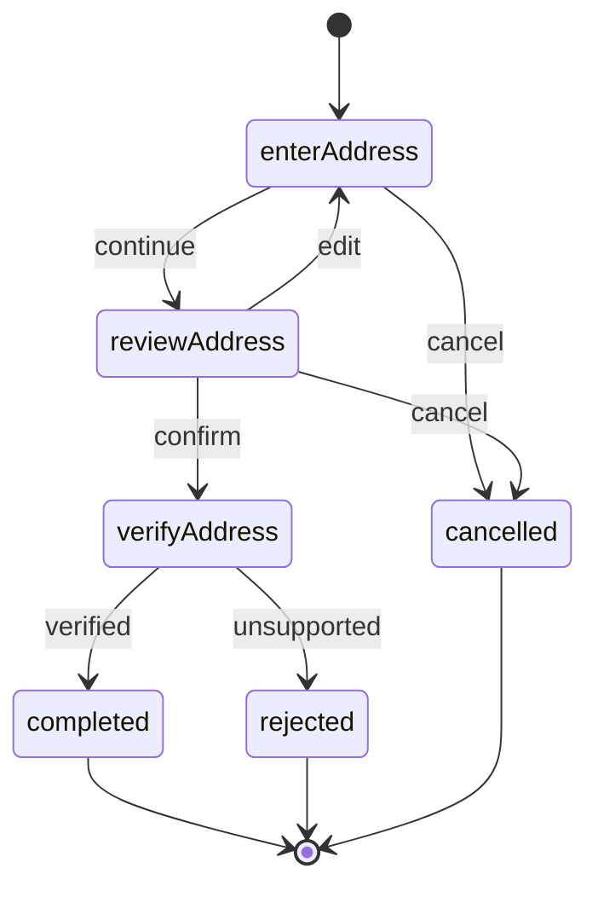
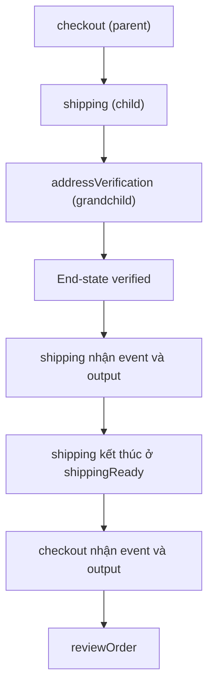

# Định danh end-state làm kết quả trả về cho flow cha

Khi một flow cha gọi flow con (*subflow*), flow con có thể tự quản lý nhiều màn hình, event và action. Flow cha không cần biết người dùng đã đi qua những view-state nào bên trong child. Điều parent cần biết là **flow con kết thúc theo kết quả nào** để quyết định bước tiếp theo.

Spring Web Flow dùng **ID của end-state** để biểu diễn kết quả đó. Khi child đi tới một end-state, ID của end-state trở thành event kết quả được trả về cho `subflow-state` của parent. Parent khai báo transition có thuộc tính `on` khớp với ID ấy để chọn nhánh xử lý. Nếu cần gửi thêm dữ liệu, child khai báo `<output>` ngay trong end-state và parent đọc dữ liệu qua `currentEvent.attributes` trong transition tương ứng.

Bài này thuộc chương **Rẽ nhánh và kết thúc** của module **SPRING_WEB_FLOW**. Nội dung tập trung vào cách đặt tên end-state như một hợp đồng giữa flow con và flow cha, phân biệt outcome với output, xử lý nhiều nhánh kết thúc, kiểm thử event trả về và chẩn đoán khi parent không nhận đúng kết quả. Đây là nền tảng để thiết kế các hành trình nhiều bước có thể tái sử dụng, kết hợp state, event, transition, subflow, form binding, validation, scope và phục hồi flow execution.

Sau bài học, bạn có thể:

1. Giải thích vì sao ID của end-state được dùng làm kết quả trả về từ flow con.
2. Phân biệt ID của end-state với ID của view-state, action-state và event nội bộ.
3. Khai báo nhiều end-state có ý nghĩa nghiệp vụ rõ ràng.
4. Ánh xạ mỗi end-state ID sang transition tương ứng trong `subflow-state` của flow cha.
5. Phân biệt outcome ID với các output attribute mang dữ liệu.
6. Thiết kế kết quả thành công, từ chối, hủy, quay lại và lỗi nghiệp vụ đã phân loại.
7. Kiểm thử hợp đồng parent/child và xử lý lỗi khi tên outcome không khớp.

## 1. End-state là điểm kết thúc của một flow execution

Trong một flow, các state mô tả nơi execution đang hoạt động. Một `view-state` thường hiển thị giao diện; `action-state` thực hiện action; `decision-state` chọn nhánh dựa trên điều kiện; còn `end-state` kết thúc flow execution.

Ví dụ child xác minh địa chỉ có thể gồm các state:

- `enterAddress`: người dùng nhập địa chỉ.
- `reviewAddress`: người dùng xem lại.
- `verifyAddress`: action gọi dịch vụ xác minh.
- `completed`: địa chỉ được xác minh và child hoàn tất.
- `rejected`: địa chỉ không thể sử dụng.
- `cancelled`: người dùng bỏ thao tác.

Ba state cuối là end-state. Khi child đi tới một end-state, flow execution của child kết thúc và trả kết quả về caller đang chờ ở `subflow-state`.



ID của end-state không phải nhãn hiển thị trên nút. Nó là định danh trong flow definition, được dùng để biểu diễn outcome. Tên có thể theo quy ước dự án, nhưng nên ổn định, ngắn gọn và diễn tả kết quả.

## 2. ID end-state trở thành event kết quả của subflow

Giả sử child khai báo:

```xml
<end-state id="completed"/>
<end-state id="rejected"/>
<end-state id="cancelled"/>
```

Parent gọi child bằng:

```xml
<subflow-state id="verifyAddress"
               subflow="addressVerification">
    <transition on="completed" to="reviewOrder"/>
    <transition on="rejected" to="editAddress"/>
    <transition on="cancelled" to="checkoutCancelled"/>
</subflow-state>
```

Cách đọc:

1. Parent đi vào `subflow-state` `verifyAddress`.
2. Spring Web Flow khởi chạy flow có ID `addressVerification`.
3. Child thực hiện các state nội bộ.
4. Child kết thúc tại một end-state.
5. ID end-state được trả về dưới dạng event kết quả cho parent.
6. Parent tìm transition có `on` khớp ID kết quả và chuyển tới state đích.

Do đó, `on="completed"` phải khớp chính xác `id="completed"` ở end-state child. Nếu child đổi ID thành `verified` nhưng parent vẫn chờ `completed`, hợp đồng đã bị lệch.

**Parent không nhận event nội bộ của child.** Event `continue` ở `enterAddress` hoặc `confirm` ở `reviewAddress` được xử lý trong child. Parent chỉ nhận outcome khi child kết thúc ở end-state.

## 3. Phân biệt các loại ID trong flow

Các thuộc tính ID xuất hiện ở nhiều phần tử XML nhưng không có cùng ý nghĩa.

| Phần tử | Ví dụ ID | Ý nghĩa | Có trở thành outcome của subflow không? |
| --- | --- | --- | --- |
| `view-state` | `enterAddress` | Định danh màn hình trong child | Không |
| `action-state` | `verifyAddress` | Định danh bước chạy action | Không |
| `decision-state` | `classifyResult` | Định danh điểm rẽ nhánh | Không |
| `end-state` | `completed` | Định danh kết quả kết thúc child | Có |
| `subflow-state` | `verifyAddress` ở parent | Điểm parent gọi và chờ child | Không; đây là state của parent |
| `transition on` | `on="completed"` | Event mà transition đang lắng nghe | Phải khớp outcome nếu transition xử lý kết quả child |

Một lỗi thường gặp là nhìn thấy child có view-state ID `completed` rồi nghĩ parent sẽ nhận outcome `completed`. Parent chỉ nhận kết quả từ **end-state**. Tên state thông thường không tự trở thành event trả về.

Một flow definition có thể có nhiều điểm kết thúc tùy thiết kế. Với contract được gọi từ parent, nên đặt ID rõ ràng cho từng kết quả mà caller cần phân biệt.

## 4. Thiết kế tên outcome theo ý nghĩa nghiệp vụ

Tên end-state nên nói rõ kết quả, không mô tả chi tiết nội bộ của child.

Ví dụ flow xác minh địa chỉ:

| End-state ID | Ý nghĩa | Parent thường làm gì? |
| --- | --- | --- |
| `verified` | Địa chỉ đã được xác minh | Lưu địa chỉ chuẩn hóa và tiếp tục |
| `unsupported` | Địa chỉ không nằm trong vùng phục vụ | Cho người dùng sửa hoặc chọn cách giao khác |
| `cancelled` | Người dùng hủy thao tác trong child | Quay về nhánh hủy bước con |
| `back` | Người dùng muốn trở lại bước trước của parent | Trở về màn chọn phương thức giao |
| `temporarilyUnavailable` | Dịch vụ xác minh tạm thời chưa xử lý được | Hiển thị retry có giới hạn |

Một số nguyên tắc đặt tên:

- Dùng từ mô tả kết quả đã xảy ra, chẳng hạn `verified`, `declined`, `cancelled`.
- Tránh tên chung như `done` hoặc `result` nếu caller cần phân biệt nhiều nhánh.
- Không đặt outcome theo tên view nội bộ như `reviewPageClosed` nếu ý nghĩa thực sự là `verified`.
- Dùng cùng một quy ước chữ hoa/thường ở child và parent.
- Đổi tên outcome cần được xem là thay đổi contract và cập nhật mọi caller cùng lúc.

Nếu flow con được dùng ở nhiều nơi, outcome ID là một phần API của flow. Đặt tên tốt giúp parent không phụ thuộc vào bố cục màn hình hoặc cách child triển khai.

## 5. Outcome và output là hai khái niệm khác nhau

ID end-state trả lời câu hỏi **child kết thúc theo kết quả nào**. Output trả lời câu hỏi **child gửi thêm dữ liệu gì về parent**.

Ví dụ:

```xml
<end-state id="verified">
    <output name="normalizedAddress"
            value="flowScope.addressDraft.normalizedAddress"/>
    <output name="verificationId"
            value="flowScope.addressDraft.verificationId"/>
</end-state>
```

Trong ví dụ:

- Outcome ID là `verified`.
- Output đầu tiên tên `normalizedAddress`.
- Output thứ hai tên `verificationId`.

Parent nhận event `verified` và đọc output:

```xml
<subflow-state id="verifyAddress"
               subflow="addressVerification">
    <transition on="verified" to="reviewOrder">
        <set name="flowScope.order.deliveryAddress"
             value="currentEvent.attributes.normalizedAddress"/>
        <set name="flowScope.order.addressVerificationId"
             value="currentEvent.attributes.verificationId"/>
    </transition>
</subflow-state>
```

Không nên nhét dữ liệu vào ID như `verified:ADDRESS-123`. ID là định danh outcome ổn định; dữ liệu nên được công bố bằng output có tên và giá trị rõ ràng.

### Một outcome có thể không cần output

Nếu người dùng hủy, parent có thể chỉ cần biết event `cancelled`:

```xml
<end-state id="cancelled"/>
```

Parent không phải đọc attribute nào. Không cần khai báo output rỗng để mọi end-state có cùng cấu trúc.

## 6. Một end-state cho mỗi kết quả mà parent cần phân biệt

Giả sử child xác minh danh tính có thể thành công, thất bại nghiệp vụ hoặc bị hủy. Nếu parent cần cách xử lý khác nhau, hãy dùng ba end-state riêng:

```xml
<end-state id="identityVerified">
    <output name="verificationReference"
            value="flowScope.verification.reference"/>
</end-state>

<end-state id="identityRejected">
    <output name="publicReason"
            value="flowScope.verification.publicReason"/>
</end-state>

<end-state id="cancelled"/>
```

Parent:

```xml
<subflow-state id="verifyIdentity"
               subflow="identityVerification">
    <transition on="identityVerified" to="continueCheckout">
        <set name="flowScope.identityReference"
             value="currentEvent.attributes.verificationReference"/>
    </transition>

    <transition on="identityRejected" to="identityHelp">
        <set name="flowScope.identityMessage"
             value="currentEvent.attributes.publicReason"/>
    </transition>

    <transition on="cancelled" to="checkoutCancelled"/>
</subflow-state>
```

Nếu tất cả các trường hợp đều kết thúc bằng một end-state `finished`, parent phải tự suy luận kết quả từ một output như `status`. Cách đó có thể dùng khi contract thật sự muốn một outcome duy nhất, nhưng thường làm flow cha phức tạp hơn khi mỗi nhánh có hành vi khác nhau.

**Quyết định thiết kế:** nếu parent cần chuyển sang state khác nhau, nhiều end-state ID thường dễ đọc hơn một end-state chung kèm chuỗi trạng thái.

## 7. Child quyết định outcome sau khi xử lý nghiệp vụ

Một flow con không nên kết thúc thành công chỉ vì người dùng bấm nút. Child cần xác định kết quả dựa trên validation và service.

Ví dụ:

```xml
<action-state id="verifyAddress">
    <evaluate expression="addressService.verify(addressDraft)"
              result="flowScope.verification"/>
    <transition on="verified" to="addressVerified"/>
    <transition on="unsupported" to="addressUnsupported"/>
    <transition on="temporarilyUnavailable" to="serviceUnavailable"/>
</action-state>

<end-state id="addressVerified">
    <output name="normalizedAddress"
            value="flowScope.verification.normalizedAddress"/>
    <output name="verificationId"
            value="flowScope.verification.id"/>
</end-state>

<end-state id="addressUnsupported">
    <output name="publicReason"
            value="flowScope.verification.publicReason"/>
</end-state>

<end-state id="serviceUnavailable">
    <output name="retryAfterSeconds"
            value="flowScope.verification.retryAfterSeconds"/>
</end-state>
```

Ví dụ giả định action/service phát ra các outcome đã phân loại tương ứng. Cần bảo đảm bean và action contract của ứng dụng thực sự trả về các event đó; không phải mọi phương thức service trả về DTO đều tự động tạo transition event cùng tên.

Nếu service trả DTO, child có thể lưu DTO rồi dùng decision-state để chọn end-state:

```xml
<action-state id="verifyAddress">
    <evaluate expression="addressService.verify(addressDraft)"
              result="flowScope.verification"/>
    <transition on="success" to="classifyVerification"/>
</action-state>

<decision-state id="classifyVerification">
    <if test="flowScope.verification.verified"
        then="addressVerified"
        else="checkRetryable"/>
</decision-state>

<decision-state id="checkRetryable">
    <if test="flowScope.verification.retryable"
        then="serviceUnavailable"
        else="addressUnsupported"/>
</decision-state>
```

Hai cách là các lựa chọn thiết kế. Hãy chọn một contract action rõ ràng và kiểm thử đường đi tới end-state.

## 8. Parent khai báo transition theo end-state ID

Trong flow cha, `subflow-state` là nơi chờ outcome. Ví dụ:

```xml
<subflow-state id="captureAddress"
               subflow="addressCapture">
    <input name="orderId" value="flowScope.order.id"/>

    <transition on="completed" to="reviewOrder"/>
    <transition on="unsupported" to="changeDelivery"/>
    <transition on="cancelled" to="deliveryCancelled"/>
    <transition on="back" to="chooseDeliveryMethod"/>
</subflow-state>
```

Mỗi transition tương ứng với một ID end-state mà child có thể trả về.

Không viết transition theo event nội bộ của child:

```xml
<!-- Không phải outcome của child nếu confirm chỉ là event trong view-state. -->
<transition on="confirm" to="reviewOrder"/>
```

Nếu child có end-state ID là `completed`, parent cần `on="completed"`. Event `confirm` chỉ hợp lệ nếu chính child kết thúc bằng end-state ID `confirm` — điều thường không nên dùng vì nó mô tả hành động của người dùng hơn là kết quả.

### Parent cần bao phủ mọi outcome công khai

Nếu child công bố `completed`, `unsupported`, `cancelled` và `back`, parent cần có chính sách cho từng outcome. Có thể một số outcome dùng chung state đích, nhưng vẫn nên viết transition riêng khi ý nghĩa nghiệp vụ khác nhau.

Điều này giúp reviewer nhìn vào parent XML và biết child có thể trả về điều gì. Nếu thêm end-state mới ở child, hãy xem lại tất cả caller để xác định họ xử lý kết quả mới ra sao.

## 9. Flow con hoàn chỉnh: xác minh địa chỉ

Ví dụ file `address-capture-flow.xml`. Các class `AddressDraft`, bean `addressService` và view template là thành phần ứng dụng cần cung cấp.

```xml
<?xml version="1.0" encoding="UTF-8"?>
<flow xmlns="http://www.springframework.org/schema/webflow"
      xmlns:xsi="http://www.w3.org/2001/XMLSchema-instance"
      xsi:schemaLocation="
        http://www.springframework.org/schema/webflow
        http://www.springframework.org/schema/webflow/spring-webflow.xsd"
      start-state="editAddress">

    <input name="orderId" type="java.lang.String"/>

    <var name="addressDraft"
         class="com.example.shipping.AddressDraft"/>

    <on-start>
        <evaluate expression="addressService.loadDraft(orderId)"
                  result="flowScope.addressDraft"/>
    </on-start>

    <view-state id="editAddress"
                view="address/edit"
                model="addressDraft">
        <binder>
            <binding property="recipientName"/>
            <binding property="street"/>
            <binding property="postalCode"/>
        </binder>

        <transition on="continue"
                    to="reviewAddress"
                    bind="true"
                    validate="true"/>

        <transition on="cancel"
                    to="cancelled"
                    bind="false"
                    validate="false"/>
    </view-state>

    <view-state id="reviewAddress" view="address/review">
        <transition on="edit" to="editAddress"/>
        <transition on="confirm" to="verifyAddress"/>
        <transition on="cancel" to="cancelled"/>
    </view-state>

    <action-state id="verifyAddress">
        <evaluate expression="addressService.verify(addressDraft)"
                  result="flowScope.verification"/>
        <transition on="success" to="classifyVerification"/>
    </action-state>

    <decision-state id="classifyVerification">
        <if test="flowScope.verification.verified"
            then="completed"
            else="checkRetryable"/>
    </decision-state>

    <decision-state id="checkRetryable">
        <if test="flowScope.verification.retryable"
            then="temporarilyUnavailable"
            else="unsupported"/>
    </decision-state>

    <end-state id="completed">
        <output name="normalizedAddress"
                value="flowScope.verification.normalizedAddress"/>
        <output name="verificationId"
                value="flowScope.verification.id"/>
    </end-state>

    <end-state id="unsupported">
        <output name="publicReason"
                value="flowScope.verification.publicReason"/>
    </end-state>

    <end-state id="temporarilyUnavailable">
        <output name="retryAfterSeconds"
                value="flowScope.verification.retryAfterSeconds"/>
    </end-state>

    <end-state id="cancelled"/>
</flow>
```

Trong child:

- `continue` và `edit` là event nội bộ.
- `confirm` gọi action xác minh.
- Decision-state chọn end-state dựa trên kết quả.
- `completed`, `unsupported`, `temporarilyUnavailable` và `cancelled` là outcome công khai.

Parent không cần biết child dùng bao nhiêu view-state hoặc decision-state. Nếu child thay đổi giao diện nhưng vẫn giữ các outcome và output contract, parent không cần thay đổi.

## 10. Flow cha nhận outcome và chọn nhánh tiếp theo

Ví dụ `checkout-flow.xml`:

```xml
<?xml version="1.0" encoding="UTF-8"?>
<flow xmlns="http://www.springframework.org/schema/webflow"
      xmlns:xsi="http://www.w3.org/2001/XMLSchema-instance"
      xsi:schemaLocation="
        http://www.springframework.org/schema/webflow
        http://www.springframework.org/schema/webflow/spring-webflow.xsd"
      start-state="chooseDeliveryMethod">

    <var name="order"
         class="com.example.checkout.OrderDraft"/>

    <view-state id="chooseDeliveryMethod"
                view="checkout/delivery-method">
        <transition on="enterAddress" to="captureAddress"/>
    </view-state>

    <subflow-state id="captureAddress"
                   subflow="addressCapture">
        <input name="orderId" value="flowScope.order.id"/>

        <transition on="completed" to="reviewOrder">
            <set name="flowScope.order.deliveryAddress"
                 value="currentEvent.attributes.normalizedAddress"/>
            <set name="flowScope.order.addressVerificationId"
                 value="currentEvent.attributes.verificationId"/>
        </transition>

        <transition on="unsupported" to="changeDelivery">
            <set name="flowScope.addressMessage"
                 value="currentEvent.attributes.publicReason"/>
        </transition>

        <transition on="temporarilyUnavailable"
                    to="addressRetry">
            <set name="flowScope.retryAfterSeconds"
                 value="currentEvent.attributes.retryAfterSeconds"/>
        </transition>

        <transition on="cancelled" to="deliveryCancelled"/>
    </subflow-state>

    <view-state id="changeDelivery" view="checkout/change-delivery">
        <transition on="tryAgain" to="captureAddress"/>
        <transition on="chooseAnotherMethod" to="chooseDeliveryMethod"/>
    </view-state>

    <view-state id="addressRetry" view="checkout/address-retry">
        <transition on="retry" to="captureAddress"/>
        <transition on="back" to="chooseDeliveryMethod"/>
    </view-state>

    <view-state id="deliveryCancelled" view="checkout/delivery-cancelled">
        <transition on="resume" to="chooseDeliveryMethod"/>
        <transition on="cancelCheckout" to="checkoutCancelled"/>
    </view-state>

    <view-state id="reviewOrder" view="checkout/review">
        <transition on="confirm" to="placeOrder"/>
    </view-state>

    <action-state id="placeOrder">
        <evaluate expression="orderService.place(order)"/>
        <transition on="success" to="completed"/>
    </action-state>

    <end-state id="completed" view="checkout/completed"/>
    <end-state id="checkoutCancelled" view="checkout/cancelled"/>
</flow>
```

Parent thực hiện ba việc quan trọng:

1. Gọi đúng flow ID `addressCapture`.
2. Định nghĩa transition theo từng end-state ID child công bố.
3. Lưu output cần dùng vào scope của parent trước khi chuyển sang state tiếp theo.

Output của child không tự động trở thành biến trong flow scope của parent. Parent phải đọc attribute trong event và chủ động lưu nếu cần dùng ở các state sau.

## 11. Flow registry và tên flow được gọi

Thuộc tính `subflow` tham chiếu tới flow ID do `FlowDefinitionRegistry` quản lý. Ví dụ:

```xml
<webflow:flow-registry id="flowRegistry"
                       xmlns:webflow="http://www.springframework.org/schema/webflow-config">
    <webflow:flow-location
        id="checkout"
        path="/WEB-INF/flows/checkout/checkout-flow.xml"/>

    <webflow:flow-location
        id="addressCapture"
        path="/WEB-INF/flows/address/address-capture-flow.xml"/>
</webflow:flow-registry>
```

Trong parent, `subflow="addressCapture"` phải khớp ID registry. End-state ID như `completed` lại thuộc contract kết quả bên trong flow con. Hai loại ID không liên quan trực tiếp:

- Flow ID `addressCapture` xác định flow definition cần khởi chạy.
- End-state ID `completed` xác định kết quả child trả về khi kết thúc.

Không dùng đường dẫn file XML thay cho flow ID, và không gọi file định nghĩa flow trực tiếp từ browser.

## 12. Kết quả nghiệp vụ và exception kỹ thuật

End-state ID nên biểu diễn một kết quả mà ứng dụng đã hiểu và phân loại. Exception kỹ thuật bất ngờ không nên tự động được chuyển thành một outcome nghiệp vụ như `rejected` hoặc `cancelled`.

| Tình huống | Biểu diễn phù hợp |
| --- | --- |
| Địa chỉ được xác minh | End-state `completed` |
| Địa chỉ không thuộc vùng phục vụ | End-state `unsupported` hoặc một nhánh nghiệp vụ riêng |
| Người dùng bỏ thao tác | End-state `cancelled` |
| Dịch vụ tạm thời không sẵn sàng, trạng thái đã phân loại | End-state `temporarilyUnavailable` |
| Lỗi cấu hình bean hoặc NullPointerException | Exception handling và logging |
| Timeout chưa rõ service đã xử lý hay chưa | Tra cứu trạng thái bằng correlation/idempotency key trước khi retry |

Nếu bắt mọi exception rồi chuyển child tới end-state `rejected`, parent sẽ hiển thị thông báo sai và có thể bỏ qua lỗi hạ tầng. Chỉ chuyển lỗi sang outcome khi service đã xác định rõ đó là kết quả nghiệp vụ hoặc trạng thái phục hồi mà contract công bố.

Đặc biệt với thanh toán/đặt chỗ, timeout không chứng minh giao dịch chưa xảy ra. Trước khi cho parent retry, cần tra cứu trạng thái theo định danh yêu cầu và giữ idempotency key ổn định.

## 13. Output attributes được đọc trong transition parent

Giả sử end-state child khai báo:

```xml
<end-state id="completed">
    <output name="reference"
            value="flowScope.result.reference"/>
    <output name="completedAt"
            value="flowScope.result.completedAt"/>
</end-state>
```

Parent đọc chúng khi xử lý event `completed`:

```xml
<transition on="completed" to="nextStep">
    <set name="flowScope.reference"
         value="currentEvent.attributes.reference"/>
    <set name="flowScope.completedAt"
         value="currentEvent.attributes.completedAt"/>
</transition>
```

Tên sau `currentEvent.attributes.` phải khớp chính xác thuộc tính `name` trong `<output>`. Nó không nhất thiết trùng tên property nguồn trong child.

Ví dụ, output tên `reference` có thể lấy giá trị từ `flowScope.result.transactionReference`. Parent đọc `currentEvent.attributes.reference`, không đọc trực tiếp `transactionReference`.

### Output chỉ có hiệu lực trên outcome công bố nó

Nếu end-state `cancelled` không khai báo `reference`, parent không nên cố đọc attribute này ở transition `cancelled`. Hợp đồng nên ghi rõ output nào có mặt trên outcome nào và output nào bắt buộc có giá trị.

## 14. Thiết kế outcome không cần output

Một số kết quả chỉ cần thông báo ý định. Ví dụ người dùng hủy bước chọn địa chỉ:

Child:

```xml
<end-state id="cancelled"/>
```

Parent:

```xml
<subflow-state id="captureAddress" subflow="addressCapture">
    <transition on="cancelled" to="addressCancelled"/>
</subflow-state>
```

Parent không cần đọc output. Đây là contract đơn giản và dễ kiểm thử.

Tương tự, outcome `back` có thể không trả dữ liệu nếu parent sẽ tải lại thông tin từ nguồn chuẩn. Chỉ thêm output khi caller thực sự cần giữ một phần dữ liệu nhập dở.

## 15. Nested subflow: mỗi tầng công bố contract riêng

Một flow con có thể gọi flow cháu. Ví dụ `checkout` gọi `shipping`, còn `shipping` gọi `addressVerification`.



Kết quả của flow cháu không tự động đi thẳng tới flow ông. Từng tầng cần nhận outcome, đọc output cần thiết và công bố lại qua end-state của chính nó nếu caller phía trên cần dữ liệu đó.

Ví dụ:

- `addressVerification` kết thúc ở `verified` với output `verificationId`.
- `shipping` nhận event `verified` và lưu ID trong scope của nó.
- Khi `shipping` hoàn tất, nó kết thúc ở `shippingReady` và khai báo output `shippingQuote` cùng `verificationId` nếu contract yêu cầu.
- `checkout` chỉ nhận `shippingReady` và các output mà `shipping` công bố.

Cách này giúp mỗi flow có ranh giới rõ ràng, dễ thay đổi và kiểm thử độc lập.

## 16. Đặt tên outcome ổn định khi flow được tái sử dụng

Khi nhiều parent cùng gọi một child, đổi tên end-state có thể ảnh hưởng nhiều caller.

Ví dụ, flow `addressCapture` được dùng từ checkout và màn quản lý địa chỉ. Cả hai parent đang chờ `completed`. Nếu child đổi end-state thành `verified`, tất cả caller cần được cập nhật.

Một số quy tắc quản lý contract:

- Ghi danh sách end-state công khai trong tài liệu của flow con.
- Ghi output tương ứng với từng end-state.
- Không dùng cùng một ID cho hai ý nghĩa khác nhau.
- Nếu cần thay đổi không tương thích, cân nhắc tạo flow ID/version mới hoặc cập nhật đồng bộ tất cả caller.
- Kiểm thử parent cho mọi outcome child có thể trả.
- Không để view-state nội bộ trở thành phụ thuộc ngầm của parent.

Định danh end-state là API nội bộ giữa các flow. Đối xử với nó như một contract giúp refactor child mà không làm hỏng các flow cha.

## 17. Kiểm thử end-state ID và transition parent

Một test đúng cần xác minh **child đã kết thúc ở end-state nào**, **parent nhận outcome nào**, và **parent đi tới state nào**.

| ID | Kịch bản | Kỳ vọng |
| --- | --- | --- |
| T1 | Parent gọi child | Đúng flow ID được registry tìm thấy |
| T2 | Child đi qua view-state nội bộ | Parent chưa nhận outcome |
| T3 | Child kết thúc ở `completed` | Parent nhận event `completed` |
| T4 | Child kết thúc ở `unsupported` | Parent nhận event `unsupported` |
| T5 | Child kết thúc ở `cancelled` | Parent nhận event `cancelled` |
| T6 | End-state công bố output | Parent đọc đúng attribute |
| T7 | Output thiếu hoặc null | Parent không giả định thành công |
| T8 | Parent thiếu transition cho một outcome | Test phát hiện contract chưa bao phủ |
| T9 | Child đổi end-state ID | Contract test của parent thất bại cho tới khi đồng bộ |
| T10 | Child có view-state tên giống outcome | Parent vẫn chỉ nhận end-state ID |
| T11 | Child ném exception bất ngờ | Exception handling, không giả thành business outcome |
| T12 | Child lồng flow cháu | Mỗi tầng nhận và công bố outcome rõ ràng |
| T13 | Hai parent execution chạy song song | Output không bị trộn giữa execution |
| T14 | Child bị retry sau timeout | Không tạo side effect trùng |
| T15 | Registry thiếu flow ID | Lỗi khởi chạy được phát hiện trước khi chờ outcome |

Pseudocode:

```text
startFlow("checkout")
  -> assertState("chooseDeliveryMethod")

submitEvent("enterAddress")
  -> assertState("captureAddress")
  -> assertSubflow("addressCapture")

submitChildEvent("continue")
  -> assertChildState("reviewAddress")
  -> assertParentStillWaiting()

submitChildEvent("confirm")
  -> childEndsAt("completed")
  -> assertParentState("reviewOrder")
  -> assertFlowScope("order.deliveryAddress", expectedAddress)
  -> assertFlowScope("order.addressVerificationId", "VERIFY-100")
```

Đây là pseudocode mô tả assertion, không phải API test framework có thể chạy nguyên văn. Khi triển khai, dùng test support của phiên bản Spring Web Flow để khởi chạy flow, gửi event và kiểm tra state/scope; dùng mock service để điều khiển từng outcome.

### Test riêng cho tên outcome

Tạo test child để chứng minh đường đi tới từng end-state. Tạo test parent với child/service được điều khiển để kiểm tra từng transition on. Khi thêm hoặc đổi end-state ID, chạy toàn bộ contract test của caller.

## 18. Chẩn đoán khi parent không nhận đúng kết quả

| Triệu chứng | Nguyên nhân có thể | Cách kiểm tra |
| --- | --- | --- |
| Parent vẫn ở subflow-state | Child chưa đi tới end-state | Kiểm tra state cuối và transition của child |
| Parent không tìm thấy nhánh | on không trùng end-state ID | So sánh chính xác tên và chữ hoa/thường |
| Parent xử lý nhầm outcome | Child dùng ID chung chung hoặc sai ý nghĩa | Xem lại outcome contract |
| Parent vào đúng state nhưng thiếu dữ liệu | End-state không khai báo output hoặc tên attribute sai | Đối chiếu output name với currentEvent.attributes |
| Output null | Biểu thức nguồn sai hoặc service chưa tạo giá trị | Kiểm tra object trước end-state |
| Parent đọc event nội bộ child | Nhầm view event với end-state outcome | Chỉ dùng ID end-state làm event kết quả |
| Không khởi chạy được child | Flow ID không có trong registry | Kiểm tra subflow và registry ID |
| Flow cháu trả kết quả nhưng parent ngoài không thấy | Tầng trung gian không công bố lại output | Kiểm tra contract của từng tầng |
| Lỗi kỹ thuật bị hiểu là rejected | Exception bị bắt quá rộng | Tách exception khỏi outcome nghiệp vụ |

Quy trình kiểm tra:

1. Xác nhận flow con đã được registry đăng ký với đúng flow ID.
2. Xác nhận parent đang ở đúng `subflow-state`.
3. Ghi lại state child trước khi kết thúc.
4. Kiểm tra child có thực sự đi tới `end-state` hay không.
5. Đối chiếu ID end-state với thuộc tính `on` của parent.
6. Kiểm tra output khai báo ở đúng end-state.
7. Đối chiếu tên output với biểu thức `currentEvent.attributes`.
8. Xác nhận transition parent lưu output vào scope nếu state sau cần.
9. Phân biệt outcome nghiệp vụ với exception kỹ thuật.
10. Kiểm tra retry, timeout và execution hết hạn nếu lỗi chỉ xuất hiện theo thời gian.

## 19. Các sai lầm thường gặp

| Sai lầm | Hậu quả | Cách sửa |
| --- | --- | --- |
| Nghĩ view-state ID trở thành event trả về | Parent chờ một kết quả child không phát ra | Dùng end-state ID |
| End-state ID và transition on khác nhau | Parent không có nhánh phù hợp | Đồng bộ contract hai phía |
| Dùng một outcome done cho mọi kết quả | Parent phải suy luận nhiều cờ/trạng thái | Tạo end-state riêng khi caller cần nhánh khác |
| Nhầm outcome với output | Cố nhét dữ liệu vào tên event | Dùng output cho dữ liệu |
| Parent đọc output bằng tên property nguồn | Attribute không tồn tại | Đọc theo output name |
| Nghĩ flowScope child tự nhập vào parent | Parent không có dữ liệu sau khi child kết thúc | Copy output từ currentEvent.attributes |
| Khai báo output ở view-state | Caller không nhận output theo end-state contract | Khai báo output trong end-state |
| Không xử lý end-state mới | Parent thiếu nhánh khi child mở rộng | Cập nhật contract test và transition |
| Bắt exception thành cancelled | Che giấu lỗi kỹ thuật | Dùng exception handling riêng |
| Đổi tên end-state mà không cập nhật caller | Flow cha cũ bị hỏng | Version hóa hoặc cập nhật đồng bộ |
| Flow cháu trả output nhưng child không re-export | Flow ông không nhận dữ liệu | Mỗi tầng công bố output cần thiết |

## 20. Bài thực hành: flow con xác minh mã giảm giá

Hãy xây dựng flow cha `checkout` gọi flow con `couponVerification`.

Flow con nhận input `orderId` và `couponCode`, cho phép người dùng xem lại mã rồi gọi service xác minh. Thiết kế các end-state:

| End-state ID | Ý nghĩa | Output |
| --- | --- | --- |
| `accepted` | Mã hợp lệ và áp dụng được | `discountAmount`, `couponReference` |
| `invalid` | Mã không hợp lệ hoặc hết hạn | `publicMessage` |
| `cancelled` | Người dùng bỏ thao tác | Không bắt buộc |
| `temporarilyUnavailable` | Dịch vụ kiểm tra chưa sẵn sàng | `retryAfterSeconds` |

Yêu cầu:

1. Đăng ký flow ID `couponVerification` trong FlowDefinitionRegistry.
2. Khai báo input ở root flow con.
3. Dùng view-state nội bộ cho nhập mã và xem lại.
4. Action/service xác minh mã trước khi child kết thúc.
5. End-state `accepted` công bố hai output.
6. Parent ánh xạ `accepted` tới `reviewOrder`, `invalid` tới màn sửa mã, `cancelled` tới nhánh hủy bước và `temporarilyUnavailable` tới màn retry.
7. Parent đọc output qua `currentEvent.attributes` và lưu vào order draft.
8. Không áp dụng giảm giá nếu output bắt buộc thiếu hoặc không hợp lệ.
9. Viết test cho từng end-state, tên transition on, output null, exception và retry.
10. Giải thích vì sao event `confirm` nội bộ không phải outcome trả về parent.

Đầu ra mong đợi: sơ đồ parent/child, XML hai flow, bảng outcome/output, test matrix và phần giải thích contract ID.

## 21. Checklist trước khi hoàn tất

- [ ] Phân biệt end-state với view-state, action-state và decision-state.
- [ ] Mỗi outcome mà parent cần phân biệt có end-state ID rõ nghĩa.
- [ ] Parent có transition on khớp chính xác ID end-state child.
- [ ] Event nội bộ child không bị nhầm với event kết quả trả về parent.
- [ ] Flow ID trong subflow khớp ID trong FlowDefinitionRegistry.
- [ ] Output được khai báo tại end-state tương ứng.
- [ ] Parent đọc output qua currentEvent.attributes.<outputName>.
- [ ] Parent lưu output vào scope của mình nếu các state tiếp theo cần dùng.
- [ ] Không giả định flow scope của child tự động nhập vào parent.
- [ ] Outcome nghiệp vụ được tách khỏi exception kỹ thuật.
- [ ] Outcome mới/đổi tên được cập nhật ở mọi caller.
- [ ] Có test cho từng end-state, transition, output và trường hợp output thiếu.
- [ ] Nested subflow truyền contract qua từng tầng một cách tường minh.
- [ ] Retry và timeout không tạo side effect trùng.

**Kết luận:** ID của `end-state` là kết quả mà flow con trả về cho flow cha. Parent dùng `transition on` để nhận diện outcome và chọn nhánh tiếp theo; nếu cần dữ liệu, child công bố `<output>` và parent đọc qua `currentEvent.attributes`. Khi tên outcome ổn định, có ý nghĩa nghiệp vụ và được kiểm thử ở cả hai phía, flow cha chỉ phụ thuộc vào hợp đồng kết thúc của child, không phụ thuộc vào các state nội bộ của nó.
