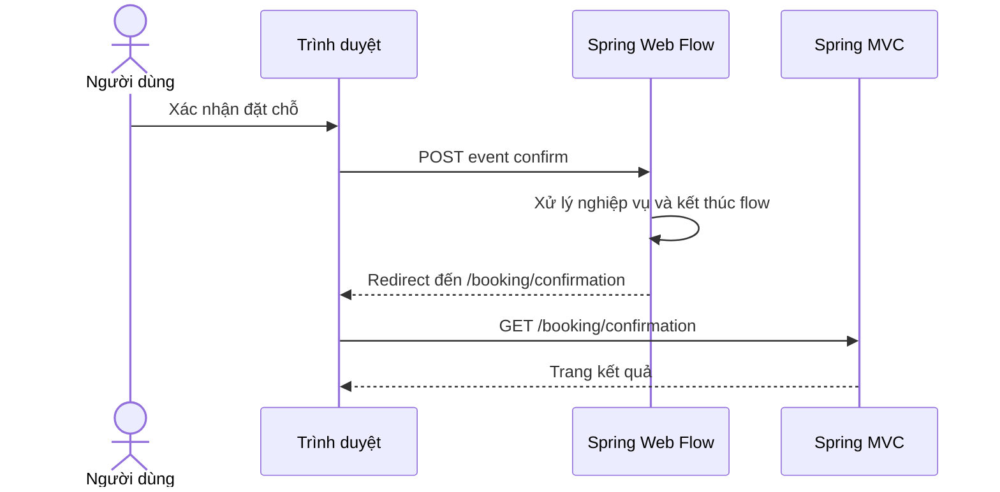

# Hiển thị view cuối và chuyển hướng sau kết thúc

Trong chương **Rẽ nhánh và kết thúc**, một flow cần xác định rõ điều gì xảy ra sau khi người dùng hoàn tất hoặc hủy hành trình. Với **SPRING_WEB_FLOW**, `end-state` đánh dấu một kết quả kết thúc của flow. Ta có thể cấu hình `end-state` để hiển thị view xác nhận cuối cùng, chuyển hướng đến một URL của ứng dụng hoặc chuyển sang một flow khác. Nhờ đó, việc kết thúc hành trình nhiều bước được mô hình hóa trong flow definition thay vì rải logic điều hướng trong controller.

Bài học dùng quy trình đặt chỗ làm ví dụ. Sau khi xác nhận, người dùng có thể xem trang hoàn tất, được chuyển đến một trang MVC hoặc bắt đầu một flow tiếp theo.

## 1. `end-state` và view cuối

`view-state` biểu diễn một màn hình vẫn tham gia vào quá trình tương tác: nó có thể nhận event và đi tiếp qua các transition. `end-state` biểu diễn một kết quả kết thúc; khi flow đi đến state này, flow không còn nhận các event tiếp theo như một màn hình đang hoạt động.

Thuộc tính `view` của `end-state` cho biết phản hồi cuối cùng cần hiển thị hoặc điều hướng đến đâu. Ví dụ đơn giản nhất là render một view xác nhận:

```xml
<view-state id="reviewBooking">
    <transition on="confirm" to="completed" />
</view-state>

<end-state id="completed" view="booking/confirmation" />
```

Khi event `confirm` được phát, flow chuyển từ `reviewBooking` đến `completed`. Web Flow kết thúc flow và render view có tên `booking/confirmation` thông qua cấu hình view resolver của ứng dụng. Tên này là logical view name, không nhất thiết là đường dẫn URL mà trình duyệt nhìn thấy.

Nếu view cuối cần hiển thị dữ liệu còn trong flow scope, hãy bảo đảm view có thể truy cập đúng dữ liệu và dữ liệu đó vẫn còn trong thời điểm render. Ví dụ, với một biến `booking` trong flow scope, JSP có thể đọc thuộc tính của nó qua biến scope mà Web Flow cung cấp:

```jsp
<h1>Đặt chỗ thành công</h1>
<p>Mã xác nhận: ${flowScope.booking.reference}</p>
```

View cuối chỉ trình bày kết quả. Nếu người dùng cần thực hiện thêm thao tác có event, chẳng hạn thay đổi đặt chỗ hoặc gửi yêu cầu hoàn tiền, hãy điều hướng đến một màn hình thuộc flow khác hoặc một endpoint phù hợp. `end-state` không hoạt động như một `view-state` có thể tiếp tục nhận event.

## 2. Chuyển hướng đến URL của ứng dụng

Đôi khi trang hoàn tất được quản lý bởi Spring MVC hoặc một ứng dụng khác. Khi đó, dùng view factory `externalRedirect:` trong thuộc tính `view` của `end-state`:

```xml
<end-state id="completed"
           view="externalRedirect:/booking/confirmation" />
```

Khi flow kết thúc, trình duyệt được chuyển hướng đến URL `/booking/confirmation`. URL này có thể được xử lý bởi controller Spring MVC, ví dụ:

```java
@Controller
public class BookingPageController {

    @GetMapping("/booking/confirmation")
    public String confirmation() {
        return "booking/confirmation";
    }
}
```

Trong ví dụ, controller trả về view `booking/confirmation` theo cơ chế Spring MVC thông thường. Hãy điều chỉnh URL theo context path và cách triển khai của ứng dụng; khi ứng dụng chạy dưới một context path riêng, cần bảo đảm URL redirect trỏ đúng vị trí sau khi deploy.

`externalRedirect:` cũng có thể điều hướng đến địa chỉ bên ngoài, chẳng hạn trang hỗ trợ hoặc cổng thanh toán. Chỉ chuyển hướng đến đích đã được ứng dụng kiểm soát hoặc xác thực. Không lấy URL tùy ý từ request rồi đưa thẳng vào redirect, vì điều đó có thể tạo lỗ hổng open redirect.

## 3. Chuyển hướng đến một flow khác

Nếu hành trình tiếp theo cũng được mô hình hóa bằng Spring Web Flow, có thể dùng view factory `flowRedirect:`. Ví dụ, sau khi hoàn tất đặt chỗ, người dùng được chuyển đến flow `accountOverview`:

```xml
<end-state id="completed"
           view="flowRedirect:accountOverview" />
```

`accountOverview` phải là flow có thể được ứng dụng tìm thấy theo cấu hình registry. Redirect này yêu cầu Web Flow bắt đầu hoặc điều hướng đến flow đích theo flow ID đã khai báo. Đây là lựa chọn phù hợp khi trang tiếp theo có nhiều state, event và quy tắc điều hướng riêng.

Ba cách kết thúc thường gặp có thể so sánh như sau:

| Cấu hình `view` | Hành vi | Khi nên dùng |
|---|---|---|
| `booking/confirmation` | Render logical view cuối thông qua view resolver. | Trang kết quả đơn giản, dữ liệu kết quả còn sẵn trong flow. |
| `externalRedirect:/booking/confirmation` | Chuyển trình duyệt đến URL của ứng dụng hoặc địa chỉ bên ngoài. | Trang đích do Spring MVC, ứng dụng khác hoặc dịch vụ bên ngoài quản lý. |
| `flowRedirect:accountOverview` | Chuyển đến một flow Spring Web Flow khác. | Hành trình tiếp theo cần state, event và transition riêng. |

Chọn cách kết thúc dựa trên nơi chịu trách nhiệm hiển thị kết quả và hành trình tiếp theo. Không cần tạo một flow mới chỉ để render một trang tĩnh; ngược lại, nếu trang tiếp theo có nhiều bước và trạng thái, flow riêng sẽ giúp quản lý rõ ràng hơn.

## 4. Ví dụ hoàn chỉnh: xác nhận rồi hiển thị trang kết quả

Flow đặt chỗ có màn hình xem lại. Khi người dùng xác nhận, flow chuyển đến end state `completed` và hiển thị trang xác nhận:

```xml
<flow xmlns="http://www.springframework.org/schema/webflow"
      xmlns:xsi="http://www.w3.org/2001/XMLSchema-instance"
      xsi:schemaLocation="http://www.springframework.org/schema/webflow
                          https://www.springframework.org/schema/webflow/spring-webflow.xsd">

    <var name="booking" class="com.example.booking.BookingForm" />

    <view-state id="reviewBooking" model="booking">
        <transition on="confirm" to="completed" />
        <transition on="cancel" to="cancelled" />
    </view-state>

    <end-state id="completed" view="booking/confirmation" />
    <end-state id="cancelled" view="booking/cancelled" />
</flow>
```

Hai end state biểu diễn hai kết quả khác nhau. `completed` hiển thị xác nhận thành công; `cancelled` hiển thị kết quả hủy. Việc đặt tên state theo kết quả giúp flow definition dễ đọc và dễ kiểm thử.

Nếu muốn đưa cả hai kết quả về một trang MVC, có thể cấu hình cả hai end state dùng `externalRedirect:` với URL đích tương ứng. Nếu cần một trang dùng chung, hãy truyền một mã kết quả không nhạy cảm hoặc để trang MVC tra cứu trạng thái từ dữ liệu đã lưu. Không nên phụ thuộc vào flow scope sau khi flow đã kết thúc và trình duyệt đã rời khỏi flow.

## 5. Dùng redirect sau POST

Trong quy trình nhiều bước, người dùng thường gửi form bằng `POST` ở bước cuối. Nếu phản hồi cuối chỉ render trực tiếp một view, thao tác tải lại trang có thể khiến trình duyệt hỏi gửi lại request trước đó, tùy vào cách request và response được xử lý.

Redirect đến một trang kết quả bằng `externalRedirect:` là một cách áp dụng mô hình Post/Redirect/Get (PRG):

```xml
<end-state id="completed"
           view="externalRedirect:/booking/confirmation" />
```

Trình tự khái quát:



Sau redirect, thao tác refresh thông thường gửi lại `GET` đến trang kết quả thay vì gửi lại `POST` xác nhận. PRG giúp giảm nguy cơ gửi lặp thao tác khi người dùng tải lại trang, nhưng không thay thế cơ chế chống xử lý trùng ở tầng nghiệp vụ. Với thao tác quan trọng như tạo đơn hoặc thu tiền, service vẫn cần kiểm soát idempotency hoặc kiểm tra trạng thái để tránh ghi nhận hai lần.

## 6. Dữ liệu cần dùng sau khi flow kết thúc

Flow scope phù hợp để giữ dữ liệu trong suốt một flow execution. Khi flow kết thúc và trình duyệt được redirect sang một request mới, không nên giả định các biến trong flow scope sẽ còn sẵn ở request đích.

Nếu trang MVC cần hiển thị thông tin đặt chỗ sau redirect, hãy lưu kết quả vào nơi có vòng đời phù hợp trước khi kết thúc flow, chẳng hạn cơ sở dữ liệu. Trang đích có thể tra cứu bằng mã tham chiếu không nhạy cảm, đồng thời kiểm tra người dùng hiện tại có quyền xem bản ghi đó hay không.

Không đưa thông tin bí mật, token phiên, dữ liệu cá nhân hoặc toàn bộ đối tượng nghiệp vụ vào query string. URL có thể xuất hiện trong lịch sử trình duyệt, log máy chủ và header referrer. Nếu cần tham số trên URL, chỉ truyền giá trị tối thiểu, đã mã hóa đúng cách và không nhạy cảm.

## 7. Kết thúc subflow và trả kết quả cho flow cha

Một end state cũng có thể kết thúc subflow và trả dữ liệu về flow cha. Trong trường hợp này, flow cha thường quyết định màn hình cuối hoặc redirect tiếp theo. Ví dụ, subflow thanh toán trả mã giao dịch khi hoàn tất:

```xml
<!-- Trong flow thanh toán -->
<end-state id="paid">
    <output name="paymentReference" value="payment.reference" />
</end-state>
```

Flow cha gọi subflow và khai báo transition theo ID end state mà subflow trả về:

```xml
<subflow-state id="payment" subflow="payment">
    <transition on="paid" to="bookingCompleted" />
    <transition on="cancelled" to="bookingCancelled" />
</subflow-state>

<end-state id="bookingCompleted" view="booking/confirmation" />
<end-state id="bookingCancelled" view="booking/cancelled" />
```

ID `paid` và `cancelled` là các outcome của subflow. Các output được khai báo ở end state cho phép flow cha nhận dữ liệu kết quả theo cấu hình mapping của subflow. Flow cha có thể dùng kết quả đó để cập nhật model hoặc quyết định bước tiếp theo trước khi kết thúc chính nó.

Thông thường, subflow nên trả kết quả cho flow cha thay vì tự redirect trình duyệt đến trang cuối của toàn bộ hành trình. Cách này giữ quyền điều phối ở flow cha, nơi biết toàn bộ quy trình lớn hơn.

## 8. Những lỗi thường gặp khi hiển thị hoặc redirect cuối flow

| Hiện tượng | Nguyên nhân cần kiểm tra |
|---|---|
| Không tìm thấy trang xác nhận | Logical view name sai, view resolver chưa cấu hình đúng hoặc file template không nằm ở vị trí được resolver tìm kiếm. |
| Redirect đến sai URL sau khi deploy | URL chưa tính đến context path hoặc đường dẫn của môi trường triển khai. |
| Redirect đến flow khác nhưng flow không được tìm thấy | Flow ID sai hoặc flow đích chưa được đăng ký trong flow registry. |
| Trang đích không có dữ liệu flow | Request redirect là request mới; dữ liệu trong flow scope không tự động trở thành dữ liệu của controller đích. Hãy lưu và tra cứu kết quả qua cơ chế phù hợp. |
| Người dùng có thể tải lại và lặp thao tác nghiệp vụ | Cần xem lại luồng POST/redirect/GET và bổ sung kiểm soát idempotency ở service. |
| Subflow kết thúc nhưng flow cha không đi đúng nhánh | Giá trị `on` trong transition của `subflow-state` không khớp ID end state của subflow. |

Khi debug, hãy kiểm tra lần lượt end state được chọn, giá trị `view`, view resolver hoặc flow registry, URL redirect cuối cùng và dữ liệu mà trang đích cần. Những kiểm tra này giúp phân biệt lỗi kết thúc flow với lỗi định tuyến hoặc lỗi truy xuất dữ liệu ở request tiếp theo.

## 9. Thực hành

Hoàn thiện flow đặt chỗ có hai kết quả: xác nhận thành công và hủy.

1. Tạo `view-state` `reviewBooking` với event `confirm` và `cancel`.
2. Khai báo end state `completed` hiển thị logical view `booking/confirmation` và end state `cancelled` hiển thị `booking/cancelled`.
3. Chạy flow, xác nhận đặt chỗ và kiểm tra view cuối được render đúng.
4. Đổi `completed` sang `externalRedirect:/booking/confirmation`; tạo route Spring MVC xử lý URL đích và kiểm tra request sau redirect là `GET`.
5. Lưu thông tin đặt chỗ trước khi kết thúc flow; để controller trang xác nhận tra cứu bằng mã tham chiếu và kiểm tra quyền truy cập.
6. Thử tải lại trang kết quả và xác nhận service không tạo thêm một đặt chỗ.
7. Nếu đặt chỗ gọi một subflow thanh toán, trả outcome cùng mã tham chiếu từ end state của subflow và để flow cha quyết định trang kết quả cuối.

Bạn hoàn thành bài khi giải thích được sự khác nhau giữa render view cuối, `externalRedirect:` và `flowRedirect:`, biết khi nào nên để flow cha xử lý kết quả subflow, và bảo đảm trang sau redirect nhận dữ liệu từ một nguồn có vòng đời phù hợp.
