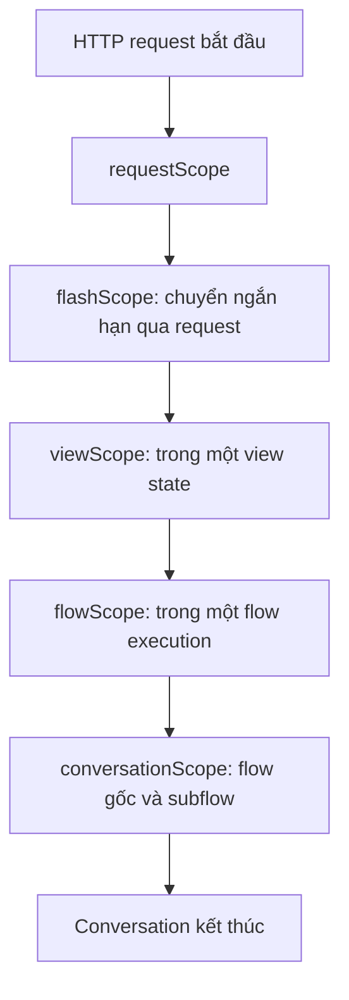

# Chuẩn bị output trước khi mất dữ liệu theo scope

Trong chương **Rẽ nhánh và kết thúc**, bài này tập trung vào một thời điểm dễ gây lỗi trong Spring Web Flow: dữ liệu đang nằm trong một scope sắp hết vòng đời, nhưng state tiếp theo, flow cha hoặc bên gọi vẫn cần dùng dữ liệu đó. Ta sẽ xác định lúc nào từng scope bị giải phóng, chuyển dữ liệu sang nơi có vòng đời phù hợp, rồi khai báo output tại điểm kết thúc để kết quả không biến mất cùng flow.

Spring Web Flow điều phối hành trình qua state, event và transition. Mỗi lần thực thi flow có dữ liệu riêng; subflow có vòng đời riêng nhưng có thể chia sẻ conversation với flow cha. Vì vậy, khi thiết kế nhánh và điểm kết thúc, cần trả lời hai câu hỏi: dữ liệu còn sống đến lúc nào, và ai cần nhận dữ liệu sau khi bước hiện tại kết thúc?

## 1. Vì sao cần chuẩn bị output trước khi rời scope?

Scope quyết định thời gian một giá trị còn có thể được truy cập. Khi scope kết thúc, dữ liệu trong đó không còn là nguồn đáng tin cậy cho bước tiếp theo. Ví dụ:

- Người dùng chọn khung giờ trong `viewScope`. Khi flow rời view state, view scope kết thúc; state review sau đó không nên phụ thuộc trực tiếp vào lựa chọn nằm trong scope đã đóng.
- Flow thanh toán giữ biên nhận trong `flowScope`. Khi subflow thanh toán kết thúc, flow scope của subflow bị giải phóng; flow cha cần nhận biên nhận qua output.
- Flow đặt lịch giữ bản ghi trong `flowScope`. Khi flow gốc kết thúc, flow scope bị giải phóng; bên gọi cần nhận mã đặt lịch hoặc kết quả cuối qua flow output.

Điều cần làm là **chuyển hoặc xuất giá trị khi nguồn vẫn còn tồn tại**. Có thể sao chép dữ liệu sang scope rộng hơn, khai báo output trên end state, hoặc lưu dữ liệu bền vững qua service trước khi flow kết thúc. Không nên chờ đến request sau rồi mới đọc lại một scope đã hết vòng đời.

## 2. Nắm vòng đời của từng scope

Spring Web Flow có các scope phổ biến sau:

| Scope | Thời gian tồn tại | Dùng khi |
| --- | --- | --- |
| `requestScope` | Trong request HTTP hiện tại. | Giá trị tạm chỉ cần trong lúc xử lý request. |
| `flashScope` | Ngắn hạn qua ranh giới request, thường để hiển thị thông báo ở lần render tiếp theo. | Thông báo sau redirect hoặc kết quả tạm cần xuất hiện ở request kế tiếp. |
| `viewScope` | Trong thời gian view state hiện tại đang hoạt động. | Dữ liệu riêng của một màn hình, như lựa chọn tạm hoặc trạng thái hiển thị. |
| `flowScope` | Trong suốt một lần thực thi flow. | Model và dữ liệu nghiệp vụ cần qua nhiều state của cùng flow. |
| `conversationScope` | Trong conversation của flow gốc và các subflow liên quan; kết thúc khi conversation gốc kết thúc. | Dữ liệu cần chia sẻ giữa flow cha và flow con. |

Có thể hình dung thứ tự vòng đời từ ngắn đến dài như sau:



Sơ đồ nhấn mạnh độ dài tương đối; `flashScope` là cơ chế chuyển tiếp ngắn hạn qua request chứ không phải một tầng cha chứa các scope còn lại. Mỗi scope có mục đích riêng, không nên chọn scope chỉ vì nó tồn tại lâu hơn.

`viewScope` là trường hợp cần chú ý khi rời một màn hình. `flowScope` là trường hợp cần chú ý khi flow kết thúc. Với subflow, phải phân biệt flow scope của subflow với conversation scope được chia sẻ. Một giá trị trong flow scope của subflow không tự động trở thành giá trị trong flow scope của cha.

## 3. Sao chép dữ liệu trước khi view state kết thúc

Giả sử người dùng chọn một khung giờ. Dữ liệu lựa chọn chỉ phục vụ màn hình chọn lịch nên được đặt trong `viewScope`. Khi người dùng nhấn tiếp tục, flow cần đưa lựa chọn sang `flowScope` để state review sử dụng.

```xml
<view-state id="chooseSlot" view="booking/choose-slot">
    <on-entry>
        <evaluate expression="slotService.createSelection()"
                  result="viewScope.selection" />
    </on-entry>

    <transition on="continue" to="review" />

    <on-exit>
        <evaluate expression="viewScope.selection.slotId"
                  result="flowScope.selectedSlotId" />
    </on-exit>
</view-state>

<view-state id="review" view="booking/review">
    <!-- Dùng flowScope.selectedSlotId để tải hoặc hiển thị lựa chọn. -->
</view-state>
```

`on-entry` khởi tạo dữ liệu riêng cho view. `on-exit` chạy khi state rời đi, trong lúc dữ liệu của view state vẫn có thể được truy cập. Action sao chép `slotId` sang `flowScope` để state `review` tiếp tục sử dụng sau khi `viewScope` kết thúc.

Nên chuyển những trường thực sự cần thiết, chẳng hạn ID hoặc một DTO nhỏ, thay vì sao chép toàn bộ object giao diện nếu object đó chứa nhiều trạng thái tạm. Nếu dữ liệu đến từ request, hãy kiểm tra và chuyển giá trị sang scope phù hợp trong cùng request trước khi request kết thúc. Không dùng `requestScope` để giữ dữ liệu cho nhiều bước.

Nếu cần giữ lại toàn bộ lựa chọn sau khi flow kết thúc, hãy gọi service lưu dữ liệu vào kho lưu trữ nghiệp vụ trước khi kết thúc và chỉ xuất mã tham chiếu. Scope của Web Flow quản lý trạng thái điều hướng; nó không thay thế database.

## 4. Khai báo output trên end state

Khi flow sắp kết thúc, `flowScope` vẫn còn dữ liệu để biểu thức output đọc. Hãy khai báo những giá trị cần trả ra ngay trên `end-state`:

```xml
<flow xmlns="http://www.springframework.org/schema/webflow"
      xmlns:xsi="http://www.w3.org/2001/XMLSchema-instance"
      xsi:schemaLocation="http://www.springframework.org/schema/webflow
                          https://www.springframework.org/schema/webflow/spring-webflow.xsd">

    <view-state id="details" view="booking/details">
        <transition on="review" to="review" />
    </view-state>

    <view-state id="review" view="booking/review">
        <transition on="confirm" to="complete" />
    </view-state>

    <end-state id="complete" view="booking/complete">
        <output name="bookingId" value="flowScope.booking.id" />
        <output name="confirmationCode" value="flowScope.booking.confirmationCode" />
    </end-state>
</flow>
```

Mỗi phần tử `output` đặt tên cho một giá trị được xuất khỏi flow. `name` là khóa output mà bên nhận sử dụng; `value` là biểu thức lấy dữ liệu từ flow context. Biểu thức được đánh giá tại điểm flow đi vào end state, trước khi trạng thái của flow bị giải phóng. Vì thế, hãy lấy output trực tiếp từ scope còn tồn tại ở thời điểm đó.

Chỉ xuất dữ liệu cần cho bên gọi. Với ví dụ đặt lịch, `bookingId` và `confirmationCode` thường hữu ích hơn toàn bộ object `Booking`. Bên nhận có thể dùng ID để truy vấn bản ghi mới nhất qua service. Cách này giảm lượng dữ liệu đi qua ranh giới flow và tránh làm lộ thuộc tính nội bộ.

Kết thúc một flow gốc trong Spring MVC thường đồng thời hiển thị view hoặc điều hướng theo cấu hình flow handler. Khai báo output không có nghĩa Spring MVC tự động biến các thuộc tính đó thành JSON hay thêm chúng vào response body. Nếu khởi chạy flow bằng API lập trình, bên gọi có thể đọc output từ kết quả thực thi flow; nếu dùng MVC, hãy xác định rõ view hoặc handler nào cần nhận kết quả.

## 5. Trả output từ subflow về flow cha

Subflow là một flow độc lập được gọi từ `subflow-state`. Flow con có `flowScope` riêng. Khi flow con kết thúc, dữ liệu trong scope riêng đó sẽ mất cùng lần thực thi. Muốn flow cha nhận kết quả, khai báo output ở end state của flow con rồi đọc thuộc tính event trong transition của subflow state.

Ví dụ flow con `payment` xuất mã biên nhận:

```xml
<flow xmlns="http://www.springframework.org/schema/webflow"
      xmlns:xsi="http://www.w3.org/2001/XMLSchema-instance"
      xsi:schemaLocation="http://www.springframework.org/schema/webflow
                          https://www.springframework.org/schema/webflow/spring-webflow.xsd">

    <view-state id="pay" view="payment/pay">
        <transition on="success" to="paid" />
        <transition on="cancel" to="cancelled" />
    </view-state>

    <end-state id="paid">
        <output name="receiptNumber" value="flowScope.receipt.number" />
    </end-state>

    <end-state id="cancelled" />
</flow>
```

Flow cha truyền mã đặt lịch vào flow con và nhận biên nhận khi flow con phát event kết thúc `paid`:

```xml
<subflow-state id="payment" subflow="payment">
    <input name="bookingId" value="flowScope.booking.id" />

    <transition on="paid" to="complete">
        <evaluate expression="currentEvent.attributes.receiptNumber"
                  result="flowScope.receiptNumber" />
    </transition>

    <transition on="cancelled" to="review" />
</subflow-state>
```

Tên `paid` và `cancelled` tương ứng với ID của các end state trong flow con. Các thuộc tính output của end state được đưa vào attributes của event kết thúc subflow. Transition `paid` đọc `receiptNumber` từ `currentEvent.attributes` rồi lưu vào `flowScope` của flow cha. Sau khi transition hoàn tất, flow cha có thể hiển thị biên nhận hoặc xuất nó ở end state của chính mình.

Hai luồng kết quả có thể được xử lý khác nhau: `paid` tiếp tục đến bước hoàn tất; `cancelled` quay về bước review. Nếu flow con kết thúc bằng một end state khác mà flow cha không có transition tương ứng, cần bổ sung nhánh hoặc quy tắc xử lý phù hợp để kết quả không rơi vào tình huống ngoài dự kiến.

## 6. Phân biệt output với scope chia sẻ

`conversationScope` cho phép flow cha và subflow truy cập dữ liệu chung trong cùng conversation. Điều đó hữu ích khi hai flow cần cùng làm việc trên một ngữ cảnh, nhưng không thay thế output mapping.

| Nhu cầu | Cách phù hợp |
| --- | --- |
| Flow cha cần một kết quả rõ ràng sau khi subflow kết thúc. | Khai báo `<output>` ở end state của subflow và đọc `currentEvent.attributes` trong transition của cha. |
| Flow cha và subflow cần cùng truy cập một dữ liệu trong lúc cả hai còn chạy. | Dùng `conversationScope` nếu dữ liệu thực sự thuộc về toàn conversation. |
| State kế tiếp cần dữ liệu của view state vừa rời. | Sao chép từ `viewScope` sang `flowScope` trong action trước khi view scope bị giải phóng. |
| Bên gọi cần kết quả sau khi flow gốc kết thúc. | Khai báo output trên end state của flow gốc và đọc từ kết quả thực thi nếu khởi chạy theo cách lập trình. |
| Dữ liệu cần tồn tại sau session hoặc được dùng ở request/thiết bị khác. | Lưu qua service vào kho dữ liệu bền vững; xuất ID hoặc mã tham chiếu. |

Chia sẻ scope và xuất output phục vụ hai mục tiêu khác nhau. Scope chia sẻ cho phép truy cập dữ liệu trong lúc các flow liên quan còn hoạt động. Output xác định dữ liệu nào vượt qua ranh giới kết thúc và được chuyển cho bên gọi. Nếu chỉ cần trả một vài kết quả từ subflow, output mapping làm rõ hợp đồng giữa flow cha và flow con hơn việc để cha đọc tùy ý nhiều biến trong conversation scope.

## 7. Kết hợp nhánh kết thúc và output

Một flow có thể có nhiều end state cho các kết quả nghiệp vụ khác nhau. Mỗi end state nên xuất những giá trị phù hợp với kết quả đó.

```xml
<decision-state id="checkAvailability">
    <if test="bookingService.hasCapacity(flowScope.booking)"
        then="confirm"
        else="unavailable" />
</decision-state>

<view-state id="confirm" view="booking/confirm">
    <transition on="submit" to="completed" />
</view-state>

<end-state id="completed" view="booking/completed">
    <output name="result" value="'CONFIRMED'" />
    <output name="bookingId" value="flowScope.booking.id" />
</end-state>

<end-state id="unavailable" view="booking/unavailable">
    <output name="result" value="'UNAVAILABLE'" />
    <output name="bookingId" value="flowScope.booking.id" />
</end-state>
```

Flow kết thúc bằng `completed` khi còn chỗ và người dùng xác nhận; kết thúc bằng `unavailable` khi không còn khả năng đặt. Bên gọi có thể phân biệt kết quả bằng end state hoặc output `result`. Mỗi end state chỉ nên xuất dữ liệu mà kết quả đó có ý nghĩa. Nếu nhánh hủy không có booking ID hợp lệ, không nên cố xuất một giá trị giả để làm cho mọi output trông giống nhau.

Với các nhánh kết thúc, hãy kiểm tra:

1. Mọi nhánh nghiệp vụ đều đi đến một state hoặc end state đã khai báo.
2. Output expression chỉ tham chiếu dữ liệu chắc chắn tồn tại ở nhánh đó.
3. Giá trị trả về có tên và kiểu dữ liệu nhất quán giữa các nhánh khi bên nhận mong đợi cùng một hợp đồng.
4. Dữ liệu cần lưu lâu dài đã được ghi bền vững trước khi kết thúc flow.

## 8. Xử lý trường hợp dữ liệu không còn hoặc không hợp lệ

Không phải lần kết thúc nào cũng có đủ dữ liệu để xuất. Ví dụ người dùng hủy trước khi hoàn tất form, session hết hạn, hoặc service không tạo được bản ghi. Thiết kế output cần phản ánh các trường hợp này.

- **Hủy trước khi có dữ liệu nghiệp vụ:** dùng end state hủy riêng; chỉ xuất mã tham chiếu nếu mã đó đã được tạo hợp lệ.
- **Validation thất bại:** giữ flow ở view state hoặc quay về state nhập liệu. Không kết thúc flow thành công chỉ để chuyển thông báo lỗi.
- **Service lỗi trước khi lưu:** trả nhánh lỗi có thể thử lại hoặc kết thúc bằng kết quả lỗi đã định nghĩa. Không xuất ID của bản ghi chưa tồn tại.
- **Service lưu thành công nhưng response bị gián đoạn:** dùng mã yêu cầu/idempotency key để truy vấn lại kết quả, tránh tạo bản ghi hoặc thanh toán lần thứ hai.
- **Execution hết hạn:** coi flow cũ đã không còn khả dụng; hướng dẫn người dùng khởi chạy lại và tra cứu dữ liệu bền vững bằng mã tham chiếu nếu nghiệp vụ cho phép.

Output expression nên an toàn với nhánh mà nó thuộc về. Nếu thuộc tính có thể `null`, hãy quyết định rõ output có được phép null hay cần một giá trị mặc định. Không để biểu thức truy cập thuộc tính sâu trên một object chưa được tạo, vì lỗi đánh giá output có thể khiến flow không kết thúc như dự kiến.

## 9. Kiểm thử việc chuyển dữ liệu qua ranh giới scope

Một bài kiểm thử chỉ xác nhận state cuối cùng là chưa đủ. Cần xác nhận giá trị được chuyển đúng thời điểm và bên nhận thực sự đọc được nó.

| Kịch bản | Điều cần xác nhận |
| --- | --- |
| Rời view state chọn lịch | Giá trị được sao chép từ `viewScope` sang `flowScope`; state review đọc đúng ID. |
| Kết thúc subflow thành công | End state xuất biên nhận; event của subflow mang thuộc tính đó; flow cha lưu được giá trị. |
| Subflow bị hủy | Flow cha đi đúng nhánh `cancelled`; không giữ lại biên nhận cũ từ lần chạy khác. |
| Flow gốc hoàn tất | Output của end state chứa đúng mã đặt lịch và mã xác nhận. |
| Flow kết thúc bằng lỗi hoặc hủy | Output không chứa dữ liệu giả hoặc ID chưa được lưu. |
| Execution hết hạn | Ứng dụng xử lý trạng thái hết hạn và không cố đọc lại scope cũ. |

Ví dụ test cho subflow nên dùng dữ liệu giả có thể nhận diện, chẳng hạn `receiptNumber = "R-1008"`. Sau khi flow con kết thúc bằng `paid`, kiểm tra `flowScope.receiptNumber` của flow cha bằng đúng giá trị đó. Một test riêng cho `cancelled` phải xác nhận transition về review và không có receipt được gán.

Đối với flow gốc được khởi chạy bằng `FlowExecutor`, kiểm tra output map của kết quả thực thi. Với MVC integration test, gửi các request liên tiếp kèm execution key do Web Flow quản lý, xác nhận view cuối hiển thị dữ liệu cần thiết và không giả định output map tự động xuất hiện trong HTTP response. Test thêm request lặp để xác nhận thao tác ghi dữ liệu không bị thực hiện hai lần.

## 10. Lỗi thường gặp khi chuẩn bị output

- Đọc `viewScope` ở state kế tiếp sau khi view state đã kết thúc. Hãy sao chép giá trị trong `on-exit` hoặc action trước khi rời state.
- Đọc biến thuộc `flowScope` của subflow từ flow cha như thể hai flow có cùng flow scope. Hãy xuất giá trị ở end state và đọc event attributes.
- Kết thúc flow rồi mới gọi service để tìm lại dữ liệu chỉ tồn tại trong scope. Hãy lưu bền vững trước khi kết thúc hoặc xuất ID khi scope còn sống.
- Dùng `conversationScope` cho mọi dữ liệu chỉ để tránh mất giá trị. Điều này kéo dài vòng đời dữ liệu và làm mờ hợp đồng output giữa các flow.
- Xuất toàn bộ entity dù bên nhận chỉ cần một ID. Hãy chọn các trường output tối thiểu.
- Khai báo output ở một end state nhưng quên nhánh kết thúc khác. Hãy rà soát từng đường đi, bao gồm hủy và lỗi.
- Dùng flash scope như kho dữ liệu nhiều bước. Flash scope chỉ phù hợp chuyển tiếp ngắn hạn qua request.
- Không kiểm tra null hoặc trạng thái nghiệp vụ trước khi đánh giá output expression. Hãy bảo đảm dữ liệu nguồn tồn tại ở từng nhánh.

## 11. Quy trình thực hành

Với flow đặt lịch, có thể triển khai theo thứ tự sau:

1. Tạo lựa chọn khung giờ trong `viewScope` và chuyển `slotId` sang `flowScope` khi rời view state.
2. Dùng `flowScope` để hiển thị review và xác nhận nghiệp vụ.
3. Tách thanh toán thành subflow, truyền `bookingId` vào flow con.
4. Ở end state thành công của subflow, xuất `receiptNumber`; ở end state hủy, không xuất biên nhận.
5. Trong flow cha, đọc output từ `currentEvent.attributes` và lưu kết quả vào `flowScope` của cha.
6. Trước khi flow gốc kết thúc, bảo đảm dữ liệu nghiệp vụ đã được lưu bền vững và xuất `bookingId`, `confirmationCode` cần thiết.
7. Kiểm thử nhánh thành công, hết chỗ, hủy, lỗi service, request lặp và execution hết hạn.

Khi hoàn thành, mỗi ranh giới vòng đời đều có cách chuyển dữ liệu rõ ràng: dữ liệu của màn hình được đưa sang flow scope trước khi view đóng; dữ liệu của subflow được trả qua output; dữ liệu của flow gốc được xuất tại end state; dữ liệu cần tồn tại lâu dài được lưu qua service. Nhờ vậy, các transition và nhánh kết thúc có thể thay đổi mà không làm mất kết quả nghiệp vụ cần bàn giao.
