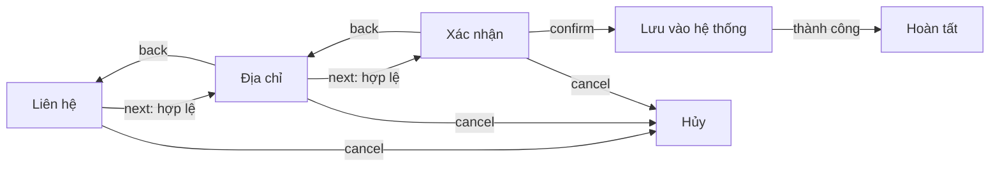

# Mô hình dữ liệu cho biểu mẫu nhiều bước trong Spring Web Flow

Một biểu mẫu nhiều bước thường không thể xử lý tốt bằng cách coi mỗi màn hình là một lần gửi biểu mẫu độc lập. Ví dụ, luồng đăng ký có ba bước: nhập thông tin liên hệ, nhập địa chỉ và xác nhận. Người dùng có thể quay lại bước trước để sửa dữ liệu, gặp lỗi ở một trường, mở lại trang hoặc hủy giữa chừng. Các thao tác đó phải diễn ra trên **cùng một bản nháp dữ liệu**; chỉ khi xác nhận thành công hệ thống mới tạo bản ghi nghiệp vụ.

Trong **Spring Web Flow (SWF)**, các `view-state` biểu diễn màn hình, `event` biểu diễn hành động của người dùng, `transition` quyết định bước tiếp theo, còn **model** giữ dữ liệu mà những màn hình đó cùng chỉnh sửa. Thiết kế model hợp lý giúp logic điều hướng nằm trong flow definition, thay vì phân tán trong nhiều controller Spring MVC.

## 1. Mục tiêu và mô hình tư duy

Sau bài học, bạn có thể:

- Tạo một đối tượng **draft/form backing object** dùng chung cho nhiều bước và phân biệt nó với entity lưu trong cơ sở dữ liệu.
- Liên kết từng `view-state` với model, chỉ cho phép binding những trường thuộc bước hiện tại.
- Phân biệt dữ liệu cần giữ trong `flowScope` với dữ liệu ngắn hạn của `requestScope`, `viewScope` và các scope khác.
- Đặt validation đúng thời điểm, cho phép quay lại mà không bị chặn bởi lỗi của bước tiếp theo.
- Xử lý xác nhận cuối luồng, lỗi lưu dữ liệu, thao tác lặp và trường hợp flow hết hạn.

Hãy hình dung luồng đăng ký như sau:



Sơ đồ nói về **trạng thái**; đối tượng `RegistrationDraft` dưới đây nói về **dữ liệu**. Hai cấu trúc cần đi cùng nhau nhưng không nên gộp vào nhau: draft không cần một trường `currentPage` để quyết định chuyển trang, vì chính flow đã quản lý trạng thái hiện tại.

## 2. Thiết kế một draft cho toàn bộ biểu mẫu

Thay vì tạo `ContactForm` ở bước 1 và `AddressForm` ở bước 2 rồi tự ghép dữ liệu từ session, ta dùng một đối tượng cha chứa hai phần thông tin:

```text
RegistrationDraft
├── contact: Contact
│   ├── fullName
│   └── email
└── address: Address
    ├── street
    ├── city
    └── postalCode
```

Một cách triển khai JavaBean đơn giản:

```java
package com.example.registration;

import java.io.Serializable;

public class RegistrationDraft implements Serializable {
    private static final long serialVersionUID = 1L;

    private Contact contact = new Contact();
    private Address address = new Address();

    public Contact getContact() { return contact; }
    public void setContact(Contact contact) { this.contact = contact; }

    public Address getAddress() { return address; }
    public void setAddress(Address address) { this.address = address; }

    public static class Contact implements Serializable {
        private static final long serialVersionUID = 1L;

        private String fullName;
        private String email;

        public String getFullName() { return fullName; }
        public void setFullName(String fullName) { this.fullName = fullName; }
        public String getEmail() { return email; }
        public void setEmail(String email) { this.email = email; }
    }

    public static class Address implements Serializable {
        private static final long serialVersionUID = 1L;

        private String street;
        private String city;
        private String postalCode;

        public String getStreet() { return street; }
        public void setStreet(String street) { this.street = street; }
        public String getCity() { return city; }
        public void setCity(String city) { this.city = city; }
        public String getPostalCode() { return postalCode; }
        public void setPostalCode(String postalCode) { this.postalCode = postalCode; }
    }
}
```

Trong ví dụ này, `Contact` và `Address` được khởi tạo sẵn. Điều đó quan trọng khi binder nhận đường dẫn lồng nhau như `contact.email`: nếu `getContact()` trả `null`, quá trình binding có thể thất bại hoặc phụ thuộc vào cách binder được cấu hình để tự tạo đối tượng trung gian. Một constructor không tham số cùng các getter/setter rõ ràng cũng giúp cơ chế JavaBean binding hoạt động dễ dự đoán.

`Serializable` hữu ích khi môi trường lưu execution snapshot hoặc session yêu cầu tuần tự hóa đối tượng. Đây không phải yêu cầu để mọi JavaBean được bind, nhưng là một lựa chọn thực tế cần kiểm tra khi triển khai session phân tán hoặc khôi phục phiên.

### Draft khác entity nghiệp vụ như thế nào?

| `RegistrationDraft` trong flow | Entity/bản ghi nghiệp vụ |
|---|---|
| Có thể thiếu dữ liệu khi người dùng chưa đi hết các bước | Chỉ được lưu khi đáp ứng quy tắc toàn vẹn |
| Phục vụ binding, hiển thị lỗi và chỉnh sửa biểu mẫu | Phục vụ lưu trữ, truy vấn và quan hệ dữ liệu |
| Tồn tại tạm thời trong một flow execution | Tồn tại sau khi giao dịch lưu thành công |
| Chỉ chứa trường người dùng được phép nhập | Có thể chứa ID, trạng thái duyệt, thời gian tạo, chủ sở hữu |

Không nên cho client binding trực tiếp vào entity có trường như `id`, `status`, `approved` hoặc `ownerId`. Ở bước cuối, tầng service sẽ kiểm tra draft và ánh xạ các trường hợp lệ sang entity; những giá trị hệ thống quyết định phải được lấy từ phía server.

## 3. Gắn model vào các view-state

Ví dụ flow XML dưới đây minh họa một luồng SWF 2.x, với ba màn hình và một trạng thái hành động lưu dữ liệu. Các đường dẫn view và tên bean dịch vụ là giả định của ứng dụng mẫu; dự án thực tế cần cấu hình view resolver, flow registry và flow executor cho Spring MVC.

```xml
<?xml version="1.0" encoding="UTF-8"?>
<flow xmlns="http://www.springframework.org/schema/webflow"
      xmlns:xsi="http://www.w3.org/2001/XMLSchema-instance"
      xsi:schemaLocation="http://www.springframework.org/schema/webflow
                          http://www.springframework.org/schema/webflow/spring-webflow.xsd">

    <!-- Biến có cùng vòng đời với flow này. -->
    <var name="registration"
         class="com.example.registration.RegistrationDraft"/>

    <view-state id="contact"
                view="registration/contact"
                model="registration">
        <binder>
            <binding property="contact.fullName" required="true"/>
            <binding property="contact.email" required="true"/>
        </binder>
        <transition on="next" to="address"/>
        <transition on="cancel" to="cancelled"
                    bind="false" validate="false"/>
    </view-state>

    <view-state id="address"
                view="registration/address"
                model="registration">
        <binder>
            <binding property="address.street" required="true"/>
            <binding property="address.city" required="true"/>
            <binding property="address.postalCode"/>
        </binder>
        <transition on="back" to="contact"
                    bind="false" validate="false"/>
        <transition on="next" to="review"/>
        <transition on="cancel" to="cancelled"
                    bind="false" validate="false"/>
    </view-state>

    <view-state id="review"
                view="registration/review"
                model="registration">
        <transition on="back" to="address"
                    bind="false" validate="false"/>
        <transition on="confirm" to="persist"
                    bind="false" validate="false"/>
        <transition on="cancel" to="cancelled"
                    bind="false" validate="false"/>
    </view-state>

    <action-state id="persist">
        <evaluate expression="registrationService.save(registration)"
                  result="flowScope.registrationId"/>
        <transition on="success" to="completed"/>
    </action-state>

    <end-state id="completed" view="registration/completed"/>
    <end-state id="cancelled" view="registration/cancelled"/>
</flow>
```

`<var>` tạo đối tượng `registration` trong scope của flow. Cả ba `view-state` tham chiếu đến **cùng đối tượng** qua `model="registration"`; khi bước 1 bind `contact.email`, giá trị đó vẫn nằm trong draft lúc bước 2 hoặc bước xác nhận được hiển thị. Người dùng quay lại bước liên hệ sẽ nhìn thấy giá trị đã nhập trước đó.

`<binder>` là danh sách cho phép binding theo từng trạng thái. Bước địa chỉ chỉ nhận các đường dẫn `address.*` được khai báo; một request tự chèn tham số `contact.email` vào lúc gửi bước địa chỉ không có quyền dùng bước này để sửa email. Danh sách binder giúp giới hạn dữ liệu nhận từ request nhưng **không thay thế** kiểm tra quyền và quy tắc nghiệp vụ ở server.

Các transition `back` và `cancel` đặt `bind="false" validate="false"`: vì đây là thao tác điều hướng, ứng dụng không nên bắt người dùng hoàn tất các trường còn thiếu chỉ để quay về hoặc hủy. Ngược lại, transition `next` giữ hành vi binding và validation của `view-state` để xử lý trường đang nhập trước khi chuyển sang bước mới. Ở `review`, `confirm` không bind lại trường nào vì view này chỉ hiển thị và xác nhận dữ liệu đã có; service vẫn cần kiểm tra toàn bộ draft trước khi lưu.

Lưu ý: action-state chỉ đi theo sự kiện `success` khi biểu thức đánh giá thành công. Nếu service ném ngoại lệ, ngoại lệ **không tự động** biến thành sự kiện `error`; luồng thực tế cần quy định cách xử lý lỗi, chẳng hạn dùng kết quả nghiệp vụ có kiểu rõ ràng, exception handler của flow hoặc chuyển sang trạng thái báo lỗi có kiểm soát.

## 4. Gửi biểu mẫu và nhận event từ Spring MVC view

Khi tích hợp SWF với Spring MVC, phần view vẫn có thể dùng cơ chế render và form binding quen thuộc. Ví dụ JSP cho bước liên hệ:

```jsp
<%@ taglib prefix="form" uri="http://www.springframework.org/tags/form" %>

<form:form method="post"
           action="${flowExecutionUrl}"
           modelAttribute="registration">
    <label>Họ tên</label>
    <form:input path="contact.fullName" />
    <form:errors path="contact.fullName" cssClass="error" />

    <label>Email</label>
    <form:input path="contact.email" />
    <form:errors path="contact.email" cssClass="error" />

    <button type="submit" name="_eventId_next">Tiếp tục</button>
    <button type="submit" name="_eventId_cancel">Hủy</button>
</form:form>
```

Ở đây, `flowExecutionUrl` hướng POST về lần thực thi flow hiện hành, còn tên nút `_eventId_next` hoặc `_eventId_cancel` thông báo event tương ứng. Flow nhận event, thực hiện binding/validation theo transition, rồi quyết định view hoặc state tiếp theo. Ứng dụng cần duy trì bảo vệ CSRF tương ứng với cấu hình Spring Security và cách render form được dùng.

Nếu chuyển sang Thymeleaf, cách viết tag và giải quyết biểu thức URL sẽ khác, nhưng ý tưởng cốt lõi vẫn giữ nguyên: **gửi về flow execution hiện tại, truyền event, bind đúng model**. Không cần một endpoint controller mới cho mỗi bước chỉ để quyết định màn hình kế tiếp.

### Dòng đời của dữ liệu khi người dùng bấm “Tiếp tục”

1. Trình duyệt gửi các trường của bước hiện tại cùng event `next` về flow execution.
2. SWF tìm `view-state` hiện tại và dùng binder để cập nhật các trường được cho phép vào `registration`.
3. Lỗi chuyển đổi kiểu hoặc validation được ghi nhận để render lại form nếu cần; transition chỉ được thực hiện khi điều kiện cho phép.
4. Khi hợp lệ, flow chuyển trạng thái; view tiếp theo đọc lại đối tượng `registration` đã được cập nhật.
5. Ở bước xác nhận, service kiểm tra cuối cùng, tạo entity trong một giao dịch và trả về kết quả để flow kết thúc.

Ví dụ, nhập email `lan@example.com` ở trạng thái `contact` rồi chuyển đến `address` **không tạo một `RegistrationDraft` mới**. Hệ thống đang chỉnh cùng bản nháp cho đến khi flow kết thúc, bị hủy hoặc hết hạn.

## 5. Validation theo bước và validation toàn luồng

Form nhiều bước có hai tầng kiểm tra khác nhau:

| Tầng kiểm tra | Ví dụ | Khi thực hiện |
|---|---|---|
| Ràng buộc của bước hiện tại | Email đúng định dạng; họ tên không rỗng; thành phố bắt buộc | Khi gửi `next` từ bước liên quan |
| Ràng buộc xuyên bước và nghiệp vụ | Địa chỉ hỗ trợ giao hàng; email chưa đăng ký; người dùng có quyền thực hiện | Tại bước thích hợp và **kiểm tra lại trước lưu** |

Trong SWF, có thể dùng cơ chế validation model của framework, một validator chuyên biệt hoặc Bean Validation tùy phiên bản và cấu hình tích hợp. Chẳng hạn, với cách validate theo tên `view-state`, model có thể khai báo phương thức kiểm tra bước `contact`:

```java
import org.springframework.binding.message.MessageBuilder;
import org.springframework.webflow.validation.ValidationContext;

// Phương thức này nằm bên trong RegistrationDraft.
public void validateContact(ValidationContext context) {
    String email = contact.getEmail();
    if (email == null || !email.matches("^[^@\\s]+@[^@\\s]+\\.[^@\\s]+$")) {
        context.getMessageContext().addMessage(
            new MessageBuilder()
                .error()
                .source("contact.email")
                .defaultText("Vui lòng nhập địa chỉ email hợp lệ")
                .build()
        );
    }
}
```

Đây là **minh họa quy tắc validation**, không phải bộ kiểm tra email chuẩn đầy đủ. Trong hệ thống thực, nên dùng validator hoặc thư viện kiểm tra phù hợp và kiểm thử đúng phiên bản SWF đang sử dụng. Phương thức validator theo state phải được SWF nhận diện qua cơ chế validation đã cấu hình; chỉ định nghĩa một phương thức tùy ý không bảo đảm rằng nó sẽ được gọi.

`required="true"` trong binder kiểm tra việc binding trường bắt buộc trong request, nhưng không đủ để diễn đạt mọi quy tắc như “chuỗi sau khi trim không được rỗng”, “email đúng định dạng” hoặc “mã bưu chính hợp lệ theo quốc gia”. Những yêu cầu đó nên được kiểm tra bằng validation riêng và hiển thị lỗi gắn với đúng property path.

Một nguyên tắc đặc biệt quan trọng: **không dựa vào việc người dùng đã đi qua bước trước để coi dữ liệu luôn hợp lệ**. Dữ liệu có thể trở nên không hợp lệ do thay đổi phía server, mở nhiều tab, request bị sửa hoặc quy tắc nghiệp vụ đổi trong quá trình điền form. `registrationService.save(...)` cần kiểm tra lại các bất biến nghiệp vụ và quyền trước khi ghi dữ liệu.

## 6. Chọn scope theo vòng đời cần thiết

Spring Web Flow cung cấp nhiều scope để đặt dữ liệu tại đúng thời điểm. Không phải mọi đối tượng đều nên được giữ trong session chung:

| Scope | Phạm vi thực tế | Dữ liệu phù hợp |
|---|---|---|
| `requestScope` | Một request xử lý flow | Tham số và kết quả xử lý tức thời |
| `flashScope` | Dữ liệu ngắn hạn phục vụ lần chuyển/hiển thị tiếp theo | Thông báo sau thao tác, phản hồi tạm |
| `viewScope` | Trong thời gian view-state hiện tại còn hoạt động | Danh sách lựa chọn hoặc dữ liệu trình bày tạm cho một màn hình |
| `flowScope` | Trong một lần thực thi flow; gắn với flow đang chứa biến | `RegistrationDraft`, dữ liệu tiến trình của luồng |
| `conversationScope` | Trong conversation chứa flow và các flow con liên quan | Thông tin dùng chung cần tồn tại qua nhiều flow liên kết |

Một vài quyết định thiết kế thường gặp:

- Dùng `flowScope.registration` cho bản nháp vì cần đi từ bước 1 đến bước 3, kể cả khi người dùng quay lại.
- Dùng `viewScope` cho dữ liệu chỉ phục vụ hiển thị ở một view; khi chuyển sang state khác, không nên giả định dữ liệu ấy còn tồn tại.
- Dùng `flashScope` cho thông báo ngắn hạn, không dùng làm kho dữ liệu biểu mẫu chính.
- Chỉ dùng `conversationScope` khi nhiều flow/subflow thực sự cần một phần dữ liệu chung. Lạm dụng scope rộng làm tăng khả năng xung đột và giữ dữ liệu lâu hơn cần thiết.

Ví dụ trong XML, `<var name="registration" .../>` tạo biến flow, còn câu lệnh:

```xml
<evaluate expression="registrationService.save(registration)"
          result="flowScope.registrationId"/>
```

đặt kết quả lưu vào `flowScope.registrationId` để sử dụng trong phần còn lại của execution. Đối tượng giữ trong scope là **dữ liệu tạm của quá trình điều hướng**, không phải một giao dịch cơ sở dữ liệu đang mở xuyên suốt nhiều request.

Nếu một bước sử dụng **subflow** để xác minh địa chỉ, hãy xác định rõ input truyền vào subflow và output cần đưa trở lại flow cha. Mỗi flow có thể có `flowScope` riêng; không nên giả định biến của flow cha tự xuất hiện trong `flowScope` của flow con. Việc chuyển dữ liệu tường minh giúp subflow tái sử dụng và kiểm thử độc lập dễ hơn.

## 7. Thiết kế model cho biểu mẫu thực tế

### 7.1. Dữ liệu có cấu trúc, nhưng tránh giữ quá nhiều

Nên nhóm các trường theo nghiệp vụ (`contact`, `address`, `paymentDetails`, ...) để việc gắn binder và validation theo bước có ngữ nghĩa. Với danh sách động, cần giới hạn kích thước, kiểm tra chỉ số và kiểm soát tập trường được phép bind. Không đưa một graph entity JPA lớn, kết nối DB, luồng đọc file, request/response hoặc dữ liệu nhạy cảm không cần thiết vào flow scope.

Với tệp tải lên, nên xử lý ở bước nhận file và chỉ lưu **mã tham chiếu tạm** hoặc metadata cần thiết trong draft; không giữ toàn bộ nội dung tệp trong session. Khi hủy hoặc timeout, cơ chế dọn tài nguyên tạm cũng phải được tính đến.

### 7.2. Xử lý dữ liệu phát sinh và dữ liệu hệ thống

Giả sử form hiển thị phí dịch vụ 50.000 đồng ở bước cuối. Người dùng có thể sửa giá trị trong HTML hoặc request. Vì vậy giá chính thức cần được tính lại từ dữ liệu được tin cậy tại service, không lấy nguyên giá từ trường ẩn `totalPrice` trong draft.

Tương tự, `registrationId`, `verified`, `ownerId`, `approvalStatus` nên do server xác lập. Binder whitelist theo từng bước giúp thu hẹp bề mặt nhận dữ liệu, còn service chịu trách nhiệm kiểm soát quyền và tính hợp lệ cuối cùng.

### 7.3. Phân biệt “chưa nhập” và “đã nhập nhưng rỗng”

Với trường optional, chuỗi `null`, chuỗi rỗng và giá trị mặc định có thể mang ý nghĩa khác nhau. Hãy thống nhất chiến lược chuẩn hóa (`trim`, chuyển chuỗi rỗng về `null` khi phù hợp), validate sau chuẩn hóa và không tự biến “chưa trả lời” thành một lựa chọn nghiệp vụ cụ thể. Đặc biệt lưu ý checkbox, enum và ngày giờ vì dữ liệu không hợp lệ có thể gây lỗi chuyển đổi kiểu ngay trong binding.

### 7.4. Tương thích khi người dùng mở nhiều tab

Một người dùng có thể mở hai flow execution song song. Nếu toàn bộ draft được đặt bằng một key cố định trong `HttpSession`, hai tab dễ ghi đè lẫn nhau. Gắn draft vào **mỗi flow execution** giúp tách biệt tốt hơn; tuy nhiên cùng một execution được mở ở hai tab vẫn có thể gặp vấn đề snapshot cũ hoặc thao tác cạnh tranh. Ứng dụng cần có chiến lược thông báo dữ liệu cũ, điều hướng lại hoặc xử lý xung đột nếu tình huống này được hỗ trợ.

## 8. Lưu dữ liệu và phục hồi khi lỗi

Luồng điều hướng và giao dịch lưu dữ liệu là hai vòng đời khác nhau. Giữ draft trong `flowScope` qua ba màn hình **không đồng nghĩa** mở một DB transaction xuyên suốt ba request. Chỉ ở bước `persist`, service mới xác nhận dữ liệu, ánh xạ sang entity và thực hiện giao dịch cần thiết.

Một service lưu có thể đi theo trình tự:

```java
// Phác thảo logic phía server; repository và kiểu entity tùy ứng dụng.
@Transactional
public Long save(RegistrationDraft draft) {
    validateEntireDraft(draft);      // Kiểm tra cuối cùng và quy tắc nghiệp vụ
    ensureCallerIsAuthorized();      // Dựa trên danh tính được xác thực

    Registration entity = new Registration();
    entity.setFullName(draft.getContact().getFullName());
    entity.setEmail(draft.getContact().getEmail());
    entity.setStreet(draft.getAddress().getStreet());
    entity.setCity(draft.getAddress().getCity());
    entity.setPostalCode(draft.getAddress().getPostalCode());

    return registrationRepository.save(entity).getId();
}
```

Đây là pseudo-code nhằm thể hiện trách nhiệm của service; phần đăng ký bean, repository và import phụ thuộc ứng dụng cụ thể. Để tránh tạo hai bản ghi khi người dùng bấm xác nhận nhiều lần hoặc gửi lại request, có thể dùng idempotency key, ràng buộc duy nhất phù hợp hoặc cơ chế phát hiện thao tác đã hoàn thành. Không nên mặc định rằng việc đi tới `end-state` đã tự bảo vệ khỏi mọi request lặp.

Các tình huống lỗi cần xử lý có chủ đích:

| Tình huống | Ứng xử mong muốn |
|---|---|
| Thiếu hoặc sai email khi nhấn `next` | Giữ ở `contact`, hiển thị lỗi ở `contact.email`, giữ các giá trị hợp lệ |
| Nhấn `back` khi địa chỉ chưa đầy đủ | Quay về `contact` mà không bị validation của `address` chặn |
| Lưu thất bại do email đã tồn tại | Thông báo lỗi nghiệp vụ, cho sửa dữ liệu và thử lại theo nhánh xử lý lỗi đã thiết kế |
| Session hoặc flow execution hết hạn | Thông báo phiên đã hết, đưa về điểm bắt đầu an toàn; không hứa khôi phục draft nếu chưa có cơ chế lưu nháp |
| Request giả mạo trường không cho phép | Binder không cập nhật trường ngoài whitelist; service vẫn xác thực và kiểm tra quyền |
| Lưu thành công nhưng người dùng bấm lại `confirm` | Không tạo bản ghi trùng; phản hồi kết quả đã xử lý theo chính sách idempotency |

Nếu yêu cầu nghiệp vụ cần **tiếp tục sau nhiều giờ hoặc từ thiết bị khác**, `flowScope` một mình thường không đủ. Khi đó nên thiết kế cơ chế lưu nháp server-side có ID, quyền truy cập, thời hạn và chính sách khôi phục rõ ràng, rồi tải lại draft khi bắt đầu một flow mới.

## 9. Kiểm thử hành vi của model trong flow

Đừng chỉ kiểm thử getter/setter của `RegistrationDraft`. Giá trị thực tế của thiết kế thể hiện ở việc binding, validation và transition phối hợp đúng khi người dùng thay đổi hướng đi.

Các kịch bản tối thiểu:

1. **Đường đi thành công:** bắt đầu flow, gửi `contact` hợp lệ, gửi `address` hợp lệ, xác nhận; kiểm tra service chỉ được gọi ở bước `confirm` và dữ liệu nhận được đúng từ cả hai màn hình.
2. **Validation theo bước:** gửi email sai rồi phát `next`; vẫn ở `contact`, có lỗi tương ứng và không gọi service lưu.
3. **Quay lại sửa:** hoàn tất địa chỉ, phát `back`, đổi email, đi tiếp; draft giữ địa chỉ cũ và email mới.
4. **Chống over-posting:** ở bước `address`, gửi thêm tham số `contact.email`; email trong draft không bị cập nhật ngoài binder cho phép.
5. **Hủy và hết hạn:** bảo đảm không tạo entity khi hủy; sau khi execution không còn hợp lệ, ứng dụng xử lý rõ ràng thay vì coi request cũ là luồng mới.
6. **Lỗi lưu và gửi lại:** giả lập lỗi nghiệp vụ, request lặp và hai tab để xác minh phản hồi an toàn, không tạo dữ liệu trùng.

Có thể dùng bộ kiểm thử flow của SWF (chẳng hạn các lớp kiểm thử flow execution tương ứng với phiên bản dự án) để khởi động flow, phát event và kiểm tra state hiện tại; đồng thời kiểm thử service riêng để xác nhận transaction, validation nghiệp vụ và kiểm soát quyền. Với bài thực hành, hãy bắt đầu từ ba trường hợp **thành công – lỗi bước 1 – quay lại sửa** rồi mở rộng ra tình huống khó hơn.

## 10. Checklist trước khi triển khai

- [ ] Một draft có cấu trúc rõ ràng và giữ đủ dữ liệu cần thiết qua các bước.
- [ ] Mỗi `view-state` có `model` đúng và binder chỉ cho phép trường của bước đó.
- [ ] `next` kích hoạt binding/validation; `back` và `cancel` không buộc hoàn tất form.
- [ ] Draft nằm trong scope phù hợp; dữ liệu hiển thị tạm không bị giữ lâu không cần thiết.
- [ ] Server kiểm tra lại dữ liệu, quyền và bất biến nghiệp vụ trước khi lưu.
- [ ] Đã thiết kế nhánh cho lỗi lưu, timeout và gửi xác nhận lặp.
- [ ] Kiểm thử luồng thực tế bao gồm quay lại, cập nhật draft và chống binding ngoài ý muốn.

**Ghi nhớ:** Một biểu mẫu nhiều bước tốt có **một nguồn dữ liệu tạm nhất quán**, nhưng **mỗi bước chỉ sở hữu phần dữ liệu được phép chỉnh sửa**. Spring Web Flow quản lý state và transition; model lưu bản nháp; binder và validation kiểm soát đầu vào; service chịu trách nhiệm tạo dữ liệu nghiệp vụ ở cuối hành trình.
