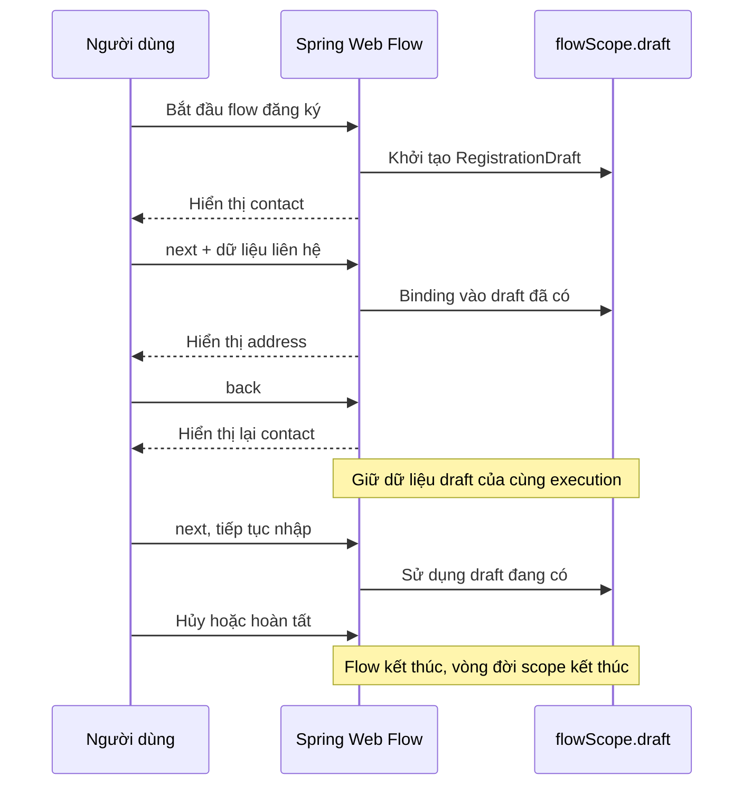
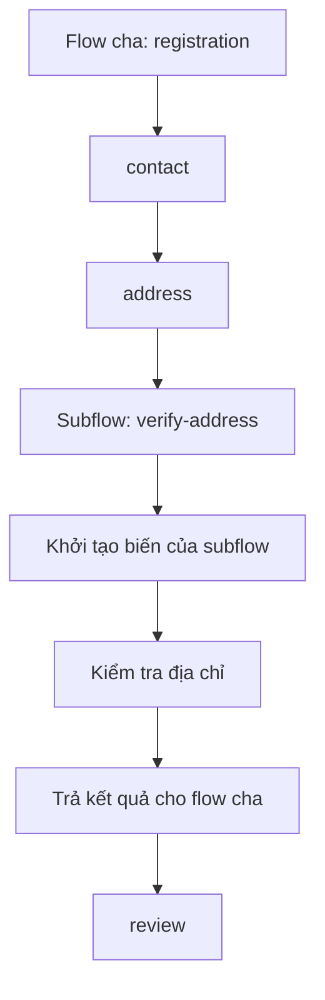

# Khai báo biến bằng `<var>` và thời điểm khởi tạo trong Spring Web Flow

Trong **Spring Web Flow (SWF)**, một người dùng có thể đi qua nhiều màn hình, quay lại sửa thông tin và tiếp tục mà vẫn làm việc với cùng **bản nháp nghiệp vụ**. Để điều đó hoạt động, luồng phải tạo dữ liệu đúng lúc và giữ dữ liệu đủ lâu. Tính năng `<var>` giải quyết phần cơ bản của nhu cầu này: **khai báo biến thuộc một lần thực thi flow, tự khởi tạo khi flow bắt đầu và cung cấp biến đó cho các state bên trong flow**.

Bài học thuộc chương **Dữ liệu và scope** của `SPRING_WEB_FLOW`, nơi Spring Web Flow tổ chức hành trình web bằng **state, event, transition và subflow**, kết hợp **form binding, validation, quản lý scope/phiên, Spring MVC, kiểm thử và xử lý lỗi**. Trọng tâm ở đây là câu hỏi dễ nhầm nhất: *Khi nào một biến được tạo mới?* Nếu trả lời sai, ta có thể vô tình xóa dữ liệu vừa nhập, làm lại công việc tải dữ liệu hoặc khiến các bước của biểu mẫu dùng những bản nháp khác nhau.

## 1. `<var>` khai báo điều gì?

Giả sử một quy trình đăng ký cần người dùng lần lượt nhập **thông tin liên hệ**, **địa chỉ** rồi **xác nhận**. Tất cả các bước sử dụng một đối tượng `RegistrationDraft`. Trong flow definition:

```xml
<?xml version="1.0" encoding="UTF-8"?>
<flow xmlns="http://www.springframework.org/schema/webflow"
      xmlns:xsi="http://www.w3.org/2001/XMLSchema-instance"
      xsi:schemaLocation="http://www.springframework.org/schema/webflow
                          http://www.springframework.org/schema/webflow/spring-webflow.xsd">

    <var name="draft"
         class="com.example.registration.RegistrationDraft"/>

    <view-state id="contact"
                view="registration/contact"
                model="draft">
        <transition on="next" to="address"/>
    </view-state>

    <view-state id="address"
                view="registration/address"
                model="draft">
        <transition on="back" to="contact"
                    bind="false" validate="false"/>
        <transition on="next" to="review"/>
    </view-state>

    <view-state id="review" view="registration/review">
        <transition on="back" to="address"
                    bind="false" validate="false"/>
        <transition on="confirm" to="submit"/>
    </view-state>

    <end-state id="submit" view="registration/finished"/>
</flow>
```

Dòng quan trọng nhất là:

```xml
<var name="draft"
     class="com.example.registration.RegistrationDraft"/>
```

- `name="draft"` đặt tên biến để các biểu thức trong flow có thể tham chiếu bằng `draft` hoặc `flowScope.draft`.
- `class="...RegistrationDraft"` xác định kiểu đối tượng cần tạo cho biến này. Với cấu hình mặc định và JavaBean thông thường, lớp cần được khởi tạo được bằng constructor không tham số.
- Biến được đặt trong **flow scope** của lần thực thi flow hiện tại, dùng xuyên suốt các state trong chính flow ấy.
- `model="draft"` trên `view-state` chỉ định đối tượng được binding khi trình duyệt gửi biểu mẫu. Nó **không phải lệnh tạo một `RegistrationDraft` mới**.

SWF quản lý vòng đời của biến. Khi flow bắt đầu, framework khởi tạo biến; khi flow chuyển từ `contact` sang `address`, nó tham chiếu đến dữ liệu đang có, không cần một lệnh `new` khác trong controller.

> **Phân biệt:** `<var>` là khai báo **biến của flow execution**, không phải khai báo `@Bean` trong Spring ApplicationContext. Đừng mặc định Spring sẽ tự inject phụ thuộc vào mọi đối tượng tạo ra qua `<var>` như với bean do container quản lý.

## 2. Viết JavaBean phù hợp làm biến flow

Ví dụ một draft tối giản, cho phép Spring binding điền dữ liệu từng bước:

```java
package com.example.registration;

import java.io.Serializable;
import java.util.UUID;

public class RegistrationDraft implements Serializable {
    private static final long serialVersionUID = 1L;

    // Gán một mã quan sát để phân biệt các lần khởi tạo draft.
    private final String draftId = UUID.randomUUID().toString();

    private String fullName;
    private String email;
    private String city;

    public RegistrationDraft() {
        // Constructor không tham số để cơ chế tạo biến có thể dùng.
    }

    public String getDraftId() {
        return draftId;
    }

    public String getFullName() {
        return fullName;
    }

    public void setFullName(String fullName) {
        this.fullName = fullName;
    }

    public String getEmail() {
        return email;
    }

    public void setEmail(String email) {
        this.email = email;
    }

    public String getCity() {
        return city;
    }

    public void setCity(String city) {
        this.city = city;
    }
}
```

Một số lựa chọn trong lớp trên có mục đích rõ ràng:

1. **Constructor không tham số** cho phép cơ chế tạo đối tượng theo `class` hoạt động theo quy ước JavaBean thông thường. Một lớp chỉ có constructor `RegistrationDraft(CustomerService service)` có thể không khởi tạo được bằng cách khai báo `<var>` cơ bản.
2. **Getter/setter công khai** giúp Spring binder truy cập các trường được phép sửa. Getter `draftId` không có setter vì người dùng không được tự đổi mã bản nháp.
3. **`Serializable`** là lựa chọn phù hợp để xét đến cơ chế lưu và khôi phục snapshot của flow execution hoặc session. Tùy cấu hình repository/session, việc lưu trữ có thể yêu cầu các đối tượng nằm trong flow scope và các trường tham chiếu của chúng cũng có khả năng tuần tự hóa.
4. **Không đặt service, repository hay tài nguyên kết nối** vào draft. Flow model nên chứa dữ liệu biểu mẫu; các phụ thuộc nghiệp vụ nên được gọi từ Spring service do container quản lý.

`draftId` ở đây chỉ giúp minh họa vòng đời; một UUID trong object **không tự tạo ra** tính bền vững hoặc khả năng khôi phục biểu mẫu sau khi phiên hết hạn. Trong ứng dụng thực, muốn lưu nháp lâu dài thì phải triển khai persistence và kiểm soát truy cập riêng.

## 3. Chính xác khi nào `<var>` được khởi tạo?

Hãy xem chuỗi thao tác dưới đây:



Quy tắc chính: **`<var>` được khởi tạo khi bắt đầu một lần thực thi flow**, trước khi nội dung của các state cần dùng biến đó. Các event `next`, `back`, `confirm` đưa execution từ state này sang state khác **không tự làm chạy lại constructor** của flow variable.

| Sự kiện | Có khởi tạo lại biến `<var name="draft">`? | Giải thích |
|---|---|---|
| Mở flow lần đầu | **Có** | Bắt đầu một execution mới, khởi tạo biến của flow |
| POST `next` từ bước liên hệ | **Không** | Flow cập nhật draft rồi chuyển state |
| Bấm `back` từ bước địa chỉ | **Không** | Chuyển state trong cùng execution |
| Render lại form do lỗi validation | **Không** | Vẫn xử lý cùng execution và dữ liệu đã có |
| Làm mới trang của execution còn hợp lệ | **Không mặc định** | Flow có thể render lại state; không bắt đầu flow mới chỉ vì refresh |
| Bắt đầu một flow đăng ký mới | **Có** | Execution mới có draft riêng |
| Một subflow mới được bắt đầu | **Có, với biến thuộc subflow đó** | Subflow sở hữu scope và lần khởi tạo biến của riêng nó |
| Execution đã hết hạn hoặc không còn hợp lệ | **Không thể dựa vào draft cũ** | Cần cơ chế xử lý hết hạn/khôi phục được thiết kế riêng |

Cần phân biệt **cùng một biến về mặt logic** với **cùng một Java object instance trong bộ nhớ JVM**. Khi SWF dùng cơ chế lưu và khôi phục flow execution, snapshot có thể được nạp hoặc tái tạo từ trạng thái đã lưu. Vì vậy, điều đáng kiểm thử là *giá trị trong `flowScope.draft` được giữ đúng*, thay vì đòi hỏi `System.identityHashCode(draft)` phải giống nhau qua mọi request và mọi cấu hình repository.

### 3.1. Flow execution khác HTTP request

Một flow execution là **hành trình nhiều bước**; một request là một lần giao tiếp HTTP. Một execution có thể phục vụ nhiều request. Nếu mỗi lần nhận POST lại gọi `new RegistrationDraft()`, ứng dụng sẽ làm mất thông tin của bước trước.

Trong Spring MVC thuần, đôi khi controller phải tự tìm một đối tượng trong session. Với SWF, ta để framework quản lý flow scope và gọi model theo tên đã khai báo. Không cần lưu một biến `registrationDraft` dùng chung cho **mọi** quy trình đăng ký trong cùng `HttpSession` bằng tay, vì làm vậy còn dễ gây xung đột giữa các tab.

### 3.2. Khi nào vòng đời của biến kết thúc?

Thông thường, biến flow sống đến khi execution của flow kết thúc. Với luồng con, scope của biến luồng con kết thúc khi subflow đó kết thúc và quyền điều khiển trở về flow cha. Trường hợp flow bị hủy, hết hạn, bị thay thế hoặc repository loại bỏ execution, không thể giả định rằng biến tiếp tục tồn tại.

Khả năng khôi phục từ snapshot còn phụ thuộc **cấu hình flow execution repository, số lượng execution/snapshot lưu lại, thời hạn session và các chính sách bảo vệ trạng thái**. `<var>` không thay thế tính năng “lưu bản nháp và mở lại từ máy khác”.

## 4. So sánh `<var>`, `<on-start>`, `<on-entry>` và `<on-render>`

Các cơ chế này liên quan đến **thời điểm chạy**, nhưng làm các công việc khác nhau.

| Cơ chế | Thời điểm chạy chính | Dùng cho |
|---|---|---|
| `<var name="draft" class="..."/>` | Lúc flow bắt đầu | Tạo model có vòng đời gắn với flow |
| `<on-start>` | Khi flow bắt đầu | Chuẩn bị giá trị ban đầu, lấy thông tin mặc định hoặc kiểm tra đầu vào flow |
| `<on-entry>` của một state | Mỗi lần execution đi vào state đó | Chuẩn bị dữ liệu phụ thuộc vào state; kiểm tra điều kiện khi vào bước |
| `<on-render>` của view-state | Khi view được chuẩn bị render | Tải dữ liệu cần để hiển thị; có thể chạy lại khi view được render lại |
| `<on-exit>` của state | Khi execution rời state | Thao tác cần thực hiện lúc thoát khỏi state |
| `<action-state>` | Khi execution đi vào action-state | Chạy xử lý nghiệp vụ và quyết định transition theo kết quả |

Ví dụ để thấy rõ sự khác biệt:

```xml
<flow xmlns="http://www.springframework.org/schema/webflow"
      xmlns:xsi="http://www.w3.org/2001/XMLSchema-instance"
      xsi:schemaLocation="http://www.springframework.org/schema/webflow
                          http://www.springframework.org/schema/webflow/spring-webflow.xsd">

    <var name="draft"
         class="com.example.registration.RegistrationDraft"/>

    <on-start>
        <evaluate expression="registrationService.prefill(draft)"/>
    </on-start>

    <view-state id="contact"
                view="registration/contact"
                model="draft">
        <binder>
            <binding property="fullName" required="true"/>
            <binding property="email" required="true"/>
        </binder>
        <transition on="next" to="address"/>
    </view-state>

    <view-state id="address"
                view="registration/address"
                model="draft">
        <binder>
            <binding property="city" required="true"/>
        </binder>

        <on-entry>
            <evaluate expression="locationService.availableCountries()"
                      result="viewScope.countries"/>
        </on-entry>

        <on-render>
            <evaluate expression="locationService.availableCities()"
                      result="viewScope.cities"/>
        </on-render>

        <transition on="back" to="contact"
                    bind="false" validate="false"/>
        <transition on="next" to="review"/>
    </view-state>

    <view-state id="review" view="registration/review">
        <transition on="back" to="address"
                    bind="false" validate="false"/>
        <transition on="confirm" to="completed"
                    bind="false" validate="false"/>
    </view-state>

    <end-state id="completed"/>
</flow>
```

Trong ví dụ này:

- Framework tạo `draft` trước khi các hành động `<on-start>` cần dùng biến đó.
- `registrationService.prefill(draft)` có thể điền thông tin ban đầu **một lần khi bắt đầu flow** (service là Spring bean riêng). Khi người dùng quay về `contact`, action của `<on-start>` không tự chạy lại.
- `locationService.availableCountries()` chạy **mỗi lần vào** state `address`; quay về `contact` rồi vào `address` lần nữa có thể làm nó chạy lại. Phần này chỉ nên chuẩn bị danh sách lựa chọn, không xóa `draft.city`.
- `locationService.availableCities()` nằm trong `<on-render>`, vì vậy có thể chạy mỗi lần view cần render, kể cả khi render lại do lỗi validation.
- Các giá trị `viewScope.countries` và `viewScope.cities` thuộc dữ liệu trình bày của view hiện tại; `draft` vẫn thuộc flow scope.

**Không dùng `<on-entry>` để làm mới toàn bộ draft ở mỗi lần vào một bước.** Chẳng hạn, một action `<evaluate expression="registrationService.newDraft()" result="flowScope.draft"/>` đặt trong `contact` sẽ ghi đè đối tượng mỗi lần người dùng quay lại state đó. Đây là một lỗi thiết kế phổ biến khiến dữ liệu của bước trước biến mất.

Một câu hỏi thiết kế hữu ích là: *Giá trị này cần được tạo **một lần cho cả flow**, **mỗi lần vào state** hay **mỗi lần render màn hình**?* Hãy chọn vị trí khởi tạo theo câu trả lời, không theo vị trí nào thuận tiện khi viết XML.

## 5. Hai cách tạo model: `<var>` và khởi tạo tường minh

Có hai mô hình thường dùng. Lựa chọn phụ thuộc vào đối tượng có thể tạo qua constructor đơn giản hay phải được một service dựng sẵn.

### Cách A: `<var>` khởi tạo, `<on-start>` điền giá trị ban đầu

Phù hợp khi model là JavaBean đơn giản:

```xml
<var name="draft"
     class="com.example.registration.RegistrationDraft"/>

<on-start>
    <evaluate expression="registrationService.prefill(draft)"/>
</on-start>
```

Quá trình diễn ra theo ý tưởng: **tạo đối tượng → điền dữ liệu mặc định → render state đầu tiên**. Service `prefill` có thể đọc danh tính đã xác thực hoặc một tham chiếu đầu vào đã được kiểm tra để chuẩn bị các giá trị; nó không nên mặc định tin vào tham số request do trình duyệt cung cấp.

Ưu điểm: đối tượng được khai báo rõ, không cần nhớ tự gán `flowScope.draft` ở từng nhánh. Hạn chế: việc khởi tạo qua `class` phù hợp hơn với loại JavaBean tạo được theo quy ước không tham số.

### Cách B: `<on-start>` gọi factory/service rồi gán vào `flowScope`

Phù hợp khi dữ liệu cần được service dựng sẵn, ví dụ phải tra cấu hình hoặc áp dụng quy tắc khởi tạo:

```xml
<on-start>
    <evaluate expression="registrationDraftFactory.create()"
              result="flowScope.draft"/>
</on-start>

<view-state id="contact"
            view="registration/contact"
            model="draft">
    <transition on="next" to="address"/>
</view-state>
```

Ở cách B, **không khai báo `<var name="draft" .../>` trùng mục đích**, vì factory đã tạo và đặt object vào `flowScope.draft`. Khi sử dụng service, service thuộc Spring container; draft trả về là dữ liệu flow. Dù tạo bằng cách A hay B, biến vẫn phục vụ một flow execution và cần được kiểm tra tính hợp lệ trước khi dùng.

| Tiêu chí | `<var>` + khởi tạo JavaBean | Factory trong `<on-start>` |
|---|---|---|
| Cách tạo đối tượng | Framework tạo từ `class` | Spring bean/service trả về đối tượng |
| Trường hợp phù hợp | Form đơn giản, mutable JavaBean | Draft cần xây dựng từ dữ liệu nghiệp vụ |
| Dữ liệu mặc định | Constructor, field initializer hoặc `prefill` | Do factory quyết định |
| Scope sau khởi tạo | Flow scope | `flowScope` khi gán vào đó |
| Điểm cần tránh | Giả định draft là Spring bean được inject | Quên gán kết quả hoặc ghi đè draft nhiều lần |

Đừng lưu một form object mutable làm **singleton Spring bean** rồi cho nhiều người dùng cùng sửa. Nếu cần lấy dữ liệu từ Spring bean, hãy gọi phương thức tạo draft mới mỗi lần bắt đầu flow và giữ draft đó trong flow scope.

## 6. Binding và validation sử dụng biến đã tạo ra sao?

`<var>` chỉ tạo và giữ đối tượng. Nó **không tự chỉ định trường nào trình duyệt có thể cập nhật**. Phần này thuộc về binding và validation ở từng view-state.

Ví dụ `contact` cho phép sửa họ tên và email; `address` chỉ cho phép sửa thành phố:

```xml
<view-state id="contact" view="registration/contact" model="draft">
    <binder>
        <binding property="fullName" required="true"/>
        <binding property="email" required="true"/>
    </binder>
    <transition on="next" to="address"/>
    <transition on="cancel" to="cancelled"
                bind="false" validate="false"/>
</view-state>

<view-state id="address" view="registration/address" model="draft">
    <binder>
        <binding property="city" required="true"/>
    </binder>
    <transition on="back" to="contact"
                bind="false" validate="false"/>
    <transition on="next" to="review"/>
</view-state>
```

Trong cấu hình trên:

- Ở `contact`, request hợp lệ có thể cập nhật `draft.fullName` và `draft.email`.
- Ở `address`, binder chỉ cho phép `draft.city`. Nếu request gửi thêm `email=...`, việc nhận giá trị đó phải được giới hạn theo whitelist binding của state.
- `required="true"` trên binding không thể thay thế toàn bộ validation về định dạng email, ký tự hợp lệ, độ dài hay quy tắc nghiệp vụ.
- `back` và `cancel` có thể tắt binding/validation để người dùng điều hướng mà không phải hoàn tất form.
- Validation thất bại thường khiến view-state hiện tại được hiển thị lại cùng thông báo lỗi; **không khởi tạo model mới** chỉ vì lỗi nhập liệu.

Trong view Spring MVC, form phải gửi tới **flow execution URL** hiện tại và phát đúng event, chẳng hạn tên nút `_eventId_next` hoặc `_eventId_back` theo cách tích hợp view đang sử dụng. Khi được cấu hình đúng, SWF sẽ điều phối POST, binding, validation và transition.

Nếu cần validate theo từng bước, hãy đặt quy tắc tại validator/model được SWF nhận diện cho state đó và kiểm tra các lỗi trước khi chuyển state. Ở bước xác nhận cuối, service nghiệp vụ vẫn phải **kiểm tra lại toàn bộ dữ liệu và quyền thực hiện**, vì việc đã đi qua các view không bảo đảm dữ liệu luôn hợp lệ cho thao tác lưu.

## 7. Quan hệ giữa `<var>` và các scope khác

Đặt tên biến đúng là chưa đủ; cần chọn scope phù hợp với thời gian tồn tại của dữ liệu.

| Scope | Vòng đời thường gặp | Ví dụ dữ liệu |
|---|---|---|
| `requestScope` | Trong một request hiện tại | Kết quả xử lý tạm của request |
| `flashScope` | Ngắn hạn qua lần chuyển/hiển thị tiếp theo | Thông báo kết quả |
| `viewScope` | Khi một view-state còn đang hoạt động | Danh sách lựa chọn, dữ liệu giao diện |
| `flowScope` | Trong một lần thực thi flow đang chứa biến | `RegistrationDraft`, tiến độ nhiều bước |
| `conversationScope` | Trong conversation chứa flow và các subflow có liên quan | Dữ liệu thực sự cần chia sẻ qua nhiều flow trong conversation |

`<var name="draft" class="..."/>` khai báo một **flow variable**. Khi đã tồn tại, `draft` và `flowScope.draft` cùng hướng đến dữ liệu đó theo cơ chế phân giải biểu thức của flow. Để người đọc XML không nhầm, có thể dùng `flowScope.draft` trong các biểu thức thao tác scope và `model="draft"` trong view-state.

Không phải mọi biến đều nên khai báo bằng `<var>`. Ví dụ một danh sách tỉnh/thành dùng riêng ở màn hình địa chỉ có thể thuộc `viewScope`, còn kết quả của một phép tính tạm thời có thể thuộc `requestScope`. Chỉ dùng `conversationScope` khi nhiều flow liên kết cần chia sẻ dữ liệu; scope rộng hơn làm tăng độ phức tạp khi dọn dẹp và bảo mật.

### Scope của flow cha và subflow

Một **subflow** có vòng đời flow của riêng nó. Giả sử flow đăng ký gọi một subflow xác minh địa chỉ:



Khi subflow bắt đầu, các biến `<var>` do **subflow** khai báo mới được khởi tạo. Chúng không được tạo sẵn lúc flow cha bắt đầu. Nếu người dùng quay lại và chạy một **lần subflow mới**, biến của lần subflow mới cũng được khởi tạo mới.

`flowScope` của flow cha và của subflow là các phạm vi khác nhau. Muốn cho subflow xử lý dữ liệu từ cha, hãy thiết kế **input/output mapping** hoặc một hợp đồng dữ liệu rõ ràng. Không nên trông chờ `flowScope.draft` của cha tự xuất hiện với cùng ý nghĩa trong mọi subflow. Khi chuyển đối tượng mutable qua flow, cần làm rõ việc chia sẻ tham chiếu, sao chép dữ liệu và cập nhật trả về để tránh thay đổi ngầm ngoài dự kiến.

## 8. Những lỗi khởi tạo thường gặp

### Lỗi 1: Tạo lại biến trong một state thường xuyên được vào lại

```xml
<!-- Không phù hợp nếu người dùng có thể quay lại contact để sửa -->
<view-state id="contact" view="registration/contact" model="draft">
    <on-entry>
        <evaluate expression="registrationDraftFactory.create()"
                  result="flowScope.draft"/>
    </on-entry>
    <transition on="next" to="address"/>
</view-state>
```

Mỗi lần từ `address` quay về `contact`, action `<on-entry>` tạo một draft mới; email và địa chỉ đã nhập có thể biến mất. Giải pháp: tạo **một lần** bằng `<var>` hoặc trong `<on-start>`, chỉ cập nhật trường cần thiết khi xử lý từng bước.

### Lỗi 2: Tưởng `<var>` chạy lại trên mỗi request

Nếu constructor log `"New RegistrationDraft"`, số lần log **không phải** số lần người dùng nhấn Next. Trong các cơ chế khôi phục execution, có thể còn có bước giải tuần tự hóa dữ liệu. Hãy quan sát hành vi flow bằng ID logic của draft và trạng thái model, thay vì suy từ số HTTP request hoặc Java object identity.

### Lỗi 3: Dùng `<var>` để tạo Spring service

```xml
<!-- Không phải cách phù hợp để tạo dependency dùng chung -->
<var name="registrationService"
     class="com.example.registration.RegistrationService"/>
```

`registrationService` là phụ thuộc nghiệp vụ do Spring quản lý, thường cần repository, transaction và các bean khác. Hãy khai báo nó trong ApplicationContext và gọi qua biểu thức từ flow. `<var>` thích hợp với **dữ liệu từng flow**, chẳng hạn `RegistrationDraft`.

### Lỗi 4: Trộn model đang nhập với entity đã lưu

Một entity có `id`, `ownerId`, `approvalStatus` không nên được expose nguyên vẹn cho form binding. Dùng draft chứa các trường được nhập và binder whitelist, rồi chuyển qua service để kiểm tra quyền, giá trị hợp lệ và ánh xạ sang entity. Chống over-posting vẫn cần ở server ngay cả khi dùng `<var>`.

### Lỗi 5: Lưu cả tài nguyên lớn hoặc phụ thuộc không thể tuần tự hóa

Flow scope có thể được giữ trong session hoặc execution repository. Giữ kết nối database, file handle, object graph quá lớn hay tài liệu tải lên nguyên khối dễ gây tốn bộ nhớ, lỗi snapshot và khó khôi phục. Chỉ lưu dữ liệu cần thiết hoặc ID tham chiếu đến tài nguyên do tầng khác quản lý.

### Lỗi 6: Nhầm restart flow với quay lại một state

Khi nhấn `back` trong cùng execution, draft vẫn được giữ. Nhưng truy cập lại URL **bắt đầu flow mới** có thể tạo execution mới và draft mới; điều này khác với việc phát event `back` của execution đang có. Giao diện cần phân biệt “Quay lại” với “Đăng ký mới” và xử lý khi flow execution key không còn hợp lệ.

### Lỗi 7: Nghĩ bản nháp trong flow tự được lưu dài hạn

Flow variable hữu ích cho những bước diễn ra trong phiên đang hoạt động. Nếu nghiệp vụ yêu cầu người dùng đóng trình duyệt, hôm sau đăng nhập lại để tiếp tục, cần một cơ chế **lưu nháp bền vững** có định danh, quyền truy cập, thời hạn và quy tắc đồng bộ. `<var>` chỉ quản lý dữ liệu theo flow execution.

## 9. Thử quan sát thời điểm khởi tạo bằng `draftId`

Từ lớp `RegistrationDraft` ở phần 2, hãy hiển thị `draftId` của model (chỉ trong môi trường phát triển/kiểm thử) ở các màn hình `contact`, `address` và `review`. Sau đó thực hiện các thao tác:

| Thử nghiệm | Kỳ vọng |
|---|---|
| Bắt đầu flow A và xem `draftId` | Nhận một mã A |
| Nhập email, chọn Next, đến `address` | Mã vẫn là A; email đã nhập được giữ |
| Chọn Back về `contact` | Mã vẫn là A; trường biểu mẫu không bị reset |
| Gửi email sai để gây lỗi validation | Vẫn ở `contact`, mã A và dữ liệu hiện tại còn |
| Mở một flow mới B độc lập | Có mã B khác A |
| Kết thúc hoặc hủy flow A rồi truy cập execution cũ | Ứng dụng xử lý đúng trường hợp execution không còn hợp lệ |

Đây là **kiểm tra hành vi dữ liệu**, không phải cam kết cùng object Java trong bộ nhớ trên mọi lần gửi request. Với repository có snapshot, điều cần chứng minh là **giá trị `draftId` và các trường trong draft được khôi phục đúng**.

Một bộ kiểm thử flow tự động (dùng các lớp kiểm thử SWF phù hợp với phiên bản dự án) có thể mô phỏng:

1. **Start:** flow bắt đầu ở `contact`, có `draft` không null và `draftId` không rỗng.
2. **Next:** gửi event `next` với họ tên và email hợp lệ, sau đó đọc `flowScope.draft` để kiểm tra dữ liệu được giữ khi sang `address`.
3. **Back:** gửi `back`, kiểm tra state quay về `contact` và draft vẫn giữ dữ liệu đã nhập.
4. **Validation:** dữ liệu sai không cho chuyển state và không tạo bản nháp mới.
5. **Independent executions:** bắt đầu hai execution mới, kiểm tra `draftId` riêng và nội dung không ghi đè nhau.
6. **Subflow:** khi subflow được bắt đầu, biến của subflow được khởi tạo theo vòng đời riêng và output mapping đưa kết quả trở về flow cha.

Nên kết hợp kiểm thử flow với kiểm thử integration qua Spring MVC để xác nhận URL, event parameter, form binding, session và chính sách hết hạn thực sự tương thích với ứng dụng.

## 10. Bài tập thực hành

Hãy xây dựng luồng đặt lịch tư vấn ba bước:

- **Bước 1 – Liên hệ:** Họ tên, email.
- **Bước 2 – Thời gian:** Ngày giờ mong muốn, loại dịch vụ.
- **Bước 3 – Xác nhận:** Hiển thị lại toàn bộ thông tin; người dùng có thể quay lại chỉnh sửa.

Yêu cầu kỹ thuật:

1. Tạo JavaBean `BookingDraft` có constructor không tham số, getter/setter và một `draftId` khởi tạo lúc tạo object.
2. Khai báo `<var name="bookingDraft" class="...BookingDraft"/>` ở cấp flow; tất cả view-state dùng cùng model hoặc đọc đúng biến flow.
3. Đặt dữ liệu mặc định từ service vào `<on-start>` **một lần**.
4. Dùng binder whitelist theo bước. Event `back` không cần bind/validate các trường của bước chưa hoàn tất.
5. Đặt danh sách dịch vụ có thể chọn ở scope phục vụ hiển thị, không ghi đè `bookingDraft` mỗi lần view render.
6. Kiểm thử rằng `draftId` không đổi qua các bước, quay lại giữ dữ liệu, validation sai không reset draft, flow mới tạo draft mới.
7. Chỉ khi xác nhận cuối cùng mới gọi service ghi dữ liệu; service kiểm tra lại quyền và ràng buộc nghiệp vụ, đồng thời chống gửi trùng.

### Câu hỏi tự kiểm tra

**1. Vì sao không đặt `new BookingDraft()` trong `<on-entry>` của bước đầu tiên?** Vì người dùng có thể quay lại bước này; mỗi lần vào lại sẽ tạo object mới và mất thông tin các bước trước.

**2. Nếu một danh sách thành phố cần được cập nhật ở mỗi lần hiển thị, nên đặt ở đâu?** Có thể lấy danh sách trong `<on-render>` và lưu dữ liệu hiển thị ở view scope; không cần tái tạo draft.

**3. `<var>` có tự cho phép khôi phục form sau khi session hết hạn không?** Không. Nó quản lý biến trong flow execution; muốn khôi phục dài hạn phải có thiết kế persistence riêng.

**4. Khi flow cha gọi subflow, biến của subflow được tạo lúc nào?** Khi một execution của subflow đó được bắt đầu, theo vòng đời của subflow.

**5. Nếu factory cần repository để dựng một draft ban đầu, nên chọn cách nào?** Để Spring quản lý factory/service và dùng `<on-start>` gọi phương thức tạo draft, gán kết quả vào `flowScope`; hoặc tạo JavaBean bằng `<var>` rồi gọi service để điền dữ liệu ban đầu.

## 11. Ghi nhớ khi thiết kế flow

- `<var>` là lựa chọn tự nhiên cho **model biểu mẫu nhiều bước** cần tồn tại suốt một lần chạy flow.
- Biến được khởi tạo **khi flow bắt đầu**, không phải mỗi request hay mỗi lần chuyển view-state.
- `<on-start>` dành cho công việc chuẩn bị một lần; `<on-entry>` và `<on-render>` có thể chạy nhiều lần trong cùng execution.
- `flowScope` giữ bản nháp, `viewScope` giữ dữ liệu hiển thị theo màn hình; subflow có scope riêng.
- Spring MVC form binding cập nhật **đối tượng đã tồn tại** theo field whitelist và validation; service chịu trách nhiệm lưu dữ liệu nghiệp vụ cuối cùng.
- Khả năng sống qua refresh, back, restart, session timeout và snapshot phải được kiểm thử theo cấu hình repository cụ thể.

**Kết luận thực hành:** Hãy gắn việc tạo model với **vòng đời nghiệp vụ của một hành trình**, không gắn với số lần trình duyệt gửi request. Với `<var>`, bạn có một điểm khởi tạo rõ ràng; với `<on-start>`, các state và scope thích hợp, bạn kiểm soát được khi nào dữ liệu được chuẩn bị, cập nhật và kết thúc.

