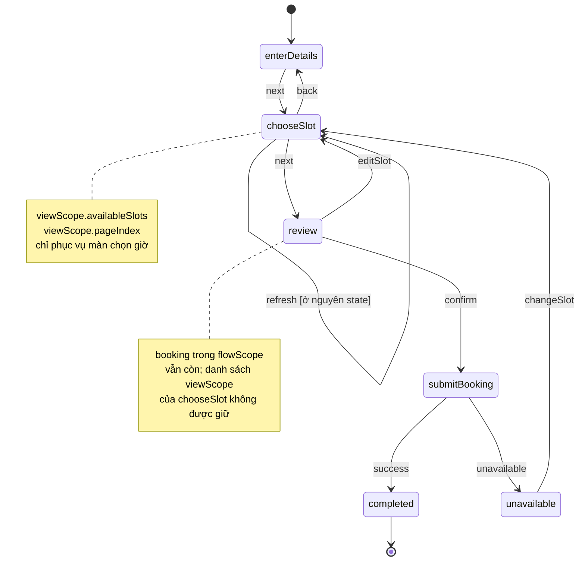

# viewScope và dữ liệu sống trong một view-state

Trong chương **Dữ liệu và scope** của **Spring Web Flow**, việc chọn đúng phạm vi lưu trữ quan trọng không kém thiết kế state, event và transition. Cùng một flow đặt lịch có thể cần giữ **bản nháp đăng ký** trong nhiều bước, nhưng danh sách **khung giờ đang hiển thị** chỉ có ý nghĩa ở màn chọn lịch. Đặt cả hai vào cùng một scope sẽ làm dữ liệu sống quá lâu, khó làm mới và dễ tạo hiểu nhầm về vòng đời.

**`viewScope`** giải quyết nhu cầu giữ dữ liệu **trong thời gian một view-state còn hoạt động**. Nó phù hợp với dữ liệu trình bày của màn hình, trạng thái phân trang, bộ lọc hoặc kết quả truy vấn để render lại cùng một view. Khi rời view-state, dữ liệu `viewScope` của lần vào state đó không còn là nơi lưu giữ đáng tin cậy; nếu sau đó quay lại state, Web Flow tạo ngữ cảnh view mới.

Bài này thuộc module **SPRING_WEB_FLOW**, hướng tới khả năng mô hình hóa hành trình nhiều bước bằng state/event/transition, quản lý form binding và validation, scope/phiên, phối hợp Spring MVC và xử lý phục hồi khi lỗi. Sau bài học, bạn sẽ:

1. Phân biệt `viewScope` với `requestScope`, `flashScope`, `flowScope`, `conversationScope` và HTTP session.
2. Xác định khi nào view scope được tạo, được dùng tiếp và kết thúc trong vòng đời `view-state`.
3. Viết một flow XML dùng `viewScope` cho danh sách hiển thị, `flowScope` cho bản nháp và transition nội bộ để làm mới dữ liệu.
4. Tránh nhầm `viewScope` của Spring Web Flow với JSF `@ViewScoped` hoặc với đối tượng `Model` của một request Spring MVC thông thường.
5. Kiểm thử việc giữ dữ liệu ở cùng state, hủy scope khi rời state, quay lại màn hình, xử lý lỗi và timeout.

## 1. Một màn hình cần hai nhóm dữ liệu có vòng đời khác nhau

Giả sử ứng dụng đặt lịch tư vấn có ba bước:

- `enterDetails`: nhập tên, email và dịch vụ muốn tư vấn.
- `chooseSlot`: xem các khung giờ còn trống, chọn một khung giờ.
- `review`: xem lại bản nháp và xác nhận.

Tại `chooseSlot`, người dùng có thể bấm **Làm mới lịch** nhiều lần nhưng chưa rời khỏi màn. Danh sách giờ trống có thể thay đổi sau mỗi lần làm mới. Khi bấm **Tiếp tục**, flow chuyển sang `review`; người dùng không cần mang cả danh sách hàng chục khung giờ sang trang review, chỉ cần lưu **mã giờ đã chọn**.

Ta có hai nhóm dữ liệu:

| Dữ liệu | Có cần qua nhiều view-state không? | Scope phù hợp |
| --- | --- | --- |
| Tên, email, mã dịch vụ đã chọn | Có: nhập → chọn giờ → xem lại | `flowScope` |
| Mã khung giờ người dùng chọn | Có: chọn giờ → xem lại → xác nhận | `flowScope` |
| Danh sách giờ trống đang render | Không: chủ yếu dùng trong `chooseSlot` | `viewScope` |
| Trang hiện tại của danh sách giờ | Không: chỉ để hiển thị ở `chooseSlot` | `viewScope` |
| Lỗi binding của một HTTP request | Ngắn hạn, để xử lý/render thông báo | Binding/message context và request/view phù hợp |
| Đặt lịch đã xác nhận | Có: phải tồn tại sau khi flow kết thúc | Service/database |

Quy tắc thực dụng: **dữ liệu cần sống qua transition sang view-state khác thuộc flow hoặc tầng lưu trữ bền vững; dữ liệu chỉ phục vụ render/tương tác ở một view-state có thể đặt trong view scope**.

Dữ liệu trong `viewScope` có thể được dùng qua **nhiều HTTP request** nếu các request đó vẫn xử lý **cùng một lần vào view-state**. Do vậy `viewScope` rộng hơn `requestScope`, nhưng hẹp hơn `flowScope`.

## 2. Vòng đời của viewScope

`viewScope` thuộc **view-state đang hoạt động trong một flow execution**, không thuộc một template JSP hoặc một URL vật lý tự thân.

Diễn tiến cơ bản:

1. Flow đi vào `view-state` `chooseSlot`.
2. Web Flow khởi tạo vùng `viewScope` cho lần vào state này.
3. Các action/hook của view-state có thể đưa dữ liệu vào scope; view dùng dữ liệu đó để render.
4. Một event xử lý **ngay trong cùng state**, không rời view-state, có thể tiếp tục đọc/ghi dữ liệu view scope.
5. Khi transition chuyển sang `review` hoặc một state khác, scope gắn với `chooseSlot` bị kết thúc/loại khỏi ngữ cảnh view đang hoạt động.
6. Khi người dùng từ `review` quay lại `chooseSlot`, đó là **một lần vào state mới**; dữ liệu view-local cần được thiết lập lại.



**Chú ý ký pháp:** mũi tên `chooseSlot → chooseSlot` trong sơ đồ biểu diễn về mặt nghiệp vụ thao tác “refresh mà vẫn ở màn chọn giờ”. Khi viết XML, nên dùng **transition không có `to`** để xử lý event tại chỗ mà không thực hiện một lần rời/vào view-state. Nếu viết transition tường minh `to="chooseSlot"`, bạn có thể tạo hành vi **thoát rồi vào lại state**, dẫn tới tái khởi tạo view scope. Hai cách không tương đương về vòng đời, dù đều hiện cùng một màn hình.

### Có phải viewScope chỉ tồn tại trong một lần render?

Không. Nếu người dùng gửi một event Ajax lọc danh sách, phân trang hoặc làm mới bên trong cùng view-state, view scope có thể tồn tại qua request đó để giữ bộ lọc và các kết quả hiển thị. Tính chất này khác `requestScope` vốn chỉ phục vụ một lần xử lý request.

### Có phải cứ quay lại cùng URL thì giữ được viewScope?

Không nên giả định như vậy. Quyết định nằm ở **state đang thực thi** và các snapshot/execution được Web Flow quản lý, không chỉ ở chuỗi URL hiển thị. Nút Back của trình duyệt có thể đưa về trang HTML cache hoặc một snapshot cũ tùy repository; đó không phải cam kết view scope cũ còn hiệu lực. Hãy thiết kế rõ event `editSlot` để trở lại `chooseSlot` và nạp lại dữ liệu view-local cần thiết.

## 3. So sánh viewScope với các phạm vi khác

| Phạm vi | Thường sống trong bao lâu? | Ví dụ sử dụng | Không nên dùng cho |
| --- | --- | --- | --- |
| `requestScope` | Một request xử lý flow | Giá trị tạm của một lần xử lý event | Dữ liệu cần dùng khi request tiếp theo đến |
| `flashScope` | Vòng đời ngắn quanh một transition/render theo cơ chế Web Flow | Thông điệp sau thao tác | Bản nháp nhiều bước hoặc dữ liệu cần lưu lâu |
| **`viewScope`** | Trong một lần vào và tương tác với một `view-state` | Danh sách lựa chọn, bộ lọc màn hình, trang phân trang | Bản nháp phải xuất hiện ở nhiều view-state |
| `flowScope` | Suốt một flow execution | Bản nháp đơn hàng, lựa chọn cần đưa tới review | Bộ dữ liệu render nặng chỉ dùng ở một màn |
| `conversationScope` | Theo một conversation bao gồm flow cha/con tùy cấu hình | Dữ liệu thực sự dùng chung trong chuỗi subflow | Dữ liệu UI riêng lẻ của một màn |
| HTTP session | Theo session web, thường rộng hơn flow execution | Context đăng nhập do hệ thống security quản lý | Bản nháp nhiều tab dưới một key cố định |
| Database | Ngoài vòng đời flow và session | Đặt lịch đã xác nhận, bản nháp cần khôi phục dài hạn | Trạng thái UI thoáng qua không cần bền vững |

`flowScope` và `viewScope` đều là scope được Web Flow quản lý trong ngữ cảnh execution. `conversationScope` có phạm vi khác khi có subflow; đừng mặc định mọi dữ liệu của flow con đều phải ở conversation scope. `sessionScope` là khái niệm HTTP session rộng hơn, không phải nơi mặc định nên đặt mọi biến của wizard.

**Không đưa object lớn vào scope chỉ vì muốn tiện truy cập.** Scope có thể tham gia cơ chế snapshot, lưu trữ và khôi phục của flow execution. Một danh sách lớn, đối tượng JPA đang gắn với persistence context hoặc resource không serializable có thể gây vấn đề bộ nhớ, serialization hoặc dữ liệu lỗi thời.

## 4. Truy cập viewScope trong biểu thức Web Flow

Trong flow XML, có thể đọc/ghi view scope bằng cú pháp biểu thức, ví dụ:

```xml
<evaluate expression="slotCatalogService.findAvailable(booking.serviceId)"
          result="viewScope.availableSlots"/>
```

Ở đây:

- `slotCatalogService` là Spring bean do ứng dụng cung cấp.
- `booking` là model chứa thông tin người dùng đã nhập, được khai báo là biến trong flow.
- `viewScope.availableSlots` là vị trí để lưu danh sách phục vụ màn hình hiện tại.
- Phần tử `<evaluate>` cần được đặt trong ngữ cảnh Web Flow cho phép thực thi action, chẳng hạn `on-entry`, `on-render` hoặc một transition.

Web Flow cung cấp các scope cho expression language. Cách truy cập bằng tên biến rút gọn và cách đưa dữ liệu vào model của công nghệ view có thể thay đổi theo cấu hình resolver, do đó **đừng nhầm cú pháp XML `viewScope.availableSlots` với một cam kết mọi JSP/JSF đều tự truy cập được đúng tên ấy**. Khi viết view, kiểm tra dữ liệu mà adapter/view renderer thực sự expose.

Trong Java action, có thể thao tác thông qua `RequestContext`:

```java
import org.springframework.webflow.execution.RequestContext;

public class SlotViewAction {

    private final SlotCatalogService slotCatalogService;

    public SlotViewAction(SlotCatalogService slotCatalogService) {
        this.slotCatalogService = slotCatalogService;
    }

    public void reloadSlots(RequestContext context) {
        BookingDraft booking =
            (BookingDraft) context.getFlowScope().get("booking");

        context.getViewScope().put(
            "availableSlots",
            slotCatalogService.findAvailable(booking.getServiceId())
        );
    }
}
```

`SlotCatalogService` và `BookingDraft` là kiểu do ứng dụng tự xây dựng. Phương thức `getViewScope()` truy cập vùng scope của view-state hiện hành; không nên gọi loại logic này từ một action không thuộc ngữ cảnh view-state rồi giả định luôn có dữ liệu view scope hợp lệ.

## 5. Ví dụ xuyên suốt: màn chọn khung giờ

Xây dựng một flow đặt lịch tư vấn:

- `enterDetails` thu thập tên, email, dịch vụ.
- `chooseSlot` hiển thị những khung giờ đang có thể đặt.
- Event `refresh` làm mới danh sách mà **không đổi state**.
- Event `next` lưu lựa chọn khung giờ vào `booking` rồi chuyển sang `review` nếu hợp lệ.
- Event `editSlot` từ `review` quay về `chooseSlot`, khiến màn hình nạp lại danh sách giờ trống theo tình trạng hiện tại.
- `confirm` gọi service đặt lịch. Service phải kiểm tra lại điều kiện và quyền ở ranh giới transaction, vì dữ liệu hiển thị trong view scope có thể đã lỗi thời.

Bảng lựa chọn scope:

| Biến | Nơi đặt | Ai sửa? |
| --- | --- | --- |
| `booking.fullName`, `booking.email`, `booking.serviceId` | `flowScope` qua model `booking` | Form bước nhập thông tin |
| `booking.slotId` | `flowScope` qua model `booking` | Form chọn giờ |
| `viewScope.availableSlots` | `viewScope` của `chooseSlot` | Action nạp danh sách / refresh |
| `viewScope.displayPage` | `viewScope` của `chooseSlot` | Event phân trang nội bộ, nếu có |
| Đặt lịch đã xác nhận | Database | Booking service trong transaction |

Không nên đưa `availableSlots` vào bản nháp `BookingDraft` chỉ để có thể render form; nó là dữ liệu *được truy vấn từ hệ thống* và có vòng đời khác với lựa chọn `slotId` của người dùng.

## 6. Model bản nháp nằm ở flowScope

Một JavaBean tối giản:

```java
package com.example.booking;

import java.io.Serializable;
import java.util.UUID;

public class BookingDraft implements Serializable {
    private static final long serialVersionUID = 1L;

    private String fullName;
    private String email;
    private String serviceId;
    private String slotId;

    // Dùng để chống xử lý trùng khi xác nhận.
    private final String requestId = UUID.randomUUID().toString();

    public BookingDraft() {}

    public String getFullName() { return fullName; }
    public void setFullName(String fullName) {
        this.fullName = fullName;
    }

    public String getEmail() { return email; }
    public void setEmail(String email) {
        this.email = email;
    }

    public String getServiceId() { return serviceId; }
    public void setServiceId(String serviceId) {
        this.serviceId = serviceId;
    }

    public String getSlotId() { return slotId; }
    public void setSlotId(String slotId) {
        this.slotId = slotId;
    }

    public String getRequestId() { return requestId; }
}
```

Trong XML:

```xml
<var name="booking" class="com.example.booking.BookingDraft"/>
```

Với cách khai báo biến flow này, `booking` tồn tại xuyên các state của execution. Khi rời `chooseSlot`, giá trị `booking.slotId` vẫn còn để hiển thị ở `review`. Trái lại, `viewScope.availableSlots` có thể bị giải phóng và không nên là nguồn dữ liệu để xác nhận.

**`requestId` là giá trị do server tạo**. Không đưa nó vào `<binder>` hay tin một giá trị được client gửi lên làm khóa xác thực. Service có thể dùng khóa này để bảo đảm một yêu cầu logic không ghi hai lần khi người dùng gửi lại event vì timeout.

## 7. Định nghĩa XML: khởi tạo viewScope khi vào view-state

Ví dụ dưới đây là khung flow đầy đủ. Nó giả định có bean `slotCatalogService` để truy vấn danh sách slot, `bookingAction` để lưu giao dịch và validator thích hợp cho model.

```xml
<?xml version="1.0" encoding="UTF-8"?>
<flow xmlns="http://www.springframework.org/schema/webflow"
      xmlns:xsi="http://www.w3.org/2001/XMLSchema-instance"
      xsi:schemaLocation="
        http://www.springframework.org/schema/webflow
        http://www.springframework.org/schema/webflow/spring-webflow.xsd"
      start-state="enterDetails">

    <var name="booking" class="com.example.booking.BookingDraft"/>

    <view-state id="enterDetails"
                view="booking/details"
                model="booking">
        <binder>
            <binding property="fullName"/>
            <binding property="email"/>
            <binding property="serviceId"/>
        </binder>

        <transition on="next" to="chooseSlot"
                    bind="true" validate="true"/>
        <transition on="cancel" to="cancelled"
                    bind="false" validate="false"/>
    </view-state>

    <view-state id="chooseSlot"
                view="booking/choose-slot"
                model="booking">

        <!-- Chỉ nạp khi bước chọn giờ được đi vào. -->
        <on-entry>
            <evaluate
                expression="slotCatalogService.findAvailable(booking.serviceId)"
                result="viewScope.availableSlots"/>
        </on-entry>

        <binder>
            <binding property="slotId"/>
        </binder>

        <!-- Không có 'to': giữ nguyên view-state/viewScope. -->
        <transition on="refresh"
                    bind="false" validate="false">
            <evaluate
                expression="slotCatalogService.findAvailable(booking.serviceId)"
                result="viewScope.availableSlots"/>
            <render fragments="slotList"/>
        </transition>

        <!-- Chỉ lựa chọn hợp lệ mới chuyển sang review. -->
        <transition on="next" to="review"
                    bind="true" validate="true"/>

        <transition on="back" to="enterDetails"
                    bind="false" validate="false"/>
        <transition on="cancel" to="cancelled"
                    bind="false" validate="false"/>
    </view-state>

    <view-state id="review" view="booking/review">
        <transition on="editSlot" to="chooseSlot"/>
        <transition on="editDetails" to="enterDetails"/>
        <transition on="confirm" to="reserve"/>
        <transition on="cancel" to="cancelled"/>
    </view-state>

    <action-state id="reserve">
        <evaluate expression="bookingAction.reserve(booking)"/>
        <transition on="success" to="completed"/>
        <transition on="unavailable" to="slotUnavailable"/>
        <transition on="retryableFailure" to="retryView"/>
    </action-state>

    <view-state id="slotUnavailable" view="booking/unavailable">
        <transition on="changeSlot" to="chooseSlot"/>
        <transition on="cancel" to="cancelled"/>
    </view-state>

    <view-state id="retryView" view="booking/retry">
        <transition on="retry" to="reserve"/>
        <transition on="editSlot" to="chooseSlot"/>
        <transition on="cancel" to="cancelled"/>
    </view-state>

    <end-state id="completed" view="booking/completed"/>
    <end-state id="cancelled" view="booking/cancelled"/>
</flow>
```

Điểm cốt lõi:

- `booking` là bản nháp thuộc flow scope, nên dữ liệu còn khi sang `review` hoặc khi quay về sửa.
- `<on-entry>` của `chooseSlot` nạp danh sách chỉ khi **đi vào** màn đó. Khi trở về từ review, danh sách được truy vấn lại.
- Transition `refresh` **không chỉ định `to`**. Nó xử lý tại chỗ, cập nhật `viewScope.availableSlots` và yêu cầu render fragment `slotList`, thay vì chuyển sang state khác.
- `next` thực hiện binding và validation cho `booking.slotId`; nếu lỗi, view-state vẫn được hiển thị cùng context thích hợp.
- `back` và `cancel` bỏ qua binding/validation để người dùng có thể rời màn đang nhập dở.
- `reserve` không được tin rằng một `slotId` có trong danh sách ở thời điểm render vẫn còn trống ở thời điểm xác nhận.

**Giới hạn của ví dụ:** tên view và fragment phụ thuộc vào Spring MVC view resolver/công nghệ render thực tế. `<render fragments="slotList"/>` không tự động tách một JSP thành fragment chỉ nhờ có thẻ HTML mang ID đó. Cần một view renderer hỗ trợ partial rendering và Ajax client xử lý response đúng giao thức.

### Tại sao không dùng `to="chooseSlot"` cho nút Refresh?

Một transition có đích có thể thực hiện logic thoát và vào state mới; khi đó các hook `on-exit`, `on-entry` và vòng đời view scope cũng khác. Với thao tác chỉ nạp lại danh sách ở màn đang mở, ta chủ ý dùng transition nội bộ **không có đích**. Điều này làm rõ ý nghĩa “làm mới dữ liệu của view hiện hành” thay vì “khởi động lại màn”.

### Nếu danh sách phải làm mới sau mỗi lần render?

Có thể dùng `<on-render>` để chạy action trước mỗi lần render view-state, chẳng hạn:

```xml
<view-state id="chooseSlot" view="booking/choose-slot">
    <on-render>
        <evaluate
            expression="slotCatalogService.findAvailable(booking.serviceId)"
            result="viewScope.availableSlots"/>
    </on-render>

    <transition on="refresh">
        <render fragments="slotList"/>
    </transition>
</view-state>
```

**Đây là lựa chọn thay thế**, không phải đoạn XML cần thêm song song vào state `chooseSlot` ở ví dụ chính. `on-render` thích hợp nếu yêu cầu phải nạp dữ liệu mới trước **mọi** lần render, kể cả sau validation lỗi hoặc khi cập nhật Ajax. Đổi lại, một request render lặp có thể gọi service nhiều lần. Nếu danh sách đắt đỏ, có thể nạp ở `on-entry` và chủ động làm mới bằng event `refresh` như ví dụ chính.

## 8. Minh họa view JSP và dữ liệu chỉ dùng trong màn

Giả sử view resolver của Spring MVC/Web Flow đã đưa `availableSlots` (giá trị từ view scope) vào model của view đang render. Một trang `choose-slot.jsp` có thể dùng Spring Form Tags:

```jsp
<%@ taglib prefix="form" uri="http://www.springframework.org/tags/form" %>
<%@ taglib prefix="c" uri="http://java.sun.com/jsp/jstl/core" %>

<h1>Chọn khung giờ tư vấn</h1>

<form:form modelAttribute="booking"
           action="${flowExecutionUrl}"
           method="post">

    <div id="slotList">
        <label for="slotId">Khung giờ còn trống</label>
        <form:select id="slotId" path="slotId">
            <form:option value="" label="-- Chọn giờ --"/>
            <form:options items="${availableSlots}"
                          itemValue="id"
                          itemLabel="displayLabel"/>
        </form:select>
        <form:errors path="slotId" cssClass="field-error"/>
    </div>

    <button type="submit" name="_eventId_refresh">
        Làm mới lịch
    </button>

    <button type="submit" name="_eventId_next">
        Xem lại
    </button>

    <button type="submit" name="_eventId_back">
        Quay lại
    </button>
</form:form>
```

Ví dụ giả định mỗi phần tử `availableSlots` có `id` và `displayLabel`; chúng thuộc DTO do ứng dụng định nghĩa. **Cách expose view scope vào model JSP phụ thuộc view adapter/resolver**, do đó hãy xác minh biến `availableSlots` thực sự được đưa tới JSP. Không tự tạo request attribute bằng chuỗi literal rồi kết luận view scope hoạt động.

Đặc biệt, giá trị `booking.slotId` được bind và giữ trong bản nháp để đi tiếp tới `review`. Danh sách `availableSlots` chỉ hỗ trợ người dùng lựa chọn ở màn hiện tại.

Nếu nút Refresh được gửi bằng **form POST thông thường**, trang có thể render lại toàn bộ HTML. Nếu muốn chỉ thay vùng `slotList` qua Ajax, cần cấu hình view renderer và JavaScript/JSF phù hợp với `<render fragments="slotList"/>`; chỉ có ID DOM không tạo ra Ajax tự động.

### Đừng đưa dữ liệu của viewScope vào hidden input để giữ qua state

Một cách làm sai là gửi toàn bộ danh sách `availableSlots` dưới dạng hidden fields rồi dùng dữ liệu gửi lại để xác nhận. Điều đó vừa làm form nặng, vừa cho phép client thay đổi dữ liệu dẫn xuất. Thay vào đó, gửi mã `slotId` cần thiết; service kiểm tra lại tính hợp lệ và tính khả dụng khi xác nhận.

## 9. Cách kiểm tra dữ liệu của màn vẫn đúng qua binding và validation

Với `model="booking"` và binder whitelist của `chooseSlot`:

- Form ở màn này chỉ được cập nhật `slotId`.
- `next` có thể chạy validation phù hợp. Nếu `slotId` rỗng hoặc không tồn tại, view phải ở lại và hiển thị lỗi.
- `refresh` có `bind="false" validate="false"`, nghĩa là người dùng có thể làm mới danh sách kể cả khi chưa chọn slot hợp lệ.
- `back` và `cancel` cũng có thể bỏ qua validation để tránh khóa người dùng trong form lỗi.

Có một chi tiết UX cần quyết định: vì `refresh` không bind các field của request, **lựa chọn slot vừa thay đổi trong DOM nhưng chưa bấm Next có thể chưa được ghi vào model**. Nếu người dùng chọn một giờ rồi bấm Refresh, control có thể trở về giá trị trước đó sau khi render. Đó là hệ quả có chủ ý của chính sách binding, không phải lỗi `viewScope`.

Nếu sản phẩm yêu cầu giữ lựa chọn tạm khi refresh, có thể:

1. Bind trường `slotId` trên event refresh, nhưng không chạy những validation không cần thiết và xử lý lỗi chuyển đổi kiểu phù hợp.
2. Lưu lựa chọn tạm trong trạng thái client khi thay DOM, sau đó đồng bộ một cách có kiểm soát.
3. Cho người dùng xác nhận lựa chọn trước khi refresh hoặc hiển thị cảnh báo khi dữ liệu sắp bị ghi đè.

Dù chọn cách nào, không dùng `availableSlots` trong view scope như nguồn chân lý về số chỗ tại thời điểm commit. Danh sách có thể thay đổi giữa các request.

## 10. viewScope trong transition nội bộ và khi quay lại

Đây là bốn tình huống cần phân biệt:

| Tình huống | Có rời `chooseSlot` không? | Kỳ vọng với `viewScope.availableSlots` |
| --- | --- | --- |
| Ban đầu từ `enterDetails` tới `chooseSlot` | Mới đi vào | Được tạo/nạp trong `on-entry` |
| Bấm `refresh` trên transition không có `to` | Không | Cùng scope, danh sách được cập nhật |
| Bấm `next` để tới `review` | Có | Scope của màn chọn giờ kết thúc |
| Từ `review` bấm `editSlot` về `chooseSlot` | Đi vào lại | Có view scope mới, `on-entry` nạp danh sách mới |
| Bấm `back` tới `enterDetails` | Có | Không giữ danh sách của màn chọn giờ như dữ liệu flow |
| Execution kết thúc hoặc hết hạn | Flow không còn tiếp tục bình thường | View scope không phải nguồn dữ liệu bền vững |

Nếu chỉ dựa vào tên view ID `chooseSlot`, dễ tưởng rằng dữ liệu phải còn khi quay lại cùng ID. Nhưng **state ID không phải khóa cache vĩnh viễn**. Cần nhìn vào *lần vào state* và *vòng đời execution*.

### So sánh chuyển sang chính state hiện tại với giữ nguyên state

Cấu hình bên dưới có đích tường minh:

```xml
<transition on="reset" to="chooseSlot"/>
```

Tùy hành vi state transition, nó có thể thoát rồi vào lại `chooseSlot`, làm khởi tạo lại view scope và thực thi lại `on-entry`. Đối với logic muốn giữ nguyên view scope, hãy ưu tiên transition **không có `to`** như ví dụ `refresh` và viết test xác nhận dữ liệu không bị mất.

## 11. viewScope và JSF @ViewScoped là hai cơ chế khác nhau

Tên giống nhau có thể gây nhầm khi tích hợp **Spring Web Flow với JSF**:

| Tiêu chí | Web Flow `viewScope` | JSF `@ViewScoped` |
| --- | --- | --- |
| Ai quản lý? | Spring Web Flow | JSF/CDI hoặc cơ chế managed bean của JSF |
| Ranh giới khái niệm | Một lần vào `view-state` của flow execution | Vòng đời của JSF view/component tree theo JSF |
| Tham chiếu trong XML flow | `viewScope.someValue` | Không phải cú pháp thay thế trực tiếp |
| Phụ thuộc | Flow execution và repository/snapshot | JSF FacesContext, view state saving |
| Rời Web Flow state | View scope của state kết thúc | Vòng đời JSF bean phụ thuộc JSF navigation/view state |
| Thích hợp | Dữ liệu hiển thị tạm của một bước trong flow | State của bean UI JSF theo thiết kế JSF |

Không nên mặc định rằng một bean JSF `@ViewScoped` và một entry `viewScope.someValue` của Web Flow có cùng lúc được tạo/hủy. Với `Facelets`, cần xác minh Spring Faces/JSF integration hỗ trợ hai lifecycle ra sao, nhất là khi Ajax partial update, browser Back và JSF ViewState hết hạn.

Nếu dùng JSP/Spring MVC, JSF `@ViewScoped` không phải cơ chế tương ứng để giữ dữ liệu của Web Flow; hãy dùng scope của Web Flow hoặc model của Spring MVC theo đúng phạm vi.

## 12. Snapshot, browser Back và hai tab

Spring Web Flow có thể lưu trạng thái execution để tiếp tục request và hỗ trợ một số hành vi browser history. Cấu hình repository, số snapshot được giữ và chiến lược lưu execution ảnh hưởng tới cách dữ liệu scope được khôi phục.

Ba vấn đề cần tách:

1. **Flow còn chạy, đang ở `chooseSlot`:** `viewScope` có thể dùng qua nhiều request trong cùng view-state.
2. **Đã rời `chooseSlot`:** về mặt logic của flow, scope view-local của lần vào state cũ không còn là nơi dữ liệu phải tồn tại.
3. **Browser Back tới snapshot cũ:** nếu repository cho phép khôi phục snapshot, một số dữ liệu có thể xuất hiện lại trong ngữ cảnh lịch sử; không nên xem đó là bằng chứng dữ liệu còn mới hoặc là quyền được tiếp tục xác nhận giao dịch.

Không dùng kết quả `availableSlots` lấy từ một snapshot cũ để khẳng định giờ còn trống. Trước khi đặt lịch, service phải kiểm tra lại availability trong transaction hoặc cơ chế đồng bộ phù hợp.

### Hai tab có riêng viewScope không?

Nếu người dùng **khởi chạy hai flow execution độc lập**, mỗi execution có scope riêng. Nhưng nếu họ **nhân đôi một tab đang mở** và cả hai tab gửi request với cùng execution URL/key, có thể là hai client đang tác động vào **cùng execution** hoặc các snapshot liên quan. Web Flow không mặc định biến việc nhân đôi tab thành hai phiên wizard độc lập.

Cần kiểm thử request song song và stale snapshot theo cấu hình thực tế. Đừng dùng một thuộc tính session cố định để lưu danh sách hay bản nháp cho mọi tab; nó khiến việc lẫn dữ liệu dễ xảy ra hơn.

## 13. Bộ nhớ, dữ liệu lỗi thời và các đối tượng không nên giữ

`viewScope` hữu ích nhưng không phải cache đa người dùng hay nơi lưu dữ liệu bền vững.

**Dữ liệu nên cân nhắc đặt vào viewScope:**

- Danh sách lựa chọn nhỏ để render lại màn hình.
- Kết quả tìm kiếm/phân trang ở quy mô vừa phải khi người dùng ở cùng bước.
- Bộ lọc hoặc trạng thái trình bày cần tồn tại qua một vài request trong view-state.
- Thông báo hoặc cờ UI tạm theo thiết kế màn hình.

**Dữ liệu nên tránh:**

- `EntityManager`, `Connection`, `InputStream`, transaction hoặc resource đang mở.
- Danh sách cực lớn hoặc object graph có quan hệ vòng phức tạp.
- Entity JPA còn gắn persistence context hoặc lazy proxy chưa thể khôi phục an toàn.
- Token xác thực, dữ liệu bảo mật không cần thiết cho render.
- Bản ghi nghiệp vụ phải sống sau khi flow kết thúc.
- Kết quả “khung giờ còn trống” như một bằng chứng không cần kiểm tra lại khi commit.

Nếu repository lưu snapshot bằng serialization, các object trong scope có thể phải đáp ứng các yêu cầu serialization của cấu hình thực tế. Dùng DTO đơn giản, chỉ lưu dữ liệu thực sự cần. Với dữ liệu lớn, view scope có thể giữ **tiêu chí truy vấn và số trang** thay vì toàn bộ danh sách, rồi gọi service để tải dữ liệu cho lần render cần thiết.

### Dữ liệu biến động phải được làm mới có chủ đích

Nếu `on-entry` chỉ truy vấn một lần, danh sách giờ trống có thể lỗi thời khi người dùng ở lại trang lâu. Hãy bổ sung event `refresh` hoặc chọn `on-render` nếu mọi lần render đều cần dữ liệu mới. Nhưng dù có refresh liên tục, race condition vẫn có thể xảy ra ngay trước khi xác nhận — service mới là nơi kiểm tra cuối cùng.

## 14. Trường hợp lỗi khi dùng viewScope

| Triệu chứng | Nguyên nhân có thể | Hướng xử lý |
| --- | --- | --- |
| Sang review thì không thấy `availableSlots` | Dữ liệu được đặt trong `viewScope` của `chooseSlot` | Nếu thực sự cần qua màn, chuyển dữ liệu cần thiết sang `flowScope` hoặc truy vấn lại |
| Quay lại chooseSlot mà danh sách trống | Không khởi tạo trong `on-entry` của lần vào mới | Nạp lại view-local data khi vào state |
| Bấm Refresh làm mất page/filter | Dùng transition có `to="chooseSlot"`, tạo lần vào state mới | Dùng transition nội bộ, kiểm tra vòng đời scope |
| Refresh không cập nhật dữ liệu | `on-entry` chỉ chạy một lần | Gọi lại action ở transition refresh hoặc `on-render` |
| Refresh hiển thị giá trị ô chọn cũ | Transition có `bind="false"` | Chọn chính sách bind cho event và xử lý dữ liệu nhập dở |
| Danh sách render lỗi sau refresh | View renderer không hỗ trợ fragment đã nêu | Kiểm tra adapter/partial-rendering contract |
| Màn chậm hoặc session phình to | Lưu danh sách/object quá lớn trong scope/snapshot | Giữ DTO nhỏ, phân trang, truy vấn lại |
| Hai tab dùng chung dữ liệu | Session attribute dùng chung hoặc cùng execution key | Tách execution/bản nháp và kiểm tra concurrency |
| Browser Back làm dữ liệu cũ xuất hiện | Cache hoặc snapshot lịch sử | Kiểm tra state server, xác nhận lại dữ liệu nghiệp vụ |
| Lưu lịch dù slot đã hết | Tin vào `availableSlots` đã render | Kiểm tra availability trong transaction |
| Sau timeout không tìm thấy viewScope | Execution đã hết hạn hoặc bị loại khỏi repository | Khởi động lại/khôi phục bản nháp theo quy trình an toàn |
| Test unit pass nhưng JSP không có list | View scope chưa được expose qua view model | Kiểm tra resolver, tên thuộc tính và render integration |

**Phân biệt lỗi nghiệp vụ và lỗi kỹ thuật:** nếu slot đã hết khi xác nhận, đó có thể là kết quả nghiệp vụ `unavailable` với đường về chọn giờ. Nếu database timeout, đó là lỗi kỹ thuật; đừng biến mọi timeout thành “hết chỗ”. Màn retry cần dùng cùng khóa yêu cầu và chính sách idempotency để tránh tạo đặt lịch trùng.

## 15. Kiểm thử vòng đời viewScope

Một bộ kiểm thử Web Flow cần quan sát cả **state ID** và **nội dung scope** thay vì chỉ xem HTML cuối cùng.

| Mã | Kịch bản | Kỳ vọng |
| --- | --- | --- |
| T1 | Bắt đầu flow | State `enterDetails`; chưa có danh sách giờ của màn chooseSlot |
| T2 | `next` hợp lệ từ enterDetails | Vào `chooseSlot`; `viewScope.availableSlots` được nạp |
| T3 | Event `refresh` không có `to` | Vẫn `chooseSlot`; danh sách được cập nhật; scope còn dùng được |
| T4 | Event `next` với slot hợp lệ | Đến `review`; `booking.slotId` có trong flow scope |
| T5 | Ở `review` thử truy cập list cũ của chooseSlot | Không được dựa vào view scope cũ như dữ liệu sống |
| T6 | `review` → `editSlot` | Vào `chooseSlot` mới; `on-entry` truy vấn lại slot |
| T7 | Event `back` từ chooseSlot | Đến `enterDetails`; bản nháp giữ thông tin đã nhập |
| T8 | Event `cancel` khi form sai | Kết thúc; không bị validation chặn |
| T9 | Slot hết chỗ ở thời điểm xác nhận | Service trả `unavailable`; không đặt trùng |
| T10 | Refresh bằng Ajax | Fragment danh sách được cập nhật đúng giao thức |
| T11 | Browser Back hoặc execution key cũ | Xử lý history/expiry theo chính sách, không tin dữ liệu cũ |
| T12 | Hai flow execution độc lập | `viewScope` và `flowScope` không trộn dữ liệu |
| T13 | Hai request song song vào cùng execution | Không có cập nhật UI hoặc ghi dữ liệu sai |
| T14 | Repository snapshot/serialize | DTO trong scope phù hợp yêu cầu lưu/khôi phục |

Mã giả kiểm thử (không phải API chạy trực tiếp của framework):

```text
startFlow("booking")
  -> assertState("enterDetails")

submit("next", fullName="Lan", email="lan@example.com",
       serviceId="CONSULT-01")
  -> assertState("chooseSlot")
  -> assertViewScope("availableSlots", nonEmpty)
  -> assertFlowScope("booking.serviceId", "CONSULT-01")

firstList = getViewScope("availableSlots")
mockCatalogReturns(updatedSlots)
submit("refresh")
  -> assertState("chooseSlot")
  -> assertViewScope("availableSlots", updatedSlots)

submit("next", slotId="SLOT-01")
  -> assertState("review")
  -> assertFlowScope("booking.slotId", "SLOT-01")

mockCatalogReturns(freshSlots)
submit("editSlot")
  -> assertState("chooseSlot")
  -> assertViewScope("availableSlots", freshSlots)
  -> assertFlowScope("booking.slotId", "SLOT-01")
```

Trong kiểm thử thật, dùng hỗ trợ test flow của Spring Web Flow để khởi chạy flow, phát event và kiểm tra state/scope; mock `slotCatalogService` cho kết quả khác nhau giữa những lần vào state. Cần test HTTP/view riêng để xác minh JSP/JSF thực sự nhận các biến mà renderer expose. Với action đặt lịch, bổ sung integration test transaction/idempotency vì unit test scope không chứng minh được an toàn đồng thời.

### Test phân biệt on-entry và on-render

Một test hữu ích là đếm số lần `slotCatalogService.findAvailable(...)` được gọi:

- Khi đi từ `enterDetails` tới `chooseSlot`: gọi **một lần** do `on-entry`.
- Render lại cùng state mà không có event refresh: với cấu hình chỉ có `on-entry`, không mặc định gọi lại.
- Khi bấm `refresh`: gọi thêm một lần do action trong transition.
- Khi rời sang `review` rồi quay lại qua `editSlot`: gọi thêm một lần do `on-entry` của lần vào state mới.

Nếu thay bằng `on-render`, kỳ vọng số lần gọi sẽ khác: nó được thực hiện trước các lần render phù hợp. Test phải phản ánh cơ chế đã chọn, không chỉ khẳng định “danh sách luôn có”.

## 16. Bài thực hành mở rộng

Hãy mở rộng flow đặt lịch bằng một màn `chooseSpecialist` trước `chooseSlot`:

1. `chooseSpecialist` hiển thị danh sách chuyên viên trong `viewScope.specialists`.
2. Người dùng chọn `specialistId`, lưu vào `flowScope.booking` để chuyển sang màn chọn giờ.
3. `chooseSlot` tải các slot dựa trên `booking.specialistId`.
4. Event `filterDate` làm mới danh sách slot trong cùng view-state, không thay đổi booking draft.
5. Từ `review` quay về `chooseSpecialist`, chọn chuyên viên khác: phải xóa hoặc kiểm tra lại `booking.slotId` cũ, tránh giữ lựa chọn không còn hợp lệ.
6. Nếu chuyên viên ngừng nhận lịch, service xác nhận trả kết quả nghiệp vụ thích hợp; không hiển thị dữ liệu cache như một cam kết.
7. Nếu execution hết hạn, ứng dụng cho khởi động lại hoặc khôi phục bản nháp theo quyền, không dùng event key cũ để ghi.

Đầu ra mong đợi: sơ đồ state, bảng scope cho từng biến, XML flow có `on-entry` và transition nội bộ, mẫu view, kịch bản test vòng đời và mô tả ranh giới transaction.

## 17. Checklist và kết luận

- [ ] Xác định được dữ liệu nào chỉ sống trong một view-state.
- [ ] Dùng `viewScope` cho dữ liệu render/filter/pagination cục bộ.
- [ ] Dùng `flowScope` cho bản nháp cần đi qua nhiều bước.
- [ ] Hiểu `requestScope` không kéo dài qua các request kế tiếp.
- [ ] Phân biệt transition nội bộ không có `to` với transition rời/vào state.
- [ ] Biết `on-entry` và `on-render` làm mới dữ liệu ở những thời điểm khác nhau.
- [ ] Khi quay lại view-state, khởi tạo lại dữ liệu view-local cần thiết.
- [ ] Không coi danh sách trong view scope là kết quả nghiệp vụ đã được commit.
- [ ] Không trộn Web Flow `viewScope` với JSF `@ViewScoped`.
- [ ] Không tin vào snapshot hoặc browser Back để bảo đảm dữ liệu còn mới.
- [ ] Không lưu tài nguyên nặng/không phù hợp vào scope.
- [ ] Có test cho refresh tại chỗ, chuyển màn, quay lại, session hết hạn và hai tab.
- [ ] Service xác thực quyền, bảo đảm transaction và chống ghi trùng khi xác nhận.

**Kết luận:** `viewScope` là công cụ để giữ **dữ liệu gắn với một lần vào và tương tác trong view-state**, chứ không phải kho lưu trữ cho cả wizard. Khi kết hợp đúng với `flowScope`, transition nội bộ, `on-entry`/`on-render`, binding và validation, bạn có thể cập nhật một màn nhiều lần mà không mất ngữ cảnh, đồng thời tránh kéo dữ liệu hiển thị tạm sang các bước khác. Thiết kế vòng đời scope rõ ràng cũng giúp Spring Web Flow xử lý browser history, Ajax, lỗi và khôi phục luồng một cách dễ kiểm thử hơn.
