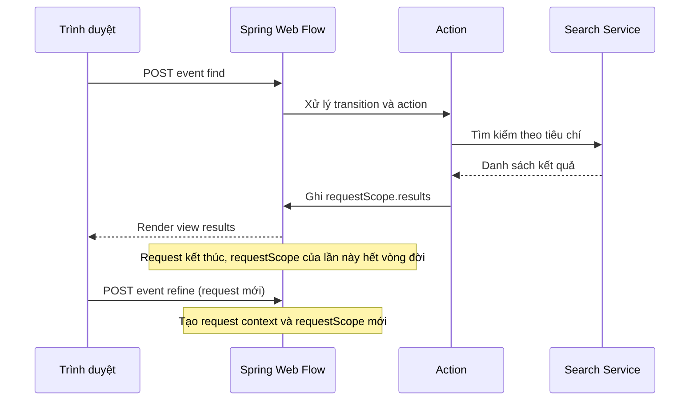
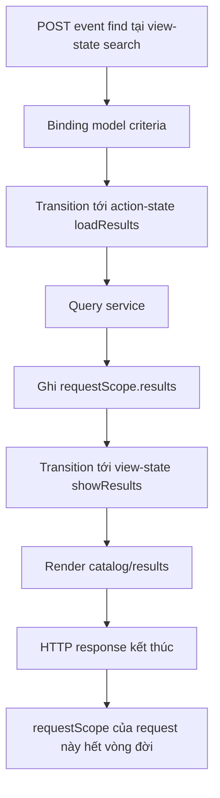

# requestScope và dữ liệu của một lần gọi vào flow

## 1. Một flow có nhiều request, mỗi request có dữ liệu tạm riêng

Trong **Spring Web Flow**, một quy trình nhiều bước như tìm kiếm khách sạn, đăng ký tài khoản hay đặt hàng được mô hình hóa bằng **state**, **event** và **transition**. Người dùng có thể nhập tiêu chí, gửi form để xem kết quả rồi tiếp tục sang bước xác nhận. Một flow execution có thể kéo dài qua nhiều HTTP request; mỗi request là một lần ứng dụng tiếp nhận và xử lý tương tác của người dùng với flow.

Có những dữ liệu chỉ cần tồn tại trong **một lần request đi vào flow**:

- Danh sách kết quả vừa truy vấn để render màn hình ngay trong response hiện tại.
- Một thông báo chẩn đoán hoặc giá trị tạm do action tạo ra khi xử lý event.
- Kết quả tính toán trung gian chỉ dùng trong các action tiếp theo của cùng request.

Nếu lưu những dữ liệu này vào `flowScope`, chúng sẽ tồn tại lâu hơn nhu cầu và có thể làm execution snapshot nặng thêm. Nếu giữ trong biến Java cục bộ, view không thể truy cập sau khi action kết thúc. **`requestScope`** là vùng lưu trữ tạm của Web Flow dành cho vòng đời đó.

Bài thuộc chương **Dữ liệu và scope** giải thích ranh giới của `requestScope`, cách đọc/ghi dữ liệu, sự khác nhau với `requestParameters` và các scope dài hơn, cũng như cách chọn scope khi flow có nhiều state, form binding, validation, subflow và Spring MVC.

## 2. requestScope là gì?

`requestScope` là **attribute map gắn với một lần xử lý request của flow**. Action và expression có thể ghi dữ liệu vào đó; các bước xử lý tiếp theo trong cùng request và view được render cho response đó có thể đọc dữ liệu này.

- Request khởi chạy flow tạo một request context cho lần launch đó.
- Request tiếp tục flow (resume) tạo một request context mới cho lần xử lý tiếp theo.
- Các action/state transition nội bộ được xử lý trong cùng request có thể dùng chung request scope của lần xử lý đó.
- Khi request kết thúc, request scope không phải dữ liệu được giữ lại để dùng trong lần POST/GET tiếp theo.

Ví dụ, người dùng gửi form tìm kiếm:



Dữ liệu `results` được tạo và dùng trong cùng lượt xử lý để hiển thị màn hình kết quả. Khi người dùng bấm **Tìm lại** ở response sau, đó là request mới; không nên kỳ vọng `requestScope.results` cũ vẫn tồn tại.

### requestScope không phải toàn bộ flow execution

| Lần tương tác | Request mới? | requestScope |
| --- | --- | --- |
| Mở `GET /searchHotels` để launch flow | Có | Map mới cho lần launch |
| Gửi event `find` và xử lý action-state để render kết quả | Có | Map mới cho request này, dùng trong các action tiếp theo và view response |
| Gửi event `refine` để quay lại màn hình tiêu chí | Có | Map mới; dữ liệu của request trước không còn |
| Gửi event `confirm` để hoàn tất | Có | Map mới cho lần resume này |
| Render lại view sau validation lỗi | Có một request postback mới | Map mới, không phải map của lần render trước |

**Một flow execution không đồng nghĩa một request.** Đặt dữ liệu vào request scope với ý định dùng xuyên suốt cả hành trình nhiều bước là lỗi chọn scope phổ biến.

## 3. Phân biệt requestScope với requestParameters và Servlet request

Ba khái niệm có tên gần nhau nhưng trách nhiệm khác nhau:

| Khái niệm | Chức năng | Có ghi dữ liệu tùy ý được không? |
| --- | --- | --- |
| `requestParameters` | Map các tham số do client gửi trong HTTP request hiện tại | Thông thường dùng để đọc; không phải vùng lưu kết quả nghiệp vụ |
| **`requestScope`** | Map tạm của Web Flow trong một lần xử lý flow request | **Có**, dùng để đặt thuộc tính tạm |
| `HttpServletRequest` / Servlet request attributes | Đối tượng request của Servlet API, chứa parameter, header, attribute và thông tin HTTP | Có thể đặt request attribute theo Servlet API; đây là cơ chế khác |

Ví dụ:

```xml
<evaluate expression="requestParameters.keyword"
          result="requestScope.normalizedKeyword"/>
```

- `requestParameters.keyword` đọc giá trị tham số `keyword` từ request gửi lên.
- `requestScope.normalizedKeyword` ghi kết quả vào scope tạm của Web Flow.

Không nên dùng `requestParameters` làm nơi lưu kết quả tính toán; cũng không nên coi `requestScope` là bản sao tự động của mọi request parameter. Nếu dữ liệu từ client được dùng trong truy vấn hoặc hành động nghiệp vụ, hãy kiểm tra kiểu, độ dài, quyền truy cập và quy tắc validation trước khi sử dụng.

### Khác với Spring @RequestScope

`requestScope` trong biểu thức Web Flow là một **scope của flow request context**. Annotation `org.springframework.web.context.annotation.RequestScope` của Spring lại dùng để tạo bean có vòng đời theo Servlet web request. Hai cơ chế có ý tưởng thời gian sống gần nhau nhưng **không phải cùng một object map**:

- Web Flow `requestScope` lưu thuộc tính của một lần xử lý flow.
- Spring `@RequestScope` điều khiển vòng đời một bean do ApplicationContext quản lý.
- Servlet request attributes là dữ liệu trên `HttpServletRequest`.

Không dùng ba tên này thay thế cho nhau khi thiết kế hoặc gỡ lỗi.

## 4. Dùng requestScope trong flow XML

Giả sử flow tìm kiếm sản phẩm có một màn hình nhập tiêu chí và một màn hình hiển thị kết quả. Tiêu chí cần giữ lại khi người dùng bấm **Tìm lại**, còn kết quả chỉ cần dùng để render response hiện tại.

**`/WEB-INF/flows/catalog/search-flow.xml`**:

```xml
<?xml version="1.0" encoding="UTF-8"?>
<flow xmlns="http://www.springframework.org/schema/webflow"
      xmlns:xsi="http://www.w3.org/2001/XMLSchema-instance"
      xsi:schemaLocation="
        http://www.springframework.org/schema/webflow
        http://www.springframework.org/schema/webflow/spring-webflow-2.0.xsd">

    <!-- Model được dùng qua nhiều request trong cùng flow. -->
    <var name="criteria" class="com.example.catalog.SearchCriteria"/>

    <view-state id="search" view="catalog/search" model="criteria">
        <transition on="find" to="loadResults"/>
    </view-state>

    <action-state id="loadResults">
        <evaluate expression="catalogService.search(flowScope.criteria)"
                  result="requestScope.results"/>
        <transition on="success" to="showResults"/>
    </action-state>

    <view-state id="showResults" view="catalog/results">
        <transition on="refine" to="search"/>
        <transition on="finish" to="finished"/>
    </view-state>

    <end-state id="finished"/>
</flow>
```

Khi người dùng bấm **Tìm kiếm**:

1. Request POST phát event `find` tại state `search`.
2. Web Flow binding dữ liệu form vào model `criteria`.
3. Transition đi vào `loadResults`; action gọi `catalogService.search(...)`.
4. Kết quả được đặt vào `requestScope.results`.
5. Transition `success` đi tới `showResults` trong cùng lần xử lý request.
6. View `catalog/results` được render và có thể đọc kết quả tạm.
7. Response được gửi về; request scope của lượt xử lý đó kết thúc.

Khi người dùng bấm `refine`, một request mới tiếp tục execution. `flowScope.criteria` vẫn còn để người dùng sửa tiêu chí, nhưng `requestScope.results` của lần tìm kiếm trước không còn được bảo đảm.

### Vì sao criteria nằm ở flowScope còn results nằm ở requestScope?

- `criteria` cần tồn tại khi đi từ màn hình tìm kiếm sang kết quả rồi quay lại tìm tiếp. Vì vậy đặt nó trong flow scope.
- `results` chỉ được dùng để dựng response kết quả vừa tìm. Nếu người dùng rời màn hình, dữ liệu đó có thể được truy vấn lại. Vì vậy request scope phù hợp khi kết quả không cần giữ qua request tiếp theo.

Nếu màn hình cần phân trang nhiều request, hoặc người dùng phải mở lại kết quả cũ, hãy chọn giải pháp lưu trạng thái có chủ đích như `flowScope`, cache có TTL hoặc truy vấn lại từ service. Không thể dùng request scope làm kho dữ liệu cho nhiều lượt phân trang.

## 5. Đọc và ghi requestScope trong Java

Trong Java action, `RequestContext` cung cấp map của request scope qua `getRequestScope()`. Ví dụ sau minh họa một action chuẩn bị dữ liệu để render:

```java
package com.example.catalog;

import java.util.List;

import org.springframework.webflow.action.AbstractAction;
import org.springframework.webflow.execution.Event;
import org.springframework.webflow.execution.RequestContext;

public class PrepareResultsAction extends AbstractAction {

    private final CatalogService catalogService;

    public PrepareResultsAction(CatalogService catalogService) {
        this.catalogService = catalogService;
    }

    @Override
    protected Event doExecute(RequestContext context) {
        SearchCriteria criteria =
                (SearchCriteria) context.getFlowScope().get("criteria");

        List<ProductSummary> results = catalogService.search(criteria);
        context.getRequestScope().put("results", results);
        return success();
    }
}
```

`AbstractAction` là lớp hỗ trợ của Spring Web Flow. Phương thức `doExecute(...)` được gọi khi action-state thực thi; `success()` trả event thành công để transition `on="success"` được chọn.

Đăng ký action như một Spring bean và gọi từ flow:

```xml
<action-state id="loadResults">
    <evaluate expression="prepareResultsAction"/>
    <transition on="success" to="showResults"/>
</action-state>
```

Đây là **trích đoạn** thay cho `<evaluate expression="catalogService.search(...)"/>` trong ví dụ trước; chỉ dùng một cách thực thi để tránh tìm kiếm hai lần.

### Đọc lại thuộc tính trong cùng request

Trong một action chạy sau `PrepareResultsAction` và trước khi response hoàn tất, có thể lấy lại:

```java
Object results = context.getRequestScope().get("results");
```

Hoặc trong Web Flow expression:

```xml
<evaluate expression="requestScope.results.size()"
          result="requestScope.resultCount"/>
```

Chỉ thực hiện phép đọc này khi chắc chắn action trước đã ghi `results` và dữ liệu có kiểu phù hợp. Nếu action không chạy, kết quả tìm kiếm rỗng hoặc lỗi, hãy định nghĩa hành vi riêng thay vì mặc định `results` luôn tồn tại.

## 6. Dữ liệu nào nên ở requestScope?

`requestScope` phù hợp với dữ liệu có đủ ba đặc điểm:

1. Được tạo trong lúc xử lý request hiện tại.
2. Chỉ cần dùng trong các action/transition tiếp theo của cùng request hoặc khi render response đó.
3. Không cần khôi phục khi người dùng gửi request tiếp theo.

| Dữ liệu | Đặt trong requestScope khi... | Không phù hợp khi... |
| --- | --- | --- |
| Kết quả tìm kiếm | Chỉ render danh sách ngay sau event tìm kiếm | Có phân trang, quay lại hoặc tải lại ở request sau mà không truy vấn lại |
| Kết quả tính phí tạm | Chỉ hiển thị báo giá trong response hiện tại | Người dùng cần so sánh/lưu báo giá qua nhiều bước |
| Thông báo kỹ thuật | Chỉ hiển thị lỗi hoặc ghi chú trong response đang render | Thông báo cần tồn tại đến request redirect kế tiếp |
| Số lượng kết quả | Chỉ dùng để hiển thị trong response hiện tại | Cần dùng để quyết định transition ở request sau |
| Dữ liệu chuẩn hóa từ parameter | Chỉ dùng trong phần xử lý còn lại của request | Cần giữ lại trong flow để tiếp tục bước sau |
| DTO tạm cho view | Chỉ phục vụ render ngay | Là dữ liệu nháp phải khôi phục khi resume flow |

Không nên đặt vào request scope:

- Dữ liệu cần tồn tại xuyên suốt một flow nhiều bước.
- Thông tin phải sống qua redirect hoặc request tiếp theo.
- Tham chiếu tới `HttpServletRequest`, response, stream, connection hoặc tài nguyên phụ thuộc thread.
- `EntityManager`, Hibernate Session hoặc đối tượng không an toàn khi giữ qua lifecycle.
- Dữ liệu lớn không cần thiết cho view hiện tại.
- Token, mật khẩu hoặc thông tin bí mật chỉ để tiện truy cập.

Request scope có thời gian sống ngắn nhưng **không phải vùng lưu trữ bảo mật**. Không đưa dữ liệu nhạy cảm vào log hoặc render trực tiếp mà chưa encode/kiểm tra.

## 7. So sánh các scope của Spring Web Flow

Chọn scope dựa trên **thời gian dữ liệu cần tồn tại**, không dựa trên việc tên biến được dùng ở bao nhiêu file.

| Scope | Thời gian sống | Ví dụ phù hợp |
| --- | --- | --- |
| `requestScope` | Một lần xử lý flow request | Kết quả truy vấn dùng để render response hiện tại |
| `flashScope` | Từ lúc được ghi cho đến khi view-state tiếp theo được render | Thông báo “Đã lưu bản nháp” sau action |
| `viewScope` | Trong thời gian flow ở một view-state cụ thể | Giá trị tạm của widget hoặc dữ liệu chỉ thuộc màn hình hiện tại |
| `flowScope` | Từ khi flow session bắt đầu đến khi nó kết thúc | Model đăng ký, tiêu chí tìm kiếm, bản nháp đặt hàng |
| `conversationScope` | Trong thời gian conversation của flow cấp cao và các subflow liên quan | Dữ liệu cần chia sẻ giữa flow cha và flow con |

`flashScope` và `viewScope` đều liên quan đến view-state nhưng khác mục đích:

- `flashScope` là dữ liệu “đi qua” để dùng ở **view-state tiếp theo**; sau khi view đó được render, dữ liệu flash được dọn theo vòng đời của nó.
- `viewScope` gắn với **chính view-state hiện tại** và tồn tại qua các postback của state đó; khi rời state, scope được dọn.

`flowScope` phù hợp khi dữ liệu phải còn sau khi người dùng gửi request mới. `conversationScope` hữu ích khi flow cha gọi subflow và có dữ liệu cần chia sẻ trong conversation. Không nên chọn conversation scope chỉ vì muốn giữ một thông báo tạm.

### Cùng một dữ liệu, chọn scope theo cách sử dụng

Giả sử sau khi tính phí giao hàng, ứng dụng cần hiển thị `shippingQuote`:

- Nếu chỉ hiển thị ngay trong response và tính lại khi người dùng gửi form tiếp theo: `requestScope`.
- Nếu action chuyển qua một view-state kế tiếp và chỉ cần báo giá tại view đó: `flashScope` có thể phù hợp.
- Nếu người dùng có thể sửa nhiều field trong cùng màn hình và cần giữ dữ liệu qua postback của màn hình: `viewScope` hoặc model gắn với view-state.
- Nếu báo giá cần tồn tại qua bước xác nhận, thanh toán và quay lại: `flowScope` hoặc một draft được lưu bền vững.
- Nếu flow xác minh địa chỉ là subflow và cả cha/con cần truy cập dữ liệu: `conversationScope` hoặc input/output mapping rõ ràng.

## 8. requestScope và dữ liệu đầu vào khi launch/resume flow

Một flow có thể được gọi bằng URL ban đầu hoặc tiếp tục bằng execution URL. Hai loại request đều tạo một lần xử lý riêng, nhưng **nguồn dữ liệu đầu vào khác nhau**:

| Nguồn | Ví dụ | Vòng đời |
| --- | --- | --- |
| HTTP request parameter | `?keyword=phone` hoặc field form `keyword` | Chỉ thuộc request hiện tại |
| Flow input | `<input name="catalogId"/>` khi launch flow | Được flow nhận theo mapping input; nếu cần dùng lâu, ánh xạ vào scope thích hợp |
| requestScope | `requestScope.normalizedKeyword` | Chỉ trong lần xử lý request hiện tại |
| flowScope | `flowScope.criteria` | Qua nhiều request của flow execution |
| Execution key | Tham số do Web Flow tạo trong execution URL | Định danh execution/snapshot; không phải dữ liệu form hay scope |

Ví dụ một handler MVC có thể chuẩn hóa input trước khi khởi chạy flow. Sau khi flow đã bắt đầu, các request tiếp tục không nên được xử lý như một launch mới. Dữ liệu cần cho cả hành trình phải được đặt vào model/scope lâu dài hoặc được nạp lại từ service theo ID có kiểm tra quyền.

**Không nhầm requestScope với flow input:** input là hợp đồng dữ liệu khi khởi chạy flow; request scope là vùng tạm để các bước xử lý trong một request dùng chung. Một input có thể được ánh xạ vào flow scope hoặc xử lý rồi bỏ đi, tùy thiết kế.

## 9. RequestScope khi có nhiều transition trong cùng request

Một request có thể kích hoạt nhiều bước xử lý nội bộ trước khi Web Flow trả response. Ví dụ người dùng gửi event `find`:



Trong toàn bộ chuỗi `B → G`, dữ liệu `requestScope.results` có thể được sử dụng. Khi người dùng bấm `refine`, request mới bắt đầu, không tiếp tục map cũ.

Điều này cũng đúng nếu transition đi qua action-state, decision-state hoặc một số action khác trong cùng request. Việc có nhiều state được xử lý không tự tạo ra nhiều request. Ngược lại, một view-state render xong và chờ người dùng bấm nút thường kết thúc response; lần submit tiếp theo là một request mới.

### Redirect làm kết thúc request hiện tại

Nếu action ghi `requestScope.notice` rồi redirect trình duyệt sang URL khác, request tiếp theo không được bảo đảm nhìn thấy giá trị đó. Với thông báo cần hiển thị sau redirect, cân nhắc `flashScope` hoặc cơ chế flash attribute của Spring MVC theo đúng luồng tích hợp. Không cố giữ request scope bằng cách lưu đối tượng request vào flow scope.

## 10. Kết hợp requestScope với validation và lỗi binding

Trong form nhiều bước, validation thường được thực hiện khi Web Flow binding request parameters vào model và xử lý event. `requestScope` có thể giữ **thông tin tạm để render trong chính request có lỗi**, nhưng không nên là nơi lưu model form cần sửa ở request tiếp theo.

Ví dụ:

```xml
<var name="criteria" class="com.example.catalog.SearchCriteria"/>

<view-state id="search"
            view="catalog/search"
            model="criteria">
    <transition on="find" to="searchResults"/>
</view-state>

<view-state id="searchResults" view="catalog/results">
    <transition on="refine" to="search" validate="false"/>
</view-state>
```

Đây là trích đoạn minh họa: `criteria` thuộc flow và có thể được binding lại ở request tiếp theo. Nếu validation lỗi, view-state có thể render lại cùng model với các thông báo lỗi được quản lý trong message context. Một thông báo chẩn đoán chỉ dùng để render response hiện tại có thể đặt trong request scope; nhưng lỗi validation phải được ghi qua cơ chế validation/`MessageContext` của Web Flow, không thay thế bằng một chuỗi tùy ý trong `requestScope`.

Tương tự, `requestScope` không làm cho một request không hợp lệ trở nên hợp lệ và cũng không thay thế việc kiểm tra quyền truy cập. Nếu client gửi `catalogId` hoặc `customerId`, service vẫn phải xác minh người dùng có quyền đọc dữ liệu đó.

## 11. Kiểm thử thời gian sống của requestScope

Nên kiểm thử cả hai điều:

1. Dữ liệu được tạo trong một request có sẵn cho action/view tiếp theo của cùng request.
2. Dữ liệu không được dựa vào trong request resume tiếp theo; những giá trị cần thiết phải nằm ở scope dài hơn hoặc được truy vấn lại.

| Kịch bản | Thao tác | Kỳ vọng |
| --- | --- | --- |
| Tạo dữ liệu tạm | Event `find` gọi action và ghi `requestScope.results` | Action sau và view kết quả của response hiện tại đọc được |
| Nhiều action cùng request | `loadResults` rồi `showResults` | Không mất request attribute giữa các transition nội bộ |
| Resume request mới | Event `refine` gửi từ view kết quả | Không giả định `requestScope.results` cũ còn tồn tại |
| Model flow dài hạn | Cùng request tìm kiếm rồi request sau quay lại | `flowScope.criteria` vẫn còn theo vòng đời flow |
| Flash message | Action ghi `flashScope.notice` rồi render view tiếp theo | View kế tiếp có thể hiển thị; flash được dọn theo vòng đời |
| Hai execution độc lập | Hai người mở cùng flow ID | requestScope của mỗi request không bị dùng chung giữa các execution |
| Validation lỗi | Submit form không hợp lệ | Model và lỗi được giữ theo cơ chế Web Flow; không phụ thuộc request scope cũ |
| Redirect | Ghi requestScope rồi phát redirect | Request đích không được giả định có dữ liệu request scope cũ |

### Test bằng flow test support

Với `AbstractXmlFlowExecutionTests` hoặc test support tương ứng của phiên bản đang dùng, có thể:

- `startFlow(...)` để tạo request launch và kiểm tra state đầu tiên.
- Gửi event qua `MockExternalContext.setEventId(...)` và `resumeFlow(...)` để mô phỏng request tiếp theo.
- Dùng một action/probe trong flow để ghi nhận thuộc tính request scope ở từng lượt xử lý.
- Khẳng định dữ liệu request đầu tiên được đọc trước khi response kết thúc, còn request resume thứ hai nhận một request scope mới.

Tên helper assertion cho request scope có thể khác theo phiên bản test support; nếu không có helper chuyên biệt, tạo một action kiểm thử ghi lại kết quả quan sát vào một test probe bên ngoài. **Probe chỉ phục vụ test**, không biến request scope thành một kho dữ liệu production.

Một test hữu ích là cho action đầu ghi `requestScope.marker`, action kế tiếp trong cùng request xác nhận marker tồn tại, rồi request resume tiếp theo kiểm tra marker không còn. Đồng thời kiểm tra một thuộc tính `flowScope.criteria` vẫn tồn tại để chứng minh test phân biệt đúng hai vòng đời.

## 12. Hiệu năng và an toàn khi dùng requestScope

Vì dữ liệu request scope thường không được giữ lại qua flow execution snapshot, nó có thể tránh việc lưu những kết quả tạm vào trạng thái dài hạn. Tuy nhiên, điều đó **không có nghĩa có thể đưa dữ liệu lớn tùy ý vào request scope**:

- Một danh sách hàng chục nghìn kết quả vẫn chiếm RAM trong thời gian request và render.
- Nếu query được gọi nhiều lần trong cùng request, hãy kiểm tra có thể tái sử dụng kết quả tạm thay vì truy vấn lặp hay không.
- Nếu cần phân trang, truy vấn page/slice ở service thay vì giữ toàn bộ danh sách.
- Không giữ stream, cursor, connection, entity manager hoặc đối tượng phụ thuộc thread trong scope.
- Khi request kết thúc, mọi dữ liệu tạm phải có thể được giải phóng; không sao chép nó vào singleton cache một cách vô tình.

Về bảo mật:

- Dữ liệu đến từ `requestParameters` vẫn không đáng tin cậy; validate và authorize trước khi sử dụng.
- Không lưu token hoặc bí mật trong scope chỉ vì nó ngắn hạn.
- Không render HTML từ dữ liệu request mà không encode đúng ngữ cảnh.
- Không log toàn bộ request scope; nó có thể chứa dữ liệu cá nhân.
- Không đặt request-scoped mutable data vào field của singleton service/controller.

## 13. Lỗi thường gặp và cách chẩn đoán

| Triệu chứng | Nguyên nhân | Cách xử lý |
| --- | --- | --- |
| View kết quả không thấy `requestScope.results` | Action chưa chạy, ghi sai tên hoặc transition tới view không nằm trong cùng request như giả định | Kiểm tra action-state, expression và đường đi transition |
| Kết quả có ở lần render đầu nhưng mất sau khi bấm nút | Đang dùng request scope cho dữ liệu cần qua request mới | Chuyển dữ liệu cần giữ sang flow/view/conversation scope hoặc truy vấn lại |
| `requestParameters.keyword` không có giá trị | Form field name sai, request không gửi parameter hoặc request là GET/POST khác dự tính | Kiểm tra Network tab, tên field và phương thức HTTP |
| Ghi `requestScope.keyword` nhưng parameter không đổi | Hai map có mục đích khác nhau | Đọc từ requestParameters, ghi kết quả đã chuẩn hóa vào requestScope |
| Dữ liệu biến mất sau redirect | Redirect tạo HTTP request mới | Dùng flash scope hoặc lưu ở scope bền hơn nếu thực sự cần |
| Dữ liệu của hai flow bị lẫn | Đang dùng biến static/singleton thay vì scope đúng | Chuyển dữ liệu theo request/flow execution, tránh mutable field dùng chung |
| Validation lỗi nhưng form mất dữ liệu | Model đặt sai scope hoặc binding chưa cấu hình | Dùng model gắn view-state và scope tồn tại qua postback |
| Dùng requestScope để lưu tiến trình dài | Nhầm một flow execution với một request | Xác định dữ liệu phải tồn tại bao lâu rồi chọn scope |
| Tốn bộ nhớ dù dùng requestScope | Kết quả quá lớn hoặc action tạo nhiều object trong cùng request | Phân trang, thu nhỏ DTO, tránh nạp graph không cần thiết |
| Không đọc được dữ liệu từ Spring @RequestScope bean | Nhầm bean scope của Spring với Web Flow requestScope | Kiểm tra ApplicationContext, proxy và request context của Servlet |

Quy trình chẩn đoán:

1. Xác định request đang là **launch hay resume**.
2. Xác định action nào ghi dữ liệu và transition nào dẫn tới view.
3. Kiểm tra request có kết thúc bằng render hay redirect.
4. Xác định dữ liệu cần dùng trong response hiện tại hay request tiếp theo.
5. Chọn lại scope và kiểm thử bằng ít nhất hai request liên tiếp.

## 14. Bài tập thực hành

Xây dựng flow `reportSearch` với màn hình `criteria` và `results`:

1. Tạo `SearchCriteria` trong `flowScope` để lưu từ khóa và bộ lọc qua nhiều request.
2. Khi event `search` được gửi, gọi `reportService.search(criteria)` và lưu danh sách kết quả vào `requestScope.results`.
3. Render view `results` và hiển thị danh sách từ dữ liệu tạm của request hiện tại.
4. Khi người dùng bấm `refine`, quay lại `criteria` trong request mới; không dựa vào danh sách `requestScope.results` cũ.
5. Thêm `flashScope.notice` khi kết quả rỗng để hiển thị một thông báo ở view kế tiếp.
6. Viết test kiểm tra kết quả tồn tại trong request xử lý event `search`, biến mất ở request resume sau, còn `flowScope.criteria` vẫn được giữ.
7. Gửi hai execution của hai người dùng cùng lúc và xác minh dữ liệu request không bị dùng chung.

**Tiêu chí đạt:** giải thích được vì sao `results` chỉ tồn tại cho một response, vì sao `criteria` phải ở scope dài hơn, và vì sao `requestParameters` không phải vùng lưu kết quả. Mọi request mới đều nhận request scope mới; dữ liệu cần dùng tiếp phải được lưu có chủ đích.

## 15. Ghi nhớ

- `requestScope` là map tạm của **một lần xử lý flow request**, không phải vòng đời của cả flow execution.
- Một request có thể đi qua nhiều action/state nội bộ trước khi render; những bước đó có thể dùng chung request scope.
- Khi người dùng gửi HTTP request tiếp theo để resume flow, request scope được tạo mới; dữ liệu cũ không còn được bảo đảm.
- `requestParameters` đọc dữ liệu client gửi; `requestScope` lưu dữ liệu tạm do flow tạo ra.
- Dữ liệu cần qua nhiều bước/request nên nằm ở `flowScope`, `viewScope`, `flashScope` hoặc `conversationScope` tùy vòng đời.
- `requestScope` của Web Flow khác Servlet request attributes và khác bean `@RequestScope` của Spring.
- Chỉ lưu dữ liệu nhỏ, cần ngay trong response; không giữ tài nguyên phụ thuộc thread, dữ liệu bí mật hoặc danh sách quá lớn.

### Tài liệu tham khảo

- [Spring Web Flow Reference Guide – Flow Data](https://docs.spring.io/spring-webflow/docs/3.0.x/reference/#flow-data): các scope và cách dùng dữ liệu trong flow.
- [Spring Web Flow Reference Guide – Flow Actions](https://docs.spring.io/spring-webflow/docs/3.0.x/reference/#flow-actions): action-state, evaluate và cách đưa kết quả vào scope.
- [RequestContext Javadoc](https://docs.spring.io/spring-webflow/docs/current/api/org/springframework/webflow/execution/RequestContext.html): truy cập request scope, flow scope và external context.
- [Spring Framework – Bean Scopes](https://docs.spring.io/spring-framework/reference/core/beans/factory-scopes.html): vòng đời singleton, request và các bean scope của Spring.
