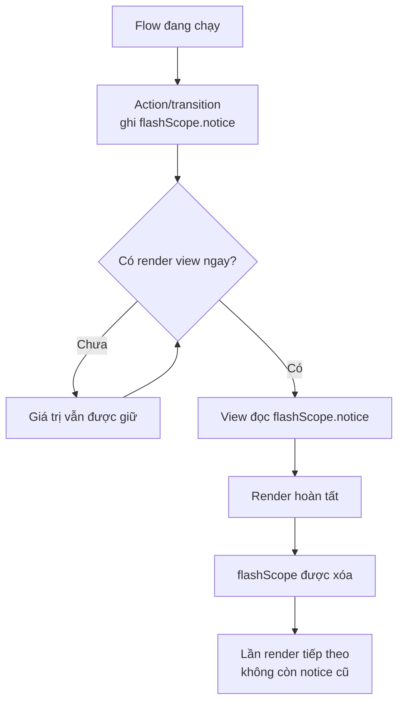
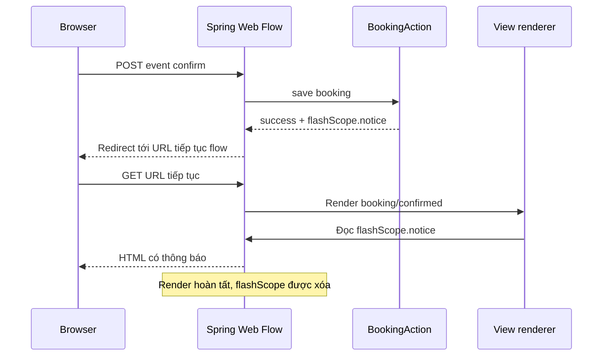

# flashScope và thời điểm dữ liệu được xóa sau render

Trong **Spring Web Flow**, một hành trình web thường đi qua nhiều `view-state`, `action-state`, event và transition. Sau khi người dùng gửi form, flow có thể xử lý nghiệp vụ rồi điều hướng sang một màn hình mới. Có những dữ liệu chỉ cần tồn tại để hiển thị một lần ở màn hình kế tiếp, chẳng hạn thông báo “Đặt chỗ thành công”, mã xác nhận hoặc lời nhắc người dùng kiểm tra email. Nếu lưu các dữ liệu ngắn hạn này trong `flowScope`, chúng có thể tồn tại lâu hơn cần thiết; nếu lưu trong `requestScope`, chúng có thể biến mất trước khi view tiếp theo được render.

`flashScope` được thiết kế cho khoảng thời gian trung gian đó. **Flash scope tồn tại cho đến sau lần render view kế tiếp**, rồi được xóa. Đây là điểm quan trọng nhất của bài học: thời điểm dữ liệu được xóa gắn với **view render**, không đơn giản là “sang request tiếp theo” hay “kết thúc redirect”.

Bài học thuộc chương **Dữ liệu và scope**, tập trung vào vòng đời của `flashScope`, cách truyền thông báo qua chuỗi action và redirect, cách phân biệt nó với `requestScope`, `viewScope`, `flowScope`, `conversationScope` và Spring MVC Flash Attributes, cùng các kiểm thử chứng minh dữ liệu chỉ xuất hiện trong đúng lần render dự kiến.

## 1. flashScope giải quyết tình huống nào?

Giả sử flow đặt phòng có các bước:

1. Người dùng nhập thông tin ở `enterBooking`.
2. Gửi event `confirm`.
3. Action gọi dịch vụ tạo đặt phòng.
4. Flow chuyển tới `bookingConfirmed`.
5. Màn hình xác nhận hiển thị thông báo và mã đặt phòng.

Thông báo thành công là dữ liệu **tạm thời dành cho màn hình sắp được hiển thị**. Nó không cần sống đến khi toàn bộ flow kết thúc, cũng không phải dữ liệu nghiệp vụ cốt lõi để các state sau tiếp tục xử lý.

`flashScope` phù hợp cho:

- Thông báo thành công sau một thao tác.
- Lời nhắc một lần sau redirect.
- Mã hoặc nhãn trạng thái cần hiển thị ngay ở view kế tiếp.
- Thông tin tạm được tạo trong transition/action và cần có mặt trong lần render tiếp theo.

Không nên dùng flash scope để lưu:

- Model đơn hàng, booking hoặc dữ liệu cần dùng ở nhiều state.
- Dữ liệu biểu mẫu cần giữ khi người dùng quay lại chỉnh sửa.
- Danh sách kết quả cần hiển thị qua nhiều lần phân trang.
- Thông tin xác thực, token bí mật hoặc dữ liệu nhạy cảm.
- Cache lớn hoặc đối tượng cần tồn tại xuyên suốt flow.

**Flash scope là vùng nhớ có thời hạn theo lần render.** Khi dữ liệu cần tồn tại lâu hơn, chọn scope khác dựa trên vòng đời nghiệp vụ.

## 2. Quy tắc vòng đời: xóa sau mỗi lần view render

Theo tài liệu Spring Web Flow, flash scope được cấp phát khi flow bắt đầu, **được xóa sau mỗi lần render view**, và bị hủy khi flow kết thúc. Với cách lưu flow execution mặc định, đối tượng đặt trong các scope cần đáp ứng yêu cầu serialization của cơ chế lưu trạng thái; vì vậy nên ưu tiên giá trị nhỏ, đơn giản như chuỗi thông báo hoặc DTO nhỏ có thể serialize.

| Mốc vòng đời | Trạng thái của flash scope |
| --- | --- |
| Flow bắt đầu | Flash scope được cấp phát |
| Một action/transition ghi `flashScope.notice` | Giá trị được lưu để lần render tiếp theo có thể đọc |
| Flow tiếp tục qua action-state nhưng chưa render view | Giá trị vẫn còn |
| View kế tiếp được render | View có thể đọc giá trị trong lúc render |
| Render hoàn tất | Flash scope được xóa |
| Flow kết thúc | Flash scope bị hủy cùng flow |

Điểm cần nhớ: **giá trị không bị xóa ngay khi request kết thúc nếu việc render view vẫn chưa hoàn tất**. Thời gian tồn tại bao gồm request hiện tại và cả redirect cần thiết để hoàn tất việc render view.



Nếu flow thực hiện nhiều action-state liên tiếp mà chưa đi tới view-state, giá trị flash vẫn có thể tồn tại. Khi view được render, dữ liệu được tiêu thụ theo vòng đời này.

## 3. Không đồng nhất flashScope với “request tiếp theo”

Một cách diễn đạt thường gặp là “flash message tồn tại trong request kế tiếp”. Cách nói đó chỉ gần đúng trong một số luồng đơn giản. Trong Spring Web Flow, quy tắc chính xác hơn là **tồn tại cho đến sau khi view được render**.

Ví dụ:

```text
Request A:
  POST event confirm
  → action tạo booking
  → ghi flashScope.notice
  → flow chuyển sang view-state bookingConfirmed
  → Web Flow thực hiện redirect theo cơ chế render mặc định

Request B:
  GET URL tiếp tục execution
  → view bookingConfirmed được render
  → template đọc flashScope.notice
  → render hoàn tất
  → flashScope được xóa

Request C:
  refresh hoặc request tiếp theo
  → không còn notice cũ trong flashScope
```

Ở đây redirect không làm mất thông báo. Dữ liệu vẫn còn trong thời gian Web Flow cần để hoàn thành render view. Sau khi render hoàn tất, dữ liệu bị xóa; refresh sau đó không nên hiển thị lại cùng một flash message.

**Nếu flow chưa render view, đừng kết luận flash scope đã bị xóa chỉ vì đã qua một request.** Ngược lại, nếu view đã render xong, đừng mong flash message tiếp tục tồn tại ở request kế tiếp.

## 4. Ví dụ cơ bản: đặt thông báo trong transition

Flow có thể ghi một thông báo trong transition thành công rồi chuyển tới màn hình xác nhận:

```xml
<action-state id="saveBooking">
    <evaluate expression="bookingAction.save(flowScope.booking)" />

    <transition on="success" to="bookingConfirmed">
        <set name="flashScope.notice"
             value="'Đặt chỗ đã được lưu thành công.'" />
    </transition>

    <transition on="unavailable" to="bookingUnavailable" />
</action-state>

<view-state id="bookingConfirmed"
            view="booking/confirmed" />

<view-state id="bookingUnavailable"
            view="booking/unavailable" />
```

Thứ tự xử lý:

1. `bookingAction.save(...)` trả event `success`.
2. Transition `on="success"` được chọn.
3. Action `<set>` đặt `flashScope.notice`.
4. Flow đi tới `bookingConfirmed`.
5. View `booking/confirmed` đọc thông báo.
6. Sau khi view render hoàn tất, flash scope được xóa.

Nếu action trả `unavailable`, transition thành công không chạy; thông báo thành công không được tạo. Đây là lý do nên đặt flash message ở đúng nhánh kết quả thay vì ghi trước khi biết action có thành công hay không.

### Hiển thị trong JSP

```jsp
<c:if test="${not empty flashScope.notice}">
    <div class="alert alert-success" role="status">
        <c:out value="${flashScope.notice}" />
    </div>
</c:if>
```

Template cần khai báo JSTL core taglib nếu dùng `<c:if>` và `<c:out>`. Với Thymeleaf hoặc công nghệ view khác, cách truy cập model có thể khác; điều quan trọng là view đọc giá trị khi flash scope còn hiệu lực và không tự sao chép nó sang một vùng lưu lâu dài.

## 5. Ghi flash message từ Java action

Khi cần quyết định nội dung thông báo trong Java, action có thể truy cập `RequestContext` và ghi vào flash scope:

```java
package com.example.booking;

import org.springframework.stereotype.Component;
import org.springframework.webflow.execution.Event;
import org.springframework.webflow.execution.RequestContext;
import org.springframework.webflow.action.MultiAction;

@Component("bookingAction")
public class BookingAction extends MultiAction {

    private final BookingService bookingService;

    public BookingAction(BookingService bookingService) {
        this.bookingService = bookingService;
    }

    public Event save(RequestContext context) {
        Booking booking =
            (Booking) context.getFlowScope().get("booking");

        BookingConfirmation confirmation =
            bookingService.save(booking);

        context.getFlowScope().put("confirmation", confirmation);
        context.getFlashScope().put(
            "notice", "Đặt chỗ đã được lưu thành công.");

        return success();
    }
}
```

Ví dụ dùng `MultiAction` để method trả về `Event`. Khi cấu hình expression, có thể gọi action method theo cơ chế Web Flow hỗ trợ:

```xml
<action-state id="saveBooking">
    <evaluate expression="bookingAction.save" />
    <transition on="success" to="bookingConfirmed" />
</action-state>
```

`success()` ở đây là helper của `MultiAction`. Nếu dùng POJO action thông thường, có thể nhận `RequestContext` và trả chuỗi event ID; hãy chọn đúng hợp đồng action theo kiểu implementation thực tế.

Lưu ý trong ví dụ: `confirmation` được đặt trong `flowScope` vì mã xác nhận có thể cần dùng ở nhiều state hoặc trả về như output. `notice` được đặt trong `flashScope` vì chỉ cần hiển thị ở lần render kế tiếp. Không nên đưa cả object booking vào flash scope chỉ để view hiển thị một câu thông báo.

## 6. Thời điểm đặt dữ liệu so với on-render

`on-render` chạy các action trước khi view được render. Điều này hữu ích để nạp dữ liệu phục vụ view:

```xml
<view-state id="bookingConfirmed"
            view="booking/confirmed">
    <on-render>
        <evaluate
            expression="bookingService.loadSummary(flowScope.confirmation.id)"
            result="viewScope.summary" />
    </on-render>
</view-state>
```

Có thể đặt một flash message trong `on-render`, nhưng cần hiểu rằng **mỗi lần render lại view, on-render có thể chạy lại**:

```xml
<view-state id="bookingConfirmed"
            view="booking/confirmed">
    <on-render>
        <set name="flashScope.notice"
             value="'Đặt chỗ đã được lưu thành công.'" />
    </on-render>
</view-state>
```

Ví dụ này sẽ tạo lại thông báo trước mỗi lần view được render. Vì vậy nó không còn mang ý nghĩa “thông báo chỉ phát sinh một lần sau hành động”; refresh hoặc render lại có thể làm thông báo xuất hiện lại. Với thông báo một lần gắn với kết quả action, nên ghi ở transition/action trước khi đi tới view. Dùng `on-render` cho dữ liệu cần chuẩn bị để hiển thị ở mỗi lần render, hoặc chỉ ghi flash khi có một điều kiện rõ ràng bảo đảm không tái tạo ngoài ý muốn.

## 7. So sánh các scope trong Spring Web Flow

Chọn scope dựa trên **thời gian dữ liệu cần tồn tại**, không dựa trên việc biến đó được tạo ở Java hay XML.

| Scope | Bắt đầu | Kết thúc | Dùng cho |
| --- | --- | --- | --- |
| `requestScope` | Khi flow được gọi để xử lý request | Khi lần gọi flow/request đó trả về | Giá trị tạm trong một lượt xử lý |
| `flashScope` | Khi flow bắt đầu | Sau mỗi lần view render; bị hủy khi flow kết thúc | Thông báo hoặc dữ liệu một lần cho view kế tiếp |
| `viewScope` | Khi vào `view-state` | Khi rời `view-state` | Model riêng của một màn hình, có thể qua nhiều request trong cùng state |
| `flowScope` | Khi flow bắt đầu | Khi flow kết thúc | Dữ liệu nghiệp vụ cần dùng qua nhiều state trong flow |
| `conversationScope` | Khi top-level flow bắt đầu | Khi top-level flow kết thúc | Dữ liệu chia sẻ giữa top-level flow và các subflow |

Ví dụ lựa chọn:

- `requestScope.searchTerm`: chỉ cần trong lần xử lý request hiện tại.
- `flashScope.notice`: hiển thị một lần sau thao tác.
- `viewScope.page`: trang hiện tại của danh sách trong một màn hình có Ajax phân trang.
- `flowScope.booking`: booking được dùng từ lúc nhập đến khi xác nhận.
- `conversationScope.currentCustomer`: dữ liệu dùng chung giữa flow cha và subflow trong cùng conversation, nếu thực sự cần chia sẻ.

### Flash scope không thay thế view scope

Một bảng kết quả có thể được người dùng sắp xếp hoặc chuyển trang qua nhiều request nhưng vẫn ở cùng `view-state`. Dữ liệu phục vụ bảng nên đặt trong `viewScope`; nếu đặt trong `flashScope`, nó có thể bị xóa ngay sau lần render đầu tiên và không còn cho lần cập nhật tiếp theo.

Ngược lại, một thông báo “Đã lưu” không cần sống suốt thời gian người dùng ở màn hình xác nhận. Đặt nó trong `viewScope` sẽ khiến thời hạn tồn tại phụ thuộc lúc state thoát, có thể dài hơn mong muốn.

## 8. Flash scope và POST-REDIRECT-GET

Spring Web Flow thường thực hiện client-side redirect khi đi vào view-state để hỗ trợ mô hình **POST-REDIRECT-GET (PRG)**. Sau khi xử lý form POST, trình duyệt được chuyển tới URL tiếp tục flow và view được render bằng request GET. Flash scope giữ dữ liệu đủ lâu để thông báo được hiển thị trong quá trình này.



Không cần tự chuyển `flashScope.notice` sang `flowScope` chỉ để vượt qua redirect. Vòng đời flash scope đã bao gồm khoảng thời gian cần thiết để hoàn thành render. Nếu thông báo vẫn mất, hãy kiểm tra xem giá trị được ghi trước hay sau điểm render, request có thực sự tiếp tục cùng execution và view có đọc đúng model không.

## 9. Phân biệt Web Flow flashScope với Spring MVC Flash Attributes

Hai cơ chế có tên gần giống nhau nhưng thuộc hai lớp khác nhau:

| Đặc điểm | Spring Web Flow `flashScope` | Spring MVC Flash Attributes |
| --- | --- | --- |
| Chủ sở hữu | Flow execution | Cơ chế redirect của Spring MVC |
| Cách ghi | `flashScope.notice`, `RequestContext.getFlashScope()` | `RedirectAttributes.addFlashAttribute(...)` hoặc `FlashMap` |
| Vòng đời | Tới sau lần view render kế tiếp của flow | Được chuyển qua redirect và tiêu thụ ở request đích phù hợp |
| Mục đích | Dữ liệu tạm giữa các bước/render trong flow | Truyền dữ liệu qua redirect MVC |
| Phạm vi | Gắn với flow đang chạy | Gắn với request/redirect của MVC |

Không nên gọi `RedirectAttributes` rồi cho rằng nó chính là `flashScope` của Web Flow. Tương tự, việc đặt dữ liệu trong flash scope của flow không có nghĩa controller MVC bên ngoài flow tự động nhìn thấy nó.

### Flow output sang MVC Flash Scope

Spring Web Flow có tùy chọn riêng trên `FlowHandlerAdapter` để lưu output của flow vào MVC flash scope khi end-state thực hiện internal redirect. Tính năng này **tắt mặc định** để giữ tương thích ngược; nếu cần, cấu hình:

```xml
<bean class="org.springframework.webflow.mvc.servlet.FlowHandlerAdapter">
    <property name="flowExecutor" ref="flowExecutor" />
    <property name="saveOutputToFlashScopeOnRedirect" value="true" />
</bean>
```

Ví dụ end-state trả output:

```xml
<end-state id="finish" view="externalRedirect:summary">
    <output name="confirmationNumber"
            value="booking.confirmationNumber" />
</end-state>
```

Đây là **cầu nối từ flow output sang MVC flash scope**, không phải thay đổi quy tắc xóa của `flashScope` nội bộ Web Flow. Chỉ bật khi có nhu cầu chuyển output sang một màn hình MVC đích; nếu màn hình tiếp theo vẫn là view-state trong flow, dùng flow scope/flash scope đúng mục đích.

## 10. Dữ liệu trong flashScope cần nhỏ và an toàn

Với cơ chế lưu flow execution mặc định, các object đặt trong flash scope cần đáp ứng khả năng serialization. Thực hành tốt:

- Lưu chuỗi thông báo, mã kết quả hoặc một DTO nhỏ.
- Tránh đặt Hibernate entity còn proxy lazy, stream, file handle, servlet request/response hoặc đối tượng không serialize được.
- Không lưu toàn bộ danh sách kết quả lớn chỉ để hiển thị một lần.
- Không lưu password, access token, số thẻ hoặc dữ liệu bí mật trong scope được đưa ra view.
- Escape/encode nội dung khi hiển thị; flash scope không tự bảo vệ chống XSS.
- Không tin dữ liệu trong flash scope như bằng chứng phân quyền. Kiểm tra quyền tại service theo người dùng hiện tại.

Ví dụ tốt:

```xml
<set name="flashScope.notice"
     value="'Mã xác nhận: ' + flowScope.confirmation.number" />
```

Ví dụ không phù hợp:

```xml
<!-- Không nên lưu toàn bộ entity graph hoặc dữ liệu nhạy cảm -->
<set name="flashScope.booking"
     value="flowScope.booking" />
```

Nếu view cần thông tin booking, hãy lấy từ `flowScope` hoặc một model view phù hợp; flash scope chỉ nên chứa phần thông báo cần hiển thị một lần.

## 11. Nhiều view-state liên tiếp và điểm tiêu thụ dữ liệu

Flash scope được xóa sau **mỗi lần render**, không phải chỉ sau khi flow kết thúc. Vì vậy cần theo dõi chuỗi state:

```text
action-state save
  → set flashScope.notice
  → view-state confirmation
  → render confirmation: notice có mặt
  → render hoàn tất: notice bị xóa
  → view-state nextStep
  → render nextStep: notice không còn
```

Nếu flow đi qua một action-state trung gian trước khi render:

```text
action-state save
  → set flashScope.notice
  → action-state calculateSummary
  → view-state confirmation
  → render confirmation: notice có mặt
  → clear
```

Thông báo vẫn còn vì chưa có view render nào tiêu thụ nó.

Nếu flow render một view trung gian trước màn hình mong muốn:

```text
action-state save
  → set flashScope.notice
  → view-state intermediate
  → render intermediate: notice được tiêu thụ và xóa
  → view-state confirmation
  → render confirmation: notice không còn
```

Khi thiết kế, hãy đặt thao tác ghi flash gần nhất có thể với **view thực sự cần hiển thị**. Nếu cần mang thông tin qua nhiều view-state, hãy chuyển sang `flowScope` hoặc output mapping thay vì cố giữ flash sau render.

## 12. Ajax, render lại và thông báo một lần

Một `view-state` có thể được render nhiều lần, ví dụ khi phân trang, sắp xếp hoặc cập nhật fragment. `on-render` cũng chạy trước các lần render tương ứng. Vì flash scope được xóa sau render, cần kiểm thử hành vi trong đúng chế độ view/Ajax mà ứng dụng dùng.

Các quy tắc thiết kế:

1. Không đặt model phân trang trong flash scope.
2. Không kỳ vọng một flash message còn tồn tại sau khi view đã render xong.
3. Nếu một transition chỉ cập nhật fragment và render lại cùng view, hãy xác nhận thời điểm clear trong integration test với view technology và chế độ Ajax thực tế.
4. Nếu cần hiển thị thông báo trong nhiều lần cập nhật fragment, dùng message/state riêng có quy tắc xóa rõ ràng hoặc để client xử lý thông báo theo response.
5. Tránh đặt lệnh ghi flash vô điều kiện trong `on-render`, vì mỗi lần render có thể tạo lại thông báo.

Đối với validation form, dùng `messageContext`/cơ chế lỗi của Web Flow thay vì flash scope. Lỗi field cần gắn với form và có thể được render lại khi người dùng sửa; flash message có vòng đời một lần sau render nên không phù hợp để giữ lỗi nhập liệu qua nhiều lần submit.

## 13. Kiểm thử thời điểm clear

Unit test cho một action chỉ chứng minh action có gọi `put("notice", ...)`; nó chưa chứng minh view nhìn thấy thông báo hoặc dữ liệu được xóa đúng lúc. Nên kiểm thử bằng flow execution test và một số integration test MVC.

### Ma trận kiểm thử vòng đời

| Kịch bản | Kết quả cần xác nhận |
| --- | --- |
| Action ghi `flashScope.notice`, sau đó đi vào view-state | View kế tiếp đọc được thông báo |
| Action ghi flash rồi đi qua action-state khác, chưa render | Giá trị vẫn còn |
| View render hoàn tất | Giá trị bị xóa |
| Flow render view thứ hai | Không còn thông báo của lần trước |
| Flow kết thúc trước khi có view render | Flash scope bị hủy cùng flow |
| `on-render` ghi flash | View hiện tại đọc được; sau render giá trị bị xóa |
| `on-render` chạy lại do refresh/render lại | Có thể tạo lại message nếu action ghi vô điều kiện |
| Người dùng gửi form sai và view render lại | Lỗi validation nên đến từ message context, không dựa vào flash |
| POST thành công rồi PRG redirect | Flash tồn tại tới khi view đích render |
| Dùng MVC `RedirectAttributes` | Kiểm tra riêng MVC FlashMap, không nhầm với flow flash scope |
| Flow có subflow | Không giả định flash scope của cha/con là cùng một vùng; dùng input/output rõ ràng |

### Kiểm thử theo Given–When–Then

```text
Given:
  flow booking đang ở reviewBooking
  bookingAction.save trả success

When:
  gửi event confirm
  transition ghi flashScope.notice
  flow chuyển tới bookingConfirmed
  view bookingConfirmed được render

Then:
  nội dung render có "Đặt chỗ đã được lưu thành công."
  sau khi render hoàn tất, flashScope không còn notice

When:
  tiếp tục request và render view kế tiếp

Then:
  thông báo cũ không xuất hiện lại
```

Một test riêng nên cho flow đi qua action-state mà chưa render để chứng minh flash vẫn tồn tại trong khoảng đó. Test này phân biệt chính xác quy tắc “clear sau render” với giả định sai “clear cuối request”.

### Kiểm thử HTTP qua Spring MVC

Với MockMvc hoặc servlet container:

1. GET URL khởi động flow, giữ session/cookie và execution URL.
2. POST event xác nhận bằng URL tiếp tục hiện hành.
3. Kiểm tra redirect/response theo cấu hình Web Flow.
4. GET URL đích và kiểm tra HTML có thông báo.
5. Gửi refresh hoặc request tiếp theo và kiểm tra thông báo không còn.

MockMvc có thể kiểm tra mapping, redirect và response của MVC; nếu cần xác minh HTML được render bởi JSP engine thật, hãy chạy thêm test với servlet container phù hợp.

## 14. Các lỗi thường gặp và cách xử lý

| Triệu chứng | Nguyên nhân có thể | Hướng kiểm tra |
| --- | --- | --- |
| View kế tiếp không thấy message | Ghi flash sau khi render đã bắt đầu hoặc ghi vào sai scope | Kiểm tra action/transition thực thi trước view render và tên scope |
| Message mất sau một action-state | Có một view render trung gian đã tiêu thụ flash | Lần theo các state có render giữa điểm ghi và view đích |
| Message biến mất sau redirect | Request tiếp tục không cùng execution/session hoặc flow render đã hoàn tất ở nơi khác | Kiểm tra execution URL, session và thứ tự redirect/render |
| Message xuất hiện lại sau refresh | `on-render` ghi lại flash mỗi lần render hoặc message được lưu thêm ở scope khác | Bỏ thao tác ghi vô điều kiện, kiểm tra flow/view model |
| Message vẫn tồn tại qua nhiều màn hình | Đã sao chép sang flow/view/conversation scope hoặc view chưa render | Tìm nơi ghi dữ liệu và xác định lần render thực tế |
| Dữ liệu phân trang mất sau render đầu | Đặt model dài hạn trong flash scope | Chuyển sang viewScope |
| Lỗi validation mất khi render lại | Dùng flash thay cho message context | Gắn lỗi vào binding/validation context |
| MVC controller không đọc được flash của flow | Nhầm flow flash scope với MVC FlashMap | Dùng flow output và cấu hình adapter nếu cần truyền qua redirect MVC |
| Lỗi serialization khi lưu execution | Đặt object không serialize được trong flash scope | Dùng chuỗi/DTO nhỏ, kiểm tra đối tượng trong scope |
| Thông báo bị lặp | Ghi lại ở `on-render` hoặc cả action lẫn controller | Chọn một nơi chịu trách nhiệm tạo message |

## 15. Bài thực hành: thông báo xác nhận chỉ xuất hiện một lần

Tạo flow `booking` với các state `enterDetails`, `reviewBooking`, `saveBooking`, `bookingConfirmed` và `nextStep`.

Yêu cầu:

1. Người dùng nhập thông tin và gửi event `confirm`.
2. Action `bookingAction.save` lưu booking và trả event `success`.
3. Transition thành công ghi `flashScope.notice` với thông báo tiếng Việt.
4. Flow chuyển tới `bookingConfirmed`; view đọc và hiển thị thông báo.
5. Sau render hoàn tất, xác nhận flash scope đã được xóa.
6. Chuyển sang `nextStep`, render lần nữa và xác nhận thông báo cũ không xuất hiện.
7. Thêm một action-state trung gian trước `bookingConfirmed` nhưng không render; xác nhận flash vẫn còn tới view đích.
8. Thử ghi message trong `on-render`, refresh view và quan sát message được tạo lại; sau đó bỏ ghi vô điều kiện.
9. Tạo một test form validation thất bại và dùng message context để hiển thị lỗi field.
10. Nếu flow kết thúc rồi redirect sang MVC summary controller, thử output mapping cùng `saveOutputToFlashScopeOnRedirect`; xác nhận đây là cơ chế MVC flash attributes riêng.

Tiêu chí hoàn thành: thông báo được tạo đúng nhánh thành công, hiển thị ở đúng lần render đầu tiên sau khi được ghi, bị xóa sau render và không làm mất dữ liệu nghiệp vụ cần giữ ở `flowScope`.

## 16. Tài liệu tham khảo

- [Spring Web Flow 2.5.1 Reference Guide — Variable Scopes](https://docs.spring.io/spring-webflow/docs/2.5.1.RELEASE/reference/htmlsingle/): vòng đời `flashScope`, các scope còn lại và yêu cầu serialization.
- [Spring Web Flow 2.5.x Reference Guide — Defining Flows](https://docs.spring.io/spring-webflow/docs/2.5.x/reference/html/defining-flows.html): mô hình flow, state, transition, action và variable scopes.
- [Spring Web Flow 2.5.x API — ScopeType](https://docs.spring.io/spring-webflow/docs/2.5.x/api/org/springframework/webflow/execution/ScopeType.html): mô tả thời gian tồn tại của các scope; flash tồn tại tới sau lần view rendering kế tiếp.
- [Spring Web Flow 2.5.1 Reference Guide — Saving Flow Output to MVC Flash Scope](https://docs.spring.io/spring-webflow/docs/2.5.1.RELEASE/reference/htmlsingle/): tùy chọn chuyển flow output sang MVC flash scope khi end-state redirect.

`flashScope` là nơi giữ dữ liệu ngắn hạn cho **lần view render kế tiếp** trong một flow. Giá trị có thể đi qua redirect và các action-state chưa render, nhưng sẽ bị xóa sau khi view render hoàn tất. Khi phân biệt đúng vòng đời đó với request, view, flow, conversation scope và MVC Flash Attributes, thông báo một lần sẽ xuất hiện đúng thời điểm mà không làm dữ liệu nghiệp vụ bị mất hoặc tồn tại quá lâu.
