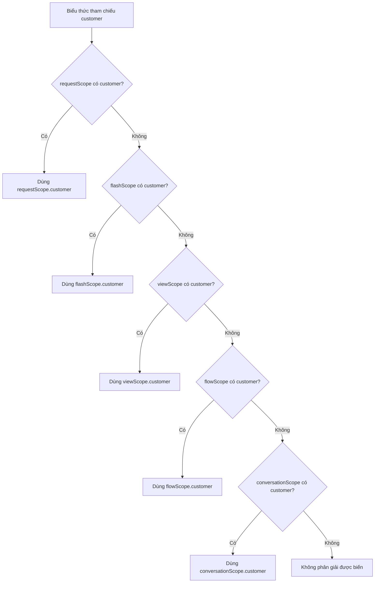

# Thứ tự tìm biến khi không ghi rõ scope

Trong chương **Dữ liệu và scope**, bài này giải thích cách Spring Web Flow tìm một biến khi biểu thức tham chiếu tên biến mà không ghi tiền tố scope. Quy tắc này quan trọng khi một flow có dữ liệu ở nhiều vòng đời khác nhau: request, flash, view, flow và conversation. Module **SPRING_WEB_FLOW** sử dụng state, event, transition và subflow để điều khiển hành trình nhiều bước; hiểu đúng thứ tự tra cứu giúp biểu thức luôn lấy đúng dữ liệu trong suốt hành trình đó.

## 1. Vì sao một tên biến có thể chỉ đến nhiều đối tượng?

Một flow có thể đồng thời giữ nhiều đối tượng cùng tên trong các scope khác nhau. Ví dụ, `customer` có thể là dữ liệu tạm của request hiện tại, dữ liệu được chuyển qua redirect, dữ liệu riêng của màn hình, khách hàng đang làm việc trong flow hoặc khách hàng được chia sẻ với subflow.

Khi viết biểu thức `customer.name`, người đọc không nhìn thấy scope chứa biến. Nếu nhiều scope đều có biến `customer`, kết quả phụ thuộc vào thứ tự tìm kiếm của Spring Web Flow. Một biến ở scope có độ ưu tiên cao hơn có thể che khuất biến cùng tên ở scope thấp hơn.

Để tránh nhầm lẫn, cần nắm hai điều: thứ tự tra cứu khi bỏ qua scope và cách viết scope tường minh khi ý nghĩa nghiệp vụ phụ thuộc vào đúng vòng đời dữ liệu.

## 2. Thứ tự tra cứu biến không ghi scope

Trong biểu thức được Spring Web Flow đánh giá, khi tham chiếu một tên biến không có tiền tố scope, Web Flow tìm lần lượt theo thứ tự sau:

1. `requestScope`
2. `flashScope`
3. `viewScope`
4. `flowScope`
5. `conversationScope`

**Scope đầu tiên có chứa tên biến sẽ được dùng.** Nếu một scope không có biến đó, Web Flow tiếp tục tìm ở scope kế tiếp. Nếu không tìm thấy trong các scope trên, biểu thức không thể phân giải biến và thường phát sinh lỗi đánh giá biểu thức.

Có thể hình dung thứ tự tra cứu như sau:



Đây là quy tắc phân giải tên biến trong biểu thức của Web Flow. Không nên suy rộng nó thành quy tắc chung cho Java, Spring bean injection, mọi template engine hoặc mọi ngôn ngữ EL khác. Một template Thymeleaf/JSP có thể có cơ chế truy cập model riêng; hãy truyền dữ liệu cần hiển thị qua model và dùng đúng cú pháp của template.

## 3. Ví dụ khi nhiều scope cùng có một tên

Giả sử trong cùng một flow đang có các giá trị sau:

| Scope | Biến `customer` chứa |
|---|---|
| `requestScope` | Đối tượng khách hàng tạm lấy từ request hiện tại |
| `flashScope` | Khách hàng vừa được chuyển qua redirect |
| `viewScope` | Bản nháp khách hàng đang hiển thị |
| `flowScope` | Khách hàng của hồ sơ đang xử lý |
| `conversationScope` | Khách hàng chung được flow cha và subflow sử dụng |

Khi biểu thức viết `customer.name`, Web Flow lấy `requestScope.customer.name`, vì `requestScope` được tìm đầu tiên. Các giá trị còn lại không được chọn trong lần phân giải đó. Nếu request scope không có `customer`, Web Flow kiểm tra flash scope; sau đó lần lượt view, flow và conversation.

Ví dụ trong flow XML:

```xml
<view-state id="editCustomer" view="customer/edit">
    <on-render>
        <evaluate expression="customer.name"
                  result="viewScope.displayName"/>
    </on-render>
</view-state>
```

Biểu thức `customer.name` phụ thuộc vào scope nào đang có `customer` ở thời điểm render. Nếu mục tiêu là tên khách hàng của hồ sơ đang được xử lý, biểu thức nên viết rõ:

```xml
<evaluate expression="flowScope.customer.name"
          result="viewScope.displayName"/>
```

Khi đã ghi `flowScope.customer`, Web Flow không cần dò request, flash hay view để chọn đối tượng `customer`. Cách viết này làm rõ ý nghĩa dữ liệu và tránh việc một biến tạm vô tình che khuất đối tượng nghiệp vụ.

## 4. Phân biệt tra cứu biến và nơi lưu kết quả

Thứ tự trên nói về việc **đọc một tên biến không ghi scope**. Khi lưu kết quả của action hoặc tạo dữ liệu cần tồn tại ở một vòng đời xác định, hãy chỉ rõ scope đích.

Ví dụ:

```xml
<evaluate expression="customerQuery.findById(flowScope.customerId)"
          result="flowScope.customer"/>

<evaluate expression="slotQuery.findAvailable(flowScope.bookingDate)"
          result="viewScope.availableSlots"/>
```

Ở ví dụ đầu, kết quả khách hàng được lưu vào `flowScope.customer` vì nhiều state trong cùng flow cần dùng. Ở ví dụ sau, danh sách giờ chỉ phục vụ màn hình hiện tại nên được lưu trong `viewScope.availableSlots`.

Không nên dựa vào tên biến không có scope để suy ra nơi kết quả sẽ được lưu. Dùng scope tường minh trong thuộc tính `result` giúp người đọc thấy rõ dữ liệu được giữ trong bao lâu và ai có thể sử dụng.

## 5. Phạm vi và vòng đời của từng scope

| Scope | Vòng đời khái quát | Ví dụ sử dụng |
|---|---|---|
| `requestScope` | Trong request hiện tại | Dữ liệu tạm chỉ phục vụ một lần xử lý request. |
| `flashScope` | Dữ liệu tạm được giữ để chuyển qua redirect hoặc lần hiển thị kế tiếp | Thông báo hoàn tất hoặc thông tin cần chuyển sau redirect. |
| `viewScope` | Trong vòng đời của một view-state, bao gồm các lần postback/render lại state đó | Danh sách lựa chọn và dữ liệu phụ trợ của màn hình. |
| `flowScope` | Trong toàn bộ flow execution | Form nghiệp vụ và dữ liệu cần dùng qua nhiều state. |
| `conversationScope` | Trong conversation của flow và các subflow liên quan | Ngữ cảnh được chia sẻ giữa flow cha và flow con. |

Scope tồn tại càng ngắn thì dữ liệu càng ít có khả năng ảnh hưởng đến bước khác. Ngược lại, dữ liệu trong flow hoặc conversation scope có thể sống lâu hơn và được nhiều state truy cập. Vì vậy, chỉ đặt dữ liệu vào scope dài khi nghiệp vụ thực sự cần.

Không nhầm `requestScope` của Web Flow với toàn bộ HTTP request API. Khi cần đọc tham số HTTP, header hoặc session thông qua hạ tầng servlet, sử dụng API phù hợp từ `externalContext`. `requestScope` là vùng dữ liệu của Web Flow dùng trong biểu thức và có vòng đời riêng.

## 6. Khi nào nên dùng tên biến không ghi scope?

Bỏ tiền tố scope có thể tiện trong biểu thức ngắn, đặc biệt khi tên biến chỉ tồn tại ở một scope hoặc khi scope không ảnh hưởng đến ý nghĩa nghiệp vụ. Tuy nhiên, trong flow nhiều bước, dữ liệu thường được giữ ở nhiều vòng đời nên việc bỏ scope dễ tạo phụ thuộc ngầm.

Có thể dùng tên không ghi scope khi tất cả điều kiện sau đều đúng:

- Tên biến chỉ xuất hiện trong một scope tại thời điểm biểu thức được đánh giá.
- Vòng đời dữ liệu đã rõ từ ngữ cảnh gần đó.
- Việc thêm một biến cùng tên vào scope ưu tiên cao hơn không làm thay đổi kết quả nghiệp vụ.

Với dữ liệu quan trọng như khách hàng, đơn đặt chỗ, quyền, giá, trạng thái thanh toán hoặc kết quả xác nhận, nên ghi rõ scope. Một biểu thức tường minh có thể dài hơn một chút nhưng giúp tránh lỗi khó phát hiện khi flow được mở rộng.

## 7. Ví dụ trong flow đặt chỗ nhiều bước

Giả sử flow đặt chỗ có form `booking` trong flow scope. Màn hình chọn giờ có danh sách `availableSlots` trong view scope. Khi người dùng xác nhận, service phải thao tác trên form đặt chỗ của flow, không phải một biến cùng tên được đưa vào request.

```xml
<flow xmlns="http://www.springframework.org/schema/webflow">
    <var name="booking"
         class="com.example.booking.BookingForm"/>

    <view-state id="chooseSlot"
                view="booking/choose-slot"
                model="flowScope.booking">
        <on-render>
            <evaluate expression="slotQueryService.findAvailable(flowScope.booking.date)"
                      result="viewScope.availableSlots"/>
        </on-render>

        <transition on="continue" to="review">
            <evaluate expression="bookingValidator.validate(flowScope.booking, messageContext)"/>
        </transition>
    </view-state>

    <view-state id="review" view="booking/review">
        <transition on="back" to="chooseSlot"/>
        <transition on="confirm" to="completed">
            <evaluate expression="bookingCommandService.confirm(flowScope.booking)"/>
        </transition>
    </view-state>

    <end-state id="completed" view="booking/confirmation"/>
</flow>
```

Trong ví dụ, `booking` được khai báo bằng `<var>` nên là dữ liệu của flow. Biểu thức dùng `flowScope.booking` để xác định rõ form cần xác nhận. `availableSlots` là dữ liệu hiển thị riêng của view nên nằm trong `viewScope`. Nếu một request vô tình có biến tên `booking`, việc tham chiếu tường minh vẫn trỏ tới form trong flow scope.

Đoạn XML minh họa cách viết scope trong biểu thức; tên bean, lớp form, validator, service và view phải được thay bằng thành phần thực tế của ứng dụng.

## 8. Tên biến trùng nhau có thể gây lỗi gì?

Khi nhiều scope dùng cùng tên, lỗi thường không xuất hiện ngay. Flow có thể chạy bình thường cho đến khi một request, redirect hoặc subflow đưa thêm biến cùng tên vào scope ưu tiên cao hơn. Khi đó, cùng một biểu thức `customer` có thể trả về đối tượng khác với trước.

| Tình huống | Rủi ro |
|---|---|
| Request thêm `booking` cùng tên với `flowScope.booking` | Biểu thức `booking` có thể đọc nhầm dữ liệu request. |
| Flash scope có `message` cùng tên với dữ liệu màn hình | Biểu thức không ghi scope có thể lấy thông báo chuyển tiếp thay vì dữ liệu dự kiến. |
| View scope và flow scope cùng có `selectedPlan` | Render có thể lấy lựa chọn tạm của view thay vì lựa chọn nghiệp vụ được giữ trong flow. |
| Subflow và flow cha cùng sử dụng tên chung trong conversation | Người đọc khó nhận ra dữ liệu đang được chia sẻ ở vòng đời nào. |
| Refactor thêm một biến tạm vào request scope | Các biểu thức không ghi scope trước đó có thể đổi kết quả mà không cần sửa chính biểu thức. |

Đặc biệt, không dùng tra cứu không ghi scope cho quyết định phân quyền, xác định chủ sở hữu tài nguyên hoặc tính tiền. Hãy lấy đối tượng có thẩm quyền từ đúng scope hoặc tải lại từ service dựa trên định danh đã xác thực, rồi kiểm tra quyền ở tầng nghiệp vụ.

## 9. Quy ước đặt tên và tổ chức dữ liệu

Ngoài việc ghi rõ scope, có thể giảm va chạm bằng cách chọn tên thể hiện vai trò:

| Tên gợi ý | Ý nghĩa | Scope thường phù hợp |
|---|---|---|
| `bookingForm` | Dữ liệu form của hành trình đặt chỗ | `flowScope` |
| `availableSlotOptions` | Các lựa chọn giờ để hiển thị | `viewScope` |
| `confirmationNotice` | Thông báo chuyển tiếp sau thao tác | `flashScope` |
| `currentStepInput` | Dữ liệu tạm chỉ dùng trong request | `requestScope` |
| `sharedCustomerContext` | Ngữ cảnh khách hàng chia sẻ với subflow | `conversationScope` |

Không cần thêm tiền tố tên scope vào mọi biến nếu tên đã rõ nghĩa, nhưng biểu thức truy cập dữ liệu quan trọng vẫn nên ghi scope. Tên biến thể hiện nội dung; tiền tố scope thể hiện vòng đời và nơi lưu.

## 10. Kiểm thử thứ tự tra cứu

Có thể kiểm tra quy tắc bằng một flow thử nghiệm có cùng tên biến ở nhiều scope. Gán mỗi biến một giá trị dễ nhận biết, sau đó đánh giá một biểu thức không ghi scope và các biểu thức có scope tường minh.

Ví dụ dữ liệu kiểm thử:

```text
requestScope.label       = "request"
flashScope.label         = "flash"
viewScope.label          = "view"
flowScope.label          = "flow"
conversationScope.label  = "conversation"
```

Kết quả mong đợi:

| Biểu thức | Kết quả mong đợi |
|---|---|
| `label` | `request` |
| `requestScope.label` | `request` |
| `flashScope.label` | `flash` |
| `viewScope.label` | `view` |
| `flowScope.label` | `flow` |
| `conversationScope.label` | `conversation` |

Sau đó bỏ `requestScope.label` và đánh giá lại `label`; kết quả phải là `flash`. Tiếp tục bỏ lần lượt biến ở scope đang đứng đầu để xác nhận thứ tự tìm kiếm. Cũng nên kiểm tra trường hợp không có biến ở bất kỳ scope nào để xác nhận ứng dụng xử lý lỗi phân giải rõ ràng.

Khi kiểm thử flow thực tế, bổ sung các tình huống:

1. Mở flow mới và xác nhận biến được khởi tạo ở đúng scope.
2. Render lại cùng view-state và xác nhận biến ở view scope vẫn có vòng đời như dự kiến.
3. Gửi event làm chuyển state và xác nhận dữ liệu flow scope vẫn tồn tại.
4. Đi qua redirect có flash data và xác nhận dữ liệu chỉ được dùng trong khoảng thời gian dự kiến.
5. Gọi subflow và xác nhận dữ liệu conversation scope được chia sẻ đúng.
6. Tạo biến trùng tên ở scope ưu tiên cao hơn và xác nhận biểu thức không ghi scope bị che khuất như quy tắc.

## 11. Cách xử lý khi biểu thức lấy nhầm biến

Khi giá trị trong view hoặc transition không đúng, kiểm tra theo trình tự sau:

1. Tìm tất cả nơi biến cùng tên được tạo hoặc ghi vào các scope.
2. Xác định scope nào đang chứa biến ở thời điểm biểu thức chạy.
3. Đối chiếu với thứ tự request, flash, view, flow, conversation.
4. Viết lại biểu thức với scope tường minh nếu nghiệp vụ yêu cầu một đối tượng cụ thể.
5. Kiểm tra nơi ghi kết quả (`result`) để bảo đảm dữ liệu được lưu vào đúng scope.
6. Kiểm thử lại các đường đi có redirect, quay lại state, subflow và request lặp.

Không sửa lỗi bằng cách xóa tùy tiện biến ở scope khác nếu biến đó còn phục vụ một phần khác của flow. Trước hết hãy xác định vòng đời của từng dữ liệu, sau đó đổi tên hoặc ghi rõ scope tại điểm truy cập.

## 12. Checklist khi viết biểu thức

- [ ] Biết rõ biến được tạo trong scope nào và cần sống qua những state nào.
- [ ] Hiểu thứ tự tra cứu không ghi scope: request, flash, view, flow, conversation.
- [ ] Không có biến cùng tên ở scope ưu tiên cao hơn ngoài dự kiến.
- [ ] Dùng scope tường minh cho dữ liệu nghiệp vụ, quyền, giá và trạng thái giao dịch.
- [ ] Chỉ rõ scope đích trong thuộc tính `result` khi lưu kết quả action.
- [ ] Không nhầm scope của Web Flow với HTTP request/session hoặc cơ chế EL của template engine.
- [ ] Kiểm thử trường hợp biến trùng tên, biến không tồn tại, redirect và subflow.
- [ ] Xử lý lỗi phân giải biến với thông báo và log đủ để chẩn đoán.

## 13. Kết luận

Khi một biểu thức Web Flow tham chiếu biến mà không ghi scope, Web Flow tìm theo thứ tự `requestScope`, `flashScope`, `viewScope`, `flowScope` rồi `conversationScope`; scope đầu tiên có biến sẽ quyết định kết quả. Quy tắc này tiện cho trường hợp tên biến không mơ hồ, nhưng có thể tạo shadowing khi nhiều scope chứa cùng tên. Với dữ liệu quan trọng, hãy dùng scope tường minh khi đọc và ghi, chọn scope theo vòng đời thực tế, rồi kiểm thử cả trường hợp trùng tên để flow nhiều bước hoạt động dễ dự đoán.
