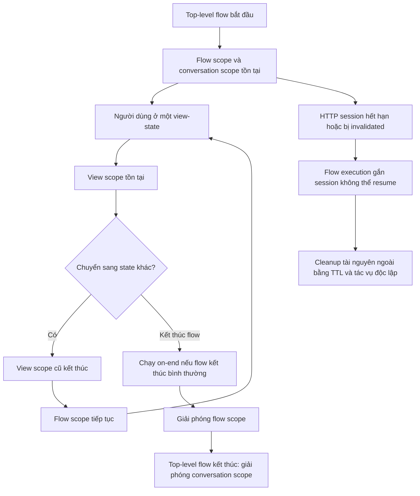

# Dọn dữ liệu khi chuyển bước, kết thúc hoặc hết phiên

Trong chương **Dữ liệu và scope**, việc chọn đúng scope giúp dữ liệu tồn tại đúng khoảng thời gian của một hành trình web. Với **SPRING_WEB_FLOW**, dữ liệu có thể thuộc request, flash, view, flow hoặc conversation scope. Mỗi scope có vòng đời riêng. Khi người dùng chuyển bước, kết thúc flow hoặc phiên HTTP hết hạn, dữ liệu và tài nguyên tạm cần được giải phóng đúng lúc để tránh giữ thông tin quá lâu, chiếm bộ nhớ hoặc để lại trạng thái nghiệp vụ dang dở.

Bài học dùng quy trình đặt chỗ làm ví dụ. Trong lúc nhập thông tin, flow có thể giữ bản nháp, kết quả tìm kiếm và mã giữ chỗ tạm thời. Ta sẽ xác định dữ liệu nào tự hết hạn theo scope, dữ liệu nào cần xóa chủ động và tài nguyên nào phải được dọn ngay cả khi phiên bị mất đột ngột.

## 1. Vòng đời của các scope

Spring Web Flow cung cấp nhiều scope để lưu dữ liệu trong những khoảng thời gian khác nhau:

| Scope | Vòng đời | Ví dụ phù hợp |
|---|---|---|
| `requestScope` | Trong một HTTP request hiện tại. | Giá trị chỉ dùng khi xử lý một request, chẳng hạn thông tin phục vụ một action. |
| `flashScope` | Dữ liệu ngắn hạn đi qua thời điểm flow tạm dừng và được xóa khi flow được resume. | Thông báo một lần cần hiển thị ở view kế tiếp. |
| `viewScope` | Trong thời gian flow ở cùng một `view-state`; bị hủy khi rời view state. | Trạng thái giao diện tạm thời của một màn hình, như tab đang chọn. |
| `flowScope` | Trong suốt một flow execution; được giải phóng khi flow kết thúc. | Bản nháp đặt chỗ hoặc dữ liệu cần dùng qua nhiều bước của cùng flow. |
| `conversationScope` | Trong suốt conversation bắt đầu từ top-level flow, bao gồm các subflow; được giải phóng khi flow gốc kết thúc. | Dữ liệu thật sự cần chia sẻ giữa flow cha và các subflow. |

Hãy chọn scope có vòng đời ngắn nhất vẫn đáp ứng được nhu cầu. Ví dụ, kết quả tìm kiếm chỉ dùng ở màn hình hiện tại có thể đặt trong `viewScope`; bản nháp cần đi qua nhiều màn hình có thể đặt trong `flowScope`. Không nên đưa mọi dữ liệu vào `conversationScope` hoặc lưu tất cả trong HTTP session vì chúng có thể tồn tại lâu hơn mức cần thiết.

Lưu ý rằng `requestScope`, `flashScope`, `viewScope`, `flowScope` và `conversationScope` là các scope do Web Flow quản lý. Vòng đời của chúng khác với vòng đời của một bean có Spring session scope hoặc của chính `HttpSession`.

## 2. Dữ liệu tự được giải phóng khi chuyển bước

Không phải dữ liệu nào cũng cần gọi lệnh xóa thủ công. Nếu dữ liệu được đặt đúng scope, Web Flow tự quản lý phần lớn vòng đời:

- Khi một request kết thúc, dữ liệu trong `requestScope` không còn được giữ cho request tiếp theo.
- Khi flow resume, dữ liệu một lần trong `flashScope` được xóa theo vòng đời flash.
- Khi flow rời một `view-state`, `viewScope` của state đó kết thúc.
- Khi một flow kết thúc, `flowScope` của flow đó kết thúc.
- Khi top-level flow kết thúc, `conversationScope` của conversation kết thúc, kể cả dữ liệu được chia sẻ với các subflow.

Ví dụ, trạng thái tab chỉ cần dùng trong màn hình nhập thông tin có thể khai báo ở view scope:

```xml
<view-state id="enterDetails">
    <on-entry>
        <set name="viewScope.activeTab" value="'contact'" />
    </on-entry>

    <transition on="continue" to="review" />
</view-state>
```

Khi flow chuyển từ `enterDetails` sang `review`, `viewScope.activeTab` của màn hình cũ không còn là dữ liệu của view state mới. Không cần thêm một lệnh xóa riêng cho giá trị giao diện này.

Thông báo ngắn hạn có thể đặt trong flash scope trước khi chuyển sang view kế tiếp:

```xml
<transition on="save" to="saved">
    <set name="flashScope.notice" value="'Đã lưu bản nháp.'" />
</transition>
```

View đích có thể hiển thị thông báo trong lần resume kế tiếp. Flash scope phù hợp với dữ liệu chỉ cần xuất hiện một lần; không dùng nó làm nơi lưu trạng thái nghiệp vụ lâu dài.

## 3. Xóa dữ liệu sớm khi rời một bước

Đôi khi dữ liệu vẫn thuộc `flowScope` nhưng chỉ cần trong một phần của hành trình. Ví dụ, danh sách kết quả tìm kiếm chỉ cần trong màn hình chọn chỗ. Sau khi người dùng chọn xong, ta có thể xóa ngay để giảm thời gian giữ dữ liệu.

Có thể dùng action ở transition hoặc `on-exit` của state để thực hiện cleanup. Ví dụ dùng `on-exit`:

```xml
<view-state id="chooseRoom">
    <on-exit>
        <evaluate expression="flowScope.remove('searchResults')" />
        <evaluate expression="flowScope.remove('temporaryFilters')" />
    </on-exit>

    <transition on="selected" to="guestDetails" />
</view-state>
```

Khi rời `chooseRoom`, hai thuộc tính được xóa khỏi flow scope. Dùng `flowScope.remove('attributeName')` khi cần xóa một thuộc tính cụ thể trước khi toàn bộ flow kết thúc. Nếu dữ liệu chỉ thuộc riêng màn hình, cân nhắc đặt nó trong `viewScope` ngay từ đầu để Web Flow tự giải phóng khi state kết thúc.

Một lựa chọn khác là đặt action trực tiếp trên transition để cleanup gắn với một event cụ thể:

```xml
<transition on="selected" to="guestDetails">
    <evaluate expression="flowScope.remove('searchResults')" />
</transition>
```

Chỉ xóa dữ liệu sau khi đã dùng xong. Nếu state đích hoặc action tiếp theo còn cần dữ liệu đó, hãy giữ nó trong scope thích hợp hoặc chuyển kết quả cần thiết sang một thuộc tính có vòng đời dài hơn.

## 4. Cleanup khi flow kết thúc

Khi flow đi đến `end-state`, Web Flow kết thúc flow execution và giải phóng `flowScope`. Nếu flow là top-level flow, conversation của nó cũng kết thúc. Tuy nhiên, một flow thường tạo ra tài nguyên bên ngoài bộ nhớ của flow, chẳng hạn mã giữ chỗ trong kho, tệp tải lên tạm thời hoặc bản ghi nháp trong cơ sở dữ liệu. Những tài nguyên này không tự biến mất chỉ vì scope bị hủy.

Flow definition có thể dùng callback `<on-end>` để gọi logic cleanup trước khi flow kết thúc:

```xml
<flow>
    <var name="booking" class="com.example.booking.BookingDraft" />

    <on-end>
        <evaluate expression="bookingFlowCleanup.releaseTemporaryResources(flowRequestContext)" />
    </on-end>

    <!-- Các state và transition của flow -->
</flow>
```

Bean cleanup có thể đọc mã tài nguyên từ flow scope, gọi service giải phóng và xóa các tham chiếu không còn cần thiết:

```java
public class BookingFlowCleanup {

    private final ReservationService reservationService;

    public BookingFlowCleanup(ReservationService reservationService) {
        this.reservationService = reservationService;
    }

    public void releaseTemporaryResources(RequestContext context) {
        String holdId = (String) context.getFlowScope().get("temporaryHoldId");

        if (holdId != null) {
            reservationService.releaseIfActive(holdId);
            context.getFlowScope().remove("temporaryHoldId");
        }
    }
}
```

Trong cấu hình thực tế, bean `bookingFlowCleanup` phải được đăng ký để biểu thức trong flow definition gọi được. `releaseIfActive` nên là thao tác idempotent: gọi lại khi tài nguyên đã được giải phóng vẫn an toàn. Điều này quan trọng vì người dùng có thể hủy flow, gửi lại request hoặc gặp lỗi giữa các bước.

`<on-end>` là nơi phù hợp để giải phóng tài nguyên tạm gắn với việc kết thúc flow. Đừng dựa vào callback này để xử lý mọi trường hợp mất phiên đột ngột; session timeout hoặc máy chủ dừng bất thường có thể khiến flow không đi qua một end state bình thường.

## 5. Scope của flow cha và subflow

Subflow có flow scope riêng, còn conversation scope được chia sẻ trong cùng một conversation. Vì vậy, khi subflow kết thúc:

- Dữ liệu thuộc `flowScope` của subflow được giải phóng.
- Dữ liệu trong `conversationScope` vẫn có thể được flow cha và subflow khác sử dụng cho đến khi top-level flow kết thúc.
- Dữ liệu được ánh xạ qua input/output của subflow có thể được flow cha nhận theo cấu hình của `subflow-state`.

Ví dụ, flow đặt chỗ gọi subflow thanh toán. Mã giao dịch tạm chỉ dùng trong subflow có thể ở flow scope của subflow; mã tham chiếu mà flow cha cần hiển thị ở trang xác nhận nên được trả qua output hoặc lưu ở scope của flow cha.

```xml
<!-- Trong flow thanh toán -->
<end-state id="paid">
    <output name="paymentReference" value="payment.reference" />
</end-state>

<!-- Trong flow đặt chỗ -->
<subflow-state id="payment" subflow="payment">
    <transition on="paid" to="completeBooking" />
    <transition on="cancelled" to="cancelBooking" />
</subflow-state>
```

Không xóa dữ liệu trong `conversationScope` ở callback kết thúc của subflow nếu flow cha còn cần dữ liệu đó. Nếu cần loại bỏ một giá trị chia sẻ sớm, hãy thống nhất rõ flow nào sở hữu giá trị và thời điểm các flow khác không còn sử dụng nó.

## 6. Điều gì xảy ra khi HTTP session hết hạn?

Trong cấu hình thường dùng, repository của Web Flow lưu trạng thái thực thi flow gắn với HTTP session. Khi session hết hạn hoặc bị invalidated, trình duyệt không còn phiên hợp lệ để resume flow execution cũ. Dữ liệu gắn với session cũng bị loại bỏ theo vòng đời của session.

Điều này khác với việc flow đi đến một `end-state`:

| Tình huống | Điều gì xảy ra | Cách xử lý |
|---|---|---|
| Người dùng chọn Hủy hoặc hoàn tất bình thường | Flow đi qua transition và end state; callback kết thúc có thể chạy. | Dùng transition rõ ràng và `<on-end>` để giải phóng tài nguyên tạm. |
| Người dùng đóng trình duyệt hoặc bỏ flow | Flow có thể không nhận thêm request và không đi đến end state. | Đặt thời hạn cho bản nháp và tài nguyên tạm; giải phóng khi hết hạn. |
| HTTP session hết hạn | Session không còn hợp lệ; flow execution lưu trong session không thể resume. | Cho phép bắt đầu flow mới và dọn tài nguyên bên ngoài theo TTL hoặc tiến trình cleanup độc lập. |
| Máy chủ dừng đột ngột | Callback trong flow có thể không chạy. | Không phụ thuộc duy nhất vào callback; dùng cơ chế phục hồi và cleanup có thể chạy lại an toàn. |

Không nên coi session timeout là một transition của flow. Nếu cần phản hồi thân thiện, ứng dụng có thể đưa người dùng đến trang thông báo phiên đã hết hạn và hướng dẫn bắt đầu lại. Việc đó thuộc xử lý phiên và bảo mật ở tầng web, không phải một event được gửi vào flow execution đã mất.

Nếu cần biết thời điểm session bị invalidated, ứng dụng có thể tích hợp listener của Servlet như `HttpSessionListener`. Tuy nhiên, listener chỉ giúp nhận sự kiện vòng đời session trong tiến trình đang chạy; nó không thay thế được cơ chế dọn dữ liệu bền vững khi máy chủ bị dừng hoặc tài nguyên đã được tạo ở hệ thống ngoài.

## 7. Thiết kế cleanup bền vững cho tài nguyên bên ngoài

Tài nguyên trong cơ sở dữ liệu, kho tệp hoặc dịch vụ bên ngoài có thể tồn tại lâu hơn flow. Hãy thiết kế cleanup độc lập với vòng đời của HTTP session:

1. Khi tạo tài nguyên tạm, lưu thời điểm hết hạn (`expiresAt`) cùng trạng thái của tài nguyên.
2. Khi người dùng hoàn tất hoặc hủy, cập nhật trạng thái và giải phóng tài nguyên qua service.
3. Chạy một tác vụ định kỳ tìm tài nguyên tạm đã hết hạn nhưng chưa được giải phóng.
4. Dùng thao tác idempotent và cập nhật trạng thái có kiểm soát để nhiều lần cleanup không gây hỏng dữ liệu.
5. Chỉ xóa dữ liệu sau khi đã xác nhận không còn flow hoặc nghiệp vụ hợp lệ nào cần đến nó.

Ví dụ, một mã giữ chỗ có thể có trạng thái `ACTIVE`, `CONFIRMED` hoặc `RELEASED`. Flow xác nhận chuyển sang `CONFIRMED`; flow hủy chuyển sang `RELEASED`; tác vụ nền giải phóng những mã `ACTIVE` đã quá hạn. Nhờ vậy, nếu session mất trước khi callback chạy, tài nguyên vẫn được thu hồi.

Với tệp tải lên, nên lưu tệp tạm trong vùng lưu trữ có chính sách TTL và chỉ giữ định danh tệp trong flow scope. Khi flow thành công, chuyển tệp sang vùng lưu trữ chính thức; khi flow bị bỏ dở, tác vụ nền xóa tệp tạm đã hết hạn. Tránh giữ byte array lớn trong flow hoặc conversation scope vì nó làm tăng dung lượng trạng thái phải lưu.

## 8. Sơ đồ vòng đời và cleanup



Sơ đồ nhấn mạnh hai đường kết thúc khác nhau: kết thúc flow bình thường có thể chạy callback; mất session là tình huống vòng đời bên ngoài flow. Cleanup tài nguyên quan trọng phải xử lý được cả hai đường.

## 9. Những lỗi thường gặp

| Hiện tượng | Nguyên nhân cần kiểm tra |
|---|---|
| Dữ liệu cũ vẫn xuất hiện ở màn hình khác | Dữ liệu được đặt trong `flowScope` hoặc `conversationScope` dù chỉ cần ở một view; cân nhắc `viewScope` hoặc xóa sớm. |
| Dữ liệu dùng chung biến mất khi subflow kết thúc | Dữ liệu được lưu trong flow scope của subflow thay vì output hoặc conversation scope phù hợp. |
| Tài nguyên tạm không được giải phóng khi người dùng đóng trình duyệt | Cleanup chỉ được đặt trong transition hủy hoặc `<on-end>`; flow không nhận event để chạy các action này. |
| Flow không thể tiếp tục sau một thời gian không hoạt động | HTTP session đã hết hạn hoặc flow execution không còn trong repository. Hướng dẫn người dùng bắt đầu lại và phục hồi dữ liệu cần thiết từ nơi lưu bền vững. |
| Cleanup chạy nhiều lần gây lỗi | Service giải phóng tài nguyên chưa idempotent hoặc cập nhật trạng thái không nguyên tử. |
| Bộ nhớ tăng khi có nhiều flow đang mở | Dữ liệu lớn hoặc không cần thiết được giữ trong flow/conversation scope; chỉ lưu ID hoặc tham chiếu khi có thể. |

Khi điều tra, hãy xác định dữ liệu nằm ở scope nào, flow nào sở hữu nó và vòng đời kết thúc vào thời điểm nào. Tiếp đó, kiểm tra tài nguyên có nằm ngoài bộ nhớ flow hay không và cleanup có thể chạy lại an toàn không.

## 10. Thực hành

Xây dựng flow đặt chỗ có bước tìm phòng, nhập thông tin khách và xác nhận.

1. Đặt `activeTab` trong `viewScope` của màn hình nhập thông tin và xác nhận giá trị không còn sau khi rời state.
2. Đặt `bookingDraft` trong `flowScope` vì bản nháp cần tồn tại qua nhiều bước.
3. Đặt thông báo một lần trong `flashScope` khi lưu bản nháp và hiển thị ở view kế tiếp.
4. Khi người dùng chọn phòng, xóa `searchResults` khỏi flow scope bằng `on-exit` hoặc action của transition.
5. Tạo `BookingFlowCleanup` và gọi từ `<on-end>` để giải phóng mã giữ chỗ tạm khi flow kết thúc bình thường.
6. Nếu flow gọi subflow thanh toán, trả mã giao dịch qua output; giữ dữ liệu mà flow cha cần ở scope của flow cha hoặc conversation scope phù hợp.
7. Gắn `expiresAt` cho mã giữ chỗ và thử mô phỏng session hết hạn trước khi người dùng xác nhận. Xác nhận tác vụ cleanup độc lập vẫn giải phóng được mã đã quá hạn.

Bạn hoàn thành bài khi giải thích được vòng đời của năm scope, phân biệt cleanup khi flow kết thúc với cleanup khi session hết hạn, và thiết kế được cách thu hồi tài nguyên tạm ngay cả khi người dùng bỏ dở hành trình.
