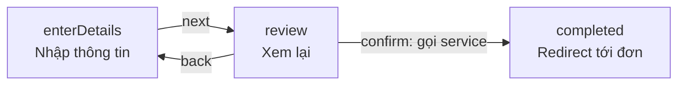

# Biểu thức chuẩn và biểu thức template trong Spring Web Flow

## 1. Vì sao một luồng web cần biểu thức?

Trong Spring Web Flow, một hành trình có thể đi qua nhiều trạng thái: nhập thông tin, kiểm tra dữ liệu, xem lại, xác nhận rồi chuyển sang trang kết quả. Để mô tả hành trình đó bằng cấu hình flow, chúng ta cần cách **đọc dữ liệu, gọi phương thức, kiểm tra điều kiện và tạo giá trị động** ngay tại các điểm chuyển trạng thái. Đó là vai trò của biểu thức.

Spring Web Flow dùng **Spring Expression Language (SpEL)** trong các cấu hình flow hiện đại. Hai cách sử dụng cần phân biệt là:

- **Biểu thức chuẩn (standard expression):** đánh giá toàn bộ chuỗi như một biểu thức và trả về giá trị của nó. Thích hợp để gọi service, đọc thuộc tính, tính toán và quyết định transition.
- **Biểu thức template (template expression):** trộn đoạn văn bản cố định với một hoặc nhiều phần được đánh giá động. Thích hợp để tạo chuỗi hiển thị, đường dẫn hoặc URL tại những vị trí của cấu hình có hỗ trợ template.

Ví dụ, sau khi người dùng xác nhận đơn hàng, flow cần gọi `orderService.placeOrder(...)` để lưu dữ liệu và có thể tạo URL `/orders/42` từ mã đơn hàng trả về. Lệnh gọi service là biểu thức chuẩn; việc ghép đường dẫn với mã đơn hàng là trường hợp điển hình của biểu thức template.

## 2. Quy tắc nhận diện nhanh

| Tiêu chí | Biểu thức chuẩn | Biểu thức template |
| --- | --- | --- |
| Ý nghĩa | Toàn bộ nội dung là một biểu thức SpEL | Chuỗi văn bản có chứa các đoạn SpEL |
| Dạng thường gặp trong flow | `orderService.findById(flowScope.orderId)` | `/orders/#{flowScope.order.id}` |
| Dấu bao biểu thức | Không cần `#{...}` tại vị trí nhận standard expression | Đặt phần động trong `#{...}` |
| Kết quả | Có thể là đối tượng, số, Boolean, danh sách hoặc chuỗi | Thường là chuỗi đã ghép từ văn bản và giá trị động |
| Tình huống | `<evaluate expression="..."/>`, `<if test="..."/>`, giá trị trong `<set>` | Giá trị chuỗi được tài liệu/API xác nhận là template, chẳng hạn đích redirect động |

**Không nên mặc định rằng mọi thuộc tính XML đều hỗ trợ cả hai kiểu.** Spring Web Flow có những thuộc tính nhận biểu thức, những thuộc tính nhận chuỗi tên hoặc định danh và những vị trí cho phép template. Cú pháp `#{...}` chỉ được nội suy khi thành phần đang đọc thuộc tính đó thực sự xử lý nó như template.

### 2.1. Biểu thức chuẩn

Một biểu thức chuẩn có thể chỉ là đường dẫn đến thuộc tính:

```text
flowScope.orderId
```

Hoặc là lời gọi phương thức và phép so sánh:

```text
orderService.findById(flowScope.orderId)
flowScope.cart.total > 0
flowScope.customer != null and flowScope.customer.email != null
```

Chẳng hạn, thẻ `<evaluate>` có thể gọi bean Spring và lưu kết quả vào flow scope:

```xml
<evaluate
    expression="orderService.findById(flowScope.orderId)"
    result="flowScope.order" />
```

Ở đây, `expression` là biểu thức **được thực thi**; `result` chỉ nơi nhận kết quả. Kết quả có thể là một đối tượng `Order` để dùng tiếp ở những state sau, chứ không nhất thiết là chuỗi.

Biểu thức chuẩn còn được sử dụng để rẽ nhánh:

```xml
<decision-state id="checkCart">
    <if test="cartService.canCheckout(flowScope.cart)"
        then="enterDetails"
        else="cartUnavailable" />
</decision-state>
```

Giá trị của `test` cần diễn giải thành Boolean. Khi là `true`, Web Flow đi tới `enterDetails`; khi là `false`, nó đi tới `cartUnavailable`.

### 2.2. Biểu thức template

Trong ngữ cảnh template của SpEL, phần văn bản nằm ngoài `#{...}` được giữ nguyên; phần nằm trong cặp ký hiệu được đánh giá rồi đưa vào chuỗi kết quả:

```text
Đơn hàng #{flowScope.order.id} đã được tạo
```

Giả sử `flowScope.order.id = 42`, kết quả là:

```text
Đơn hàng 42 đã được tạo
```

Một template cũng có thể chứa nhiều đoạn động:

```text
Đơn #{flowScope.order.id} - trạng thái #{flowScope.order.status}
```

Khi cần một URL động cho kết quả kết thúc flow, một ví dụ thường gặp là:

```xml
<end-state
    id="completed"
    view="externalRedirect:contextRelative:/orders/#{flowScope.savedOrder.id}" />
```

Với mã đơn hàng `42`, đích redirect được tạo là `/orders/42` **theo context path của ứng dụng**. Tiền tố `externalRedirect:contextRelative:` là quy ước redirect của Web Flow; `#{flowScope.savedOrder.id}` mới là phần template. Đặc điểm chính của template nằm ở việc tạo *một chuỗi* từ giá trị động.

Trong mã Java sử dụng trực tiếp SpEL, template cần `TemplateParserContext`; chỉ gọi `SpelExpressionParser.parseExpression(text)` theo chế độ thông thường sẽ không tự coi toàn bộ chuỗi hỗn hợp là template. Spring Web Flow xử lý parser context tại các vị trí cấu hình tương ứng.

## 3. Ngữ cảnh đánh giá: dữ liệu đến từ đâu?

SpEL không tự tạo ra dữ liệu. Biểu thức hoạt động trên **expression context** mà Spring Web Flow cung cấp: các bean có thể gọi, đối tượng của flow và những scope có vòng đời khác nhau.

| Tên thường dùng | Phạm vi và cách dùng |
| --- | --- |
| `flowScope` | Dữ liệu cần giữ suốt một flow execution, ví dụ `flowScope.orderId`, `flowScope.savedOrder`. |
| `viewScope` | Dữ liệu của view-state hiện hành; thích hợp cho thông tin tạm phục vụ view. Khi rời view-state, dữ liệu này không được bảo đảm còn tồn tại. |
| `requestScope` | Dữ liệu tạm của một lần xử lý request/event trong Web Flow. |
| `flashScope` | Dữ liệu cần chuyển qua một bước kế tiếp ngắn hạn; không thích hợp lưu nghiệp vụ dài hạn. |
| `conversationScope` | Dữ liệu ở cấp conversation, có thể rộng hơn một flow/subflow; dùng thận trọng vì vòng đời và bộ nhớ. |
| `requestParameters` | Các tham số request đến từ bên ngoài; phải kiểm tra và chuyển kiểu trước khi sử dụng cho nghiệp vụ. |

Ví dụ đọc giá trị từ request rồi dùng trong flow:

```xml
<on-start>
    <set name="flowScope.query" value="requestParameters.q" />
</on-start>
```

Ở đây `requestParameters.q` được đánh giá như một biểu thức chuẩn. Tham số `q` có thể vắng mặt hoặc có nội dung ngoài dự kiến; luồng thực tế cần xử lý tình huống này. Đặc biệt, tham số từ HTTP thường bắt đầu dưới dạng chuỗi; hãy sử dụng binding, converter hoặc dịch vụ kiểm tra kiểu nếu nghiệp vụ cần số, ngày hay enum.

Một số tên trong flow có thể được truy cập trực tiếp nhờ ngữ cảnh phân giải biến, nhưng khi bài viết cần làm rõ **dữ liệu tồn tại bao lâu**, nên viết tường minh `flowScope.foo` hoặc `viewScope.foo`. Không nên suy luận rằng một giá trị ở `requestScope` sẽ còn đó sau nhiều lần bấm nút Back/Next.

## 4. Ví dụ xuyên suốt: đặt hàng qua nhiều bước

Giả sử ứng dụng có `CheckoutForm` (dữ liệu người mua nhập), `CheckoutService` (xử lý lưu đơn) và đối tượng `Order` trả về có thuộc tính `id`. Luồng có ba giai đoạn:



Ví dụ flow XML minh họa:

```xml
<?xml version="1.0" encoding="UTF-8"?>
<flow xmlns="http://www.springframework.org/schema/webflow"
      xmlns:xsi="http://www.w3.org/2001/XMLSchema-instance"
      xsi:schemaLocation="
        http://www.springframework.org/schema/webflow
        http://www.springframework.org/schema/webflow/spring-webflow.xsd">

    <!-- Một đối tượng form sống trong flow execution. -->
    <var name="checkoutForm"
         class="com.example.checkout.CheckoutForm" />

    <view-state id="enterDetails"
                view="checkout/details"
                model="checkoutForm">
        <binder>
            <binding property="customerName" required="true" />
            <binding property="email" required="true" />
        </binder>
        <transition on="next" to="review" />
    </view-state>

    <view-state id="review"
                view="checkout/review"
                model="checkoutForm">
        <transition on="back" to="enterDetails" />

        <transition on="confirm" to="completed">
            <!-- Standard expression: trả về một Order. -->
            <evaluate
                expression="checkoutService.placeOrder(checkoutForm)"
                result="flowScope.savedOrder" />
        </transition>
    </view-state>

    <!-- Template: dùng id của Order để xây URL. -->
    <end-state id="completed"
        view="externalRedirect:contextRelative:/orders/#{flowScope.savedOrder.id}" />

</flow>
```

Đây là đoạn flow tập trung vào **cách dùng biểu thức**, giả định `checkoutService` là bean Spring đã đăng ký và `CheckoutForm` có những thuộc tính phù hợp. Ứng dụng thực tế còn phải cấu hình flow registry, flow executor, Spring MVC handler adapter, các view và endpoint `/orders/{id}`.

Khi người dùng phát event `confirm`, Web Flow chạy action của transition. Biểu thức chuẩn `checkoutService.placeOrder(checkoutForm)` trả về một `Order` và `result="flowScope.savedOrder"` lưu đối tượng đó. Sau khi tới end-state, template đọc `flowScope.savedOrder.id` để tạo URL chuyển hướng. Nếu `savedOrder` chưa được thiết lập, biểu thức truy cập `.id` có thể lỗi; flow cần bảo đảm việc lưu thành công trước khi hoàn tất.

**Điểm cần nắm:** phần nghiệp vụ là lệnh gọi phương thức, còn phần template là cách hiển thị hoặc điều hướng bằng dữ liệu đã có. Các expression không thay thế cho việc quản lý transaction, validation hay kiểm soát quyền truy cập của tầng service.

## 5. Phân biệt kết quả đánh giá với cách hiển thị

Một sai lầm phổ biến là dùng dấu `#{...}` ở nơi đang mong đợi biểu thức chuẩn:

```xml
<!-- Dễ sai: expression đã là vị trí dùng standard expression. -->
<evaluate expression="#{checkoutService.placeOrder(checkoutForm)}"
          result="flowScope.savedOrder" />
```

Ở `<evaluate expression="...">`, nên viết trực tiếp:

```xml
<evaluate expression="checkoutService.placeOrder(checkoutForm)"
          result="flowScope.savedOrder" />
```

Ngược lại, với một thuộc tính nhận template, nếu chỉ viết:

```text
/orders/flowScope.savedOrder.id
```

thì phần `flowScope.savedOrder.id` chỉ là ký tự thông thường. Cần chèn đoạn động vào vị trí nội suy:

```text
/orders/#{flowScope.savedOrder.id}
```

Không nên dùng `#{...}` như dấu bao tùy tiện cho mọi biểu thức xuất hiện trong ứng dụng Spring. Ví dụ, cú pháp annotation `@Value("#{...}")` của Spring Framework thuộc một cơ chế cấu hình khác với thuộc tính `expression` trong tài liệu flow XML.

### 5.1. Chuỗi cố định trong standard expression

Vì biểu thức chuẩn được parser hiểu là mã biểu thức, **string literal** trong SpEL phải có dấu nháy đơn:

```xml
<set name="flowScope.channel" value="'website'" />
```

Có thể ghép chuỗi ngay trong biểu thức chuẩn:

```xml
<set name="flowScope.summary"
     value="'Mã đơn: ' + flowScope.savedOrder.id" />
```

Đoạn trên vẫn là **standard expression** dù kết quả cuối cùng là chuỗi. Việc trả về kiểu `String` không tự biến một biểu thức thành template: khác biệt nằm ở cách parser xử lý *toàn bộ nội dung* hay *các phần được chèn vào văn bản*.

### 5.2. Ký tự đặc biệt trong XML

Các dấu có ý nghĩa riêng với XML phải được escape đúng cách, không phụ thuộc biểu thức chuẩn hay template:

```xml
<!-- & được viết thành &amp; trong XML. -->
<if test="flowScope.amount > 0 and flowScope.amount &lt; 100000"
    then="regularPayment"
    else="manualReview" />
```

Trong ví dụ này, `&lt;` được XML parser giải mã thành `<` trước khi biểu thức được đánh giá. Nếu cần dấu `&` trong URL đặt trực tiếp trong XML attribute, viết `&amp;`.

## 6. Binding, validation và vòng đời flow

Biểu thức chỉ là một phần của cơ chế Spring Web Flow. Với flow nhiều bước, dữ liệu form và sự kiện có những trách nhiệm riêng:

1. **Form binding:** lấy dữ liệu request và gán lên đối tượng `model` của view-state, chẳng hạn `checkoutForm.email`. `<binder>` có thể giới hạn những thuộc tính cho phép binding.
2. **Validation:** xác minh dữ liệu đã binding bằng cơ chế validator phù hợp, và hiển thị lỗi cho người dùng khi cần. Một biểu thức Boolean đơn giản không thay được validation của toàn bộ form.
3. **Transition/action:** sau khi sự kiện hợp lệ, action trong transition có thể sử dụng standard expression để gọi service.
4. **Phạm vi lưu trữ:** kết quả cần sử dụng ở state khác phải nằm trong scope thích hợp; `flowScope` phù hợp cho dữ liệu của toàn hành trình.
5. **Kết thúc/điều hướng:** template có thể tạo đích redirect từ kết quả của bước nghiệp vụ, nếu điểm khai báo redirect hỗ trợ template.

Trong ví dụ đặt hàng, nên kiểm tra dữ liệu trước `confirm`, xử lý lỗi từ service và thiết kế thao tác lưu theo hướng tránh tạo đơn trùng nếu người dùng gửi lại request. Template URL **không** giải quyết được vấn đề transaction hoặc gửi lặp event.

Nếu có subflow, đừng mặc định rằng mọi giá trị trong flow scope của flow cha tự trở thành biến cục bộ của flow con. Hãy khai báo và truyền input/output của subflow rõ ràng. Điều này đặc biệt quan trọng khi biểu thức của flow con tham chiếu một tên như `orderId`.

## 7. Lỗi thường gặp và cách xử lý

| Hiện tượng | Nguyên nhân có thể | Hướng xử lý |
| --- | --- | --- |
| Expression parsing error ở `<evaluate>` | Thêm `#{...}` vào nơi chỉ chấp nhận standard expression; viết sai cú pháp SpEL | Bỏ dấu template và kiểm tra từng đường dẫn thuộc tính/phương thức |
| `#{flowScope.order.id}` xuất hiện nguyên văn | Thuộc tính đang dùng là chuỗi literal hoặc nơi đó không hỗ trợ template | Kiểm tra hợp đồng thuộc tính; tạo sẵn chuỗi bằng standard expression hoặc service nếu cần |
| Lỗi truy cập thuộc tính trên `null` | Object chưa được tạo, kết quả service lỗi hoặc đã ra ngoài scope | Đảm bảo thứ tự action, kiểm tra `null`, chọn scope đúng |
| Giá trị nhập từ URL không đúng kiểu | `requestParameters` được dùng trực tiếp làm `Long`/ngày/enum | Dùng binding, converter và validation; xử lý input không hợp lệ |
| Chuyển hướng sai đường dẫn | Nhầm URL tuyệt đối và đường dẫn tương đối context; ký tự động chưa được encode | Kiểm tra quy tắc redirect, mã hóa thành phần URL, thử với context path khác `/` |
| Lộ dữ liệu hoặc tạo open redirect | Ghép trực tiếp tham số người dùng vào URL chuyển hướng | Chỉ cho phép đích được kiểm soát; không lấy URL tùy ý từ request rồi redirect |
| Flow hoạt động ở bước đầu nhưng sai khi quay lại | Đặt dữ liệu nhiều bước trong `requestScope` hoặc `viewScope` | Xác định vòng đời cần thiết; dùng `flowScope` hoặc input/output subflow |

Chú ý bảo mật: các biểu thức cấu hình được viết bởi người phát triển ứng dụng, không phải đầu vào để người dùng tùy ý cung cấp. **Không lấy một chuỗi SpEL từ request rồi đưa vào parser để thực thi.** Đối với dữ liệu động trong URL, ưu tiên định danh có kiểu rõ ràng và mã hóa đúng phần path/query.

## 8. Cách kiểm thử có mục tiêu

Với một luồng đặt hàng có template redirect, nên kiểm tra ít nhất bốn tình huống:

1. Bắt đầu flow, nhập dữ liệu hợp lệ, gửi `next`: trạng thái tiếp theo là `review`; form vẫn còn dữ liệu.
2. Từ `review`, gửi `back`: quay lại `enterDetails` mà không mất dữ liệu cần giữ trong flow.
3. Gửi `confirm` khi service trả về đơn có `id = 42`: service được gọi đúng một lần, `savedOrder` được lưu và redirect trỏ đến `/orders/42` theo context path.
4. Cho service trả về lỗi hoặc để thiếu mã đơn: flow cần có chiến lược xử lý lỗi thay vì tạo redirect sai hay hiển thị stack trace cho người dùng.

Khi viết kiểm thử flow, có thể thay bean nghiệp vụ bằng mock/stub để quan sát số lần gọi và đối số. Nếu chưa rõ một thuộc tính có xử lý template hay không, hãy kiểm thử chính xác cấu hình đó với phiên bản Spring Web Flow của dự án, vì cơ chế phân tích biểu thức phụ thuộc vào **điểm sử dụng** và cấu hình của ứng dụng.

## 9. Bài tập thực hành

**Bài 1 — Standard expression.** Cho `flowScope.cart.total = 250000`. Viết `<decision-state>` chọn `needsApproval` nếu tổng tiền lớn hơn `200000`, ngược lại chọn `checkout`.

<details>
<summary>Gợi ý lời giải</summary>

```xml
<decision-state id="checkTotal">
    <if test="flowScope.cart.total > 200000"
        then="needsApproval"
        else="checkout" />
</decision-state>
```

</details>

**Bài 2 — Template expression.** Sau khi `invoiceService.issue(checkoutForm)` trả về hóa đơn `invoice` có `code = INV-2026-007`, hãy tạo URL đến `/invoices/INV-2026-007`.

<details>
<summary>Gợi ý lời giải</summary>

```xml
<evaluate expression="invoiceService.issue(checkoutForm)"
          result="flowScope.invoice" />

<end-state id="issued"
    view="externalRedirect:contextRelative:/invoices/#{flowScope.invoice.code}" />
```

</details>

Với `code` sinh từ nghiệp vụ, cần xác nhận định dạng mã an toàn trong path (hoặc URL-encode nếu định dạng cho phép ký tự đặc biệt). Đồng thời cần bảo đảm action tạo hóa đơn chạy thành công trước khi tới `issued`.

**Bài 3 — Phân loại.** Xác định kiểu của ba nội dung: `flowScope.user.email`, `'Xin chào ' + flowScope.user.name`, `Xin chào #{flowScope.user.name}`.

Đáp án lần lượt: **standard expression**; **standard expression trả về chuỗi**; **template expression** (khi được đặt trong một vị trí hỗ trợ template).

## 10. Ghi nhớ

- **Standard expression** đánh giá toàn bộ biểu thức để lấy giá trị hoặc thực hiện logic, thường viết trực tiếp trong `expression`, `test`, `value`.
- **Template expression** dùng `#{...}` để đưa giá trị động vào chuỗi tĩnh, chẳng hạn một đích redirect được Web Flow hỗ trợ nội suy.
- `flowScope`, `viewScope` và các scope khác quyết định giá trị còn tồn tại bao lâu; chúng không phải cú pháp template.
- Khi gặp lỗi, hãy kiểm tra lần lượt **ngữ cảnh parser → dữ liệu/scope → kiểu dữ liệu → lifecycle của state/transition**.
- Biểu thức giúp cấu hình hành trình nhiều bước rõ ràng hơn; xử lý nghiệp vụ, validation và kiểm soát bảo mật vẫn thuộc các thành phần tương ứng của ứng dụng Spring.
