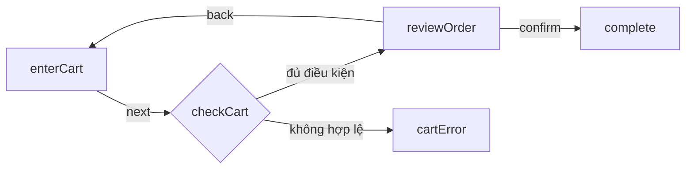

# Spring EL, Unified EL và khác biệt theo cấu hình trong Spring Web Flow

## 1. Vì sao cùng một flow lại có thể hiểu biểu thức theo những cách khác nhau?

Spring Web Flow (SWF) mô tả hành trình web nhiều bước bằng **state**, **event**, **transition**, **action** và **subflow**. Trong flow XML, biểu thức giúp đọc dữ liệu từ scope, gọi bean nghiệp vụ, rẽ nhánh theo điều kiện và truyền dữ liệu qua các bước. Nhưng một chuỗi giống cú pháp biểu thức chưa chắc được xử lý giống nhau ở mọi ứng dụng.

Lý do là có hai tầng phải phân biệt:

1. **Bộ phân tích biểu thức của flow (flow expression parser):** được Spring Web Flow sử dụng khi đọc những thuộc tính cấu hình cần đánh giá biểu thức, chẳng hạn `expression` trong `<evaluate>` và `test` trong `<if>`.
2. **Bộ biểu thức của view:** do công nghệ giao diện quyết định. Trang JSF thường dùng Unified EL; trang Thymeleaf dùng biểu thức Thymeleaf; JSP có EL của JSP. Bộ parser của view không tự động trở thành bộ parser của flow.

Spring Web Flow có hỗ trợ những cơ chế biểu thức khác nhau trong các dòng phiên bản/cấu hình, đáng chú ý là **Spring Expression Language (SpEL, Spring EL)** và **Unified Expression Language (Unified EL)**. Muốn xác định cú pháp nào hoạt động trong một dự án cụ thể, cần kiểm tra phiên bản SWF, `flow-builder-services` và parser thực tế được gắn vào flow registry.

> Trọng tâm của bài này là **chọn và sử dụng đúng ngôn ngữ biểu thức theo cấu hình**, từ đó tránh lỗi khi kết hợp Spring MVC, JSF, binding, validation hoặc khi nâng cấp dự án. Không nên dựa riêng vào dấu `#{...}` hay tên công nghệ view để kết luận flow đang dùng parser nào.

## 2. Spring EL là gì?

**Spring Expression Language (SpEL)** là ngôn ngữ biểu thức của Spring Framework. Ngoài truy cập thuộc tính và gọi phương thức, SpEL hỗ trợ nhiều cú pháp của riêng nó, ví dụ:

- Truy cập đối tượng: `flowScope.order.total`.
- Gọi phương thức: `orderService.calculateTotal(flowScope.order)`.
- Điều kiện: `flowScope.amount > 0 and flowScope.amount <= 1000000`.
- Truy cập an toàn khi giá trị có thể là `null`: `flowScope.customer?.email`.
- Giá trị dự phòng bằng toán tử Elvis: `flowScope.customer?.name ?: 'Khách'`.
- Tham chiếu kiểu Java: `T(java.lang.Math).max(10, 20)`.
- Một số thao tác trên collection như selection/projection, tùy phiên bản SpEL.

Ví dụ một action dùng **biểu thức chuẩn** trong flow:

```xml
<evaluate
    expression="orderService.calculateTotal(flowScope.cart)"
    result="flowScope.total" />
```

Nếu parser của flow là SpEL và `orderService` được đưa vào ngữ cảnh đánh giá theo cấu hình của SWF, thuộc tính `expression` sẽ gọi phương thức tương ứng rồi đặt kết quả vào `flowScope.total`.

Trong đoạn này, tên `flowScope` do **Spring Web Flow** cung cấp; khả năng dùng phép toán và cú pháp `T(...)` hoặc `?.` đến từ **SpEL**. Hai trách nhiệm đó khác nhau: parser quyết định cách hiểu chuỗi, còn evaluation context quyết định những biến và bean nào có thể truy cập.

## 3. Unified EL là gì?

**Unified Expression Language** là họ ngôn ngữ biểu thức gắn với các nền tảng web Java, đặc biệt là JSF/Jakarta Faces, với khả năng truy cập thuộc tính, map, collection, thực hiện so sánh và gọi phương thức theo khả năng của phiên bản EL đang dùng.

Ví dụ quen thuộc trong một trang JSF:

```xml
<h:outputText value="#{booking.id}" />
<h:commandButton value="Tiếp tục" action="next" />
```

Khi JSF dựng view, `#{booking.id}` được giải quyết theo **ngữ cảnh EL của JSF**, thường gắn với những đối tượng mà JSF hoặc tích hợp Web Flow đưa vào view. Đây là một ví dụ của **view expression**, chưa chứng minh flow XML đang dùng SpEL hay Unified EL.

Unified EL thường gặp các biểu thức:

```text
flowScope.booking.id
flowScope.booking.total gt 100000
empty flowScope.booking.items
flowScope.booking != null and flowScope.booking.confirmed
```

Lưu ý:

- `empty`, `eq`, `ne`, `gt`, `lt`, `ge`, `le` là các toán tử quen thuộc của Unified EL.
- Tập tính năng như gọi phương thức với tham số có thể khác nhau giữa các phiên bản và các hiện thực EL; không nên coi mọi biểu thức SpEL đều chuyển sang Unified EL nguyên vẹn.
- Cú pháp `T(java.lang.Math)`, `?.` và `?:` của SpEL **không phải** cú pháp có thể mặc định sử dụng trong Unified EL.

Một ví dụ điều kiện dùng cú pháp Unified EL:

```xml
<decision-state id="checkCart">
    <if test="empty flowScope.cart.items"
        then="emptyCart"
        else="reviewOrder" />
</decision-state>
```

Ví dụ trên **chỉ phù hợp nếu parser được chọn hỗ trợ toán tử `empty` theo cách đó**. Khi cấu hình flow chuyển sang SpEL, nên rà soát biểu thức thay vì giả định parser mới hiểu toàn bộ cú pháp cũ.

## 4. So sánh Spring EL và Unified EL

| Chủ đề | Spring EL (SpEL) | Unified EL |
| --- | --- | --- |
| Nguồn gốc | Spring Framework | Hệ sinh thái Java/Jakarta web, đặc biệt JSF |
| Vai trò trong SWF | Có thể là parser đánh giá biểu thức flow | Có thể là parser đánh giá biểu thức flow ở cấu hình/phiên bản hỗ trợ |
| Truy cập thuộc tính | `flowScope.order.id` | `flowScope.order.id` |
| So sánh, logic | `==`, `!=`, `>`, `and`, `or`, v.v. | `==`, `!=`, `gt`, `eq`, `and`, `or`, v.v. |
| Kiểm tra rỗng | Thường kiểm tra `null`, độ dài hoặc gọi phương thức; tùy kiểu đối tượng | Có toán tử `empty` |
| Truy cập an toàn | `customer?.email` | Không mặc định hỗ trợ toán tử `?.` của SpEL |
| Giá trị dự phòng | `name ?: 'Khách'` | Dùng các cách diễn đạt điều kiện được phiên bản EL hỗ trợ |
| Tham chiếu kiểu Java | `T(java.lang.Math)` | Không dùng cú pháp `T(...)` của SpEL |
| Gọi phương thức | Có hỗ trợ qua SpEL và evaluation context | Phụ thuộc chuẩn/phiên bản EL và resolver được cấu hình |
| Kết quả trong một view JSF | Không tự thay parser của JSF | JSF vẫn đánh giá biểu thức view theo cơ chế EL của nó |

Điểm chung hữu ích là những biểu thức **đơn giản** như đọc thuộc tính từ `flowScope` hoặc so sánh số thường có thể chuyển đổi với rất ít thay đổi. Tuy nhiên, ngay cả một tên giống nhau cũng có thể khác kết quả nếu bean resolver, type conversion, property accessor hoặc dữ liệu `null` khác nhau.

### 4.1. Phân biệt expression parser và template parser

Trong nhiều file flow, bạn sẽ gặp:

```xml
<evaluate expression="orderService.findById(flowScope.orderId)"
          result="flowScope.order" />
```

và:

```xml
<end-state id="completed"
    view="externalRedirect:contextRelative:/orders/#{flowScope.order.id}" />
```

Thuộc tính `expression` đầu tiên nhận **biểu thức chuẩn**; đoạn `#{...}` thứ hai minh họa **nội suy trong chuỗi template** tại vị trí có hỗ trợ template. Việc dùng dấu `#{...}` trong template không đủ để kết luận cả flow đang dùng Unified EL. Spring Web Flow có lớp xử lý cấu hình cho các kiểu biểu thức; parser được chọn mới quyết định cách giải nghĩa *nội dung* biểu thức trong từng vị trí.

Tương tự, trong cấu hình bean của Spring Framework, `@Value("#{...}")` là cú pháp Spring bean expression; không nên sao chép dấu bao đó vào `<evaluate expression="...">` mà không xét hợp đồng của thuộc tính.

## 5. Cấu hình nào quyết định parser của Spring Web Flow?

Khi sử dụng cấu hình XML namespace, các phần liên quan thường là **flow registry** và **flow builder services**. Registry chứa các flow definition; builder services cung cấp những dịch vụ dùng khi phân tích và dựng flow, trong đó có expression parser.

Ví dụ sau minh họa **điểm nối cấu hình**, với điều kiện bean `flowExpressionParser` đã được tạo đúng API của phiên bản SWF đang dùng:

```xml
<webflow:flow-registry id="flowRegistry"
                       flow-builder-services="flowBuilderServices">
    <webflow:flow-location
        path="/WEB-INF/flows/checkout/checkout-flow.xml" />
</webflow:flow-registry>

<webflow:flow-builder-services
    id="flowBuilderServices"
    expression-parser="flowExpressionParser" />
```

Trong ví dụ, thuộc tính `expression-parser` là **tham chiếu tới bean parser**, không phải nơi đặt chuỗi `SpEL` hay `UnifiedEL` tùy ý. Việc khởi tạo bean parser phải dùng đúng lớp, constructor và conversion service của phiên bản thư viện trong ứng dụng; một số phiên bản có thể cung cấp parser mặc định mà không cần khai báo riêng.

Các lớp và khái niệm bạn có thể gặp khi đọc cấu hình hoặc tài liệu API tương ứng gồm:

- `SpringELExpressionParser`: bộ parser tích hợp Spring Expression Language với cơ chế expression của Web Flow.
- `WebFlowELExpressionParser`: bộ parser cho Unified EL trong những phiên bản SWF có hỗ trợ.
- `ConversionService`: phục vụ chuyển kiểu khi binding và đánh giá giá trị theo cơ chế được cấu hình.
- `flow-builder-services`: nơi chọn parser cho flow definition; `flow-registry` cần tham chiếu đúng services nếu ứng dụng khai báo nhiều bộ.

Tên lớp, constructor, cách đăng ký bean và tính sẵn có của parser **cần được xác nhận trên đúng phiên bản SWF**. Đặc biệt, đừng giả định bộ parser mặc định của một bản cũ giống hoàn toàn bản khác.

### 5.1. Các tình huống cấu hình điển hình

| Tình huống | Nơi cần kiểm tra | Ý nghĩa |
| --- | --- | --- |
| Ứng dụng dùng parser mặc định | Phiên bản SWF và builder services thực tế | Cú pháp phải hợp với parser mà phiên bản đó mặc định chọn |
| Ứng dụng chỉ định Spring EL | Bean parser SpEL, `expression-parser`, liên kết với registry | Có thể dùng những tính năng SpEL mà parser và evaluation context hỗ trợ |
| Ứng dụng chỉ định Unified EL | Bean parser Unified EL, cấu hình resolver/context, phiên bản tương thích | Viết theo cú pháp/tính năng Unified EL được hỗ trợ |
| Có nhiều `flow-registry` | Registry nào được flow executor sử dụng, registry trỏ tới builder services nào | Hai nhóm flow trong cùng ứng dụng có thể được biên dịch với cấu hình khác nhau |
| Spring MVC render view, ví dụ Thymeleaf | Parser của flow **và** engine của template | Biểu thức trong view được engine view xử lý theo cú pháp của chính nó |
| Spring Web Flow tích hợp JSF | Parser của flow, bridge/view factory JSF, phiên bản JSF/EL | Biểu thức trong XHTML và biểu thức trong flow XML có thể đi qua hai evaluator khác nhau |

### 5.2. Trình tự xác định cấu hình đang thực sự có hiệu lực

1. Xác nhận **phiên bản Spring Web Flow** đang chạy, cùng bộ phụ thuộc Spring/JSF liên quan.
2. Xác định flow được tải từ **flow registry** nào.
3. Xem registry đó dùng `flow-builder-services` mặc định hay một bean services riêng.
4. Nếu có `expression-parser`, xác định bean được tham chiếu và lớp hiện thực thực tế của nó.
5. Kiểm tra các bean resolver, conversion service và cấu hình đánh giá có liên quan.
6. Kiểm chứng bằng một biểu thức đơn giản, sau đó bằng một đặc tính riêng của parser trong môi trường kiểm thử.

Nếu cấu hình dùng hoàn toàn Java hoặc chương trình hóa thay vì namespace XML, hãy tìm các đối tượng tương đương chịu trách nhiệm dựng `FlowBuilderServices` và gắn parser. Ý tưởng không thay đổi: **parser được cấp cho quá trình dựng flow** là căn cứ cần kiểm tra.

## 6. Ví dụ so sánh trong hành trình đặt hàng nhiều bước

Giả sử flow đi qua `enterCart` → `checkCart` → `reviewOrder` → `complete`. Hành trình cần đảm bảo giỏ hàng tồn tại và tổng tiền hợp lệ trước khi chuyển tới view xác nhận.



Phần điều hướng có thể khai báo bằng `<decision-state>`:

```xml
<decision-state id="checkCart">
    <if test="flowScope.cart != null and flowScope.cart.total > 0"
        then="reviewOrder"
        else="cartError" />
</decision-state>
```

Đây là dạng biểu thức dễ đọc và khá gần nhau giữa các hệ EL. Nó trả về điều kiện Boolean để Web Flow quyết định transition. Tầng nghiệp vụ vẫn nên xác thực giá và tính khả dụng của sản phẩm ở phía server; điều kiện trên chỉ giúp rẽ nhánh flow.

### 6.1. Khi muốn dùng cú pháp đặc trưng của Spring EL

Giả sử `flowScope.customer` có thể là `null`. Với parser SpEL, có thể dùng:

```xml
<decision-state id="checkCustomer">
    <if test="flowScope.customer?.verified == true"
        then="reviewOrder"
        else="requestVerification" />
</decision-state>
```

Toán tử `?.` làm cho việc đọc `verified` có thể trả về `null` nếu `customer` rỗng; phép so sánh với `true` sau đó cho kết quả không khớp. Với Unified EL, không nên đưa nguyên cú pháp này vào flow; thay vào đó, viết điều kiện rõ ràng và tương thích với parser:

```xml
<decision-state id="checkCustomer">
    <if test="flowScope.customer != null and flowScope.customer.verified == true"
        then="reviewOrder"
        else="requestVerification" />
</decision-state>
```

Trường hợp `customer` có thể rỗng, cần xác nhận engine có đánh giá ngắn mạch `and` như mong đợi; đây là điểm nên có kiểm thử thực tế.

### 6.2. Khi dùng toán tử `empty` của Unified EL

Trong dự án có parser Unified EL hỗ trợ, có thể kiểm tra giỏ hàng bằng:

```xml
<decision-state id="checkItems">
    <if test="empty flowScope.cart.items"
        then="cartError"
        else="reviewOrder" />
</decision-state>
```

Nếu chuyển sang SpEL, nên chuyển ý định này thành phương thức Java hoặc điều kiện theo kiểu collection đang sử dụng. Chẳng hạn, khi chắc chắn `cart` và `items` khác `null`, biểu thức SpEL:

```xml
<decision-state id="checkItems">
    <if test="flowScope.cart.items.isEmpty()"
        then="cartError"
        else="reviewOrder" />
</decision-state>
```

Hai ví dụ chỉ tương đương **khi đầu vào và điều kiện tiền đề giống nhau**. `empty` của Unified EL có thể coi `null`, chuỗi rỗng, mảng hoặc collection rỗng là empty; gọi `isEmpty()` trên một giá trị `null` sẽ lỗi. Nếu mục tiêu là chuyển đổi tương đương, hãy xử lý rõ cả trường hợp không có giỏ hàng.

### 6.3. Kết hợp logic flow và template URL

Sau event `confirm`, flow có thể gọi bean và lưu đối tượng:

```xml
<view-state id="reviewOrder" view="checkout/review"
            model="checkoutForm">
    <transition on="back" to="enterCart" />
    <transition on="confirm" to="complete">
        <evaluate
            expression="checkoutService.placeOrder(checkoutForm)"
            result="flowScope.savedOrder" />
    </transition>
</view-state>

<end-state id="complete"
    view="externalRedirect:contextRelative:/orders/#{flowScope.savedOrder.id}" />
```

Ở đây `checkoutService.placeOrder(...)` là biểu thức chuẩn trong action; `#{flowScope.savedOrder.id}` là phần động của chuỗi redirect. Việc resolve `checkoutService` phụ thuộc vào context của flow và parser; đích redirect còn phụ thuộc quy tắc redirect của Web Flow. Ví dụ giả định service đã đăng ký và trả về `Order` có `id`; cấu hình ứng dụng hoàn chỉnh cũng cần flow executor, view resolver và route nhận `/orders/{id}`.

**Không nên suy ra** rằng nhìn thấy `#{...}` ở `end-state` nghĩa là parser của toàn flow phải là Unified EL. Ngoài ra, cần bảo đảm action tạo đơn thành công trước khi đánh giá redirect, và thiết kế service để tránh tạo đơn trùng khi người dùng gửi lại yêu cầu.

## 7. Khác biệt khi tích hợp Spring MVC và JSF

### 7.1. Spring MVC

Khi Web Flow được tích hợp vào Spring MVC, Spring MVC có thể nhận request và chuyển cho flow executor; Web Flow tiếp tục xử lý state/event/transition. View được render bởi một công nghệ như JSP hoặc Thymeleaf.

Ví dụ trong flow:

```xml
<evaluate expression="productService.findById(flowScope.productId)"
          result="flowScope.product" />
```

Biểu thức này được Web Flow xử lý bằng **flow expression parser**. Còn trong trang Thymeleaf:

```html
<span th:text="${product.name}">Tên sản phẩm</span>
```

`${product.name}` là cú pháp Thymeleaf của **view template**, không phải bằng chứng Web Flow dùng Unified EL. Nếu chuyển flow parser từ Unified EL sang SpEL, bạn cần kiểm tra flow XML; thay đổi đó không mặc định biến cú pháp view thành cú pháp SpEL.

### 7.2. JSF/Jakarta Faces

Với tích hợp JSF, biểu thức trong XHTML như:

```xml
<h:outputText value="#{flowScope.booking.code}" />
```

được xử lý bởi cơ chế EL của JSF và hệ thống resolver của môi trường tương ứng. Còn một `<evaluate expression="...">` trong flow definition được xử lý bởi cấu hình parser của SWF. Hai tầng có thể cùng truy cập một đối tượng như `booking`, nhưng không nhất thiết hỗ trợ cùng cú pháp hoặc quy tắc chuyển kiểu.

Khi gặp lỗi như `PropertyNotFoundException`, `MethodNotFoundException` hoặc lỗi parse, cần xác định **lỗi xuất hiện khi dựng/chạy flow hay khi JSF render/action trên trang**. Việc đổi flow expression parser không thể tự sửa lỗi cấu hình resolver ở view.

### 7.3. Scope và subflow vẫn là trách nhiệm của Web Flow

Các tên `flowScope`, `viewScope`, `requestScope`, `flashScope` và `conversationScope` biểu diễn vòng đời dữ liệu do Web Flow quản lý. Khi đổi parser, **scope không tự tăng thời gian tồn tại**. Dữ liệu đặt trong request scope vẫn chỉ hợp với lần xử lý request hiện hành; dữ liệu cần giữ qua nhiều state thường phải nằm trong flow scope.

Nếu gọi subflow, cần khai báo input/output rõ ràng. Một biểu thức hợp lệ về cú pháp vẫn có thể lỗi vì tham số chưa được truyền vào flow con hoặc đặt sai scope. Đây là lỗi mô hình hóa flow, không đơn thuần là lỗi Spring EL hay Unified EL.

## 8. Những khác biệt dễ gây lỗi khi nâng cấp hoặc đổi parser

| Hiện tượng | Khả năng nguyên nhân | Cách xác minh và sửa |
| --- | --- | --- |
| Lỗi parse tại `?.`, `?:`, `T(...)` | Flow đang dùng Unified EL hoặc parser không hỗ trợ tính năng SpEL đó | Xác nhận bean parser; viết lại biểu thức theo ngôn ngữ đang dùng |
| Lỗi parse tại `empty flowScope.items` | Đang dùng SpEL nhưng copy cú pháp Unified EL | Thay bằng điều kiện kiểm tra `null`/collection hoặc gọi method theo SpEL |
| `orderService` không được tìm thấy | Bean resolver/evaluation context chưa được cấu hình phù hợp | Kiểm tra Spring bean, registration và phạm vi nhìn thấy từ flow |
| Biểu thức chạy nhưng trả về kiểu khác | Conversion service hoặc quy tắc coercion khác nhau | Kiểm tra kiểu thực tế, converter, dữ liệu `null`, số và ngày |
| `#{...}` hiện nguyên văn trên trang | Thuộc tính/view không xử lý chuỗi đó như template | Xác định điểm xử lý: flow template, JSF EL hay Thymeleaf |
| Action flow thành công nhưng JSF không render được giá trị | JSF EL resolver/view scope không thấy biến cần thiết | Debug phía view; đừng thay flow parser theo phỏng đoán |
| Dữ liệu mất sau event `next` hoặc quay lại `back` | Dùng sai scope, không phải lỗi cú pháp EL | Sơ đồ hóa vòng đời state, request và subflow |
| Flow chạy khác trên môi trường triển khai | Phiên bản JAR, expression parser hoặc conversion service khác | Khóa phiên bản phụ thuộc và kiểm thử config thực tế |

Đừng dùng cách sửa hàng loạt `#{x}` thành `x` hay ngược lại. Trước hết cần xác định **thuộc tính hiện tại nhận standard expression, template expression hay văn bản literal**; sau đó mới kiểm tra parser cho *nội dung* bên trong.

### 8.1. Tính tương thích và bảo mật

- Không biên dịch và thực thi biểu thức được người dùng cung cấp trực tiếp từ `requestParameters` hoặc nội dung form. SpEL có khả năng truy cập đối tượng, gọi phương thức và kiểu Java; cho đầu vào không tin cậy trở thành source expression có thể gây rủi ro nghiêm trọng.
- Validate dữ liệu trước khi gọi service; expression rẽ nhánh `amount > 0` không thay thế business validation hay authorization.
- Khi tạo URL từ template, không ghép đích redirect tùy ý lấy từ request. Dùng route được kiểm soát và mã hóa đúng thành phần path/query.
- Kiểm tra kỹ các phép so sánh `null`, phép toán số, format ngày tháng và collection khi đổi EL. Kết quả có thể khác dù biểu thức được parse thành công.

## 9. Chiến lược kiểm thử khi thay đổi cấu hình

Để xác nhận flow vẫn hoạt động sau khi chuyển parser, hãy kiểm thử **hành vi** của luồng thay vì chỉ kiểm tra một biểu thức có parse được:

1. **Khởi tạo:** bắt đầu flow, đảm bảo `<on-start>` đọc đúng tham số và tạo dữ liệu ban đầu.
2. **Standard expression:** gọi một service giả lập và xác nhận giá trị trả về được lưu vào `flowScope`.
3. **Điều kiện:** tạo dữ liệu ở cả hai phía của `<if test="...">`, xác nhận transition đúng.
4. **Tình huống rỗng:** thử `null`, collection rỗng, thuộc tính vắng và lỗi conversion. Đây là nhóm khác biệt quan trọng giữa các engine EL.
5. **View + binding:** hiển thị view-state, gửi event, ràng buộc dữ liệu form và kiểm tra thông báo validation.
6. **Quay lại và subflow:** thực hiện `back`/retry, gọi subflow có input/output và xác nhận dữ liệu vẫn đúng scope.
7. **Redirect:** kết thúc flow với mã định danh đã biết; kiểm tra URL thực tế đúng context path, không bị nội suy thiếu hoặc sai mã hóa.

Có thể dùng cơ chế kiểm thử flow execution của Web Flow kết hợp mock service. Chọn ít nhất một ca có **cú pháp riêng SpEL** và một ca có **cú pháp riêng Unified EL** trong bản kiểm thử/đối chiếu parser; điều này giúp nhận ra sai lệch cấu hình mà một biểu thức truy cập thuộc tính đơn giản không thể phát hiện.

Ví dụ tập kiểm tra biểu thức tối thiểu:

| Điều kiện đầu vào | Biểu thức | Parser mục tiêu | Kỳ vọng |
| --- | --- | --- | --- |
| `customer = null` | `flowScope.customer?.email` | SpEL | Không lỗi khi truy cập `email`; giá trị `null` |
| `items = []` | `empty flowScope.items` | Unified EL | `true` |
| `amount = 250000` | `flowScope.amount > 200000` | Cả hai, khi được cấu hình tương thích | `true` |
| `order.id = 42` | `/orders/#{flowScope.order.id}` ở vị trí nhận template | Parser tương ứng | Chuỗi URL có mã `42` |

Đây là **các ca thử định hướng**: kết quả chính thức cần kiểm tra với implementation/version và evaluation context đang chạy. Đặc biệt, biểu thức template phải đặt tại một API/thuộc tính thực sự hỗ trợ template.

## 10. Bài tập thực hành

### Bài 1 — Nhận diện parser

Một flow cũ đang có:

```xml
<if test="empty flowScope.cart.items"
    then="cartError"
    else="reviewOrder" />
```

Sau khi thay cấu hình parser, ứng dụng báo lỗi parse ở `empty`. Hãy nêu bước chẩn đoán trước khi sửa XML, và cách viết lại trong trường hợp parser mới là SpEL.

**Gợi ý:** xác nhận registry sử dụng builder services nào, bean parser nào đang có hiệu lực; sau đó viết điều kiện kiểm tra `null`/collection theo SpEL. Nếu `cart` và `items` được đảm bảo khác `null`, biểu thức `flowScope.cart.items.isEmpty()` thể hiện kiểm tra collection rỗng. Nếu không, cần thêm điều kiện bảo vệ `null`.

### Bài 2 — Phân biệt tầng flow và tầng view

Flow XML dùng:

```xml
<evaluate expression="accountService.load(flowScope.accountId)"
          result="flowScope.account" />
```

Trang JSF dùng:

```xml
<h:outputText value="#{flowScope.account.name}" />
```

Hỏi: đổi flow expression parser sang SpEL có đồng nghĩa trang JSF bắt đầu đánh giá bằng SpEL không?

**Đáp án:** không. Flow expression được parser của SWF đánh giá; biểu thức trong trang XHTML được JSF EL xử lý qua view/resolver của JSF. Hai tầng có thể truy cập cùng dữ liệu nhưng giữ cơ chế đánh giá riêng.

### Bài 3 — Thiết kế ca kiểm thử di trú

Hãy lập ít nhất ba ca kiểm thử cho flow `enterDetails` → `review` → `complete` sau khi chuyển từ Unified EL sang SpEL. Mỗi ca phải nêu input, event, state mong đợi và giá trị cần kiểm tra.

**Một phương án:** (1) input hợp lệ, event `next` đi tới `review`, form không mất dữ liệu; (2) input thiếu, event `next` bị chặn bởi validation và hiển thị lỗi; (3) event `confirm`, mock service tạo đơn có `id = 42`, flow kết thúc với redirect đúng `/orders/42`. Bổ sung ca collection rỗng hoặc `null` để kiểm tra các biểu thức có nguy cơ khác biệt giữa hai EL.

## 11. Ghi nhớ

- **Spring EL/SpEL** và **Unified EL** là hai hệ ngôn ngữ biểu thức khác nhau; các tính năng như `?.`, `T(...)` và `empty` không thể tùy tiện dùng lẫn.
- **Parser của flow** được quyết định bởi phiên bản và cấu hình dựng flow, điển hình là `flow-builder-services` cùng `flow-registry`. Muốn kết luận parser đang chạy, phải kiểm tra chuỗi cấu hình có hiệu lực.
- **Parser của view** (JSF, Thymeleaf, JSP) là một tầng riêng. Cùng nhìn thấy `#{...}` không có nghĩa các phần của ứng dụng đang dùng cùng một EL.
- **Scope, binding, validation, transition và subflow** do cơ chế Web Flow quản lý; đổi parser không giải quyết được sai vòng đời dữ liệu hoặc lỗi nghiệp vụ.
- Khi nâng cấp, hãy kiểm thử cú pháp riêng của từng EL, cách xử lý `null`, chuyển kiểu và hành trình end-to-end để phát hiện lỗi trước khi đưa vào sử dụng.
