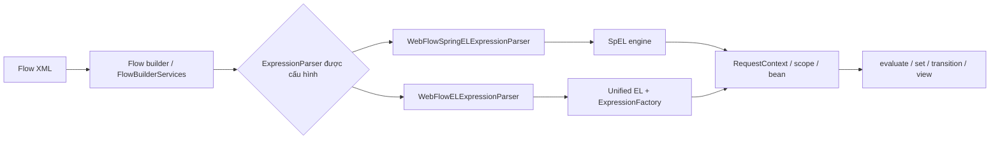

# Chọn ExpressionParser và kiểm tra hành vi trên phiên bản Spring Web Flow đang sử dụng

## 1. Vấn đề cần giải quyết

**Spring Web Flow (SWF)** mô hình hóa hành trình web nhiều bước bằng `state`, `event`, `transition` và `subflow`. Trong một flow đặt lịch hẹn, XML cần đọc dữ liệu từ `flowScope`, quyết định có được chuyển tới bước xác nhận không, gọi một Spring service, đặt giá trị vào scope và chọn giao diện để render.

Những chỗ đó sử dụng **expression language (EL)**. Ví dụ:

```xml
<evaluate expression="bookingService.findAvailableSlots(booking)" 
          result="viewScope.availableSlots" />

<transition on="next" to="review" 
            if="bookingService.canProceed(booking)" />
```

Nếu ứng dụng dùng một `ExpressionParser` khác với parser mà người phát triển giả định, cùng một chuỗi biểu thức có thể được giải thích khác, không thể parse hoặc trả giá trị không như mong đợi. Rủi ro nổi bật khi nâng cấp các dự án lâu năm sử dụng **Unified EL**, OGNL đời cũ, hoặc tích hợp JSF; thêm thư viện EL vào classpath và thay cấu hình `flow-builder-services` cũng có thể làm xuất hiện khác biệt.

Bài thuộc chương **Biểu thức**, tập trung vào hai việc:

1. **Chọn chính xác parser** dùng để biên dịch các biểu thức trong *định nghĩa flow*.
2. **Kiểm tra hành vi trên đúng phiên bản và cấu hình được triển khai**: từ parse, resolve biến, chuyển kiểu, đánh giá điều kiện, cho đến postback và transition.

Sau bài này, bạn sẽ có khả năng phân biệt Spring EL (SpEL) với Unified EL; viết standard/template expressions đúng chỗ; khai báo hoặc xác minh parser của `FlowBuilderServices`; giải thích tác động của converter, scope và JSF; xây dựng bộ kiểm thử để khóa hành vi khi nâng cấp.

## 2. ExpressionParser thuộc tầng nào?

SWF có interface:

```java
org.springframework.binding.expression.ExpressionParser
```

Interface này khác với:

```java
org.springframework.expression.ExpressionParser
```

Interface thứ hai là API chung của **Spring Framework SpEL**. SWF sử dụng abstraction của **Spring Binding** để parse cả *standard expressions* lẫn *template expressions*, rồi adapter có thể ủy quyền cho SpEL hoặc Unified EL.

Những lớp cần nhận diện:

| Lớp / interface | Thuộc thư viện | Vai trò |
|---|---|---|
| `org.springframework.binding.expression.ExpressionParser` | Spring Web Flow / Spring Binding | Hợp đồng parser mà flow builder dùng. |
| `org.springframework.webflow.expression.spel.WebFlowSpringELExpressionParser` | Spring Web Flow | Adapter SpEL có property accessor phù hợp với ngữ cảnh Web Flow. |
| `org.springframework.expression.spel.standard.SpelExpressionParser` | Spring Framework | Parser gốc của SpEL, nhận chuỗi biểu thức Spring. |
| `org.springframework.webflow.expression.el.WebFlowELExpressionParser` | Spring Web Flow | Adapter cho Unified EL, cần `ExpressionFactory` phù hợp. |
| `javax.el.ExpressionFactory` / `jakarta.el.ExpressionFactory` | Java EE / Jakarta EE EL | Factory dùng bởi Unified EL; package thay đổi theo thế hệ. |
| `org.springframework.webflow.engine.builder.support.FlowBuilderServices` | Spring Web Flow | Giữ parser, conversion service, validator, view factory creator được dùng khi xây dựng flow. |

Một `SpelExpressionParser` tự tạo bằng `new` để thử chuỗi SpEL **không tự động có** các property accessor của Web Flow, biến `flowScope`, `requestParameters`, `currentEvent` hoặc bean resolver mà flow execution cung cấp. Unit test SpEL thuần có ích cho cú pháp, nhưng chưa chứng minh cùng biểu thức hoạt động trong **flow runtime**.



**Phạm vi áp dụng:** cấu hình `expression-parser` nằm ở **Spring application context** cấp hệ thống thông qua `flow-builder-services`. Nó không phải thuộc tính tùy ý đặt trong mỗi `<view-state>` và cũng không phải cấu hình parser của template JSP/Thymeleaf/Facelets.

## 3. Lựa chọn Spring EL, Unified EL và parser cũ

### 3.1. Spring EL: lựa chọn thông thường

SpEL được Spring Framework hỗ trợ và gắn chặt với cơ chế conversion, formatter, bean resolution của Spring. Trong ứng dụng Web Flow mới, lựa chọn thực tế thường là dùng **Web Flow SpEL adapter** và viết expression theo quy tắc Spring EL. Các khả năng thường dùng:

- Truy cập property: `booking.customerEmail`.
- Gọi method trên bean/đối tượng: `bookingService.find(bookingId)`.
- Điều kiện boolean: `booking != null and booking.confirmed`.
- Toán tử điều kiện: `booking != null ? booking.customerEmail : null`.
- Safe navigation: `booking?.customerEmail` khi dữ liệu có thể `null`.
- Đọc biến ngữ cảnh: `flowScope`, `viewScope`, `requestParameters`, `currentEvent`.

SpEL không “tự biết” toàn bộ các biến đó ở bất cứ nơi nào: Web Flow tạo ngữ cảnh đánh giá tại runtime. Vì thế, khi viết kiểm thử, cần xác minh cả **parser được chọn** lẫn **context object được cung cấp**.

### 3.2. Unified EL: dùng khi có lý do cụ thể

**Unified EL** có thể hiện diện trong các hệ thống từ thời JSF, hoặc một bộ quy tắc cũ được xây trên `WebFlowELExpressionParser`. Khi lựa chọn Unified EL cần kiểm kê:

- Parser adapter được cấu hình trong SWF.
- EL API và implementation (`ExpressionFactory`) thực tế.
- Namespace `javax.el.*` hoặc `jakarta.el.*` tương thích phiên bản Spring Web Flow.
- Cách resolve Spring beans, flow scopes và phương thức.
- Bộ converter tùy biến đang dùng; với Unified EL, `WebFlowELExpressionParser` có cấu hình `conversionService` riêng.
- Những biểu thức bị phụ thuộc cú pháp hoặc hành vi cụ thể của implementation Unified EL.

Không chọn Unified EL chỉ vì ứng dụng có JSP hoặc JSF. Việc renderer sử dụng EL **khác** với quyết định parser dùng để xây dựng định nghĩa flow.

### 3.3. OGNL trong các ứng dụng rất cũ

Một số tài liệu SWF 2.0–2.4 đề cập `WebFlowOgnlExpressionParser` và OGNL. Tài liệu SWF 2.4 ghi OGNL đã bị deprecated; SWF 2.5/3.x/4.x tập trung vào Spring EL và Unified EL. Khi gặp cấu hình `ognl` trong một dự án legacy, hãy ghi lại **đúng phiên bản đang chạy**, đánh giá từng biểu thức và chuyển đổi có kiểm thử. Không sao chép nguyên cấu hình OGNL từ tài liệu cũ sang SWF mới.

### 3.4. Bảng quyết định

| Tình huống | Phương án xem xét | Kiểm chứng bắt buộc |
|---|---|---|
| Tạo flow mới dựa trên Spring MVC | Dùng Web Flow SpEL adapter | Property/method, `currentEvent.id`, conversion, scope. |
| Dự án có Unified EL được cấu hình rõ | Giữ tạm nếu stack còn tương thích, hoặc migrate sang SpEL | Regression test cú pháp, `null`, event, template và converter. |
| Dự án JSF dùng Facelets EL `#{...}` | Vẫn chọn parser của SWF theo flow builder; JSF có EL riêng | Test JSF lifecycle **và** transition Web Flow. |
| Thư viện/framework nâng cấp lớn | Xem lại default và pin parser tường minh khi cần ổn định | Đọc bean thực tế, dependency graph, flow integration tests. |
| Source có OGNL | Lập kế hoạch chuyển sang parser đang được hỗ trợ | So sánh kết quả và lỗi với bộ input cũ. |

## 4. Điểm rất dễ nhầm: parser mặc định khác với giả định từ tài liệu

Tài liệu SWF 3.0.x và 4.0.x có những cách diễn đạt cần đọc trong ngữ cảnh:

- Phần **Expression Language / EL Implementations** mô tả Spring EL là lựa chọn được khuyến nghị và cho phép cấu hình `WebFlowELExpressionParser` nếu muốn Unified EL.
- Phần **System Setup / Using the Expression Parser** ghi default có thể chọn **Unified EL khi có trên classpath**, nếu không dùng **Spring EL**.
- Java API của một số builder, ví dụ `org.springframework.faces.config.FlowBuilderServicesBuilder` ở SWF 3.0.1, ghi default là **`WebFlowSpringELExpressionParser` dùng SpEL**, trừ khi cấu hình ghi đè.

Những mô tả này không nên được xem là một cam kết rằng mọi lộ trình cấu hình XML, Java, JSF và mọi bản vá đều tạo **cùng một instance** theo cùng một cách. Lớp được chọn có thể phụ thuộc builder, classpath, bean cấu hình và extension của ứng dụng.

**Quy tắc vận hành:** khi chốt parser, hãy xác minh **instance đang thực sự được `FlowBuilderServices` dùng** trong ứng dụng và chạy một flow test trên đúng artifact/version đó. Đừng chọn chỉ bằng câu “mặc định chắc là SpEL”, cũng đừng suy rằng sự xuất hiện của `jakarta.el` chắc chắn đã đổi parser.

### 4.1. Bảng kiểm kê trước khi quyết định

| Cần kiểm tra | Nguồn xác minh |
|---|---|
| SWF version | Dependency tree và WAR/JAR đang deploy: `spring-webflow`, `spring-binding`, `spring-faces`. |
| Spring Framework version | `spring-expression`, `spring-core`, `spring-webmvc` được resolve và chạy. |
| Parser đã cấu hình | `<webflow:flow-builder-services expression-parser="...">`; Java config/builders. |
| Bean parser thực | `FlowBuilderServices.getExpressionParser().getClass()` hoặc equivalent runtime inspection trong test. |
| Runtime EL | Các JAR/container modules của `javax.el` hoặc `jakarta.el` và provider. |
| Conversion service | `FlowBuilderServices.getConversionService()` và formatter/converter được nối vào. |
| Context đánh giá | RequestContext thật, bean names, flowScope/viewScope, JSF managed beans nếu có. |
| Flow references | Biểu thức trong action, transition, `view`, subflow và variable mapping. |

Đánh dấu mỗi trường `Verified` (có runtime/test), `Resolved` (dependency graph), `Declared` (chỉ file build) hoặc `Unknown`. Tránh gộp cả bốn thành một cột “parser version”.

## 5. Phân biệt standard expression và template expression

Một phần quan trọng **không phụ thuộc** việc chọn SpEL hay Unified EL là **loại biểu thức** mà thuộc tính flow XML yêu cầu.

### 5.1. Standard expression

Standard expression là một biểu thức được đưa cho parser **nguyên vẹn**, không có cặp đánh dấu `#{...}` ở bên ngoài:

```xml
<on-entry>
    <evaluate expression="bookingService.load(bookingId)"
              result="flowScope.booking" />
</on-entry>

<transition on="next"
            to="review"
            if="bookingService.canProceed(booking)" />
```

Ở những vị trí này:

- `expression="bookingService.load(bookingId)"` gọi service.
- `result="flowScope.booking"` là đường dẫn nơi đặt kết quả.
- `if="bookingService.canProceed(booking)"` phải trả ra boolean hoặc giá trị mà framework chấp nhận cho điều kiện.

**Không viết:**

```xml
<evaluate expression="#{bookingService.load(bookingId)}" />
```

Trong ngữ cảnh **standard expression**, dấu `#{...}` dư thừa và có thể làm phát sinh lỗi parser như `IllegalArgumentException`. Cần đọc XML schema và tài liệu của **thuộc tính cụ thể** để biết vị trí nào đòi expression nào; không áp dụng một quy tắc “mọi expression đều có `#{...}`”.

### 5.2. Template expression

Template expression kết hợp **đoạn văn bản cố định** với **một hay nhiều expression** được đánh dấu bằng `#{...}`:

```xml
<view-state id="localizedError"
            view="error-#{externalContext.locale}.xhtml" />
```

Web Flow lấy giá trị của `externalContext.locale` rồi ghép với tiền tố `error-` và hậu tố `.xhtml`. Kết quả có thể là một tên view như `error-vi_VN.xhtml` tùy kiểu và giá trị locale của request.

Trong ví dụ này, `view` là vị trí cho template expression. Không phải mọi chỗ nhận chuỗi đều là template; chẳng hạn `id="localizedError"` là ID tĩnh. Cũng không nên dùng cú pháp template để lắp ghép string từ request rồi tự động coi là đường dẫn view hợp lệ nếu chưa kiểm soát dữ liệu đầu vào.

### 5.3. Các trường hợp hay bị lẫn

| Nơi sử dụng | Ví dụ | Kiểu/ý nghĩa |
|---|---|---|
| `<evaluate expression="...">` | `bookingService.load(id)` | Standard expression gọi service. |
| `<set name="..." value="...">` | `requestParameters.id` | Standard expression lấy dữ liệu. |
| `<transition if="...">` | `booking != null` | Điều kiện đánh giá khi event đến. |
| `<view-state view="...">` | `error-#{externalContext.locale}.xhtml` | Template expression khi ghép view ID. |
| EL trong Facelets | `value="#{registration.email}"` | **JSF EL** của giao diện, không đồng nghĩa flow parser. |
| Expression trong Thymeleaf | `th:text="${...}"` | Cú pháp của **template engine**, riêng với XML flow. |

Khi nhìn thấy `#{...}` trong file XHTML, đừng suy rằng cấu hình `expression-parser` của SWF đã được chọn giống JSF renderer. Nhiều framework dùng ký hiệu tương tự nhưng tạo context khác nhau.

## 6. Một flow mẫu để kiểm chứng hành vi expression

Ví dụ booking có dữ liệu được truyền vào qua request, gọi service để lấy booking, cho người dùng xem lại rồi xác nhận.

### 6.1. Flow XML

```xml
<?xml version="1.0" encoding="UTF-8"?>
<flow xmlns="http://www.springframework.org/schema/webflow"
      start-state="review">

    <input name="bookingId" type="long" />

    <on-start>
        <evaluate expression="bookingService.load(bookingId)"
                  result="flowScope.booking" />
    </on-start>

    <view-state id="review" view="booking/review">
        <on-render>
            <evaluate expression="bookingService.availableSlots(booking)"
                      result="viewScope.slots" />
        </on-render>

        <transition on="confirm"
                    to="completed"
                    if="bookingService.canConfirm(booking)" />

        <transition on="cancel" to="cancelled" bind="false" />
    </view-state>

    <end-state id="completed" />
    <end-state id="cancelled" />
</flow>
```

**Giả định để chạy được:** có bean Spring `bookingService` với methods `load(long)`, `availableSlots(Booking)`, `canConfirm(Booking)`; có class model tương ứng và template `booking/review`; `bookingId` được cung cấp và convert đúng kiểu long. Ở ứng dụng thực tế, quyền xem/xác nhận booking và trạng thái giao dịch cần kiểm tra trong service.

Flow tạo ít nhất bốn điểm để test parser:

1. `<input type="long">`: convert input và đặt biến có kiểu.
2. `bookingService.load(bookingId)`: resolve bean, method và đối số.
3. `result="flowScope.booking"`: ghi dữ liệu vào scope.
4. `if="bookingService.canConfirm(booking)"`: đánh giá điều kiện trước transition.

`<on-render>` có thể chạy nhiều lần khi màn hình render lại, nên method `availableSlots` nên là thao tác đọc hoặc có kiểm soát tác dụng phụ. Nếu dùng `on-render` để tạo giao dịch thật, refresh hoặc lỗi validation có thể khiến hành vi lặp lại.

### 6.2. Một biến thể xử lý input từ request

```xml
<on-start>
    <set name="flowScope.requestedId"
         value="requestParameters.id"
         type="long" />
</on-start>
```

`requestParameters.id` đến từ HTTP request dưới dạng chuỗi. `type="long"` yêu cầu giá trị có thể chuyển sang long; input như `id=abc` sẽ thất bại. Phân biệt:

- **Lỗi parse expression**: cú pháp `value` không được parser chấp nhận.
- **Lỗi evaluate/resolve**: thiếu `id` hoặc thiếu bean/property trong runtime.
- **Lỗi conversion**: có chuỗi nhưng không chuyển được sang kiểu `long`.
- **Lỗi nghiệp vụ**: ID hợp lệ về kiểu nhưng không có quyền hoặc booking không tồn tại.

Từng loại lỗi cần kiểm thử riêng để biết sửa parser, conversion service hay business logic.

### 6.3. Current event và phạm vi

Trong các transition/action liên quan đến postback, biến `currentEvent` biểu diễn event của Web Flow, không phải một chuỗi ID thuần. Với SpEL, so sánh:

```xml
<transition on="submit"
            to="review"
            if="currentEvent.id == 'submit'" />
```

Ví dụ này hơi dư logic vì `on="submit"` đã lọc event, nhưng minh họa chính xác cách đọc ID. Khi di chuyển từ một dạng Unified EL cũ sang SpEL, biểu thức `currentEvent == 'submit'` có thể không còn cho kết quả mong đợi. Trong logic thật, nên kiểm tra những thông tin phục vụ nghiệp vụ thay vì lặp lại việc so event.

Phạm vi cũng quan trọng:

- `flowScope` sống trong flow execution.
- `viewScope` sống trong view-state và mất khi rời view.
- `requestScope` chỉ áp dụng cho request hiện hành.
- `conversationScope` dùng qua một conversation gồm top-level flow và subflow.
- `flashScope` có đặc tính dọn sau render; cần xác minh thời điểm đọc/ghi.

Những biến scope là đối tượng runtime của Web Flow. Test parser bằng SpEL thuần và truyền một Java Map trống sẽ không đại diện cho đầy đủ ngữ cảnh.

## 7. Chọn parser tường minh bằng XML

Đối với dự án cần cố định hành vi, một cách dễ kiểm tra là **cấu hình bean parser** và nối bean ấy vào `flow-builder-services`. Ví dụ pin SpEL adapter:

```xml
<!-- Đoạn trong Spring application context, KHÔNG đặt trong booking-flow.xml -->
<webflow:flow-registry id="flowRegistry"
                       flow-builder-services="flowBuilderServices">
    <webflow:flow-location id="booking"
                           path="/WEB-INF/flows/booking/booking-flow.xml" />
</webflow:flow-registry>

<webflow:flow-builder-services id="flowBuilderServices"
                               expression-parser="webFlowSpelParser" />

<bean id="webFlowSpelParser"
      class="org.springframework.webflow.expression.spel.WebFlowSpringELExpressionParser">
    <constructor-arg>
        <bean class="org.springframework.expression.spel.standard.SpelExpressionParser" />
    </constructor-arg>
</bean>
```

Ví dụ chỉ hiển thị phần liên quan; file Spring XML thật cần khai báo namespace `beans`, `webflow` và `xsi:schemaLocation` phù hợp phiên bản. Không đặt `<webflow:flow-builder-services>` bên trong file Flow XML có root `<flow>`.

**Tại sao dùng `WebFlowSpringELExpressionParser` thay vì bean `SpelExpressionParser` thuần?** Thuộc tính `expression-parser` nhận interface của Spring Binding; adapter Web Flow bổ sung cách giải quyết các thuộc tính của request context. Bean SpEL thuần có interface khác và không phải replacement trực tiếp ở vị trí này.

Nếu ứng dụng cần converter/formatter đặc thù, hãy nối `conversion-service` ở `flow-builder-services` với dịch vụ chuyển kiểu tương ứng. Khi tạo parser custom với constructor có `ConversionService`, kiểm tra cùng converter và cùng locale được sử dụng ở cả parser và flow binding. Không giả định tự động dùng chung tất cả formatter với Spring MVC chỉ vì chúng đều là Spring bean.

### 7.1. Cấu hình Unified EL ở dự án kế thừa

Dạng mẫu trong tài liệu SWF cũ là:

```xml
<!-- Ví dụ lịch sử của một stack dùng javax.el; không copy sang Jakarta -->
<webflow:flow-builder-services id="flowBuilderServices"
                               expression-parser="webFlowUnifiedParser" />

<bean id="webFlowUnifiedParser"
      class="org.springframework.webflow.expression.el.WebFlowELExpressionParser">
    <constructor-arg>
        <bean class="org.jboss.el.ExpressionFactoryImpl" />
    </constructor-arg>
</bean>
```

Cấu hình này được tài liệu SWF 2.x nêu để minh họa provider **JBoss EL**. Đây là ví dụ của một thế hệ phần mềm cũ. Trên SWF 3.x/4.x dùng Jakarta, API factory là `jakarta.el.ExpressionFactory`; phải chọn provider và cấu hình đáp ứng Jakarta, không ghép provider `javax.el.ExpressionFactory` từ ví dụ lịch sử vào parser hiện đại.

Nếu dự án đang chạy Unified EL và cần converter tùy biến, tài liệu SWF còn nhắc cấu hình `conversionService` cho `WebFlowELExpressionParser` và nối `conversion-service` của flow builder. Hãy kiểm tra class constructor/property tồn tại ở đúng bản SWF bạn dùng trước khi migrate cấu hình.

### 7.2. Khi dùng Java configuration

Trong cấu hình Java, cách chọn parser phụ thuộc loại builder mà ứng dụng dùng. Các builder dành cho Flow Builder Services có phương thức nhận một instance của `org.springframework.binding.expression.ExpressionParser`; cần truyền **đúng bean adapter** thay vì interface SpEL của Spring Framework.

Quy trình thực tế:

1. Xác định cấu hình xây dựng `FlowDefinitionRegistry` và `FlowBuilderServices` đang dùng.
2. Tạo hoặc lấy parser adapter từ Spring context.
3. Nối parser vào builder bằng API đúng bản được deploy (ví dụ phương thức `setExpressionParser(...)` nơi builder đó hỗ trợ).
4. Dùng chính builder services này cho registry chứa những flow muốn áp dụng.
5. Test parser instance rồi test flow behavior.

Không cần có hai parser chỉ vì ứng dụng vừa có Spring MVC vừa có JSF. Chỉ tạo cấu hình riêng nếu bạn thực sự cần nhiều registry/flow builder services khác nhau và hiểu quy tắc phạm vi của từng registry.

## 8. Kiểm tra parser thực tế, không chỉ kiểm tra classpath

### 8.1. Quan sát bean được dùng

Tài liệu API cho thấy `FlowBuilderServices` cung cấp `getExpressionParser()`. Trong bài test Spring context có bean `flowBuilderServices`:

```java
import org.junit.jupiter.api.Test;
import org.springframework.beans.factory.annotation.Autowired;
import org.springframework.webflow.engine.builder.support.FlowBuilderServices;
import org.springframework.webflow.expression.spel.WebFlowSpringELExpressionParser;

import static org.junit.jupiter.api.Assertions.assertInstanceOf;

class FlowParserConfigurationTest {

    @Autowired
    private FlowBuilderServices flowBuilderServices;

    @Test
    void flowBuilderUsesSpelAdapter() {
        assertInstanceOf(
            WebFlowSpringELExpressionParser.class,
            flowBuilderServices.getExpressionParser()
        );
    }
}
```

Đây là **phần thân test minh họa**. Để chạy thật, class cần được Spring Test khởi tạo bằng `@SpringJUnitConfig(...)`/cấu hình test phù hợp, có bean `flowBuilderServices` trong context và dependency JUnit tương ứng. Với dự án dùng JUnit đời cũ, dùng assertion tương đương. Mục đích của test là xác minh **parser thực**, không kiểm tra implementation details không liên quan.

Nếu ứng dụng không định nghĩa rõ bean `flowBuilderServices` hoặc builder được tạo bên trong cấu hình Java, hãy lấy bean/builder thực tế mà registry sử dụng. Chỉ tạo thêm một bean mới trong test rồi kiểm tra bean đó **không chứng minh** production registry đang dùng nó.

### 8.2. Kiểm tra dependency và version thực

Các lệnh sau là **gợi ý cho người học chạy trong dự án ứng dụng**, không phải thao tác đã được thực thi trên module bài viết:

```bash
# Đối chiếu JDK và công cụ build
java -version
mvn -version

# Xem dependency Web Flow, Spring Expression và EL
mvn dependency:tree -Dincludes=org.springframework.webflow:*,org.springframework:spring-expression

# Xem toàn bộ graph, tránh bỏ qua dependency do library khác kéo vào
mvn dependency:tree -Dverbose
```

Với Gradle:

```bash
./gradlew dependencies --configuration runtimeClasspath
./gradlew dependencyInsight --dependency spring-webflow --configuration runtimeClasspath
./gradlew dependencyInsight --dependency spring-expression --configuration runtimeClasspath
```

Trên Windows dùng `.\gradlew.bat`. Những lệnh này hỗ trợ xác định thư viện **đã resolve**; cần đối chiếu thêm JAR trong WAR/Boot JAR, server module, runtime JVM, context configuration và log để biết parser nào đang hoạt động. Không suy ra parser từ tên file `spring-expression-*.jar` vì SpEL jar có thể chỉ là dependency được nạp nhưng flow chọn Unified EL.

### 8.3. Bốn lớp chứng cứ

| Lớp | Bằng chứng | Kết luận cho phép |
|---|---|---|
| Declared | XML bean/config Java chỉ định `expression-parser` | Có ý định dùng parser cụ thể. |
| Resolved | Maven/Gradle graph, source jar và runtime EL API | Các class/implementation cần thiết có thể có mặt. |
| Packaged | JAR thực tế và Spring config trong artifact | Artifact đưa cấu hình/thư viện tương ứng vào triển khai. |
| Running | Parser class từ registry builder services, kết quả flow test | Parser và hành vi được xác minh trên môi trường test. |

Mỗi lần so sánh version nên ghi **commit, profile, môi trường, Java/Spring/SWF version và ngày test**. Sự khác biệt giữa staging và production có thể làm kết quả khác nhau dù source giống nhau.

## 9. Bộ kiểm thử hành vi để khóa quyết định parser

Một regression suite đủ mạnh phải kiểm tra **đầu ra và transition**, không chỉ assert tên class.

### 9.1. Ma trận ca test

| Ca | Biểu thức / tình huống | Mong đợi |
|---|---|---|
| Standard expression cơ bản | `bookingService.load(bookingId)` | Trả Booking từ bean và ID đúng kiểu. |
| Không bọc sai delimiter | `expression="...method()"` | Parse và evaluate thành công trong flow. |
| Standard bị bọc `#{...}` | `expression="#{...}"` | Test phải phát hiện lỗi cú pháp hoặc không phù hợp ngữ cảnh. |
| Template view ID | `view="error-#{externalContext.locale}.xhtml"` | Render đúng logical view name cho locale thử nghiệm. |
| Truy cập scope | `result="flowScope.booking"` | Model có trong flowScope khi state kế tiếp đọc. |
| Event ID | `currentEvent.id == 'submit'` | Boolean đúng với event thực tế. |
| Null property | `booking?.customerEmail` | Không ném lỗi trên `null` khi parser SpEL hỗ trợ. |
| Boolean transition | `bookingService.canConfirm(booking)` | Chỉ đi transition khi trả true. |
| Numeric conversion | `requestParameters.id` vào `type="long"` | Chuỗi hợp lệ chuyển đúng, giá trị lỗi bị từ chối. |
| Custom conversion | Kiểu tiền/ngày theo locale | Dùng formatter/converter thật của ứng dụng. |
| Missing bean | `missingService.check()` | Lỗi resolve rõ ràng, không âm thầm chuyển state. |
| Postback với session cũ | Execution hết hạn | Báo lỗi/khôi phục theo chính sách, không coi là lỗi parser. |
| Unified EL migration | Biểu thức legacy có `${...}` | Đối chiếu và đổi sang template `#{...}` khi cần. |
| JSF view | `h:commandButton action="next"` | JSF lifecycle tạo outcome, SWF nhận event và chuyển state. |

Với tất cả các ca, cần khai báo **giá trị input** và **expected state/result** rõ ràng. Các ví dụ trong tài liệu không thay thế regression suite của chính codebase.

### 9.2. Test nào thực sự cần chạy?

**Tầng parser:** xác minh lớp adapter và những biểu thức đơn giản. Không dùng một `SpelExpressionParser` thuần với `EvaluationContext` giả rồi kết luận flow parser đúng.

**Tầng flow execution:** khởi chạy flow, cấp `bookingId`, kiểm tra `bookingService.load` được gọi; gửi event `confirm` với `canConfirm=true`/`false` và kiểm tra state. Có thể dùng Spring Web Flow test support tương ứng phiên bản hoặc test tích hợp khởi chạy qua FlowExecutor.

**Tầng web/view:** với Spring MVC/JSF, gửi POST thực đến flow execution URL; kiểm tra form/EL, conversion, validation, event, redirect và re-render. Đây là nơi phát hiện vấn đề không lộ ra ở parser unit test.

**Tầng migration:** chạy cùng một bộ input trên stack cũ và stack mục tiêu, lưu bảng kết quả. Chỉ ghi `PASS` nếu hành vi chấp nhận được; thay đổi có chủ đích phải được mô tả và điều chỉnh test rõ.

### 9.3. Bảng ghi kết quả kiểm thử

| ID | Stack | Parser thực | Expression | Input/context | Output / state | Kết luận |
|---|---|---|---|---|---|---|
| P01 | SWF 3.x + Spring 6.x | WebFlowSpringELExpressionParser | `bookingService.load(7)` | Bean giả lập hợp lệ | Booking ID 7 | PASS khi được chứng minh |
| P02 | SWF 3.x + Spring 6.x | Parser thực tế | `currentEvent.id == 'confirm'` | Event confirm | true | VERIFY trước khi chạy |
| P03 | SWF 4.x + Spring 7.x | Parser thực tế | `error-#{externalContext.locale}.xhtml` | Locale vi_VN | View ID mong đợi | VERIFY trước khi chạy |

Các giá trị phiên bản và kết quả trên **chỉ minh họa cấu trúc báo cáo**. Tại dự án thật, phải thay bằng version patch cụ thể và evidence: commit, dependency tree, test case và log liên quan. Đừng ghi `PASS` nếu chưa chạy test; `VERIFY` là trạng thái hợp lệ khi mới chuẩn bị dữ liệu.

## 10. Migrate từ Unified EL sang Spring EL: kiểm tra gì?

Tài liệu Web Flow về EL portability liệt kê những khác biệt thường gặp:

### 10.1. Thay delimiter ở template

Một mẫu expression cũ có `${...}` có thể cần chuyển sang `#{...}` nếu được dùng ở **template expression của flow XML**:

```xml
<!-- Ví dụ mô tả trước khi migrate (không áp dụng máy móc) -->
<view-state id="localizedError" view="error-${externalContext.locale}.xhtml" />

<!-- Template expression của Web Flow với SpEL -->
<view-state id="localizedError" view="error-#{externalContext.locale}.xhtml" />
```

Không thay đại trà trên mọi file JSP, XHTML, Thymeleaf hoặc Java string vì mỗi công nghệ có quy tắc interpolation khác nhau. Và với thuộc tính yêu cầu **standard expression** như `<evaluate expression="...">`, đừng bổ sung `#{...}`.

### 10.2. So sánh currentEvent

```text
Legacy assumption: currentEvent == 'confirm'
SpEL-compatible:  currentEvent.id == 'confirm'
```

So sánh đúng ID; không dựa vào việc object event tự chuyển thành string theo một parser/provider cụ thể.

### 10.3. Null handling

```text
Giả định dữ liệu có thể null:
booking?.customerEmail
booking != null ? booking.customerEmail : null
```

SpEL hỗ trợ safe navigation operator `?.`. Không mặc định cả Unified EL, OGNL và SpEL đều có cùng cú pháp hoặc cùng kết quả khi property/bean bằng `null`. Những expression đang đọc nested property phải được kiểm tra ít nhất hai trường hợp: có dữ liệu và không có dữ liệu.

### 10.4. Conversion/formatting

SpEL tích hợp với hệ thống Spring conversion và formatter; Unified EL có cơ chế chuyển kiểu riêng được SWF thích ứng qua conversion service. Một expression chạy tốt trong điều kiện bình thường có thể khác ở locale, enum, date, generic collection hoặc đối tượng custom. Cần ghi lại **type nguồn, type đích, locale, converter/formatter đã dùng** và kỳ vọng sau migration.

Khi ứng dụng dùng Spring MVC data binding, hãy kiểm tra đồng thời configuration của Spring MVC và Web Flow. Tạo formatter trong MVC context không bảo đảm formatter được dùng bởi flow builder services trong mọi cấu hình.

## 11. Phân biệt expression của flow với expression của JSF

Đây là trường hợp dễ đánh đồng nhất trong hệ thống tích hợp Spring Faces.

Ví dụ Facelets:

```xhtml
<h:form xmlns:h="jakarta.faces.html">
    <h:inputText value="#{registration.email}" />
    <h:commandButton value="Tiếp tục" action="next" />
</h:form>
```

- `#{registration.email}` ở `value` được **JSF EL/lifecycle** sử dụng để đọc/ghi model.
- `action="next"` cung cấp outcome; tích hợp Spring Faces/Web Flow ánh xạ outcome tới event/transition của flow.
- Các biểu thức trong `<evaluate>` hoặc `<transition if="...">` của flow vẫn được parser do `FlowBuilderServices` cấu hình xử lý.

Một ứng dụng có thể dùng **Jakarta EL** cho Facelets trong khi flow definition dùng **SpEL**. Điều này không tự mâu thuẫn. Khi kiểm thử, cần tách lỗi của JSF converter/component tree với lỗi của parser Web Flow.

Nếu cấu hình sử dụng chế độ resolve JSF-managed beans trong biểu thức flow, cần kiểm tra builder services đặc biệt của Spring Faces ở **phiên bản ứng dụng**. Ví dụ một số API builder có tùy chọn `enableManagedBeans` làm thay đổi parser adapter; phải xác minh parser instance và cách resolve bean thực tế.

## 12. Lỗi phổ biến và phương án chẩn đoán

| Triệu chứng | Nguyên nhân nghi vấn | Cách xử lý |
|---|---|---|
| `IllegalArgumentException` khi gọi `<evaluate>` | Bọc standard expression bằng `#{...}` | Bỏ delimiter ở đúng attribute, kiểm tra schema. |
| `ParserException` ngay khi load flow | Cú pháp không được parser hiện tại hỗ trợ | Xác minh parser bean + biểu thức gây lỗi + version. |
| `PropertyOrFieldReference` hoặc `EvaluationException` | Sai tên property, thiếu object hoặc context | Kiểm tra scope, bean names và dữ liệu null. |
| `MethodNotFound`/lỗi gọi method | Sai chữ ký hoặc type conversion | Kiểm tra method signature, type đối số và converter. |
| Flow đi sai nhánh `if` | Điều kiện false, nhầm event hoặc data stale | Log input, currentEvent.id, kết quả service, transition matching. |
| Locale đổi tên view không như mong đợi | Template expression hoặc locale context sai | Kiểm tra chuỗi template và `externalContext.locale`. |
| Thêm EL library rồi behavior thay đổi | Classpath ảnh hưởng quá trình chọn parser | Pin parser tường minh và kiểm tra runtime bean. |
| Không tìm được parser bean | `expression-parser` trỏ sai ID/context | Kiểm tra Spring ApplicationContext và registry sử dụng. |
| Converter date không chạy trong flow | ConversionService chưa nối đúng | Xác minh flow builder services và parser/conversion path. |
| Lỗi khi đổi `javax.el` sang `jakarta.el` | Provider thuộc sai thế hệ | Kiểm tra API và implementation/classpath phù hợp. |
| JSF EL chạy nhưng `<evaluate>` lỗi | Hai expression contexts khác nhau | Kiểm tra JSF EL và SWF parser độc lập. |

Nên phân loại lỗi thành **parse-time**, **evaluation-time**, **conversion-time** và **business-time**. Một lỗi business khi `bookingService.load(id)` truy vấn dữ liệu không tồn tại không thể được sửa bằng cách thay parser.

## 13. An toàn khi cho flow đánh giá expression

SpEL và Unified EL có khả năng truy cập property và gọi phương thức. Một số cấu hình SpEL có tính năng như tham chiếu class hoặc method invocation mạnh; vì vậy **không nhận chuỗi biểu thức do người dùng nhập rồi đưa trực tiếp vào parser/evaluator với quyền ứng dụng**.

Ví dụ không an toàn về mặt thiết kế là lưu `requestParameters.expression` rồi đưa nó vào dịch vụ biên dịch/đánh giá expression tùy ý. Người dùng có thể thử truy cập bean hoặc method vượt ngoài mục đích nghiệp vụ nếu evaluation context cho phép. Thay vào đó:

- Giữ expression của flow trong file cấu hình được quản lý bởi người phát triển.
- Dữ liệu người dùng chỉ là **giá trị đầu vào**, được bind/convert/validate trước khi đưa cho service.
- Dùng transition/action/service để áp dụng quy tắc quyền, không để client quyết định tên bean/method sẽ gọi.
- Không xây đường dẫn view hoặc class name trực tiếp từ giá trị request chưa xác thực.
- Giới hạn thông tin lỗi gửi về client để tránh lộ cấu trúc nội bộ, nhưng lưu đủ log/test evidence phía server.

Nếu ứng dụng cần cho người dùng định nghĩa biểu thức, đó là một tính năng khác cần evaluation context hạn chế, danh sách phép toán được phép và thiết kế bảo vệ riêng. Không lấy cấu hình flow parser mặc định làm nền cho một expression sandbox công khai.

## 14. Quy trình lựa chọn và khóa parser trong dự án

Một quy trình dùng được khi tạo ứng dụng mới hoặc nâng cấp legacy:

1. **Kiểm kê:** ghi Java, Spring Framework, SWF, Spring Faces (nếu có), Maven/Gradle graph, provider EL và parser bean.
2. **Xác định chủ sở hữu:** tìm nơi xây dựng `FlowBuilderServices`, nơi registry gắn builder và những registry nào phục vụ flow quan trọng.
3. **Chọn engine:** ưu tiên SpEL nếu không có ràng buộc kế thừa; nếu phải giữ Unified EL thì ghi lý do, version và tác động conversion/JSF.
4. **Pin cấu hình:** khai báo parser bằng bean/Java config rõ ràng khi cần ổn định giữa các môi trường; dùng cùng builder services ở registry mong muốn.
5. **Ghi test về class parser:** kiểm tra instance thực trong Spring context test.
6. **Ghi test về hành vi:** standard/template, scope, event, null, service call, conversion, transition và view.
7. **Thử qua web:** thực hiện postback form hợp lệ/sai, back/cancel, JSF/Ajax (nếu dùng), session expired và lỗi phục hồi.
8. **So sánh khi nâng cấp:** chạy lại cùng test trên dependency mới; khác biệt cần được giải thích trước khi đổi production.
9. **Ghi quyết định:** lưu parser engine, library versions, source evidence, kết quả test, các expression đã migrate và giới hạn đã biết.

Lưu ý khi dùng flow inheritance hoặc subflow: một định nghĩa có thể được xây bởi registry/builder services khác nếu hệ thống chia thành nhiều context. Đừng kết luận parser của **toàn bộ** ứng dụng từ một bean kiểm tra khi những flow khác sử dụng builder riêng.

## 15. Bài tập thực hành

### Bối cảnh

Một ứng dụng đặt vé có ba state: `selectTrip`, `review` và `completed`. Mã cũ có:

```xml
<evaluate expression="tripService.findTrip(tripId)"
          result="flowScope.trip" />

<view-state id="error" view="error-${externalContext.locale}.xhtml" />

<transition on="confirm"
            to="completed"
            if="currentEvent == 'confirm'" />
```

Đội phát triển chuyển từ stack sử dụng Unified EL sang Web Flow/Spring mới và muốn **chọn SpEL** cho định nghĩa flow.

### Yêu cầu

1. Tìm nơi cấu hình `flow-builder-services` và nối một bean `WebFlowSpringELExpressionParser` đúng với registry đang dùng.
2. Giữ standard expression của `<evaluate>` ở dạng không bọc delimiter.
3. Chuyển template view `${externalContext.locale}` sang `#{externalContext.locale}` theo ngữ cảnh.
4. Kiểm tra kiểu của `currentEvent` và chuyển điều kiện sang so sánh `currentEvent.id`.
5. Tạo hai trường hợp `tripService.findTrip`: tồn tại và không tồn tại; thiết kế xử lý lỗi/`null` tương ứng.
6. Viết test chứng minh `tripId` có thể chuyển đúng kiểu, bean `tripService` được resolve, `flowScope.trip` được gán và event `confirm` chuyển đúng.
7. Thêm một negative test với standard expression sai cú pháp, một test dùng locale khác và một test khi request mất flow execution.
8. Ghi lại phiên bản Java, Spring, SWF, parser class thực và output test.

*Gợi ý:* hai điểm bẫy có thể tách độc lập là **delimiter không đúng context** và **event object bị so sánh như chuỗi**. Chúng không thể được xác định hoàn toàn bằng việc kiểm tra dependency.

### Tiêu chí tự đánh giá

Một bài giải tốt phải giải thích được:

- Vì sao Web Flow dùng `org.springframework.binding.expression.ExpressionParser`, không phải bean `SpelExpressionParser` thuần.
- Vì sao `#{...}` có thể đúng trong view/template expression nhưng sai trong standard expression.
- Vì sao classpath có EL provider **không đủ** để khẳng định parser flow đang chạy.
- Cách kiểm tra bean thực và behavior của một `FlowExecution`.
- Cách phân biệt parse error, resolution error, conversion error và business error.
- Những biểu thức cần đổi và những biểu thức nên giữ khi migrate từ Unified EL.
- Nguy cơ bảo mật khi cho đầu vào người dùng điều khiển expression evaluator.

## 16. Ghi nhớ và tài liệu tham khảo

**Quy tắc chọn parser cho Spring Web Flow:** xác định version và cấu hình đã dùng, lựa chọn SpEL hoặc Unified EL theo yêu cầu thực tế, chỉ định parser ở `FlowBuilderServices` khi cần ổn định, rồi **chạy kiểm thử hành vi trên đúng artifact**. Đối với ứng dụng Spring MVC thông thường, adapter SpEL là phương án hợp lý để phối hợp với Spring conversion và action beans. Với một hệ thống JSF hoặc Unified EL cũ, cần kiểm tra riêng lớp EL của view, parser của flow và provider tương ứng.

Về cú pháp, hãy nhớ **standard expression thường không có delimiter**, còn **template expression dùng `#{...}` để chèn giá trị vào chuỗi**. Khi thay parser, các trường hợp cần kiểm tra sớm là `currentEvent.id`, safe navigation/null, conversion, bean resolution và lựa chọn view. Kết quả trên flow test mới là chứng cứ xác nhận việc chuyển đổi thành công.

### Nguồn tham khảo

1. [Spring Web Flow 3.0.x Reference Guide — Expression Language](https://docs.spring.io/spring-webflow/docs/3.0.x/reference/#_expression_language_el) — standard/template expressions, Spring EL, Unified EL, portability và special variables.
2. [Spring Web Flow 4.0.x Reference Guide — Expression Language](https://docs.spring.io/spring-webflow/docs/4.0.x/reference/#_expression_language_el) — cách dùng parser, cú pháp và hướng dẫn phiên bản mới.
3. [Spring Web Flow 3.0.x Reference Guide — System Setup](https://docs.spring.io/spring-webflow/docs/3.0.x/reference/#_system_setup) — cấu hình `expression-parser` qua `flow-builder-services` và các thành phần registry.
4. [Spring Web Flow 4.0.x API — ExpressionParser](https://docs.spring.io/spring-webflow/docs/current/api/org/springframework/binding/expression/ExpressionParser.html) — interface parser của Spring Binding.
5. [Spring Web Flow 3.0.1 API — FlowBuilderServicesBuilder](https://docs.spring.io/spring-webflow/docs/3.0.1/api/org/springframework/faces/config/FlowBuilderServicesBuilder.html) — điểm cấu hình parser của builder Spring Faces.
6. [Spring Framework — SpEL Evaluation](https://docs.spring.io/spring-framework/reference/core/expressions/evaluation.html) — SpEL parser, evaluation context, conversion và các cơ chế đánh giá.
7. [Spring Web Flow 2.5.1 Reference Guide](https://docs.spring.io/spring-webflow/docs/2.5.1.RELEASE/reference/htmlsingle/) — đối chiếu cú pháp, parser và những lưu ý khi chuyển hệ thống legacy.
