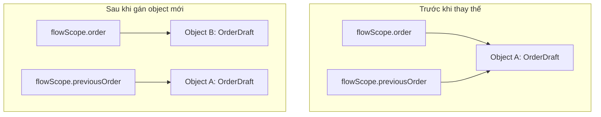

# Gán biến mới vào scope và cập nhật đối tượng đã có

## 1. Hai việc khác nhau khi ghi dữ liệu trong flow

Trong **Spring Web Flow** (`SPRING_WEB_FLOW`), expression được dùng để đọc dữ liệu, gọi phương thức, đặt giá trị và điều phối state. Một flow đăng ký dịch vụ có thể cần tạo bản nháp lúc bắt đầu, lưu kết quả tra cứu ở một bước, rồi cập nhật một thuộc tính của bản nháp khi người dùng chọn phương án.

Hai thao tác thường bị nhầm:

1. **Gán một biến mới vào scope:** tạo một tên biến trong `flowScope`, `viewScope` hoặc scope khác để các bước tiếp theo có thể đọc.
2. **Cập nhật một đối tượng đã có:** thay đổi một thuộc tính hoặc phần tử bên trong object mà flow đang giữ, giữ nguyên tham chiếu object đó.

Ví dụ:

```xml
<!-- Tạo biến mới trong flow scope. -->
<set name="flowScope.deliveryQuote"
     value="deliveryService.quote(order)" />

<!-- Cập nhật thuộc tính trên object order đã tồn tại. -->
<set name="flowScope.order.status"
     value="'REVIEWED'" />
```

Cả hai đều dùng expression, nhưng **đích gán khác nhau**. Ở ví dụ thứ nhất, đích là một biến mới `deliveryQuote` trong flow scope. Ở ví dụ thứ hai, đích là thuộc tính `status` của object `order` đã có.

Spring Web Flow cung cấp hai cơ chế phổ biến:

- `<set name="..." value="..."/>`: đánh giá biểu thức giá trị và gán vào biểu thức đích.
- `<evaluate expression="..." result="..."/>`: thực thi một expression/action; nếu expression trả về giá trị và có `result`, lưu kết quả vào biểu thức đích.

> **Quy tắc thực hành:** Khi tạo biến mới, ghi rõ scope đích như `flowScope.summary`. Khi cập nhật object đã tồn tại, ghi rõ property path như `flowScope.order.status`. Việc gán lại cả biến object và thay đổi một property là hai thao tác khác nhau.

Bài thuộc chương **Biểu thức** của module `SPRING_WEB_FLOW`. Module học cách mô hình hóa hành trình nhiều bước bằng state, event, transition và subflow; thực hành form binding, validation, scope, phiên, Spring MVC và phục hồi lỗi. Vì vậy, bài này tập trung vào cách expression thay đổi dữ liệu trong execution mà không làm mờ vòng đời của object.

### Mục tiêu học tập

Sau bài này, bạn có thể:

1. Phân biệt expression đích và expression giá trị.
2. Tạo biến mới bằng `<set>` hoặc `<evaluate result>`.
3. Cập nhật property lồng nhau, phần tử collection và map của object hiện có.
4. Phân biệt thay thế reference object với thay đổi object tại chỗ.
5. Chọn đúng scope theo vòng đời dữ liệu.
6. Kết hợp expression với binding/validation và service.
7. Kiểm thử dữ liệu sau khi flow chuyển state, resume hoặc khôi phục snapshot.

## 2. Expression language và cách đọc một phép gán

Flow definition dùng expression language để tham chiếu bean, variable, scope và property. Trong các cấu hình Spring Web Flow phổ biến, Spring Expression Language (SpEL) được dùng; parser có thể được cấu hình qua `FlowBuilderServices`. Các ví dụ dưới đây sử dụng cú pháp SpEL.

Một phép gán có hai phía:

```xml
<set name="flowScope.discountRate"
     value="pricingService.discountRate(order)" />
```

| Thành phần | Ý nghĩa | Cách đọc |
| --- | --- | --- |
| `name` | Biểu thức đích có thể ghi | Nơi nhận giá trị |
| `value` | Biểu thức được đánh giá | Giá trị cần gán |
| `flowScope` | Scope đích | Vòng đời của biến |
| `discountRate` | Tên biến | Biến mới hoặc biến đã có |
| `pricingService.discountRate(order)` | Biểu thức nguồn | Gọi Spring bean để lấy giá trị |

**`name` không phải tên biến dạng chuỗi thông thường trong mọi trường hợp.** Nó là một expression chỉ tới vị trí có thể gán. Tương tự, `value` cũng được đánh giá chứ không phải lúc nào cũng là literal.

### 2.1. String literal trong SpEL

Giá trị chuỗi phải được đặt trong dấu nháy đơn bên trong expression:

```xml
<set name="flowScope.orderStatus"
     value="'DRAFT'" />
```

Nếu viết `value="DRAFT"`, parser sẽ hiểu `DRAFT` là tên biến/property cần phân giải, không nhất thiết là chuỗi chữ. Đây là lỗi thường gặp khi gán trạng thái dạng String.

### 2.2. Literal số và Boolean

```xml
<set name="flowScope.retryCount" value="0" />
<set name="flowScope.requiresReview" value="true" />
<set name="flowScope.maximumAttempts" value="3" />
```

Các literal số và Boolean không cần dấu nháy. Khi giá trị phải bind vào kiểu cụ thể, conversion service có thể tham gia; nên dùng kiểu Java phù hợp trong model thay vì lưu mọi dữ liệu dưới dạng chuỗi.

### 2.3. Đọc biến và ghi biến

Có thể dùng scope tường minh để đọc:

```xml
<evaluate expression="auditService.describe(flowScope.order)" />
```

Và ghi:

```xml
<set name="flowScope.orderStatus" value="flowScope.order.status" />
```

Trong expression phức tạp, ghi rõ scope làm code dễ đọc hơn và giảm nguy cơ biến trùng tên che khuất nhau. Tránh dựa vào thứ tự tìm kiếm biến ngầm định khi nhiều scope có thể chứa cùng một tên.

## 3. Tạo biến mới trong scope bằng set

Cú pháp tổng quát:

```xml
<set name="scopeName.variableName"
     value="expression" />
```

Ví dụ tạo một bản tóm tắt đơn hàng sau khi người dùng chọn giỏ:

```xml
<action-state id="calculateSummary">
    <set name="flowScope.summary"
         value="checkoutService.calculateSummary(flowScope.order)" />
    <transition on="success" to="reviewOrder" />
</action-state>
```

`flowScope.summary` được tạo khi action chạy. Biến này có thể được đọc ở các state tiếp theo trong cùng flow execution.

### 3.1. Tạo biến trong flowScope

`flowScope` phù hợp khi dữ liệu cần tồn tại qua nhiều view-state:

```xml
<on-start>
    <set name="flowScope.startedAt"
         value="T(java.time.Instant).now()" />
    <set name="flowScope.orderStatus"
         value="'DRAFT'" />
</on-start>
```

Ví dụ dùng SpEL static type reference `T(...)`. Nếu parser hoặc môi trường bảo mật không cho phép static type access, hãy tạo giá trị qua Spring bean/factory thay thế. Không cần lưu timestamp nếu nghiệp vụ không sử dụng nó.

### 3.2. Tạo biến trong viewScope

`viewScope` dành cho dữ liệu gắn với view-state hiện tại:

```xml
<view-state id="choosePlan" view="registration/plans">
    <on-render>
        <set name="viewScope.availablePlans"
             value="planService.availablePlans()" />
    </on-render>
    <transition on="next" to="review" />
</view-state>
```

`availablePlans` phục vụ view `choosePlan`. Khi rời view-state và vào view-state khác, view scope cũ không còn là nơi lưu dữ liệu dùng chung cho toàn flow. Nếu `review` cũng cần danh sách đó, hãy tính lại hoặc đặt kết quả ở `flowScope` nếu vòng đời dài hơn là cần thiết.

### 3.3. Tạo biến trong requestScope

`requestScope` chỉ dành cho dữ liệu của request hiện tại:

```xml
<on-start>
    <set name="requestScope.requestMarker"
         value="'launch-request'" />
</on-start>
```

Ví dụ này chỉ minh họa scope; `on-start` chạy khi flow bắt đầu, nên marker không phải biến được giữ qua các request sau. Nếu cần một correlation ID xuyên nhiều bước, đặt nó trong flow scope hoặc context logging thích hợp.

### 3.4. Gán thông báo vào flashScope

```xml
<transition on="saveDraft" to="review">
    <set name="flashScope.notice"
         value="'Bản nháp đã được cập nhật'" />
</transition>
```

`flashScope` thích hợp với thông báo ngắn hạn cần hiển thị ở lần render tiếp theo. Nó không phù hợp cho dữ liệu nghiệp vụ cần giữ qua nhiều bước hoặc cần phục hồi sau thời gian dài.

### 3.5. Tạo biến trong conversationScope

```xml
<set name="conversationScope.checkoutContext"
     value="checkoutService.createContext(order)" />
```

`conversationScope` có thể chia sẻ dữ liệu giữa flow cha và subflow trong cùng conversation. Dùng khi có nhu cầu phối hợp thật sự; nếu chỉ một flow cần dữ liệu thì `flowScope` có phạm vi nhỏ và dễ hiểu hơn.

## 4. Gán kết quả evaluate vào một biến mới

`<evaluate>` thực thi một expression. Khi expression trả về giá trị, thuộc tính `result` chỉ định nơi lưu kết quả:

```xml
<evaluate expression="pricingService.quote(order)"
          result="flowScope.quote" />
```

Đọc theo trình tự:

1. Web Flow đánh giá `pricingService.quote(order)`.
2. Phương thức service trả về một object quote.
3. Web Flow gán object trả về vào `flowScope.quote`.
4. Các state tiếp theo có thể đọc `flowScope.quote` khi execution còn tồn tại.

### 4.1. So sánh set và evaluate result

| Cú pháp | Vai trò | Khi nên dùng |
| --- | --- | --- |
| `<set name="flowScope.x" value="expression"/>` | Đánh giá giá trị rồi gán | Gán property, literal hoặc kết quả biểu thức đơn giản |
| `<evaluate expression="service.load()" result="flowScope.x"/>` | Chạy action/expression rồi lưu return value | Gọi service/action và lưu DTO trả về |
| `<evaluate expression="order.recalculate()"/>` | Chạy action không cần lưu return value | Gọi method cập nhật object hoặc side effect có chủ đích |

Hai cú pháp đầu có thể làm cùng một việc trong nhiều trường hợp. Chọn `set` khi mục đích chính là **gán**; chọn `evaluate` khi mục đích chính là **thực thi action** và kết quả trả về cần được lưu.

### 4.2. Lưu một DTO trả về từ service

```xml
<action-state id="loadQuote">
    <evaluate expression="quoteService.createQuote(flowScope.order)"
              result="flowScope.quote" />
    <transition on="success" to="reviewOrder" />
</action-state>
```

Nếu service trả một DTO khác null, outcome thông thường của action là `success`. Event điều hướng `success` và dữ liệu DTO `quote` là hai thứ riêng: `result` ghi object, còn transition khớp event của action.

### 4.3. Nếu expression không trả về giá trị

Không gán `result` cho một method không có giá trị trả về. Ví dụ:

```xml
<evaluate expression="auditService.recordViewed(order)" />
```

Nếu method chỉ trả `void`, không có object kết quả để lưu. Nếu cần một kết quả cho flow quyết định, thiết kế service trả DTO hoặc enum có ý nghĩa, thay vì cố lấy return value từ method void.

### 4.4. result cũng là biểu thức đích

`result` không phải tên field cố định. Nó có thể chỉ tới biến scope hoặc một property có thể ghi, tùy expression parser và khả năng writable của target:

```xml
<evaluate expression="pricingService.calculateTotal(order)"
          result="flowScope.order.total" />
```

Tuy nhiên, khi muốn **thay đổi một property đơn giản**, `<set>` thường rõ ý hơn. Dùng `result` cho một property path khi kết quả thực sự là return value của action và target property có setter hợp lệ.

## 5. Cập nhật property của một object đã tồn tại

Giả sử flow đã khai báo biến `order`:

```xml
<var name="order"
     class="com.example.checkout.OrderDraft" />
```

Web Flow khởi tạo object theo định nghĩa flow. Khi muốn cập nhật trạng thái:

```xml
<set name="flowScope.order.status"
     value="'REVIEWED'" />
```

Thao tác này thay đổi property `status` trên object `order`. Nó **không thay toàn bộ object order** bằng một object mới.

### 5.1. Cập nhật nhiều thuộc tính

```xml
<set name="flowScope.order.customerName"
     value="requestParameters.customerName" />
<set name="flowScope.order.deliveryMethod"
     value="requestParameters.deliveryMethod" />
<set name="flowScope.order.status"
     value="'READY_FOR_REVIEW'" />
```

Đây là ví dụ cú pháp; với dữ liệu form thực tế, nên dùng model binding và validator của view-state thay vì đọc raw request parameters rồi gán trực tiếp. Request parameter là dữ liệu không đáng tin cậy.

### 5.2. Cập nhật object lồng nhau

Nếu `order.shippingAddress` đã được khởi tạo:

```xml
<set name="flowScope.order.shippingAddress.postalCode"
     value="requestParameters.postalCode" />
```

Expression đi theo property path:

```text
flowScope
  └── order
      └── shippingAddress
          └── postalCode
```

Nếu `shippingAddress` đang là `null`, parser không thể tự đi tiếp để gán `postalCode`. Hãy khởi tạo object lồng nhau trước:

```xml
<set name="flowScope.order.shippingAddress"
     value="addressFactory.createEmptyAddress()" />
<set name="flowScope.order.shippingAddress.postalCode"
     value="requestParameters.postalCode" />
```

Factory/service là Spring bean do ứng dụng cung cấp. Trong domain model, constructor/factory nên tạo object ở trạng thái hợp lệ hoặc rõ ràng là bản nháp chưa hoàn chỉnh.

### 5.3. Cập nhật phần tử list

Với một collection có thể truy cập theo index:

```xml
<set name="flowScope.order.items[0].quantity"
     value="2" />
```

Ví dụ giả định `items` không rỗng, phần tử đầu tiên có property `quantity` có thể ghi. Nếu list chưa có phần tử hoặc index không hợp lệ, expression sẽ thất bại. Không dựa vào phép gán để tự tạo phần tử collection.

### 5.4. Cập nhật giá trị trong map

Với map thuộc tính của object:

```xml
<set name="flowScope.order.attributes['campaign']"
     value="'SPRING'" />
```

Ví dụ dùng cú pháp index của SpEL. Map `attributes` phải được khởi tạo và hỗ trợ key ghi được. Khi key có thể do người dùng cung cấp, hãy kiểm tra allowlist và tránh cho phép ghi tùy ý vào thuộc tính nhạy cảm.

## 6. Thay reference object khác với cập nhật object tại chỗ

Đây là khác biệt quan trọng khi làm việc với flow scope.

Giả sử `flowScope.order` đang trỏ tới object A.

**Cập nhật một property:**

```xml
<set name="flowScope.order.status"
     value="'REVIEWED'" />
```

Object A vẫn là object được tham chiếu; chỉ property `status` thay đổi.

**Thay thế cả biến bằng object B:**

```xml
<set name="flowScope.order"
     value="orderFactory.createReplacement(order)" />
```

Bây giờ `flowScope.order` trỏ tới object B. Nếu một biến khác cũng đang tham chiếu A, biến kia vẫn giữ object A. Phép gán không tự cập nhật mọi reference đang trỏ tới object cũ.

### 6.1. Minh họa reference



Nếu mục đích là sửa một trường, hãy gán vào property path. Nếu mục đích là tạo một bản thay thế hoặc bản sao, hãy gán vào biến scope. Đặt tên rõ để người đọc không nhầm hai ý định.

### 6.2. Khi nào nên thay object?

Các tình huống hợp lý:

- Tạo lại một draft sạch khi người dùng bắt đầu lại.
- Thay DTO cũ bằng kết quả mới từ service.
- Tạo một immutable value object mới thay cho object cũ.
- Thay một kết quả tìm kiếm bằng kết quả mới.

Không thay object chỉ để cập nhật một field đơn giản, trừ khi domain model được thiết kế bất biến và yêu cầu tạo object mới.

## 7. Dùng evaluate để gọi method cập nhật object

Không phải mọi cập nhật đều là phép gán property. Một object domain có thể cung cấp method bảo vệ invariant:

```java
public class OrderDraft implements Serializable {
    private String status;
    private final List<OrderItem> items = new ArrayList<>();

    public void addItem(OrderItem item) {
        if (item == null) {
            throw new IllegalArgumentException("item is required");
        }
        items.add(item);
    }

    public void markReadyForReview() {
        if (items.isEmpty()) {
            throw new IllegalStateException("Order must contain an item");
        }
        this.status = "READY_FOR_REVIEW";
    }
}
```

Gọi method qua `evaluate`:

```xml
<evaluate expression="flowScope.order.addItem(flowScope.selectedItem)" />
<evaluate expression="flowScope.order.markReadyForReview()" />
```

Điểm khác với `set`:

- `set` phù hợp để gán một giá trị vào một vị trí cụ thể.
- `evaluate` phù hợp để gọi một method có hành vi, đặc biệt khi method tự kiểm tra invariant hoặc điều phối logic trên object.
- Nếu method có side effect bên ngoài object (ghi DB, gửi mail, thu tiền), phải đặt trong service với transaction/idempotency rõ ràng.

Không gọi method mutating từ một expression chỉ có ý nghĩa kiểm tra điều kiện. Hãy để flow XML thể hiện đúng rằng đây là một action.

## 8. Cập nhật dữ liệu trong các hook và transition

`<set>` và `<evaluate>` có thể xuất hiện trong nhiều điểm của flow definition. Thời điểm thực thi ảnh hưởng dữ liệu nhận được và vòng đời biến.

| Vị trí | Khi chạy | Ví dụ |
| --- | --- | --- |
| `<on-start>` | Khi flow bắt đầu | Tạo draft hoặc operation ID |
| `<on-entry>` | Mỗi lần vào state | Đặt mặc định cho state |
| `<on-render>` | Trước khi render view | Nạp danh sách hiển thị |
| Bên trong `<transition>` | Khi transition được chọn | Cập nhật model theo event |
| Trong `<action-state>` | Khi engine thực thi action-state | Tạo quote, gọi service |
| `<on-exit>` | Khi rời state | Ghi nhận hoặc dọn dữ liệu theo thiết kế |
| `<on-end>` | Khi flow kết thúc | Cleanup/audit phù hợp |

Ví dụ:

```xml
<view-state id="editOrder" view="checkout/edit">
    <on-entry>
        <set name="flowScope.order.status"
             value="'EDITING'" />
    </on-entry>

    <on-render>
        <set name="viewScope.shippingMethods"
             value="shippingService.availableMethods(order)" />
    </on-render>

    <transition on="next" to="review">
        <set name="flowScope.order.status"
             value="'REVIEWED'" />
    </transition>
</view-state>
```

`on-entry` có thể chạy lại khi người dùng quay lại state. `on-render` có thể chạy nhiều lần trong cùng state do Refresh, render lại sau validation hoặc Ajax. Vì vậy, tránh đặt các phép ghi dữ liệu nghiệp vụ không idempotent trong `on-render`.

## 9. Scope nào phù hợp cho biến mới?

| Scope | Vòng đời | Khi nên dùng | Ví dụ |
| --- | --- | --- | --- |
| `requestScope` | Một request flow | Giá trị tạm không cần giữ sau request | `requestScope.requestLabel` |
| `flashScope` | Ngắn hạn tới lần render theo cơ chế Web Flow | Thông báo một lần | `flashScope.notice` |
| `viewScope` | View-state hiện tại | Dữ liệu chỉ dùng cho trang đó | `viewScope.availablePlans` |
| `flowScope` | Suốt flow session | Bản nháp, lựa chọn và kết quả nhiều bước | `flowScope.order` |
| `conversationScope` | Toàn conversation gồm parent/subflow | Context dùng chung nhiều flow liên quan | `conversationScope.customerContext` |

### 9.1. Chọn scope theo câu hỏi

- Biến có cần tồn tại sau khi rời view-state không? Nếu không, `viewScope` có thể đủ.
- Biến có cần qua nhiều bước trong cùng flow không? Dùng `flowScope`.
- Biến có cần chia sẻ với subflow trong cùng conversation không? Cân nhắc `conversationScope`.
- Biến chỉ cần trong lần request hiện tại? Dùng `requestScope`.
- Biến chỉ là thông báo sau thao tác? Dùng `flashScope`.

### 9.2. Flow variable và biến tạo động

Khai báo flow variable:

```xml
<var name="order"
     class="com.example.checkout.OrderDraft" />
```

`<var>` khai báo một flow variable có vòng đời trong flow session. Đây là lựa chọn rõ ràng cho object cốt lõi như `order` hoặc `registration`.

Tạo biến động bằng expression:

```xml
<set name="flowScope.quote"
     value="quoteService.createQuote(order)" />
```

Cách thứ hai hữu ích cho dữ liệu được tạo trong quá trình chạy. Không cần khai báo mọi biến tạm trong XML, nhưng các biến cốt lõi có contract rõ thường nên dùng `<var>`.

### 9.3. Tránh trùng tên ở nhiều scope

Giả sử đồng thời có `flowScope.status` và `viewScope.status`. Nếu expression chỉ ghi `status`, kết quả phụ thuộc cơ chế tìm kiếm biến của parser/context và scope hiện hành. Điều đó làm code khó đọc.

Dùng:

```xml
<set name="flowScope.status" value="'DRAFT'" />
<set name="viewScope.status" value="'SHOWING_WARNING'" />
```

Với biến cần ghi hoặc đọc trong logic quan trọng, prefix scope tường minh là lựa chọn an toàn.

## 10. Binding form và cập nhật object hiện có

Một `view-state` có thể bind trực tiếp các field vào object trong flow scope:

```xml
<var name="registration"
     class="com.example.registration.RegistrationDraft" />

<view-state id="enterDetails"
            view="registration/details"
            model="registration">
    <binder>
        <binding property="fullName" required="true" />
        <binding property="email" required="true" />
    </binder>
    <transition on="next" to="review" />
</view-state>
```

Ở đây Web Flow binding cập nhật **object registration đã có**. Không cần thêm `<set>` cho từng input nếu model/binder đã xử lý việc bind.

Điều này khác với việc gán biến mới:

```xml
<set name="flowScope.registration"
     value="registrationFactory.createFrom(requestParameters)" />
```

Ví dụ thứ hai tạo một object mới từ request data. Nó có thể bỏ qua một số hành vi binder/validator mà view-state vốn cung cấp; không dùng như cách thay thế binding chuẩn nếu không có lý do rõ.

### 10.1. Validation trước khi chuyển state

Binding và validation nên được cấu hình trong view-state để lỗi hiển thị gần field. Nếu validation thất bại, transition `next` thường không được thực hiện và object draft vẫn ở state hiện tại để người dùng sửa.

### 10.2. Cập nhật property bằng set có bypass validation không?

`<set>` là phép gán expression, **không tự chạy toàn bộ form validation**. Nếu gán trực tiếp `flowScope.order.total`, Web Flow không tự hiểu rằng cần kiểm tra quy tắc tổng tiền hợp lệ của domain.

Với giá trị do client cung cấp, cần validate ở service/domain trước khi chấp nhận. Không dùng `set` để tin cậy dữ liệu từ hidden field hoặc request parameter.

### 10.3. Back và cancel

Một transition `back` có thể tắt validation nếu mục tiêu là cho người dùng quay lại:

```xml
<transition on="back"
            to="editOrder"
            validate="false" />
<transition on="cancel"
            to="cancelled"
            bind="false" />
```

`validate="false"` không có nghĩa là bỏ binding hoàn toàn; `bind="false"` bỏ binding/validation cho transition đó theo semantics Web Flow. Chọn dựa trên việc có muốn giữ các thay đổi vừa nhập hay không.

## 11. Cập nhật collection và object graph an toàn

Khi flow giữ một object graph có nhiều collection, expression có thể cập nhật phần tử nhưng cần hiểu trạng thái hiện tại:

```xml
<set name="flowScope.order.items[0].quantity"
     value="requestParameters.quantity" />
```

Các điều kiện cần có:

- `order` không null.
- `items` đã được khởi tạo.
- Collection có phần tử index 0.
- Phần tử có property `quantity` có thể ghi.
- Conversion từ request value sang kiểu số thành công.
- Giá trị nằm trong miền nghiệp vụ cho phép.

Nếu một điều kiện không thỏa, expression có thể lỗi hoặc dữ liệu không hợp lệ được gán. Với form phức tạp, nên dùng model binding, validator hoặc method domain như `order.changeQuantity(itemId, quantity)`.

Ví dụ method domain:

```xml
<evaluate expression="flowScope.order.changeQuantity(
    flowScope.selectedItemId,
    flowScope.requestedQuantity)" />
```

Method có thể kiểm tra item có thuộc đơn hàng không, quantity dương và không vượt giới hạn. Đây là cách giữ invariant trong domain model.

## 12. Gán dữ liệu từ service: giữ DTO hay cập nhật object?

Hai mẫu:

**Mẫu A — Lưu DTO mới:**

```xml
<evaluate expression="pricingService.calculate(order)"
          result="flowScope.priceQuote" />
```

`priceQuote` là kết quả tính toán riêng. Dùng khi muốn giữ snapshot giá/đề xuất để hiển thị hoặc so sánh.

**Mẫu B — Service cập nhật object hiện có:**

```xml
<evaluate expression="orderPricingService.applyQuote(order)" />
```

Service lấy dữ liệu mới và cập nhật object `order` theo contract của nó. Dùng khi hành vi domain chủ động thay đổi aggregate.

### So sánh

| Câu hỏi | Lưu DTO mới | Cập nhật object hiện có |
| --- | --- | --- |
| Reference của order thay đổi? | Không, nếu DTO riêng | Không, nếu mutate tại chỗ |
| Có object kết quả mới? | Có | Không nhất thiết |
| Dễ giữ lịch sử báo giá? | Có thể giữ nhiều DTO/version | Cần cơ chế version/audit riêng |
| Kiểm thử | Assert DTO và scope | Assert state sau mutation |
| Rủi ro | DTO cũ có thể lỗi thời | Object mutable khó theo dõi nếu sửa ở nhiều nơi |

Không mặc định giữ một DTO là giá trị có thẩm quyền cuối cùng. Khi xác nhận, service phải tính/kiểm tra lại các giá trị cần thiết theo chính sách nghiệp vụ.

## 13. Lỗi thường gặp khi gán biến và cập nhật object

| Triệu chứng | Nguyên nhân thường gặp | Cách xử lý |
| --- | --- | --- |
| Biến mới không xuất hiện ở state sau | Gán vào request/view scope quá ngắn | Chọn `flowScope` hoặc scope cần thiết |
| Giá trị chuỗi bị coi là tên biến | Quên dấu nháy đơn trong SpEL | Dùng `value="'DRAFT'"` |
| Ghi vào object gây lỗi null | Object hoặc property lồng nhau chưa khởi tạo | Tạo object qua factory trước |
| Index collection không tồn tại | List rỗng hoặc index sai | Kiểm tra collection, dùng domain method |
| Thay object nhưng biến khác vẫn giữ dữ liệu cũ | Đã thay reference một biến, không thay các reference khác | Hiểu aliasing; cập nhật đúng object |
| Property không được cập nhật | Getter/setter hoặc property access không phù hợp | Kiểm tra writable property và parser |
| Dữ liệu request ghi đè giá trị tin cậy | Gán raw request parameter không validate | Dùng binder/validator/service |
| Giá trị mất khi resume | Scope/repository/session không còn | Kiểm tra execution key và repository |
| Snapshot không lưu được | Object trong scope không serialize được | Lưu DTO phù hợp hoặc ID thay vì resource |
| Service bị gọi nhiều lần | Gọi trong on-render/on-entry hoặc event replay | Chuyển side effect sang action rõ ràng, thêm idempotency |
| Biến cùng tên cho kết quả khó đoán | Có biến trùng ở nhiều scope | Prefix scope tường minh |
| Result không được gán | Expression không trả giá trị hoặc target không writable | Kiểm tra return type và setter |
| Model view khác object flow mong đợi | Tạo object mới thay vì bind model hiện tại | Kiểm tra `model` và cách gán reference |

### 13.1. Null và property path

Một path như:

```text
flowScope.order.shippingAddress.postalCode
```

đòi hỏi mọi mắt xích trước property cuối đều tồn tại. SpEL không tự tạo `order` hoặc `shippingAddress` khi đi qua một path null. Khởi tạo object trước hoặc dùng một factory method tạo aggregate hợp lệ.

### 13.2. Type conversion

Nếu `quantity` là `Integer` nhưng request parameter là chuỗi, cần conversion service phù hợp. Với các giá trị như tiền, ngày hoặc enum, cấu hình converter/formatter rõ ràng và validate miền giá trị sau conversion.

### 13.3. Method invocation và side effect

Expression có thể gọi method. Điều đó không có nghĩa mọi method đều nên được gọi từ bất kỳ vị trí XML nào. Predicate trong `decision-state` nên thuần; `on-render` nên ưu tiên đọc dữ liệu; thao tác ghi nên nằm trong action/service có transaction và idempotency.

## 14. Persistence, serialization và execution snapshot

Các scope của Web Flow có thể được lưu cùng execution tùy repository. Vì vậy, object trong scope phải phù hợp với vòng đời lưu trữ:

- DTO/model nên serializable khi repository/session replication yêu cầu.
- Không lưu trực tiếp `EntityManager`, JDBC connection, file stream hoặc request/response object.
- Không lưu entity graph quá lớn chỉ để tránh truy vấn lại.
- Tránh giữ thông tin nhạy cảm lâu hơn cần thiết.
- Dữ liệu cần tồn tại qua session timeout phải được lưu trong persistence nghiệp vụ.

### 14.1. Object mutable và snapshot cũ

Nếu execution được lưu thành snapshot, một browser tab có thể giữ key tới snapshot trước. Khi resume, object graph được khôi phục theo snapshot đó. Thay đổi ở một execution snapshot không đồng nghĩa cập nhật mọi snapshot khác.

Vì vậy:

- Không coi object trong flow scope là dữ liệu dùng chung giữa các tab.
- Không dựa vào snapshot để giải quyết concurrency nghiệp vụ.
- Dùng optimistic locking/version hoặc transaction phù hợp nếu nhiều execution cùng cập nhật một bản ghi.
- Kiểm tra quyền và trạng thái mới nhất ở service trước khi ghi.

### 14.2. Scope không thay thế database

`flowScope.order` là bản nháp phục vụ hành trình. Nếu đơn hàng cần tồn tại sau khi flow kết thúc, service phải lưu nó vào database. Flow có thể giữ `orderId` hoặc receipt để chuyển sang trang kết quả, nhưng database mới là nguồn dữ liệu bền vững.

## 15. Ví dụ hoàn chỉnh: tạo biến quote và cập nhật draft

Yêu cầu:

1. Khởi tạo draft khi flow bắt đầu.
2. Người dùng nhập số lượng.
3. Tính quote và lưu vào flow scope.
4. Đánh dấu draft đã được xem lại.
5. Người dùng có thể quay lại sửa số lượng.
6. Khi xác nhận, service kiểm tra lại và lưu đơn.

```xml
<?xml version="1.0" encoding="UTF-8"?>
<flow xmlns="http://www.springframework.org/schema/webflow"
      xmlns:xsi="http://www.w3.org/2001/XMLSchema-instance"
      xsi:schemaLocation="
        http://www.springframework.org/schema/webflow
        https://www.springframework.org/schema/webflow/spring-webflow.xsd">

    <on-start>
        <set name="flowScope.order"
             value="orderFactory.createDraft()" />
        <set name="flowScope.order.status"
             value="'DRAFT'" />
    </on-start>

    <view-state id="editOrder"
                view="checkout/edit"
                model="order">
        <binder>
            <binding property="quantity" required="true" />
        </binder>
        <transition on="next" to="calculateQuote" />
        <transition on="cancel"
                    to="cancelled"
                    bind="false" />
    </view-state>

    <action-state id="calculateQuote">
        <evaluate expression="pricingService.calculate(order)"
                  result="flowScope.quote" />
        <transition on="success" to="reviewOrder" />
    </action-state>

    <view-state id="reviewOrder" view="checkout/review">
        <on-entry>
            <set name="flowScope.order.status"
                 value="'REVIEWED'" />
        </on-entry>

        <transition on="back"
                    to="editOrder"
                    validate="false">
            <set name="flowScope.order.status"
                 value="'DRAFT'" />
        </transition>

        <transition on="confirm" to="submitOrder" />
    </view-state>

    <action-state id="submitOrder">
        <evaluate expression="orderService.submit(order, quote)"
                  result="flowScope.receipt" />
        <transition on="success" to="completed" />
    </action-state>

    <end-state id="completed" />
    <end-state id="cancelled" />
</flow>
```

Các bean `orderFactory`, `pricingService` và `orderService` là thành phần ứng dụng cần triển khai. `OrderDraft` và `Quote` phải có kiểu dữ liệu phù hợp với view, scope và repository. Ví dụ chỉ minh họa cú pháp và trách nhiệm; service submit phải kiểm tra lại giá, số lượng, quyền và tính idempotent.

### 15.1. Đọc kết quả tại view review

View `checkout/review` có thể đọc `order` và `quote` qua scope lookup:

```html
<section>
    <p>Trạng thái: <span>REVIEWED</span></p>
    <p>Số lượng: <span>...</span></p>
    <p>Giá dự kiến: <span>...</span></p>
</section>
```

Template engine cần bind các property thực tế; đoạn HTML chỉ minh họa vị trí hiển thị. Không gửi toàn bộ giá trị tin cậy về browser rồi nhận lại để tạo đơn mà không tính/kiểm tra lại phía server.

### 15.2. Người dùng quay lại và thay đổi dữ liệu

Khi event `back` quay về `editOrder`, object `order` vẫn là object flow đang giữ, nhưng quote trước đó có thể đã lỗi thời sau khi quantity thay đổi.

Có hai hướng:

- Luôn tính lại quote khi đi qua `calculateQuote`, như flow trên.
- Đặt cờ/version để xác định quote có còn khớp draft hay không.

Không chỉ đổi `order.quantity` rồi tiếp tục dùng `quote.total` cũ. Dữ liệu liên quan phải được tính lại hoặc xác minh lại trước khi submit.

## 16. Kiểm thử việc gán và cập nhật

Kiểm thử nên xác minh cả **giá trị** và **scope** nhận giá trị.

### 16.1. Test biến mới

Kịch bản:

1. Khởi chạy flow.
2. Đi tới action-state tạo quote.
3. Kiểm tra `flowScope.quote` tồn tại.
4. Kiểm tra kiểu object và các thuộc tính.
5. Chuyển sang view-state tiếp theo và xác nhận view đọc được quote.

### 16.2. Test cập nhật object hiện có

Kịch bản:

1. Tạo `flowScope.order`.
2. Giữ lại reference trong test context.
3. Chạy `set name="flowScope.order.status"`.
4. Xác minh property status thay đổi.
5. Xác minh reference của `order` vẫn là object ban đầu.

Ngược lại, khi gán một object mới vào `flowScope.order`, kiểm tra reference đã thay đổi và object tham chiếu cũ không bị sửa ngoài ý muốn.

### 16.3. Test scope lifecycle

| Test | Kỳ vọng |
| --- | --- |
| Gán `flowScope.x` ở action-state | Đọc được ở view-state tiếp theo |
| Gán `viewScope.x` ở view-state | Đọc được trong view-state đó |
| Rời view-state | Không dùng view scope cũ làm dữ liệu dài hạn |
| Gán `flashScope.notice` | Hiển thị trong khoảng flash hợp lệ |
| Gán `requestScope.x` | Không kỳ vọng tồn tại ở request mới |
| Resume execution | Flow scope khôi phục nếu execution/repository còn hợp lệ |
| Kết thúc flow | Không dựa vào flow scope làm persistence lâu dài |

### 16.4. Test lỗi expression

Các ca nên kiểm tra:

- Tên biến scope sai.
- Bean Spring không tồn tại.
- Method không tồn tại hoặc sai kiểu tham số.
- Property không có setter.
- Object lồng nhau là null.
- Collection index không hợp lệ.
- Value không convert được sang kiểu đích.
- Object trong scope không đáp ứng yêu cầu serialization của repository.

Không cần chỉ test parser; hãy kiểm tra đường chạy thật của flow và state nơi expression được thực thi.

## 17. Checklist thiết kế

Trước khi thêm một phép gán vào flow XML:

1. Xác định đang **tạo biến mới**, **thay reference** hay **cập nhật object hiện có**.
2. Chọn scope theo vòng đời dữ liệu.
3. Dùng tên scope tường minh trong biểu thức đích.
4. Dùng `<set>` cho phép gán đơn giản; dùng `<evaluate result>` khi thực thi action trả về giá trị.
5. Khởi tạo object lồng nhau và collection trước khi ghi property/index.
6. Ưu tiên domain method khi cần bảo vệ invariant thay vì set thẳng property.
7. Không gán raw request parameter vào property nhạy cảm mà bỏ qua validation.
8. Tránh side effect trong `decision-state` predicate hoặc `on-render`.
9. Đảm bảo object phù hợp với serialization/snapshot policy.
10. Kiểm tra dữ liệu mới nhất và idempotency ở service khi thực hiện ghi nghiệp vụ.

### Câu hỏi tự luyện

1. `<set name="flowScope.quote" value="quoteService.create(order)"/>` tạo biến ở đâu và giữ được bao lâu?
2. Khác biệt giữa `result="flowScope.quote"` và `name="flowScope.order.status"` là gì?
3. Khi nào nên dùng `<evaluate>` thay cho `<set>`?
4. Vì sao string literal `DRAFT` cần viết thành `'DRAFT'` trong SpEL?
5. `flowScope.order.shippingAddress.postalCode` có thể lỗi trong trường hợp nào?
6. Gán object mới vào `flowScope.order` có cập nhật reference mà biến khác đang giữ không?
7. Tại sao `viewScope` không thích hợp cho quote cần đọc ở nhiều state?
8. Binding form vào model khác gì tạo một object mới từ request parameters?
9. Vì sao `<set>` không thay thế domain validation?
10. Tại sao không nên gọi method thu tiền trong `on-render`?
11. Một object trong flow scope cần đáp ứng yêu cầu nào khi repository snapshot?
12. Nếu người dùng quay lại sửa số lượng, vì sao quote cũ phải được tính lại hoặc kiểm tra version?

## Tài liệu tham khảo

- [Spring Web Flow 3.0.2 Reference Guide — Actions](https://docs.spring.io/spring-webflow/docs/3.0.2/reference/#_actions)
- [Spring Web Flow 3.0.2 Reference Guide — Using Expression Language (EL)](https://docs.spring.io/spring-webflow/docs/3.0.2/reference/#_using_expression_language_el)
- [Spring Web Flow 3.0.2 Reference Guide — Variable Scopes](https://docs.spring.io/spring-webflow/docs/3.0.2/reference/#_variable_scopes)
- [Spring Web Flow 3.0.2 Reference Guide — Flow Variables](https://docs.spring.io/spring-webflow/docs/3.0.2/reference/#_flow_variables)
- [Spring Web Flow 3.0.2 Reference Guide — Executing Actions](https://docs.spring.io/spring-webflow/docs/3.0.2/reference/#_executing_actions)
- [Spring Framework Reference — Spring Expression Language](https://docs.spring.io/spring-framework/reference/core/expressions.html)

Các ví dụ sử dụng expression syntax phổ biến của Spring Web Flow 3.x và SpEL. Khi áp dụng vào dự án, hãy kiểm tra expression parser thực tế, conversion service, scope configuration, model property access và yêu cầu serialization của execution repository.
