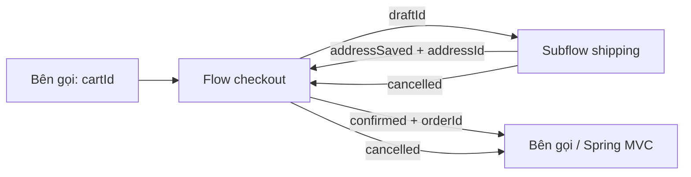

# Input và output như hợp đồng của một flow

Một hành trình web nhiều bước thường bắt đầu với một ít dữ liệu, tích lũy trạng thái trong quá trình tương tác, rồi kết thúc bằng một kết quả cụ thể. Ví dụ, hành trình thanh toán nhận `cartId`, cho người dùng kiểm tra đơn hàng và nhập địa chỉ giao hàng, cuối cùng trả về `orderId` nếu đặt hàng thành công. Nếu người dùng hủy, hành trình kết thúc với kết quả khác và không có mã đơn hàng.

Trong **Spring Web Flow (SWF)**, ta mô hình hóa hành trình đó bằng **flow**, **state**, **event**, **transition** và **subflow**. Hai thẻ XML `<input>` và `<output>` giúp công bố rõ ràng dữ liệu nào được phép đi qua **ranh giới** của một flow. Chúng đóng vai trò gần giống danh sách tham số và giá trị trả về của một phương thức Java.

## 1. Mục tiêu học tập

Sau bài này, bạn có thể:

1. Giải thích vì sao input/output tạo thành một hợp đồng giữa flow và bên gọi.
2. Khai báo input bằng `name`, `type`, `required`, `value` và hiểu tác dụng của chuyển đổi kiểu.
3. Khai báo output ở `end-state`; phân biệt **outcome** (kết quả điều hướng) với **output attributes** (dữ liệu kết quả).
4. Truyền input vào subflow và nhận output của subflow qua `currentEvent.attributes`.
5. Phân biệt flow input với HTTP request parameters, form binding và các scope.
6. Thiết kế trường hợp lỗi, hủy, bảo mật và kiểm thử theo hợp đồng dữ liệu.

## 2. Xem flow như một thành phần có giao diện rõ ràng

Có thể hình dung một flow như một hàm:

```java
// Mô hình tư duy, không phải chữ ký API Java cần tự triển khai.
FlowOutcome checkout(Map<String, Object> inputAttributes);

// FlowOutcome bao gồm:
// - name: tên kết quả cuối cùng, ví dụ "confirmed" hoặc "cancelled"
// - outputAttributes: dữ liệu công khai cho bên gọi, ví dụ orderId
```

Kết quả đầu ra luôn có **hai phần riêng**:

| Thành phần | Ý nghĩa | Ví dụ |
| --- | --- | --- |
| Input attributes | Dữ liệu cần cung cấp để bắt đầu một flow | `cartId = 42` |
| Flow-local state | Dữ liệu nội bộ được lưu/biến đổi khi flow đang chạy | `checkout`, `addressForm` |
| Outcome name | Flow kết thúc theo nhánh nào | `confirmed`, `cancelled` |
| Output attributes | Dữ liệu được chủ động xuất tại nhánh kết thúc | `orderId = 915` |

Ví dụ hợp đồng thanh toán:

| Điều kiện | Outcome | Output |
| --- | --- | --- |
| Người dùng xác nhận và lưu thành công | `confirmed` | `orderId: Long` |
| Người dùng chọn hủy | `cancelled` | Không yêu cầu `orderId` |
| Dữ liệu gửi vào không hợp lệ | Flow không được khởi tạo thành công hoặc đi qua cơ chế xử lý lỗi đã cấu hình | Không hứa hẹn output thành công |

Việc khai báo `<input>` **không có nghĩa** mọi đối tượng nội bộ sẽ tự được đưa sang flow khác. Tương tự, chỉ vì `orderId` có trong `flowScope` cũng **không có nghĩa** bên gọi nhận được nó. Muốn trả một giá trị, phải khai báo output cho nhánh kết thúc tương ứng.

## 3. Khai báo input khi một flow bắt đầu

Trong file định nghĩa flow XML, khai báo `<input>` trực tiếp bên trong `<flow>`:

```xml
<flow xmlns="http://www.springframework.org/schema/webflow"
      xmlns:xsi="http://www.w3.org/2001/XMLSchema-instance"
      xsi:schemaLocation="http://www.springframework.org/schema/webflow
                          https://www.springframework.org/schema/webflow/spring-webflow.xsd">

    <input name="cartId" type="long" required="true" />
    <input name="couponCode" />

    <on-start>
        <evaluate expression="checkoutService.open(cartId)"
                  result="flowScope.checkout" />
    </on-start>

    <view-state id="reviewCart" />
</flow>
```

Ở đây, `cartId` và `couponCode` là **tên input chính thức** của flow; `cartId` bắt buộc và được chuyển về kiểu `long` nếu cần. Sau khi input được ánh xạ, có thể dùng `cartId` trong biểu thức của `on-start`. Khi không khai báo đích riêng, input được lưu trong `flowScope` dưới đúng tên của nó.

### 3.1. Ý nghĩa của từng thuộc tính

| Thuộc tính | Ví dụ | Vai trò |
| --- | --- | --- |
| `name` | `name="cartId"` | Tên input mà bên gọi phải cung cấp |
| `type` | `type="long"` | Kiểu mong đợi; SWF thử chuyển đổi nếu giá trị truyền vào chưa đúng kiểu |
| `required` | `required="true"` | Từ chối input thiếu, `null` hoặc rỗng theo quy tắc kiểm tra của framework |
| `value` | `value="flowScope.cartId"` | Biểu thức **đích** để gán input vào trong flow đang được khởi tạo |

Nếu bỏ `required`, input có thể vắng mặt. Nếu bỏ `type`, framework sử dụng thông tin kiểu có thể suy ra từ biểu thức đích, hoặc giữ giá trị theo khả năng ánh xạ hiện có. Không nên giả định một chuỗi bất kỳ chắc chắn được chuyển đổi thành kiểu nghiệp vụ tùy ý.

Ví dụ gán tường minh vào đích:

```xml
<input name="cartId"
       type="long"
       required="true"
       value="flowScope.cartId" />
```

Hai cách dưới đây có mục đích khác nhau:

```xml
<!-- Đầu flow: value là nơi tiếp nhận giá trị đầu vào. -->
<input name="cartId" value="flowScope.cartId" />

<!-- Trong subflow-state: value là biểu thức lấy dữ liệu ở flow cha
     để truyền cho input có tên draftId của flow con. -->
<subflow-state id="editShipping" subflow="shipping">
    <input name="draftId" value="checkout.id" />
    <transition on="cancelled" to="reviewCart" />
</subflow-state>
```

Đây là một điểm rất dễ nhầm: cùng thuộc tính `value`, nhưng **ngữ cảnh của thẻ** quyết định chiều ánh xạ. Trong `<flow>`, nó chỉ nơi **nhận** input; trong `<subflow-state>`, nó chỉ biểu thức **lấy** dữ liệu để **gửi** sang flow con.

### 3.2. `required` và `type` không thay thế kiểm tra nghiệp vụ

Khai báo `<input name="cartId" type="long" required="true" />` giúp đảm bảo flow nhận một giá trị có kiểu phù hợp; nó **không chứng minh** rằng giỏ hàng tồn tại, thuộc về người đang đăng nhập, chưa bị khóa hoặc còn được phép đặt hàng. Các điều kiện này phải được kiểm tra tại service/authorization phù hợp trước khi thực hiện thao tác nghiệp vụ.

Ngoài ra, `required="true"` xử lý tính hiện diện của input khi khởi chạy; không phải bộ kiểm tra tất cả ràng buộc của form nhiều bước. Form binding và validation là một tầng xử lý khác, sẽ được phân biệt ở phần sau.

## 4. Khai báo output khi một flow kết thúc

Output được đặt **bên trong `<end-state>`**, bởi mỗi nhánh kết thúc có thể có kết quả và dữ liệu khác nhau:

```xml
<end-state id="confirmed">
    <output name="orderId" value="flowScope.orderId" />
</end-state>

<end-state id="cancelled" />
```

Khi flow đến `confirmed`, bên gọi nhận:

```text
outcome.name = "confirmed"
outcome.outputAttributes = { "orderId": 915 }
```

Khi flow đến `cancelled`, bên gọi nhận outcome `cancelled` và không được giả định có `orderId`. Điều này làm cho các nhánh thành công/hủy trở nên dễ kiểm tra và dễ thay đổi độc lập.

Hai kiểu khai báo thông dụng:

```xml
<!-- Không có value: lấy thuộc tính có tên orderId từ flowScope. -->
<output name="orderId" />

<!-- Có value: tính giá trị từ biểu thức chỉ định. -->
<output name="orderId" value="checkout.persistedOrderId" />
```

`name` là **tên mà bên gọi nhìn thấy**; `value` là **nguồn dữ liệu nội bộ** để tạo output. Nhờ đó có thể giữ ổn định tên hợp đồng công khai, kể cả khi cấu trúc dữ liệu bên trong flow thay đổi.

Lưu ý: `output` không tự thực hiện ghi database hay xác nhận giao dịch. Nó chỉ xuất một giá trị tại thời điểm flow kết thúc. Nếu việc tạo `orderId` chưa thực sự thành công, không nên điều hướng tới `confirmed`.

## 5. Ví dụ đầy đủ: checkout gọi subflow nhập địa chỉ

Giả sử ứng dụng Spring MVC có hai flow:

- `checkout` chịu trách nhiệm rà soát giỏ hàng, chọn địa chỉ, đặt hàng.
- `shipping` là bước dùng lại được: nhận ID bản nháp đơn hàng, cho sửa địa chỉ và trả về ID địa chỉ đã lưu.

Quan hệ giữa chúng:



### 5.1. Flow cha: `checkout-flow.xml`

Đây là ví dụ minh họa một định nghĩa flow; các bean `checkoutService` và view phải được ứng dụng cung cấp.

```xml
<flow xmlns="http://www.springframework.org/schema/webflow"
      xmlns:xsi="http://www.w3.org/2001/XMLSchema-instance"
      xsi:schemaLocation="http://www.springframework.org/schema/webflow
                          https://www.springframework.org/schema/webflow/spring-webflow.xsd">

    <!-- Hợp đồng đầu vào của checkout. -->
    <input name="cartId" type="long" required="true" />

    <on-start>
        <evaluate expression="checkoutService.open(cartId)"
                  result="flowScope.checkout" />
    </on-start>

    <view-state id="reviewCart">
        <transition on="editShipping" to="editShipping" />
        <transition on="placeOrder" to="submitOrder" />
        <transition on="cancel" to="cancelled" />
    </view-state>

    <!-- Hợp đồng khi gọi shipping: truyền checkout.id với tên draftId. -->
    <subflow-state id="editShipping" subflow="shipping">
        <input name="draftId" value="checkout.id" />

        <transition on="addressSaved" to="reviewCart">
            <evaluate expression="checkoutService.attachAddress(
                      checkout, currentEvent.attributes.addressId)" />
        </transition>

        <transition on="cancelled" to="reviewCart" />
    </subflow-state>

    <action-state id="submitOrder">
        <evaluate expression="checkoutService.place(checkout)"
                  result="flowScope.orderId" />
        <transition on="success" to="confirmed" />
    </action-state>

    <!-- Hợp đồng đầu ra của checkout. -->
    <end-state id="confirmed">
        <output name="orderId" value="flowScope.orderId" />
    </end-state>

    <end-state id="cancelled" />
</flow>
```

Tham số truyền sang `shipping` được lấy từ `checkout.id` của flow cha nhưng mang **tên hợp đồng** `draftId` ở flow con. Khi flow con kết thúc bằng `addressSaved`, Web Flow phát sự kiện có ID `addressSaved` để flow cha chọn `<transition on="addressSaved">`. Output `addressId` xuất hiện trong `currentEvent.attributes.addressId` tại transition đó.

Phương thức `checkoutService.place(checkout)` trong ví dụ trả về ID đơn hàng sau khi lưu thành công. Kết quả của `<evaluate>` được lưu vào `flowScope.orderId`; chuyển hướng `success` chỉ biểu diễn đường đi thông thường khi action thực hiện thành công. Trong ứng dụng thật cần bổ sung nhánh xử lý lỗi nghiệp vụ, chẳng hạn giỏ hàng hết hiệu lực hoặc đặt hàng bị từ chối.

### 5.2. Flow con: `shipping-flow.xml`

```xml
<flow xmlns="http://www.springframework.org/schema/webflow"
      xmlns:xsi="http://www.w3.org/2001/XMLSchema-instance"
      xsi:schemaLocation="http://www.springframework.org/schema/webflow
                          https://www.springframework.org/schema/webflow/spring-webflow.xsd">

    <!-- Nhận đúng tham số mà flow cha gửi đến. -->
    <input name="draftId" type="long" required="true" />

    <on-start>
        <evaluate expression="shippingService.newForm(draftId)"
                  result="flowScope.addressForm" />
    </on-start>

    <view-state id="editAddress" model="addressForm">
        <transition on="save" to="saveAddress" />
        <transition on="cancel" to="cancelled"
                    bind="false" validate="false" />
    </view-state>

    <action-state id="saveAddress">
        <evaluate expression="shippingService.save(draftId, addressForm)"
                  result="flowScope.addressId" />
        <transition on="success" to="addressSaved" />
    </action-state>

    <end-state id="addressSaved">
        <output name="addressId" value="flowScope.addressId" />
    </end-state>

    <end-state id="cancelled" />
</flow>
```

Trong `editAddress`, `model="addressForm"` yêu cầu Web Flow binding trường form vào đối tượng `addressForm` và chạy validation khi người dùng gửi sự kiện phù hợp. Khi binding hoặc validation thất bại, view được hiển thị lại để sửa dữ liệu; action `saveAddress` chưa được thực hiện. Transition `cancel` chủ động tắt binding/validation để người dùng có thể hủy ngay cả khi form còn lỗi.

Ở cuối `shipping`:

- `addressSaved` xuất `addressId`; flow cha đọc được output này.
- `cancelled` không có `addressId`; flow cha chỉ quay lại `reviewCart`, không gọi `attachAddress`.

**Không truy cập trực tiếp `flowScope.addressId` của flow con từ flow cha** như một biến chia sẻ ngầm. Ranh giới input/output giúp subflow có thể thay đổi cách lưu trạng thái nội bộ mà không phá vỡ flow cha.

### 5.3. Theo dõi dữ liệu trong một lượt chạy

| Thời điểm | Bên gửi → bên nhận | Giá trị/định dạng | Kết quả |
| --- | --- | --- | --- |
| Khởi chạy checkout | HTTP/MVC → checkout | `cartId="42"` | Ánh xạ thành `long`, lưu trong flow scope |
| Mở subflow | checkout → shipping | `draftId=checkout.id` | Shipping nhận input `draftId` |
| Lưu địa chỉ | shipping → checkout | `addressSaved` và `addressId=7` | Transition của checkout nhận `currentEvent.attributes.addressId` |
| Đặt hàng | checkout → bên gọi | `confirmed` và `orderId=915` | MVC hoặc flow handler xử lý kết quả |
| Hủy checkout | checkout → bên gọi | `cancelled`, không có `orderId` | Bên gọi xử lý nhánh hủy |

Số ID trong bảng chỉ minh họa. Sự kiện `addressSaved` không đồng nghĩa với tên output `addressId`; một bên là **tên nhánh kết thúc**, một bên là **giá trị đi kèm**.

## 6. Quan hệ với Spring MVC, request parameters và form binding

### 6.1. Bắt đầu flow từ HTTP request

Khi một flow được ánh xạ tới URL thông qua `FlowHandlerMapping` / `FlowHandlerAdapter` của Spring MVC, các HTTP request parameters được cung cấp vào input map lúc khởi chạy theo hành vi mặc định. Ví dụ, nếu ứng dụng đã cấu hình flow `checkout` tại `/checkout`, URL sau có thể bắt đầu hành trình:

```text
GET /checkout?cartId=42
```

`cartId` từ request được đối chiếu với `<input name="cartId" type="long" required="true" />`. Nếu ứng dụng cần kiểm soát chặt nguồn input, có thể cài đặt `FlowHandler` riêng và điều chỉnh `createExecutionInputMap(HttpServletRequest)` để chọn/chuẩn hóa dữ liệu được chuyển vào flow.

Không nhầm `cartId` trong URL với trạng thái được giữ suốt quá trình: request parameters tồn tại ở **request hiện tại**; sau khi được ánh xạ thành flow input, `cartId` nằm trong `flowScope` theo vòng đời flow, kể cả qua nhiều lần submit/resume.

### 6.2. Kết thúc flow và xử lý output trong MVC

Nếu checkout là flow top-level, Spring MVC có thể nhận outcome và output thông qua một `FlowHandler`. Mẫu logic tương ứng:

```java
// Phần thân minh họa của FlowHandler.handleExecutionOutcome(...)
if ("confirmed".equals(outcome.getId())) {
    Object orderId = outcome.getOutput().get("orderId");
    // Chuyển đến trang xem đơn hàng bằng ID đã xác thực ở service.
    return "contextRelative:/orders/" + orderId;
}
return "contextRelative:/cart";
```

Trong subflow, outcome trở thành sự kiện để flow cha chọn transition; trong flow top-level, outcome có thể được xử lý bởi `FlowHandler` để điều hướng về controller/trang khác. Đây là hai tình huống sử dụng cùng hợp đồng output, nhưng **bên nhận** khác nhau.

### 6.3. Flow input khác form binding

| Cơ chế | Kích hoạt khi nào? | Đọc dữ liệu gì? | Nhiệm vụ |
| --- | --- | --- | --- |
| `<input>` ở cấp flow | Khi bắt đầu flow | Input map từ bên gọi | Thiết lập hợp đồng tham số đầu vào |
| `<input>` trong `<subflow-state>` | Khi flow cha gọi flow con | Biểu thức của flow cha | Chuyển dữ liệu qua ranh giới subflow |
| `model` trong `<view-state>` | Khi người dùng tương tác và submit view | Các trường form | Bind/validate dữ liệu của bước hiện tại |
| `<output>` trong `<end-state>` | Khi một nhánh kết thúc được đạt tới | Biểu thức hoặc biến flow scope | Công bố kết quả cho bên gọi |

Ví dụ: `draftId` là input khi bắt đầu `shipping`; `addressForm.street` là trường form được bind trong view; `addressId` là output sau khi service lưu địa chỉ thành công. Ba dữ liệu này có vòng đời và ý nghĩa khác nhau.

## 7. Scope và ranh giới dữ liệu

Trong hành trình nhiều bước, việc chọn scope đúng giúp tránh mất dữ liệu hoặc làm lộ chi tiết nội bộ:

| Scope | Vòng đời khái quát | Phù hợp với |
| --- | --- | --- |
| `requestScope` / `requestParameters` | Một request HTTP | Đầu vào/tín hiệu của lượt tương tác hiện tại |
| `viewScope` | Trong một `view-state` | Trạng thái cần cho view đang hiển thị |
| `flowScope` | Từ lúc flow bắt đầu đến khi kết thúc | Dữ liệu dùng xuyên nhiều state trong cùng flow |
| `conversationScope` | Phạm vi conversation, có thể qua nhiều flow liên quan | Dữ liệu thực sự cần chia sẻ trong cả hành trình |
| `flashScope` | Dữ liệu tạm cho tương tác/hiển thị kế tiếp | Thông báo hoặc thông tin ngắn hạn |

Flow con có flow scope của chính nó. Cần dùng input/output khi muốn diễn đạt rõ dữ liệu qua ranh giới flow; chỉ dùng `conversationScope` khi thực sự chủ ý chia sẻ dữ liệu ở phạm vi lớn hơn. Các object được lưu trong scope có thể phải được lưu/khôi phục qua các request, vì vậy ưu tiên object gọn, có thể tuần tự hóa theo cơ chế persistence đang dùng; tránh nhét vào đó kết nối DB, stream hoặc đối tượng không thể phục hồi an toàn.

Việc truyền một đối tượng mutable sang subflow có thể tạo liên kết tham chiếu và tác động phụ khó kiểm soát. Với hợp đồng giữa các bước độc lập, truyền ID hoặc DTO nhỏ, rồi để service tải lại và kiểm tra quyền truy cập thường dễ quản lý hơn.

## 8. Thiết kế hợp đồng có lỗi, hủy và phục hồi

Một flow production cần mô tả rõ **đầu vào bắt buộc**, **những outcome có thể trả về**, và **output nào tồn tại ở từng outcome**:

1. **Input thiếu hoặc sai kiểu:** `required`/`type` giúp phát hiện sớm; ánh xạ lỗi sang trang/HTTP error thân thiện theo cơ chế xử lý exception của ứng dụng. Không kỳ vọng flow tự sửa dữ liệu sai.
2. **Input hợp lệ về kiểu nhưng sai nghiệp vụ:** service phải kiểm tra ID có tồn tại, trạng thái và quyền của người dùng; không tin giá trị từ URL.
3. **Form không hợp lệ:** cho người dùng ở lại `view-state`, hiển thị lỗi và nhập lại; chưa công bố outcome thành công.
4. **Subflow hủy:** xử lý `cancelled` riêng, không đọc output chỉ có ở `addressSaved`.
5. **Thao tác cuối bị lỗi:** không đến `confirmed` khi service chưa lưu thành công. Xác định rõ quy tắc retry và chống tạo đơn hàng hai lần nếu request được gửi lặp.
6. **Session hết hạn/flow execution không còn:** cần thiết kế điểm khôi phục phù hợp. Lưu trạng thái nghiệp vụ bền vững ở service/database nếu hành trình phải tiếp tục sau khi session mất; `flowScope` không phải giải pháp lưu trữ dài hạn.
7. **Thay đổi phiên bản hợp đồng:** đổi tên `draftId` hoặc `addressId` phải cập nhật đồng thời nơi gọi và nơi định nghĩa; có thể giữ nguyên tên output và đổi biểu thức `value` để giảm ảnh hưởng.

Ví dụ hợp đồng mong đợi cho `shipping`:

```text
Input:
  draftId: long, required

Outcomes:
  addressSaved:
    output addressId: ID của địa chỉ đã được lưu
  cancelled:
    không có output bắt buộc

Quy tắc nghiệp vụ:
  người dùng phải được phép sửa địa chỉ cho draftId
  địa chỉ được validate trước khi lưu
```

Những quy tắc nghiệp vụ trong hợp đồng trên là trách nhiệm của application/service; chúng không được tự động thực thi chỉ bằng các thẻ `<input>` và `<output>`.

## 9. Kiểm thử hợp đồng của flow

Spring Web Flow cung cấp `AbstractXmlFlowExecutionTests` để tải định nghĩa XML, bắt đầu flow với input map, phát event, kiểm tra state/outcome và mock subflow. Có thể thử trực tiếp hợp đồng bằng bảng trường hợp sau:

| Ca kiểm thử | Đầu vào/tác động | Kỳ vọng |
| --- | --- | --- |
| Bắt đầu thành công | `cartId="42"`, service trả checkout hợp lệ | Đến `reviewCart`; `cartId` được ánh xạ đúng kiểu |
| Thiếu input bắt buộc | Không có `cartId` | Bắt đầu flow bị từ chối theo ràng buộc input |
| Sai kiểu | `cartId="khong-phai-so"` | Chuyển đổi input thất bại, không thực hiện đặt hàng |
| Gọi subflow | Checkout có `id=100` | Shipping nhận `draftId=100` |
| Shipping lưu thành công | Subflow kết thúc `addressSaved` với `addressId=7` | Checkout đọc đúng `currentEvent.attributes.addressId` |
| Shipping hủy | Subflow kết thúc `cancelled` | Quay lại `reviewCart`; không gọi `attachAddress` |
| Checkout xác nhận | Service tạo `orderId=915` | Kết thúc `confirmed`, xuất `orderId=915` |
| Checkout hủy | Event `cancel` tại `reviewCart` | Kết thúc `cancelled`, không có output đơn hàng |
| Dữ liệu không được phép | `cartId` thuộc người dùng khác | Service từ chối; không trả outcome `confirmed` |

Đoạn kiểm thử khởi chạy dưới đây minh họa API của bộ kiểm thử Web Flow. Trong bộ test thực, cần bổ sung định nghĩa XML, mock `checkoutService` và các assert theo state cụ thể:

```java
// Bên trong một test kế thừa AbstractXmlFlowExecutionTests.
MutableAttributeMap input = new LocalAttributeMap();
input.put("cartId", "42");  // Mô phỏng giá trị chuỗi đến từ HTTP.

MockExternalContext context = new MockExternalContext();
startFlow(input, context);

assertCurrentStateEquals("reviewCart");
```

Với subflow, mock đầu ra `addressSaved`/`cancelled` để kiểm tra từng transition của flow cha. Với root flow, kiểm tra cả **ID của outcome** và **giá trị output**, vì chỉ assert đến `confirmed` sẽ bỏ sót lỗi quên khai báo `<output>` hoặc lấy sai nguồn dữ liệu.

## 10. Bài tập thực hành

Thiết kế flow `registration` tạo tài khoản qua ba bước: nhập thông tin, xác nhận email và hoàn tất. Yêu cầu:

1. Khai báo input `invitationCode` (bắt buộc) và `referralSource` (tùy chọn).
2. Tạo subflow `verifyEmail` nhận `email` và trả `verificationId` khi thành công; có outcome `cancelled` riêng.
3. Khi tài khoản được tạo, flow `registration` kết thúc `registered` với `accountId`; khi hủy, kết thúc `cancelled` không có `accountId`.
4. Viết ít nhất bốn test: thiếu lời mời, email xác minh thành công, hủy xác minh, đăng ký thành công có `accountId`.

**Gợi ý tự kiểm tra:** Có tên input nào phụ thuộc trực tiếp vào tên field nội bộ của subflow không? Flow cha có cố đọc biến `flowScope` của flow con không? Nhánh `cancelled` có vô tình giả định tồn tại output thành công không? Việc xác minh invitation code có nằm ở service không?

## 11. Những điểm cần nhớ

- `<input>` khai báo **dữ liệu đi vào flow**; `name` là tên hợp đồng, `type` hỗ trợ chuyển kiểu, `required` yêu cầu có giá trị, `value` ở cấp flow là biểu thức **đích**.
- `<output>` khai báo **dữ liệu đi ra tại một `end-state`**; output của nhánh này không tự xuất hiện ở nhánh khác.
- `end-state` trả về **outcome name** để quyết định điều hướng; output attributes trả về **dữ liệu** cho bên gọi.
- Tại `<subflow-state>`, `<input name="x" value="..."/>` lấy dữ liệu từ flow cha; khi subflow kết thúc, flow cha đọc output bằng `currentEvent.attributes.x` trong transition phù hợp.
- Input/output là hợp đồng giao tiếp, còn form binding, validation, authorization, lưu database và phục hồi session cần được thiết kế ở các tầng tương ứng.

### Tài liệu tham khảo

- [Spring Web Flow Reference Guide 3.0.2 — Input/Output Mapping](https://docs.spring.io/spring-webflow/docs/3.0.x/reference/#_inputoutput_mapping)
- [Spring Web Flow Reference Guide 3.0.2 — Calling Sub-flows](https://docs.spring.io/spring-webflow/docs/3.0.x/reference/#_calling_sub_flows)
- [Spring Web Flow Reference Guide 3.0.2 — Spring MVC Integration và Testing Flows](https://docs.spring.io/spring-webflow/docs/3.0.x/reference/)
