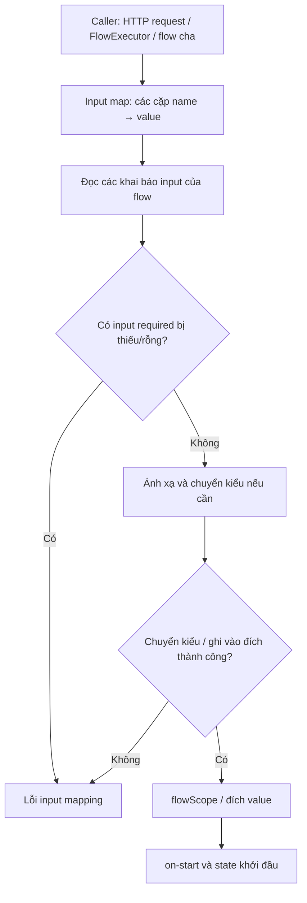

# Khai báo input theo tên, kiểu và tính bắt buộc

## 1. Vì sao flow phải công bố hợp đồng đầu vào?

Trong **Spring Web Flow**, một hành trình nhiều bước có thể bắt đầu từ liên kết trong ứng dụng, một lời gọi `FlowExecutor` hoặc một `subflow-state` của flow cha. Dù bắt đầu bằng cách nào, flow vẫn cần biết dữ liệu nào được cung cấp khi khởi chạy, kiểu dữ liệu mong đợi và giá trị nào không thể thiếu.

Ví dụ, flow `checkout` phải nhận `orderId` để lấy đơn hàng; flow `inviteMember` cần `teamId` và có thể nhận thêm `campaign` để phân tích nguồn truy cập. Thay vì mỗi state tự đọc tham số HTTP, flow khai báo hợp đồng ngay trong định nghĩa XML:

```xml
<flow xmlns="http://www.springframework.org/schema/webflow"
      xmlns:xsi="http://www.w3.org/2001/XMLSchema-instance"
      xsi:schemaLocation="
          http://www.springframework.org/schema/webflow
          http://www.springframework.org/schema/webflow/spring-webflow.xsd">

    <input name="orderId" type="long" required="true" />
    <input name="campaign" type="java.lang.String" required="false" />

    <on-start>
        <evaluate expression="orderService.loadForCheckout(orderId)"
                  result="flowScope.order" />
    </on-start>

    <view-state id="reviewOrder" model="order">
        <transition on="confirm" to="confirmed" />
        <transition on="cancel" to="cancelled" />
    </view-state>

    <end-state id="confirmed" />
    <end-state id="cancelled" />
</flow>
```

Ở đây:

- `orderId` là input **bắt buộc**, được chuyển sang kiểu `long` trước khi sử dụng trong `on-start`.
- `campaign` là input **tùy chọn**; flow vẫn có thể khởi chạy khi không có giá trị này.
- `orderService.loadForCheckout(orderId)` là thao tác nghiệp vụ dùng input đã được ánh xạ. Service vẫn phải kiểm tra đơn hàng tồn tại và người dùng có quyền truy cập.
- `reviewOrder` và các transition là phần điều hướng tiếp theo; chúng không chịu trách nhiệm tự khai báo lại `orderId`.

Đây là **input mapping lúc flow bắt đầu**, khác với việc bind các trường của form về model khi người dùng nhấn Submit ở một `view-state`. Hai cơ chế có thể cùng xuất hiện trong một flow, nhưng có thời điểm và mục đích khác nhau.

## 2. Cú pháp và ý nghĩa của từng thuộc tính

Trong định nghĩa flow, đặt các phần tử `<input />` trực tiếp dưới `<flow>`, cùng cấp với `<on-start>` và các state. Ví dụ đầy đủ bốn thuộc tính (các thuộc tính ngoài `name` có thể lược bỏ khi không cần):

```xml
<input name="orderId"
       type="long"
       required="true"
       value="flowScope.orderId" />
```

| Thuộc tính | Chức năng | Ví dụ | Khi không khai báo |
|---|---|---|---|
| `name` | Tên input được lấy từ bản đồ dữ liệu đầu vào của flow | `name="orderId"` | Phải chỉ rõ tên input |
| `type` | Kiểu Java mong đợi; hệ thống thử chuyển kiểu khi nguồn không cùng kiểu | `type="long"`, `type="java.lang.String"` | Dùng thông tin kiểu có thể suy ra từ đích, nếu có |
| `required` | Yêu cầu giá trị nguồn không được `null` hoặc rỗng | `required="true"` | Mặc định là `false` |
| `value` | Biểu thức **đích** để ghi giá trị sau ánh xạ | `value="flowScope.checkoutId"` | Mặc định ghi vào `flowScope` theo chính `name` |

**Chỉ định `name` không đồng nghĩa giá trị phải có.** Khai báo `<input name="orderId" />` mô tả một input tên `orderId`, nhưng chưa bắt buộc caller phải gửi. Muốn fail khi thiếu, viết rõ `required="true"`.

Tương tự, `type="long"` chỉ điều khiển kiểu và chuyển đổi, không bảo đảm giá trị đó là mã đơn hàng hợp lệ, thuộc người dùng hiện tại hay nằm trong phạm vi được phép. Kiểm tra nghiệp vụ phải được thực hiện riêng.

### 2.1. Khai báo tối thiểu chỉ có `name`

```xml
<input name="hotelId" />
```

Giả sử engine nhận input map là `{"hotelId": "42"}`. Giá trị sẽ được đưa vào `flowScope.hotelId` và có thể được dùng bằng biểu thức `hotelId` trong flow. Vì không có `type`, không nên mặc định giá trị là số nguyên: nếu nguồn đưa vào là chuỗi thì flow có thể giữ chuỗi.

### 2.2. Kèm `type` để khai báo kiểu mong muốn

```xml
<input name="hotelId" type="long" required="true" />
```

Nếu caller cung cấp chuỗi `"42"`, Web Flow sẽ cố chuyển sang kiểu `long` theo cấu hình type conversion đang dùng. Kết quả hợp lệ có thể được truyền vào action:

```xml
<on-start>
    <evaluate expression="hotelService.loadHotel(hotelId)"
              result="flowScope.hotel" />
</on-start>
```

Các kiểu thường gặp gồm `long`, `int`, `boolean` hoặc tên class đầy đủ như `java.lang.Long`, `java.lang.String`. Với enum hoặc kiểu domain riêng, cần bảo đảm converter tương ứng đã được cấu hình; không giả định chuỗi HTTP nào cũng có thể ánh xạ thành object tùy ý.

### 2.3. Kèm `required` để xác nhận sự hiện diện

```xml
<input name="accountId" type="long" required="true" />
<input name="returnTo" type="java.lang.String" required="false" />
```

Khi `accountId` không được cung cấp hoặc là giá trị rỗng, **input mapping không thành công**, thường được báo bằng `FlowInputMappingException`. Khả năng khởi chạy flow dừng trước logic của state. Khi `returnTo` vắng mặt, việc kiểm tra bắt buộc không chặn flow; tuy nhiên code sử dụng `returnTo` vẫn phải chấp nhận tình huống không có giá trị.

`required` kiểm tra nguồn ở giai đoạn ánh xạ, không phải bộ luật validation tổng quát. Những yêu cầu như `accountId > 0`, domain email hợp lệ hoặc giá trị phải nằm trong một tập cho phép không được giải quyết chỉ bằng `required="true"`.

### 2.4. Kèm `value` để đổi đích lưu dữ liệu

```xml
<input name="orderId"
       type="long"
       value="flowScope.checkoutOrderId"
       required="true" />
```

Caller vẫn gửi input dưới **khóa `orderId`**, nhưng sau ánh xạ giá trị sẽ được ghi vào **`flowScope.checkoutOrderId`**. Flow có thể tham chiếu bằng `checkoutOrderId` hoặc `flowScope.checkoutOrderId`.

`value` là biểu thức **đích nhận giá trị**, không phải giá trị mặc định và cũng không phải biểu thức nguồn để đọc HTTP parameter. Trường hợp chỉ cần lưu trùng tên, `<input name="orderId" />` ngắn gọn và dễ đọc hơn.

Nếu `value` ghi vào một thuộc tính của object, ví dụ `flowScope.criteria.hotelId`, object `criteria` phải tồn tại và có property phù hợp tại thời điểm mapping. Khi target có kiểu đã xác định, Web Flow có thể dùng kiểu đó để chuyển đổi, ngay cả khi không ghi rõ `type`.

## 3. Input đi qua những bước nào trước khi flow bắt đầu?



Các bước cốt lõi:

1. **Caller tạo input map.** Với `FlowExecutor.launchExecution`, map là đối số Java được truyền vào; với MVC, `FlowHandlerAdapter` có thể xây map từ tham số request; với subflow, flow cha dùng `<input>` trong `<subflow-state>` để truyền dữ liệu.
2. **Web Flow đọc hợp đồng của flow đích.** Tên input trong map phải khớp `name` đã khai báo để có thể ánh xạ vào đúng biến.
3. **Web Flow kiểm tra bắt buộc và chuyển kiểu.** Input sai kiểu hoặc vi phạm `required` có thể dẫn tới lỗi mapping.
4. **Giá trị được lưu ở đích.** Mặc định là `flowScope.<name>`, còn `value` cho phép chỉ rõ biểu thức đích khác.
5. **Flow xử lý `on-start` và chuyển tới state ban đầu.** Action có thể dùng input đã được ánh xạ cho nghiệp vụ.

Ví dụ cụ thể:

```text
Input map đến checkout:
    orderId = "42"
    campaign = "spring-sale"

Flow declarations:
    <input name="orderId" type="long" required="true" />
    <input name="campaign" type="java.lang.String" />

Sau mapping:
    flowScope.orderId  → 42 (kiểu số)
    flowScope.campaign → "spring-sale" (chuỗi)

on-start:
    orderService.loadForCheckout(orderId)
```

Không nên đọc lại `requestParameters.orderId` trong các request tiếp theo rồi coi đó là input khởi tạo. Một flow execution có thể sống qua nhiều lần Submit, và URL của các request tiếp tục không cần lặp lại tham số khởi tạo. `flowScope` là nơi duy trì dữ liệu trong vòng đời flow session thích hợp.

## 4. Nguồn input khi khởi chạy từ Spring MVC

### 4.1. Tham số URL ở đầu flow

Một liên kết có thể dẫn vào flow:

```text
GET /checkout?orderId=42&campaign=spring-sale
```

Trong tích hợp Spring MVC Servlet điển hình của Web Flow 2.5, `FlowHandlerAdapter` mặc định cung cấp các request parameters làm execution input khi `FlowHandler` không tự cung cấp map. Vì vậy `orderId=42` có thể được đưa vào `<input name="orderId" type="long" required="true" />` và chuyển kiểu. Đường dẫn `/checkout` chỉ là minh họa; flow ID thực tế được xác định bởi `FlowHandlerMapping`, registry và URL mapping của ứng dụng.

**Không đồng nhất tên HTTP parameter với tên biến Java của controller.** Điều quan trọng là **khóa trong input map** mà adapter đưa cho flow. Ở ứng dụng có `FlowHandler` tùy chỉnh, map có thể được lọc, đổi tên hoặc khởi tạo từ dữ liệu server; không thể đoán input map chỉ từ URL.

### 4.2. Giới hạn và chuẩn hóa đầu vào bằng `FlowHandler`

Khi muốn chỉ truyền một tập dữ liệu được phép, có thể override `createExecutionInputMap` của `AbstractFlowHandler`. Ví dụ cho nhánh 2.5.x (Servlet `javax.servlet`):

```java
package com.example.checkout.web;

import javax.servlet.http.HttpServletRequest;

import org.springframework.binding.collection.LocalAttributeMap;
import org.springframework.binding.collection.MutableAttributeMap;
import org.springframework.webflow.mvc.servlet.AbstractFlowHandler;

public final class CheckoutFlowHandler extends AbstractFlowHandler {

    @Override
    public MutableAttributeMap<Object> createExecutionInputMap(
            HttpServletRequest request) {

        MutableAttributeMap<Object> input = new LocalAttributeMap<>();

        String orderId = request.getParameter("orderId");
        if (orderId != null) {
            input.put("orderId", orderId); // Web Flow chuyển sang long
        }

        String campaign = request.getParameter("campaign");
        if (campaign != null) {
            input.put("campaign", campaign);
        }
        return input;
    }
}
```

Đoạn trên là ví dụ tạo input map, cần được đăng ký thành `FlowHandler` cho flow `checkout` theo cấu hình MVC của ứng dụng. Nó không tự thay thế tất cả cấu hình `FlowHandlerMapping`/`FlowHandlerAdapter`. Nếu `orderId` không có, handler không thêm khóa; `required="true"` trong XML đảm nhiệm việc phát hiện thiếu. Khi có `"abc"`, handler vẫn chuyển chuỗi vào map và việc đổi sang `long` sẽ thất bại ở input mapping.

Trong hệ thống dùng phiên bản Servlet/Jakarta khác, cần thay package `javax.servlet` theo dependency thực tế; các ví dụ cú pháp XML vẫn phải theo phiên bản Spring Web Flow mà dự án đang sử dụng.

### 4.3. Khởi chạy qua `FlowExecutor` trực tiếp

API `FlowExecutor` có thao tác:

```java
FlowExecutionResult launchExecution(
        String flowId,
        MutableAttributeMap<?> input,
        ExternalContext context);
```

Ví dụ mã từ một caller đã có `flowExecutor` và `externalContext` phù hợp:

```java
MutableAttributeMap<Object> input = new LocalAttributeMap<>();
input.put("orderId", 42L);
input.put("campaign", "partner");

FlowExecutionResult result =
        flowExecutor.launchExecution("checkout", input, externalContext);
```

Khác với HTTP query string, input có thể là Java object đã đúng kiểu từ đầu, giúp tránh thao tác parse không cần thiết. Dù vậy, việc đúng kiểu không thay thế bước xác thực và kiểm tra quyền sở hữu đơn hàng.

## 5. Truyền input giữa flow cha và subflow

**Khai báo input của flow đích** và **truyền input từ flow cha** là hai chỗ khác nhau. Giả sử flow cha `checkout` gọi subflow `payment`.

### 5.1. Flow cha cung cấp input

Trong flow cha:

```xml
<subflow-state id="takePayment" subflow="payment">
    <input name="orderId" value="flowScope.order.id" />
    <input name="currency" value="'VND'" />

    <transition on="paid" to="complete" />
    <transition on="declined" to="reviewOrder" />
</subflow-state>
```

Ở **`<subflow-state>`**, `value` là biểu thức **nguồn** chạy trong ngữ cảnh flow cha để tạo input map cho subflow. `name="orderId"` và `name="currency"` là tên khóa gửi sang flow con. Có thể viết `<input name="orderId" />` nếu muốn lấy biến cùng tên đang thấy được ở flow cha.

### 5.2. Flow con công bố hợp đồng input

Ở đầu định nghĩa flow `payment`:

```xml
<flow xmlns="http://www.springframework.org/schema/webflow"
      xmlns:xsi="http://www.w3.org/2001/XMLSchema-instance"
      xsi:schemaLocation="
          http://www.springframework.org/schema/webflow
          http://www.springframework.org/schema/webflow/spring-webflow.xsd">

    <input name="orderId" type="long" required="true" />
    <input name="currency" type="java.lang.String" required="true" />

    <on-start>
        <evaluate expression="paymentService.prepare(orderId, currency)"
                  result="flowScope.paymentForm" />
    </on-start>

    <view-state id="enterPayment" model="paymentForm">
        <transition on="submit" to="paid" />
        <transition on="cancel" to="declined" />
    </view-state>

    <end-state id="paid" />
    <end-state id="declined" />
</flow>
```

Đây là bộ khung minh họa cho việc truyền input; trong ứng dụng thật, event `submit` cần chạy thanh toán và xác nhận kết quả qua action/service trước khi chuyển sang `paid`.

Flow con chỉ cần biết hợp đồng `orderId` và `currency`. Nó không cần đọc `flowScope.order` của cha hay phụ thuộc trực tiếp vào state nội bộ của `checkout`.

```text
checkout.flowScope.order.id = 42
      │
      ▼
subflow-state(payment)
  <input name="orderId" value="flowScope.order.id" />
      │ input map: {"orderId": 42, "currency": "VND"}
      ▼
payment <input name="orderId" type="long" required="true" />
      │
      ▼
payment.flowScope.orderId = 42
      │
      ▼
payment on-start → enterPayment
```

Bảng phân biệt hai ngữ cảnh giúp tránh lỗi hay gặp:

| Đặt `<input>` ở đâu? | `name` là gì? | `value` nghĩa là gì? |
|---|---|---|
| Trực tiếp dưới `<flow>` | Khóa cần đọc từ input map **của flow được chạy** | Đích ghi sau mapping trong flow đó |
| Bên trong `<subflow-state>` | Khóa cần gửi sang input map **của subflow** | Nguồn dữ liệu/biểu thức lấy từ flow cha |

Không kỳ vọng `flowScope` của flow con tự động chứa mọi dữ liệu của flow cha. Chỉ truyền các giá trị cần thiết cho hợp đồng con. Nếu flow con phải trả kết quả, khai báo `<output>` tại `<end-state>` của nó và xử lý outcome/output tại flow cha; đó là chiều ngược với input.

## 6. Khi nào `required` và `type` báo lỗi?

Xét:

```xml
<input name="orderId" type="long" required="true" />
<input name="campaign" type="java.lang.String" required="false" />
```

| Giá trị `orderId` trong input map | Kết quả kỳ vọng | Nguyên nhân |
|---|---|---|
| Không có khóa `orderId` | Không qua kiểm tra required | Thiếu giá trị bắt buộc |
| `orderId = null` | Không qua kiểm tra required | Giá trị bắt buộc bị null |
| `orderId = ""` | Không qua kiểm tra required | Chuỗi rỗng |
| `orderId = "42"` | Thành công nếu converter hoạt động bình thường | Chuỗi chuyển được sang số |
| `orderId = 42L` | Thành công với kiểu tương thích | Giá trị đã là kiểu số |
| `orderId = "abc"` | Lỗi chuyển kiểu | Không thể parse thành `long` |
| `orderId = "0"` | Có thể qua required và chuyển kiểu | Chưa có quy tắc nghiệp vụ yêu cầu ID dương |

Với input tùy chọn `campaign`, việc không cung cấp giá trị **không tự gây lỗi required**. Nếu caller đưa vào một giá trị không chuyển đổi được sang `type` đã khai báo, mapping vẫn có thể lỗi dù input là tùy chọn.

Trong Web Flow 2.5.x, một thất bại ở giai đoạn ánh xạ input có thể phát sinh `org.springframework.webflow.engine.FlowInputMappingException`. API này có thể cung cấp `MappingResults` để phân biệt lỗi required, lỗi đọc/ghi biểu thức và lỗi type conversion. Ứng dụng cần định nghĩa cách hiển thị hoặc xử lý lỗi phù hợp với đường khởi chạy; không tự giả định framework luôn trả HTTP 400 hoặc đưa lỗi này vào validation messages của view đang mở.

Một trường hợp quan trọng nữa: chuỗi chỉ có dấu cách, ký tự Unicode khó nhận biết hoặc các định dạng số theo locale có thể cần chuẩn hóa, kiểm thử riêng. `required` không nên được xem là bộ lọc dữ liệu đầu vào toàn diện.

## 7. Input mapping khác form binding và validation ở view-state

Từ "data binding" thường dùng cho cả hai chiều dữ liệu, nhưng cần phân biệt rõ:

| Tiêu chí | Flow input mapping | View-state form binding |
|---|---|---|
| Thời điểm | Khi flow hoặc subflow **khởi chạy** | Khi người dùng **submit** một view-state |
| Nguồn | Execution input map từ caller | Request parameters từ form postback |
| Khai báo chính | `<input name="..." type="..." required="..." />` | `<view-state model="...">`, binding và validation của form |
| Đích | `flowScope` hoặc biểu thức `value` | Property của model trong view-state |
| Lỗi thường gặp | Thiếu input, sai kiểu, sai biểu thức đích | Sai định dạng trường, lỗi validator, binding failures |
| Hành vi xử lý | Có thể không khởi chạy được flow | Thường render lại view để người dùng sửa form |

Ví dụ, `orderId` trong URL `/checkout?orderId=42` được khai báo bằng `<input>`. Còn `shippingAddress.street` người dùng nhập ở màn hình `reviewOrder` là trường của form model. Khai báo `required="true"` trên `orderId` **không tự buộc** trường `shippingAddress.street` phải có giá trị. Với form, dùng validation riêng như Bean Validation, Spring Validator hay các phương thức `validate<stateId>` theo cấu hình Web Flow.

Một cách thiết kế dễ kiểm thử là khai báo input tối thiểu ở biên flow, sau đó chuyển thành một domain model hoặc command object rõ ràng. Đừng trộn việc đọc input khởi tạo với logic xử lý event `submit` của form.

## 8. Thiết kế hợp đồng input an toàn và dễ bảo trì

### 8.1. Đặt tên rõ nghĩa và giữ ổn định

Tên input là một phần hợp đồng giữa caller và flow. `orderId` rõ nghĩa hơn `id` khi hệ thống có nhiều loại ID. Đổi tên từ `orderId` thành `checkoutId` đòi hỏi cập nhật tất cả nguồn tạo map, bao gồm URL, `FlowHandler`, API launcher và các `subflow-state` đang gọi.

Đừng âm thầm cho phép caller đưa cùng dữ liệu dưới nhiều tên khó kiểm soát. Nếu cần tương thích ngược, hãy thực hiện bước chuẩn hóa có chủ đích ở boundary và có kiểm thử.

### 8.2. Chọn kiểu biểu diễn phù hợp với hợp đồng

Dùng `long` hoặc `java.lang.Long` cho ID dạng số khi đúng loại; `java.lang.String` cho mã định danh dạng chuỗi cần giữ số 0 ở đầu; enum hoặc domain type khi có converter ổn định. Đừng bắt `orderCode="000123"` thành số nếu các số 0 ban đầu mang ý nghĩa.

`type` không biến một chuỗi bất kỳ thành object nghiệp vụ đã được kiểm chứng. Với input phức tạp từ trình duyệt, thường an toàn hơn khi truyền ID hoặc command nhỏ rồi tải entity thông qua service có kiểm tra quyền.

### 8.3. Bắt buộc chỉ những gì flow cần

Dùng `required="true"` cho dữ liệu thiếu thì flow không thể thực hiện chức năng cốt lõi, chẳng hạn `orderId` ở bước thanh toán. Dùng `required="false"` cho dữ liệu hỗ trợ có thể bỏ qua như `campaign`. Khi thiếu dữ liệu tùy chọn, hãy có cách xử lý `null` rõ ràng ở service hoặc action được gọi.

Đặc biệt, không dùng input map để truyền trực tiếp thông tin bí mật, token thanh toán hoặc object mang quyền truy cập mà chưa kiểm soát nguồn gốc. URL và log HTTP có thể lưu lại tham số truy vấn.

### 8.4. Áp dụng bảo mật ở tầng nghiệp vụ

Khai báo:

```xml
<input name="orderId" type="long" required="true" />
```

**không chứng minh** caller được phép đọc hay thanh toán đơn hàng. Hãy để service hoặc security policy kiểm tra identity của người dùng hiện tại so với quyền trên đơn hàng, ngay cả khi `orderId` đã chuyển sang số thành công. Tương tự, `required="true"` không thể ngăn người dùng tự đổi `orderId=42` thành `orderId=43` trong URL.

## 9. Checklist thực hành và kịch bản kiểm thử

Cho một flow `checkout` nhận `orderId` bắt buộc và `campaign` tùy chọn, kiểm tra những tình huống sau:

1. **Đầu vào hợp lệ:** Khởi chạy với `orderId="42"`, xác nhận `on-start` nhận đúng giá trị đã chuyển đổi và flow tới `reviewOrder`.
2. **Thiếu bắt buộc:** Khởi chạy chỉ có `campaign="mail"`, xác nhận phát sinh lỗi input mapping trước khi tạo đơn/xử lý nghiệp vụ.
3. **Sai kiểu:** Gửi `orderId="XYZ"`, xác nhận không gọi service xử lý đơn hàng bằng một ID không hợp lệ.
4. **Input tùy chọn vắng mặt:** Chỉ gửi `orderId="42"`, xác nhận flow vẫn hoạt động và phần xử lý `campaign` không phụ thuộc vào giá trị bắt buộc phải tồn tại.
5. **Giá trị hợp kiểu nhưng sai nghiệp vụ:** Gửi `orderId="-1"` hoặc ID không thuộc người dùng hiện tại, xác nhận service từ chối bằng rule nghiệp vụ hoặc bảo mật phù hợp.
6. **Subflow:** Gọi `payment` từ `checkout`, kiểm tra hai input `orderId`, `currency` đến flow con đúng kiểu và đúng tên.
7. **Đổi tên input:** Cố ý đổi khóa tại caller thành `purchaseId` nhưng giữ hợp đồng `orderId`, xác nhận test phát hiện sự không tương thích.
8. **Flow tiếp tục sau submit:** Xác nhận không cần gửi lại `orderId` như một input **khởi tạo mới** mỗi lần chuyển state; dữ liệu vẫn được sử dụng qua scope phù hợp.

Một ma trận test ngắn giúp rà soát:

| Ca kiểm thử | Input `orderId` | Input `campaign` | Kỳ vọng chính |
|---|---|---|---|
| A | `"42"` | `"email"` | Mapping thành công |
| B | `"42"` | Không có | Không lỗi required |
| C | Không có | `"email"` | Lỗi required |
| D | `""` | Không có | Lỗi required |
| E | `"abc"` | Không có | Lỗi type conversion |
| F | `"99999"` | Không có | Mapping có thể thành công; service phải kiểm tra quyền/tồn tại |

Khi nhận lỗi, hãy kiểm tra **map thực tế** được đưa vào `FlowExecutor`, thuộc tính `name` trong flow XML, kiểu dữ liệu Java, converter và `value` (nếu có). Nếu input đến từ một subflow, kiểm tra cả `<input>` bên flow cha lẫn khai báo tương ứng bên flow con.

## 10. Tổng kết kiến thức cốt lõi

Một flow nên công bố input bằng `<input>` để caller biết chính xác **đang truyền gì** và flow biết **cần nhận gì**. Ghi nhớ bốn thuộc tính:

- **`name`:** xác định khóa input cần đọc từ caller.
- **`type`:** xác định kiểu Java đích và cách hệ thống thử chuyển đổi.
- **`required`:** kiểm soát dữ liệu có được phép thiếu/rỗng khi khởi chạy flow hay không.
- **`value`:** trong khai báo đầu flow là nơi ghi giá trị; trong `subflow-state` là biểu thức nguồn do flow cha truyền đi.

Khai báo input hợp lý giúp flow độc lập với cách khởi chạy, giảm logic lặp trong controller và làm hành trình state/event/transition/subflow dễ hiểu hơn. Tuy nhiên, **type conversion, required checking, form validation và authorization là bốn mối quan tâm khác nhau**: phối hợp đúng vị trí mới tạo được flow nhiều bước ổn định.

### Tài liệu tham khảo

- [Spring Web Flow Reference – Defining Flows, Input/Output Mapping](https://docs.spring.io/spring-webflow/docs/2.5.x/reference/html/defining-flows.html) – `name`, `type`, `value`, `required`, subflow input.
- [Spring Web Flow Reference – Spring MVC Integration](https://docs.spring.io/spring-webflow/docs/2.5.1.RELEASE/reference/html/spring-mvc.html) – `FlowHandler` và việc cung cấp execution input.
- [FlowExecutor API](https://docs.spring.io/spring-webflow/docs/2.5.x/api/org/springframework/webflow/executor/FlowExecutor.html) – chữ ký `launchExecution`.
- [FlowInputMappingException API](https://docs.spring.io/spring-webflow/docs/2.5.x/api/org/springframework/webflow/engine/FlowInputMappingException.html) – exception khi input mapping thất bại.
