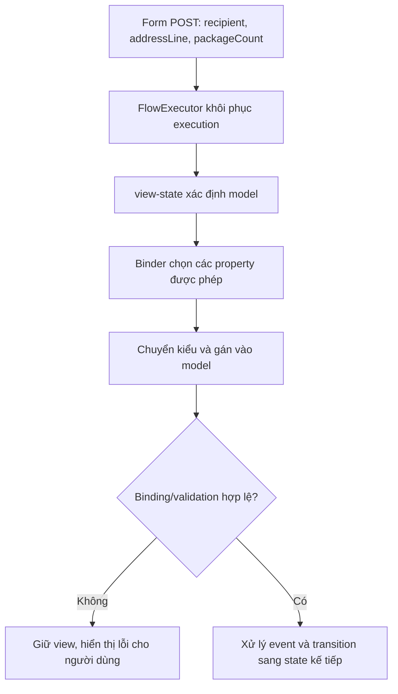
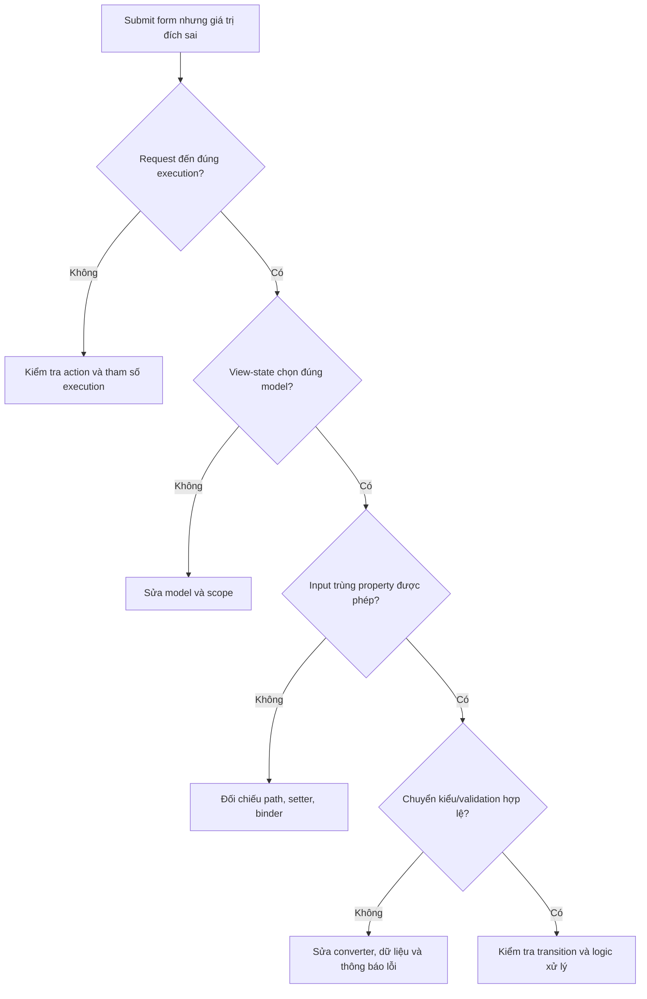

# Gán input vào đối tượng hoặc biến đích trong Spring Web Flow

Trong **Spring Web Flow** (`SPRING_WEB_FLOW`), dữ liệu người dùng nhập ở một màn hình cần được đưa vào **đúng đối tượng hoặc biến** để các state tiếp theo xử lý. Ví dụ, khi khách hàng đi qua quy trình **nhập thông tin giao hàng → xem lại → xác nhận**, các trường `recipient`, `addressLine` và `packageCount` phải trở thành giá trị của một model được quản lý trong flow. Nếu chỉ đọc tham số HTTP trực tiếp ở từng controller, ứng dụng dễ làm mất dữ liệu giữa các bước hoặc bỏ qua quy trình kiểm tra.

Bài học thuộc chương **Ánh xạ dữ liệu** này trình bày cơ chế **data binding** của Spring Web Flow: xác định nguồn input, chọn đích gán, khai báo model trong `view-state`, giới hạn thuộc tính được phép bind, chuyển kiểu, phát hiện lỗi và kiểm chứng dữ liệu ở các state tiếp theo. Bài cũng phân biệt việc bind form vào JavaBean với việc truyền input khi khởi tạo flow hoặc gán kết quả action vào biến scope.

## 1. Input, đích gán và thời điểm binding

Một yêu cầu HTTP gửi từ biểu mẫu thường chứa **chuỗi ký tự**:

```text
POST /checkout?execution=e1s1

recipient=Nguyen%20An
addressLine=12%20Le%20Loi
packageCount=2
_eventId_continue=1
```

`execution` là khóa để Spring Web Flow tiếp tục **lần thực thi flow**; `_eventId_continue` chỉ ra **event** muốn kích hoạt. Ba tham số còn lại là dữ liệu nhập. Bộ binding cần tìm model đang hoạt động, gán từng giá trị vào property phù hợp và chuyển kiểu khi cần. Các giá trị `e1s1` và URL chỉ mang tính minh họa.

Có thể hình dung đường đi:



Trong `view-state` có model và binding thông thường, khi người dùng gửi event, Web Flow thực hiện giai đoạn binding/validation theo cấu hình trước khi hoàn thành transition. Nếu có lỗi, view có thể được hiển thị lại để sửa dữ liệu. Tuy nhiên, thao tác nào thực sự chạy và thông báo nào xuất hiện còn phụ thuộc `bind`, `validate` trên transition, binder và validator đã đăng ký.

Ba câu hỏi cần trả lời khi đọc cấu hình:

1. **Nguồn:** input đến từ form request, input khi bắt đầu flow, hay kết quả xử lý của action?
2. **Đích:** property trong JavaBean, một biến `flowScope`, hay scope khác?
3. **Quy tắc:** ai chịu trách nhiệm chọn property, chuyển kiểu, kiểm tra dữ liệu và giữ lại lỗi?

## 2. Các cách gán input thường gặp

| Cơ chế | Nguồn dữ liệu | Đích gán | Tình huống sử dụng |
| --- | --- | --- | --- |
| `view-state model="shipping"` | Trường form do trình duyệt gửi | Thuộc tính của object `shipping` | Chỉnh sửa form nhiều trường qua nhiều bước |
| `<binder><binding .../></binder>` | Trường form đã được binder chọn | Danh sách property được phép trên model | Giới hạn input, đánh dấu trường bắt buộc |
| `<input name="productId" .../>` | Input map lúc **bắt đầu** flow | Biến input của flow (mặc định trong `flowScope` theo tên input) | Nhận mã sản phẩm/đơn hàng để mở flow |
| `<evaluate ... result="flowScope.quote"/>` | Kết quả biểu thức/service action | Một biến có tên trong `flowScope` | Gán kết quả tính toán phía server |
| `<set name="flowScope.step" .../>` | Giá trị biểu thức cấu hình | Biến đích được chỉ định | Thiết lập cờ/giá trị điều khiển nội bộ |

**Binding form không đồng nghĩa với sao chép toàn bộ request vào flowScope.** Binder hoạt động với model mà `view-state` chọn; `<input>` xử lý dữ liệu lúc **khởi tạo** flow; `<evaluate>`/`<set>` gán giá trị theo biểu thức ở nơi chúng được khai báo. Mỗi cơ chế có thời điểm và ràng buộc riêng.

Cũng không nên nhầm `requestParameters` với dữ liệu đã được validate. Đó là nguồn dữ liệu đầu vào từ request, có thể bị sửa tùy ý bởi client. Trước khi đưa vào logic nghiệp vụ, luôn cần kiểm tra kiểu, định dạng, quyền truy cập và tính hợp lệ.

## 3. Tạo JavaBean làm đối tượng đích

Giả sử người dùng cần nhập thông tin gửi hàng. Tạo một lớp model có constructor không tham số và các getter/setter theo quy ước JavaBean:

```java
package com.example.checkout;

public class ShippingForm {
    private String recipient;
    private String addressLine;
    private Integer packageCount;

    public ShippingForm() {
    }

    public String getRecipient() {
        return recipient;
    }

    public void setRecipient(String recipient) {
        this.recipient = recipient;
    }

    public String getAddressLine() {
        return addressLine;
    }

    public void setAddressLine(String addressLine) {
        this.addressLine = addressLine;
    }

    public Integer getPackageCount() {
        return packageCount;
    }

    public void setPackageCount(Integer packageCount) {
        this.packageCount = packageCount;
    }
}
```

Lớp `ShippingForm` là **đích gán**. Khi binder thấy tham số `packageCount=2` và property được phép bind, nó tìm setter phù hợp và thử chuyển chuỗi `"2"` sang `Integer`. Nếu người dùng gửi `packageCount=abc`, hệ thống cần ghi nhận lỗi chuyển kiểu thay vì coi `"abc"` là số lượng hợp lệ.

Với mô hình binding dựa trên property/JavaBean, **tên field trên giao diện phải khớp tên property**. `recipient` tương ứng `setRecipient(...)`; `addressLine` tương ứng `setAddressLine(...)`. Tên Java field nội bộ ít quan trọng hơn hợp đồng getter/setter mà binder có thể truy cập.

Các object immutable, record hoặc class chỉ có constructor tham số không tự động tương đương JavaBean mutable trong cơ chế này. Nếu muốn bind trực tiếp vào chúng, cần xác minh và cấu hình chiến lược binder/converter hỗ trợ phiên bản đang dùng; với ví dụ cơ bản, JavaBean mutable giúp nhìn rõ cách hoạt động.

## 4. Khai báo model và binder trong flow XML

Ví dụ sau là một flow tối giản. `<var>` yêu cầu Web Flow tạo biến model khi flow được khởi tạo. `view-state` xác định object đích bằng `model="shipping"` và danh sách các property hợp lệ bằng `<binder>`:

```xml
<?xml version="1.0" encoding="UTF-8"?>
<flow xmlns="http://www.springframework.org/schema/webflow"
      xmlns:xsi="http://www.w3.org/2001/XMLSchema-instance"
      xsi:schemaLocation="
          http://www.springframework.org/schema/webflow
          http://www.springframework.org/schema/webflow/spring-webflow-2.0.xsd"
      start-state="enterShipping">

    <var name="shipping" class="com.example.checkout.ShippingForm" />

    <view-state id="enterShipping"
                view="checkout/shipping"
                model="shipping">
        <binder>
            <binding property="recipient" required="true" />
            <binding property="addressLine" required="true" />
            <binding property="packageCount" required="true" />
        </binder>

        <transition on="continue" to="review" />

        <transition on="cancel"
                    to="cancelled"
                    bind="false" />
    </view-state>

    <view-state id="review" view="checkout/review">
        <transition on="back" to="enterShipping" />
        <transition on="confirm" to="completed" />
    </view-state>

    <end-state id="completed" />
    <end-state id="cancelled" />
</flow>
```

Ý nghĩa từng phần:

- `<var name="shipping" .../>` tạo biến `shipping` chứa `ShippingForm`, thuộc phạm vi flow; model tồn tại để nhiều state dùng chung trong cùng execution.
- `model="shipping"` báo cho `view-state` dùng object đó để nhận dữ liệu form. Nó **không phải tên flow ID**.
- `<binding property="recipient" .../>` cho phép bind `recipient`; tương tự cho hai property còn lại.
- `required="true"` biểu thị yêu cầu đầu vào theo cơ chế binder. Kiểm tra nội dung nghiệp vụ, chẳng hạn chuỗi chỉ chứa khoảng trắng hoặc số lượng phải lớn hơn 0, vẫn cần validation tương ứng.
- `<transition on="continue" .../>` xử lý event khi form được gửi hợp lệ để chuyển sang `review`.
- `bind="false"` trên transition `cancel` tránh bind form khi người dùng hủy; ứng dụng không cần ép nhập dữ liệu hợp lệ chỉ để thoát flow.

Nếu không khai báo binder giới hạn property, cơ chế binding mặc định có thể cho phép nhiều writable property của model được gán. Với form tiếp xúc bên ngoài, nên khai báo rõ các trường cần nhận để giảm nguy cơ **mass assignment**.

Trong ví dụ này, `shipping` sẽ được flow giữ để view `review` và hành động phía server đọc lại. Việc model có dữ liệu không có nghĩa đơn hàng đã được lưu vào database; thao tác lưu phải xảy ra ở bước nghiệp vụ được thiết kế riêng.

## 5. Form JSP gửi dữ liệu vào model

Với ứng dụng Spring MVC sử dụng JSP và Spring form tags, view `checkout/shipping` có thể dùng:

```jsp
<%@ taglib prefix="form" uri="http://www.springframework.org/tags/form" %>

<form:form method="post"
           action="${flowExecutionUrl}"
           modelAttribute="shipping">

    <label for="recipient">Người nhận</label>
    <form:input path="recipient" id="recipient" />
    <form:errors path="recipient" cssClass="error" />

    <label for="addressLine">Địa chỉ</label>
    <form:input path="addressLine" id="addressLine" />
    <form:errors path="addressLine" cssClass="error" />

    <label for="packageCount">Số kiện</label>
    <form:input path="packageCount"
                id="packageCount"
                type="number" min="1" />
    <form:errors path="packageCount" cssClass="error" />

    <button type="submit" name="_eventId_continue" value="1">
        Tiếp tục
    </button>
    <button type="submit" name="_eventId_cancel" value="1">
        Hủy
    </button>
</form:form>
```

Lưu ý bốn điểm:

1. `modelAttribute="shipping"` chọn model mà Spring form tags hiển thị. Tên này cần khớp model của `view-state` theo cấu hình view hiện tại.
2. `path="packageCount"` tạo field có tên `packageCount`, tương ứng property `packageCount` của `ShippingForm`.
3. `action="${flowExecutionUrl}"` dùng **URL tiếp tục flow hiện tại**, có execution key do framework quản lý. Nếu hardcode `/checkout` làm action, request có thể khởi tạo flow mới.
4. `_eventId_continue` và `_eventId_cancel` gửi event. Chúng không phải property trên `ShippingForm` và không nên được coi là dữ liệu form để lưu.

Ví dụ dùng JSP. Nếu dự án dùng Thymeleaf hoặc JSF, cú pháp biểu mẫu khác nhưng yêu cầu về model, binding, event và execution URL vẫn cần được kiểm tra với tích hợp cụ thể.

**Kiểm tra trình duyệt:** mở DevTools → Network và xem request POST có `recipient`, `addressLine`, `packageCount`, event phù hợp và `execution` trên URL tiếp tục không.

## 6. Trình tự xử lý khi người dùng bấm Tiếp tục

Giả sử flow hiện đang ở `enterShipping`. Người dùng gửi:

```text
recipient=Nguyen An
addressLine=12 Le Loi
packageCount=2
_eventId_continue=1
```

Diễn biến logic điển hình:

1. Web Flow đọc execution key để khôi phục đúng flow và state hiện tại.
2. Event `continue` được nhận diện từ request.
3. Binder tìm model `shipping` và danh sách property cho phép.
4. Giá trị `"Nguyen An"` được gán cho `shipping.recipient`; `"12 Le Loi"` cho `shipping.addressLine`; `"2"` được chuyển thành số nguyên cho `shipping.packageCount`.
5. Binder và validator (nếu đã cấu hình) tạo thông báo cho dữ liệu thiếu, sai kiểu hoặc không hợp lệ.
6. Nếu không bị chặn bởi lỗi, transition sang `review`; dữ liệu model có thể được dùng để hiển thị/kiểm tra trước khi xác nhận.

Ở bước `review`, service có thể kiểm tra quy tắc nghiệp vụ trên đối tượng `ShippingForm` đã được binding:

```java
package com.example.checkout;

public final class ShippingRules {
    private ShippingRules() {
    }

    public static boolean packageCountValid(ShippingForm form) {
        return form != null
                && form.getPackageCount() != null
                && form.getPackageCount() > 0;
    }
}
```

Đoạn Java trên minh họa một quy tắc thuần Java, **chưa phải cấu hình đăng ký validator vào flow**. Trong dự án thật, cần gọi quy tắc này từ validator/service ở đúng state và phản hồi lỗi có thể hiểu được cho người dùng qua cơ chế thông báo của Web Flow.

## 7. Chuyển kiểu: từ HTTP String sang property có kiểu

Dữ liệu từ request thường là chuỗi hoặc tập giá trị chuỗi. Nhưng property Java có thể là `Integer`, `BigDecimal`, `LocalDate`, enum hay một kiểu tự định nghĩa.

| Input trên form | Property đích | Kết quả mong đợi |
| --- | --- | --- |
| `packageCount=2` | `Integer packageCount` | Chuyển thành số nguyên `2` |
| `packageCount=abc` | `Integer packageCount` | Lỗi chuyển kiểu; không được chấp nhận như một số |
| `packageCount=` | `Integer packageCount` | Có thể thành `null`/giá trị trống; cần kiểm tra `required` và validation |
| `deliveryDate=2026-12-01` | `LocalDate deliveryDate` | Chỉ chuyển đúng nếu có converter/formatter phù hợp |
| `shippingMethod=EXPRESS` | `ShippingMethod shippingMethod` (enum) | Phụ thuộc converter và tên enum hợp lệ |

Các kiểu có formatter đặc biệt, như ngày/tháng, tiền tệ, số theo locale hoặc enum có nhãn hiển thị, cần cấu hình **conversion/formatting** phù hợp với phiên bản Spring Web Flow/Spring Framework đang chạy. Đừng giả định mọi định dạng ngày hoặc số thập phân được tự động hiểu.

Có thể phân biệt ba lớp kiểm tra:

- **Binding:** input có đến đúng property được phép gán không?
- **Conversion:** giá trị có thể chuyển sang kiểu Java không?
- **Validation:** giá trị sau chuyển có hợp lệ theo quy tắc nghiệp vụ không?

Ví dụ `packageCount=-3` chuyển được sang `Integer` nhưng **không hợp lệ về nghiệp vụ**. Tương tự, `recipient="   "` là một chuỗi hợp lệ về kiểu, nhưng có thể bị từ chối vì chỉ có khoảng trắng.

## 8. Validation và thông báo lỗi khi bind

`required="true"` giúp binder biết trường phải có giá trị đầu vào phù hợp, nhưng nó không thay thế mọi quy tắc dữ liệu. Với quy trình giao hàng, cần thêm các điều kiện như:

- `recipient` không được rỗng hoặc chỉ chứa khoảng trắng.
- `addressLine` phải đủ thông tin theo quy tắc ứng dụng.
- `packageCount` phải là số nguyên dương và không vượt giới hạn nghiệp vụ.
- Địa chỉ giao hàng phải thuộc khu vực hỗ trợ nếu quy trình cần kiểm tra đó.

Trong Spring Web Flow, lỗi binding, conversion và validation có thể được đưa vào **message context** để view hiển thị. Việc gọi validator có thể dựa trên convention, cấu hình validator hoặc integration Bean Validation tùy phiên bản và thiết lập của dự án. Cần kiểm tra cách đăng ký validator thực tế; không mặc định chỉ đặt annotation trên JavaBean là mọi quy tắc tự chạy.

Ví dụ kết quả khi gửi `packageCount=abc`:

```text
Request:
    packageCount=abc
    _eventId_continue=1

Binding:
    "abc" không chuyển được sang Integer

View:
    Ở lại enterShipping
    Hiển thị lỗi cạnh packageCount
    Người dùng nhập lại số hợp lệ
```

Nếu form đã gửi đúng `execution` và event nhưng không chuyển sang state mới, hãy kiểm tra binding/validation trước khi nghi ngờ URL điều hướng. Cùng một flow có thể cố ý hiển thị lại view để bảo vệ dữ liệu.

Khi người dùng bấm **Hủy**, transition `bind="false"` trong ví dụ cho phép rời form mà không buộc chạy quy trình binding của nút Tiếp tục. Nếu một transition được phép bỏ validation, phải bảo đảm nó không vô tình thực hiện thao tác nghiệp vụ đòi hỏi dữ liệu đã được kiểm tra.

## 9. Gán input lúc bắt đầu flow vào biến đích

Không phải dữ liệu nào cũng đến từ một form trong `view-state`. Khi mở một flow, ứng dụng có thể cần **mã sản phẩm** để tải dữ liệu nền từ server. Spring Web Flow hỗ trợ khai báo **flow input** bằng `<input>`:

```xml
<flow xmlns="http://www.springframework.org/schema/webflow"
      xmlns:xsi="http://www.w3.org/2001/XMLSchema-instance"
      xsi:schemaLocation="
          http://www.springframework.org/schema/webflow
          http://www.springframework.org/schema/webflow/spring-webflow-2.0.xsd">

    <input name="productId" type="long" required="true" />

    <on-start>
        <evaluate expression="catalogService.findVisibleProduct(productId)"
                  result="flowScope.product" />
    </on-start>

    <view-state id="details" view="catalog/details" />
</flow>
```

Ý tưởng:

1. Flow nhận `productId` từ **input map khi bắt đầu execution**; ở cấu hình mặc định, giá trị input có tên này được đưa vào `flowScope`.
2. `type="long"` biểu thị kiểu cần chuyển; `required="true"` yêu cầu input bắt buộc ở giai đoạn khởi tạo flow.
3. `catalogService.findVisibleProduct(productId)` dùng ID đã có kiểu để truy vấn bản ghi từ service; kết quả trả về được gán vào `flowScope.product`.
4. View `details` có thể đọc `product` trong phạm vi flow theo cơ chế hiển thị tương ứng.

Ví dụ không định nghĩa URL hay cơ chế chuyển `request parameter → input map` cho mọi môi trường. Tùy `FlowHandler` và cách khởi chạy, ứng dụng cần đưa giá trị đầu vào vào input map phù hợp. Không nên mặc định mọi query parameter đều được nhận hoặc có quyền truy vấn mọi ID.

**Vấn đề quyền truy cập:** `productId` là dữ liệu bên ngoài; service phải kiểm tra sản phẩm có tồn tại, được công khai/cho phép xem hay không. Chuyển kiểu `long` không tự chứng minh người dùng có quyền mở đối tượng đó.

### Gán kết quả của action vào một biến

`<evaluate>` với `result` phù hợp khi **đích là kết quả do phía server tính ra**, chẳng hạn bảng giá được tính theo người dùng hiện tại:

```xml
<on-entry>
    <evaluate expression="quoteService.calculate(shipping)"
              result="flowScope.quote" />
</on-entry>
```

Đoạn này đặt trong state hoặc vị trí cấu hình hỗ trợ `<on-entry>`. Nó lấy kết quả từ service rồi gán vào `flowScope.quote`; **không trực tiếp bind một request field vào property**. Nếu `quote` quyết định giá phải trả, hãy tính giá từ dữ liệu được kiểm tra ở backend và không cho form tự ghi đè `quote.totalPrice`.

Có thể dùng `<set>` để đặt một biến điều khiển nội bộ:

```xml
<on-entry>
    <set name="flowScope.currentStep" value="'review'" />
</on-entry>
```

Đích `flowScope.currentStep` là một biến; `'review'` là chuỗi literal trong expression. Đừng lẫn cơ chế gán này với binder tự động của `view-state`.

## 10. Chọn scope phù hợp cho biến đích

Spring Web Flow quản lý nhiều scope với vòng đời khác nhau:

| Scope | Vòng đời chính | Nên dùng khi |
| --- | --- | --- |
| `requestScope` | Trong một request đang xử lý | Dữ liệu trung gian không cần giữ qua request khác |
| `flashScope` | Dữ liệu ngắn hạn qua các bước hiển thị/chuyển hướng theo cơ chế Web Flow | Thông báo sau thao tác hoặc dữ liệu tạm rất ngắn hạn |
| `viewScope` | Khi một `view-state` đang hoạt động | Dữ liệu chỉ phục vụ màn hình đó |
| `flowScope` | Trong một lần thực thi flow | Form nhiều bước, lựa chọn cần dùng ở state tiếp theo |
| `conversationScope` | Trong conversation liên quan, kể cả luồng cha/con khi thích hợp | Dữ liệu cần chia sẻ qua subflow |
| HTTP session | Theo phiên HTTP, được ứng dụng/container quản lý | Dữ liệu phiên dùng rộng hơn một flow khi thật sự cần |

Trong ví dụ, `shipping` được khai báo bằng `<var>` để tồn tại xuyên `enterShipping` và `review`. Nếu form chỉ cần dùng ở một view, `viewScope` có thể phù hợp hơn. Ngược lại, đặt toàn bộ form vào HTTP session dễ làm các flow khác nhau vô tình chia sẻ dữ liệu nếu không phân biệt từng lần thực thi.

**Execution key không chứa nguyên văn dữ liệu form.** Nó giúp Web Flow khôi phục execution; dữ liệu của model/scope được repository và cơ chế session tương ứng quản lý. Khi một session hết hạn hoặc một execution bị đóng, việc dùng lại key có thể không khôi phục được đối tượng cũ.

## 11. An toàn khi bind dữ liệu do client gửi

Một request có thể chứa trường ngoài giao diện, ví dụ:

```text
recipient=Nguyen An
addressLine=12 Le Loi
packageCount=2
orderStatus=PAID
unitPrice=0
admin=true
```

Trình duyệt không ngăn người dùng tự gửi thêm `orderStatus`, `unitPrice` hoặc `admin`. Nếu model dùng cho binding chứa cả các property nhạy cảm và binder tự động nhận mọi property có setter, có nguy cơ **mass assignment**: dữ liệu client sửa trạng thái nghiệp vụ mà server không chủ định.

Để hạn chế rủi ro:

1. **Tách input model khỏi entity nghiệp vụ**. `ShippingForm` chỉ có các trường thật sự cần cho thao tác nhập.
2. **Khai báo `<binder>` với danh sách property được phép** cho từng view-state. Nếu cần nested property, chỉ mở những đường dẫn cụ thể đã xác minh.
3. **Không tin giá/đặc quyền/trạng thái từ request**. Đọc chúng từ database hoặc tính lại bằng service theo identity và quyền đã kiểm tra.
4. **Kiểm tra quyền ở tầng nghiệp vụ**, kể cả khi ID đã convert đúng; không suy quyền từ flow execution key.
5. **Dùng CSRF protection** cho các request thay đổi dữ liệu theo cấu hình Spring Security; execution key không thay thế CSRF token.
6. **Kiểm soát kích thước và định dạng input**, giới hạn giá trị quá lớn hoặc dữ liệu gây quá tải, sau đó hiển thị nội dung đã escape để giảm nguy cơ XSS.

Ví dụ, dù request gửi `orderStatus=PAID`, field đó không thuộc `ShippingForm` và không có trong danh sách binding; logic thanh toán chỉ đổi trạng thái đơn hàng sau khi dịch vụ thanh toán xác nhận.

## 12. Các lỗi phổ biến và hướng điều tra

| Hiện tượng | Nguyên nhân đáng kiểm tra | Cách khắc phục |
| --- | --- | --- |
| Form hiển thị được nhưng submit xong property vẫn rỗng | `path`/tên input khác tên JavaBean property; sai `model`; property không có setter | Đối chiếu tên field, getter/setter, `model` và binder |
| Nút Tiếp tục không sang bước tiếp theo | Conversion hoặc validation thất bại | Hiển thị `form:errors`/message context và kiểm tra input lỗi |
| Giá trị `"abc"` được gửi vào `Integer` | Conversion thất bại | Dùng input phù hợp, converter/formatter và xử lý lỗi |
| Nút Hủy bị chặn bởi trường bắt buộc | Transition Hủy vẫn thực hiện binding/validation | Dùng chính sách `bind="false"`/`validate="false"` phù hợp cho event Hủy |
| Số lượng sang state Review bị mất | Model đặt sai scope hoặc bị tạo lại | Dùng model thuộc scope phù hợp, tránh tự reset ở mỗi request |
| Gửi form thì quay về bước đầu | URL tiếp tục flow thiếu `execution` hoặc key không hợp lệ | Dùng `flowExecutionUrl`, kiểm tra session và request URL |
| Dữ liệu của hai tab ảnh hưởng nhau | Dùng chung object/session ngoài dự kiến | Xác minh vòng đời scope và cách khởi tạo execution |
| Request gửi thêm trường nhạy cảm vẫn được gán | Binder không giới hạn property/model chứa field không nên nhận | Tách DTO/form, khai báo binder whitelist và kiểm tra backend |

Một quy trình debug phù hợp:



Để chẩn đoán sâu hơn, có thể bật mức log phù hợp với dự án:

```properties
logging.level.org.springframework.webflow=DEBUG
logging.level.org.springframework.binding=DEBUG
```

Tên logger và lượng log thực tế thay đổi theo phiên bản. Khi tìm lỗi, hãy đối chiếu request URL, event, state, field và chuỗi exception/`Caused by`. Tránh ghi dữ liệu cá nhân từ form vào log chia sẻ.

## 13. Kiểm thử gán input từ đầu đến cuối

Với flow `enterShipping → review → completed`, nên kiểm thử cả đường thành công và lỗi:

| Kịch bản | Input hoặc thao tác | Điều cần xác nhận |
| --- | --- | --- |
| Hợp lệ | Recipient/địa chỉ có giá trị, `packageCount=2`, event `continue` | Model nhận đúng kiểu, đi sang `review` |
| Thiếu bắt buộc | Không gửi `recipient` | Không âm thầm hoàn tất; hiển thị lỗi phù hợp |
| Sai kiểu | `packageCount=abc` | Không chuyển được sang `Integer`; người dùng có thể sửa |
| Sai quy tắc nghiệp vụ | `packageCount=-3` | Validator ngăn xác nhận đơn hàng |
| Hủy giữa chừng | Event `cancel` với form đang dở | Kết thúc theo luồng Hủy mà không cần dữ liệu hợp lệ |
| Input ngoài danh sách | Gửi thêm `unitPrice=0` hoặc `admin=true` | Không có property nhạy cảm nào bị cập nhật |
| Quay lại | Từ `review` bấm `back` | Model giữ dữ liệu đã nhập theo thiết kế |
| Nhiều tab | Khởi tạo hai execution riêng, nhập dữ liệu khác nhau | Dữ liệu được tách đúng theo execution |
| Session hết hạn | Gửi key cũ sau timeout | Có xử lý lỗi/khởi động lại, không gây tác động nghiệp vụ sai |

Nếu kiểm thử qua HTTP, không dùng key hardcode. Trước hết gọi URL mở flow, lấy URL tiếp tục được render, rồi gửi POST tới URL đó với event và các field. Kiểm tra giá trị model thực tế ở view/logic nghiệp vụ cùng trạng thái response. Các test unit của validator có ích nhưng không thay thế test Web Flow để xác minh **binding + event + transition** phối hợp đúng.

## 14. Bài thực hành: tìm lỗi gán vào sai đích

Giả sử ứng dụng đã khai báo:

```java
public class ProfileForm {
    private String displayName;

    public String getDisplayName() {
        return displayName;
    }

    public void setDisplayName(String displayName) {
        this.displayName = displayName;
    }
}
```

Flow XML có:

```xml
<var name="profile" class="com.example.ProfileForm" />

<view-state id="editProfile" model="profile">
    <binder>
        <binding property="displayName" required="true" />
    </binder>
    <transition on="save" to="done" />
</view-state>
```

Nhưng HTML gửi tham số `name=Lan` với `_eventId_save=1`, và sau khi submit `profile.displayName` vẫn rỗng.

**Câu hỏi:**

1. Xác định **object đích** và **property đích**.
2. Vì sao `name=Lan` không khớp cấu hình binder?
3. Hãy sửa phần HTML/JSP để dữ liệu được gán đúng.
4. Nếu gửi đúng `displayName` nhưng state vẫn không chuyển, cần kiểm tra thêm gì?
5. Nếu client gửi `isAdmin=true`, nên xử lý ra sao?

**Gợi ý lời giải:**

- Model đích là biến `profile`; property được bind là `displayName`.
- `name` và `displayName` là hai tên khác nhau, nên binder không tự suy ra chúng cùng một trường.
- Với JSP Spring form tags, cần dùng `<form:input path="displayName" />` trong form `modelAttribute="profile"`; với HTML thuần, dùng `<input name="displayName" value="Lan" />`, đảm bảo form submit tới URL tiếp tục flow.
- Nếu tên đúng mà vẫn lỗi, kiểm tra event `save`, setter, danh sách binding, lỗi conversion/validation, thông báo trong view và việc request có tiếp tục đúng execution hay không.
- `isAdmin` không thuộc input model và danh sách property được phép; server phải kiểm soát quyền bằng logic backend và không nhận giá trị này làm trạng thái đặc quyền.

Khi làm việc với Spring Web Flow, hãy luôn lần theo chuỗi **request field → model của view-state → binder/property → conversion/validation → transition → scope của dữ liệu**. Chuỗi này giúp gán đúng input vào JavaBean hoặc biến cần thiết, duy trì dữ liệu khi điều hướng nhiều bước và kiểm soát những giá trị mà client được phép thay đổi.
