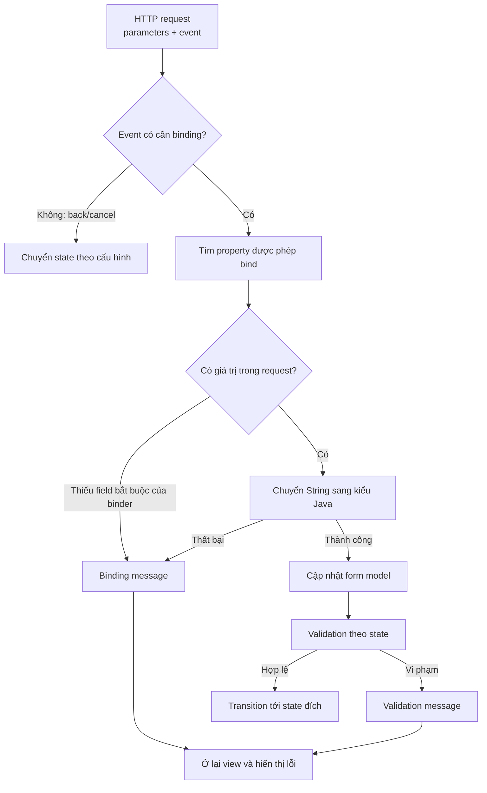

# Xử lý input thiếu và giá trị không chuyển kiểu được trong Spring Web Flow

Trong một biểu mẫu nhiều bước, lỗi không chỉ là “người dùng nhập sai”. Một request có thể **không gửi trường cần thiết**, gửi **chuỗi rỗng** cho trường bắt buộc, hoặc gửi **giá trị không thể chuyển thành kiểu Java**. Ba trường hợp trông tương tự trên giao diện nhưng có nguyên nhân, thời điểm phát hiện và cách khắc phục khác nhau.

Bài học thuộc chương **Ánh xạ dữ liệu** của module **SPRING_WEB_FLOW**. Spring Web Flow mô hình hóa hành trình web bằng **state, event, transition và subflow**, giữ dữ liệu qua các màn hình bằng scope, tích hợp với Spring MVC để thực hiện **form binding, validation** và phục hồi khi người dùng nhập sai hoặc gửi request không hợp lệ. Mục tiêu là thiết kế một luồng có thể thông báo chính xác lỗi, giữ nguyên dữ liệu hợp lệ và không chuyển state khi thông tin còn sai.

## 1. Input đi từ HTTP vào model như thế nào?

Giả sử người dùng đặt hàng theo ba bước:

1. **contact**: họ tên và email.
2. **quantity**: nhập số lượng và ngày nhận dự kiến.
3. **review**: xem lại, quay về chỉnh sửa rồi xác nhận.

Ở bước `quantity`, form gửi:

```http
POST /orders/new?execution=<execution-key>
Content-Type: application/x-www-form-urlencoded

_eventId_next=&itemCount=3&requestedDate=2027-01-15
```

SWF dùng tên event `next` để tìm transition và dùng binder của view-state để đưa các trường biểu mẫu vào đối tượng model. Đường đi khái niệm:



**Cần phân biệt ba tầng:**

- **Binding** xác định trường nào được phép cập nhật, lấy dữ liệu request và chuyển sang property tương ứng.
- **Conversion** là một phần của quá trình binding: giá trị từ request (thường là chuỗi) phải chuyển thành `Integer`, `LocalDate`, `BigDecimal`, `enum` hoặc kiểu khác.
- **Validation** xác nhận giá trị đã chuyển kiểu thỏa mãn ràng buộc như “số lượng tối thiểu là 1”, “ngày nhận phải trong tương lai”, “email không được rỗng”.

Một request có thể vượt qua conversion nhưng thất bại validation. Ví dụ `itemCount=-2` chuyển thành số nguyên được, nhưng không đáp ứng quy tắc số lượng dương.

## 2. Phân loại tình huống: thiếu, rỗng, không hợp lệ

Bảng này giúp tránh dùng một thông báo chung cho mọi lỗi:

| Dữ liệu HTTP | Tình trạng | Ví dụ | Điều cần kiểm tra |
|---|---|---|---|
| Không có tham số | **Missing** | Request không có `itemCount` | Binder có yêu cầu tham số xuất hiện không? |
| Tham số tồn tại nhưng rỗng | **Empty** | `itemCount=` | Converter xử lý rỗng thành null hay báo lỗi? Validation có yêu cầu giá trị? |
| Chỉ có khoảng trắng | **Blank** | `fullName=%20%20` | Có trim/normalize và `@NotBlank` không? |
| Sai định dạng | **Conversion failure** | `itemCount=abc` | Converter không tạo được `Integer` |
| Ngoài phạm vi kiểu dữ liệu | **Conversion failure** | Số quá lớn với `Integer` | Bộ chuyển kiểu hoặc giới hạn kiểu từ chối |
| Chuyển kiểu được nhưng trái quy tắc | **Validation failure** | `itemCount=0` | `@Min(1)` hoặc validator nghiệp vụ |
| Property không được phép bind | **Disallowed input** | Request tự gửi `approved=true` | Binder whitelist và kiểm tra quyền |
| Không có tham số vì HTML tự bỏ qua | **Expected omission** | Checkbox không tick | Định nghĩa rõ giá trị mặc định và cách xử lý |

Đặc biệt, **missing** khác **empty**:

```text
# Không gửi trường itemCount
_eventId_next=

# Có gửi trường, nhưng giá trị là chuỗi rỗng
_eventId_next=&itemCount=

# Có gửi trường với giá trị không chuyển thành số
_eventId_next=&itemCount=abc
```

Không thể dựa vào ảnh chụp form để biết chắc request thuộc trường hợp nào. Khi chẩn đoán, hãy xem **request parameter thực tế** bằng network inspector hoặc test HTTP, đồng thời tránh ghi dữ liệu nhạy cảm vào log.

## 3. Tạo JavaBean dùng xuyên suốt flow

Một model đơn giản cho ví dụ đặt hàng:

```java
package com.example.orders;

import java.io.Serializable;
import java.time.LocalDate;

public class OrderDraft implements Serializable {
    private static final long serialVersionUID = 1L;

    private String fullName;
    private String email;
    private Integer itemCount;
    private LocalDate requestedDate;

    public OrderDraft() {
    }

    public String getFullName() { return fullName; }
    public void setFullName(String fullName) {
        this.fullName = fullName;
    }

    public String getEmail() { return email; }
    public void setEmail(String email) {
        this.email = email;
    }

    public Integer getItemCount() { return itemCount; }
    public void setItemCount(Integer itemCount) {
        this.itemCount = itemCount;
    }

    public LocalDate getRequestedDate() { return requestedDate; }
    public void setRequestedDate(LocalDate requestedDate) {
        this.requestedDate = requestedDate;
    }
}
```

**Tại sao chọn `Integer` thay vì `int`?** Vì `Integer` có thể là `null`, qua đó biểu diễn trạng thái “chưa có số lượng” một cách rõ ràng. Với `int`, giá trị mặc định là `0`, dễ làm ta nhầm “người dùng chưa nhập” với “người dùng cố ý nhập 0”. Chọn wrapper type không tự xử lý lỗi: vẫn cần binding và validation.

**Với `LocalDate`**, việc chuyển chuỗi ngày phụ thuộc conversion service và format/locale của ứng dụng. Không nên mặc định mọi phiên bản Spring Web Flow tự hiểu một định dạng ngày tùy ý, chẳng hạn `15/01/2027`. Cần định nghĩa format và conversion theo stack đang dùng.

Đối tượng này là **draft của một flow execution**; không nên chứa các Spring service, connection hoặc entity nghiệp vụ nhạy cảm. Khi cần khôi phục execution từ snapshot/session, mô hình còn phải tương thích cơ chế lưu trạng thái của repository.

## 4. Cấu hình binder whitelist và trường bắt buộc

Ví dụ cấu hình XML ở cấp flow:

```xml
<?xml version="1.0" encoding="UTF-8"?>
<flow xmlns="http://www.springframework.org/schema/webflow"
      xmlns:xsi="http://www.w3.org/2001/XMLSchema-instance"
      xsi:schemaLocation="
          http://www.springframework.org/schema/webflow
          http://www.springframework.org/schema/webflow/spring-webflow.xsd">

    <var name="draft" class="com.example.orders.OrderDraft"/>

    <view-state id="contact"
                view="orders/contact"
                model="draft">
        <binder>
            <binding property="fullName" required="true"/>
            <binding property="email" required="true"/>
        </binder>

        <transition on="next" to="quantity"/>
        <transition on="cancel" to="cancelled"
                    bind="false" validate="false"/>
    </view-state>

    <view-state id="quantity"
                view="orders/quantity"
                model="draft">
        <binder>
            <binding property="itemCount" required="true"/>
            <binding property="requestedDate" required="true"/>
        </binder>

        <transition on="back" to="contact"
                    bind="false" validate="false"/>
        <transition on="next" to="review"/>
    </view-state>

    <view-state id="review"
                view="orders/review"
                model="draft">
        <transition on="back" to="quantity"
                    bind="false" validate="false"/>
        <transition on="confirm" to="complete"
                    bind="false" validate="false"/>
    </view-state>

    <end-state id="complete" view="orders/complete"/>
    <end-state id="cancelled" view="orders/cancelled"/>
</flow>
```

Từ cấu hình này:

- Khi người dùng đang ở `contact`, binder chỉ chấp nhận `fullName` và `email`.
- Ở `quantity`, binder chỉ chấp nhận `itemCount` và `requestedDate`.
- `required="true"` đánh dấu **binding bắt buộc**: trường cần có giá trị đầu vào khi request thực hiện binding theo cấu hình; lỗi thiếu trường được xử lý ở tầng binding.
- Event `back` và `cancel` có `bind="false" validate="false"` để người dùng có thể rời bước ngay cả khi form chưa hoàn tất.
- `model="draft"` trỏ đến đối tượng đã có trong flow, không tạo draft mới trên mỗi request.

**Giới hạn quan trọng:** `required="true"` ở binder **không thay thế** ràng buộc nội dung. Ví dụ `fullName=` có gửi tham số nhưng vẫn là chuỗi rỗng; cần `@NotBlank` hoặc logic validation tương ứng. Đối với trường số, chuỗi rỗng có thể được chuyển thành `null` hoặc dẫn đến lỗi conversion tùy converter. Sau đó `@NotNull` và `@Min` vẫn cần nếu nghiệp vụ bắt buộc số lượng hợp lệ.

Đồng thời, **binder whitelist không phải biện pháp bảo mật duy nhất**. Service phải kiểm tra phân quyền, giá trị nghiệp vụ và dữ liệu mới nhất trước khi lưu.

## 5. Xử lý input thiếu: đừng coi mọi trường không gửi là lỗi

HTTP form tuân theo quy tắc của trình duyệt: không phải mọi input nhìn thấy trên màn hình đều luôn xuất hiện trong request.

### 5.1. Khi input thực sự bắt buộc

Nếu người dùng bấm `next` mà request thiếu `itemCount`, trong khi binder khai báo `required="true"`, ứng dụng cần ở lại state hiện tại và thông báo lỗi theo cơ chế binding của SWF.

Ví dụ:

```text
_eventId_next=&requestedDate=2027-01-15
# itemCount hoàn toàn không xuất hiện
```

Khi đó cần kiểm tra xem **frontend có gửi đúng tên field hay không**. Một lỗi đánh máy `itemsCount` (có thêm chữ s) khiến binder không thấy property `itemCount`, dù người dùng đã nhập số.

### 5.2. Khi trường có thể bị bỏ qua có chủ đích

Ví dụ checkbox:

```html
<label>
  <input type="checkbox" name="giftWrap" value="true">
  Gói quà
</label>
```

Theo hành vi form HTML thông thường, checkbox không được tick sẽ **không gửi** tham số `giftWrap`. Nếu binder coi mọi lần thiếu `giftWrap` là lỗi, thao tác không chọn gói quà sẽ không thể thực hiện.

Các hướng thiết kế:

1. Cho phép field tùy chọn không xuất hiện và xác định giá trị mặc định rõ ràng.
2. Dùng hỗ trợ checkbox/field-marker của framework hoặc một hidden input **được cấu hình đúng** để biểu diễn trạng thái không chọn.
3. Khi form có nhiều hành động, phân biệt submit “lưu nháp” với “tiếp tục” để không yêu cầu tất cả trường cùng lúc.
4. Không dựa vào checkbox để thể hiện quyền: mọi flag có tác dụng nghiệp vụ phải được kiểm tra phía server.

**Lưu ý:** `<input disabled>` không được gửi cùng form HTML. Nếu một trường cần hiển thị nhưng vẫn phải gửi, nên thiết kế rõ việc dữ liệu đó lấy từ đâu; hidden input cũng có thể bị sửa nên không thể là nguồn đáng tin cậy cho quyền, giá hoặc định danh người dùng.

### 5.3. Missing parameter không luôn có nghĩa xóa giá trị cũ

Trong flow nhiều bước, `draft` có thể đã có `itemCount=3` từ request trước. Nếu request hiện tại không gửi lại `itemCount`, việc giữ giá trị cũ hay báo thiếu phụ thuộc **binding configuration**, yêu cầu nghiệp vụ và event hiện tại.

Một lỗi nguy hiểm là hiểu “trường không có trong request” thành “người dùng muốn xóa trường” rồi tự gán `null` cho toàn bộ property. Đừng tự động làm vậy với mọi request, nhất là AJAX partial submit và event `back`. Hãy phân biệt rõ:

- **Không có tham số**: cần xem policy binding và event.
- **Có tham số rỗng**: người dùng/HTML thực sự gửi một giá trị rỗng.
- **Lệnh xóa rõ ràng**: ứng dụng có thể cần một event hoặc field marker có ngữ nghĩa riêng.

### 5.4. Trường chỉ bắt buộc có điều kiện

Giả sử `deliveryMode=DELIVERY` thì cần địa chỉ, còn `PICKUP` thì không. Không nên đặt `required="true"` cho `address.street` ở mọi trường hợp và mọi bước. Thay vào đó:

- Binder cho phép property được gửi theo view thích hợp.
- Validator kiểm tra mối quan hệ giữa `deliveryMode` và địa chỉ.
- Nếu thiếu địa chỉ trong trường hợp DELIVERY, tạo lỗi gắn với `address.street`.
- Nếu PICKUP, không báo thiếu trường địa chỉ không cần dùng.

**Binding requirement** và **business requirement** là hai lớp khác nhau; điều kiện phụ thuộc dữ liệu thường nên thuộc validation.

## 6. Khi không chuyển kiểu được: từ String sang Java type

Các giá trị gửi qua HTML form thường đến server dưới dạng chuỗi. Bộ chuyển kiểu sẽ cố biến chúng thành kiểu property của JavaBean.

Ví dụ với `Integer itemCount`:

| Input | Kết quả chuyển kiểu thường gặp | Kiểm tra tiếp theo |
|---|---|---|
| `3` | `Integer.valueOf(3)` | Kiểm tra `@Min(1)` nếu có |
| `0` | Chuyển thành số 0 được | Validation có thể từ chối |
| `-5` | Chuyển thành số -5 được | Validation có thể từ chối |
| `abc` | Không thể chuyển sang `Integer` | Binding/conversion error |
| `3.5` | Thường không phù hợp số nguyên | Binding/conversion error |
| Chuỗi rất dài | Có thể vượt giới hạn kiểu | Binding/conversion error |
| Chuỗi rỗng | Phụ thuộc converter: `null` hoặc lỗi | Xử lý rõ `@NotNull`/message |

Ví dụ request lỗi:

```http
POST /orders/new?execution=<execution-key>
Content-Type: application/x-www-form-urlencoded

_eventId_next=&itemCount=three&requestedDate=2027-01-15
```

Lỗi ở `itemCount` không phải vì `@Min(1)` thất bại: **số lượng chưa được chuyển thành `Integer`** để ràng buộc đó được đánh giá trên giá trị vừa gửi. SWF cần giữ người dùng ở view hiện tại và cung cấp thông báo binding, thay vì chuyển tiếp bằng giá trị cũ hoặc mặc định.

### 6.1. Đừng nuốt lỗi rồi mặc định thành 0

Một cách xử lý sai:

```java
int count;
try {
    count = Integer.parseInt(requestValue);
} catch (NumberFormatException ex) {
    count = 0; // Làm mất nguyên nhân lỗi
}
```

Khi đó người dùng nhập `three` lại nhận thông báo “số lượng phải lớn hơn 0” hoặc bị lưu giá trị 0, dù lỗi gốc là **định dạng**. Giải pháp tốt hơn là để binder/conversion service báo lỗi rõ ràng và không coi dữ liệu vừa nhập đã hợp lệ.

Một converter có thể chuẩn hóa dữ liệu hợp lệ, nhưng không nên biến giá trị không phân giải được thành một kết quả “hợp lệ” tùy ý để che đi lỗi.

### 6.2. Khi conversion thất bại, model đang có giá trị gì?

Nếu `draft.itemCount` trước đó là `3`, sau đó người dùng gửi `itemCount=abc`, không thể kết luận từ việc `draft.itemCount` vẫn hiển thị `3` rằng request mới đã thành công. Bộ binding có thể giữ giá trị model cũ trong lúc ghi nhận lỗi chuyển kiểu.

Điều cần xác minh ở test:

- Event `next` **không chuyển sang state tiếp theo**.
- Có lỗi binding gắn với property `itemCount`.
- UI cho người dùng biết input vừa gửi không chuyển kiểu được.
- Trường nhập hiển thị giá trị phù hợp theo khả năng của view binding, để người dùng sửa mà không vô tình mất các trường hợp lệ.
- Service chưa được gọi để ghi giao dịch.

Không dùng giá trị model cũ như bằng chứng rằng input mới hợp lệ.

## 7. Conversion service, định dạng ngày và locale

Kiểu `Integer` khá đơn giản; ngày, số thập phân và enum có nhiều lựa chọn về định dạng.

### 7.1. LocalDate phải có quy tắc định dạng thống nhất

Giả sử người dùng nhập:

```text
requestedDate=15/01/2027
```

nhưng conversion service chỉ chấp nhận dạng ISO:

```text
requestedDate=2027-01-15
```

Khi đó cùng một ngày hợp lệ về mặt nghiệp vụ lại thất bại **do khác định dạng**. Cần quy định rõ UI chấp nhận định dạng nào và cấu hình converter/formatter tương ứng trong phiên bản SWF đang dùng.

Không nên suy luận rằng `@DateTimeFormat` của Spring MVC được áp dụng tự động trong mọi cấu hình Spring Web Flow. SWF có hệ thống binding/conversion riêng và khả năng tích hợp Spring ConversionService tùy phiên bản/cấu hình. Hãy kiểm thử bằng chính form và converter mà flow sử dụng.

### 7.2. Số thập phân và dấu phân cách

Tùy locale, người dùng có thể nhập:

```text
1,5
1.5
1.000,50
1,000.50
```

Không phải chuỗi nào cũng có cùng ý nghĩa ở mọi locale. Dùng `BigDecimal` cho số tiền, converter/formatter theo chính sách ứng dụng, rồi validate phạm vi giá trị. Không dùng `double` và tự parse tiền tệ bằng cách xóa mọi dấu phẩy/dấu chấm.

**Giá tiền, tổng đơn và mức giảm giá** phải do backend tính hoặc xác minh; conversion thành công từ một hidden field không chứng minh dữ liệu đáng tin cậy.

### 7.3. Enum và giá trị chưa biết

Ví dụ model có `DeliveryMode { PICKUP, DELIVERY }`. Request `deliveryMode=UNKNOWN` có thể không được chuyển thành enum. Đây là lỗi binding, khác với việc enum hợp lệ nhưng không được người dùng hiện tại phép chọn.

Khi thiết kế UI, nên gửi **mã máy ổn định** (`PICKUP`, `DELIVERY`) và dịch tên hiển thị theo locale. Không dùng trực tiếp label tiếng Việt “Nhận tại quầy” làm enum code nếu backend không có converter rõ ràng.

### 7.4. Khi cần converter riêng

Khi kiểu dữ liệu miền nghiệp vụ là `ProductCode`, `TimeSlotId` hoặc một mã phức hợp, có thể cần converter/formatter tùy biến. Quy tắc:

1. Converter chỉ chuyển đổi cú pháp/giá trị vào kiểu dữ liệu cần thiết.
2. Giá trị không hợp lệ phải được báo là không thể chuyển; đừng im lặng thay bằng mặc định.
3. Validator/service tiếp tục xác nhận mã có tồn tại, thuộc quyền người dùng hoặc còn khả dụng.
4. Đăng ký converter trong **conversion service thực sự được binder của SWF sử dụng**, không chỉ trong một bean độc lập mà flow không tham chiếu.
5. Kiểm thử đầu vào hợp lệ, rỗng, lỗi và từng locale cần hỗ trợ.

## 8. Giữ hành trình đúng khi binding hoặc validation thất bại

Các transition không nhất thiết xử lý binding giống nhau:

| Event | Ý nghĩa | Cấu hình thường phù hợp |
|---|---|---|
| `next` | Hoàn tất bước để tiến tiếp | Cho binding và validation |
| `back` | Quay lại sửa thông tin ở bước trước | Có thể `bind="false" validate="false"` |
| `cancel` | Hủy toàn bộ hành trình | Thường bỏ binding/validation |
| `saveDraft` | Lưu bản nháp chưa hoàn tất | Cần hợp đồng riêng: cho phép thiếu field nào? |
| `confirm` | Ghi nghiệp vụ cuối cùng | Bắt buộc kiểm tra toàn bộ dữ liệu và quyền, dù bind của view tắt |

Nếu người dùng đang ở `quantity` với input `itemCount=abc`, rồi nhấn `back`, sẽ không hợp lý nếu họ bị bắt sửa trường số trước khi được quay về màn hình liên hệ. Đó là lý do để xem xét tắt binding và validation cho event điều hướng thuần.

Ngược lại, nhấn `next` phải chạy đủ kiểm tra để không đưa draft sai định dạng sang `review`. Khi có binding error, giữ nguyên flow execution và hiển thị lại view hiện tại cùng message; không tạo một flow mới chỉ để thông báo lỗi.

### 8.1. Vấn đề nhiều nút submit và tên event

Một JSP dùng Spring MVC form tags có thể trông như sau:

```jsp
<%@ taglib prefix="form" uri="http://www.springframework.org/tags/form" %>

<form:form id="quantityForm"
           method="post"
           action="${flowExecutionUrl}"
           modelAttribute="draft">

    <label for="itemCount">Số lượng</label>
    <form:input id="itemCount" path="itemCount"/>
    <form:errors path="itemCount"
                 cssClass="field-error"/>

    <label for="requestedDate">Ngày nhận</label>
    <form:input id="requestedDate" path="requestedDate"/>
    <form:errors path="requestedDate"
                 cssClass="field-error"/>

    <button type="submit" name="_eventId_back">Quay lại</button>
    <button type="submit" name="_eventId_next">Tiếp tục</button>
</form:form>
```

Ở đây form action phải là **execution URL do SWF cung cấp**. Tên `_eventId_next` hoặc `_eventId_back` quyết định event được kích hoạt theo quy ước của view integration. Nếu HTML gửi sai tên event hoặc dùng execution key cũ, đó là lỗi **điều hướng HTTP**, không nên nhầm với lỗi converter.

**Lưu ý tích hợp:** `<form:errors>` chỉ hiển thị đúng khi các lỗi từ SWF được đưa đến cơ chế view mà Spring MVC form tags đọc được. Cần kiểm thử integration với renderer thực tế; không phải mọi template engine tự đọc `MessageContext`.

### 8.2. Vì sao input không được khôi phục sau lỗi?

Một số lỗi hay gặp:

- Controller hoặc action tự tạo `new OrderDraft()` mỗi lần render lại view.
- Form trỏ sang execution mới thay vì tiếp tục execution hiện tại.
- UI lấy giá trị trực tiếp từ model đã chuyển kiểu thay vì kết quả binding/giá trị bị từ chối mà renderer hỗ trợ.
- Lỗi thiếu property path nên không hiển thị cạnh input.
- Dùng primitive `int` làm model nên trạng thái “chưa nhập” biến thành `0`.

Sửa lỗi theo **vòng đời model, cơ chế binding và view integration**, không phải chỉ thêm một dòng JavaScript cho trường hợp nhìn thấy trên màn hình.

## 9. Hiển thị lỗi đúng trường và đúng ngôn ngữ

Spring Web Flow cung cấp cơ chế thông báo như `MessageContext`, `MessageBuilder` và các lỗi từ binding/validation để view phản hồi cho người dùng.

Một thông báo theo trường cần ba thành phần:

1. **Nguồn lỗi**: property path, ví dụ `itemCount` hoặc `address.city`.
2. **Loại lỗi**: binding/conversion, required, validation hay nghiệp vụ.
3. **Văn bản hướng dẫn**: câu cụ thể, có thể tra `MessageSource` theo `Locale`.

Bảng gợi ý nội dung:

| Lỗi | Thông báo hữu ích | Nơi hiển thị |
|---|---|---|
| Không gửi `itemCount` khi bắt buộc | “Vui lòng nhập số lượng.” | Cạnh ô số lượng |
| `itemCount=abc` | “Số lượng phải là số nguyên.” | Cạnh ô số lượng |
| `itemCount=0` | “Số lượng phải từ 1 trở lên.” | Cạnh ô số lượng |
| `requestedDate` sai định dạng | “Ngày nhận phải theo định dạng ngày được hỗ trợ.” | Cạnh ô ngày |
| Dịch vụ lưu đơn đang bận | “Chưa thể lưu đơn. Vui lòng thử lại.” | Banner chung của màn hình |
| Session hết hạn | “Phiên nhập liệu đã hết hạn. Hãy bắt đầu lại.” | Trang/khối thông báo chung |

Nếu tự thêm message từ validator, có thể dùng:

```java
messageContext.addMessage(
    new MessageBuilder()
        .error()
        .source("itemCount")
        .code("orders.itemCount.min")
        .defaultText("Số lượng phải từ 1 trở lên.")
        .build()
);
```

Đoạn trên **minh họa message của validation**, không phải lời khuyên bắt `NumberFormatException` ở mọi controller rồi tự tạo message. Lỗi conversion của binder cần được xử lý bởi binding infrastructure và được trình bày nhất quán trong view. Nếu cần tùy biến thông báo conversion, hãy dùng cơ chế thông báo/resolver tương thích với phiên bản SWF và binder của dự án.

### 9.1. Message code và fallback

Ví dụ bundle:

```properties
# messages_vi.properties
orders.itemCount.required=Vui lòng nhập số lượng.
orders.itemCount.invalidNumber=Số lượng phải là số nguyên.
orders.itemCount.min=Số lượng phải từ 1 trở lên.
orders.requestedDate.invalid=Ngày nhận chưa đúng định dạng.
```

```properties
# messages_en.properties
orders.itemCount.required=Please enter a quantity.
orders.itemCount.invalidNumber=Quantity must be an integer.
orders.itemCount.min=Quantity must be at least 1.
orders.requestedDate.invalid=Please enter a valid date.
```

`orders.itemCount.invalidNumber` là **mã do ứng dụng định nghĩa**; nó không phải bảo đảm rằng binder mặc định của SWF tự phát mã này. Với lỗi binding mặc định, hãy kiểm tra mã/message source thực tế ở phiên bản SWF đang dùng rồi cấu hình cách giải quyết mã phù hợp.

### 9.2. Accessibility

- Đặt thông báo cạnh input có label rõ ràng.
- Liên kết ô sai với vùng mô tả lỗi bằng `aria-describedby`.
- Đặt `aria-invalid="true"` khi có lỗi và cập nhật đúng sau khi sửa.
- Không chỉ dùng màu đỏ; cần có câu chữ hướng dẫn.
- Với nhiều lỗi, có thể thêm summary đầu form nhưng tránh lặp thông báo không cần thiết.
- Không hiển thị token, thông tin kỹ thuật nội bộ hoặc dữ liệu nhạy cảm trong message.

## 10. Validation sau khi binding thành công

Annotation trong JavaBean có thể định nghĩa quy tắc **sau conversion**:

```java
import jakarta.validation.constraints.Email;
import jakarta.validation.constraints.Min;
import jakarta.validation.constraints.NotBlank;
import jakarta.validation.constraints.NotNull;

public class OrderDraft {
    @NotBlank
    private String fullName;

    @NotBlank
    @Email
    private String email;

    @NotNull
    @Min(1)
    private Integer itemCount;

    // Các field, getters và setters khác ...
}
```

Ví dụ sử dụng `jakarta.validation.*`, phù hợp với hệ Spring/Jakarta tương ứng. Với các phiên bản cũ có thể phải dùng `javax.validation.*`; không trộn hai API không tương thích.

**Chú ý về từng annotation:**

- `@NotBlank`: kiểm tra chuỗi có nội dung thực sự, không chỉ là khoảng trắng.
- `@NotNull`: đảm bảo object không null, phù hợp trường kiểu `Integer`.
- `@Min(1)`: kiểm tra số đã chuyển kiểu không nhỏ hơn 1.
- `@Email`: kiểm tra định dạng email theo provider, không xác nhận hộp thư tồn tại.

**Quan trọng:** SWF **không tự chạy mọi Bean Validation annotation** chỉ vì chúng xuất hiện trong model. Validation phải được cấu hình hoặc gọi qua cơ chế model/validator tương thích, theo từng view-state hay action thích hợp. Khi flow có nhiều bước, nên dùng **state-specific validation hoặc groups** để `contact` chưa bị chặn bởi `itemCount` của `quantity`.

Ở bước cuối, service nghiệp vụ vẫn phải kiểm tra toàn bộ draft và quyền thực hiện, kể cả khi người dùng đã đi qua mọi màn hình. Dữ liệu trong request có thể bị sửa hoặc hệ thống có thể thay đổi sau bước validation trước đó.

## 11. Dữ liệu lồng nhau và collection: trường có thể thiếu ở nhiều cấp

Nếu model mở rộng thành:

```text
OrderDraft
├── contact.email
├── delivery.address.city
└── lines[0].quantity
```

binder nhận property path tương ứng khi form gửi, ví dụ:

```text
contact.email=lan@example.test
delivery.address.city=Hanoi
lines[0].quantity=two
```

Trường hợp lỗi:

- `contact.email` không được gửi: kiểm tra required binding theo view và validation.
- `delivery.address` là `null`: binder không thể đi tới `city` nếu object graph chưa được khởi tạo hoặc không hỗ trợ auto-grow phù hợp.
- `lines[0].quantity=two`: conversion thất bại ở property lồng nhau.
- Client gửi `lines[999999].quantity=5`: có thể gây vấn đề tài nguyên/binding nếu danh sách không được giới hạn.

Với model nhiều bước, nên chủ động tạo các object con cần thiết, dùng binder whitelist cho từng bước, giới hạn số phần tử và kiểm tra property path của message. **Đường dẫn của lỗi phải khớp tên field** trong view, ví dụ `lines[0].quantity`, để thông báo xuất hiện gần đúng ô nhập.

Đừng dùng entity JPA phức tạp làm form model trực tiếp nếu nó chứa field hoặc quan hệ người dùng không được phép sửa.

## 12. Khi nào lỗi không phải lỗi binding?

Không ít lỗi hiển thị “không thể tiếp tục” nhưng hoàn toàn không đến từ conversion.

| Biểu hiện | Cách nhận biết | Hướng chẩn đoán |
|---|---|---|
| GET bắt đầu flow trả 404 | Chưa vào được view-state | Flow ID, `FlowHandlerMapping`, registry, URL |
| POST với execution key cũ | Flow không thể resume đúng execution | Session, action URL, execution repository |
| POST trả 403 | Request bị chặn bởi Security/CSRF | Token, quyền, filter chain |
| POST ở lại state, có lỗi field | Binding hoặc validation từ view-state | Request parameter, conversion, message |
| POST ở lại state, không có lỗi field | Event sai, guard hoặc logic điều hướng | Tên nút submit, transition, logging |
| POST vào review nhưng save fail | Lỗi nghiệp vụ hoặc transaction | Service, dữ liệu mới nhất, nhánh recovery |
| 500 khi render view | Không tìm thấy template hoặc lỗi view | View resolver, model, JSP/Thymeleaf |

Tránh sửa `FlowHandlerMapping` chỉ vì `itemCount=abc` không chuyển kiểu được; request đã vào đúng flow thì phải chẩn đoán tại binder/conversion. Ngược lại, nếu URL không được map, thay đổi annotation `@Min` cũng không giúp flow mở được.

## 13. Kiểm thử theo ma trận missing/empty/invalid/valid

Một bộ test có ý nghĩa cần **phân biệt các loại input** thay vì chỉ có hai nhóm “đúng” và “sai”.

| ID | Input ở bước quantity | Kỳ vọng |
|---|---|---|
| B01 | Không gửi `itemCount`, required binding bật | Ở lại `quantity`, báo thiếu field |
| B02 | Gửi `itemCount=` | Ở lại, báo rỗng/không hợp lệ theo converter và validation đã cấu hình |
| B03 | `itemCount=abc` | Lỗi conversion tại `itemCount`, không chuyển state |
| B04 | `itemCount=999999999999999999999` | Không vượt qua conversion của `Integer` |
| B05 | `itemCount=0` | Conversion thành công, `@Min(1)` từ chối |
| B06 | `itemCount=3`, ngày hợp lệ | Chuyển sang `review` |
| B07 | Ngày `15/01/2027`, chỉ chấp nhận ISO | Lỗi conversion ngày với thông báo phù hợp |
| B08 | `back` khi `itemCount=abc` | Quay lại `contact` nếu event tắt binding/validation |
| B09 | `cancel` khi thiếu mọi field | Kết thúc flow theo cấu hình, không bị binding cản |
| B10 | Gửi thêm `approved=true` | Field ngoài whitelist không được cập nhật |
| B11 | Thiếu checkbox tùy chọn | Không báo lỗi bắt buộc ngoài ý muốn |
| B12 | Hai request của hai execution | Không lẫn draft trong cùng session |
| B13 | Gửi lại form với key hết hạn | Phản hồi hết hạn có kiểm soát, không âm thầm tạo draft mới |
| B14 | Confirm khi dữ liệu không còn hợp lệ ở service | Service từ chối an toàn, không ghi sai |
| B15 | Lỗi nested `lines[0].quantity=abc` | Lỗi có path chính xác, không áp dụng nhầm cho phần tử khác |

### 13.1. Flow execution test

SWF có các lớp hỗ trợ kiểm thử flow như `AbstractXmlFlowExecutionTests` (tùy phiên bản). Một phép thử dạng flow engine có thể:

1. Bắt đầu flow và assert state `quantity` sau bước contact.
2. Tạo `MockExternalContext` với request parameter `itemCount=abc`.
3. Phát event `next` qua test harness với external context đó.
4. Kiểm tra state vẫn là `quantity` và có binding message cho `itemCount`.
5. Thay bằng `itemCount=3` và ngày hợp lệ, sau đó kiểm tra transition.

**Không gán trực tiếp `draft.itemCount = 3` rồi kết luận form binding đã PASS.** Test gán model trực tiếp chỉ chứng minh state/transition dùng được model, không chứng minh HTTP input được chuyển kiểu đúng.

### 13.2. HTTP integration test

Với `MockMvc` hoặc môi trường servlet tương đương:

```java
// Mã minh họa cấu trúc test, không phải lớp chạy độc lập.
// application context phải có MVC + SWF + view + security phù hợp.

MvcResult start = mvc.perform(get("/orders/new"))
        .andReturn();

// Helper test trích form action/execution URL và session
// từ phản hồi thực tế của ứng dụng.
String action = extractFormAction(start);
MockHttpSession session = sessionOf(start);

MvcResult invalid = mvc.perform(
        post(action)
            .session(session)
            .with(csrf())
            .param("_eventId_next", "")
            .param("itemCount", "abc")
            .param("requestedDate", "2027-01-15"))
        .andReturn();

// Theo redirect/forward nếu có; kiểm tra view vẫn ở bước
// quantity và lỗi gắn với itemCount, không chỉ HTTP status.
```

Ở đây `extractFormAction` và `sessionOf` là **helper cần triển khai** theo view/template thật; `.with(csrf())` chỉ áp dụng khi ứng dụng có Spring Security Test phù hợp và chính sách yêu cầu CSRF. Flow execution URL phải lấy từ phản hồi, không hardcode `execution=e1s1`.

Với JSP, `MockMvc` có thể chỉ mô phỏng forward mà không render JSP thành HTML hoàn chỉnh; nếu cần assert thông báo hiển thị đúng trên trang thật, hãy dùng môi trường servlet integration hoặc browser test phù hợp.

### 13.3. Kiểm tra cả thông báo và dữ liệu được giữ

Mỗi test input lỗi nên assert:

- **State**: vẫn ở view cần sửa.
- **Message**: lỗi có source đúng, ví dụ `itemCount`, nội dung hoặc message code phù hợp.
- **Model**: các field hợp lệ trước đó vẫn còn và không bị reset.
- **Transition**: action ghi nghiệp vụ chưa chạy khi dữ liệu chưa hợp lệ.
- **HTTP**: nếu thuộc tầng tích hợp, form execution URL và session được sử dụng đúng.

Như vậy test phản ánh trải nghiệm người dùng, không chỉ xác nhận “có exception”.

## 14. Bài tập thực hành: form đặt lịch

Tạo flow ba bước:

```text
contact → schedule → review → completed
```

Model `AppointmentDraft` gồm:

```java
private String email;
private Integer participants;
private LocalDate appointmentDate;
private Boolean online;
```

Yêu cầu:

1. Ở `contact`, chỉ cho bind `email`; kiểm tra email không rỗng và có định dạng hợp lệ.
2. Ở `schedule`, cho bind `participants` và `appointmentDate`; dùng `required="true"` cho những field luôn phải được gửi ở event `next`.
3. `participants` phải là số nguyên từ 1 đến 20. Thử các input: thiếu tham số, chuỗi rỗng, `abc`, `0`, `21`, `3`.
4. Chọn một định dạng ngày và cấu hình converter/formatter tương thích; thử thêm một định dạng không được chấp nhận.
5. Thêm `online` dưới dạng checkbox; xử lý có chủ ý trường hợp không tick nên HTTP không gửi tham số.
6. Các event `back` và `cancel` không bị chặn vì validation của trường đang để trống.
7. Khi lỗi conversion xảy ra, giữ form ở bước `schedule`, không reset email và không gọi service lưu.
8. Dùng field message đúng property path; có bundle tiếng Việt và tiếng Anh.
9. Dùng binder whitelist để request từ `schedule` không sửa field như `approvalStatus`.
10. Kiểm tra lại dữ liệu, thời gian khả dụng và quyền khi `review` xác nhận; xử lý lặp request an toàn.

**Tự đánh giá:**

**1. `itemCount=` và không có tham số `itemCount` có giống nhau không?** Không. Một trường được gửi rỗng, trường kia hoàn toàn vắng mặt; required binding và converter/validation có thể xử lý chúng khác nhau.

**2. Vì sao `itemCount=0` thường là validation error chứ không phải conversion error?** Vì `0` chuyển thành `Integer` được, nhưng vi phạm điều kiện `@Min(1)`.

**3. Nếu checkbox không tick thì thiếu tham số có phải lỗi?** Không nhất thiết. Đó là hành vi HTML thường gặp; ứng dụng phải định nghĩa giá trị mặc định/field marker hoặc cách binding phù hợp.

**4. Vì sao `@NotNull` cần thiết dù đã khai báo `required="true"`?** Vì required binding giải quyết yêu cầu của quá trình nhận input, còn validation xác nhận property Java có giá trị hợp lệ; hai cơ chế không thay thế nhau.

**5. Khi nhấn `back` trong lúc input số sai, nên xảy ra điều gì?** Nếu event `back` được cấu hình `bind="false" validate="false"`, người dùng quay về state trước mà không bị lỗi input đó ngăn lại.

**6. Nếu test gọi `signalEvent("next")` trên model đã điền bằng setter, đã kiểm thử conversion chưa?** Chưa. Cần gửi request parameter qua binding hoặc kiểm thử tích hợp HTTP.

## 15. Checklist trước khi đưa form nhiều bước vào sử dụng

- [ ] Đã phân biệt input **missing**, **empty**, **blank**, **invalid format**, **out-of-range**.
- [ ] `<binder>` chỉ cho phép field cần thiết của từng view-state.
- [ ] `required="true"` chỉ dùng nơi thực sự cần field xuất hiện trong binding.
- [ ] Dùng wrapper type (`Integer`, `Boolean`, ...) khi cần biểu diễn trạng thái chưa có giá trị.
- [ ] Các ràng buộc nội dung (`@NotBlank`, `@NotNull`, `@Min`, ...) được áp dụng đúng lúc.
- [ ] Conversion service/formatter khớp kiểu Java và định dạng/locale của giao diện.
- [ ] Không âm thầm chuyển input sai thành số 0, ngày mặc định hoặc enum tùy ý.
- [ ] Lỗi binding/conversion giữ người dùng ở đúng view với message rõ ràng.
- [ ] Đường dẫn `source` của lỗi trùng tên property trong form, kể cả object lồng nhau.
- [ ] Event `back`/`cancel` không bị binding/validation không cần thiết chặn.
- [ ] Input checkbox, disabled field và partial submit được xử lý có chủ đích.
- [ ] Không mất draft/giá trị hợp lệ khi render lại do lỗi.
- [ ] Các field nhạy cảm và nghiệp vụ được kiểm tra lại phía service trước khi lưu.
- [ ] Có flow test và HTTP test cho trường hợp thiếu, rỗng, sai kiểu, hợp lệ và hết hạn execution.

**Ghi nhớ:** **Thiếu input** là chuyện của hợp đồng request/binder; **không chuyển kiểu được** là chuyện của conversion; còn **giá trị đã chuyển kiểu nhưng vi phạm quy tắc** là chuyện của validation. Tách rõ ba tầng này, gắn thông báo đúng property và giữ nguyên flow execution khi có lỗi sẽ giúp hành trình Spring Web Flow nhiều bước đáng tin cậy và dễ sửa hơn.

