# Lấy input khi khởi chạy flow từ tầng MVC trong Spring Web Flow

## 1. Bài toán và mục tiêu học tập

Trong **Spring Web Flow (SWF)**, một hành trình web nhiều bước được mô hình hóa bằng `state`, `event`, `transition` và `subflow`. Khi bắt đầu một hành trình, flow thường cần dữ liệu để xác định đối tượng đang xử lý: mã khách sạn khi đặt phòng, mã hồ sơ khi xét duyệt hoặc mã đơn hàng khi mở quy trình hoàn trả.

Ví dụ, người dùng đang xem chi tiết khách sạn trên trang Spring MVC và bấm **Đặt phòng**. Trang hiện tại biết `hotelId=42`; flow `booking` cần nhận giá trị này để tải thông tin khách sạn, khởi tạo dữ liệu và hiển thị bước nhập ngày nhận/trả phòng.

Đây là điểm nối giữa hai tầng:

- **Spring MVC** tiếp nhận HTTP request, xác định route, đọc request parameter, xác thực người dùng và quyết định khởi chạy flow nào.
- **Spring Web Flow** tạo một flow execution mới, nhận tập input ban đầu, ánh xạ input theo flow definition rồi thực hiện state đầu tiên.

Dữ liệu đầu vào lúc khởi chạy được truyền qua **execution input map**. Đây là hợp đồng giữa MVC và flow, không phải toàn bộ request parameter tự động được đưa vào flow.

Sau bài này, bạn có thể:

1. Phân biệt HTTP request parameter, MVC Model, flow input và dữ liệu trong `flowScope`.
2. Khai báo input bằng phần tử `<input>` và xác định kiểu dữ liệu flow cần nhận.
3. Dùng `FlowHandler.createExecutionInputMap(...)` để ánh xạ dữ liệu từ request MVC sang flow.
4. Cấu hình `FlowHandlerMapping` và `FlowHandlerAdapter` để MVC khởi chạy flow.
5. Phân biệt request khởi chạy execution mới với request tiếp tục execution hiện tại.
6. Kiểm tra input thiếu, sai kiểu, trùng tham số, không có quyền và các tình huống bảo mật.
7. Viết kiểm thử cho input mapping và toàn bộ đường đi từ MVC tới state đầu tiên.

## 2. Phân biệt các loại dữ liệu

Một HTTP request có thể chứa nhiều loại dữ liệu, nhưng mỗi loại có vòng đời và vai trò khác nhau.

| Khái niệm | Nguồn tạo | Vòng đời | Vai trò |
|---|---|---|---|
| **HTTP request parameter** | Query string hoặc form body | Một request | Nhận dữ liệu gửi từ trình duyệt, ví dụ `hotelId=42`. |
| **Spring MVC Model** | Controller trả về `ModelAndView`/`Model` | Gắn với request và view MVC | Cung cấp dữ liệu cho template của controller. |
| **Flow execution input** | MVC FlowHandler hoặc nơi gọi FlowExecutor | Lúc khởi chạy execution | Cung cấp dữ liệu ban đầu cho flow. |
| **Flow input** | Phần tử `<input>` trong flow definition | Được ánh xạ khi flow bắt đầu | Khai báo tên, kiểu và điều kiện đầu vào của hành trình. |
| **flowScope** | Web Flow execution | Suốt vòng đời execution | Giữ dữ liệu cần dùng qua nhiều state/request. |
| **requestParameters** | Web Flow external context | Request hiện tại | Đọc tham số HTTP của request đang xử lý; không tự trở thành dữ liệu bền vững của flow. |

**Thêm dữ liệu vào MVC Model không tự động tạo flow input.** Ví dụ `model.addAttribute("hotelId", 42L)` chỉ cung cấp dữ liệu cho view MVC. Khi redirect sang URL flow, FlowHandler vẫn cần một cơ chế rõ ràng để nhận và ánh xạ giá trị.

Tương tự, request có `?hotelId=42` không có nghĩa Web Flow tự động lưu giá trị đó vào `flowScope.hotelId`. Cần ánh xạ qua execution input map hoặc cơ chế khởi chạy phù hợp.

```mermaid
flowchart LR
    B["Browser request<br/>hotelId=42"] --> M["Spring MVC"]
    M --> H["FlowHandler<br/>createExecutionInputMap"]
    H --> I["Execution input map<br/>hotelId → 42"]
    I --> F["FlowExecutor launches flow"]
    F --> D["Flow definition<br/><input name=hotelId>"]
    D --> S["Flow input / flow context"]
    S --> A["on-start / first state"]
```



Sơ đồ mô tả lần **khởi chạy mới**. Khi flow đã có execution key, request tiếp theo được dùng để tiếp tục execution; không tạo lại input ban đầu như một lần launch mới.

## 3. Khai báo input trong flow definition

### 3.1. Phần tử `<input>`

Flow khai báo dữ liệu cần nhận từ bên ngoài:

```xml
<?xml version="1.0" encoding="UTF-8"?>
<flow xmlns="http://www.springframework.org/schema/webflow"
      start-state="loadHotel">

    <input name="hotelId" type="java.lang.Long" required="true" />

    <on-start>
        <evaluate expression="hotelService.findHotel(hotelId)"
                  result="flowScope.hotel" />
    </on-start>

    <view-state id="loadHotel" view="booking/enterDates">
        <transition on="next" to="review" />
    </view-state>

    <view-state id="review" view="booking/review">
        <transition on="back" to="loadHotel" />
        <transition on="confirm" to="completed" />
    </view-state>

    <end-state id="completed" />
</flow>
```

Trong ví dụ:

- `name="hotelId"` là tên input mà flow yêu cầu.
- `type="java.lang.Long"` khai báo kiểu dữ liệu mong muốn. Việc chuyển kiểu dựa trên conversion service của flow builder.
- `required="true"` thể hiện input bắt buộc theo cấu hình flow.
- `hotelId` có thể được sử dụng trong action của flow; kết quả tra cứu được đặt vào `flowScope.hotel` để các state sau sử dụng.

Không khai báo input cho mọi request parameter. Chỉ khai báo giá trị là **đầu vào có ý nghĩa của hành trình**, chẳng hạn `hotelId`, `draftId`, `orderId` hoặc `campaignCode`. Các tham số giao diện như `submitButton`, `pageX` hoặc tracking parameter thường không nên trở thành input của flow.

### 3.2. Input không đồng nghĩa với model form

Flow input là dữ liệu ban đầu để khởi tạo hành trình. Model form là đối tượng mà một `view-state` dùng để bind dữ liệu người dùng.

```xml
<flow xmlns="http://www.springframework.org/schema/webflow"
      start-state="enterDates">

    <input name="hotelId" type="java.lang.Long" required="true" />

    <var name="bookingForm"
         class="com.example.booking.BookingForm" />

    <on-start>
        <evaluate expression="bookingService.createDraft(hotelId)"
                  result="flowScope.booking" />
    </on-start>

    <view-state id="enterDates"
                view="booking/enterDates"
                model="bookingForm">
        <transition on="next" to="review" />
    </view-state>

    <view-state id="review" view="booking/review">
        <transition on="back" to="enterDates" />
        <transition on="confirm" to="completed" />
    </view-state>

    <end-state id="completed" />
</flow>
```

Ở đây:

- `hotelId` là **input lúc khởi chạy**.
- `booking` là dữ liệu nghiệp vụ được tải/khởi tạo từ service.
- `bookingForm` là model dành cho biểu mẫu nhập ngày.
- Người dùng sửa `bookingForm` qua postback; dữ liệu được binding theo chính sách của `view-state`.
- Flow input không tự động bind mọi field HTML vào model form.

Nếu cần dùng ID qua nhiều state, flow có thể tham chiếu input theo tên hoặc lưu một kết quả đã xử lý vào `flowScope`. Hãy gán rõ dữ liệu nghiệp vụ bằng action khi cần, thay vì dựa vào một request parameter chỉ tồn tại trong request đầu.

### 3.3. Kiểu dữ liệu và conversion

HTTP parameter thường là chuỗi. Khi handler đưa `"42"` vào map và flow khai báo input `hotelId` kiểu `Long`, Web Flow cần chuyển đổi giá trị. Nếu request gửi `hotelId=abc`, việc ánh xạ kiểu có thể thất bại trước khi state đầu tiên được xử lý.

Có hai cách phổ biến:

1. **Đưa chuỗi vào input map và để flow input/conversion service chuyển kiểu.** Cách này tận dụng conversion service đã cấu hình trong FlowBuilderServices.
2. **Kiểm tra và chuyển kiểu trước ở MVC/FlowHandler.** Cách này giúp từ chối dữ liệu sai sớm và chủ động trả thông báo phù hợp.

Chọn một hợp đồng rõ ràng. Không parse thủ công ở nhiều tầng với các quy tắc khác nhau mà không có test.

## 4. Nhận input từ Spring MVC bằng FlowHandler

### 4.1. FlowHandler là điểm mở rộng cho lần launch

Trong tích hợp Spring MVC, `FlowHandlerAdapter` nhận request và dùng `FlowExecutor` để khởi chạy hoặc tiếp tục flow. `FlowHandler` là điểm mở rộng cho phép tùy chỉnh:

- Flow ID cần chạy theo request.
- Execution input map khi **khởi chạy flow mới**.
- Cách xử lý outcome khi flow kết thúc.
- Cách xử lý exception của flow.

Phương thức trọng tâm:

```java
MutableAttributeMap<Object> createExecutionInputMap(
        HttpServletRequest request);
```

FlowHandler đọc những tham số được cho phép từ request rồi đặt chúng vào `MutableAttributeMap`. Adapter dùng map này làm input khi launch execution.

### 4.2. Ví dụ FlowHandler cho booking

Giả sử URL khởi chạy là:

```text
GET /booking?hotelId=42
```

Handler:

```java
package com.example.booking.web;

import jakarta.servlet.http.HttpServletRequest;

import org.springframework.binding.collection.LocalAttributeMap;
import org.springframework.binding.collection.MutableAttributeMap;
import org.springframework.webflow.mvc.servlet.FlowHandler;

public class BookingFlowHandler extends FlowHandler {

    @Override
    public String getFlowId(HttpServletRequest request) {
        return "booking";
    }

    @Override
    public MutableAttributeMap<Object> createExecutionInputMap(
            HttpServletRequest request) {

        MutableAttributeMap<Object> input = new LocalAttributeMap<>();

        // Chỉ ánh xạ input flow đã công bố.
        String hotelId = request.getParameter("hotelId");
        if (hotelId != null) {
            input.put("hotelId", hotelId);
        }

        return input;
    }
}
```

Đây là ví dụ cho stack hiện đại dùng Jakarta Servlet. Với Web Flow 2.x chạy trên Servlet đời cũ, import có thể là `javax.servlet.http.HttpServletRequest`; package và API phải khớp version đang dùng.

Một số điểm cần chú ý:

- `getFlowId(...)` trả flow ID trong registry. Nếu URL mapping mặc định đã xác định đúng flow, có thể dùng handler mặc định; override khi cần route tùy chỉnh.
- `createExecutionInputMap(...)` chỉ đưa `hotelId` vào map. Các query parameter khác không tự động chuyển vào flow.
- Giá trị trong ví dụ vẫn là String. Flow input `type="java.lang.Long"` và conversion service sẽ đảm nhiệm chuyển kiểu.
- Nếu tham số không được gửi, map không có khóa `hotelId`; flow khai báo input bắt buộc không thể khởi chạy như một request hợp lệ.
- Không đưa toàn bộ `request.getParameterMap()` vào map một cách mù quáng. Danh sách input phải được allowlist.

### 4.3. Đăng ký handler với FlowHandlerMapping

Ví dụ Spring XML rút gọn:

```xml
<bean id="bookingFlowHandler"
      class="com.example.booking.web.BookingFlowHandler" />

<bean class="org.springframework.webflow.mvc.servlet.FlowHandlerMapping">
    <property name="flowRegistry" ref="flowRegistry" />
    <property name="flowHandlers">
        <map>
            <entry key="booking" value-ref="bookingFlowHandler" />
        </map>
    </property>
    <property name="order" value="0" />
</bean>

<bean class="org.springframework.webflow.mvc.servlet.FlowHandlerAdapter">
    <property name="flowExecutor" ref="flowExecutor" />
</bean>
```

Đoạn này minh họa việc đăng ký handler tùy chỉnh cho flow ID `booking`. Application context đầy đủ còn cần namespace Spring beans/Web Flow và các bean `flowRegistry`, `flowExecutor` tương ứng.

`FlowHandlerMapping` chọn handler theo flow mapping; `FlowHandlerAdapter` xử lý request bằng executor. Cần bảo đảm thứ tự mapping không bị controller hoặc handler mapping khác bắt URL flow trước. Nếu request không tới FlowHandlerAdapter, `createExecutionInputMap(...)` sẽ không được gọi.

### 4.4. Kiểm tra input sớm tại biên MVC

Nếu muốn từ chối ID sai ngay ở FlowHandler, có thể parse trước:

```java
@Override
public MutableAttributeMap<Object> createExecutionInputMap(
        HttpServletRequest request) {

    String raw = request.getParameter("hotelId");
    if (raw == null || raw.isBlank()) {
        throw new IllegalArgumentException("Thiếu hotelId");
    }

    final Long hotelId;
    try {
        hotelId = Long.valueOf(raw);
    } catch (NumberFormatException ex) {
        throw new IllegalArgumentException("hotelId phải là số nguyên", ex);
    }

    MutableAttributeMap<Object> input = new LocalAttributeMap<>();
    input.put("hotelId", hotelId);
    return input;
}
```

Cách này truyền Long đã parse vào execution input map. Cần cấu hình exception resolver/handler phù hợp để trả thông báo thân thiện nếu input sai; không để `IllegalArgumentException` biến thành trang lỗi kỹ thuật không kiểm soát.

Nếu để flow input type/conversion service xử lý String → Long, hãy test trường hợp chuỗi sai và xác minh cách FlowHandlerAdapter/exception resolver của ứng dụng xử lý lỗi launch. Dù chọn cách nào, thông báo người dùng nên nói rõ dữ liệu cần sửa mà không lộ stack trace.

## 5. FlowHandlerAdapter phân biệt launch và resume

Đây là khác biệt quan trọng nhất để hiểu vòng đời input.

### 5.1. Request khởi chạy mới

Một request tới URL flow chưa mang execution key hợp lệ được xem là yêu cầu khởi chạy flow. Adapter:

1. Xác định flow ID qua handler/mapping.
2. Gọi `createExecutionInputMap(request)` để thu input ban đầu.
3. Dùng FlowExecutor khởi chạy execution cho flow ID với input map.
4. Flow input được ánh xạ và state đầu tiên bắt đầu chạy.
5. Web Flow render view/redirect theo cấu hình handler.

Ví dụ:

```text
GET /booking?hotelId=42
    ↓
FlowHandlerMapping → booking
    ↓
BookingFlowHandler.createExecutionInputMap()
    ↓
{ hotelId: "42" }
    ↓
FlowExecutor.launchExecution(...)
    ↓
<input name="hotelId" type="java.lang.Long" />
    ↓
on-start → loadHotel → enterDates
```

### 5.2. Request tiếp tục execution hiện tại

Sau khi flow đã khởi chạy, response/URL chứa thông tin execution để request sau tiếp tục đúng hành trình. Khi người dùng bấm `next`, `back` hoặc `cancel`, adapter nhận diện execution hiện tại và **resume** execution đó.

Request resume không phải lần launch mới; không nên kỳ vọng handler tạo lại input ban đầu. Thay đổi form trong request tiếp theo phải được nhận bằng binding/event của flow hoặc một cơ chế cập nhật dữ liệu rõ ràng.

Ví dụ:

```text
POST /booking?execution=<execution-key>
    _eventId_next=
    checkinDate=2026-12-01
    checkoutDate=2026-12-04

    ↓
FlowHandlerAdapter nhận execution key
    ↓
FlowExecutor.resumeExecution(...)
    ↓
view-state binding + validation
    ↓
transition next
```

Giá trị execution key trong ví dụ chỉ là ký hiệu; Web Flow tạo key thực tế. Không hard-code key hoặc tự dựng URL resume bằng chuỗi cố định.

### 5.3. Vì sao không dùng input map cho mọi lần POST?

Nếu mỗi postback lại chạy logic launch, ứng dụng có thể tạo execution mới thay vì tiếp tục execution cũ. Hậu quả:

- Dữ liệu `flowScope` của hành trình trước không còn là context đang xử lý.
- Người dùng có thể vô tình tạo nhiều execution khi bấm submit lặp.
- Back/Refresh có thể đi tới execution khác với mong đợi.
- Input ban đầu có thể được đánh giá lại, làm thay đổi dữ liệu khởi tạo.
- Kiểm thử khó phân biệt lỗi launch với lỗi resume.

Hãy dành **input map cho lần bắt đầu** và dùng **view-state binding/event** cho các bước form tiếp theo.

## 6. Khởi chạy flow từ MVC Controller

Một controller MVC có thể là trang trung gian: nhận thao tác chọn khách sạn, kiểm tra tham số rồi chuyển hướng tới endpoint của flow. Cách đơn giản là để FlowHandlerMapping/FlowHandlerAdapter tiếp nhận request launch.

### 6.1. Controller chuyển hướng tới flow URL

```java
@Controller
@RequestMapping("/hotels")
public class HotelController {

    @GetMapping("/{hotelId}/book")
    public String startBooking(@PathVariable Long hotelId) {
        // Có thể kiểm tra hotel tồn tại/hiển thị được tại đây.
        return "redirect:/booking?hotelId=" + hotelId;
    }
}
```

Khi trình duyệt theo redirect tới `/booking?hotelId=42`, `BookingFlowHandler` tạo input map và flow bắt đầu.

Cách này phù hợp khi URL chỉ chứa ID không nhạy cảm. Query string có thể xuất hiện trong browser history, proxy log, analytics và Referer header; không truyền mật khẩu, token, dữ liệu cá nhân hoặc nội dung biểu mẫu nhạy cảm qua query string.

Nếu cần nhận dữ liệu nhạy cảm, dùng POST launch endpoint với CSRF protection và một cơ chế truyền dữ liệu có kiểm soát, chẳng hạn server-side one-time reference. Không chuyển bí mật sang GET chỉ để tiện tạo URL.

### 6.2. MVC Model không tự chuyển sang flow input

Ví dụ sau **không đủ** để cung cấp input cho flow:

```java
@GetMapping("/start")
public String start(Model model) {
    model.addAttribute("hotelId", 42L);
    return "redirect:/booking";
}
```

Khi redirect, Model thường không còn là model của view ban đầu. Dù có dùng flash attribute, FlowHandler vẫn cần được thiết kế để đọc và ánh xạ giá trị đó. Không coi MVC Model là input map tự động của FlowExecutor.

Nếu dùng flash attributes, hãy kiểm tra rõ cơ chế FlashMap, redirect behavior và cách FlowHandler lấy dữ liệu. Chỉ dùng khi có lý do; không biến flash storage thành kho input không có hợp đồng.

### 6.3. Khi nào controller gọi FlowExecutor trực tiếp?

Tích hợp tiêu chuẩn thường dùng FlowHandlerAdapter. Ứng dụng có endpoint cần khởi chạy execution theo logic đặc biệt có thể gọi `FlowExecutor.launchExecution(...)` với flow ID, input map và ExternalContext phù hợp.

```java
FlowExecutionResult result =
        flowExecutor.launchExecution("booking", input, externalContext);
```

Đây là **mẫu API ở mức khái niệm**, không phải controller hoàn chỉnh. Trong MVC Servlet, cần tạo external context phù hợp với request/response/servlet context, xử lý kết quả/redirect và bảo toàn execution key theo đúng hợp đồng của version đang dùng. Nếu không có nhu cầu đặc biệt, FlowHandlerAdapter giúp tránh tự triển khai những chi tiết này.

Không gọi `launchExecution(...)` mỗi lần form POST để thay cho resume. Endpoint phải phân biệt request đang bắt đầu hành trình mới hay tiếp tục execution đã có.

## 7. Ánh xạ nhiều input và dữ liệu từ request

### 7.1. Allowlist input

Giả sử flow cần `hotelId` và `promotionCode`:

```java
@Override
public MutableAttributeMap<Object> createExecutionInputMap(
        HttpServletRequest request) {

    MutableAttributeMap<Object> input = new LocalAttributeMap<>();

    String hotelId = request.getParameter("hotelId");
    String promotionCode = request.getParameter("promotionCode");

    if (hotelId != null) {
        input.put("hotelId", hotelId);
    }
    if (promotionCode != null && !promotionCode.isBlank()) {
        input.put("promotionCode", promotionCode.trim());
    }

    return input;
}
```

Flow:

```xml
<flow xmlns="http://www.springframework.org/schema/webflow"
      start-state="loadHotel">

    <input name="hotelId" type="java.lang.Long" required="true" />
    <input name="promotionCode" type="java.lang.String" required="false" />

    <on-start>
        <evaluate expression="hotelService.findHotel(hotelId)"
                  result="flowScope.hotel" />
        <evaluate expression="promotionService.findPromotion(promotionCode)"
                  result="flowScope.promotion" />
    </on-start>

    <view-state id="loadHotel" view="booking/enterDates" />
</flow>
```

`promotionCode` là input tùy chọn. Service cần xử lý `null`/chuỗi rỗng theo hợp đồng rõ ràng; không gọi tra cứu khi chưa có mã nếu service không hỗ trợ trường hợp đó.

### 7.2. Không đưa toàn bộ request parameter vào input map

Cách sau không khuyến nghị:

```java
// Không khuyến nghị: nhận tất cả tham số client gửi
input.putAll(request.getParameterMap());
```

Lý do:

- Client có thể thêm field không thuộc hợp đồng flow.
- Nhiều giá trị cùng tên có thể được xử lý không như mong đợi.
- Dữ liệu giao diện, tracking và CSRF có thể lọt vào flow input.
- Dữ liệu không cần thiết có thể bị giữ lâu trong flow/session.
- Thay đổi UI có thể vô tình thay đổi contract khởi chạy flow.

Chỉ đưa các input được flow công bố và đã kiểm tra. Với parameter có thể lặp, ví dụ `role=user&role=admin`, dùng `getParameterValues()` khi cần phát hiện và từ chối nhiều giá trị thay vì vô tình lấy phần tử đầu.

### 7.3. Dữ liệu nào nên lấy từ Principal thay vì request?

Không tin các tham số như:

```text
userId=1001
role=ADMIN
tenantId=other-company
approved=true
```

Client có thể tự thay đổi chúng. Nếu flow cần danh tính, vai trò hoặc tenant hiện tại, lấy từ `Principal`/Spring Security context đã xác thực và kiểm tra quyền tại service. Không dùng `userId` gửi lên để quyết định người dùng có quyền xem booking hay không.

Handler có thể nhận principal từ request rồi đưa một định danh đã xác thực vào input nếu kiến trúc yêu cầu. Tuy nhiên service vẫn cần kiểm tra ownership khi đọc dữ liệu. Flow input không phải ranh giới bảo mật.

## 8. Chuyển kiểu, dữ liệu thiếu và lỗi khi launch

### 8.1. Flow input type

```xml
<input name="hotelId" type="java.lang.Long" required="true" />
<input name="source" type="java.lang.String" required="false" />
```

Nếu handler đưa chuỗi `"42"` vào map, conversion service có thể chuyển thành Long. Nếu request gửi `"hotel-42"`, conversion thất bại. Exception cụ thể và thời điểm phát sinh phụ thuộc builder/conversion configuration; cần kiểm tra log của version đang dùng.

| Input | Vấn đề | Xử lý |
|---|---|---|
| Không gửi `hotelId` | Thiếu input bắt buộc | Kiểm tra ở biên MVC và flow contract. |
| `hotelId=` | Chuỗi rỗng | Xác định empty được coi là missing hay invalid. |
| `hotelId=abc` | Không chuyển được sang Long | Trả lỗi input rõ ràng; không khởi chạy với dữ liệu giả. |
| `hotelId=0` hoặc số âm | Có thể parse nhưng sai nghiệp vụ | Service/validator kiểm tra tồn tại và quy tắc ID. |
| `hotelId=42&hotelId=43` | Parameter trùng tên | Từ chối hoặc định nghĩa rõ cách xử lý nhiều giá trị. |
| ID hợp lệ nhưng user không sở hữu | Vi phạm authorization | Service từ chối truy cập, không tiết lộ dữ liệu. |

`required="true"` khai báo contract đầu vào nhưng không thay thế kiểm tra quyền hoặc tính tồn tại của tài nguyên. Với lỗi cần trả form MVC thân thiện, có thể kiểm tra sớm ở controller/handler trước khi gọi launch.

### 8.2. Phản hồi khi input không hợp lệ

Một quy trình rõ ràng:

1. Controller hoặc FlowHandler đọc đúng parameter đã allowlist.
2. Kiểm tra thiếu/rỗng, định dạng và số lượng giá trị.
3. Kiểm tra danh tính hiện tại; không tin role/user ID do client gửi.
4. Chuyển kiểu hoặc đưa giá trị có kiểu vào map.
5. Flow khai báo input tương ứng và bắt đầu execution.
6. `on-start` gọi service kiểm tra tài nguyên và quyền truy cập.
7. Nếu không hợp lệ, ứng dụng trả trang lỗi/redirect phù hợp qua exception handling hoặc luồng nghiệp vụ được thiết kế.

Không trả stack trace hoặc exception class cho người dùng. Log phía server cần giữ correlation ID, flow ID, input name và loại lỗi; không log token, session cookie hoặc dữ liệu cá nhân không cần thiết.

### 8.3. Không biến input map thành nơi thực thi nghiệp vụ

`createExecutionInputMap(...)` nên tập trung vào **đọc, lọc và chuẩn hóa đầu vào**. Không đặt toàn bộ quy trình đặt phòng, tính phí, gửi email hoặc ghi database trong handler. Hãy để flow action/service xử lý nghiệp vụ sau khi input đã được xác định.

Cách này giúp test mapping độc lập, tái sử dụng flow từ nguồn khác và tránh request bị xử lý một phần trước khi flow execution thực sự được tạo.

## 9. Input và subflow: hai hợp đồng khác nhau

Flow khởi chạy từ MVC nhận input bên ngoài. Một subflow được gọi từ flow cha bằng `subflow-state` và nhận dữ liệu qua input mapping của parent:

```xml
<subflow-state id="selectRoom" subflow="room-selection">
    <input name="hotelId" value="flowScope.hotel.id" />
    <transition on="roomSelected" to="reviewBooking" />
</subflow-state>
```

Ở đây:

- `hotelId` là input của subflow `room-selection`.
- `flowScope.hotel.id` là expression lấy dữ liệu từ flow cha.
- Đây không phải `createExecutionInputMap(...)` của MVC; subflow được khởi chạy trong khi flow cha đang chạy.

Nếu flow con khai báo input tên `propertyId` mà parent truyền `hotelId`, cần mapping đúng tên; nếu không, flow con thiếu input. Khi debug, kiểm tra riêng hai ranh giới: **MVC → top-level flow** và **parent flow → subflow**.

Subflow cũng cần một contract nhỏ, rõ và có kiểu. Không truyền toàn bộ request parameter trực tiếp vào subflow như cách thay cho input mapping.

## 10. Ví dụ cấu hình tích hợp Spring MVC

### 10.1. Flow registry và executor

```xml
<webflow:flow-registry id="flowRegistry">
    <webflow:flow-location
        id="booking"
        path="/WEB-INF/flows/booking/booking-flow.xml" />
</webflow:flow-registry>

<webflow:flow-executor id="flowExecutor"
                       flow-registry="flowRegistry" />
```

Đây là mảnh cấu hình; ứng dụng cần khai báo namespace, builder services, view resolver và bean nghiệp vụ.

### 10.2. Handler mapping và adapter

```xml
<bean id="bookingFlowHandler"
      class="com.example.booking.web.BookingFlowHandler" />

<bean class="org.springframework.webflow.mvc.servlet.FlowHandlerMapping">
    <property name="flowRegistry" ref="flowRegistry" />
    <property name="flowHandlers">
        <map>
            <entry key="booking" value-ref="bookingFlowHandler" />
        </map>
    </property>
    <property name="order" value="0" />
</bean>

<bean class="org.springframework.webflow.mvc.servlet.FlowHandlerAdapter">
    <property name="flowExecutor" ref="flowExecutor" />
</bean>
```

Mapping URL cụ thể phụ thuộc FlowUrlHandler, servlet mapping và cấu hình MVC. URL `/booking` chỉ minh họa; cần xác minh đường dẫn thực tế trên ứng dụng.

### 10.3. Flow definition nhận input

```xml
<flow xmlns="http://www.springframework.org/schema/webflow"
      start-state="enterDates">

    <input name="hotelId" type="java.lang.Long" required="true" />

    <var name="bookingForm"
         class="com.example.booking.BookingForm" />

    <on-start>
        <evaluate expression="hotelService.findBookableHotel(hotelId)"
                  result="flowScope.hotel" />
    </on-start>

    <view-state id="enterDates"
                view="booking/enterDates"
                model="bookingForm">
        <transition on="next" to="review" />
    </view-state>

    <view-state id="review" view="booking/review">
        <transition on="back" to="enterDates" />
        <transition on="confirm" to="completed" />
    </view-state>

    <end-state id="completed" />
</flow>
```

`hotelService.findBookableHotel(...)` phải kiểm tra khách sạn tồn tại và người dùng hiện tại được phép truy cập. Nếu trả `null`, flow cần xử lý rõ ràng, ví dụ chuyển tới state báo không tìm thấy hoặc ném exception nghiệp vụ được handler xử lý. Không để template dereference object null rồi mới phát hiện.

## 11. Kiểm thử MVC-to-flow input

Một test có ý nghĩa cần xác minh **map được tạo**, **flow nhận đúng kiểu** và **request tiếp theo resume đúng execution**.

### 11.1. Unit test cho FlowHandler

```java
import static org.junit.jupiter.api.Assertions.*;
import static org.mockito.Mockito.*;

import jakarta.servlet.http.HttpServletRequest;
import org.junit.jupiter.api.Test;
import org.springframework.webflow.core.collection.MutableAttributeMap;

class BookingFlowHandlerTest {

    @Test
    void mapsOnlyHotelId() {
        HttpServletRequest request = mock(HttpServletRequest.class);
        when(request.getParameter("hotelId")).thenReturn("42");
        when(request.getParameter("admin")).thenReturn("true");

        BookingFlowHandler handler = new BookingFlowHandler();
        MutableAttributeMap<Object> input =
                handler.createExecutionInputMap(request);

        assertEquals("42", input.get("hotelId"));
        assertFalse(input.contains("admin"));
    }
}
```

Test kiểm tra allowlist. Vì handler ví dụ truyền chuỗi, assertion xác nhận giá trị vẫn là `"42"`; flow input `type="java.lang.Long"` thực hiện conversion khi launch. Nếu handler được viết theo biến thể parse sớm, test phải assert `42L` thay vì String.

### 11.2. Integration test cho flow input

Dùng test support phù hợp phiên bản Web Flow hoặc khởi chạy flow qua FlowExecutor trong test context:

1. Tạo input map có `hotelId = 42L` hoặc chuỗi `"42"` tùy chiến lược conversion.
2. Khởi chạy flow `booking`.
3. Kiểm tra state đầu tiên là `enterDates` sau khi action `on-start` hoàn tất.
4. Xác minh service được gọi với đúng ID và `flowScope.hotel` có dữ liệu mong đợi.
5. Khởi chạy không có `hotelId`; kiểm tra flow từ chối input bắt buộc.
6. Khởi chạy với `"abc"`; kiểm tra lỗi conversion được phân loại đúng.
7. Gửi event `next` trên execution đang có; xác minh request resume không gọi lại logic tạo execution input như lần launch.
8. Kiểm tra input map không nhận thêm `admin`, `role` hoặc `tenantId` do client tự gửi.

### 11.3. MVC web integration test

Một test qua MockMvc hoặc test client tương đương cần:

- Gọi đúng flow URL qua FlowHandlerMapping.
- Truyền cùng HTTP session/cookie trong các request.
- Kiểm tra handler được gọi ở lần launch và flow ID đúng.
- Kiểm tra response redirect/render có execution key do Web Flow tạo.
- Gửi POST tiếp theo với execution URL thực lấy từ response và event phù hợp.
- Xác minh `createExecutionInputMap(...)` không bị dùng như cơ chế bind field của postback.
- Kiểm tra CSRF/security khi endpoint launch là POST hoặc ứng dụng yêu cầu token.

Không tự tạo execution key cố định như `e1s1` trong test web. Lấy URL/key từ response để test phản ánh repository/handler của phiên bản đang chạy.

### 11.4. Ma trận test đầu vào

| ID | Request launch | Kết quả cần chứng minh |
|---|---|---|
| I01 | `hotelId=42` | Map có hotelId, flow nhận kiểu Long và vào state đầu tiên. |
| I02 | Không có hotelId | Input bắt buộc bị từ chối theo contract. |
| I03 | `hotelId=abc` | Conversion/validation launch thất bại có kiểm soát. |
| I04 | `hotelId=` | Empty được phân loại rõ như missing hoặc invalid. |
| I05 | `hotelId=42&hotelId=43` | Tham số trùng được xử lý theo chính sách. |
| I06 | `hotelId=42&admin=true` | admin không được đưa vào input map. |
| I07 | ID tồn tại nhưng user không có quyền | Service từ chối truy cập. |
| I08 | Request POST launch có CSRF token sai | Security layer từ chối trước khi flow chạy. |
| I09 | POST tiếp tục execution có event next | Resume execution hiện tại, không launch mới. |
| I10 | Mở URL flow trong session khác | Tạo execution độc lập trong session mới. |
| I11 | Flow hoàn tất rồi refresh URL cũ | Hành vi stale/ended execution theo chính sách ứng dụng. |

## 12. Lỗi thường gặp và cách chẩn đoán

| Triệu chứng | Nguyên nhân có thể | Cách kiểm tra |
|---|---|---|
| Flow báo thiếu input dù URL có hotelId | FlowHandler không đưa tham số vào map hoặc mapping không được gọi | Đặt breakpoint/log tại createExecutionInputMap. |
| createExecutionInputMap() không chạy | URL không được FlowHandlerMapping bắt hoặc request đang resume execution | Kiểm tra handler mapping, adapter và execution key. |
| Flow ID không tìm thấy | getFlowId() trả ID không có trong FlowRegistry | Kiểm tra flow ID và registry mapping. |
| hotelId là String thay vì Long | Flow input chưa khai báo type hoặc conversion service chưa đúng | Kiểm tra `<input type>` và FlowBuilderServices. |
| Lỗi conversion lúc khởi chạy | Giá trị không đúng kiểu hoặc converter thiếu | Ghi input name/type và cause. |
| Controller Model có giá trị nhưng flow không thấy | MVC Model không tự map sang execution input | Tạo FlowHandler input map hoặc cơ chế launch rõ ràng. |
| Mỗi lần POST tạo flow mới | Request không mang execution key hoặc URL/action sai | Kiểm tra flow execution URL và adapter. |
| Input bị ghi đè khi resume | Code tự launch lại hoặc dùng request parameter như nguồn dữ liệu lâu dài | Tách launch input và postback binding. |
| Người dùng thay hotelId để xem khách sạn khác | Tin request parameter mà không kiểm tra quyền | Authorization tại service theo principal hiện tại. |
| Input map có field không mong muốn | Sao chép toàn bộ parameter map | Dùng allowlist và test tham số giả mạo. |
| Redirect làm mất dữ liệu | Mong MVC Model tồn tại qua redirect | Truyền flow input rõ ràng hoặc dùng flash có chủ đích. |
| Request chạy nhầm controller | Handler mapping order hoặc URL mapping chồng lấn | Kiểm tra thứ tự HandlerMapping và servlet path. |

Khi chẩn đoán, log hữu ích thường là flow ID, trạng thái launch/resume, tên input và kiểu dữ liệu. Không log toàn bộ request, cookie, session ID hoặc token bảo mật.

## 13. An toàn và thiết kế input contract

Flow input là dữ liệu do một tầng bên ngoài cung cấp. Dù request đến từ trang MVC cùng ứng dụng, vẫn cần coi các giá trị client gửi là không đáng tin.

- **Không tin ID chỉ vì nó có kiểu Long.** `hotelId=42` parse thành công không chứng minh người dùng được phép xem khách sạn 42. Service cần kiểm tra quyền theo user/tenant đã xác thực.
- **Không nhận role hoặc trạng thái phê duyệt từ request.** Các giá trị như `admin=true`, `approved=true`, `price=1` không nên trở thành input nếu không phải dữ liệu người dùng được phép nhập và có kiểm tra phía server.
- **Không truyền dữ liệu nhạy cảm qua query string.** Query có thể xuất hiện trong browser history, proxy log, analytics và Referer header. Dùng POST/one-time server-side reference phù hợp, đồng thời bảo vệ CSRF.
- **Giữ input map nhỏ.** Chỉ truyền dữ liệu cần cho bước đầu; tải phần còn lại qua service sau khi xác thực. Không giữ nguyên cả request parameter map trong `flowScope`.
- **Không dùng input type để thay business validation.** Khai báo kiểu chỉ kiểm tra khả năng chuyển đổi. Ngày đặt, phòng còn trống, booking thuộc user và promotion còn hạn phải được kiểm tra ở service/validator.
- **Không đưa object lớn hoặc tài nguyên mở vào input.** Flow execution có thể được giữ qua nhiều request/snapshot. Truyền ID hoặc DTO nhẹ thay vì Hibernate session, JDBC connection, stream hay toàn bộ object graph.

## 14. Bài tập thực hành

### Bối cảnh

Trang MVC hiển thị danh sách khách sạn. Người dùng chọn một khách sạn và bấm **Đặt phòng**. Flow `booking` cần nhận `hotelId`, `arrivalDate` và `source`.

### Yêu cầu

1. Khai báo flow input `hotelId` kiểu `Long`, `arrivalDate` kiểu `LocalDate` và `source` tùy chọn.
2. Viết `BookingFlowHandler` lấy đúng ba parameter từ request; không copy `role`, `admin`, `price` hoặc toàn bộ parameter map.
3. Cấu hình `FlowHandlerMapping` đăng ký handler `booking` và `FlowHandlerAdapter` dùng đúng `FlowExecutor`.
4. Viết `on-start` gọi service tìm khách sạn và xác minh quyền; lưu kết quả vào `flowScope`.
5. Tạo `view-state` nhập thông tin booking, dùng form binding cho các field người dùng được phép sửa.
6. Viết MVC controller redirect tới URL launch chỉ với dữ liệu không nhạy cảm; giải thích vì sao MVC Model không tự thành flow input.
7. Viết test cho hotelId hợp lệ, thiếu, sai kiểu, trùng parameter, ID không thuộc user và request có `admin=true`.
8. Lấy execution URL từ response launch rồi POST event `next`; chứng minh đây là resume, không phải launch lại.
9. Thử session khác và hai tab để xác định input map được tạo bao nhiêu lần.

### Câu hỏi tự đánh giá

- Flow input khác `requestParameters` ở vòng đời nào?
- Vì sao `model.addAttribute("hotelId", 42L)` không tự đưa giá trị vào flow?
- `FlowHandler.createExecutionInputMap()` được dùng ở thời điểm nào?
- Vì sao input map nên allowlist thay vì sao chép toàn bộ query/form parameters?
- Khi nào nên chuyển kiểu trong FlowHandler, khi nào để flow input conversion service xử lý?
- Tại sao một `hotelId` hợp lệ về cú pháp vẫn có thể bị service từ chối?
- Khi nào dùng `FlowExecutor.launchExecution(...)` trực tiếp thay vì FlowHandlerAdapter?
- Vì sao request tiếp tục execution không nên tạo lại input ban đầu?

Bài thực hành đạt yêu cầu khi theo dõi được chuỗi **HTTP request → FlowHandler → execution input map → flow input declaration → on-start/state đầu tiên**, đồng thời phân biệt chuỗi **execution URL → resume → binding/event → transition** ở request tiếp theo.

## 15. Checklist trước khi đưa flow launch vào ứng dụng

| Kiểm tra | Kết quả cần có |
|---|---|
| Flow ID được ánh xạ đúng | URL và FlowRegistry khớp |
| Flow input được khai báo rõ | Tên, kiểu, required/optional |
| Handler chỉ nhận input cho phép | Allowlist, không copy toàn bộ request |
| Kiểu đầu vào nhất quán | Parse ở một tầng hoặc conversion được kiểm thử |
| MVC Model không bị nhầm với flow input | Có mapping tường minh |
| Launch và resume được phân biệt | Input map chỉ áp dụng khi khởi chạy |
| Service kiểm tra quyền | ID không thay thế authorization |
| Request nhạy cảm được bảo vệ | POST/CSRF và không lộ dữ liệu qua URL |
| Input map gọn | Không giữ payload/file/object graph lớn |
| Error path có chủ đích | Missing, malformed, unauthorized, expired execution |
| Integration test có execution key thật | Lấy từ response, giữ session/cookie |
| Flow nhiều tab được kiểm thử | Independent launch và shared execution URL |

## 16. Ghi nhớ và tài liệu tham khảo

Khi khởi chạy Spring Web Flow từ tầng MVC, hãy xem **execution input map** là hợp đồng dữ liệu đầu vào của hành trình. MVC/FlowHandler đọc và chọn dữ liệu từ request; FlowHandlerAdapter dùng FlowExecutor để launch execution; flow definition khai báo input bằng `<input>`; các action đầu tiên có thể tải dữ liệu và đặt kết quả vào `flowScope`.

Điều cần giữ rõ là **launch khác resume**. Input ban đầu được cung cấp khi tạo execution mới; request sau dùng execution key để tiếp tục flow, binding dữ liệu biểu mẫu và phát event. MVC Model không tự động trở thành flow input, và request parameter không tự động tồn tại xuyên nhiều state. Một input contract nhỏ, có kiểu, được allowlist và kiểm tra quyền tại service giúp flow dễ kiểm thử, an toàn và ổn định hơn.

### Tài liệu tham khảo

1. [Spring Web Flow 3.0.x Reference — Spring MVC Integration](https://docs.spring.io/spring-webflow/docs/3.0.x/reference/) — FlowHandler, FlowHandlerMapping, FlowHandlerAdapter và tùy chỉnh input map.
2. [Spring Web Flow 4.0.x Reference — Spring MVC Integration](https://docs.spring.io/spring-webflow/docs/4.0.x/reference/) — tích hợp MVC và flow execution trong dòng 4.x.
3. [Spring Web Flow 3.0.x Reference — Flow Input/Output](https://docs.spring.io/spring-webflow/docs/3.0.x/reference/) — khai báo input, kiểu và mapping dữ liệu của flow.
4. [Spring Web Flow API — FlowHandler](https://docs.spring.io/spring-webflow/docs/current/api/org/springframework/webflow/mvc/servlet/FlowHandler.html) — hợp đồng tùy chỉnh flow ID, execution input map, outcome và exception.
5. [Spring Web Flow API — FlowExecutor](https://docs.spring.io/spring-webflow/docs/current/api/org/springframework/webflow/execution/FlowExecutor.html) — khởi chạy và tiếp tục flow execution.
6. [Spring Framework Reference — Web MVC](https://docs.spring.io/spring-framework/reference/web/webmvc.html) — request mapping, controller, model và servlet integration.
