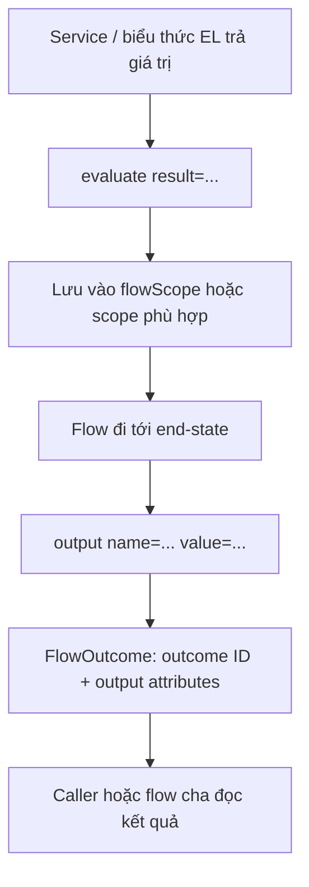

# Ánh xạ output từ biểu thức hoặc dữ liệu trong scope

## 1. Output mapping giúp flow trả đúng dữ liệu cần thiết

Trong **Spring Web Flow**, một flow không chỉ điều khiển state và transition. Flow còn gọi service, tạo dữ liệu trung gian, lưu dữ liệu vào scope và trả kết quả cho nơi gọi khi kết thúc. Khi một flow được gọi như một đơn vị nghiệp vụ, nơi gọi thường cần biết **kết quả nào đã xảy ra** và **dữ liệu nào được tạo ra**.

Ví dụ quy trình đặt phòng:

- **Xác nhận thành công:** flow trả mã đặt phòng và số xác nhận.
- **Người dùng hủy:** flow trả outcome hủy và không cần mã đặt phòng.
- **Tạo khách lưu trú:** một subflow trả đối tượng khách mới để flow cha thêm vào danh sách.

Spring Web Flow có ba cơ chế ánh xạ liên quan nhưng phục vụ những điểm khác nhau:

1. **result của evaluate:** lưu giá trị trả về của một biểu thức vào biến hoặc thuộc tính trong scope.
2. **output trong end-state:** công bố một thuộc tính output thuộc kết quả cuối của flow; giá trị có thể lấy từ biến cùng tên trong flowScope hoặc từ một biểu thức được chỉ định.
3. **currentEvent.attributes ở flow cha:** đọc các output do subflow trả về trong transition xử lý outcome của subflow.

Ba cơ chế này thường xuất hiện liên tiếp: service trả kết quả, action lưu kết quả vào scope, end-state xuất một phần dữ liệu, rồi parent hoặc caller nhận dữ liệu theo hợp đồng output.



## 2. Phân biệt result, output và outcome

| Thành phần | Nơi khai báo | Vai trò | Ví dụ |
| --- | --- | --- | --- |
| expression | evaluate | Tính toán hoặc gọi method | bookingService.confirm(booking) |
| result | evaluate | Nơi nhận giá trị trả về của expression | flowScope.confirmation |
| name | output | Tên thuộc tính công khai trong output map | bookingId |
| value | output | Biểu thức cung cấp giá trị cho output | flowScope.booking.id |
| End-state ID | end-state | Tên outcome khi flow kết thúc | bookingConfirmed |
| currentEvent.attributes | Transition của parent | Đọc output của subflow theo outcome vừa nhận | currentEvent.attributes.guest |

Ví dụ:

```xml
<action-state id="confirmBooking">
    <evaluate expression="bookingService.confirm(flowScope.booking)"
              result="flowScope.confirmation"/>
    <transition on="success" to="bookingConfirmed"/>
</action-state>

<end-state id="bookingConfirmed">
    <output name="bookingId" value="flowScope.confirmation.bookingId"/>
</end-state>
```

Trong đoạn này, bookingService.confirm(...) là biểu thức được thực thi; giá trị trả về được lưu vào flowScope.confirmation; khi flow đi tới bookingConfirmed, output bookingId lấy từ thuộc tính bookingId của đối tượng confirmation. bookingConfirmed là outcome ID, còn bookingId là một output attribute nằm trong outcome đó.

**Outcome và output không thay thế nhau.** Outcome trả lời “flow kết thúc theo nhánh nào”; output trả lời “nhánh đó trả thêm dữ liệu gì”.

## 3. Ánh xạ kết quả của evaluate vào scope

### 3.1. expression là nguồn, result là đích

Phần tử evaluate đánh giá một biểu thức EL tại thời điểm action được chạy. Biểu thức có thể gọi Spring bean, gọi method trên đối tượng trong flow hoặc đọc một giá trị. Nếu flow cần giữ giá trị trả về, dùng thuộc tính result.

```xml
<evaluate expression="catalogService.findProducts(flowScope.criteria)"
          result="flowScope.products"/>
```

Ở ví dụ trên, catalogService.findProducts(...) là nguồn dữ liệu; flowScope.products là đích nhận kết quả; products có thể được dùng trong các state tiếp theo của cùng flow execution.

Nếu chỉ gọi method để tạo side effect và không cần lưu giá trị trả về, có thể bỏ result:

```xml
<evaluate expression="auditService.recordSearch(flowScope.criteria)"/>
```

Trong trường hợp này, giá trị trả về không được gán vào một biến flow. Chỉ dùng cách đó khi method được gọi vì side effect và không cần kết quả cho bước tiếp theo.

### 3.2. Biến mới phải chỉ rõ scope

Khi tạo một biến mới trong flow data model, hãy chỉ rõ scope ở thuộc tính result:

```xml
<evaluate expression="bookingService.createBooking(flowScope.hotelId)"
          result="flowScope.booking"/>

<evaluate expression="pricingService.calculate(flowScope.booking)"
          result="flowScope.priceQuote"/>
```

Các biến booking và priceQuote được tạo trong flow scope. Cách viết có scope giúp người đọc biết dữ liệu tồn tại bao lâu và tránh vô tình tạo biến ở phạm vi không phù hợp.

Các scope thường dùng:

| Scope | Vòng đời | Khi phù hợp để nhận kết quả |
| --- | --- | --- |
| flowScope | Từ lúc flow session bắt đầu đến khi kết thúc | Dữ liệu cần qua nhiều request/state, ví dụ booking, hồ sơ, kết quả nghiệp vụ |
| viewScope | Khi flow vào một view-state đến khi rời state đó | Dữ liệu chỉ phục vụ màn hình hiện tại |
| requestScope | Trong một lần xử lý flow request | Giá trị trung gian chỉ dùng trong request đang xử lý |
| flashScope | Được giữ đến lần render view kế tiếp rồi được dọn | Thông báo ngắn hạn hoặc dữ liệu chuyển tiếp tới view |
| conversationScope | Từ lúc top-level flow bắt đầu đến khi top-level flow kết thúc; dùng chung với subflow | Dữ liệu cần chia sẻ giữa flow cha và các subflow |

Với kết quả cần xuất ở end-state, flowScope thường là lựa chọn dễ hiểu nhất vì dữ liệu còn tồn tại khi flow đi qua các state khác nhau. Không lưu đối tượng chỉ dùng trong một màn hình vào flowScope nếu viewScope đủ đáp ứng.

### 3.3. Ghi vào thuộc tính của biến đã tồn tại

Không phải lần nào cũng tạo biến mới. Nếu cần cập nhật một thuộc tính của đối tượng đã có, có thể nhắm thẳng vào thuộc tính đó:

```xml
<evaluate expression="requestParameters.sortBy"
          result="searchCriteria.sortBy"/>
```

Ở đây searchCriteria đã tồn tại trong flow scope; kết quả được gán vào thuộc tính sortBy. Vì đang cập nhật một biến đã tồn tại, biểu thức đích có thể tham chiếu trực tiếp searchCriteria.sortBy. Khi tạo một biến mới, hãy ghi rõ scope như flowScope.newValue.

Một cách khác là dùng set khi thao tác đơn giản:

```xml
<set name="flowScope.searchCriteria.sortBy"
     value="requestParameters.sortBy"/>
```

Hãy dùng biểu thức gán phù hợp với mục đích. result không phải tên event, cũng không phải tên output được trả cho caller; nó là đích ghi giá trị của expression.

### 3.4. Chuyển đổi kiểu của kết quả evaluate

Nếu giá trị trả về cần chuyển sang kiểu khác, có thể dùng result-type:

```xml
<evaluate expression="bookingService.findHotels(flowScope.criteria)"
          result="viewScope.hotels"
          result-type="dataModel"/>
```

Ví dụ dataModel chuyển kết quả sang kiểu model dữ liệu phù hợp cho việc hiển thị danh sách trong view. Đây là chuyển đổi giá trị trước khi lưu vào đích result.

Không dùng result-type như một cách ép kiểu tùy tiện để che lỗi hợp đồng. Nếu service trả sai kiểu hoặc thiếu dữ liệu, hãy sửa hợp đồng service hoặc cấu hình conversion service; nếu không thể chuyển đổi, lỗi cần được xử lý rõ ràng.

## 4. output mặc định lấy dữ liệu từ flowScope

### 4.1. Cách viết ngắn khi tên biến trùng tên output

Output attribute được khai báo bên trong end-state:

```xml
<end-state id="bookingConfirmed">
    <output name="bookingId"/>
</end-state>
```

Nếu không có value, Web Flow lấy giá trị từ flowScope theo đúng tên thuộc tính output. Với khai báo trên, giá trị của biến flowScope.bookingId được đưa vào output map dưới khóa bookingId.

Ví dụ:

```xml
<evaluate expression="bookingService.confirm(flowScope.booking)"
          result="flowScope.bookingId"/>

<end-state id="bookingConfirmed">
    <output name="bookingId"/>
</end-state>
```

Đây là cách ngắn và dễ đọc khi tên biến nội bộ cũng chính là tên thuộc tính cần trả ra.

### 4.2. Chỉ rõ nguồn bằng thuộc tính value

Trong thực tế, tên biến nội bộ thường khác tên output công khai. Dùng value để chỉ rõ biểu thức nguồn:

```xml
<end-state id="bookingConfirmed">
    <output name="bookingId" value="flowScope.booking.id"/>
    <output name="confirmationNumber"
            value="flowScope.booking.confirmationNumber"/>
</end-state>
```

Ở đây flow giữ đối tượng booking, nhưng caller chỉ nhận hai thuộc tính cần thiết:

- bookingId lấy từ flowScope.booking.id.
- confirmationNumber lấy từ flowScope.booking.confirmationNumber.

Tên output và đường dẫn nguồn không cần giống nhau. Đây là cách giữ cấu trúc nội bộ của flow độc lập với hợp đồng mà caller sử dụng.

### 4.3. Dùng biểu thức chuẩn, không bọc dấu phân cách tùy tiện

Các thuộc tính expression như value của output nhận biểu thức EL chuẩn:

```xml
<output name="bookingId" value="flowScope.booking.id"/>
```

Không cần bọc biểu thức trên trong cú pháp template. Trong flow definition, biểu thức chuẩn được đánh giá trực tiếp. Cú pháp template expression có dấu phân cách chỉ dành cho thuộc tính cần ghép văn bản tĩnh với biểu thức, không phải cách bọc mặc định cho mọi EL expression.

### 4.4. Output chỉ được trả từ end-state đã khai báo

Không phải toàn bộ flowScope tự động được xuất ra. Chỉ những output được khai báo trong end-state đang kết thúc mới thuộc output map của outcome đó.

Ví dụ:

```xml
<end-state id="bookingConfirmed">
    <output name="bookingId" value="flowScope.booking.id"/>
</end-state>

<end-state id="bookingCancelled"/>
```

Khi kết thúc ở bookingConfirmed, caller nhận bookingId. Khi kết thúc ở bookingCancelled, flow không khai báo output tương ứng. Caller cần xử lý theo outcome thay vì giả định mọi nhánh đều có cùng dữ liệu.

## 5. Ví dụ hoàn chỉnh: flow đặt phòng trả output cho caller

Giả sử flow hotelBooking nhận hotelId, tạo booking, cho người dùng nhập thông tin và xác nhận. Khi thành công, flow trả mã booking và số xác nhận. Khi hủy, flow trả outcome hủy mà không xuất dữ liệu đặt phòng.

```xml
<?xml version="1.0" encoding="UTF-8"?>
<flow xmlns="http://www.springframework.org/schema/webflow"
      xmlns:xsi="http://www.w3.org/2001/XMLSchema-instance"
      xsi:schemaLocation="
        http://www.springframework.org/schema/webflow
        https://www.springframework.org/schema/webflow/spring-webflow.xsd">

    <input name="hotelId" type="long" required="true"/>

    <on-start>
        <evaluate
            expression="bookingService.createBooking(flowScope.hotelId)"
            result="flowScope.booking"/>
    </on-start>

    <view-state id="enterBookingDetails"
                view="booking/details"
                model="booking">
        <transition on="review" to="reviewBooking"/>
        <transition on="cancel" to="bookingCancelled"
                    bind="false" validate="false"/>
    </view-state>

    <view-state id="reviewBooking" view="booking/review">
        <transition on="confirm" to="confirmBooking"/>
        <transition on="revise" to="enterBookingDetails"/>
        <transition on="cancel" to="bookingCancelled"
                    bind="false" validate="false"/>
    </view-state>

    <action-state id="confirmBooking">
        <evaluate
            expression="bookingService.confirm(flowScope.booking)"
            result="flowScope.confirmation"/>
        <transition on="success" to="bookingConfirmed"/>
    </action-state>

    <end-state id="bookingConfirmed">
        <output name="bookingId"
                value="flowScope.confirmation.bookingId"/>
        <output name="confirmationNumber"
                value="flowScope.confirmation.confirmationNumber"/>
    </end-state>

    <end-state id="bookingCancelled"/>
</flow>
```

Các thành phần bookingService, Booking và Confirmation là thành phần do ứng dụng cung cấp. Flow thể hiện hợp đồng dữ liệu:

1. hotelId là input của flow và được lưu trong flow scope theo tên input.
2. createBooking(...) trả đối tượng booking; result lưu vào flowScope.booking.
3. Khi người dùng xác nhận, confirm(...) trả kết quả; result lưu vào flowScope.confirmation.
4. End-state bookingConfirmed xuất hai trường từ đối tượng confirmation.
5. End-state bookingCancelled chỉ trả outcome hủy, không công bố booking ID.

Trong ứng dụng thật, service phải kiểm tra giá, tình trạng phòng và quyền truy cập ở phía server. Không tin dữ liệu form để quyết định booking đã xác nhận. Việc commit transaction và gửi thông báo cũng cần tuân theo transaction boundary của service.

## 6. Mapping output từ subflow về flow cha

### 6.1. End-state của subflow định nghĩa output

Giả sử flow createGuest tạo một khách mới. Khi tạo thành công, flow con kết thúc ở end-state guestCreated và trả đối tượng guest:

```xml
<flow xmlns="http://www.springframework.org/schema/webflow">
    <var name="guest" class="com.example.booking.Guest"/>

    <view-state id="enterGuest" view="guest/details"
                model="guest">
        <transition on="save" to="saveGuest"/>
        <transition on="cancel" to="creationCancelled"
                    bind="false" validate="false"/>
    </view-state>

    <action-state id="saveGuest">
        <evaluate expression="guestService.create(flowScope.guest)"
                  result="flowScope.guest"/>
        <transition on="success" to="guestCreated"/>
    </action-state>

    <end-state id="guestCreated">
        <output name="guest" value="flowScope.guest"/>
        <output name="guestId" value="flowScope.guest.id"/>
    </end-state>

    <end-state id="creationCancelled"/>
</flow>
```

Khi flow con kết thúc:

- Outcome ID là guestCreated.
- Output map có guest và guestId.
- Nếu người dùng hủy, outcome ID là creationCancelled và không có các output trên.

Output có thể là object hoặc scalar. Nếu parent chỉ cần mã ID, trả guestId sẽ giảm sự phụ thuộc vào cấu trúc entity. Nếu parent cần thao tác với đối tượng mới ngay sau khi subflow trả về, có thể trả một DTO GuestSummary thay cho entity persistence.

### 6.2. Flow cha đọc output qua currentEvent.attributes

Flow cha gọi subflow bằng subflow-state:

```xml
<subflow-state id="addGuest" subflow="createGuest">
    <input name="booking"/>

    <transition on="guestCreated" to="reviewBooking">
        <evaluate
            expression="flowScope.booking.guests.add(currentEvent.attributes.guest)"/>
    </transition>

    <transition on="creationCancelled" to="reviewBooking"/>
</subflow-state>
```

Khi flow con trả outcome guestCreated, parent nhận event có ID guestCreated. Các output của outcome được truy cập qua currentEvent.attributes:

- currentEvent.id là outcome ID của subflow.
- currentEvent.attributes.guest là output guest.
- currentEvent.attributes.guestId là output guestId.

Output chỉ có ý nghĩa trong transition xử lý outcome tương ứng. Không đọc currentEvent.attributes.guest ở một state bất kỳ sau đó nếu parent chưa lưu giá trị vào scope của chính nó.

Nếu parent cần giữ output cho các request sau, hãy ánh xạ vào scope của parent:

```xml
<transition on="guestCreated" to="reviewBooking">
    <evaluate expression="currentEvent.attributes.guest"
              result="flowScope.newGuest"/>
    <evaluate expression="flowScope.booking.guests.add(flowScope.newGuest)"/>
</transition>
```

Ở đây newGuest được lưu trong flow scope cha trước khi sử dụng ở những state tiếp theo.

### 6.3. Output mapping khác với chia sẻ conversationScope

| Cách trao đổi | Ý nghĩa | Khi phù hợp |
| --- | --- | --- |
| Subflow output | Trả dữ liệu rõ ràng theo outcome | Flow cha chỉ cần một số kết quả từ flow con |
| currentEvent.attributes | Đọc output ngay trong transition của parent | Xử lý kết quả ngay sau khi subflow kết thúc |
| conversationScope | Dữ liệu dùng chung trong top-level flow và các subflow | Nhiều flow thực sự cần cùng truy cập một dữ liệu trong suốt conversation |
| Service/database | Dữ liệu nghiệp vụ bền vững ngoài flow | Kết quả phải tồn tại sau khi flow kết thúc hoặc được nhiều request khác sử dụng |

Output mapping làm hợp đồng giữa hai flow rõ ràng: flow con công bố trường nào, parent nhận trường đó. Không nên dùng conversation scope chỉ để tránh khai báo output; cách đó làm flow cha phụ thuộc ngầm vào biến nội bộ của flow con.

## 7. Root flow trả output cho nơi gọi

Khi root flow kết thúc, kết quả có thể được hiểu như một FlowOutcome:

```java
public interface FlowOutcome {
    String getName();
    Map<String, Object> getOutputAttributes();
}
```

Hai phần của kết quả:

- getName() trả outcome ID, tương ứng end-state mà flow đã đi vào.
- getOutputAttributes() trả map các thuộc tính output được khai báo trong end-state đó.

Ví dụ một caller nhận:

```java
String outcomeName = outcome.getName();
Map<String, Object> attributes = outcome.getOutputAttributes();

if ("bookingConfirmed".equals(outcomeName)) {
    Long bookingId = (Long) attributes.get("bookingId");
    String confirmationNumber =
            (String) attributes.get("confirmationNumber");
}
```

Đây là minh họa cách đọc hợp đồng FlowOutcome; cách lấy outcome cụ thể phụ thuộc điểm tích hợp đang gọi flow (FlowExecutor, subflow hoặc Spring MVC handler). Với subflow, parent thường xử lý trực tiếp event và currentEvent.attributes như mục trước.

Nếu root flow được tích hợp với Spring MVC, ứng dụng có thể dùng FlowHandler hoặc cơ chế điều hướng của end-state để chọn response. Chỉ những output đã khai báo mới được trả theo outcome; không giả định MVC tự đưa toàn bộ flowScope vào model hoặc flash scope.

## 8. Chọn nguồn output và scope phù hợp

### 8.1. Ưu tiên flowScope cho kết quả cuối

Kết quả được tạo ở một action và cần dùng ở end-state nên thường được lưu vào flowScope:

```xml
<evaluate expression="paymentService.authorize(flowScope.order)"
          result="flowScope.paymentResult"/>

<end-state id="paymentAuthorized">
    <output name="authorizationCode"
            value="flowScope.paymentResult.authorizationCode"/>
</end-state>
```

flowScope tồn tại trong vòng đời flow session, nên dữ liệu còn khi flow chuyển qua các state và request khác. Với mặc định repository, đối tượng trong flow scope có thể cần serializable để execution snapshot được lưu/khôi phục.

### 8.2. Không xuất trực tiếp dữ liệu chỉ thuộc view hoặc request nếu không cần

viewScope chỉ tồn tại trong một view-state; requestScope chỉ tồn tại trong lần xử lý request; flashScope được dọn sau khi view render. Các scope này hữu ích cho UI hoặc dữ liệu tạm nhưng thường không phù hợp để làm nơi giữ kết quả nghiệp vụ cần trả ở cuối flow.

Nếu một giá trị bắt đầu ở viewScope nhưng cần dùng ở end-state sau khi rời view-state, hãy chuyển nó vào flowScope trước khi rời state:

```xml
<view-state id="review" view="booking/review">
    <transition on="confirm" to="confirmBooking">
        <evaluate expression="viewScope.selectedOption"
                  result="flowScope.selectedOption"/>
    </transition>
</view-state>
```

Sau đó end-state đọc flowScope.selectedOption. Điều này làm rõ rằng dữ liệu đã được nâng từ phạm vi một view sang phạm vi flow.

### 8.3. Tránh giữ entity hoặc tài nguyên không phù hợp trong output

Output map có thể chứa object reference, không phải bản sao sâu tự động của đối tượng. Vì vậy:

- Không trả EntityManager, Hibernate Session, JDBC connection, stream hoặc request/response object.
- Cẩn trọng khi trả entity có lazy association; caller có thể truy cập sau khi persistence context đã đóng.
- Ưu tiên DTO nhỏ, ID hoặc scalar value mà caller thực sự cần.
- Không trả token, mật khẩu, dữ liệu bí mật hoặc toàn bộ form model nếu caller không cần.
- Nếu object output có thể được serialize cùng execution hoặc lưu qua session, bảo đảm kiểu dữ liệu phù hợp với cấu hình persistence của ứng dụng.

## 9. EL và scope lookup khi ánh xạ dữ liệu

Trong biểu thức EL, khi **ghi một biến mới** vào scope, phải chỉ rõ scope:

```xml
<evaluate expression="bookingService.createBooking(flowScope.hotelId)"
          result="flowScope.booking"/>
```

Khi **đọc biến đã tồn tại**, việc ghi prefix scope có thể không bắt buộc vì Web Flow có thuật toán tìm biến qua các scope. Tuy nhiên, nếu nhiều scope có cùng tên, hoặc biểu thức là hợp đồng output quan trọng, nên viết rõ:

```xml
<output name="bookingId" value="flowScope.booking.id"/>
```

Thứ tự tìm kiếm mặc định khi đọc tên biến không có scope là:

1. requestScope
2. flashScope
3. viewScope
4. flowScope
5. conversationScope

Nếu không tìm thấy biến, EL ném lỗi đánh giá. Vì thế không nên dựa vào scope lookup ngầm cho các output quan trọng: hai biến trùng tên ở request và flow scope có thể khiến biểu thức đọc nhầm dữ liệu.

Biểu thức trong thuộc tính expression, result và value phải tuân thủ cú pháp EL mà flow builder đang cấu hình. Spring EL là mặc định trong các cấu hình hiện đại; nếu ứng dụng dùng Unified EL hoặc expression parser tùy chỉnh, hãy kiểm tra conversion service và cú pháp tương ứng.

## 10. Giá trị null, thiếu output và chuyển đổi kiểu

Khi thiết kế hợp đồng output, hãy xác định rõ trường nào bắt buộc và trường nào tùy chọn:

| Tình huống | Cách thiết kế |
| --- | --- |
| Output luôn phải có sau khi thành công | Chỉ đi vào end-state sau khi service tạo giá trị; kiểm tra invariant trước khi kết thúc |
| Output có thể không có ở một outcome | Không khai báo ở end-state không cần nó; caller phân nhánh theo outcome |
| Biểu thức nguồn có thể trả null | Caller kiểm tra null; không giả định object luôn tồn tại |
| Cần kiểu dữ liệu cụ thể cho evaluate result | Dùng result-type hoặc cấu hình conversion service |
| Output là entity lớn hoặc lazy | Trả DTO/ID/scalar thay vì entity graph |
| Cùng dữ liệu được dùng ở nhiều flow | Xác định rõ output contract hoặc dùng service/database; không dựa vào tên biến ngầm |

Không nên dùng một output result chung cho cả thành công, từ chối và hủy nếu ý nghĩa dữ liệu khác nhau. Hãy đặt output trong end-state phù hợp để caller không phải suy đoán từ một map mơ hồ.

## 11. Lỗi thường gặp khi ánh xạ output

| Triệu chứng | Nguyên nhân | Cách xử lý |
| --- | --- | --- |
| evaluate chạy nhưng biến không có giá trị | Thiếu result hoặc ghi vào scope không phù hợp | Khai báo result="flowScope.name" hoặc scope đúng |
| result ghi đè nhầm biến cùng tên | Dùng scope lookup ngầm khi nhiều scope có biến trùng tên | Chỉ rõ scope ở đích và nguồn |
| Caller không thấy output | End-state chưa khai báo output | Thêm output vào đúng end-state |
| Output luôn null | value trỏ sai property hoặc action chưa tạo dữ liệu | Kiểm tra expression và thứ tự state/action |
| Output lấy nhầm object cùng tên | Dùng output name không có biến cùng tên mong muốn trong flowScope | Chỉ rõ value="flowScope.object.property" |
| Parent không đọc được output subflow | Sai outcome ID hoặc sai tên output trong currentEvent.attributes | Đối chiếu end-state ID và output name của flow con |
| Output biến mất sau khi rời view | Lưu dữ liệu cần xuất ở viewScope rồi state kết thúc | Chuyển dữ liệu vào flowScope trước khi rời view |
| ClassCastException ở caller | Caller giả định kiểu khác với giá trị service trả | Thống nhất kiểu DTO/scalar và kiểm thử conversion |
| Caller nhận entity nhưng truy cập lazy bị lỗi | Persistence context không còn mở | Trả DTO hoặc ID, nạp dữ liệu cần thiết trước khi kết thúc |
| Output chứa quá nhiều dữ liệu | Xuất cả model hoặc entity graph | Chỉ công bố các trường caller thực sự cần |

Khi gỡ lỗi, lần theo đường đi:

1. Expression có chạy không?
2. Giá trị trả về có đúng kiểu và khác null không?
3. result ghi vào scope nào?
4. End-state nào thực sự được đi vào?
5. output có khai báo trong end-state đó không?
6. value trỏ đúng nguồn hay đang dùng mặc định cùng tên trong flowScope?
7. Caller đọc đúng outcome ID và output key chưa?

## 12. Kiểm thử output mapping

Nên kiểm thử cả **outcome ID** lẫn **output attributes**. Chỉ xác nhận flow kết thúc chưa đủ để chứng minh mapping đúng.

| Kịch bản | Điều cần kiểm tra |
| --- | --- |
| Action tạo booking thành công | flowScope.booking nhận đúng object từ service |
| Action tính confirmation | flowScope.confirmation có booking ID và confirmation number |
| Root flow kết thúc thành công | Outcome là bookingConfirmed, output có đúng hai key |
| Root flow bị hủy | Outcome là bookingCancelled, không yêu cầu booking output |
| Output mặc định | output name bookingId lấy giá trị từ flowScope.bookingId |
| Output expression | output value flowScope.booking.id lấy đúng property |
| Subflow tạo guest | Child trả outcome guestCreated cùng output guest |
| Parent xử lý subflow | currentEvent.attributes.guest được thêm vào booking |
| Subflow bị hủy | Parent nhận creationCancelled và không thêm guest |
| Kiểu dữ liệu | Caller nhận đúng kiểu ID/DTO và không phải cast sai |
| Output tùy chọn | Caller xử lý null hoặc không có key theo hợp đồng đã chọn |

### Kiểm thử flow XML

AbstractXmlFlowExecutionTests cho phép chạy flow definition, gửi event và kiểm tra state/outcome mà không cần trình duyệt. Một test nên:

1. Khởi tạo flow với input cần thiết.
2. Stub service trả về đối tượng có ID và dữ liệu xác định.
3. Gửi event để đi qua action-state.
4. Kiểm tra flow đi vào end-state mong đợi.
5. Kiểm tra output map của flow result hoặc kiểm tra transition parent nhận đúng currentEvent.attributes.

Với subflow, có thể test parent flow bằng một child flow fixture trả output đã biết. Cách này xác minh cả hai phía của hợp đồng: tên end-state, output name và nơi parent đọc dữ liệu.

Không chỉ test nhánh thành công. Hãy thêm test cho cancel/reject, output null, lỗi service, output thiếu và trường hợp child trả outcome không có transition tương ứng ở parent.

## 13. Bài tập thực hành

Xây dựng hai flow:

**Flow createOrder:**

- Nhận customerId làm input.
- Tạo OrderDraft trong flowScope.order.
- Khi xác nhận, gọi orderService.submit(...) và lưu kết quả vào flowScope.submission.
- End-state orderSubmitted trả orderId và trackingCode bằng biểu thức value.
- End-state orderCancelled không trả output.

**Flow con addOrderItem:**

- Nhận order làm input.
- Tạo một item mới.
- End-state itemAdded trả output item.
- End-state itemCancelled không trả item.

**Flow cha createOrder:**

- Gọi addOrderItem bằng subflow-state.
- Khi nhận outcome itemAdded, đọc currentEvent.attributes.item và thêm item vào flowScope.order.
- Khi nhận itemCancelled, quay lại màn hình review mà không thay đổi danh sách item.

Yêu cầu kiểm thử:

1. Kết quả orderService.submit được lưu đúng vào flowScope.submission.
2. orderSubmitted xuất đúng orderId và trackingCode.
3. orderCancelled không trả dữ liệu đặt hàng.
4. Subflow output được parent đọc qua đúng key.
5. Parent lưu output vào scope của nó nếu cần dùng ở request tiếp theo.
6. Không xuất entity graph hoặc dữ liệu nhạy cảm không cần thiết.

**Tiêu chí đạt:** giải thích được khác biệt giữa result và output, biết khi nào dùng output mặc định theo tên biến trong flowScope, khi nào chỉ rõ value, và đọc đúng output subflow qua currentEvent.attributes.

## 14. Ghi nhớ

- result của evaluate là **đích ghi** giá trị trả về của biểu thức; biến mới nên chỉ rõ scope.
- output nằm trong end-state và định nghĩa các thuộc tính được trả theo outcome đó.
- Nếu output không có value, Web Flow lấy giá trị từ flowScope theo cùng tên name.
- value cho phép ánh xạ từ một biểu thức hoặc property khác sang tên output công khai.
- End-state ID là outcome; output name là key trong output map. Hai khái niệm này độc lập.
- Subflow trả output trong outcome; flow cha đọc dữ liệu qua currentEvent.attributes trong transition tương ứng.
- Dữ liệu cần dùng xuyên nhiều state nên thường ở flowScope; dữ liệu chỉ dùng trong view/request nên ở scope ngắn hơn.
- Ưu tiên output nhỏ, rõ ràng, có kiểu ổn định; tránh trả entity lazy, tài nguyên runtime hoặc dữ liệu bí mật.
- Kiểm thử cả outcome, output key, giá trị, kiểu dữ liệu và nhánh không có output.

### Tài liệu tham khảo

- [Spring Web Flow 3.0 Reference Guide – Actions](https://docs.spring.io/spring-webflow/docs/3.0.0-SNAPSHOT/reference/#actions): evaluate, gán kết quả và result-type.
- [Spring Web Flow 3.0 Reference Guide – Input/Output Mapping](https://docs.spring.io/spring-webflow/docs/3.0.0-SNAPSHOT/reference/#flow-input-output): flow input, output, mặc định lấy từ flow scope và thuộc tính value.
- [Spring Web Flow 3.0 Reference Guide – Calling Sub-flows](https://docs.spring.io/spring-webflow/docs/3.0.0-SNAPSHOT/reference/#calling-sub-flows): subflow outcome và currentEvent.attributes.
- [Spring Web Flow 3.0 Reference Guide – Variable Scopes](https://docs.spring.io/spring-webflow/docs/3.0.0-SNAPSHOT/reference/#variable-scopes): vòng đời flow, view, request, flash và conversation scope.
- [Spring Web Flow 3.0 Reference Guide – Expression Language](https://docs.spring.io/spring-webflow/docs/3.0.0-SNAPSHOT/reference/#expression-language): biểu thức chuẩn, biến đặc biệt và thuật toán tìm kiếm scope.
