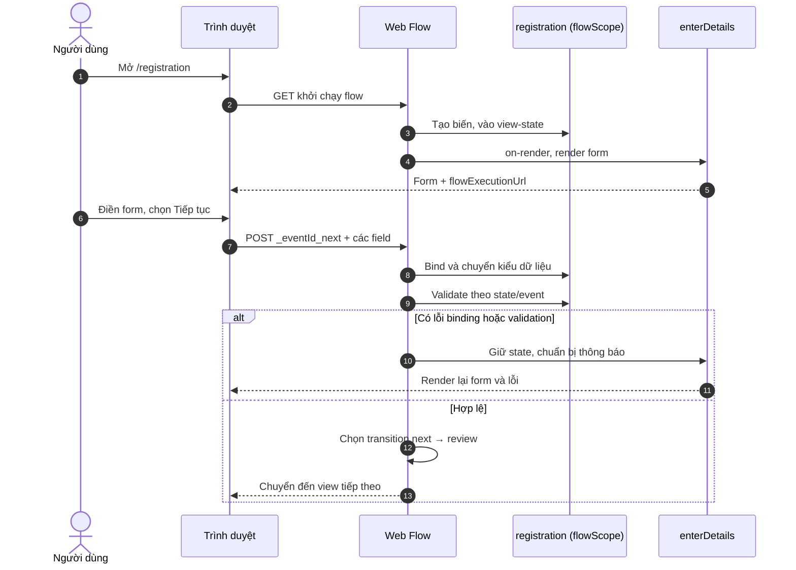

# Thuộc tính `model` của `view-state` và vòng đời postback trong Spring Web Flow

## 1. Mục tiêu học tập

Sau bài này, bạn có thể:

- Phân biệt `id`, `view` và `model` trong một `view-state`; xác định đối tượng Java nào đang nhận dữ liệu biểu mẫu.
- Giải thích từng bước từ lúc hiển thị form đến khi nhận HTTP postback, binding, chuyển kiểu, validation, xử lý event và transition.
- Tạo một form nhiều bước giữ dữ liệu giữa các view bằng `flowScope` và trả lỗi về đúng màn hình khi nhập sai.
- Điều khiển binding/validation theo sự kiện với `bind="false"`, `validate="false"`; giới hạn thuộc tính được sửa bằng `<binder>`.
- Chẩn đoán các lỗi thường gặp: mất flow execution, model rỗng, nhập sai kiểu, chuyển state khi chưa hợp lệ, reset dữ liệu hoặc cho phép sửa thuộc tính không chủ ý.

**Ngữ cảnh:** Trong Spring Web Flow, một hành trình như đăng ký, đặt phòng hoặc checkout được biểu diễn bằng **state → event → transition**. Người dùng có thể gửi biểu mẫu qua nhiều HTTP request, nhưng Web Flow tiếp tục cùng một *flow execution*, quản lý trạng thái và quyết định bước tiếp theo. Vì vậy, xử lý postback khác với cách một controller Spring MVC độc lập tự nhận `@ModelAttribute` rồi tự chọn URL điều hướng.

## 2. `model` của `view-state` thực sự có ý nghĩa gì?

`view-state` là trạng thái có giao diện để hiển thị và tạm dừng flow chờ người dùng gửi event. Xét ba thuộc tính:

```xml
<view-state id="enterDetails" view="enterDetails" model="registration">
    <transition on="next" to="review" />
</view-state>
```

| Thành phần | Trả lời câu hỏi | Vai trò |
|---|---|---|
| `id="enterDetails"` | Flow đang ở bước nào? | Tên state, dùng để định nghĩa transition và quy ước validation theo state. |
| `view="enterDetails"` | Giao diện nào được render? | Tên view để công nghệ trình bày và `ViewResolver` tìm template. |
| `model="registration"` | Postback sẽ ghi dữ liệu vào đâu? | Biểu thức trỏ đến **đối tượng model** dùng để bind dữ liệu và validate. |

`model` **không phải** tên file HTML và cũng không có tác dụng tự tạo đối tượng mới khi mỗi request đến. Đối tượng phải tồn tại trong scope mà flow có thể truy cập. Ví dụ, khai báo:

```xml
<var name="registration" class="com.example.flow.RegistrationForm" />
```

sẽ tạo biến `registration` trong `flowScope` khi flow bắt đầu. `model="registration"` sẽ tìm biến theo cơ chế phân giải scope; có thể viết rõ `model="flowScope.registration"` để thể hiện chủ đích. Model cũng có thể thuộc `viewScope` nếu dữ liệu chỉ phục vụ một màn hình.

Khi một `view-state` có `model` và xảy ra view event cần xử lý form, Web Flow cung cấp quy trình mặc định: **lấy tham số request → gán vào thuộc tính model → chuyển kiểu → validate → xét transition**. Với lỗi binding hoặc validation, Web Flow giữ người dùng tại view hiện tại để sửa và hiển thị thông báo lỗi.

> Cần phân biệt **flow model** với **MVC model**: đối tượng được biểu thức `model` tham chiếu là dữ liệu nghiệp vụ/form của flow; khi tích hợp Spring MVC, view có thể thấy đối tượng đó dưới tên thuộc tính tương ứng để render và nhận giá trị nhập. `model` trong XML là cấu hình hành vi của state, không phải một lần gọi `Model.addAttribute(...)` trong controller cho mỗi request.

## 3. Vòng đời từ request đầu tiên đến postback

### 3.1. Luồng thực thi



**Bước 1 — Khởi chạy và vào state.** Một request được `FlowHandlerAdapter`/Web Flow mapping nhận, flow được tạo và các biến `<var>` ở cấp flow được khởi tạo. Khi vào `enterDetails`, Web Flow cấp một `viewScope` cho state này. `on-entry` (nếu có) chạy khi vào state; `on-render` chạy trước lần render đầu và các lần render lại.

**Bước 2 — Hiển thị form.** View lấy model hiện thời và biểu diễn các giá trị của nó. URL gửi form phải trỏ về **flow execution hiện hành** (ví dụ dùng biến `flowExecutionUrl` do Web Flow cung cấp). Thông tin execution cho phép server tiếp tục đúng flow, thay vì khởi tạo hành trình mới.

**Bước 3 — Người dùng phát event.** Trên HTML view tích hợp Spring MVC, nút `name="_eventId_next"` được hiểu là event `next`. Một lựa chọn khác là trường ẩn `name="_eventId" value="next"` khi form chỉ có một event. Tên event phải tương ứng với `on="next"` trong transition.

**Bước 4 — Tiếp tục flow và binding.** Web Flow khôi phục execution/state hiện tại, đọc tham số gửi lên, gán những trường được phép vào model, đồng thời chuyển chuỗi HTTP thành kiểu Java phù hợp (`String`, số, `LocalDate`, enum...). Binding lỗi — ví dụ gửi `"ngày mai"` cho `LocalDate` nhưng không có bộ chuyển đổi phù hợp — sẽ được ghi nhận để hiển thị thông báo.

**Bước 5 — Validation.** Nếu binding phù hợp và transition không tắt validation, các quy tắc được cấu hình (Bean Validation hoặc validator theo quy ước Web Flow) được áp dụng. Lỗi validation ngăn người dùng đi tiếp qua transition yêu cầu dữ liệu hợp lệ.

**Bước 6 — Xử lý transition.** Khi dữ liệu hợp lệ, Web Flow chọn transition có `on` khớp event và điều kiện phù hợp, thực thi action của transition (nếu có), rồi chuyển state. Rời `enterDetails` sẽ kết thúc `viewScope` của state; `flowScope.registration` vẫn còn để bước `review` sử dụng.

**Bước 7 — Render trạng thái tiếp theo.** Trong cấu hình web thông thường, Web Flow dùng cơ chế redirect quanh lần hiển thị state (**Post/Redirect/Get**) để việc reload trang không lặp lại nguyên request POST. Đây là hành vi mặc định có thể chịu ảnh hưởng của cấu hình hiển thị/Ajax; không nên tự suy ra URL execution có giá trị cố định.

### 3.2. Khi người dùng nhập sai, điều gì vẫn được giữ lại?

Giả sử người dùng nhập email không hợp lệ:

1. Field tương ứng được bind vào model nếu chuyển kiểu thành công.
2. Validator ghi lỗi cho trường `email`.
3. Transition `next → review` **không được thực hiện**; view hiện tại render lại với giá trị đã nhập và lỗi.
4. Do chưa rời state, `viewScope` của state vẫn phục vụ các lần cập nhật trong cùng state; `flowScope.registration` tiếp tục thuộc flow hiện hành.

Có thể có trường chuyển kiểu thất bại, nên không được giả định mọi giá trị gửi lên đã được gán thành công vào đối tượng Java. Dùng dữ liệu form và thông báo do cơ chế binding của view cung cấp để hiện lại input sai.

## 4. Ví dụ xuyên suốt: đăng ký lịch hẹn qua hai màn hình

Tình huống: khách nhập họ tên, email, ngày hẹn; chọn **Tiếp tục** để xem lại; **Quay lại** để sửa; **Hủy** để kết thúc. Ví dụ bên dưới tập trung vào điều hướng và binding; `completed` minh họa kết thúc flow, chưa ghi dữ liệu vào cơ sở dữ liệu.

### 4.1. Đối tượng form trong Java

```java
package com.example.flow;

import java.io.Serializable;
import java.time.LocalDate;

import jakarta.validation.constraints.Email;
import jakarta.validation.constraints.Future;
import jakarta.validation.constraints.NotBlank;
import jakarta.validation.constraints.NotNull;
import org.springframework.format.annotation.DateTimeFormat;

public class RegistrationForm implements Serializable {
    private static final long serialVersionUID = 1L;

    @NotBlank
    private String fullName;

    @NotBlank
    @Email
    private String email;

    @NotNull
    @Future
    @DateTimeFormat(iso = DateTimeFormat.ISO.DATE)
    private LocalDate appointmentDate;

    public String getFullName() { return fullName; }
    public void setFullName(String fullName) { this.fullName = fullName; }

    public String getEmail() { return email; }
    public void setEmail(String email) { this.email = email; }

    public LocalDate getAppointmentDate() { return appointmentDate; }
    public void setAppointmentDate(LocalDate appointmentDate) {
        this.appointmentDate = appointmentDate;
    }
}
```

Đây là một đối tượng form có constructor không tham số mặc định và các getter/setter phù hợp cho binding. `@DateTimeFormat` quy định định dạng ISO như `2027-01-15`. Các annotation Bean Validation là ràng buộc của model; để chúng thực sự được kiểm tra, flow phải có Bean Validation validator được cấu hình. Với Spring Web Flow 3.x, ví dụ sử dụng namespace `jakarta.validation`; dự án 2.x đời cũ có thể dùng namespace `javax.validation`, tùy phiên bản Spring/Jakarta.

### 4.2. Định nghĩa flow XML

```xml
<?xml version="1.0" encoding="UTF-8"?>
<flow xmlns="http://www.springframework.org/schema/webflow">

    <!-- Tạo một đối tượng dùng xuyên suốt flow. -->
    <var name="registration" class="com.example.flow.RegistrationForm" />

    <view-state id="enterDetails" view="enterDetails" model="registration">
        <binder>
            <binding property="fullName" required="true" />
            <binding property="email" required="true" />
            <binding property="appointmentDate" required="true" />
        </binder>

        <transition on="next" to="review" />
        <transition on="cancel" to="cancelled" bind="false" />
    </view-state>

    <view-state id="review" view="review">
        <transition on="back" to="enterDetails" />
        <transition on="confirm" to="completed" />
        <transition on="cancel" to="cancelled" />
    </view-state>

    <end-state id="completed" />
    <end-state id="cancelled" />
</flow>
```

**Cách đọc:** `<var>` giúp dữ liệu biểu mẫu không biến mất khi đi từ `enterDetails` sang `review`. `<binder>` cho phép chỉ ba trường được cập nhật trong màn hình nhập. `next` sẽ bind và validate mặc định; `cancel` bỏ qua cả hai. Màn hình `review` chỉ hiển thị dữ liệu (không khai báo `model` để bind form ở đó). `confirm` kết thúc flow; ở ứng dụng thật, việc lưu bản ghi cần xử lý ở bước nghiệp vụ thích hợp, có kiểm tra quyền truy cập và bảo đảm tránh tạo trùng khi người dùng gửi lại.

### 4.3. View nhập liệu: minh họa bằng Spring MVC JSP form tags

Đoạn JSP sau giả định đã tích hợp Web Flow với Spring MVC, cấu hình view resolver đến đúng JSP, và có form model tên `registration`. Đây là phần thân view; cấu hình `FlowHandlerMapping`, `FlowHandlerAdapter` và CSRF phụ thuộc ứng dụng.

```jsp
<%@ taglib prefix="form" uri="http://www.springframework.org/tags/form" %>

<form:form method="post"
           action="${flowExecutionUrl}"
           modelAttribute="registration">

    <label for="fullName">Họ tên</label>
    <form:input id="fullName" path="fullName" />
    <form:errors path="fullName" cssClass="error" />

    <label for="email">Email</label>
    <form:input id="email" path="email" />
    <form:errors path="email" cssClass="error" />

    <label for="appointmentDate">Ngày hẹn (yyyy-MM-dd)</label>
    <form:input id="appointmentDate" path="appointmentDate" />
    <form:errors path="appointmentDate" cssClass="error" />

    <button type="submit" name="_eventId_next">Tiếp tục</button>
    <button type="submit" name="_eventId_cancel" formnovalidate>Hủy</button>
</form:form>
```

Các `path` phải trùng tên thuộc tính Java; chỉ cần một nút được gửi thì Web Flow nhận event tương ứng từ `_eventId_...`. `formnovalidate` chỉ ảnh hưởng validation ở trình duyệt; `bind="false"` trong XML mới là quyết định phía server để nút Hủy không bị chặn bởi dữ liệu nhập sai. Khi ứng dụng bật Spring Security CSRF, request POST cũng phải có token hợp lệ theo cấu hình bảo mật.

Màn hình `review` có thể đọc `registration.fullName`, `registration.email` và `registration.appointmentDate` để hiển thị, rồi gửi event `back` hoặc `confirm` về flow execution URL. Vì `registration` nằm trong `flowScope`, các trường đã nhập không mất đi khi chuyển qua màn hình xác nhận.

## 5. Điều khiển postback theo từng event

Không phải mọi nút trên form đều cần cùng một chính sách. Đó là lý do `bind` và `validate` nằm ở **transition**.

```xml
<view-state id="enterDetails" model="registration">
    <transition on="next" to="review" />

    <!-- Không đọc/ghi các giá trị form vừa POST, không validate. -->
    <transition on="cancel" to="cancelled" bind="false" />

    <!-- Chấp nhận giá trị đã điền dù chưa đủ hợp lệ để lưu nháp. -->
    <transition on="saveDraft" validate="false">
        <evaluate expression="draftService.saveDraft(registration)" />
    </transition>
</view-state>
```

`saveDraft` là ví dụ **riêng**: transition không có `to` nên có thể thực hiện action rồi render lại view hiện tại; muốn dùng thật, dịch vụ `draftService` phải được cấu hình và phải kiểm tra quyền/điều kiện lưu nháp. Không bật lưu nháp khi bài toán không cho phép lưu dữ liệu chưa hợp lệ.

| Cấu hình transition | Có binding postback? | Có validation tự động? | Dùng khi |
|---|---|---|---|
| `<transition on="next" to="review" />` | Có (mặc định) | Có (mặc định) | Tiếp tục sau khi nhập hợp lệ. |
| `<transition on="cancel" to="cancelled" bind="false" />` | Không | Không | Hủy/thoát, không quan tâm form hiện tại. |
| `<transition on="back" to="previous" validate="false" />` | Có | Không | Giữ phần vừa nhập khi quay lại hoặc lưu nháp. |

Hai nhầm lẫn cần tránh:

- `validate="false"` **không** tắt binding. Một request có trường được phép bind vẫn có thể thay đổi model, kể cả khi bạn bỏ qua kiểm tra ràng buộc.
- `bind="false"` bỏ binding và validation cho **event đó**, nhưng không đảo ngược dữ liệu đã được lưu ở những postback trước. Đối với hành động kết thúc flow, cần xử lý nghiệp vụ theo mục đích thực tế.

## 6. Chuyển kiểu, giới hạn field và validation

### 6.1. Binding không đơn thuần là gán chuỗi

Mọi tham số HTTP đều là dữ liệu do client cung cấp. Ví dụ:

```text
_eventId_next=Tiếp tục
fullName=Nguyen Van A
email=a@example.com
appointmentDate=2027-01-15
```

`_eventId_next` có nhiệm vụ phát event; `fullName`, `email`, `appointmentDate` là các giá trị dự kiến bind. Web Flow cần chuyển `"2027-01-15"` thành `LocalDate` trước khi gọi setter. Nếu client gửi `"ngay-mai"` mà không có formatter tương ứng, binding sinh lỗi `typeMismatch` và trạng thái hiện tại được render lại. Có thể dùng `@DateTimeFormat`, formatter/converter được đăng ký với `ConversionService`, hoặc `converter` cho một `<binding>` cụ thể.

### 6.2. Tại sao nên khai báo `<binder>`?

Theo hành vi mặc định của Web Flow, nếu không có phần tử `<binder>` thì các thuộc tính public có thể ghi của model có thể trở thành đối tượng binding. Điều này tạo rủi ro *mass assignment* khi một client cố tình gửi tham số ngoài form, chẳng hạn `approved=true` hoặc `role=ADMIN`. Chặn field ở giao diện không đủ vì người dùng có thể tự tạo HTTP request.

```xml
<view-state id="enterDetails" model="registration">
    <binder>
        <binding property="fullName" required="true" />
        <binding property="email" required="true" />
        <binding property="appointmentDate" required="true" />
    </binder>
    <transition on="next" to="review" />
</view-state>
```

Khi định nghĩa binder tường minh, chỉ các property được liệt kê được phép bind trong view-state đó. `required="true"` tạo lỗi nếu giá trị bắt buộc trống/không được cung cấp phù hợp; nó không thay thế mọi điều kiện nghiệp vụ hoặc các annotation như `@Email` và `@Future`. Một form chỉ nên chứa trường người dùng thực sự được phép sửa; các trường quyền hạn, trạng thái phê duyệt, giá tiền cuối cùng... cần được xác định phía server.

### 6.3. Hai lớp validation thường gặp

**Bean Validation:** đặt ràng buộc như `@NotBlank`, `@Email`, `@Future` trên model rồi bảo đảm có `LocalValidatorFactoryBean` (hoặc validator tương ứng) được nối với flow builder services. Với cấu hình Spring XML truyền thống, ví dụ:

```xml
<webflow:flow-registry flow-builder-services="flowBuilderServices" />

<webflow:flow-builder-services id="flowBuilderServices"
                               validator="validator" />

<bean id="validator"
      class="org.springframework.validation.beanvalidation.LocalValidatorFactoryBean" />
```

Phần này là **mảnh cấu hình** đặt trong file Spring bean có namespace `webflow` và `beans` phù hợp, không phải các tag nằm trong flow XML ở mục trước. Tùy ứng dụng/phiên bản, validator có thể đã được cấu hình qua Java config; cần kiểm tra tích hợp thực tế.

**Validation theo state:** Spring Web Flow còn có quy ước gọi phương thức theo state. Với state `enterDetails`, có thể tạo một bean `registrationValidator` và phương thức `validateEnterDetails(...)` để kiểm tra nghiệp vụ theo bước:

```java
import java.time.DayOfWeek;
import org.springframework.stereotype.Component;
import org.springframework.binding.message.MessageBuilder;
import org.springframework.webflow.validation.ValidationContext;

@Component("registrationValidator")
public class RegistrationValidator {

    public void validateEnterDetails(RegistrationForm form,
                                     ValidationContext context) {
        if (form.getAppointmentDate() != null &&
            form.getAppointmentDate().getDayOfWeek() == DayOfWeek.SUNDAY) {
            context.getMessageContext().addMessage(
                new MessageBuilder()
                    .error()
                    .source("appointmentDate")
                    .defaultText("Không nhận lịch hẹn vào Chủ nhật.")
                    .build()
            );
        }
    }
}
```

Tên bean và phương thức phải khớp quy ước phát hiện validator của Web Flow; chỉ đặt tên tùy ý rồi kỳ vọng được tự gọi sẽ không hoạt động. Các lỗi từ binding và validation có thể được trình bày bởi Spring form tags thông qua `<form:errors>`. Với nhiều bước cần bộ quy tắc khác nhau, Web Flow hỗ trợ `validation-hints`/Bean Validation groups cho từng state hoặc transition.

**Thứ tự suy luận hữu ích khi có lỗi:** kiểm tra binding/conversion trước, kiểm tra validator đã được kích hoạt chưa, rồi kiểm tra transition có bật validation không. Nếu một field chưa chuyển được sang kiểu Java, các quy tắc nghiệp vụ phụ thuộc field đó cần xử lý an toàn giá trị `null`.

## 7. Liên hệ giữa model và các scope

| Scope | Bắt đầu/kết thúc | Phù hợp với | Rủi ro khi dùng sai |
|---|---|---|---|
| `requestScope` | Trong request hiện tại | Dữ liệu phát sinh nhất thời. | Không tự tồn tại qua postback kế tiếp. |
| `viewScope` | Khi vào một `view-state` / khi rời state | Dữ liệu tạm, lựa chọn Ajax, phân trang trong cùng màn hình. | Mất khi chuyển sang state khác. |
| `flowScope` | Khi flow bắt đầu / khi kết thúc | Form nhiều bước, dữ liệu tổng hợp để review/confirm. | Giữ đối tượng quá lớn hoặc không serializable gây vấn đề lưu/khôi phục flow. |
| `conversationScope` | Trong phạm vi conversation chứa các flow liên quan | Dữ liệu chia sẻ trong một conversation, kể cả subflow khi thích hợp. | Vòng đời rộng hơn nhu cầu của một form ngắn. |

Với `registration` ở ví dụ, `flowScope` là lựa chọn tự nhiên vì form phải còn ở màn hình review và khi quay lại sửa. `viewScope` chỉ phù hợp nếu đối tượng đó không cần đi theo state khác. Tại flow execution, dữ liệu thường cần được bảo toàn giữa nhiều HTTP request; với cơ chế lưu execution mặc định, nên dùng đối tượng có thể serialize và không đưa tài nguyên mở (connection, stream), dữ liệu nặng hoặc thông tin nhạy cảm không cần thiết vào flow.

`on-render` có thể chạy **nhiều lần** trong cùng state, gồm sau lỗi validation. Không nên đặt thao tác như `registration = new RegistrationForm()` hoặc lệnh tạo đơn hàng vào `on-render`: mỗi lần render lại có thể xóa dữ liệu nhập hoặc tạo bản ghi trùng. Khởi tạo dữ liệu đúng vào lúc flow/state bắt đầu hoặc qua action có điều kiện rõ ràng.

## 8. Phân tích những trường hợp postback quan trọng

| Tình huống | Hành vi mong đợi | Điểm kiểm tra |
|---|---|---|
| Gửi `next` với tất cả field hợp lệ | Bind + validate thành công, chuyển sang `review`. | State tiếp theo thấy cùng `flowScope.registration`. |
| Gửi `next` với email sai | Còn ở `enterDetails`, hiện lỗi email. | Validator được kích hoạt; lỗi hiển thị ở view. |
| Gửi `next` với ngày không parse được | Binding lỗi, không chuyển state. | `@DateTimeFormat`/converter và thông báo `typeMismatch`. |
| Gửi `cancel` dù form chứa giá trị không hợp lệ | Kết thúc qua `cancelled`. | `bind="false"` tránh bị binding/validation chặn. |
| Gửi `next` kèm trường giả `approved=true` | Không cho field này tham gia binding. | Danh sách field trong `<binder>`. |
| Từ `review` quay về `enterDetails` | Dữ liệu trước đó xuất hiện lại trên form. | Model dùng `flowScope`, không dùng requestScope. |
| Refresh hoặc nút Back của browser | Tùy flow execution và history; không tự lưu lại nghiệp vụ. | Redirect, chính sách history, tính hợp lệ của execution key. |
| Gửi postback với execution key cũ/hết hạn | Không nên giả định có thể resume bình thường. | Cấu hình flow execution repository và xử lý lỗi/khôi phục. |

Nếu HTTP POST tới URL khác với `flowExecutionUrl` hoặc thiếu thông tin execution, handler có thể không tìm thấy flow đang chạy; khi đó binding cho view-state mong đợi sẽ không diễn ra. Với ứng dụng có nhiều tab, request cũ hoặc session hết hạn, cần kiểm thử cách ứng dụng báo lỗi và giúp người dùng khởi chạy lại hành trình một cách an toàn.

## 9. Cách kiểm thử một vòng postback

Một bộ kiểm thử tích hợp có giá trị hơn việc chỉ kiểm tra DTO setter:

1. **Bắt đầu flow:** gọi URL khởi chạy, kiểm tra response đến view nhập và có flow execution hợp lệ.
2. **Dữ liệu đúng:** gửi POST vào execution URL với `_eventId_next` và ba field; kiểm tra state `review` và dữ liệu được giữ.
3. **Lỗi cú pháp dữ liệu:** gửi ngày không parse được; kiểm tra vẫn ở `enterDetails` và có lỗi field.
4. **Lỗi nghiệp vụ:** gửi ngày Chủ nhật hợp lệ về cú pháp; kiểm tra validator trả lỗi và không có transition sang `review`.
5. **Hủy khi dữ liệu sai:** gửi `_eventId_cancel` cùng field sai; kiểm tra đi tới kết quả `cancelled`.
6. **Bảo vệ model:** cố tình gửi property ngoài binder (chẳng hạn `approved` nếu DTO có setter); kiểm tra field ngoài danh sách không bị thay đổi.
7. **Quay lại và tiếp tục:** từ `review` gửi event `back`, sửa dữ liệu và gửi lại `next`; kiểm tra nội dung cập nhật nhất quán.
8. **Execution không hợp lệ:** thử session hết hạn hoặc execution key cũ; kiểm tra lỗi được xử lý theo chính sách ứng dụng, không tạo thao tác nghiệp vụ trùng.

Có thể thực hiện bằng bộ kiểm thử flow execution của Spring Web Flow hoặc bài test web tích hợp phù hợp với stack đang dùng. Với hành động cuối cùng tạo đơn hàng/lịch hẹn, thêm kiểm thử tính *idempotent* ở service hoặc cơ sở dữ liệu: Web Flow hỗ trợ điều hướng, nhưng không thay thế cơ chế chống thao tác ghi lặp.

## 10. Những ngộ nhận cần tự kiểm tra

- **“Có `model="registration"` thì Web Flow tự tạo model mỗi lần GET/POST.”** Không. Cần khởi tạo đối tượng trong scope phù hợp; `<var>` tạo flow variable lúc bắt đầu flow.
- **“Postback cứ có tên field là setter sẽ được gọi.”** Chỉ đúng khi field được cho phép bind và chuyển đổi kiểu thành công. `<binder>` giúp giới hạn trường hợp này.
- **“`validate="false"` giúp không nhận bất kỳ dữ liệu client nào.”** Sai: nó chỉ tắt validation của event; binding vẫn có thể cập nhật model.
- **“Lỗi validation thì chuyển state rồi quay lại.”** Mặc định lỗi ngăn transition, view-state đang xử lý sẽ hiển thị lại thông báo.
- **“Lưu model vào `viewScope` luôn phù hợp vì form chỉ nằm trên một trang.”** Chỉ khi dữ liệu không cần đi qua state khác; flow nhiều bước thường cần `flowScope`.
- **“Cần gọi `bindAndValidate()` thủ công trên mọi submit.”** Với `view-state model="..."` theo cơ chế hiện đại, binding/validation được Web Flow điều phối tự động; `FormAction` là API/cách làm khác thường thấy trong ví dụ đời cũ, không nên trộn hai cơ chế một cách máy móc.
- **“Cứ có annotation `@Email` là validation tự chạy trong mọi dự án.”** Cần Bean Validation provider và validator được tích hợp đúng với cấu hình flow.

## 11. Bài tập tự thực hành

Hãy mở rộng ví dụ đặt lịch hẹn thành ba state: `enterContact` (họ tên, email), `chooseDate` (ngày hẹn) và `review`. Cùng một `RegistrationForm` tồn tại trong `flowScope`. Mỗi state khai báo một `<binder>` chỉ cho phép trường tương ứng. Thiết kế event `next`, `back`, `cancel`, trong đó quay lại giữ dữ liệu nhập nhưng không ép kiểm tra những field thuộc bước sau.

Tự kiểm tra bằng ba yêu cầu cụ thể: (1) nhập email sai thì không sang bước kế; (2) ở `chooseDate` nhấn Quay lại khi ngày còn trống vẫn về `enterContact` mà không mất email; (3) client gửi thêm `role=ADMIN` ở bất kỳ postback nào cũng không làm thay đổi thuộc tính ngoài danh sách binder. Giải thích được kết quả từng request bằng chuỗi **event → binding → conversion → validation → transition → render** là bạn đã nắm đúng cơ chế.

## 12. Tham khảo

- [Spring Web Flow 3.0.x Reference Guide — Rendering Views](https://docs.spring.io/spring-webflow/docs/3.0.x/reference/) — các mục *Binding to a Model*, *Suppressing Binding*, *Specifying Bindings Explicitly*, *Validating a Model*, *Suppressing Validation*.
- [Spring Web Flow 3.0.x Reference Guide — Spring MVC Integration](https://docs.spring.io/spring-webflow/docs/3.0.x/reference/) — mục *Signaling an Event from a View*, bao gồm `_eventId`, `_eventId_*` và `flowExecutionUrl`.
