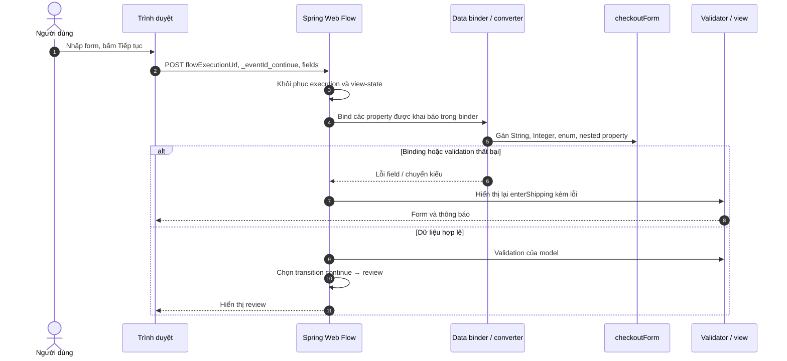
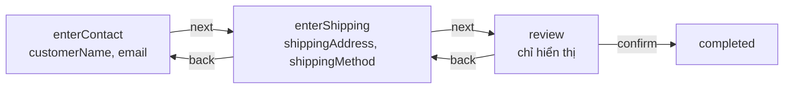

# Ánh xạ trường form vào thuộc tính của model trong Spring Web Flow

## 1. Vấn đề cần giải quyết

Trong một hành trình web nhiều bước, dữ liệu người dùng nhập ở trang hiện tại cần được nhận chính xác, kiểm tra rồi giữ lại để chuyển sang bước sau. Với **Spring Web Flow (SWF)**, một `view-state` có thể khai báo đối tượng `model`; Web Flow quản lý việc ánh xạ (*binding*) tham số HTTP vào thuộc tính của đối tượng đó khi người dùng phát sinh một event.

Ví dụ, một form đặt hàng có các input tên `customerName`, `shippingAddress.city` và `quantity`. Khi gửi event `continue`, ba tên field được diễn giải thành ba đường dẫn thuộc tính trong một đối tượng Java duy nhất. SWF tiếp tục điều hướng bằng **state, event, transition và subflow**, nên không cần viết thủ công một controller riêng cho từng bước để chép từng request parameter vào Java bean.

Bài này thuộc chương **Liên kết biểu mẫu**, tập trung vào câu hỏi: *Một tên field trong HTML đi đến đúng thuộc tính nào của model, được chuyển kiểu và kiểm tra ra sao, và làm thế nào giới hạn những gì client được phép thay đổi?*

Sau bài học, bạn có thể:

- Thiết kế model Java phù hợp cho việc binding các field phẳng, field lồng nhau và các kiểu dữ liệu không phải chuỗi.
- Kết nối tên input HTML/Spring form tags với biểu thức `model` của `view-state`.
- Khai báo danh sách property được bind qua `<binder>`, kể cả trường bắt buộc.
- Phân biệt lỗi ánh xạ, lỗi chuyển kiểu và lỗi validation; xử lý phản hồi khi form sai.
- Kiểm thử sự kiện postback, bảo vệ model khỏi dữ liệu ngoài ý muốn và giữ dữ liệu qua nhiều state.

## 2. Ba lớp tên cần phân biệt

Một màn hình nhập liệu có ít nhất ba lớp định danh:

| Lớp | Ví dụ | Ý nghĩa |
|---|---|---|
| Biểu thức model của view-state | `model="checkoutForm"` | Web Flow truy cập đối tượng Java `checkoutForm` trong execution đang chạy. |
| Tên thuộc tính của form | `customerName` | Property của `checkoutForm` mà binder được phép ghi. |
| Tên event điều hướng | `_eventId_continue` | Tín hiệu người dùng chọn một transition, **không phải** property của `checkoutForm`. |

Ví dụ:

```xml
<var name="checkoutForm" class="com.example.checkout.CheckoutForm" />

<view-state id="enterShipping"
            view="enterShipping"
            model="checkoutForm">
    <transition on="continue" to="review" />
</view-state>
```

Điều quan trọng:

- `id="enterShipping"` là tên của state, giúp Web Flow biết đang ở màn nào.
- `view="enterShipping"` là tên giao diện cần render.
- `model="checkoutForm"` là **đối tượng gốc** dùng để bind input của view-state.
- `<var>` khởi tạo một instance cho flow; model tồn tại trong `flowScope`, phù hợp khi phải dùng lại dữ liệu ở màn review. Nếu bạn đặt model ở `viewScope`, dữ liệu có thể biến mất khi rời view-state.

Có thể viết `model="flowScope.checkoutForm"` để diễn đạt scope tường minh. Biểu thức model phải phân giải được ra đối tượng thực sự có thuộc tính cần ghi; chỉ đặt tên model trong XML không thay thế việc khởi tạo object.

**Quy tắc cốt lõi:** Tên field của HTTP request là *đường dẫn tương đối* tính từ đối tượng được chỉ định bởi `model`, không chứa lại tên của model ở đầu đường dẫn.

Ví dụ:

```text
view-state model="checkoutForm"
    ├── customerName            → checkoutForm.customerName
    ├── email                   → checkoutForm.email
    ├── shippingAddress.city    → checkoutForm.shippingAddress.city
    ├── quantity                → checkoutForm.quantity
    └── shippingMethod          → checkoutForm.shippingMethod
```

Vì vậy, khi dùng Spring MVC form tags với `modelAttribute="checkoutForm"`, `path="customerName"` là đường dẫn đúng. Đặt `path="checkoutForm.customerName"` trong trường hợp này thường dẫn đến việc cố truy cập nhầm thuộc tính `checkoutForm` bên trong chính model.

## 3. Dữ liệu HTTP được ánh xạ thành Java bean như thế nào?

### 3.1. Field phẳng

Một request như sau chứa các tham số văn bản:

```http
POST /checkout?execution=e1s1 HTTP/1.1
Content-Type: application/x-www-form-urlencoded

customerName=Lan&email=lan%40example.com&quantity=2&_eventId_continue=
```

Đây là minh họa quy ước URL/parameter của một flow execution; token execution thật do ứng dụng phát sinh và không nên được ghép cứng. Khi `view-state` có `model="checkoutForm"` và transition không tắt binding, Web Flow xử lý gần tương đương:

```java
checkoutForm.setCustomerName("Lan");
checkoutForm.setEmail("lan@example.com");
checkoutForm.setQuantity(2);
```

Bản chất là *tương đương về kết quả*, không có nghĩa Web Flow chạy đúng ba dòng Java này. Nó dùng hạ tầng data binding và chuyển đổi kiểu để chọn property và gán giá trị.

Để binding kiểu Java bean hoạt động, model nên có:

- Getter/setter công khai cho những trường cần sửa (hoặc cơ chế truy cập property được framework hỗ trợ).
- Kiểu property có thể chuyển được từ dữ liệu HTTP.
- Đối tượng cha cho đường dẫn lồng nhau, ví dụ `shippingAddress`, đã được khởi tạo.
- Các ràng buộc kiểm tra hợp lệ được định nghĩa rõ và validator được cấu hình khi cần.

### 3.2. Field lồng nhau

Tên field `shippingAddress.city` mô tả đường dẫn:

```text
checkoutForm
  .getShippingAddress()
  .setCity("Da Nang")
```

Nếu `checkoutForm.getShippingAddress()` trả `null`, binder có thể không đi tới thuộc tính con như dự kiến; hành vi tự khởi tạo đối tượng lồng nhau phụ thuộc cơ chế binder và cấu hình. Cách đáng tin cậy cho biểu mẫu đơn giản là khởi tạo nested bean trước khi render form.

Ví dụ:

```java
private ShippingAddress shippingAddress = new ShippingAddress();

public ShippingAddress getShippingAddress() {
    return shippingAddress;
}

public void setShippingAddress(ShippingAddress shippingAddress) {
    this.shippingAddress = shippingAddress;
}
```

### 3.3. Collection và chỉ mục

Với danh sách người tham gia, một field dạng `participants[0].email` mô tả thuộc tính `email` của phần tử đầu danh sách. Nhưng **không nên mặc định** mọi chỉ mục do client gửi sẽ được binder chấp nhận, hoặc binder tự mở rộng danh sách đến kích thước bất kỳ. Khả năng truy cập chỉ mục phụ thuộc kiểu collection, sự tồn tại của phần tử, cấu hình binder/converter và whitelist.

Trong giao diện cho phép nhập danh sách, hãy giới hạn số phần tử ở server, khởi tạo cấu trúc dự kiến, kiểm tra index hợp lệ và chỉ cho phép đường dẫn mà người dùng được sửa. Nếu danh sách động phức tạp, có thể dùng một DTO chuyên dụng để thu thập/thẩm định phần tử, sau đó chuyển sang domain model trong service.

## 4. Ví dụ hoàn chỉnh: form thông tin giao hàng

Giả sử checkout có màn **enterShipping** để điền thông tin, sau đó qua **review** trước khi xác nhận. Dữ liệu cần giữ khi người dùng quay lại chỉnh sửa.

### 4.1. DTO dùng làm model

```java
package com.example.checkout;

import java.io.Serializable;
import jakarta.validation.Valid;
import jakarta.validation.constraints.Email;
import jakarta.validation.constraints.Max;
import jakarta.validation.constraints.Min;
import jakarta.validation.constraints.NotBlank;
import jakarta.validation.constraints.NotNull;

public class CheckoutForm implements Serializable {
    private static final long serialVersionUID = 1L;

    @NotBlank
    private String customerName;

    @NotBlank
    @Email
    private String email;

    @Valid
    @NotNull
    private ShippingAddress shippingAddress = new ShippingAddress();

    @NotNull
    @Min(1)
    @Max(10)
    private Integer quantity = 1;

    @NotNull
    private ShippingMethod shippingMethod;

    private boolean giftWrap;

    public String getCustomerName() { return customerName; }
    public void setCustomerName(String customerName) {
        this.customerName = customerName;
    }

    public String getEmail() { return email; }
    public void setEmail(String email) { this.email = email; }

    public ShippingAddress getShippingAddress() {
        return shippingAddress;
    }
    public void setShippingAddress(ShippingAddress shippingAddress) {
        this.shippingAddress = shippingAddress;
    }

    public Integer getQuantity() { return quantity; }
    public void setQuantity(Integer quantity) { this.quantity = quantity; }

    public ShippingMethod getShippingMethod() {
        return shippingMethod;
    }
    public void setShippingMethod(ShippingMethod shippingMethod) {
        this.shippingMethod = shippingMethod;
    }

    public boolean isGiftWrap() { return giftWrap; }
    public void setGiftWrap(boolean giftWrap) { this.giftWrap = giftWrap; }

    public static class ShippingAddress implements Serializable {
        private static final long serialVersionUID = 1L;

        @NotBlank
        private String street;

        @NotBlank
        private String city;

        public String getStreet() { return street; }
        public void setStreet(String street) { this.street = street; }

        public String getCity() { return city; }
        public void setCity(String city) { this.city = city; }
    }

    public enum ShippingMethod {
        STANDARD, EXPRESS
    }
}
```

Trong DTO này:

1. `customerName` và `email` nhận chuỗi; `quantity` là `Integer` nên cần chuyển `"2"` thành `2`; `shippingMethod` là enum cần chuyển từ chuỗi `"STANDARD"` hoặc `"EXPRESS"`.
2. `shippingAddress` được tạo sẵn, bảo đảm hai field lồng nhau có đối tượng đích. `@Valid` cho phép Bean Validation đi sâu vào `ShippingAddress` khi Bean Validation được kích hoạt.
3. `@NotBlank`, `@Min`, `@Max`... chỉ kiểm tra hợp lệ khi flow đã tích hợp validator tương ứng. Đừng nhầm annotation với quy tắc mapping tên field.
4. Đây là **form DTO** dành cho dữ liệu client được phép nhập. Giá tiền, vai trò người dùng, trạng thái phê duyệt và thông tin nhạy cảm nên được tính/xác định ở phía server, không lấy trực tiếp từ form.

Ở ví dụ Spring Web Flow 3.x dùng gói `jakarta.validation`. Dự án chạy Web Flow/Spring đời cũ có thể dùng gói `javax.validation` và cấu hình tích hợp khác; mã ví dụ cần khớp phiên bản thực tế.

### 4.2. Định nghĩa view-state và danh sách binding hợp lệ

```xml
<?xml version="1.0" encoding="UTF-8"?>
<flow xmlns="http://www.springframework.org/schema/webflow">

    <var name="checkoutForm" class="com.example.checkout.CheckoutForm" />

    <view-state id="enterShipping"
                view="enterShipping"
                model="checkoutForm">

        <binder>
            <binding property="customerName" required="true" />
            <binding property="email" required="true" />
            <binding property="shippingAddress.street" required="true" />
            <binding property="shippingAddress.city" required="true" />
            <binding property="quantity" required="true" />
            <binding property="shippingMethod" required="true" />
            <binding property="giftWrap" />
        </binder>

        <transition on="continue" to="review" />
        <transition on="cancel" to="cancelled" bind="false" />
    </view-state>

    <view-state id="review" view="review">
        <transition on="back" to="enterShipping" />
        <transition on="confirm" to="completed" />
    </view-state>

    <end-state id="completed" />
    <end-state id="cancelled" />
</flow>
```

Cấu hình có ba điểm quyết định:

- `model="checkoutForm"` chọn **đối tượng gốc** của binding.
- `<binder>` giới hạn **đường dẫn property** được phép cập nhật. Trong ví dụ trên chỉ bảy property được liệt kê; một tham số lạ như `admin=true` hoặc `shippingAddress.country=...` không thuộc danh sách được bind.
- `required="true"` ở `<binding>` yêu cầu giá trị được cung cấp cho binding đó; nó không thay thế toàn bộ ràng buộc nghiệp vụ như email đúng định dạng hoặc số lượng trong khoảng 1–10.

`giftWrap` không đặt `required="true"` vì hộp chọn không bắt buộc. Cần kiểm thử tình huống checkbox bỏ chọn: nhiều công nghệ form gửi một field-marker bổ sung để phân biệt “không gửi do bỏ chọn” với “không thay đổi”; không nên tự suy rằng thiếu một HTTP parameter sẽ tự đặt Boolean về `false` trong mọi cấu hình binder.

Ở màn `review` không có `model` cho việc cập nhật form; nhiệm vụ là hiển thị dữ liệu đã nhập, sau đó phát event `back` hoặc `confirm`. Phần `completed` chỉ kết thúc flow để minh họa; ứng dụng thật cần triển khai lưu đơn trong service, kiểm tra quyền truy cập, chống ghi trùng và quy tắc giao dịch.

### 4.3. Giao diện bằng Spring MVC JSP form tags

Đoạn JSP sau giả định ứng dụng đã tích hợp SWF với Spring MVC và có view resolver phù hợp. Biến `flowExecutionUrl` là URL của execution hiện hành do Web Flow cung cấp.

```jsp
<%@ taglib prefix="form"
           uri="http://www.springframework.org/tags/form" %>

<form:form modelAttribute="checkoutForm"
           method="post"
           action="${flowExecutionUrl}">

    <label for="customerName">Họ tên</label>
    <form:input id="customerName" path="customerName" />
    <form:errors path="customerName" cssClass="error" />

    <label for="email">Email</label>
    <form:input id="email" path="email" />
    <form:errors path="email" cssClass="error" />

    <label for="street">Địa chỉ</label>
    <form:input id="street" path="shippingAddress.street" />
    <form:errors path="shippingAddress.street" cssClass="error" />

    <label for="city">Thành phố</label>
    <form:input id="city" path="shippingAddress.city" />
    <form:errors path="shippingAddress.city" cssClass="error" />

    <label for="quantity">Số lượng</label>
    <form:input id="quantity" path="quantity" type="number" min="1" max="10" />
    <form:errors path="quantity" cssClass="error" />

    <label for="shippingMethod">Vận chuyển</label>
    <form:select id="shippingMethod" path="shippingMethod">
        <form:option value="" label="-- Chọn phương thức --" />
        <form:option value="STANDARD" label="Tiêu chuẩn" />
        <form:option value="EXPRESS" label="Nhanh" />
    </form:select>
    <form:errors path="shippingMethod" cssClass="error" />

    <label for="giftWrap">Gói quà</label>
    <form:checkbox id="giftWrap" path="giftWrap" />

    <button type="submit" name="_eventId_continue">Tiếp tục</button>
    <button type="submit" name="_eventId_cancel" formnovalidate>Hủy</button>
</form:form>
```

Quan hệ tên field được thể hiện rõ:

| Spring form tag | HTTP field gửi lên | Property của `checkoutForm` |
|---|---|---|
| `<form:input path="customerName" />` | `customerName` | `setCustomerName(String)` |
| `<form:input path="shippingAddress.city" />` | `shippingAddress.city` | `getShippingAddress().setCity(String)` |
| `<form:input path="quantity" />` | `quantity` | `setQuantity(Integer)` sau khi chuyển kiểu |
| `<form:select path="shippingMethod">` | `shippingMethod` | `setShippingMethod(ShippingMethod)` sau khi chuyển kiểu |
| `<form:checkbox path="giftWrap" />` | `giftWrap` và field hỗ trợ nếu tag sinh ra | `setGiftWrap(boolean)` theo quy tắc binder |

`path` là phần trung tâm của ánh xạ; thuộc tính `id` được dùng cho liên kết `label for` của HTML và có thể đặt khác tên property. Với form HTML thuần, chính thuộc tính `name` của input phải khớp tên property. Tên nút `_eventId_continue` không được bind vào DTO; nó dùng để báo cho Web Flow kích hoạt transition `continue`.

Dù có `type="number"`, HTML vẫn gửi giá trị dạng văn bản. Các thuộc tính `required`, `min`, `max` hoặc `formnovalidate` trên HTML chỉ hỗ trợ giao diện, không thay thế kiểm tra và bảo vệ dữ liệu ở server.

## 5. Vòng đời binding khi có postback



Sơ đồ tóm tắt quyết định; validation có thể nhận thông tin lỗi binding và chỉ được chạy theo chính sách event/cấu hình. Trình tự hữu ích để đọc một request thực tế:

1. **Xác định flow execution:** Request phải tiếp tục đúng execution và state; nếu gửi sai execution URL, flow không có ngữ cảnh model để bind như mong đợi.
2. **Nhận event:** Web Flow đọc event do người dùng gửi (trong ví dụ là `continue`).
3. **Kiểm tra chính sách của transition:** Với transition mặc định, SWF bind rồi validate model; với `bind="false"`, bỏ qua cả hai; với `validate="false"`, vẫn bind nhưng bỏ validation tự động.
4. **Lọc field:** Binder xét tên parameter và danh sách property được phép, thay vì tin mọi field do browser gửi.
5. **Gán giá trị:** Chuỗi HTTP được chuyển thành đúng kiểu property. Nếu conversion hoặc set property thất bại, tạo lỗi binding tương ứng.
6. **Kiểm tra hợp lệ:** Validator kiểm tra trạng thái model và ghi lỗi theo field/model. Bean Validation chỉ có tác dụng khi được tích hợp; có thể dùng validator theo quy ước state.
7. **Điều hướng:** Nếu binding/validation thành công, Web Flow thực hiện `transition on="continue" to="review"`. Nếu lỗi, ở lại state đang có form để người dùng sửa.

Một form có thể được render lại nhiều lần trong cùng `view-state`. Vì vậy tránh đặt lệnh khởi tạo lại `checkoutForm` trong `on-render`: nó có thể xóa dữ liệu người dùng đã nhập sau một lần postback lỗi.

## 6. Chuyển đổi giá trị và xử lý lỗi theo field

### 6.1. Chuỗi đến số và enum

Giả sử trình duyệt gửi:

```text
quantity=3
shippingMethod=EXPRESS
shippingAddress.city=Ha Noi
```

Binder cần chuyển `"3"` thành `Integer(3)`, `"EXPRESS"` thành `ShippingMethod.EXPRESS` và gán `"Ha Noi"` cho thuộc tính `city`. Những kiểu cơ bản thường được hỗ trợ bởi conversion service; với kiểu tùy biến như `Money`, `LocalDate` theo định dạng đặc biệt hoặc mã định danh nghiệp vụ, bạn phải cấu hình converter/formatter tương ứng cho hạ tầng binding của Web Flow.

Tính khả dụng của converter phụ thuộc phiên bản SWF và `ConversionService` mà flow builder sử dụng. Đừng giả định converter chỉ đăng ký với Spring MVC controller sẽ tự được mọi flow sử dụng nếu hai nơi dùng cấu hình chuyển đổi khác nhau.

Khi client gửi `quantity=abc`:

- Đây là **lỗi conversion/binding**, xảy ra trước khi có `Integer` hợp lệ.
- Không thể tin vào việc setter đã được gọi hoặc `quantity` đã mang giá trị mới.
- Lỗi cần được gắn đúng field `quantity` để view hiển thị; trong JSP có thể dùng `<form:errors path="quantity" />`.
- Không nên báo thành công hoặc chuyển sang `review` khi chưa xử lý lỗi.

Khi client gửi `quantity=100`:

- Chuyển sang `Integer` có thể **thành công**.
- Ràng buộc `@Max(10)` mới phát hiện giá trị không phù hợp **nếu validator chạy**.
- Đây là **lỗi validation**, khác lỗi conversion.

### 6.2. Field không tồn tại và thuộc tính không được phép

Giả sử client cố gửi:

```text
customerName=Lan
quantity=1
price=1
approved=true
shippingAddress.country=Anywhere
```

Với `<binder>` tường minh ở mục 4.2, ba field `price`, `approved`, `shippingAddress.country` không nằm trong danh sách cho phép và không được dùng để cập nhật model. Điều này chống dạng lỗi **over-posting/mass assignment**: attacker gửi những field không có trên UI để cố thay đổi thông tin nội bộ.

Không dùng HTML `readonly`, `disabled` hoặc `type="hidden"` để thay thế allowlist phía server. Trình duyệt là môi trường do client kiểm soát; mọi tham số đều có thể bị sửa hoặc tự tạo bằng công cụ HTTP. Các giá trị quan trọng như giá thanh toán, quyền hạn, trạng thái duyệt nên do logic phía server quyết định.

### 6.3. Giá trị rỗng, không gửi và checkbox

Ba trường hợp này cần phân biệt:

| Postback | Ý nghĩa khả dĩ | Điều cần kiểm tra |
|---|---|---|
| `email=` | Client **có gửi** field nhưng giá trị chuỗi rỗng. | `required`, quy tắc chuỗi trống và `@NotBlank`. |
| Không có tham số `email` | Client **không gửi** field. | `<binding required="true">` có bắt buộc nhận giá trị cho event này? |
| Checkbox `giftWrap` không được chọn | HTML thuần thường **không gửi** `giftWrap`. | Spring form tag có sinh field-marker và binder hiểu cách reset false không? |

Không nên suy ra `required="true"` đồng nghĩa với `@NotBlank` ở mọi kiểu dữ liệu. `required` bảo vệ điều kiện có giá trị binding theo cơ chế của SWF, còn các annotation/rule kiểm tra nội dung và tính hợp lệ. Để tránh thay đổi sai dữ liệu khi bỏ chọn checkbox, hãy kiểm thử thực tế bằng cả thao tác chọn → submit → bỏ chọn → submit.

### 6.4. Thông báo lỗi của form

Trong Spring MVC JSP form tags tích hợp đúng với Web Flow, các thông báo field có thể hiện ở:

```jsp
<form:errors path="customerName" cssClass="error" />
<form:errors path="shippingAddress.city" cssClass="error" />
<form:errors path="quantity" cssClass="error" />
<form:errors path="*" cssClass="form-errors" />
```

Lỗi theo đường dẫn lồng nhau thường gắn với chính `shippingAddress.city`, giúp đặt thông báo cạnh input tương ứng. `path="*"` hiển thị danh sách lỗi tổng hợp; nếu đồng thời hiển thị lỗi từng field, UI có thể lặp thông báo nên cần thiết kế phù hợp.

Khi có lỗi conversion, giá trị gốc người dùng gửi có thể khác trạng thái typed value đang giữ trong Java bean. Các Spring form tags và binding error context thường hỗ trợ hiển thị lại giá trị bị từ chối; kiểm tra view cụ thể để bảo đảm người dùng không mất nội dung vừa nhập.

## 7. Quy tắc `bind` và `validate` theo event

Một form thường có nhiều nút với mục đích khác nhau: Tiếp tục, Hủy, Quay lại hoặc Lưu nháp. Cấu hình **transition** quyết định liệu dữ liệu postback có được nhận và kiểm tra không.

```xml
<view-state id="enterShipping" model="checkoutForm">
    <binder>
        <binding property="customerName" />
        <binding property="email" />
        <binding property="shippingAddress.street" />
        <binding property="shippingAddress.city" />
        <binding property="quantity" />
        <binding property="shippingMethod" />
        <binding property="giftWrap" />
    </binder>

    <transition on="continue" to="review" />

    <!-- Hủy bất kể dữ liệu người dùng đang nhập có hợp lệ hay không. -->
    <transition on="cancel" to="cancelled" bind="false" />

    <!-- Ví dụ: quay lại bước trước nhưng vẫn giữ các field có thể bind. -->
    <transition on="back" to="previous" validate="false" />
</view-state>
```

Đây là **ví dụ độc lập** để so sánh ba event; `previous` cần được định nghĩa nếu dùng cấu hình này trong một flow thật. Đừng ghép nguyên khối XML này vào flow trước vì sẽ tạo state trùng `id`.

| Event | Binding | Validation tự động | Hệ quả |
|---|---|---|---|
| `continue` | Có | Có | Chỉ sang bước review khi dữ liệu chấp nhận được. |
| `cancel` với `bind="false"` | Không | Không | Không để form nhập sai cản việc hủy. |
| `back` với `validate="false"` | Có | Không | Có thể giữ dữ liệu vừa nhập khi quay về, ngay cả khi chưa đạt ràng buộc nghiệp vụ. |

Khi dùng `validate="false"`, **binding/conversion vẫn diễn ra**; nếu conversion gặp vấn đề, cần thiết kế xử lý lỗi phù hợp. `bind="false"` thì không tiếp nhận những giá trị mới trong request đó. Đây là sự khác biệt quan trọng khi quyết định nút nào được phép sửa model.

## 8. Dùng model nhất quán trong flow nhiều bước

Một bản checkout nhiều màn hình có thể dùng chung `flowScope.checkoutForm`:



Mỗi state có thể dùng **cùng model** nhưng khai báo `<binder>` riêng:

```xml
<view-state id="enterContact" model="checkoutForm">
    <binder>
        <binding property="customerName" required="true" />
        <binding property="email" required="true" />
    </binder>
    <transition on="next" to="enterShipping" />
</view-state>

<view-state id="enterShipping" model="checkoutForm">
    <binder>
        <binding property="shippingAddress.street" required="true" />
        <binding property="shippingAddress.city" required="true" />
        <binding property="shippingMethod" required="true" />
    </binder>
    <transition on="next" to="review" />
    <transition on="back" to="enterContact" bind="false" />
</view-state>
```

Hai state trên là một **phác thảo bổ sung**; cần đặt cùng khai báo `<var>` và các state đích khi xây dựng flow hoàn chỉnh. Trong flow nhiều bước, cần cấu hình validation theo **state hoặc group** để không bắt buộc người dùng hoàn tất field của các bước chưa tới. Hành vi mặc định của Bean Validation và validator theo state phải được kiểm tra theo phiên bản/cấu hình; không thể chỉ chia binder thành nhiều danh sách rồi mặc định tất cả ràng buộc sẽ tự giới hạn theo bước.

Lưu ý khi dùng scope:

- `flowScope` giữ dữ liệu qua những lần chuyển state trong cùng flow execution, phù hợp form wizard.
- `viewScope` chỉ sống trong thời gian ở một view-state; rời state có thể làm mất dữ liệu tạm.
- `requestScope` chỉ dành cho request hiện tại, không đủ để lưu form qua nhiều lần postback.
- `conversationScope` phù hợp dữ liệu dùng trong conversation rộng hơn hoặc liên quan subflow, nhưng vòng đời có thể vượt nhu cầu một màn hình.

Nếu có subflow cùng tham gia thu thập dữ liệu, hãy truyền dữ liệu bằng input/output mapping phù hợp với thiết kế flow, không dựa vào việc mọi scope đều tự chia sẻ như nhau. Đồng thời cân nhắc kích thước và tính serializable của các object cần bảo toàn trong execution.

## 9. Tự kiểm tra bảo mật và độ tin cậy

### 9.1. Những điều thường bị bỏ sót

**Field không thuộc UI vẫn có thể được gửi.** Kẻ gửi request có thể thêm `role=ADMIN`. Bảo vệ bằng DTO đúng mục đích, binder allowlist, và kiểm tra quyền ở service. Binder bảo vệ quá trình nhập; nghiệp vụ nhạy cảm vẫn phải tự xác minh lại phía server.

**Không thể tin giá trị của trường ẩn.** Nếu trang có `<input type="hidden" name="productId">`, backend vẫn cần kiểm tra sản phẩm tồn tại, còn được phép mua và giá hiện tại trước khi lưu đơn.

**Chuyển kiểu thành công không đồng nghĩa dữ liệu hợp lệ.** Giá trị `quantity=999999` có thể parse được nhưng không đạt giới hạn kinh doanh; dùng cả conversion lẫn validation.

**Không nên tạo lại model trên mỗi render.** `on-render` có thể chạy sau khi form sai và trước khi render lại; hành động tạo object mới có thể xóa toàn bộ giá trị vừa nhập.

**Không nhầm URL bắt đầu flow với URL tiếp tục execution.** Form cần POST về đúng `flowExecutionUrl` và truyền event hợp lệ. Một request đi nhầm URL có thể bắt đầu flow khác hoặc dẫn đến lỗi không tìm thấy execution.

**Không chỉ dựa vào JavaScript validation.** Client có thể tắt JavaScript hoặc gửi HTTP trực tiếp. Binder/validator phía server là hàng rào quyết định; endpoint còn cần CSRF protection, xác thực và phân quyền theo chính sách ứng dụng.

### 9.2. Kiểm thử các trường hợp nên có

| Ca kiểm thử | Dữ liệu/event | Kết quả cần chứng minh |
|---|---|---|
| Field chuỗi đúng | `customerName=Lan` + `continue` | Model có `customerName="Lan"`. |
| Field lồng nhau đúng | `shippingAddress.city=Hue` | Chỉ đúng thuộc tính `city` của `shippingAddress` được sửa. |
| Số hợp lệ | `quantity=3` | Model giữ `Integer 3`, có thể qua review nếu các field khác hợp lệ. |
| Số sai định dạng | `quantity=abc` | Có lỗi conversion ở `quantity`, không qua review. |
| Số ngoài khoảng | `quantity=11` | Parse thành công nhưng vi phạm `@Max(10)` nếu Bean Validation hoạt động. |
| Enum không xác định | `shippingMethod=INSTANT` | Lỗi chuyển kiểu/giá trị không được chấp nhận. |
| Nested bean vắng | `shippingAddress=null` trước postback | Phát hiện lỗi thiết kế model hoặc kiểm chứng cấu hình khởi tạo nested path. |
| Bỏ chọn checkbox | Chọn rồi bỏ `giftWrap` giữa hai POST | Giá trị trở về `false` khi marker/binder được cấu hình đúng. |
| Tham số không cho phép | `approved=true` hoặc `price=1` | Property ngoài binder không được cập nhật. |
| Event hủy khi form sai | `_eventId_cancel` + `quantity=abc` | Đi tới `cancelled` khi transition có `bind="false"`. |
| Quay về bước trước | `back` sau khi đi qua `review` | Dữ liệu trong `flowScope.checkoutForm` vẫn còn. |
| Execution hết hạn | POST với execution key không còn hợp lệ | Ứng dụng xử lý lỗi/khôi phục theo chính sách, không làm phát sinh đơn trùng. |

Nên có test thực tế ở tầng flow/web để kiểm chứng kết nối giữa view, converter, binder, validator và transition. Test chỉ gọi setter của DTO không thể chứng minh các thành phần này đã hoạt động đúng với HTTP request.

## 10. Bài tập thực hành

Xây dựng màn đăng ký tham dự hội thảo với model `EventRegistrationForm` gồm `fullName`, `email`, `attendanceType` (enum), `contactAddress.city` và `agreeToTerms` (boolean). Đặt model trong `flowScope` và tạo hai state `enterRegistration`, `reviewRegistration`.

Yêu cầu:

1. Viết Java bean (khởi tạo đối tượng `contactAddress`), JSP form với `path` đúng từng property và XML `<binder>` chỉ cho phép năm field trên.
2. Event `next` phải bind và validate; event `cancel` dùng `bind="false"`.
3. Thử gửi thêm tham số `isStaff=true` bằng HTTP client; xác minh field này không được cập nhật.
4. Gửi `attendanceType=UNKNOWN` để kiểm tra lỗi conversion, rồi `email=not-an-email` để kiểm tra lỗi validation.
5. Từ review quay lại form, kiểm tra các giá trị đã chọn có còn không; đổi một field và tiếp tục.

Tự trả lời: `model` chọn đối tượng gốc nào? Input nào maps tới setter nào? Khi nào converter cần thiết? `<binder>` giới hạn điều gì? Tại sao `validate="false"` khác `bind="false"`? Một câu trả lời đầy đủ phải lần được chuỗi **tham số HTTP → property path → binder allowlist → conversion → validation → transition**.

## 11. Ghi nhớ

Việc ánh xạ trường biểu mẫu trong Spring Web Flow dựa vào hai quyết định: **chọn model cho `view-state`** và **chọn chính xác những property model được phép nhận dữ liệu**. Tên input hoặc `path` xác định thuộc tính đích; converter biến chuỗi HTTP thành kiểu Java; validator kiểm tra ý nghĩa dữ liệu; event và transition quyết định state tiếp theo.

Với form nhiều bước, hãy sử dụng scope có vòng đời phù hợp, khai báo binder tường minh, khởi tạo nested bean và xác minh các nhánh postback sai dữ liệu. Như vậy dữ liệu đi đúng tới đối tượng cần lưu, các bước điều hướng rõ ràng, và client không có cơ hội thay đổi những thuộc tính nằm ngoài phạm vi biểu mẫu.
