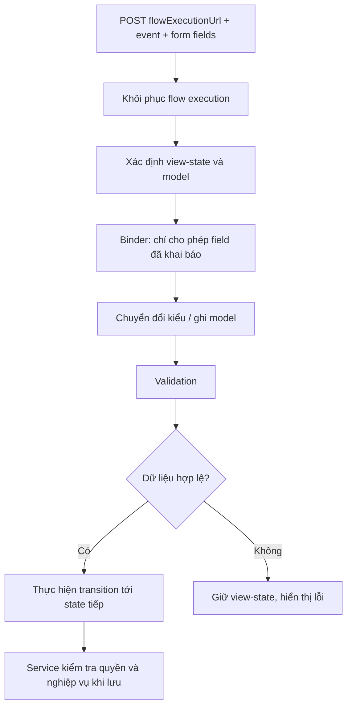
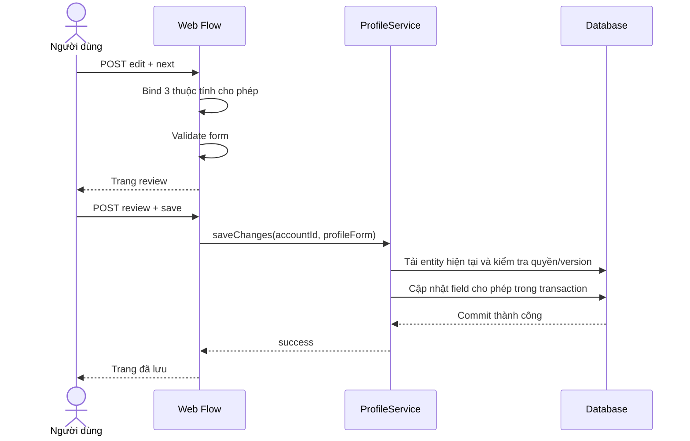

# Binder và danh sách thuộc tính được phép nhận dữ liệu trong Spring Web Flow

Một form nhiều bước có thể chứa hàng chục thuộc tính: tên người liên hệ, email, địa chỉ giao hàng, lựa chọn dịch vụ và ghi chú. Nhưng đối tượng Java dùng làm model đôi khi còn chứa các trường nội bộ như `accountId`, `role`, `approved`, `price` hoặc phiên bản dữ liệu. Nếu ứng dụng tự động chép mọi tham số HTTP vào model, người dùng có thể gửi thêm thuộc tính không xuất hiện trên giao diện và làm thay đổi dữ liệu ngoài ý muốn. Spring Web Flow cung cấp **binder** để quy định tường minh những thuộc tính nào của một `view-state` được phép nhận dữ liệu từ request.

Trong chương **Liên kết biểu mẫu** của `SPRING_WEB_FLOW`, chúng ta tập trung vào hai phần tử **`<binder>`** và **`<binding>`**, cách chúng phối hợp với `model`, event, transition, validation và scope trong một hành trình nhiều bước. Đây là một lớp kiểm soát dữ liệu đầu vào quan trọng; kiểm tra quyền và quy tắc nghiệp vụ vẫn phải được thực hiện tại service.

Sau bài học, bạn có thể:

- Giải thích quá trình **data binding** và vì sao cần một danh sách thuộc tính được phép nhận dữ liệu (*allowlist*).
- Cấu hình `<binder>` trong `<view-state>` và khai báo các `<binding property="...">` cụ thể.
- Phân biệt `required` của binding với validation kiểu `@NotBlank`, `@Email` và các quy tắc nghiệp vụ.
- Thiết kế DTO/form model độc lập với entity đã lưu, kể cả thuộc tính lồng nhau.
- Chọn `bind="false"` hoặc `validate="false"` cho event Hủy/Quay lại khi thích hợp.
- Kiểm thử request có thêm trường trái phép, lỗi kiểu dữ liệu, form không hợp lệ và hành vi qua nhiều state.

## 1. Binder nằm ở đâu trong luồng xử lý form?

Trong Web Flow, một `view-state` thường khai báo `model` là đối tượng dùng nhận dữ liệu người dùng gửi. Ví dụ:

```xml
<view-state id="editProfile" view="profile/edit" model="profileForm">
    <transition on="next" to="review" />
</view-state>
```

Khi request mang event `next` tới execution đang ở `editProfile`, Web Flow có thể thực hiện **binding**: đọc các giá trị từ request, tìm thuộc tính trong `profileForm`, chuyển đổi kiểu và ghi các giá trị hợp lệ vào model. Sau đó cơ chế validation/transition theo cấu hình quyết định có thể rời state hay phải hiển thị lại lỗi.

Nếu không giới hạn các thuộc tính có thể bind, một field không có trên HTML vẫn có thể được gửi bằng HTTP client. Browser chỉ là một client; việc “ẩn input” hay “không render nút chỉnh sửa” không bảo đảm client sẽ không tự thêm tham số.



Sơ đồ biểu diễn **đường submit thông thường** từ một `view-state` có model. Chính sách binding/validation cụ thể có thể được điều chỉnh trên transition; không phải mọi event đều bắt buộc bind, chẳng hạn Hủy có thể dùng `bind="false"`.

## 2. `<binder>` và `<binding>`: danh sách được phép

Cách giới hạn field trực tiếp trong flow XML:

```xml
<view-state id="editProfile"
            view="profile/edit"
            model="profileForm">
    <binder>
        <binding property="displayName" required="true" />
        <binding property="contactEmail" required="true" />
        <binding property="address.city" />
    </binder>
    <transition on="next" to="review" />
</view-state>
```

| Thành phần | Ý nghĩa |
| --- | --- |
| `model="profileForm"` | Chọn form object làm đích của binding tại view-state |
| `<binder>` | Xác định các binding được phép trong state |
| `<binding property="displayName" />` | Cho phép request gán `profileForm.displayName` |
| `<binding property="contactEmail" />` | Cho phép request gán `profileForm.contactEmail` |
| `<binding property="address.city" />` | Cho phép gán thuộc tính lồng nhau khi đường dẫn và object trung gian hợp lệ |
| `required="true"` | Đánh dấu binding cần có trong quá trình bind; không thay thế validation giá trị |

Khi dùng binder với danh sách tường minh, những field **không nằm trong danh sách** không được đưa vào model bởi binder của view-state này. Chẳng hạn request có `role=ADMIN` hoặc `enabled=true` không làm các thuộc tính đó tự trở thành dữ liệu được bind thông qua cấu hình trên.

**Quy tắc an toàn:** hãy liệt kê đúng trường được phép nhập, không duyệt qua mọi tham số request để gán vào object bằng reflection hoặc copy tự động. Khi yêu cầu sản phẩm thay đổi, cập nhật allowlist có chủ đích cùng với UI và các bài kiểm thử.

### Required binding có giống `@NotBlank` không?

Không. Tính chất `required` của một `<binding>` tập trung vào **sự tham gia của thuộc tính trong thao tác binding**. Nó không chứng minh chuỗi có nội dung hợp lệ, giá trị số ở đúng khoảng hoặc một địa chỉ email có định dạng đúng. Các kiểm tra này thuộc trách nhiệm của validator và service:

| Kiểm soát | Câu hỏi cần trả lời | Ví dụ |
| --- | --- | --- |
| Allowlist của binder | Trường này có được phép gửi từ client không? | Chỉ nhận `displayName`, `contactEmail`, `address.city` |
| `required` của binding | Trường cần được cung cấp trong lượt bind không? | `contactEmail` phải có dữ liệu để bind |
| Chuyển đổi kiểu | Chuỗi HTTP có chuyển được sang kiểu property không? | `age=abc` không đổi được sang `Integer` |
| Validation của form | Giá trị có đúng format/constraint không? | Email hợp lệ, tên không rỗng |
| Service/domain validation | Người dùng có quyền và dữ liệu có hợp nghiệp vụ không? | Chỉ được sửa hồ sơ của mình; không tự nâng quyền |

Tùy phiên bản và cách cấu hình binding, lỗi thiếu trường bắt buộc hoặc lỗi conversion được phản ánh qua message/binding error thích hợp. Không nên xây dựng bảo mật chỉ dựa vào thông báo lỗi của view: service vẫn kiểm tra dữ liệu đầu vào ở ranh giới ghi.

## 3. Ví dụ thực tế: wizard chỉnh sửa thông tin liên hệ

Giả sử người dùng vào `/profile/edit?accountId=42`, sửa tên, email và thành phố, xem lại rồi mới bấm Lưu. Ứng dụng cần giữ dữ liệu giữa các state mà không cho client sửa `accountId`, `role` hoặc `emailVerified`.

### 3.1. Tạo form model riêng

```java
package com.example.profile;

import java.io.Serializable;

public class ProfileEditForm implements Serializable {
    private String displayName;
    private String contactEmail;
    private AddressForm address = new AddressForm();

    // Các field chỉ server quản lý, tuyệt đối không cho binder sửa.
    private Long loadedVersion;
    private boolean emailVerified;

    public String getDisplayName() { return displayName; }
    public void setDisplayName(String value) { this.displayName = value; }

    public String getContactEmail() { return contactEmail; }
    public void setContactEmail(String value) { this.contactEmail = value; }

    public AddressForm getAddress() { return address; }
    public void setAddress(AddressForm value) { this.address = value; }

    public Long getLoadedVersion() { return loadedVersion; }
    public void setLoadedVersion(Long value) { this.loadedVersion = value; }

    public boolean isEmailVerified() { return emailVerified; }
    public void setEmailVerified(boolean value) { this.emailVerified = value; }

    public static class AddressForm implements Serializable {
        private String city;

        public String getCity() { return city; }
        public void setCity(String value) { this.city = value; }
    }
}
```

Trong ứng dụng thực tế, model nên chỉ chứa dữ liệu cần cho hành trình; có thể loại hẳn những field nhạy cảm như `emailVerified` khỏi form object để giảm bề mặt tấn công. Ở đây field chỉ server quản lý được giữ trong ví dụ để minh họa vì sao binder **không được phép** ghi chúng.

Đối với đường dẫn lồng nhau `address.city`, `getAddress()` cần trả object hợp lệ. Ví dụ khởi tạo `AddressForm` ngay trong class để binding không phụ thuộc vào một tham chiếu `null`. Khi model có danh sách hoặc cấu trúc động, phải giới hạn index, kích thước và dữ liệu hợp lệ; không mở binder vô hạn vào một object graph lớn.

### 3.2. Flow XML với allowlist cụ thể

```xml
<?xml version="1.0" encoding="UTF-8"?>
<flow xmlns="http://www.springframework.org/schema/webflow"
      xmlns:xsi="http://www.w3.org/2001/XMLSchema-instance"
      xsi:schemaLocation="http://www.springframework.org/schema/webflow
                          http://www.springframework.org/schema/webflow/spring-webflow-2.0.xsd">

    <input name="accountId" type="java.lang.Long" required="true" />

    <on-start>
        <evaluate expression="profileService.loadEditableForm(accountId)"
                  result="flowScope.profileForm" />
    </on-start>

    <view-state id="edit" view="profile/edit" model="profileForm">
        <binder>
            <binding property="displayName" required="true" />
            <binding property="contactEmail" required="true" />
            <binding property="address.city" />
        </binder>

        <transition on="next" to="review" />
        <transition on="cancel" to="cancelled" bind="false" />
    </view-state>

    <view-state id="review" view="profile/review">
        <transition on="back" to="edit" />
        <transition on="save" to="persist" />
    </view-state>

    <action-state id="persist">
        <evaluate expression="profileService.saveChanges(accountId, profileForm)" />
        <transition on="success" to="saved" />
        <transition on="conflict" to="review" />
    </action-state>

    <end-state id="saved" view="profile/saved" />
    <end-state id="cancelled" view="profile/cancelled" />
</flow>
```

`profileService` là bean do ứng dụng viết. Trong ví dụ này, `loadEditableForm` kiểm tra quyền và trả `ProfileEditForm`, còn `saveChanges` cần trả outcome phù hợp như `"success"`/`"conflict"` nếu xử lý lỗi nghiệp vụ dự kiến bằng transition tương ứng. Các exception bảo mật hoặc lỗi hệ thống phải được xử lý rõ ràng; không giả định exception tự biến thành event `conflict`.

**Tại sao `accountId` không nằm trong binder?** `accountId` là input được xác định lúc khởi chạy flow, dùng để chọn đối tượng nghiệp vụ trong service. Form của màn `edit` chỉ có quyền sửa đúng những trường người dùng được phép. Dù client tự gửi tham số `accountId=999` trong POST, action ghi dữ liệu phải sử dụng ngữ cảnh đã xác thực và kiểm tra quyền lại tại service.

### 3.3. JSP gửi form và event theo đúng execution

Ví dụ view dùng Spring form tags (cần khai báo taglib `form` trong JSP):

```jsp
<form:form method="post" modelAttribute="profileForm"
           action="${flowExecutionUrl}">
    <label for="displayName">Tên hiển thị</label>
    <form:input path="displayName" id="displayName" />
    <form:errors path="displayName" />

    <label for="contactEmail">Email liên hệ</label>
    <form:input path="contactEmail" id="contactEmail" />
    <form:errors path="contactEmail" />

    <label for="city">Thành phố</label>
    <form:input path="address.city" id="city" />
    <form:errors path="address.city" />

    <button type="submit" name="_eventId_next" value="1">
        Xem lại
    </button>
    <button type="submit" name="_eventId_cancel" value="1">
        Hủy
    </button>
</form:form>
```

`${flowExecutionUrl}` giúp form submit về **đúng execution**, còn `_eventId_next` và `_eventId_cancel` phát các event tương ứng. Event parameter không phải property cần thêm vào `<binder>`. Với Spring Security, phải gửi CSRF token đúng theo cấu hình; dữ liệu hiển thị và attribute HTML cần được escape phù hợp. Đoạn JSP là ví dụ về binding và event, chưa phải toàn bộ trang production.

## 4. Điều gì xảy ra nếu client gửi field không được phép?

Giả sử UI chỉ cho người dùng sửa tên và email, nhưng có người mở DevTools hoặc gửi request thủ công:

```http
POST /profile/edit?execution=e1s1
Content-Type: application/x-www-form-urlencoded

_eventId_next=1
&displayName=An
&contactEmail=an@example.com
&address.city=HaNoi
&emailVerified=true
&loadedVersion=999
&role=ADMIN
```

Những dòng `&...` trong ví dụ được tách ra để dễ đọc; form URL encoded thực tế có thể gửi các cặp key/value trên cùng một dòng. Binder allowlist ở `edit` chỉ chấp nhận `displayName`, `contactEmail` và `address.city`. Các trường khác không được binder này dùng để cập nhật model.

Tuy nhiên cần hiểu giới hạn của lớp bảo vệ này:

- Binder kiểm soát **thuộc tính được cập nhật qua một lần binding tại view-state**, không phải quyền nghiệp vụ chung.
- Những API hoặc controller khác cập nhật entity vẫn phải có cơ chế bảo vệ riêng.
- Client có thể sửa cả những trường **được phép** (ví dụ email), nên vẫn cần kiểm tra giá trị và quyền.
- Không được dùng `requestParameters.role` ở một action khác để tự cập nhật quyền; cách đó đi vòng qua binder.
- Form object có thể chứa field nhạy cảm bị ứng dụng tự cập nhật sai trong code Java; allowlist không ngăn lỗi nghiệp vụ đó.

Đối với dữ liệu quan trọng, cách an toàn là **DTO nhỏ + binder allowlist + service chỉ chép thuộc tính được phép** vào entity đã tải lại và đã xác thực quyền. Không dùng cùng một entity đầy đủ làm model editable nếu không cần.

### Binder có tự loại bỏ dữ liệu nguy hiểm trong chuỗi không?

Không. Allowlist không phải bộ lọc XSS, SQL injection hay kiểm tra nội dung. Chuỗi `displayName` vẫn có thể chứa ký tự đặc biệt, mã HTML hoặc dữ liệu quá dài. Tầng view phải escape đầu ra; service/validator áp dụng constraint; tầng truy cập dữ liệu dùng parameterized query hoặc ORM đúng cách.

## 5. Required, type conversion và validation

Khi một field được phép bind, Web Flow vẫn phải chuyển dữ liệu HTTP thành kiểu Java. Ví dụ `age=abc` không thể chuyển sang `Integer`; ngày tháng có thể cần converter/formatter theo locale; danh sách ID có thể cần converter đã cấu hình.

Một mô hình kiểm soát phù hợp:

| Bước | Trách nhiệm | Ví dụ |
| --- | --- | --- |
| Binder allowlist | Chọn property cho phép client gán | `contactEmail` có trong danh sách |
| Required binding | Ràng buộc field phải tham gia binding | Thiếu `contactEmail` được báo lỗi binding theo cấu hình |
| Type conversion | Đổi chuỗi sang kiểu dữ liệu của model | `age="21"` → `Integer 21` |
| Bean Validation / Web Flow validation | Kiểm tra giá trị model | `@Email`, `@NotBlank`, độ dài tối đa |
| Business validation | Kiểm tra trạng thái, quyền và quan hệ dữ liệu | Email được phép dùng, tài khoản được sửa, version không cũ |

Ví dụ biến thể form model dùng Jakarta Bean Validation:

```java
public class ProfileEditForm implements java.io.Serializable {
    @jakarta.validation.constraints.NotBlank
    @jakarta.validation.constraints.Size(max = 100)
    private String displayName;

    @jakarta.validation.constraints.NotBlank
    @jakarta.validation.constraints.Email
    private String contactEmail;

    // Các field và getter/setter khác.
}
```

Đây là **biến thể minh họa**, không phải khai báo lớp thứ hai cần đặt trùng tên trong cùng dự án. Tùy phiên bản Spring/Bean Validation, namespace có thể là `jakarta.validation` hoặc `javax.validation`; cần cấu hình validator tương thích. Chỉ thêm annotation không bảo đảm mọi đường lưu đều được kiểm tra nếu ứng dụng bỏ qua validation ở tầng service.

**Không đánh đồng `required="true"` với `@NotBlank`**: ngay cả khi request chứa property, giá trị vẫn có thể rỗng, chỉ chứa dấu cách hoặc vi phạm định dạng. Ngoài ra, checkbox HTML không được chọn thường **không gửi tham số**; nếu khai báo binding required một cách máy móc cho mọi checkbox có thể gây lỗi không mong muốn. Cần xác định ngữ nghĩa giá trị `false`, giá trị mặc định và cách form library gửi field marker theo công nghệ view.

## 6. `bind="false"` và `validate="false"`: không phải cùng ý nghĩa

Khi người dùng phát event, cấu hình transition có thể thay đổi việc có bind và validate dữ liệu hay không.

```xml
<view-state id="edit" view="profile/edit" model="profileForm">
    <binder>
        <binding property="displayName" required="true" />
        <binding property="contactEmail" required="true" />
    </binder>

    <transition on="next" to="review" />
    <transition on="back" to="previous" validate="false" />
    <transition on="cancel" to="cancelled" bind="false" />
</view-state>
```

Đoạn này là **trích đoạn**: state `previous` phải được định nghĩa trong flow thực tế. Ý nghĩa:

| Event | Binding | Validation | Khi nào dùng |
| --- | --- | --- | --- |
| `next` | Theo cấu hình bình thường | Theo cấu hình bình thường | Chuyển bước sau khi form hợp lệ |
| `back` với `validate="false"` | Vẫn cố gắng bind các field được phép | Bỏ validation của transition | Muốn giữ bản nháp dù chưa đáp ứng các quy tắc validation |
| `cancel` với `bind="false"` | Bỏ qua binding | Không thực hiện validation model cho lượt submit này | Muốn thoát không phụ thuộc dữ liệu đang nhập |

Nếu người dùng ở bước thứ hai, đã sửa `contactEmail` nhưng bấm `back`, `validate="false"` có thể phù hợp để giữ thay đổi vừa submit. Ngược lại, `bind="false"` bỏ qua cả việc nhận giá trị đó, nên dữ liệu mới chưa bind sẽ không được giữ.

**Lưu ý về lỗi chuyển kiểu:** tắt validation không đồng nghĩa mọi chuỗi HTTP đều chuyển đổi thành công. Nếu dữ liệu không thể bind vào property Java, hệ thống vẫn phải xử lý binding error theo cơ chế tương ứng. Không dùng `validate="false"` để thay cho kiểm tra dữ liệu hoặc quyền.

## 7. Mỗi view-state có quyền binding riêng

Trong wizard, các màn hình có thể dùng **cùng một form model** nhưng mỗi màn hình chỉ cho phép sửa một phần thuộc tính.

Giả sử flow đặt lịch có ba bước: `selectSlot`, `enterContact`, `review`.

```xml
<view-state id="selectSlot" view="booking/slot" model="bookingForm">
    <binder>
        <binding property="slotId" required="true" />
    </binder>
    <transition on="next" to="enterContact" />
</view-state>

<view-state id="enterContact" view="booking/contact" model="bookingForm">
    <binder>
        <binding property="customerName" required="true" />
        <binding property="phone" required="true" />
    </binder>
    <transition on="next" to="review" />
    <transition on="back" to="selectSlot" validate="false" />
</view-state>

<view-state id="review" view="booking/review">
    <transition on="confirm" to="saveBooking" />
    <transition on="back" to="enterContact" />
</view-state>
```

Ở `selectSlot`, client chỉ được bind `slotId`. Ở `enterContact`, chỉ `customerName` và `phone` được bind. `review` không cần nhận lại toàn bộ dữ liệu qua hidden fields; nó hiển thị những gì đã nằm trong `flowScope.bookingForm` từ các bước trước. State `saveBooking` và service phải được định nghĩa trong flow hoàn chỉnh.

Điểm mạnh của thiết kế này là quyền ghi vào model theo **ngữ cảnh state**. Nếu người dùng gửi thêm `phone` trong request của `selectSlot`, binder của state đó không cho phép sửa `phone`; những dữ liệu cần thay đổi phải đi theo đúng bước của flow.

Tuy nhiên, flow-state không phải ranh giới phân quyền tuyệt đối. Một request giả mạo có thể thử event không được hiển thị, gửi khóa execution cũ hoặc thao tác trực tiếp với API backend. Service lưu lịch vẫn phải kiểm tra quyền, tính khả dụng của slot, dữ liệu liên hệ và chống booking trùng.

## 8. Dữ liệu nằm ở scope nào?

Binder chỉ biết **đối tượng được chọn làm model**. Việc model sống bao lâu do scope và cách flow khởi tạo quyết định.

| Scope | Vòng đời | Sử dụng với biểu mẫu |
| --- | --- | --- |
| `viewScope` | Trong một view-state đang hoạt động | Dữ liệu chỉ phục vụ một màn hình, có thể tạo lại khi vào state |
| `flowScope` | Trong flow session qua nhiều state | Model wizard cần giữ khi người dùng đi tiếp/quay lại |
| `conversationScope` | Qua các flow session trong cùng conversation | Chỉ khi cần chia sẻ giữa flow cha và subflow |
| `requestScope` | Trong request hiện tại | Dữ liệu tạm chỉ dùng một lần |
| Database | Sau transaction commit | Dữ liệu nghiệp vụ đã chấp nhận/lưu |

Trong ví dụ profile, `profileForm` được đưa vào `flowScope` khi `on-start` chạy. Khi người dùng đi `edit → review → edit`, cùng model vẫn có thể chứa các thay đổi đã bind, miễn execution còn hợp lệ và không bị code khác ghi đè.

Không nhầm **lưu execution** với **lưu database**. Web Flow có thể snapshot/restore model để tiếp tục quy trình, nhưng dữ liệu người dùng nhập chưa được xem là đã commit cho tới khi service thực hiện thao tác ghi thành công. Nếu dùng JPA, tránh giữ entity đang được quản lý, proxy ORM hoặc persistence context qua nhiều request chỉ để làm model form; nên giữ DTO độc lập và tải lại entity trong transaction khi lưu.

### Subflow có binder riêng

Nếu flow chính gọi subflow nhập địa chỉ, form/context được truyền vào subflow qua các input đã khai báo. Binder của một `view-state` trong subflow chỉ điều khiển các thuộc tính được bind tại state đó; nó không tự cấp quyền cập nhật mọi property của form cha. Cần thiết kế input/output giữa flow cha và con có mục đích, tránh chia sẻ object mutable chứa dữ liệu không được phép thay đổi mà không có kiểm tra bổ sung.

## 9. Service mới là ranh giới cập nhật dữ liệu đã lưu

Ngay cả khi binder đã giới hạn field, action lưu vẫn phải kiểm tra lại danh tính và dữ liệu hiện tại. Một quy trình lưu phổ biến:



Ví dụ logic service ở mức minh họa:

```java
@Transactional
public String saveChanges(Long accountId, ProfileEditForm form) {
    Account account = requireEditableAccountForCurrentUser(accountId);
    validateBusinessRules(form, account);

    if (!java.util.Objects.equals(
            account.getVersion(), form.getLoadedVersion())) {
        return "conflict";
    }

    // Chỉ chép các thuộc tính được phép sửa:
    account.setDisplayName(form.getDisplayName());
    account.setContactEmail(form.getContactEmail());
    account.getAddress().setCity(form.getAddress().getCity());

    // Không cập nhật account.role, account.id, account.enabled...
    return "success";
}
```

`Account`, `requireEditableAccountForCurrentUser`, `validateBusinessRules` và các getter/setter là thành phần minh họa của ứng dụng. Với JPA, nên dùng `@Version` để bắt xung đột cập nhật ở lúc flush/commit; so sánh version sớm chỉ là lớp bảo vệ bổ sung. Lỗi transaction có thể xuất hiện sau khi method trả về nhưng trước khi proxy `@Transactional` hoàn tất commit; cách ánh xạ lỗi sang outcome phải xử lý đúng ranh giới này.

Nếu ứng dụng không cần outcome `conflict` từ action-state, có thể thiết kế ngoại lệ nghiệp vụ và error handler riêng. **Không** tự động biến mọi ngoại lệ kỹ thuật thành sự kiện thành công.

## 10. Các lỗi binder thường gặp

| Hiện tượng | Nguyên nhân có thể | Cách kiểm tra và sửa |
| --- | --- | --- |
| Submit thành công nhưng field không đổi | Tên `property` trong `<binding>` không khớp `name` của input hoặc getter/setter | So request, XML binder và JavaBean property |
| Field bị xem là thiếu | `required="true"` nhưng browser không gửi tham số | Xem `Form Data`, nhất là checkbox và input `disabled` |
| Lỗi binding thuộc tính lồng nhau | `address` đang `null` hoặc đường dẫn sai | Tạo object trung gian, kiểm tra getter/setter và converter |
| Lỗi chuyển kiểu | `age=abc`, ID không đúng format, locale sai | Cấu hình formatter/converter, hiển thị binding error |
| Nút Hủy bị chặn bởi form không hợp lệ | Transition vẫn bind/validate model | Xem xét `bind="false"` cho event Hủy |
| Nút Quay lại làm mất dữ liệu chưa submit | Dùng `bind="false"` không đúng nhu cầu | Dùng `validate="false"` nếu cần bind bản nháp |
| Người dùng sửa được field nhạy cảm | Không có allowlist hoặc action khác đọc raw request parameter | Khai báo binder tường minh, audit controller/action, bảo vệ tại service |
| Quay lại state làm reset form | `on-entry` tạo lại model ở mọi lần vào | Chỉ tải form ban đầu một lần hoặc khởi tạo có điều kiện |
| Request từ tab cũ không còn hợp lệ | Execution key/snapshot đã cũ hoặc hết hạn | Xử lý recovery rõ ràng, không lưu dữ liệu theo request lỗi |
| Form qua AJAX khác HTML submit thường | Client không gửi đúng field/event/CSRF hoặc dùng partial render | Đối chiếu request thực tế và cấu hình tích hợp |

### Khi debug binding

Hãy mở Developer Tools của browser, xem **Network → Request URL, Method, Form Data**. So sánh tên tham số với `<binding property="...">`, form model và transition event. Kiểm tra state thực sự đang active và error messages. Nếu dùng breakpoint, đặt ở setter của form, validator và service lưu để phân biệt:

1. Request có chứa field không?
2. Binder có cho phép field đó không?
3. Conversion có thành công không?
4. Validation có chặn transition không?
5. Service có lưu dữ liệu sau khi kiểm tra quyền/transaction không?

Không ghi token CSRF, thông tin cá nhân, mật khẩu hoặc toàn bộ form vào log dùng chung.

## 11. Kiểm thử allowlist và trường hợp bất thường

Một bộ kiểm thử tốt cần chứng minh rằng **đúng field được bind**, **field ngoài allowlist không được bind**, và **nghiệp vụ không tin client**.

| Ca kiểm thử | Request hoặc thao tác | Kỳ vọng |
| --- | --- | --- |
| Binding hợp lệ | POST `displayName`, `contactEmail`, `address.city` với event `next` | Model được cập nhật đúng và đi `edit → review` nếu valid |
| Trường ngoài allowlist | Thêm `emailVerified=true` hoặc `loadedVersion=999` | Các property nội bộ không bị binder sửa |
| Trường lạ | Gửi `role=ADMIN` | Không tạo quyền mới hoặc gọi nhầm setter nghiệp vụ |
| Thiếu field required | Bỏ tham số bắt buộc | Lỗi binding/validation phù hợp theo cấu hình, không được lưu |
| Email sai định dạng | `contactEmail=abc` | Lỗi validation, giữ view-state để sửa |
| Giá trị sai kiểu | Form có property kiểu số nhưng gửi chuỗi bất hợp lệ | Báo lỗi conversion, không đi tiếp như dữ liệu hợp lệ |
| Thuộc tính lồng nhau | Gửi `address.city=Hanoi` | Chỉ `city` được bind; các field khác của `address` không bị cập nhật ngoài ý muốn |
| Nút Hủy | POST `_eventId_cancel=1` khi form sai | Không bị validation chặn nếu transition có `bind="false"` |
| Quay lại giữ bản nháp | POST `back` với `validate="false"` | Dữ liệu bind được giữ theo thiết kế dù chưa qua validation nghiệp vụ |
| Event ở sai state | Gửi `save` khi flow còn ở `edit` | Không tự bỏ qua chuỗi state hợp lệ |
| Người dùng không có quyền | Gửi form hợp lệ với account của người khác | Service từ chối, database không đổi |
| Xung đột phiên bản | Một session khác đã cập nhật hồ sơ | Phát hiện conflict; không ghi đè dữ liệu mới |
| Nhiều tab | Hai execution độc lập cùng chỉnh form | Scope và binding không trộn model của hai execution |

Nên kết hợp **flow test** (kiểm tra state/scope và binding), **integration test** với MVC/Web Flow (request/event/validation/CSRF) và **service/database test** (quyền, transaction, optimistic locking). Một unit test chỉ mô phỏng `ProfileEditForm` không thể chứng minh allowlist của Web Flow đã được cấu hình đúng.

## 12. Bài tập thực hành

Xây dựng flow `registration` gồm `accountInfo`, `contactInfo`, `review`, `persist` và `completed`:

1. Tạo `RegistrationForm` chứa `username`, `contactEmail`, `phone`, `address.city`; dùng DTO riêng, không bind thẳng vào entity `User`.
2. Trong `accountInfo`, dùng `<binder>` chỉ cho phép `username`, `contactEmail`; đánh dấu những binding thật sự cần thiết.
3. Trong `contactInfo`, chỉ cho phép `phone`, `address.city`. Sử dụng model lưu qua nhiều state.
4. Thêm các nút `next`, `back`, `cancel`; lựa chọn `validate="false"` hoặc `bind="false"` theo hành vi muốn giữ/hủy dữ liệu.
5. Ở `review`, hiển thị dữ liệu từ model đã bind; không cho phép client gửi lại toàn bộ form để thay đổi dữ liệu ngay tại bước xác nhận.
6. Tại service ghi tài khoản, kiểm tra username/email hợp lệ, trùng lặp, quyền và các ràng buộc database; chỉ ghi field cho phép.
7. Dùng HTTP client tự thêm `role=ADMIN`, `enabled=true`, `userId=1`; chứng minh các trường này không được binder sử dụng để cập nhật model hoặc database.
8. Kiểm thử form lỗi, conversion lỗi, checkbox không gửi tham số, hai tab độc lập và execution key hết hạn.

**Câu hỏi tự đánh giá:**

- Vì sao ẩn một input `role` trên giao diện không ngăn client gửi `role=ADMIN`?
- Khi đã dùng binder allowlist, tại sao service vẫn phải kiểm tra quyền và giới hạn các field được ghi?
- `required="true"` khác `@NotBlank` như thế nào?
- Nếu người dùng bấm Hủy khi form còn lỗi, nên cân nhắc thuộc tính nào của transition?
- Khi cần quay lại và giữ dữ liệu chưa hợp lệ, `validate="false"` có ý nghĩa gì khác `bind="false"`?
- Với ba state cùng dùng một form model, nên khai báo một binder chung nhận mọi trường hay binder riêng theo state?

## Ghi nhớ

`<binder>` và `<binding property="...">` giúp **giới hạn chính xác những thuộc tính mà một view-state được phép nhận từ request**. Đây là cơ chế quan trọng để giảm lỗi over-posting và mass assignment khi làm form nhiều bước bằng Spring Web Flow. Nhưng allowlist chỉ là một lớp kiểm soát: kiểu dữ liệu, required binding, validation, quyền truy cập, transaction và dữ liệu đã lưu cần được kiểm tra ở các tầng phù hợp. Nên dùng DTO/form model nhỏ, xác định binder cho từng state, thiết kế event Hủy/Quay lại có chủ đích và để service quyết định các cập nhật nghiệp vụ cuối cùng.
