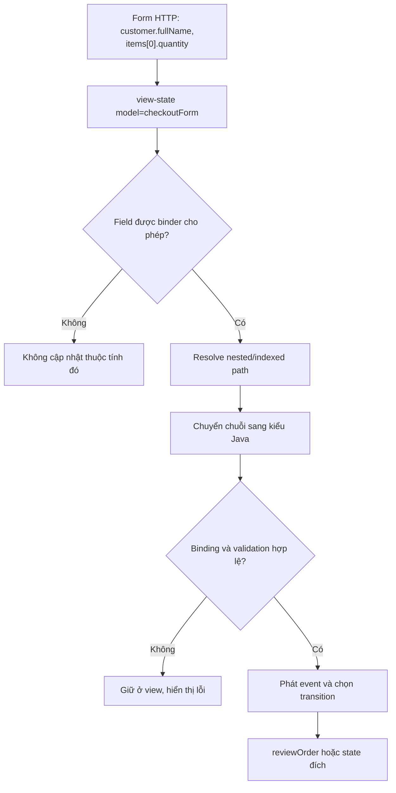
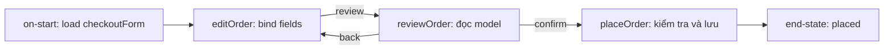

# Liên kết thuộc tính lồng nhau và phần tử collection

Trong một hành trình web nhiều bước, dữ liệu người dùng nhập hiếm khi chỉ gồm những thuộc tính đơn giản như `name` hoặc `email`. Form đặt hàng có thể gồm đối tượng `customer`, `shippingAddress` và một danh sách `items`; mỗi phần tử danh sách lại có `quantity` riêng. Khi chuyển từ màn hình chỉnh sửa sang màn hình xác nhận, Spring Web Flow cần đọc đúng từng trường, chuyển đổi kiểu, cập nhật model đang thuộc flow và kiểm tra dữ liệu trước khi cho phép chuyển state.

Chủ đề **liên kết thuộc tính lồng nhau và phần tử collection** nằm ở giao điểm giữa cú pháp property path của Spring, `view-state model`, vòng đời `flowScope`, cơ chế `binder` và validation. Hiểu đúng các phần này giúp form nhiều bước giữ được dữ liệu mà không ghi nhầm phần tử, đồng thời tránh cho người dùng sửa các thuộc tính nghiệp vụ không được phép.

## 1. Mục tiêu của bài học

Sau bài học, bạn có thể:

1. Đọc và tạo tên field theo quy ước `customer.fullName`, `items[0].quantity` và `settings[priority]`.
2. Tổ chức một model Java có bean lồng nhau và `List` để Spring Web Flow liên kết dữ liệu.
3. Khai báo `<view-state model="...">` và dùng `<binder>` để chỉ cho phép những thuộc tính được chỉnh sửa.
4. Phân biệt binding, type conversion và validation khi người dùng gửi event.
5. Xử lý collection có số lượng phần tử thay đổi mà không coi chỉ số form là ID nghiệp vụ.
6. Chẩn đoán lỗi null ở đường dẫn lồng nhau, index vượt phạm vi, sai kiểu và field không nằm trong binder.
7. Viết kiểm thử cho form nhiều bước, bao gồm nhánh lỗi, hủy và cố tình gửi thêm field trái phép.

## 2. Property path: từ tên input đến cấu trúc object

Spring có quy ước diễn đạt đường dẫn tới một thuộc tính Java bằng dấu chấm và cặp ngoặc vuông. Tên field được gửi lên server phải khớp với cấu trúc model mà bộ binding đang sử dụng.

| Tên field trong request | Model tương ứng | Ý nghĩa |
| --- | --- | --- |
| `customer.fullName` | `form.getCustomer().setFullName(...)` | Thuộc tính của bean lồng nhau |
| `shippingAddress.city` | `form.getShippingAddress().setCity(...)` | Thuộc tính trong một bean khác |
| `items[0].quantity` | `form.getItems().get(0).setQuantity(...)` | Số lượng của phần tử đầu tiên trong List |
| `items[1].quantity` | `form.getItems().get(1).setQuantity(...)` | Số lượng của phần tử thứ hai |
| `labels[0]` | `form.getLabels().set(0, ...)` | Phần tử trực tiếp của List |
| `settings[priority]` | `form.getSettings().put("priority", ...)` | Giá trị của Map ứng với khóa `priority` |

Các biểu thức trên mô tả **property path**, không phải cú pháp truy cập Java được chạy trực tiếp từ input. Bộ binding phân tích đường dẫn, tìm getter/setter hoặc accessor phù hợp rồi chuyển giá trị HTTP dạng chuỗi thành kiểu của đích.

### 2.1. Hai loại ngoặc vuông không giống nhau

- Với `List` hoặc mảng, `[0]` và `[1]` biểu diễn **vị trí theo chỉ số**, thường bắt đầu từ 0.
- Với `Map`, `[priority]` biểu diễn **khóa**. Một khóa không được coi là vị trí của List.
- Với `Set`, thứ tự phần tử không phải một hợp đồng truy cập theo index; không nên dựng form dựa trên `set[0]`. Hãy dùng `List` hoặc một DTO chứa danh sách có thứ tự.

Ví dụ JSON giúp hình dung dữ liệu phía server:

```json
{
  "customer": {
    "fullName": "Nguyen An",
    "email": "an@example.com"
  },
  "shippingAddress": {
    "street": "12 Nguyen Trai",
    "city": "Ho Chi Minh City"
  },
  "items": [
    { "lineId": 101, "sku": "BOOK-A", "quantity": 2 },
    { "lineId": 102, "sku": "BOOK-B", "quantity": 1 }
  ]
}
```

Nếu người dùng sửa `items[1].quantity` thành `3`, mục tiêu là cập nhật **quantity của phần tử thứ hai**. Không được hiểu con số `1` trong `[1]` là `lineId=1`.

## 3. Liên kết dữ liệu nằm ở đâu trong Spring Web Flow?

Trong Spring Web Flow, một `view-state` có thể trỏ tới object dùng làm model:

```xml
<view-state id="editOrder" model="checkoutForm">
    <transition on="review" to="reviewOrder"/>
</view-state>
```

Khi view nhận một event từ request:

1. Web Flow xác định state đang hoạt động và model `checkoutForm`.
2. Các field trong request được đối chiếu với những thuộc tính được phép bind.
3. Giá trị dạng chuỗi được chuyển sang kiểu đích, ví dụ `"3"` thành `Integer.valueOf(3)`.
4. Các giá trị được gán vào thuộc tính của model, kể cả bean lồng nhau và phần tử collection nếu đường dẫn hợp lệ.
5. Validation được thực hiện theo cấu hình trước khi event có thể làm flow rời view-state.
6. Nếu binding/validation không đạt, view được hiển thị lại với lỗi; người dùng có thể sửa thông tin và submit lại.



**Phân biệt với flow input:** `<input name="cartId">` ở cấp `<flow>` nhận dữ liệu lúc **khởi chạy flow**, còn `model="checkoutForm"` dùng để liên kết dữ liệu người dùng submit **từ view hiện tại**. Đó là hai thời điểm và hai hợp đồng khác nhau.

## 4. Chuẩn bị model Java chứa bean lồng nhau và List

Ví dụ xuyên suốt bài là form chỉnh sửa thông tin một đơn hàng đã có đúng hai dòng sản phẩm. Service trả về DTO phục vụ form, không đưa trực tiếp entity database làm model.

```java
package example.checkout;

import java.io.Serializable;
import java.util.ArrayList;
import java.util.List;

// Với Spring 6/Jakarta Validation dùng jakarta.validation.*.
// Dự án Spring cũ có thể dùng javax.validation.* tương ứng.
import jakarta.validation.Valid;
import jakarta.validation.constraints.Email;
import jakarta.validation.constraints.Min;
import jakarta.validation.constraints.NotBlank;
import jakarta.validation.constraints.NotNull;

public class CheckoutForm implements Serializable {

    @Valid
    private CustomerForm customer = new CustomerForm();

    @Valid
    private ShippingAddressForm shippingAddress = new ShippingAddressForm();

    @Valid
    private List<LineForm> items = new ArrayList<>();

    public CustomerForm getCustomer() {
        return customer;
    }

    public ShippingAddressForm getShippingAddress() {
        return shippingAddress;
    }

    public List<LineForm> getItems() {
        return items;
    }

    public static class CustomerForm implements Serializable {
        @NotBlank
        private String fullName;

        @NotBlank
        @Email
        private String email;

        public String getFullName() {
            return fullName;
        }

        public void setFullName(String fullName) {
            this.fullName = fullName;
        }

        public String getEmail() {
            return email;
        }

        public void setEmail(String email) {
            this.email = email;
        }
    }

    public static class ShippingAddressForm implements Serializable {
        @NotBlank
        private String street;

        @NotBlank
        private String city;

        public String getStreet() {
            return street;
        }

        public void setStreet(String street) {
            this.street = street;
        }

        public String getCity() {
            return city;
        }

        public void setCity(String city) {
            this.city = city;
        }
    }

    public static class LineForm implements Serializable {
        // Do service tạo từ dữ liệu tin cậy của đơn hàng.
        private Long lineId;
        private String sku;

        @NotNull
        @Min(1)
        private Integer quantity;

        public LineForm() {
        }

        public LineForm(Long lineId, String sku, Integer quantity) {
            this.lineId = lineId;
            this.sku = sku;
            this.quantity = quantity;
        }

        public Long getLineId() {
            return lineId;
        }

        public String getSku() {
            return sku;
        }

        public Integer getQuantity() {
            return quantity;
        }

        public void setQuantity(Integer quantity) {
            this.quantity = quantity;
        }
    }
}
```

Một `CheckoutForm` mới có sẵn `customer`, `shippingAddress` và `items` nên có chỗ để bind các đường dẫn cơ bản. Khi service tải đơn hàng, nó phải tạo những `LineForm` thực sự tương ứng với các dòng mà người dùng được phép sửa:

```java
CheckoutForm form = new CheckoutForm();
form.getItems().add(new CheckoutForm.LineForm(101L, "BOOK-A", 2));
form.getItems().add(new CheckoutForm.LineForm(102L, "BOOK-B", 1));
// Trong ứng dụng thật, danh sách được lấy từ dữ liệu đơn hàng đã kiểm tra quyền.
```

Trong ví dụ, `lineId` và `sku` chỉ có getter, còn `quantity` có setter. Đây là một lớp bảo vệ ở DTO; phần tiếp theo còn thêm danh sách binding được phép tại `view-state`.

### 4.1. Vì sao không dùng entity JPA làm form?

Đối tượng entity có thể chứa `orderId`, `unitPrice`, `total`, `paid`, `ownerId` hoặc quan hệ tới entity khác. Nếu vô tình bind trực tiếp các property này từ request, người dùng có thể gửi thêm field để sửa dữ liệu mà giao diện không hề hiển thị. DTO chỉ chứa dữ liệu cần nhập và một danh sách binding rõ ràng giúp thu hẹp phạm vi. Khi lưu, service lấy lại entity từ database theo ID đã kiểm tra quyền, rồi áp dụng những thay đổi hợp lệ.

## 5. Flow XML: bind có chủ đích cho thuộc tính lồng nhau

Giả sử checkout đã có **hai** dòng hàng như phần trên. Flow dưới đây chỉ cho phép sửa họ tên, email, địa chỉ và số lượng của hai dòng:

```xml
<flow xmlns="http://www.springframework.org/schema/webflow"
      xmlns:xsi="http://www.w3.org/2001/XMLSchema-instance"
      xsi:schemaLocation="http://www.springframework.org/schema/webflow
                          https://www.springframework.org/schema/webflow/spring-webflow.xsd">

    <!-- Input khởi chạy flow, khác với form binding. -->
    <input name="cartId" type="long" required="true" />

    <on-start>
        <evaluate expression="checkoutService.loadEditableDraft(cartId)"
                  result="flowScope.checkoutForm" />
    </on-start>

    <view-state id="editOrder" model="checkoutForm">
        <binder>
            <binding property="customer.fullName" required="true" />
            <binding property="customer.email" required="true" />
            <binding property="shippingAddress.street" required="true" />
            <binding property="shippingAddress.city" required="true" />

            <!-- Ví dụ minh họa với đúng hai dòng đã có trong model. -->
            <binding property="items[0].quantity" required="true" />
            <binding property="items[1].quantity" required="true" />
        </binder>

        <transition on="review" to="reviewOrder" />
        <transition on="cancel" to="cancelled"
                    bind="false" validate="false" />
    </view-state>

    <view-state id="reviewOrder">
        <transition on="back" to="editOrder" />
        <transition on="confirm" to="placeOrder" />
    </view-state>

    <action-state id="placeOrder">
        <evaluate expression="checkoutService.place(checkoutForm)"
                  result="flowScope.orderId" />
        <transition on="success" to="placed" />
    </action-state>

    <end-state id="placed">
        <output name="orderId" value="flowScope.orderId" />
    </end-state>

    <end-state id="cancelled" />
</flow>
```

**Lưu ý phạm vi ví dụ:** `<binding property="items[0].quantity"/>` và `items[1].quantity` chỉ hợp lý khi service chắc chắn cung cấp hai dòng và view chỉ hiển thị hai dòng đó. Chúng **không** cấu hình tự động cho một List có số lượng phần tử tùy ý. Với collection động, cần thiết kế cách chọn field được phép và quản lý cấu trúc danh sách riêng; xem mục 10.

### 5.1. Ý nghĩa `<binder>`

Theo cơ chế Web Flow, nếu view-state **không** khai báo `<binder>`, các public property của model có thể được xem là ứng viên bind theo hành vi mặc định. Khi có `<binder>`, chỉ những binding được khai báo mới được chấp nhận. Điều này đặc biệt hữu ích với nested properties và collection vì một đường dẫn không mong muốn có thể dẫn đến thay đổi bên trong object.

`required="true"` trên `<binding>` yêu cầu giá trị không rỗng khi bind; nó không thay thế toàn bộ validation nghiệp vụ. Ví dụ số lượng `-2` là một số nguyên có thể chuyển kiểu thành công, nhưng cần quy tắc `@Min(1)` để từ chối.

### 5.2. Không ghép tên model vào path của field

`model="checkoutForm"` đã chọn **root object**. Field con dùng:

```text
customer.fullName
shippingAddress.city
items[0].quantity
```

Không tự thêm `checkoutForm.` ở đầu thành `checkoutForm.customer.fullName`, trừ khi model được cấu trúc thực sự có property lồng thêm tên như vậy. Tên model là điểm xuất phát; đường dẫn field tương đối với object đó.

## 6. Giao diện JSP: field name bám sát property path

Khi Spring Web Flow tích hợp Spring MVC và sử dụng JSP/Spring form tags, một view minh họa có thể được viết:

```jsp
<%@ taglib prefix="form" uri="http://www.springframework.org/tags/form" %>
<%@ taglib prefix="c" uri="http://java.sun.com/jsp/jstl/core" %>

<form:form modelAttribute="checkoutForm"
           action="${flowExecutionUrl}" method="post">

    <label>Họ tên</label>
    <form:input path="customer.fullName" />
    <form:errors path="customer.fullName" cssClass="error" />

    <label>Email</label>
    <form:input path="customer.email" />
    <form:errors path="customer.email" cssClass="error" />

    <label>Đường</label>
    <form:input path="shippingAddress.street" />
    <form:errors path="shippingAddress.street" cssClass="error" />

    <label>Thành phố</label>
    <form:input path="shippingAddress.city" />
    <form:errors path="shippingAddress.city" cssClass="error" />

    <c:forEach items="${checkoutForm.items}" var="line" varStatus="row">
        <p><c:out value="${line.sku}"/></p>
        <label>Số lượng</label>
        <form:input path="items[${row.index}].quantity" />
        <form:errors path="items[${row.index}].quantity"
                     cssClass="error" />
    </c:forEach>

    <button type="submit" name="_eventId_review">Xem lại đơn hàng</button>
    <button type="submit" name="_eventId_cancel">Hủy</button>
</form:form>
```

`row.index` bắt đầu từ 0. Ở dòng đầu, Spring form tag sẽ tạo field tương ứng `items[0].quantity`; ở dòng thứ hai là `items[1].quantity`. Các thẻ `form:errors` hiển thị lỗi theo đúng property path (cần tích hợp validation/message handling theo view technology đã cấu hình).

Lưu ý rằng đoạn JSP chỉ minh họa việc kết nối form với flow. Ứng dụng phải cung cấp view resolver, JSTL và cấu hình MVC/Web Flow phù hợp. Nếu dùng Thymeleaf hoặc JSF, cú pháp ở view khác nhưng ý tưởng **đường dẫn tới property của model** vẫn được giữ.

### 6.1. Request thực sự gửi gì?

Giả sử người dùng cập nhật số lượng sách thành 3 và 5. Dữ liệu form có thể tương đương:

```text
customer.fullName=Nguyen An
customer.email=an%40example.com
shippingAddress.street=12+Nguyen+Trai
shippingAddress.city=Ho+Chi+Minh+City
items[0].quantity=3
items[1].quantity=5
_eventId_review=
```

Web Flow biết đây là event `review` từ tên nút, bind các field được phép vào `checkoutForm`, rồi mới quyết định có chuyển sang `reviewOrder` hay cần render lại `editOrder`.

Các field có thể được URL-encode khi gửi HTTP; Spring nhận request parameter name sau giải mã. Khi debug, xem tên field thực tế trong **Network → Form Data**, không suy từ text hiển thị trên trang.

## 7. Điều kiện để property path lồng nhau hoạt động

Một property path như `customer.fullName` đòi hỏi khả năng truy cập vào từng phần của object graph:

1. Root model `checkoutForm` phải được tạo và có trong scope phù hợp.
2. `checkoutForm.getCustomer()` phải trả về object có thể truy cập; nếu là `null`, bộ binder cần cơ chế tạo giá trị hoặc quá trình bind sẽ thất bại.
3. `CustomerForm` phải có property `fullName` có thể ghi theo cơ chế JavaBeans/accessor đang sử dụng.
4. Giá trị request cần có kiểu có thể chuyển tới thuộc tính đích.
5. Binding path phải được cho phép theo `<binder>` và các giới hạn truy cập của ứng dụng.

### 7.1. Tránh bean lồng nhau null

Ví dụ model dễ gây lỗi:

```java
public class UnsafeCheckoutForm {
    private CustomerForm customer; // Chưa khởi tạo.

    public CustomerForm getCustomer() {
        return customer;
    }
}
```

Khi request gửi `customer.fullName` mà `customer == null`, hành vi tùy thuộc binder và cấu hình auto-grow. Có thể gặp lỗi truy cập đường dẫn lồng nhau hoặc không bind được.

Cách chuẩn bị rõ ràng hơn:

```java
private CustomerForm customer = new CustomerForm();
```

Spring Framework `DataBinder` / `BeanWrapper` có cơ chế **auto-grow nested paths** trong những cấu hình nhất định; chẳng hạn `DataBinder` có thể tự tạo một bean con hoặc mở rộng List. Nhưng không được mặc định mọi cấu hình Spring Web Flow và mọi view technology đều có hành vi giống nhau. Chuẩn bị model có cấu trúc hợp lệ từ service và test bằng đúng cấu hình runtime là cách dễ dự đoán nhất.

### 7.2. Getter/setter và kiểu collection

Với một List chứa bean, cần có khả năng lấy đúng phần tử và sửa property trong phần tử đó. Các kiểu khai báo sau thường dễ làm việc hơn:

```java
private List<CheckoutForm.LineForm> items = new ArrayList<>();
```

So với một `Set` không có thứ tự ổn định, `List` giúp view hiển thị tuần tự và dùng `items[0]`, `items[1]`. Nếu model chỉ có các getter trả về danh sách bản sao mỗi lần gọi, binder có thể sửa object bản sao rồi mất dữ liệu. Hãy đảm bảo các getter phản ánh **cùng trạng thái model đang được flow lưu giữ**.

## 8. Collection: List, array và Map

### 8.1. List và array dùng chỉ số

`items[0].quantity` nghĩa là lấy phần tử thứ nhất của List, rồi sửa property `quantity`. Với mảng, cú pháp index có thể tương tự. Nếu index âm, vượt phạm vi, hoặc phần tử đó là `null`, binding có thể thất bại.

Không nên tin rằng gửi `items[1000].quantity` sẽ tự tạo ra 1.001 dòng hợp lệ. Các thiết lập auto-grow, giới hạn kích thước collection, khả năng tạo phần tử và quyền binding khác nhau theo backend. Dù có hỗ trợ tự mở rộng, ứng dụng vẫn cần giới hạn số dòng người dùng được chỉnh sửa.

### 8.2. Map dùng khóa

Ví dụ model:

```java
private Map<String, String> deliveryInstructions = new HashMap<>();
```

Một field như `deliveryInstructions[home]` có thể nhắm vào value của key `home`. Cách này hữu ích khi form có các tùy chọn theo khóa ổn định. Tuy nhiên, nếu key được người dùng điều khiển hoàn toàn và ứng dụng không giới hạn danh sách khóa cho phép, request có thể tạo/sửa các mục ngoài dự kiến.

Khi cần danh sách có khóa nghiệp vụ, nên cân nhắc DTO với tập key cố định hoặc validate key trong service. **Chỉ số của List không được thay thế bằng ID database**, còn **key của Map không tự được coi là đáng tin cậy** chỉ vì nó xuất hiện trong property path.

### 8.3. Chỉ số và ID nghiệp vụ là hai khái niệm

Giả sử:

| Vị trí trong form | `lineId` trong database | `sku` | `quantity` |
| --- | --- | --- | --- |
| `items[0]` | 101 | BOOK-A | 2 |
| `items[1]` | 102 | BOOK-B | 1 |

Nếu xóa dòng đầu rồi render lại form, dòng có `lineId=102` có thể chuyển từ `items[1]` sang `items[0]`. Backend cần biết người dùng sửa dòng nào bằng **lineId đã xác minh**, không suy ra ID từ index hiện tại.

Ở bước lưu, service nên lấy lại danh sách line item thuộc đúng giỏ hàng, kiểm tra quyền và đối chiếu các ID hiện có. Index chỉ là tọa độ kỹ thuật dùng khi bind request.

## 9. Binding, chuyển đổi kiểu và validation là ba lớp riêng

Giả sử field `items[1].quantity` trong model có kiểu `Integer`.

| Giá trị gửi từ form | Binding/chuyển kiểu | Validation | Kết quả mong muốn |
| --- | --- | --- | --- |
| `"5"` | Chuyển thành `Integer(5)` | Hợp lệ nếu quy tắc cho phép | Có thể tới `reviewOrder` |
| `"abc"` | Không chuyển thành Integer | Chưa có giá trị đúng kiểu để kiểm tra đầy đủ | Render lại view với lỗi type mismatch |
| `"-2"` | Chuyển thành `Integer(-2)` | Vi phạm `@Min(1)` | Render lại view với lỗi nghiệp vụ |
| Chuỗi rỗng | Tùy converter, có thể thành null | Vi phạm `@NotNull` / `required` | Yêu cầu nhập số lượng |
| `"99999999"` | Có thể chuyển thành Integer | Phải kiểm tra giới hạn đặt hàng, tồn kho | Từ chối nếu vượt chính sách |

**Binding** là việc gán dữ liệu từ request vào model. **Type conversion** là một phần của quá trình đó, chuyển chuỗi thành giá trị có kiểu. **Validation** kiểm tra tính đúng đắn của dữ liệu sau khi chuyển đổi, bao gồm ràng buộc trên bean con và toàn bộ collection.

### 9.1. `required` không thay thế quy tắc nghiệp vụ

`<binding property="items[0].quantity" required="true"/>` nhằm phát hiện giá trị đầu vào thiếu/rỗng trong một lần bind. Nó không kiểm tra tồn kho, giới hạn một khách có thể mua, quy tắc tối thiểu theo SKU hoặc tổng tiền. Các quy tắc này thuộc bean validation/service.

### 9.2. Validation lồng nhau cần cơ chế cascade

Trong DTO minh họa, `@Valid` được đặt trên `customer`, `shippingAddress` và `items` để chỉ ra ý định kiểm tra các object bên trong khi Bean Validation được kích hoạt. Không nên chỉ gắn `@NotBlank` trên `CustomerForm.fullName` rồi mặc định validator của root luôn tự kiểm tra mọi bean con nếu cascade không được cấu hình.

Với dự án Spring Web Flow khác phiên bản, cần xác định Validation provider, annotation namespace (`jakarta.validation` hay `javax.validation`), và chiến lược validator được gắn với view. Bản thân khai báo `@Valid` không tự khắc phục việc ứng dụng chưa bật validation phù hợp.

### 9.3. Validation ở cấp toàn bộ đơn hàng

Một số quy tắc không thể biểu diễn bằng `@Min` trên từng dòng:

- List phải có ít nhất một dòng hợp lệ.
- Tất cả `lineId` phải thuộc cùng giỏ hàng của người dùng.
- Không cho phép hai dòng trùng SKU nếu nghiệp vụ không hỗ trợ.
- Số lượng và tổng số sản phẩm không vượt giới hạn đặt hàng.
- Địa chỉ giao hàng phải được phục vụ tại khu vực đó.

Các kiểm tra này cần được thực hiện trong validator/service tại thời điểm phù hợp; nhiều quy tắc phải được kiểm tra lại lúc lưu do tồn kho và quyền truy cập có thể thay đổi trong lúc flow đang chạy.

## 10. Collection động: thêm, xóa, thay đổi thứ tự

Đây là phần dễ phát sinh lỗi nhất khi form nhiều bước không có số dòng cố định.

### 10.1. Vì sao không thể dùng mãi hai binding cố định?

```xml
<binder>
    <binding property="items[0].quantity"/>
    <binding property="items[1].quantity"/>
</binder>
```

Ví dụ này chỉ công bố hai đường dẫn. Khi có thêm dòng thứ ba, field `items[2].quantity` không tự trở thành một binding hợp lệ chỉ vì trình duyệt đã render thêm ô input.

Không nên tự suy đoán rằng `<binding property="items[*].quantity"/>` được Web Flow chấp nhận như một wildcard cho mọi item. Hỗ trợ cú pháp wildcard và allowed-field pattern phụ thuộc cơ chế binder thực tế; cần kiểm tra API/configuration và viết integration test trước khi dùng.

### 10.2. Thay đổi cấu trúc collection ở phía server

Đối với form cho phép thêm một dòng mới, một thiết kế dễ kiểm soát là dùng **event riêng** để yêu cầu service thay đổi danh sách, rồi render lại form từ model mới:

```xml
<view-state id="editOrder" model="checkoutForm">
    <!-- Các binding của view được thiết kế theo cấu trúc cho phép. -->
    <transition on="addLine" to="editOrder" validate="false">
        <evaluate expression="checkoutService.addEditableLine(checkoutForm)" />
    </transition>
    <transition on="review" to="reviewOrder"/>
</view-state>
```

Đoạn này minh họa event thay đổi cấu trúc; nó chưa phải giải pháp đầy đủ cho binder động. Cần quyết định rõ:

- Các field người dùng đang nhập có được bind trước khi thêm dòng hay không?
- Nếu một field cũ không chuyển kiểu được, có cho phép sự kiện `addLine` đi tiếp không?
- View sẽ công bố những path mới nào khi render lại?
- Service có kiểm tra giới hạn số dòng và việc người dùng được phép thêm không?

Nếu muốn giữ các giá trị người dùng đã nhập nhưng chưa hợp lệ, phải thiết kế cách bảo toàn chúng qua render/binding error. Đặt `bind="false"` cho `addLine` sẽ bỏ qua cập nhật dữ liệu vừa gửi, nên có thể làm mất các thay đổi chưa lưu trong form.

### 10.3. Xóa phần tử bằng ID được xác thực

Giả sử giao diện có nút “Xóa dòng 101”. Không nên chỉ gửi index 0 và xóa phần tử tương ứng mà không kiểm tra ngữ cảnh, vì trong tab khác hoặc sau khi danh sách đổi thứ tự, index 0 có thể là dòng khác.

Một luồng xử lý hợp lý:

1. Nhận lệnh xóa cùng `lineId` hoặc một mã dòng ổn định.
2. Service xác nhận dòng đó thuộc draft/cart hiện tại và người dùng được phép xóa.
3. Service xóa/đánh dấu xóa theo nghiệp vụ, rồi xây dựng lại danh sách DTO.
4. Render lại form với index mới dựa trên danh sách hiện tại.
5. Khi submit lần kế tiếp, binder và service kiểm tra lại cấu trúc đang dùng.

Không được tin một hidden input `lineId` là bằng chứng quyền sở hữu. Hidden field vẫn có thể bị sửa bởi client.

### 10.4. Nếu danh sách quá linh hoạt

Khi số lượng, vị trí và kiểu phần tử thay đổi nhiều, có thể cân nhắc UI/API riêng cho từng thao tác thêm/sửa/xóa dòng rồi giữ flow cho các bước điều hướng cấp cao. Cách này giảm nhu cầu mở mọi nested/indexed property của một DTO lớn cho một request. Quyết định phụ thuộc trải nghiệm người dùng, validation và yêu cầu lưu tạm của ứng dụng.

## 11. Bảo vệ khỏi mass assignment và field injection

Giả sử một attacker mở DevTools và gửi thêm:

```text
items[0].quantity=2
items[0].sku=FREE-GIFT
items[0].lineId=999
unitPrice=0
customer.isVip=true
```

Nếu model expose các property có thể ghi và view không giới hạn binding, có nguy cơ những field ngoài giao diện cũng được gán. Spring Web Flow nhấn mạnh rằng khi không khai báo binder, các public property của model có thể trở thành ứng viên binding mặc định.

Cách phòng ngừa theo lớp:

1. **DTO riêng cho form:** Không expose entity nghiệp vụ hay thuộc tính quyết định giá, quyền, trạng thái thanh toán.
2. **Binder tường minh:** Chỉ khai báo những property path mà view này được phép sửa.
3. **Setter tối thiểu:** Với các trường chỉ đọc như `sku`, `lineId`, tránh setter không cần thiết.
4. **Service kiểm tra lại:** Giá, tổng tiền, tồn kho, quyền sử dụng giỏ hàng và quan hệ giữa các dòng phải đến từ nguồn tin cậy.
5. **Giới hạn collection:** Tránh nhận index quá lớn, quá nhiều dòng hoặc key không được phép.
6. **Test request giả mạo:** Gửi field trái phép trực tiếp mà không đi qua HTML để bảo đảm không thay đổi state quan trọng.

Chỉ dùng `readonly`, `disabled` hoặc ẩn input bằng CSS **không** bảo vệ được dữ liệu: client vẫn có thể gửi request tùy ý.

## 12. Vòng đời flowScope và ảnh hưởng đến form nhiều bước

Giả sử `checkoutForm` được tạo ở `<on-start>` và lưu trong `flowScope`. Nó có thể được dùng lại khi flow đi từ `editOrder` sang `reviewOrder` rồi quay về `editOrder`:



Không nên tạo lại `checkoutForm` từ database ở mỗi lần quay về view nếu mục đích là giữ những thay đổi tạm của người dùng. Ngược lại, khi người dùng chọn “Đặt hàng”, service phải kiểm tra lại giá trị đã thay đổi theo thời gian (tồn kho, giá, quyền) trước khi ghi giao dịch.

Với cơ chế lưu/khôi phục flow execution mặc định, các object trong `flowScope` thường cần hỗ trợ serializable. Ví dụ DTO ở trên triển khai `Serializable` để minh họa yêu cầu này. Tránh lưu EntityManager, database connection hoặc stream trong form.

### 12.1. Nhiều tab và dữ liệu cũ

Nếu cùng một người mở cùng một draft ở hai tab, mỗi tab có thể tiếp tục một execution/snapshot khác nhau hoặc cùng cập nhật một tài nguyên phía service. Index của List trong tab cũ có thể không khớp cấu trúc mới. Hãy kết hợp kiểm tra version của draft, xác thực line ID và quy tắc xử lý xung đột ở tầng service; không xem `flowScope` là cơ chế khóa dữ liệu.

## 13. Nút Hủy và Quay lại: quyết định bind/validate có chủ đích

Giả sử một người nhập `items[0].quantity=abc` rồi nhấn Hủy. Nút Hủy có thể cần kết thúc ngay cả khi kiểu số lượng không hợp lệ:

```xml
<transition on="cancel" to="cancelled"
            bind="false" validate="false" />
```

Ngược lại, khi nhấn Xem lại, phải bind và validate:

```xml
<transition on="review" to="reviewOrder" />
```

Với nút Quay lại, nhu cầu có thể khác:

```xml
<transition on="back" to="previousStep"
            validate="false" />
```

`validate="false"` có thể tắt validation nhưng **không mặc nhiên bỏ qua type conversion/binding**. Nếu mục đích là rời form bất kể người dùng nhập gì, cần xem xét `bind="false"` và hiểu rằng thay đổi đang hiện trên trình duyệt có thể không được ghi vào model. Cơ chế cụ thể cần được kiểm tra theo version và view technology đang dùng.

## 14. Chú ý khác biệt giữa cơ chế binding của Web Flow và Spring MVC

Một ứng dụng có Spring MVC và Spring Web Flow vẫn có thể sử dụng cách binding khác nhau ở từng view technology/cấu hình. Với `MvcViewFactoryCreator`, Web Flow có lựa chọn `useSpringBinding` để sử dụng binding dựa trên `BeanWrapper` của Spring MVC thay cho cơ chế EL mặc định ở view.

Ví dụ cấu hình minh họa:

```xml
<bean id="mvcViewFactoryCreator"
      class="org.springframework.webflow.mvc.builder.MvcViewFactoryCreator">
    <property name="viewResolvers">
        <list>
            <ref bean="viewResolver" />
        </list>
    </property>
    <property name="useSpringBinding" value="true" />
</bean>
```

Một số hành vi như tự tạo nested object, mở rộng collection, giới hạn index và thông điệp lỗi phụ thuộc đường binding đang được dùng. Tài liệu Spring Framework về `DataBinder`/`BeanWrapper` là cơ sở tốt để hiểu property path, nhưng không nên suy ra mọi setting của `@InitBinder` trong một Spring MVC controller tự áp dụng cho mọi view-state của Spring Web Flow.

Khi dùng collection động hoặc path phức tạp, hãy kiểm tra chính xác:

- Web Flow version và Spring Framework version.
- View technology: JSP/MVC, Thymeleaf, JSF hoặc cơ chế khác.
- `MvcViewFactoryCreator` và tùy chọn `useSpringBinding`.
- `ConversionService`, formatters, validators và cấu hình binder.
- Cách field name được render và request parameter thực tế gửi về.

## 15. Các lỗi điển hình và cách chẩn đoán

| Hiện tượng | Nguyên nhân khả dĩ | Cách kiểm tra |
| --- | --- | --- |
| `customer.fullName` không cập nhật | `customer` null hoặc property không ghi được | Getter/setter, khởi tạo bean con |
| `items[0].quantity` không đổi | Field name sai, property không nằm trong binder | HTML/Network, `<binding property="...">` |
| Dòng đầu đúng nhưng dòng thứ ba không đổi | Binder chỉ có index 0 và 1 | Số phần tử thực và cấu hình cho phép field |
| Lỗi khi truy cập `items[5]` | List không đủ phần tử hoặc binder không auto-grow | Kích thước List, config binding, giới hạn index |
| Gửi `quantity=abc` làm view đứng yên | Chuyển String sang Integer thất bại | Lỗi type mismatch và `form:errors` |
| Gửi `quantity=-1` làm view đứng yên | `@Min(1)` hoặc validator từ chối | Thông báo validation trên phần tử |
| Số lượng của dòng khác bị sửa | Collection bị reorder trong lúc dùng index cũ | Đối chiếu line ID và version draft |
| Bấm Hủy mà báo lỗi số lượng | Transition vẫn bind/validate dữ liệu | `bind="false"`, `validate="false"` |
| Trường `unitPrice` bất ngờ bị thay | Model expose property và binder quá rộng | DTO/binder allowlist; test field injection |
| Form mất dữ liệu khi quay lại | Tạo lại model mỗi lần render/state entry | Vị trí load model, scope và transition |
| Chạy ổn ở MVC controller nhưng lỗi ở flow | Cơ chế binder/view factory khác nhau | `MvcViewFactoryCreator` và integration test |

### 15.1. Quy trình debug có thể lặp lại

1. Xác định flow ID, state ID và object được khai báo trong `model`.
2. Đọc giá trị/thành phần của model trước submit: bean con đã được tạo chưa, List có bao nhiêu phần tử?
3. Xem request parameter names từ Network; kiểm tra các dấu chấm và ngoặc vuông.
4. Đối chiếu từng field với `<binder>` của đúng state.
5. Kiểm tra có lỗi type conversion hoặc binding trước khi xét validation.
6. Kiểm tra kết quả validation, nhất là các field thuộc bean con/List.
7. Nếu binding thành công, xác minh event và transition đưa flow sang state tiếp theo.
8. Khi dữ liệu bị đổi nhầm dòng, so sánh index từ view với line ID/server model ở thời điểm submit.

Có thể bật log ở mức phát triển:

```properties
logging.level.org.springframework.webflow=DEBUG
logging.level.org.springframework.binding=DEBUG
```

Các logger cụ thể phụ thuộc phiên bản. Không log nguyên văn password, token, thông tin thanh toán hay toàn bộ form người dùng để debug. Ưu tiên field name, loại lỗi và ID kỹ thuật.

## 16. Kiểm thử liên kết nested/collection

Nên kết hợp test cho Java model, test flow bằng công cụ kiểm thử Spring Web Flow và integration test HTTP/view. Mỗi loại bắt được lỗi khác nhau.

### 16.1. Ma trận test

| Trường hợp | Input / hành động | Kỳ vọng |
| --- | --- | --- |
| Bean lồng nhau hợp lệ | `customer.fullName=An` | Thuộc tính tương ứng được cập nhật |
| Hai phần tử List | `items[0].quantity=3`, `items[1].quantity=5` | Đúng hai dòng được cập nhật |
| Chỉ gửi một field | Chỉ `items[0].quantity=3` | Các field khác xử lý theo cấu hình required/binder, không suy từ index |
| Giá trị không phải số | `items[1].quantity=abc` | Binding báo lỗi, không chuyển sang review |
| Vi phạm @Min | `items[1].quantity=-1` | Validation báo lỗi |
| Thiếu bean con | `customer=null` khi bắt đầu | Test phát hiện cấu trúc model không phù hợp/cơ chế auto-grow |
| Index ngoài danh sách | `items[99].quantity=3` | Không được tạo/sửa dòng không được cấp phép |
| Field không trong binder | `items[0].sku=FAKE` | SKU không thay đổi |
| Field server-only | `unitPrice=0` | Giá lấy từ service/database, không bị sửa bởi form |
| Hủy khi input sai | `quantity=abc` + event `cancel` | Kết thúc hủy nếu chuyển trạng thái được thiết kế bỏ qua binding |
| Quay lại màn hình chỉnh sửa | `reviewOrder` → `editOrder` | Dữ liệu đã bind trước đó vẫn có trong model |
| Đổi thứ tự danh sách | Hai dòng đổi vị trí sau một hành động | Không áp nhầm quantity cho line ID khác |
| Session được phục hồi | Suspend → resume flow | Model còn dữ liệu cần thiết; không lỗi serialization |

### 16.2. Ví dụ kiểm tra property path ở mức Java

Một test đơn vị của `BeanWrapper` giúp kiểm tra đường dẫn nested/indexed mà không cần khởi động Web Flow:

```java
import org.springframework.beans.BeanWrapper;
import org.springframework.beans.PropertyAccessorFactory;

CheckoutForm form = new CheckoutForm();
form.getItems().add(
        new CheckoutForm.LineForm(101L, "BOOK-A", 2));

BeanWrapper accessor =
        PropertyAccessorFactory.forBeanPropertyAccess(form);

accessor.setPropertyValue("customer.fullName", "Nguyen An");
accessor.setPropertyValue("items[0].quantity", 3);

assertEquals("Nguyen An", form.getCustomer().getFullName());
assertEquals(3, form.getItems().get(0).getQuantity());
```

Test này chứng minh property path có thể hoạt động với mô hình JavaBeans đã khởi tạo. Nó **không thay thế** test Web Flow, vì `<binder>`, event, validation và view factory là các lớp xử lý bổ sung.

### 16.3. Kiểm tra bằng request thật

Một integration test cần gửi form đến đúng flow execution URL, ví dụ với hai input:

```text
items[0].quantity=3
items[1].quantity=5
_eventId_review=
```

Sau đó xác minh:

1. Flow đi đến `reviewOrder` nếu dữ liệu hợp lệ.
2. Model bên trong flow giữ đúng quantity của từng line ID.
3. Gửi lại với `items[0].quantity=abc` làm view báo lỗi.
4. Gửi field ngoài binder (`items[0].sku`, `unitPrice`) không làm thay đổi dữ liệu quan trọng.
5. Thử với List có số phần tử khác hai để bảo đảm quy tắc binding collection đã được thiết kế chính xác.

## 17. Bài tập thực hành

Thiết kế form đăng ký khóa học nhiều bước với:

- `student.fullName` và `student.email`.
- `contactAddress.city` và `contactAddress.country`.
- Danh sách `enrollments`, mỗi phần tử gồm `courseId` (server-only), `credits` (người dùng chọn).
- Các nút `continue`, `back` và `cancel`.

Yêu cầu:

1. Tạo một DTO Java có getter/setter cần thiết, chuẩn bị ít nhất hai phần tử trong `enrollments`.
2. Khai báo `view-state model="registrationForm"` với binder chỉ cho phép sửa họ tên, email, địa chỉ và `credits` của hai phần tử đã cấp.
3. Viết hai input HTML/JSP có tên `enrollments[0].credits` và `enrollments[1].credits`.
4. Áp dụng quy tắc `credits` là số nguyên trong khoảng 1–6 và tổng tín chỉ không vượt 18.
5. Thiết kế xử lý `cancel` cho phép thoát khi đang có lỗi validation.
6. Mô tả cách bổ sung khóa học thứ ba mà không dựa vào index do client tự bịa.
7. Viết test gửi `enrollments[0].courseId=999` và chứng minh người dùng không thể đổi khóa học được cấp.

**Câu hỏi tự kiểm tra:** `enrollments[1]` có phải là course ID 1 không? Nếu form gửi `enrollments[2].credits` nhưng server chỉ có hai phần tử, bạn xử lý thế nào? Vì sao `@NotNull` không đủ bảo đảm người dùng được phép đăng ký một khóa học?

## 18. Những điểm cần nhớ

- Dấu chấm trong `customer.fullName` chỉ đường tới bean con; `[0]` trong `items[0].quantity` chỉ phần tử List/mảng; `[key]` trong Map chỉ khóa.
- Khai báo `model` trên `view-state` để Web Flow bind request vào object form của state; binding thành công và validation hợp lệ mới cho phép event chuyển state theo đường đi thông thường.
- Tạo bean lồng nhau và danh sách có cấu trúc rõ ràng trước khi render; đừng đặt toàn bộ tính đúng đắn vào auto-grow.
- `<binder>` công bố danh sách field được phép sửa. Với collection động, phải thiết kế cách cấp/giới hạn các path thực tế, tránh giả định wildcard luôn được hỗ trợ.
- Index trong form là vị trí, không phải ID nghiệp vụ. Service phải kiểm tra quyền, line ID và dữ liệu server-only trước khi lưu.
- `required`, conversion và validation giải quyết các vấn đề khác nhau; tất cả đều cần trong một form nhiều bước an toàn.
- Với nút Hủy/Quay lại, xác định rõ có cần bind/validate hay không để tránh làm mất dữ liệu hoặc chặn điều hướng.
- Test BeanWrapper giúp chứng minh property path, nhưng cần thêm integration test Web Flow để kiểm tra binder, validation, view và flow execution.

### Tài liệu tham khảo

- [Spring Web Flow Reference Guide 3.0.x — Rendering Views, Binding to a Model và Specifying Bindings Explicitly](https://docs.spring.io/spring-webflow/docs/3.0.x/reference/)
- [Spring Framework Reference — Data Binding, Nested/Indexed Properties](https://docs.spring.io/spring-framework/reference/core/validation/data-binding.html)
- [Spring Framework Reference — Spring MVC Data Binding and Allowed Fields](https://docs.spring.io/spring-framework/reference/web/webmvc/mvc-data-binding.html)
- [Spring Web Flow — MvcViewFactoryCreator Javadoc](https://docs.spring.io/spring-webflow/docs/3.0.1/api/org/springframework/webflow/mvc/builder/MvcViewFactoryCreator.html)
