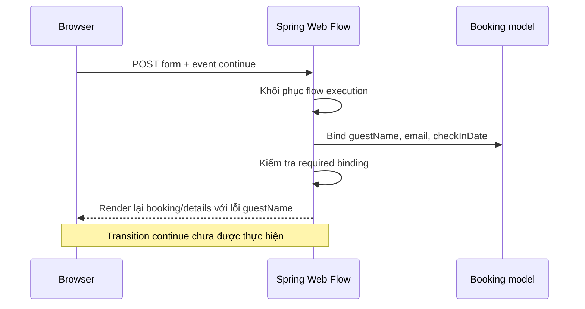

# Trường bắt buộc ở mức binding trong Spring Web Flow

Trong **Spring Web Flow** (`SPRING_WEB_FLOW`), một `view-state` thường hiển thị biểu mẫu để người dùng nhập hoặc chỉnh sửa model. Khi họ bấm **Tiếp tục**, các giá trị từ HTTP request được bind vào thuộc tính Java tương ứng. Có những trường phải có dữ liệu trước khi quy trình được phép đi tiếp, chẳng hạn tên người nhận, email hoặc ngày nhận phòng.

Thuộc tính **`required="true"`** trên phần tử `<binding>` cho phép khai báo một thuộc tính model là bắt buộc ở **tầng binding của Web Flow**. Nếu giá trị gửi lên rỗng, Web Flow tạo lỗi binding/validation và render lại view để người dùng sửa. Cơ chế này giúp server kiểm tra dữ liệu ngay khi xử lý postback, kể cả khi người dùng bỏ qua kiểm tra phía trình duyệt.

Bài thuộc chương **Liên kết biểu mẫu** giải thích cách khai báo trường bắt buộc, cách nó tương tác với model, conversion và validation, cách bỏ qua binding khi Hủy, cũng như cách kiểm thử và xử lý lỗi trong một hành trình nhiều bước.

## 1. Trường bắt buộc ở mức binding nghĩa là gì?

Giả sử form đăng ký nhận hàng có ba thuộc tính:

| Thuộc tính model | Yêu cầu | Lý do |
| --- | --- | --- |
| `recipientName` | Bắt buộc | Phải biết người nhận |
| `deliveryAddress` | Bắt buộc | Cần địa chỉ để giao hàng |
| `deliveryNote` | Tùy chọn | Người dùng có thể để trống |

Khi định nghĩa `view-state`, ta khai báo rõ thuộc tính bắt buộc:

```xml
<view-state id="enterDelivery" model="delivery">
    <binder>
        <binding property="recipientName" required="true" />
        <binding property="deliveryAddress" required="true" />
        <binding property="deliveryNote" />
    </binder>

    <transition on="continue" to="reviewDelivery" />
</view-state>
```

`required="true"` yêu cầu Web Flow kiểm tra giá trị của binding khi form được gửi. Nếu một binding bắt buộc nhận giá trị rỗng, quá trình binding tạo lỗi và view hiện tại được render lại để người dùng chỉnh sửa. Transition `continue` không được thực hiện như một lần gửi form hợp lệ.

Đây là quy tắc ở **server-side binding**. Nó không chỉ là dấu sao đỏ trên giao diện, cũng không phải thuộc tính Java của model. Web Flow sử dụng cấu hình binder để biết trường nào phải có giá trị khi nhận dữ liệu từ view.

## 2. Phân biệt required của Web Flow và required của HTML

Hai thuộc tính có tên giống nhau nhưng chạy ở hai nơi:

| Cơ chế | Khai báo | Ai thực hiện? | Có thể bị bỏ qua? |
| --- | --- | --- | --- |
| Required ở Web Flow | `<binding property="recipientName" required="true" />` | Server, trong quá trình binding | Client không thể vô hiệu hóa quy tắc server bằng cách sửa HTML |
| Required ở HTML | `<input name="recipientName" required>` | Trình duyệt | Có thể bị tắt hoặc bỏ qua khi gửi request thủ công |
| Validation nghiệp vụ | Validator hoặc service kiểm tra model | Server | Không được thay bằng kiểm tra giao diện |

Có thể kết hợp cả hai:

- HTML `required` giúp trình duyệt hướng dẫn người dùng trước khi gửi form.
- Web Flow `required="true"` bảo đảm server vẫn kiểm tra giá trị khi xử lý request.
- Validator nghiệp vụ kiểm tra những điều kiện phức tạp hơn, chẳng hạn địa chỉ thuộc vùng giao hàng hoặc ngày nhận không nằm trong quá khứ.

**Không được coi HTML required là biện pháp bảo vệ dữ liệu.** Người dùng có thể gửi request bằng DevTools, curl hoặc một client khác mà không qua kiểm tra HTML. Quy tắc bắt buộc quan trọng phải được xác thực ở server.

## 3. Khai báo binding bắt buộc trong flow XML

Ví dụ flow đặt phòng:

```xml
<?xml version="1.0" encoding="UTF-8"?>
<flow xmlns="http://www.springframework.org/schema/webflow"
      xmlns:xsi="http://www.w3.org/2001/XMLSchema-instance"
      xsi:schemaLocation="
          http://www.springframework.org/schema/webflow
          http://www.springframework.org/schema/webflow/spring-webflow-2.0.xsd"
      start-state="enterBooking">

    <var name="booking"
         class="com.example.booking.BookingForm" />

    <view-state id="enterBooking"
                view="booking/details"
                model="booking">
        <binder>
            <binding property="guestName" required="true" />
            <binding property="email" required="true" />
            <binding property="checkInDate" required="true" />
            <binding property="specialRequest" />
        </binder>

        <transition on="continue" to="reviewBooking" />
        <transition on="cancel"
                    to="bookingCancelled"
                    bind="false" />
    </view-state>

    <view-state id="reviewBooking" view="booking/review">
        <transition on="back" to="enterBooking" />
        <transition on="confirm" to="bookingConfirmed" />
    </view-state>

    <end-state id="bookingConfirmed" />
    <end-state id="bookingCancelled" />
</flow>
```

Đọc cấu hình theo từng phần:

- `<var>` tạo model `booking` để flow sử dụng.
- `model="booking"` chỉ ra object nhận dữ liệu từ view-state.
- `<binder>` liệt kê những property được phép bind tại view này.
- `guestName`, `email` và `checkInDate` có `required="true"` nên phải có giá trị.
- `specialRequest` không bật required nên là trường tùy chọn theo cấu hình binder.
- Transition `cancel` có `bind="false"` để bỏ qua binding và validation model khi người dùng hủy.

Nếu không khai báo `<binder>`, theo mặc định các public property phù hợp của model có thể đủ điều kiện nhận dữ liệu từ request. Khai báo binder rõ ràng vừa giúp chỉ định trường bắt buộc, vừa giới hạn tập thuộc tính được phép bind cho view.

## 4. Form gửi dữ liệu đến model

Với JSP và Spring form tags, view `booking/details` có thể được viết như sau:

```jsp
<%@ taglib prefix="form" uri="http://www.springframework.org/tags/form" %>

<form:form method="post"
           action="${flowExecutionUrl}"
           modelAttribute="booking">

    <label for="guestName">Tên khách</label>
    <form:input path="guestName" id="guestName" required="required" />
    <form:errors path="guestName" cssClass="error" />

    <label for="email">Email</label>
    <form:input path="email" id="email" type="email" required="required" />
    <form:errors path="email" cssClass="error" />

    <label for="checkInDate">Ngày nhận phòng</label>
    <form:input path="checkInDate" id="checkInDate" />
    <form:errors path="checkInDate" cssClass="error" />

    <label for="specialRequest">Yêu cầu thêm</label>
    <form:textarea path="specialRequest" id="specialRequest" />

    <button type="submit" name="_eventId_continue" value="1">
        Tiếp tục
    </button>
    <button type="submit" name="_eventId_cancel" value="1">
        Hủy
    </button>
</form:form>
```

Các điểm cần chú ý:

1. `modelAttribute="booking"` phải trỏ đến model được `view-state` khai báo.
2. `path="guestName"`, `path="email"` và `path="checkInDate"` phải khớp property của JavaBean.
3. `action="${flowExecutionUrl}"` sử dụng URL tiếp tục flow hiện tại, có execution key phù hợp.
4. `_eventId_continue` và `_eventId_cancel` gửi event cho Web Flow.
5. `form:errors` hiển thị lỗi binding/validation của field tương ứng.
6. HTML `required` được thêm để cải thiện trải nghiệm, còn server vẫn kiểm tra theo XML binder.

Nếu dùng Thymeleaf hoặc JSF, cú pháp view khác nhưng nguyên tắc không đổi: tên input phải khớp property, request phải tiếp tục đúng flow execution, và server phải áp dụng binding/validation đã cấu hình.

## 5. Điều gì xảy ra khi trường bắt buộc bị bỏ trống?

Giả sử người dùng gửi request:

```text
POST /booking?execution=e1s1

guestName=
email=guest@example.test
checkInDate=2026-12-12
_eventId_continue=1
```

Trong đó `guestName` rỗng. Quá trình xử lý có thể mô tả:



Kết quả mong đợi:

- Model nhận được những giá trị hợp lệ mà binder có thể gán.
- Binding `guestName` tạo lỗi vì giá trị gửi lên rỗng.
- Web Flow giữ người dùng ở view hiện tại và hiển thị lỗi.
- Người dùng nhập lại tên rồi gửi event `continue`.
- Chỉ khi binding và validation liên quan hoàn tất thành công, event mới có thể điều khiển transition sang `reviewBooking`.

Khi binding thất bại, đừng giả định mọi property đã được cập nhật hoặc không property nào được cập nhật. Hãy thiết kế form và logic nghiệp vụ sao cho không thực hiện tác dụng phụ chỉ vì một phần model đã nhận dữ liệu.

## 6. Required binding kiểm tra sự hiện diện, không thay thế validation

`required="true"` tập trung vào việc giá trị binding có rỗng hay không. Nó không thay thế kiểm tra định dạng và quy tắc nghiệp vụ.

| Dữ liệu gửi lên | Required binding | Kiểm tra bổ sung có thể cần |
| --- | --- | --- |
| `guestName=""` | Bị từ chối vì rỗng | Hiển thị thông báo tên bắt buộc |
| `guestName="An"` | Có giá trị | Có thể kiểm tra độ dài hoặc ký tự |
| `guestName="   "` | Cần kiểm tra quy tắc trim/validator của ứng dụng | Dùng validation kiểu NotBlank hoặc chuẩn hóa khoảng trắng |
| `email="abc"` | Có giá trị nên required có thể đạt | Kiểm tra định dạng email |
| `checkInDate="not-a-date"` | Có dữ liệu nhưng có thể lỗi conversion | Cấu hình converter/formatter ngày |
| `packageCount="0"` | Có giá trị, không rỗng | Kiểm tra số lượng phải lớn hơn 0 |
| `packageCount="-2"` | Có giá trị và có thể chuyển thành số | Kiểm tra giá trị dương |
| `specialRequest=""` | Hợp lệ nếu field là tùy chọn | Giới hạn độ dài nếu cần |

Với chuỗi chỉ chứa khoảng trắng, không nên giả định required tự động loại bỏ khoảng trắng. Nếu nghiệp vụ coi chuỗi trắng là rỗng, hãy chuẩn hóa input hoặc dùng validator phù hợp, ví dụ ràng buộc kiểu `NotBlank` khi ứng dụng đã cấu hình Bean Validation tương thích.

Tương tự, số `0` là giá trị có mặt. Nếu `packageCount` phải lớn hơn 0, dùng validation số hoặc quy tắc nghiệp vụ; không dùng required để biểu đạt điều kiện đó.

### Binding, conversion và validation là ba bước khác nhau

- **Binding:** ánh xạ request field vào property của model.
- **Conversion:** chuyển giá trị dạng chuỗi sang kiểu Java, ví dụ `"12"` thành `Integer`.
- **Validation:** kiểm tra giá trị đã bind có đáp ứng điều kiện dữ liệu/nghiệp vụ hay không.

Ví dụ `email="abc"` có thể bind thành công vào `String` và vượt qua required vì không rỗng, nhưng vẫn thất bại validation định dạng email. Ngược lại `packageCount="abc"` có thể thất bại conversion trước khi validation nghiệp vụ chạy.

## 7. Phạm vi của required theo từng view-state

Required binding được khai báo trong binder của một `view-state`. Điều đó có nghĩa mỗi màn hình có thể có tập trường bắt buộc khác nhau.

Ví dụ một flow đặt hàng:

| View-state | Trường bắt buộc | Trường tùy chọn |
| --- | --- | --- |
| `customerDetails` | `fullName`, `email` | `companyName` |
| `deliveryDetails` | `address`, `city`, `postalCode` | `deliveryNote` |
| `paymentDetails` | `paymentMethod`, `billingAddress` | `promotionCode` |
| `reviewOrder` | Không nhận form chỉnh sửa | Chỉ hiển thị dữ liệu để xác nhận |

Không nên khai báo tất cả field của toàn bộ wizard là required trong mọi view-state. Nếu người dùng đang ở bước nhập địa chỉ, họ chưa thể gửi `paymentMethod`; binder ở bước địa chỉ chỉ nên kiểm tra các property thuộc bước đó.

Ví dụ:

```xml
<view-state id="customerDetails"
            view="order/customer"
            model="orderForm">
    <binder>
        <binding property="fullName" required="true" />
        <binding property="email" required="true" />
        <binding property="companyName" />
    </binder>
    <transition on="continue" to="deliveryDetails" />
</view-state>

<view-state id="deliveryDetails"
            view="order/delivery"
            model="orderForm">
    <binder>
        <binding property="address" required="true" />
        <binding property="city" required="true" />
        <binding property="postalCode" required="true" />
        <binding property="deliveryNote" />
    </binder>
    <transition on="continue" to="paymentDetails" />
    <transition on="back" to="customerDetails" />
</view-state>
```

Mỗi state đặt hợp đồng input cho đúng màn hình. Khi quay lại state trước, cần kiểm tra dữ liệu đã nhập được giữ đúng theo scope/model và binding mới không vô tình xóa giá trị cũ ngoài dự kiến.

## 8. Nút Hủy và bind="false"

Một form có trường bắt buộc vẫn cần cho phép người dùng thoát khi họ chưa nhập đủ. Nếu event `cancel` cũng buộc chạy binding/validation, người dùng có thể không hủy được vì form đang trống.

Spring Web Flow cho phép tắt binding cho một transition:

```xml
<view-state id="enterBooking"
            view="booking/details"
            model="booking">
    <binder>
        <binding property="guestName" required="true" />
        <binding property="email" required="true" />
    </binder>

    <transition on="continue" to="reviewBooking" />
    <transition on="cancel"
                to="bookingCancelled"
                bind="false" />
</view-state>
```

Với `bind="false"`, Web Flow bỏ qua model binding và validation cho event Hủy đó. Người dùng có thể rời view mà không cần làm cho form hợp lệ.

Chỉ áp dụng cho event thực sự có quyền bỏ qua dữ liệu. Không đặt `bind="false"` cho event xác nhận đơn hàng hoặc thanh toán nếu những event đó cần dữ liệu vừa nhập.

Nếu muốn nút **Quay lại** bỏ qua validation, hãy quyết định theo yêu cầu UX và bảo toàn dữ liệu. Khi bỏ qua binding, những thay đổi chưa submit ở màn hình hiện tại có thể không được đưa vào model; đừng hứa với người dùng rằng mọi ký tự vừa gõ sẽ được giữ lại.

## 9. Required binding và giới hạn thuộc tính được phép bind

Khai báo `<binder>` không chỉ giúp đặt trường bắt buộc. Nó còn xác định chính xác tập property mà view được phép cập nhật.

Giả sử model có cả dữ liệu người dùng được sửa và dữ liệu chỉ do server quản lý:

```java
public class BookingForm {
    private String guestName;
    private String email;

    private Long accountId;
    private Boolean paid;
    private BigDecimal totalPrice;

    // Getter/setter
}
```

Chỉ nên bind những field người dùng có quyền sửa:

```xml
<binder>
    <binding property="guestName" required="true" />
    <binding property="email" required="true" />
</binder>
```

Không đưa `accountId`, `paid` hoặc `totalPrice` vào binder của form. Nếu không có binder giới hạn, nhiều public property của model có thể đủ điều kiện nhận request parameter; điều này tạo nguy cơ **mass assignment** tùy domain và người dùng.

Required chỉ áp dụng trên property đã được khai báo binding. Nó không phải một whitelist và cũng không tự ngăn client gửi thêm field. **Whitelist và required giải quyết hai vấn đề khác nhau:**

- Whitelist: field nào được phép cập nhật?
- Required: field được bind có bắt buộc phải có giá trị hay không?

Ngoài binder, backend vẫn phải xác minh quyền sở hữu booking, giá và trạng thái thanh toán. Không dùng hidden input hoặc execution key làm bằng chứng quyền.

## 10. Lỗi hiển thị cho người dùng như thế nào?

Khi required binding thất bại, Web Flow ghi lỗi vào cơ chế binding/message context và render lại view. Với JSP và Spring form tags, có thể hiển thị lỗi cạnh trường:

```jsp
<form:form modelAttribute="booking"
           method="post"
           action="${flowExecutionUrl}">
    <form:input path="guestName" />
    <form:errors path="guestName" cssClass="error" />

    <form:input path="email" />
    <form:errors path="email" cssClass="error" />

    <button type="submit" name="_eventId_continue" value="1">
        Tiếp tục
    </button>
</form:form>
```

Thông điệp có thể được tùy chỉnh theo message code/bundle của ứng dụng. Nên dùng câu dễ hiểu, chỉ rõ trường cần sửa, chẳng hạn:

- “Vui lòng nhập tên người nhận.”
- “Vui lòng nhập địa chỉ giao hàng.”
- “Vui lòng chọn ngày nhận phòng.”

Không hiển thị thông báo kỹ thuật như tên class converter hoặc stack trace cho người dùng cuối. Log server có thể lưu chi tiết lỗi để hỗ trợ chẩn đoán, nhưng cần tránh ghi dữ liệu cá nhân không cần thiết.

Nếu view không hiển thị lỗi, kiểm tra model attribute có đúng tên, view có render đúng error tag/message, và request có quay lại đúng flow execution không.

## 11. Kiểm thử trường bắt buộc

Cần kiểm thử qua request thật hoặc flow execution test, không chỉ kiểm tra HTML có thuộc tính `required`.

| Kịch bản | Request | Kết quả mong đợi |
| --- | --- | --- |
| Đủ trường bắt buộc | Tên, email, ngày hợp lệ | Binding thành công và transition được xử lý |
| Thiếu tên | `guestName` rỗng | Có lỗi required, ở lại view |
| Thiếu email | `email` không có giá trị | Có lỗi required, ở lại view |
| Thiếu tham số | Request không gửi `guestName` | Required binding báo lỗi |
| Field tùy chọn rỗng | `specialRequest` rỗng | Không có lỗi required cho field này |
| Chuỗi khoảng trắng | `guestName="   "` | Xác minh trim/validator theo chính sách ứng dụng |
| Email sai định dạng | `email="abc"` | Required có thể đạt; validator định dạng phải báo lỗi |
| Số bằng 0 | `packageCount=0` | Required có thể đạt; validator số dương phải xử lý |
| Hủy form rỗng | Event `cancel` với `bind="false"` | Đi đến state Hủy mà không chạy binding/validation |
| Gửi field ngoài whitelist | `paid=true` | Field không được cập nhật từ request |
| Back rồi tiếp tục | Nhập dữ liệu, quay lại, gửi lại | Dữ liệu giữ đúng theo thiết kế và required được áp dụng cho view hiện tại |

Một bài test nên kiểm tra ít nhất:

1. State hiện tại trước khi submit.
2. Event và request parameter được gửi.
3. Giá trị model sau binding.
4. Mapping/validation errors khi có trường rỗng.
5. State sau request — không chỉ HTTP status.
6. Dữ liệu không bị ghi vào database khi form chưa hợp lệ.

### Kiểm tra bằng DevTools

Mở **Network** trên trình duyệt và xem request:

- Request URL có execution key hiện tại không?
- Form có gửi đúng tên field không?
- Trường bắt buộc đang rỗng có thực sự được gửi với giá trị rỗng, hay bị disable nên không có tham số?
- Event `_eventId_continue` hoặc event tương ứng có đúng không?
- Response có render lại view hay redirect sang state tiếp theo?

Nếu request không có field, cần xác minh binder nhận giá trị trống và tạo lỗi required theo cấu hình. Tránh chỉ dựa vào việc nhìn ô input trên màn hình.

## 12. Các lỗi thường gặp và cách khắc phục

| Triệu chứng | Nguyên nhân cần kiểm tra | Cách xử lý |
| --- | --- | --- |
| Để trống field nhưng vẫn chuyển state | Binding không được khai báo required, hoặc view không dùng model như dự kiến | Kiểm tra `model`, `binder`, tên property và request |
| Field required luôn báo lỗi dù đã nhập | Tên input khác property, request không gửi field hoặc converter không xử lý | So sánh `path`/`name`, setter và lỗi conversion |
| Hủy không hoạt động vì form trống | Transition Hủy vẫn chạy binding/validation | Dùng `bind="false"` trên transition Hủy |
| Quay lại màn hình thì dữ liệu mất | Model/scope hoặc hành vi binding của state trước không đúng | Kiểm tra scope và request thực tế khi back |
| Chỉ HTML chặn, gửi request thủ công lại qua | Chỉ đặt thuộc tính HTML `required` | Khai báo `required="true"` ở Web Flow |
| Chuỗi khoảng trắng vẫn được chấp nhận | Required chỉ kiểm tra giá trị rỗng theo binding, không thay thế trim/NotBlank | Chuẩn hóa hoặc thêm validator |
| Số 0 vẫn qua required | Giá trị số có mặt, không rỗng | Thêm kiểm tra min/positive |
| Field nhạy cảm bị cập nhật | Binder không giới hạn property | Khai báo binder whitelist, dùng form DTO |
| Lỗi không hiện trên JSP | View không render error hoặc model name sai | Kiểm tra `form:errors`, message context và model |

Để phân tích lỗi sâu hơn, bật log Web Flow tạm thời:

```properties
logging.level.org.springframework.webflow=DEBUG
logging.level.org.springframework.binding=DEBUG
```

Logger chi tiết và lượng log thay đổi theo phiên bản. Khi điều tra, hãy đối chiếu flow ID, state ID, event, tên property và mapping/validation error. Không ghi toàn bộ nội dung form hoặc thông tin cá nhân vào log chia sẻ.

## 13. Bài thực hành: trường bắt buộc ở bước nhập địa chỉ

Một flow đặt hàng có model `delivery`:

```java
public class DeliveryForm {
    private String recipientName;
    private String address;
    private String deliveryNote;

    // Getter/setter cho ba property
}
```

Định nghĩa view-state:

```xml
<view-state id="enterDelivery"
            view="order/delivery"
            model="delivery">
    <binder>
        <binding property="recipientName" required="true" />
        <binding property="address" required="true" />
        <binding property="deliveryNote" />
    </binder>

    <transition on="continue" to="reviewOrder" />
    <transition on="cancel" to="cancelled" bind="false" />
</view-state>
```

Người dùng gửi các request:

**Request A:**

```text
recipientName=Lan
address=12+Le+Loi
deliveryNote=
_eventId_continue=1
```

**Request B:**

```text
recipientName=
address=12+Le+Loi
deliveryNote=Gọi trước khi giao
_eventId_continue=1
```

**Request C:**

```text
recipientName=
address=
deliveryNote=
_eventId_cancel=1
```

**Câu hỏi:**

1. Request A có vượt qua required binding không? Vì sao?
2. Request B tạo lỗi ở property nào và flow phản hồi ra sao?
3. Request C có bị chặn bởi required binding không?
4. Nếu Request B gửi `recipientName="   "`, cần bổ sung loại kiểm tra nào khi nghiệp vụ không chấp nhận tên chỉ có khoảng trắng?
5. Nếu client gửi thêm `paid=true`, làm thế nào để ngăn cập nhật property đó?

**Gợi ý lời giải:**

- Request A có đủ hai giá trị bắt buộc; `deliveryNote` là tùy chọn. Nếu conversion và validation khác đều đạt, event `continue` có thể chuyển sang `reviewOrder`.
- Request B thiếu `recipientName`; binding tạo lỗi required và view `order/delivery` được render lại. Transition `continue` chưa hoàn tất.
- Request C gửi event `cancel`. Transition có `bind="false"` nên bỏ qua binding/validation cho event Hủy và đi tới `cancelled`.
- Required không thay thế quy tắc trim/NotBlank; thêm chuẩn hóa hoặc validator phù hợp.
- Binder chỉ khai báo `recipientName`, `address` và `deliveryNote` nên `paid` không nằm trong tập property được phép bind. Backend vẫn phải giữ quyền kiểm soát trạng thái thanh toán.

## 14. Checklist trước khi đưa form vào sử dụng

- [ ] View-state khai báo đúng model.
- [ ] Binder liệt kê rõ các property được phép nhận input.
- [ ] Trường thực sự bắt buộc có `required="true"`.
- [ ] Trường tùy chọn không bị đánh dấu bắt buộc ngoài ý muốn.
- [ ] Tên input trùng property và có setter/đường gán hợp lệ.
- [ ] Converter phù hợp với kiểu dữ liệu của field.
- [ ] Validator kiểm tra định dạng, khoảng trắng và quy tắc nghiệp vụ.
- [ ] Error message hiển thị cạnh field hoặc ở vùng lỗi chung.
- [ ] Event Hủy có chính sách binding/validation rõ ràng.
- [ ] Request dùng URL tiếp tục flow hiện tại và đúng execution key.
- [ ] Field nhạy cảm không nằm trong binder và được backend bảo vệ.
- [ ] Test cả dữ liệu rỗng, thiếu tham số, dữ liệu sai kiểu, Back và Cancel.

**Điểm cần nhớ:** `required="true"` trên `<binding>` là quy tắc bắt buộc ở tầng binding của Spring Web Flow. Nó kiểm tra dữ liệu khi view postback, tạo lỗi và giữ người dùng ở màn hình khi trường bắt buộc rỗng. Kết hợp binder whitelist, conversion, validation và `bind="false"` cho event Hủy giúp biểu mẫu nhiều bước vừa dễ dùng vừa bảo vệ được hợp đồng dữ liệu ở phía server.

## Tài liệu tham khảo

- [Spring Web Flow 2.5.1 — Rendering Views, Specifying Bindings Explicitly](https://docs.spring.io/spring-webflow/docs/2.5.1.RELEASE/reference/html/views.html)
- [Spring Web Flow 2.4.x — Rendering Views](https://docs.spring.io/spring-webflow/docs/2.4.x/reference/htmlsingle/)
- [BinderConfiguration.Binding API — required binding](https://docs.spring.io/spring-webflow/docs/2.5.1.RELEASE/api/org/springframework/webflow/engine/builder/BinderConfiguration.Binding.html)

Đối chiếu tài liệu của đúng phiên bản Spring Web Flow đang dùng trước khi áp dụng vào dự án, nhất là khi binder, conversion service hoặc view technology đã được tùy biến.
