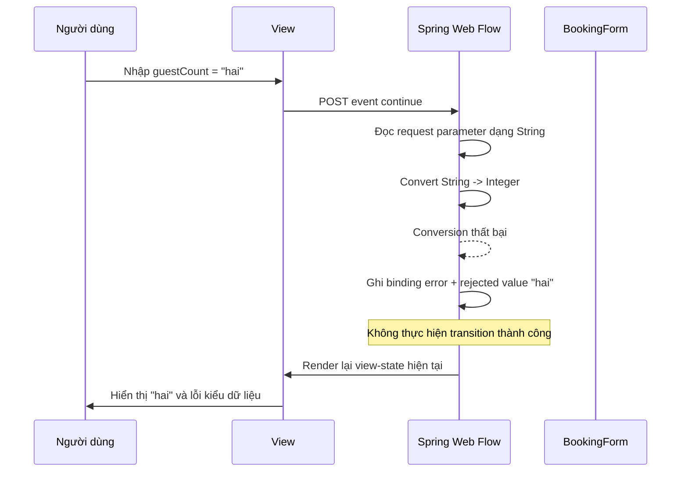

# Giữ giá trị người dùng đã nhập khi chuyển kiểu thất bại

## 1. Vấn đề: người dùng nhập đúng ý nhưng sai kiểu dữ liệu

Một form đặt phòng có trường **Số khách**. Model Java khai báo thuộc tính là `Integer` vì service cần một số nguyên:

```java
public class BookingForm {
    private Integer guestCount;

    public Integer getGuestCount() {
        return guestCount;
    }

    public void setGuestCount(Integer guestCount) {
        this.guestCount = guestCount;
    }
}
```

Người dùng nhập `hai` thay vì `2` rồi bấm **Tiếp tục**. Trình duyệt gửi form value dưới dạng chuỗi:

```text
guestCount=hai
```

Spring Web Flow phải chuyển chuỗi `hai` thành `Integer` trước khi gán vào `BookingForm.guestCount`. Phép chuyển đổi thất bại. Nếu view chỉ đọc lại `bookingForm.guestCount`, người dùng có thể thấy ô nhập trống hoặc giá trị cũ thay vì chữ `hai` mà họ vừa nhập.

Đây là trải nghiệm khó chịu: người dùng phải nhớ lại dữ liệu vừa gõ. Trong form nhiều trường, mất một giá trị sai kiểu có thể khiến họ phải nhập lại nhiều lần.

**Mục tiêu của bài:** hiểu cách Web Flow giữ lỗi binding, vì sao transition không được thực hiện khi chuyển kiểu thất bại, cách view hiển thị lại giá trị đã gửi và thông báo lỗi cạnh đúng trường. Sau bài học, bạn có thể xử lý trường số, ngày tháng, enum và kiểu dữ liệu tùy chỉnh.

## 2. Phân biệt giá trị model và giá trị người dùng vừa gửi

Trong quá trình binding, có hai giá trị cần phân biệt:

- **Giá trị trong model:** thuộc tính Java có kiểu đích, ví dụ `Integer guestCount`.
- **Giá trị bị từ chối (rejected value):** chuỗi người dùng gửi lên nhưng không thể chuyển sang kiểu đích, ví dụ `"hai"`.

Khi conversion thất bại, Spring không thể gán `"hai"` vào thuộc tính `Integer`. Giá trị model có thể vẫn là `null` hoặc giữ giá trị hợp lệ trước đó. Tuy vậy, binding error giữ thông tin về trường và giá trị bị từ chối để view có thể hiển thị lại.



Điểm quan trọng là **giá trị không chuyển đổi được không trở thành giá trị hợp lệ của model**. Web Flow giữ lỗi binding để người dùng sửa, còn view phải sử dụng cơ chế binding-aware để đọc rejected value khi render lại.

### 2.1. Vì sao không nên chỉ đọc thuộc tính Java?

Giả sử model đang có `guestCount = 3`. Người dùng sửa thành `hai`.

| Thành phần | Giá trị sau lần POST |
| --- | --- |
| Request parameter | Chuỗi `"hai"` |
| Model property `guestCount` | Vẫn là `3` nếu giá trị cũ chưa bị thay đổi |
| Binding error | `typeMismatch` cho trường `guestCount` |
| Rejected value | Chuỗi `"hai"` |
| Giá trị nên hiển thị lại trong ô nhập | `"hai"` |

Nếu view render trực tiếp `bookingForm.guestCount`, người dùng có thể thấy `3`, mặc dù họ vừa nhập `hai`. Giá trị trong model phản ánh dữ liệu có kiểu; rejected value phản ánh nội dung cần được sửa.

### 2.2. Conversion error khác validation error

Hai lỗi này thường cùng khiến form được render lại, nhưng xảy ra ở các giai đoạn khác nhau:

| Tình huống | Conversion | Validation |
| --- | --- | --- |
| Người dùng nhập | `hai` | `99` |
| Kiểu đích | `Integer` | `Integer` |
| Chuyển đổi | Thất bại | Thành công |
| Model nhận giá trị | Không gán được giá trị mới | Gán được `99` |
| Lỗi | `typeMismatch` | Ví dụ `Max` hoặc `guestCount.tooLarge` |
| Giá trị hiển thị lại | Rejected value `"hai"` | Giá trị model `99` |

Conversion kiểm tra chuỗi có thể biểu diễn thành kiểu đích hay không. Validation kiểm tra giá trị đã chuyển đổi có thỏa quy tắc nghiệp vụ hay không. Hãy xử lý hai trường hợp đúng giai đoạn.

## 3. Web Flow xử lý binding thất bại như thế nào?

Khi một `view-state` khai báo `model`, Web Flow thực hiện view-to-model binding khi nhận postback:

1. Đọc các request parameter được phép bind.
2. Chuyển chuỗi sang kiểu của thuộc tính model.
3. Gán các giá trị chuyển đổi thành công.
4. Ghi nhận lỗi nếu có trường không chuyển đổi được.
5. Chỉ tiếp tục validation và transition khi binding hoàn tất theo yêu cầu.

Nếu binding thất bại, Web Flow **không thực hiện transition sang state kế tiếp**. Nó render lại view-state hiện tại để người dùng sửa dữ liệu.

Ví dụ:

```xml
<view-state id="editBooking"
            view="booking/edit"
            model="bookingForm">
    <transition on="continue" to="reviewBooking" />
</view-state>
```

Nếu `guestCount=hai` không chuyển thành `Integer`, flow không đi tới `reviewBooking`. Người dùng ở lại `editBooking` và có thể nhập lại.

### 3.1. Model của view-state có thể nằm trong scope nào?

Model được chỉ định bằng thuộc tính `model` có thể là đối tượng truy cập được từ flow, chẳng hạn trong `flowScope` hoặc `viewScope`. Ví dụ:

```xml
<var name="bookingForm"
     class="com.example.booking.BookingForm" />

<view-state id="editBooking"
            view="booking/edit"
            model="bookingForm">
    <transition on="continue" to="reviewBooking" />
</view-state>
```

`bookingForm` được tạo cho flow execution. Binding error gắn với lần xử lý view hiện tại để Web Flow có thể render lại đúng form. Không tạo mới hoặc thay model trong mỗi lần render lỗi, nếu không dữ liệu hợp lệ đã nhập ở các trường khác có thể bị mất.

### 3.2. Binding xảy ra trước validation

Web Flow thực hiện binding trước khi gọi model validation. Khi một trường không chuyển đổi được, không có giá trị đúng kiểu để validator kiểm tra trường đó. Vì vậy, đừng viết validator để cố chuyển chuỗi `"hai"` thành số lần nữa nếu framework đã báo `typeMismatch`.

Validation phù hợp với những quy tắc như:

- Số khách phải lớn hơn 0.
- Số khách không vượt quá giới hạn phòng.
- Ngày trả phòng phải sau ngày nhận phòng.

Conversion phù hợp với việc chuyển `"2"` thành `Integer` hoặc `"2026-12-15"` thành `LocalDate` theo formatter đã đăng ký.

## 4. Khai báo model và binder rõ ràng

Một form nên dùng DTO chuyên biệt thay vì bind trực tiếp entity Hibernate/JPA. DTO chỉ chứa các trường người dùng được phép nhập:

```java
public class BookingForm {

    private Integer guestCount;
    private LocalDate checkIn;
    private LocalDate checkOut;

    public Integer getGuestCount() {
        return guestCount;
    }

    public void setGuestCount(Integer guestCount) {
        this.guestCount = guestCount;
    }

    public LocalDate getCheckIn() {
        return checkIn;
    }

    public void setCheckIn(LocalDate checkIn) {
        this.checkIn = checkIn;
    }

    public LocalDate getCheckOut() {
        return checkOut;
    }

    public void setCheckOut(LocalDate checkOut) {
        this.checkOut = checkOut;
    }
}
```

Flow XML:

```xml
<flow xmlns="http://www.springframework.org/schema/webflow"
      xmlns:xsi="http://www.w3.org/2001/XMLSchema-instance"
      xsi:schemaLocation="
          http://www.springframework.org/schema/webflow
          https://www.springframework.org/schema/webflow/spring-webflow.xsd">

    <var name="bookingForm"
         class="com.example.booking.BookingForm" />

    <view-state id="editBooking"
                view="booking/edit"
                model="bookingForm">
        <binder>
            <binding property="guestCount" required="true" />
            <binding property="checkIn" required="true" />
            <binding property="checkOut" required="true" />
        </binder>

        <transition on="continue" to="reviewBooking" />
        <transition on="cancel" to="cancelled"
                    bind="false" validate="false" />
    </view-state>

    <view-state id="reviewBooking" view="booking/review">
        <transition on="confirm" to="completed" />
        <transition on="revise" to="editBooking" />
    </view-state>

    <end-state id="completed" />
    <end-state id="cancelled" />
</flow>
```

Ở đây:

- `model="bookingForm"` bật binding và validation cho view-state.
- `<binder>` giới hạn các thuộc tính được phép bind.
- `required="true"` tạo lỗi nếu trường bắt buộc bị bỏ trống.
- Event `continue` chỉ đi tới `reviewBooking` sau khi binding thành công.
- Event `cancel` dùng `bind="false"` và `validate="false"` vì người dùng có thể muốn hủy mà không cần sửa dữ liệu đang lỗi.

Khi không khai báo `<binder>`, mặc định các public property của model có thể đủ điều kiện binding. Với form chứa dữ liệu nhạy cảm hoặc domain object, đây là rủi ro mass assignment. Hãy khai báo rõ các field được phép bind.

## 5. Render lại rejected value trong JSP

Với Spring MVC/JSP view integration, Spring cung cấp form tag library có khả năng liên kết với form-backing object và binding errors. Dùng `<form:input>` để render trường và `<form:errors>` để hiển thị lỗi tương ứng.

```jsp
<%@ taglib prefix="form" uri="http://www.springframework.org/tags/form" %>

<h1>Thông tin đặt phòng</h1>

<form:form modelAttribute="bookingForm"
           method="post"
           action="${flowExecutionUrl}">

    <div class="field">
        <form:label path="guestCount">Số khách</form:label>
        <form:input path="guestCount"
                    id="guestCount"
                    type="text" />
        <form:errors path="guestCount"
                     cssClass="field-error" />
    </div>

    <div class="field">
        <form:label path="checkIn">Ngày nhận phòng</form:label>
        <form:input path="checkIn"
                    id="checkIn"
                    type="text" />
        <form:errors path="checkIn"
                     cssClass="field-error" />
    </div>

    <button type="submit"
            name="_eventId_continue"
            value="continue">
        Tiếp tục
    </button>

    <button type="submit"
            name="_eventId_cancel"
            value="cancel">
        Hủy
    </button>
</form:form>
```

Khi conversion của `guestCount` thất bại, binding-aware view phải ưu tiên rejected value của trường thay vì chỉ đọc thuộc tính `bookingForm.guestCount`. Nhờ vậy, chuỗi người dùng vừa nhập có thể xuất hiện lại trong ô và lỗi được hiển thị ngay bên dưới.

### 5.1. Cách render dễ làm mất giá trị vừa nhập

Đoạn HTML tự dựng sau đây chỉ đọc giá trị trong model:

```jsp
<input type="text"
       name="guestCount"
       value="${bookingForm.guestCount}" />
```

Nếu model vẫn chứa `3` nhưng rejected value là `"hai"`, đoạn trên có thể render `3`. Người dùng không thấy chuỗi sai kiểu mà họ cần sửa.

Đây chỉ là ví dụ về cách đọc trực tiếp model property, không phải mẫu render an toàn để dùng trong production. Nếu buộc phải tự dựng HTML, view integration phải cung cấp binding status/rejected value cho trường đó. Không tự lấy giá trị từ model rồi giả định nó luôn phản ánh nội dung cuối cùng của request. Cũng phải HTML-escape rejected value trước khi đưa vào thuộc tính `value`.

### 5.2. Không dùng lại dữ liệu nhạy cảm

Không nên tự động đưa lại các giá trị như mật khẩu, mã xác thực một lần, token thanh toán hoặc dữ liệu bí mật vào form sau lỗi. Với những trường này, hãy render rỗng hoặc theo chính sách bảo mật riêng, dù các trường thông thường vẫn giữ rejected value.

## 6. Hiển thị thông báo conversion error

Spring Web Flow tự tạo message cho một số lỗi binding, trong đó có lỗi chuyển kiểu. Với trường `checkIn` của model `Booking`, error code phổ biến là `typeMismatch`.

Web Flow thử tìm message theo key cụ thể gồm:

```text
<tên model viết thường>.<tên thuộc tính>.typeMismatch
```

Ví dụ với model `Booking`:

```properties
booking.checkinDate.typeMismatch=Ngày nhận phòng phải theo định dạng yyyy-MM-dd.
typeMismatch=Trường {0} có định dạng không hợp lệ.
```

Với model `BookingForm` và thuộc tính `guestCount`, key cụ thể thường là:

```properties
bookingForm.guestCount.typeMismatch=Hãy nhập số khách bằng chữ số, ví dụ 2.
typeMismatch=Giá trị của trường {0} không đúng kiểu dữ liệu.
```

Nếu không tìm thấy key cụ thể, Web Flow thử key tổng quát `typeMismatch`. Field name được truyền làm message argument để thông báo tổng quát có thể chỉ rõ trường bị lỗi.

### 6.1. Message bundle theo flow

Có thể đặt `messages.properties` cùng thư mục flow definition:

```text
booking/
├── booking-flow.xml
├── messages.properties
└── booking/
    └── edit.jsp
```

Ví dụ `messages.properties`:

```properties
bookingForm.guestCount.typeMismatch=Vui lòng nhập số khách bằng chữ số.
bookingForm.checkIn.typeMismatch=Ngày nhận phòng không đúng định dạng yyyy-MM-dd.
typeMismatch=Giá trị trường {0} không đúng định dạng.
```

Nếu ứng dụng hỗ trợ nhiều ngôn ngữ, tạo bundle theo locale, chẳng hạn `messages_vi.properties` và `messages_en.properties`. Đừng để lộ exception nội bộ hoặc tên class Java trong thông báo dành cho người dùng.

### 6.2. Phân biệt lỗi trường và lỗi toàn form

`typeMismatch` thường gắn với một thuộc tính. Hãy đặt `<form:errors path="guestCount"/>` cạnh input tương ứng. Có thể thêm vùng hiển thị lỗi tổng quát ở đầu form nếu muốn người dùng dễ nhận ra form cần sửa.

Không nên chỉ hiển thị một dòng “Dữ liệu không hợp lệ” ở đầu trang mà không đánh dấu trường nào cần sửa. Với form dài, người dùng cần biết chính xác vị trí lỗi.

## 7. Cấu hình Converter và Formatter nhất quán

Web Flow dùng hệ thống type conversion và formatting của Spring cho hầu hết nhu cầu chuyển kiểu. Điều này cho phép ứng dụng dùng cùng quy tắc chuyển đổi giữa Spring MVC và Web Flow nếu hai bên được cấu hình dùng chung `FormattingConversionService`.

### 7.1. Phân biệt Converter và Formatter

| Thành phần | Vai trò | Ví dụ |
| --- | --- | --- |
| `Converter<S,T>` | Chuyển một kiểu đối tượng sang kiểu khác | `String` thành `Integer` |
| `Formatter<T>` | Parse chuỗi theo locale và in đối tượng thành chuỗi | `LocalDate` thành chuỗi ngày hiển thị |
| `ConversionService` | Đăng ký và thực thi converter/formatter | Dùng khi Web Flow bind request vào model |

Với dữ liệu người dùng nhập, `Formatter` thường phù hợp nếu quy tắc phụ thuộc locale, ví dụ dấu thập phân hoặc cách viết ngày tháng.

### 7.2. Ví dụ Formatter cho số khách

Formatter nên từ chối dữ liệu không hợp lệ bằng exception chuyển đổi, thay vì âm thầm trả về `0` hoặc một giá trị mặc định:

```java
public class GuestCountFormatter implements Formatter<Integer> {

    @Override
    public Integer parse(String text, Locale locale)
            throws ParseException {
        String value = text == null ? "" : text.trim();

        if (!value.matches("[0-9]{1,2}")) {
            throw new ParseException(
                "Guest count must contain one or two digits",
                0
            );
        }

        return Integer.valueOf(value);
    }

    @Override
    public String print(Integer value, Locale locale) {
        return value == null ? "" : value.toString();
    }
}
```

Khi người dùng nhập `hai`, `parse` ném `ParseException`; Web Flow ghi nhận lỗi chuyển đổi và render lại view. Khi người dùng nhập `2`, formatter trả về `Integer.valueOf(2)`.

Formatter được đăng ký dùng chung nên cần stateless hoặc thread-safe. Không giữ dữ liệu riêng của một request trong field của formatter.

### 7.3. Dùng chung FormattingConversionService

Trong Spring MVC, `mvc:annotation-driven` có thể nhận `conversion-service` tùy chỉnh. Web Flow cũng cần được nối với cùng conversion service thông qua `flow-builder-services`.

Ví dụ cấu hình rút gọn:

```xml
<mvc:annotation-driven
    conversion-service="applicationConversionService" />

<bean id="applicationConversionService"
      class="com.example.config.ApplicationConversionServiceFactoryBean" />

<bean id="defaultConversionService"
      class="org.springframework.binding.convert.service.DefaultConversionService">
    <constructor-arg ref="applicationConversionService" />
</bean>

<webflow:flow-builder-services
    id="flowBuilderServices"
    conversion-service="defaultConversionService" />

<webflow:flow-registry
    id="flowRegistry"
    flow-builder-services="flowBuilderServices">
    <!-- Khai báo flow locations tại đây. -->
</webflow:flow-registry>
```

`ApplicationConversionServiceFactoryBean` có thể kế thừa `FormattingConversionServiceFactoryBean` và đăng ký formatter trong `installFormatters`:

```java
public class ApplicationConversionServiceFactoryBean
        extends FormattingConversionServiceFactoryBean {

    @Override
    protected void installFormatters(FormatterRegistry registry) {
        registry.addFormatter(new GuestCountFormatter());
        // Đăng ký các formatter dùng chung khác.
    }
}
```

Tên class và cách cấu hình cụ thể cần khớp phiên bản Spring/Web Flow đang dùng. Ý tưởng quan trọng là **Spring MVC và Web Flow dùng chung quy tắc parse/print**, tránh một màn hình chấp nhận giá trị nhưng flow lại từ chối vì hai conversion service khác nhau.

### 7.4. Định dạng ngày tháng

Không nên giả định mọi phiên bản Spring đều tự chọn cùng một định dạng ngày. Hãy đăng ký formatter phù hợp với định dạng giao diện, ví dụ `dd/MM/yyyy`, và dùng cùng formatter khi in lại giá trị.

Nếu người dùng nhập ngày không đúng định dạng, giữ rejected value như `31/02/2026` để họ sửa. Đừng tự đổi thành ngày mặc định hoặc thay bằng ngày hiện tại vì điều đó che giấu lỗi nhập.

## 8. Khi nào nên giữ trường nhập dưới dạng String?

Không phải lúc nào cũng cần chuyển request value sang kiểu số/ngày ngay lập tức. Nếu dữ liệu có quy tắc nhập phức tạp hoặc cần giữ nguyên cách viết để người dùng sửa, DTO có thể giữ trường dưới dạng `String`:

```java
public class PaymentForm {

    private String amountText;

    public String getAmountText() {
        return amountText;
    }

    public void setAmountText(String amountText) {
        this.amountText = amountText;
    }
}
```

Sau đó một validator hoặc service chuyên biệt parse `amountText` theo locale, kiểm tra định dạng và tạo giá trị tiền tệ có kiểu. Cách này hữu ích khi:

- Người dùng có thể nhập dấu phân cách hàng nghìn/thập phân theo locale.
- Muốn giữ các ký tự trung gian trong form.
- Cần báo lỗi theo quy tắc riêng thay vì lỗi `typeMismatch` mặc định.

Đổi lại, code phải kiểm tra và parse trước khi dùng giá trị. Không truyền chuỗi chưa được xác thực vào phép tính hoặc ghi database.

Với trường số nguyên đơn giản như số khách, dùng `Integer` và conversion service thường dễ quản lý hơn. Chọn `String` khi định dạng nhập là một phần quan trọng của trải nghiệm và cần được xử lý có chủ đích.

## 9. Validation không nên xóa dấu vết conversion error

Web Flow cho phép tắt model validation trên một transition bằng `validate="false"`. Thuộc tính này **không tắt binding**. Nếu người dùng nhập `hai` vào trường `Integer`, conversion vẫn thất bại và flow vẫn không thể đi tiếp.

Ví dụ:

```xml
<transition on="continue"
            to="reviewBooking"
            validate="false" />
```

Ở đây validation bị bỏ qua, nhưng view-to-model binding vẫn diễn ra. Đây không phải cách sửa lỗi conversion.

Nếu đặt `bind="false"`, Web Flow bỏ qua cả binding và validation cho event đó. Cách này phù hợp với Cancel hoặc Back khi không muốn xử lý các trường đang lỗi:

```xml
<transition on="cancel"
            to="cancelled"
            bind="false"
            validate="false" />
```

Không đặt `bind="false"` lên nút Continue/Save nếu mục tiêu là nhận dữ liệu người dùng. Khi binding bị tắt, giá trị mới không được đưa vào model và binding error cũng không được tạo.

## 10. Những lỗi thiết kế khiến giá trị bị mất

### 10.1. Tạo mới model trong mỗi lần render

Không khởi tạo lại `BookingForm` trong `on-render` mỗi lần view xuất hiện. `on-render` chạy cả lần đầu và các lần render tiếp theo; nếu factory tạo object mới, dữ liệu hợp lệ đã nhập trước đó có thể bị ghi đè.

Hãy tạo form khi flow bắt đầu hoặc khi vào state lần đầu, sau đó giữ object trong scope phù hợp.

### 10.2. Ghi giá trị mặc định khi conversion thất bại

Một converter tự bắt lỗi rồi trả `0`, `null` hoặc một giá trị mặc định có thể khiến framework tưởng conversion thành công. Khi đó rejected value và lỗi `typeMismatch` không còn được giữ theo cách mong muốn.

Hãy để conversion thất bại bằng exception phù hợp; xử lý thông báo ở message bundle hoặc validator theo đúng loại lỗi.

### 10.3. Render trực tiếp thuộc tính model

HTML tự dựng lấy `bookingForm.guestCount` có thể hiển thị giá trị cũ. Dùng binding-aware component hoặc view integration cung cấp rejected value và error state.

### 10.4. Chỉ hiển thị lỗi chung

Thông báo ở đầu trang không thay thế lỗi gắn với field. Dùng field-specific error để người dùng tìm đúng vị trí cần sửa.

### 10.5. Converter khác nhau giữa MVC và Web Flow

Spring MVC chấp nhận định dạng `1.234,50` nhưng Web Flow chỉ chấp nhận `1234.50` nếu hai conversion service không dùng cùng formatter. Đăng ký chung quy tắc chuyển đổi hoặc kiểm thử riêng hai đường request.

### 10.6. Bind trực tiếp domain entity

Nếu model là entity có nhiều thuộc tính, người dùng có thể gửi thêm field không nằm trên form. Khai báo `<binder>` giới hạn property được phép bind và ưu tiên DTO riêng cho form.

## 11. Kiểm thử giá trị bị từ chối

Một test tốt cần xác minh cả ba điều:

1. Flow không chuyển state khi conversion thất bại.
2. Binding error được ghi đúng field và có thông báo phù hợp.
3. View render lại đúng chuỗi người dùng đã gửi.

### 11.1. Ma trận kiểm thử

| Input `guestCount` | Conversion | State sau POST | Giá trị hiển thị lại |
| --- | --- | --- | --- |
| `2` | Thành công | `reviewBooking` | `2` |
| `hai` | `typeMismatch` | `editBooking` | `hai` |
| `2.5` | `typeMismatch` với Integer | `editBooking` | `2.5` |
| Chuỗi rỗng | Required/binding error theo cấu hình | `editBooking` | Ô trống và lỗi phù hợp |
| `99` | Thành công | Ở lại nếu validator giới hạn số khách | `99` và lỗi nghiệp vụ |

### 11.2. Pseudocode kiểm thử flow

```text
launchFlow("booking")
assertCurrentState("editBooking")

submitEvent("continue", {
    guestCount: "hai"
})

assertCurrentState("editBooking")
assertFieldError("guestCount", "typeMismatch")
assertRenderedFieldValue("guestCount", "hai")
assertNotInvoked(bookingService, "confirm")

submitEvent("continue", {
    guestCount: "2"
})

assertCurrentState("reviewBooking")
assertModelValue("bookingForm.guestCount", 2)
```

Đây là pseudocode mô tả mục tiêu test, không phải API có thể chạy nguyên văn. Dùng flow test support phù hợp phiên bản SWF để phát event và kiểm tra active state/message; dùng HTTP integration test để kiểm tra HTML được render.

### 11.3. Kiểm thử qua HTTP và trình duyệt

Với MockMvc hoặc browser automation:

- Giữ cùng HTTP session và continuation URL qua các request.
- Gửi POST chứa `guestCount=hai`.
- Xác nhận response render lại form thay vì redirect sang review.
- Kiểm tra HTML input vẫn chứa `hai`.
- Kiểm tra lỗi nằm cạnh trường `guestCount`.
- Sửa thành `2`, submit lại và xác nhận flow chuyển tiếp.

Không chỉ assert status 200. Một response 200 vẫn có thể render sai giá trị nếu view đọc model property thay vì rejected value.

### 11.4. Kiểm thử formatter theo locale

Nếu có formatter theo locale, chạy test với từng locale được hỗ trợ:

| Locale | Chuỗi đầu vào | Kỳ vọng |
| --- | --- | --- |
| `vi-VN` | `2` | Parse thành 2 |
| `en-US` | `2` | Parse thành 2 |
| `vi-VN` | Chuỗi ngày theo `dd/MM/yyyy` | Parse theo định dạng đã đăng ký |
| `en-US` | Chuỗi ngày theo `MM/dd/yyyy` | Parse theo định dạng đã đăng ký cho locale |
| Locale bất kỳ | Chuỗi không hợp lệ | Rejected value được giữ và có lỗi |

Đừng chỉ kiểm thử `parse`. Cần kiểm thử cả `print` vì view có thể dùng formatter để hiển thị lại giá trị model hợp lệ sau khi người dùng sửa.

## 12. Bảo mật khi hiển thị lại dữ liệu

Rejected value là dữ liệu không đáng tin vì đến từ request. Khi hiển thị lại:

- Dùng tag/component có HTML escaping.
- Không chèn raw input vào HTML hoặc JavaScript.
- Giới hạn độ dài input và số lượng phần tử collection.
- Không echo password, OTP, token hoặc dữ liệu bí mật.
- Giới hạn property được bind bằng `<binder>`.
- Không coi việc conversion thành công là bằng chứng dữ liệu hợp lệ về nghiệp vụ.

Nếu người dùng nhập `<script>` vào một trường chuỗi, view phải hiển thị chuỗi đó dưới dạng text đã escape. Binding-aware không có nghĩa là tự động an toàn trong mọi ngữ cảnh; hãy kiểm tra cách view technology encode output.

## 13. Quy trình chẩn đoán khi giá trị biến mất

Khi người dùng báo “Tôi nhập rồi nhưng sau lỗi thì ô bị xóa”, kiểm tra theo thứ tự:

1. `view-state` có khai báo đúng `model` không?
2. Thuộc tính trong `<binder>` có đúng tên và được phép bind không?
3. Request có gửi đúng parameter name không?
4. Conversion service có ghi nhận lỗi hay converter đã âm thầm trả giá trị mặc định?
5. Flow có ở lại view-state sau lỗi binding không?
6. Model có bị tạo mới hoặc ghi đè trong `on-render` không?
7. View có dùng binding-aware field component để lấy rejected value không?
8. Error message có được map đúng từ `typeMismatch` không?
9. Có JavaScript nào reset input sau khi response được render không?
10. Nếu là Ajax, client có thay fragment chứa input bằng HTML mới nhất không?

Log nên ghi field name, error code và correlation ID. Không ghi toàn bộ dữ liệu người dùng nhập nếu trường đó có thể chứa thông tin nhạy cảm.

## 14. Bài tập thực hành

### Bài 1 — Dự đoán giá trị được render

Model có `Integer guestCount = 3`. Người dùng nhập `hai` rồi submit. Binding thất bại.

**Câu hỏi:** nếu view đọc trực tiếp `bookingForm.guestCount`, nó có thể hiển thị gì? Giá trị nào cần được ưu tiên để người dùng sửa?

**Đáp án:** model có thể vẫn là `3`; view cần hiển thị rejected value `hai` cùng lỗi `typeMismatch`.

### Bài 2 — Phân biệt conversion và validation

Người dùng nhập `99` vào trường `Integer`, nhưng quy tắc nghiệp vụ chỉ cho phép từ 1 đến 8.

**Đáp án:** conversion thành công, sau đó validation báo lỗi giới hạn. Model chứa `99`, nên view có thể render lại `99` từ model cùng thông báo validation.

### Bài 3 — Message key

Model có class `BookingForm`, thuộc tính `guestCount`, conversion error là `typeMismatch`.

**Gợi ý:** thêm key cụ thể:

```properties
bookingForm.guestCount.typeMismatch=Hãy nhập số khách bằng chữ số.
```

Có thể thêm key tổng quát `typeMismatch` làm fallback.

### Bài 4 — Vì sao Cancel vẫn hoạt động khi form sai?

Form có trường ngày bị sai định dạng. Người dùng muốn hủy thay vì sửa.

**Gợi ý:** khai báo transition Cancel với `bind="false"` và `validate="false"` để không bắt buộc xử lý dữ liệu đang lỗi trước khi kết thúc nhánh hủy.

### Bài 5 — Chọn String hay Integer?

Một trường tiền cho phép nhập `1.250,50` ở locale Việt Nam và `1,250.50` ở locale Hoa Kỳ.

**Gợi ý:** có thể dùng `BigDecimal` cùng formatter theo locale; hoặc giữ chuỗi trong form DTO rồi parse có chủ đích. Không tự thay dấu phân cách bằng chuỗi thủ công mà không xác định locale.

### Bài 6 — Tìm nguyên nhân mất giá trị

Sau mỗi lần submit, `on-render` gọi factory tạo `BookingForm` mới và gán vào `flowScope.bookingForm`.

**Đáp án:** model bị thay mới khi render lại, nên dữ liệu đã nhập và binding context có thể mất. Chỉ tạo form khi bắt đầu flow hoặc khi thực sự cần reset; không khởi tạo lại ở mỗi lần render lỗi.

## 15. Tiêu chí hoàn thành

- [ ] Phân biệt model property với rejected value.
- [ ] Giải thích được vì sao conversion thất bại khiến Web Flow ở lại view-state.
- [ ] Dùng binding-aware input để render lại giá trị người dùng vừa nhập.
- [ ] Hiển thị lỗi `typeMismatch` cạnh đúng field.
- [ ] Cấu hình message bundle cụ thể và fallback.
- [ ] Biết đăng ký Converter/Formatter phù hợp và chia sẻ conversion service.
- [ ] Phân biệt conversion error với validation error.
- [ ] Biết tác dụng của `bind="false"` và `validate="false"`.
- [ ] Giới hạn property được bind và escape dữ liệu khi render.
- [ ] Có test xác nhận state, error, rejected value và lần submit hợp lệ tiếp theo.

## 16. Ghi nhớ

- Request parameter là chuỗi; Web Flow phải chuyển chuỗi sang kiểu thuộc tính model trước khi gán.
- Khi conversion thất bại, model property không nhận được chuỗi sai kiểu. Binding error giữ rejected value để view có thể hiển thị lại.
- Nếu model binding thất bại, Web Flow không thực hiện transition; view-state hiện tại được render lại để người dùng sửa.
- Dùng binding-aware field component; đọc trực tiếp model property có thể hiển thị giá trị cũ thay vì dữ liệu vừa nhập.
- `typeMismatch` là error code phổ biến cho lỗi chuyển kiểu. Có thể tùy biến message theo `<model>.<field>.typeMismatch` và dùng `typeMismatch` làm fallback.
- Spring Web Flow dùng Spring type conversion/formatting; chia sẻ formatter giữa Spring MVC và Web Flow giúp quy tắc nhập liệu nhất quán.
- Conversion error xảy ra trước validation. Dùng validation cho giá trị đã chuyển đổi nhưng vi phạm quy tắc nghiệp vụ.
- `validate="false"` tắt validation nhưng vẫn binding; `bind="false"` tắt cả binding và validation cho event như Cancel.
- Dùng DTO và `<binder>` để giới hạn field; escape rejected value khi render và không echo dữ liệu bí mật.

## Tài liệu tham khảo

- [Spring Web Flow 3.0 Reference Guide — Binding to a Model](https://docs.spring.io/spring-webflow/docs/3.0.0/reference/)
- [Spring Web Flow 3.0 Reference Guide — Performing Type Conversion](https://docs.spring.io/spring-webflow/docs/3.0.0/reference/)
- [Spring Web Flow 3.0 Reference Guide — Understanding System-generated Messages](https://docs.spring.io/spring-webflow/docs/3.0.0/reference/)
- [Spring Framework Reference — Data Binding](https://docs.spring.io/spring-framework/reference/core/validation/data-binding.html)
- [Spring Framework Reference — JSP and Form Tags](https://docs.spring.io/spring-framework/reference/web/webmvc-view/mvc-jsp.html)
