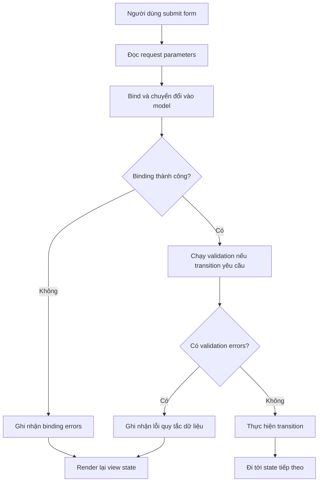

# Phân biệt lỗi binding với lỗi kiểm tra quy tắc dữ liệu

## Bối cảnh và mục tiêu

Bài học thuộc chương **Liên kết biểu mẫu** của module `SPRING_WEB_FLOW`. Spring Web Flow mô hình hóa hành trình web nhiều bước bằng state, event, transition và subflow. Trong mỗi view state, dữ liệu người dùng gửi lên phải được chuyển thành thuộc tính của model trước khi ứng dụng có thể kiểm tra các quy tắc nghiệp vụ. Hai công việc này có liên quan nhưng khác nhau: **binding** chuyển dữ liệu đầu vào thành giá trị có kiểu; **validation** đánh giá xem các giá trị đó có hợp lệ theo yêu cầu của ứng dụng hay không.

Nếu không phân biệt hai loại lỗi, nhóm phát triển dễ viết validator để xử lý một giá trị chưa chuyển đổi được, hiển thị thông báo sai chỗ hoặc cho phép flow chuyển state dù dữ liệu chưa đáp ứng điều kiện nghiệp vụ. Bài học này đặt hai loại lỗi vào đúng thứ tự trong vòng đời xử lý form của Spring Web Flow.

Sau bài học, bạn có thể:

- Giải thích quá trình bind request parameter vào model của view state.
- Nhận diện lỗi chuyển đổi/ghi thuộc tính và lỗi quy tắc dữ liệu.
- Thiết kế thông báo lỗi gắn đúng field và đúng nguyên nhân.
- Cấu hình binder, validator và transition để flow chỉ đi tiếp khi dữ liệu hợp lệ.
- Kiểm thử riêng binding, validation và các trường hợp kết hợp cả hai.

## 1. Binding và validation giải quyết hai câu hỏi khác nhau

Khi người dùng gửi form, ứng dụng cần trả lời hai câu hỏi theo thứ tự:

1. **Binding:** Giá trị nhận được có thể chuyển thành kiểu dữ liệu mà model yêu cầu và ghi vào thuộc tính tương ứng hay không?
2. **Validation:** Sau khi có các giá trị đã bind, chúng có đáp ứng quy tắc của màn hình và nghiệp vụ hay không?

Binding quan tâm đến việc chuyển dữ liệu từ dạng truyền qua HTTP (thường là chuỗi) sang kiểu Java, tìm đúng thuộc tính và ghi giá trị. Validation quan tâm đến ý nghĩa của giá trị: số lượng có nằm trong giới hạn cho phép không, ngày kết thúc có sau ngày bắt đầu không, hoặc người dùng có đủ điều kiện thực hiện hành động không.

Ví dụ một form đặt phòng có các trường:

- `numberOfGuests`: số khách, kiểu `Integer`.
- `checkIn`: ngày nhận phòng, kiểu `LocalDate`.
- `checkOut`: ngày trả phòng, kiểu `LocalDate`.

Các tình huống sau cho thấy ranh giới giữa hai loại lỗi:

| Dữ liệu gửi lên | Kết quả binding | Kết quả validation |
| --- | --- | --- |
| `numberOfGuests=abc` | Lỗi: chuỗi `abc` không chuyển được thành `Integer` | Không thể đánh giá quy tắc số khách trên giá trị chưa chuyển đổi thành công |
| `numberOfGuests=0` | Thành công: giá trị trở thành số nguyên 0 | Lỗi: số khách phải lớn hơn 0 |
| `checkIn=2026-12-20`, `checkOut=2026-12-18` | Thành công: cả hai ngày đều chuyển được | Lỗi: ngày trả phòng phải sau ngày nhận phòng |
| `numberOfGuests=2`, các ngày hợp lệ | Thành công | Thành công nếu các quy tắc khác cũng đạt |
| `checkIn=ngaymai` | Lỗi: chuỗi không chuyển được thành ngày theo định dạng được hỗ trợ | Không thể kiểm tra thứ tự ngày khi ngày nhận phòng chưa có giá trị hợp lệ |

Một giá trị có thể bind thành công nhưng vẫn không hợp lệ về nghiệp vụ. Ngược lại, nếu binding thất bại thì validator không nên cố diễn giải chuỗi đầu vào như thể model đã nhận được một giá trị có kiểu đúng.

## 2. Binding diễn ra như thế nào trong Spring Web Flow?

Một view state có thể chỉ định model dùng để nhận dữ liệu form. Khi event submit được gửi, Spring Web Flow lấy các tham số request, áp dụng quy tắc binding và chuyển đổi, rồi ghi giá trị vào các thuộc tính được cho phép của model.

Ví dụ, flow dùng model `booking` trong view state:

```xml
<view-state id="enterBookingDetails" model="booking">
    <binder>
        <binding property="numberOfGuests"/>
        <binding property="checkIn"/>
        <binding property="checkOut"/>
    </binder>

    <transition on="submit" to="review" validate="true"/>
</view-state>
```

Phần `binder` khai báo những thuộc tính mà form được phép bind. Đây là nơi kiểm soát phạm vi dữ liệu có thể ghi vào model. Với form thực tế, chỉ nên mở những thuộc tính mà người dùng được phép thay đổi; không đưa các thuộc tính như giá đã tính, trạng thái thanh toán, quyền sở hữu hoặc cờ phê duyệt vào danh sách bind chỉ vì chúng có mặt trong object.

Model Java có thể có cấu trúc như sau:

```java
public class Booking {
    private Integer numberOfGuests;
    private LocalDate checkIn;
    private LocalDate checkOut;

    // getters và setters
}
```

Giá trị HTTP thường đến dưới dạng chuỗi. ConversionService hoặc cơ chế chuyển đổi được cấu hình cho ứng dụng sẽ chuyển chuỗi thành kiểu thuộc tính. Ví dụ:

- `"3"` có thể chuyển thành `Integer.valueOf(3)`.
- `"2026-12-20"` có thể chuyển thành `LocalDate` nếu bộ chuyển đổi/formatter hỗ trợ định dạng đó.
- `"ba"` không thể chuyển thành số nguyên.
- `"20-13-2026"` không phải ngày hợp lệ theo định dạng ngày được cấu hình.

Khi không thể chuyển đổi hoặc ghi giá trị, binding tạo ra lỗi gắn với thuộc tính. Giá trị model có thể vẫn giữ giá trị cũ hoặc giá trị mặc định; không được coi giá trị đó là dữ liệu người dùng vừa gửi thành công.

### Giới hạn thuộc tính được bind

Binder giúp kiểm soát dữ liệu form đi vào model. Nếu model có nhiều thuộc tính hơn số trường trên giao diện, hãy khai báo rõ các thuộc tính được phép nhận dữ liệu. Việc chỉ ẩn một input ở giao diện không bảo vệ được thuộc tính phía server: người dùng có thể tự gửi thêm tham số HTTP.

Với dữ liệu lồng nhau, collection hoặc object con, cần xem xét đường dẫn thuộc tính nào được phép bind, giới hạn kích thước collection và các trường hợp index bất thường. Không để form ghi trực tiếp vào cấu trúc object nhạy cảm mà không có kiểm soát.

### Binding error thường gặp

| Nguyên nhân | Ví dụ | Cách xử lý |
| --- | --- | --- |
| Sai kiểu dữ liệu | Gửi `abc` cho thuộc tính số nguyên | Hiển thị thông báo yêu cầu nhập số; giữ nguyên trạng thái form phù hợp để người dùng sửa |
| Sai định dạng | Gửi ngày không khớp formatter | Thông báo định dạng ngày được chấp nhận |
| Giá trị vượt giới hạn chuyển đổi | Số quá lớn so với kiểu đích | Thông báo giá trị nằm ngoài phạm vi có thể nhận |
| Thiếu trường được đánh dấu bắt buộc trong binder | Request không có một parameter bắt buộc theo cấu hình binding | Kiểm tra tên input và gửi đủ trường |
| Không thể ghi thuộc tính | Setter hoặc đường dẫn thuộc tính không dùng được | Sửa model/binder và kiểm tra lỗi cấu hình |

Một giá trị rỗng không phải lúc nào cũng là binding error. Tùy kiểu đích và converter, chuỗi rỗng có thể được chuyển thành `null`, chuỗi rỗng hoặc một giá trị khác. Nếu chuyển đổi thành công thành `null`, quy tắc “không được để trống” thường thuộc validation. Nếu binder đánh dấu trường là bắt buộc và parameter không có mặt, đó có thể là lỗi ở giai đoạn binding. Hãy kiểm tra cấu hình và kiểu đích thay vì gộp mọi trường hợp rỗng vào một nguyên nhân.

## 3. Validation kiểm tra giá trị đã bind

Sau khi binding tạo ra model có kiểu dữ liệu phù hợp, validation kiểm tra các quy tắc của ứng dụng. Các quy tắc thường gồm:

- Trường bắt buộc phải có giá trị.
- Số lượng phải nằm trong giới hạn cho phép.
- Ngày bắt đầu không được ở quá khứ.
- Ngày trả phòng phải sau ngày nhận phòng.
- Hai trường xác nhận phải khớp nhau.
- Người dùng phải có quyền hoặc thỏa điều kiện nghiệp vụ để tiếp tục.

Một số quy tắc chỉ kiểm tra một field; các quy tắc khác cần so sánh nhiều field hoặc gọi dịch vụ nghiệp vụ. Ví dụ, `numberOfGuests=0` là giá trị số nguyên hợp lệ về mặt kiểu, nhưng không hợp lệ đối với quy tắc đặt phòng.

### Validation trong view state

Spring Web Flow hỗ trợ kích hoạt validation khi xử lý transition của view state. Có thể đặt rõ `validate="true"` trên transition submit để yêu cầu kiểm tra model trước khi chuyển tới state kế tiếp.

Một cách triển khai phổ biến là đặt phương thức validation theo quy ước tên view state trên model. Ví dụ với state `enterBookingDetails`, phương thức có thể là `validateEnterBookingDetails` và nhận `ValidationContext`:

```java
public void validateEnterBookingDetails(ValidationContext context) {
    MessageContext messages = context.getMessageContext();

    if (numberOfGuests == null || numberOfGuests < 1) {
        messages.addMessage(
            new MessageBuilder()
                .error()
                .source("numberOfGuests")
                .code("booking.guests.minimum")
                .defaultText("Số khách phải lớn hơn hoặc bằng 1.")
                .build()
        );
    }

    if (checkIn != null && checkOut != null
            && !checkOut.isAfter(checkIn)) {
        messages.addMessage(
            new MessageBuilder()
                .error()
                .source("checkOut")
                .code("booking.dateOrder")
                .defaultText("Ngày trả phòng phải sau ngày nhận phòng.")
                .build()
        );
    }
}
```

Ví dụ minh họa cách thêm lỗi vào `MessageContext` bằng `MessageBuilder`. Trong dự án, cần đặt phương thức ở đúng model/bean theo cơ chế validation đang dùng, kiểm tra quy ước tên của view state và bảo đảm validator được gọi khi transition submit được xử lý.

Nếu dự án dùng Spring `Validator`, Bean Validation hoặc validator riêng, hãy cấu hình việc tích hợp rõ ràng. Các annotation như `@NotNull`, `@Min` hoặc `@Size` chỉ có tác dụng khi có cơ chế validation thực sự được gọi; chỉ khai báo annotation trên model không đảm bảo mọi form submit đều tự động được kiểm tra.

### Validation error thường gặp

| Quy tắc | Giá trị đã bind | Lỗi |
| --- | --- | --- |
| Số khách tối thiểu là 1 | `0` | Số khách phải lớn hơn hoặc bằng 1 |
| Số khách tối đa là 8 | `12` | Mỗi đặt phòng chỉ được tối đa 8 khách |
| Ngày trả phòng phải sau ngày nhận phòng | Hai ngày đều hợp lệ về định dạng nhưng ngày trả phòng sớm hơn | Ngày trả phòng phải sau ngày nhận phòng |
| Mã xác nhận phải khớp | Hai chuỗi đều bind được nhưng khác nhau | Mã xác nhận không khớp |
| Người đặt phải đủ điều kiện | ID và dữ liệu đã chuyển đổi được | Người đặt không đủ điều kiện theo chính sách |

Validation có thể cần kiểm tra dữ liệu từ database hoặc dịch vụ. Khi đó, nên tách logic nghiệp vụ vào service/validator phù hợp, xử lý lỗi dịch vụ riêng và tránh để mỗi lần validation gọi dịch vụ không cần thiết. Nếu kiểm tra phụ thuộc dữ liệu thay đổi theo thời gian, vẫn cần kiểm tra lại tại thời điểm thực hiện thao tác cuối cùng để tránh race condition.

## 4. Thứ tự xử lý khi submit form

Một chu trình submit điển hình trong view state gồm các bước:

1. Trình duyệt gửi event, thường là `submit`, cùng các field của form.
2. Spring Web Flow xác định view state và model đang hoạt động.
3. Binder đọc các request parameter được phép và chuyển đổi giá trị sang kiểu của model.
4. Nếu binding có lỗi, các lỗi được ghi nhận để hiển thị; transition không nên tiếp tục như thể model đã được bind đầy đủ.
5. Nếu binding thành công và transition yêu cầu validation, validator kiểm tra các quy tắc dữ liệu.
6. Nếu validation có lỗi, flow ở lại view state hiện tại để người dùng sửa form.
7. Nếu không còn lỗi cản trở, transition được thực hiện và flow chuyển sang state kế tiếp.



Binding và validation có thể cùng xuất hiện trong phần thông báo lỗi của view, nhưng nguồn gốc và cách khắc phục khác nhau. Người dùng cần sửa cách nhập hoặc định dạng khi binding thất bại; họ cần thay đổi giá trị để đáp ứng quy tắc khi validation thất bại.

## 5. Hiển thị lỗi đúng field và đúng nguyên nhân

Một lỗi hữu ích cần cho người dùng biết:

- Field nào có vấn đề.
- Giá trị hoặc quy tắc nào chưa đạt.
- Cách sửa dữ liệu.
- Có thể tiếp tục hay cần thực hiện lại thao tác.

Thông báo “Dữ liệu không hợp lệ” thường quá chung. Với binding error, có thể hiển thị “Số khách phải là một số nguyên”. Với validation error, có thể hiển thị “Số khách phải từ 1 đến 8”. Cả hai cùng nói về một field nhưng hướng dẫn sửa khác nhau.

Trong Spring Web Flow, `MessageContext` quản lý các message của flow. `MessageBuilder` cho phép chỉ định loại message, source, code và nội dung mặc định. Source nên là tên field phù hợp với view để giao diện có thể hiển thị lỗi cạnh input. Code giúp tách nội dung khỏi mã nguồn để hỗ trợ message bundle và đa ngôn ngữ.

Ví dụ các message code có thể được tổ chức:

| Code minh họa | Nội dung |
| --- | --- |
| `typeMismatch.booking.numberOfGuests` | Số khách phải là số nguyên |
| `booking.guests.minimum` | Số khách phải lớn hơn hoặc bằng 1 |
| `booking.guests.maximum` | Số khách không được vượt quá giới hạn |
| `booking.dateOrder` | Ngày trả phòng phải sau ngày nhận phòng |

Tên code thực tế phụ thuộc cấu hình message resolver và quy ước của ứng dụng. Không nên phụ thuộc cứng vào một mã chưa được xác minh trong cấu hình. Hãy kiểm tra message code được framework tạo ra trong trường hợp binding lỗi, rồi khai báo bundle tương ứng.

Khi render form, cần giữ lại các giá trị người dùng đã nhập được và đặt lỗi cạnh field tương ứng. Với giá trị không thể chuyển đổi, model có thể không giữ được chuỗi thô trong thuộc tính có kiểu. Cơ chế binding/view cần được cấu hình để hiển thị lại giá trị từ request và lỗi chuyển đổi phù hợp, thay vì hiển thị một giá trị mặc định khiến người dùng không hiểu điều gì đã xảy ra.

## 6. Phân biệt lỗi binding và validation trong thực tế

Xét form nhập thông tin đặt phòng với `numberOfGuests`, `checkIn` và `checkOut`.

**Tình huống A: người dùng nhập “ba” vào số khách.**

- Request chứa chuỗi `"ba"`.
- Binder không thể chuyển chuỗi này thành `Integer`.
- Binding error được ghi nhận cho field `numberOfGuests`.
- Validator không thể kiểm tra chính xác giới hạn số khách từ giá trị chưa bind được.
- View state được render lại với thông báo yêu cầu nhập số.

**Tình huống B: người dùng nhập 0 khách.**

- Binder chuyển `"0"` thành số nguyên 0.
- Binding thành công.
- Validator phát hiện số khách nhỏ hơn giới hạn tối thiểu.
- Validation error được gắn với field `numberOfGuests`.
- Flow giữ người dùng ở view state để sửa.

**Tình huống C: người dùng nhập ngày hợp lệ về định dạng nhưng ngày trả phòng trước ngày nhận phòng.**

- Cả hai chuỗi chuyển thành `LocalDate`.
- Binding thành công.
- Validator so sánh hai ngày và phát hiện quy tắc thứ tự ngày không đạt.
- Lỗi được gắn với field `checkOut` hoặc vùng thông báo phù hợp.

**Tình huống D: người dùng nhập một ngày sai định dạng và số khách bằng 0.**

- Binding cho ngày thất bại; số khách có thể bind thành công.
- Ứng dụng cần hiển thị binding error cho ngày.
- Validator không nên so sánh ngày nếu một trong hai giá trị chưa có kiểu hợp lệ.
- Tùy cách tích hợp, validation có thể không được gọi khi binding đã có lỗi; dù vậy, validator cũng nên kiểm tra null an toàn để không tạo thêm lỗi thứ cấp gây nhiễu.

Bốn tình huống cho thấy không nên xử lý mọi lỗi bằng một câu “form invalid”. Cần biết lỗi phát sinh ở bước chuyển đổi hay bước đánh giá quy tắc để chọn cách khắc phục đúng.

## 7. Kiểm soát transition và tránh bỏ qua validation

Transition submit là ranh giới quan trọng: chỉ chuyển sang state xác nhận hoặc hoàn tất khi dữ liệu đáp ứng yêu cầu. Với transition cần validation, đặt `validate="true"` rõ ràng và kiểm tra rằng validator thực sự được gọi. Với transition chỉ dùng để quay lại hoặc hủy, việc validation có chạy hay không cần được quyết định theo nghiệp vụ.

Ví dụ, người dùng đang ở form nhập đặt phòng:

```xml
<view-state id="enterBookingDetails" model="booking">
    <binder>
        <binding property="numberOfGuests"/>
        <binding property="checkIn"/>
        <binding property="checkOut"/>
    </binder>

    <transition on="submit" to="review" validate="true"/>
    <transition on="cancel" to="cancelled" validate="false"/>
</view-state>
```

Trong ví dụ, submit yêu cầu kiểm tra dữ liệu trước khi đi tới `review`; cancel cho phép rời form mà không bắt người dùng sửa các field đang nhập dở. Hãy xác nhận hành vi cụ thể của cấu hình và phiên bản Web Flow đang dùng, nhất là khi có action trong transition hoặc validator tùy chỉnh.

Không nên tắt validation trên một transition có thể tạo dữ liệu chính thức hoặc kích hoạt tác dụng phụ. Nếu một transition có nhiều action, hãy bảo đảm các action ghi dữ liệu hoặc gọi service chỉ chạy sau khi các điều kiện cần thiết đã được kiểm tra. Đặc biệt, không xem validation phía form là cơ chế bảo vệ duy nhất: service nghiệp vụ vẫn phải kiểm tra các bất biến quan trọng ở phía server tại thời điểm lưu.

## 8. Lỗi binding và validation trong subflow

Subflow thường có form và model riêng. Khi flow cha gọi subflow, dữ liệu input được chuyển vào flow con; người dùng nhập form trong view state của flow con; khi hoàn tất, output được trả lại cho flow cha.

Ví dụ: flow `checkout` gọi subflow `address`. Subflow có model `addressForm` và các field địa chỉ. Binding error trong view state của `address` phải được xử lý tại view state đó. Validation error về quy tắc địa chỉ cũng được hiển thị tại flow con. Chỉ khi địa chỉ đạt yêu cầu và subflow kết thúc bằng event thành công, output mới được trả cho flow cha.

Cần giữ rõ các ranh giới:

- Input của subflow là dữ liệu khởi tạo từ flow cha, không phải dữ liệu form đã được xác thực.
- Binding errors thuộc lần submit của view state trong flow con.
- Validation errors kiểm tra model của flow con theo quy tắc địa chỉ.
- Output chỉ nên chứa dữ liệu mà flow cha được phép nhận sau khi subflow hoàn tất theo nhánh tương ứng.
- Flow cha vẫn cần kiểm tra điều kiện nghiệp vụ của chính nó trước khi xác nhận đơn hàng.

Ví dụ, subflow xác nhận mã bưu chính hợp lệ không đồng nghĩa toàn bộ đơn hàng đã hợp lệ. Flow cha còn có thể phải kiểm tra phí giao hàng, giới hạn khu vực hoặc trạng thái tồn kho trước khi đi tiếp.

## 9. Kiểm thử riêng từng loại lỗi

Một bộ test tốt cần phân biệt binding failure với validation failure thay vì chỉ kiểm tra rằng trang có hiển thị thông báo.

| Ca kiểm thử | Dữ liệu gửi lên | Điều cần xác minh |
| --- | --- | --- |
| Kiểu số sai | `numberOfGuests=abc` | Binding error xuất hiện đúng field; validator không tạo lỗi thứ cấp dựa trên giá trị không hợp lệ |
| Ngày sai định dạng | `checkIn=not-a-date` | Conversion error được ghi nhận và view được render lại |
| Giá trị nhỏ hơn giới hạn | `numberOfGuests=0` | Binding thành công; validation error của quy tắc tối thiểu xuất hiện |
| Giá trị lớn hơn giới hạn | `numberOfGuests=99` | Binding thành công; validation error của quy tắc tối đa xuất hiện |
| Hai ngày đảo thứ tự | `checkIn=2026-12-20`, `checkOut=2026-12-18` | Binding thành công; lỗi liên field được gắn đúng nơi |
| Tất cả dữ liệu hợp lệ | Số khách và ngày hợp lệ | Validator không thêm lỗi; transition đi tới state tiếp theo |
| Thiếu parameter bắt buộc | Bỏ một field được cấu hình required trong binder | Binding báo thiếu dữ liệu theo cấu hình |
| Field không được cho phép | Gửi thêm parameter như `price` hoặc `approved` | Giá trị nhạy cảm không bị ghi vào model |
| Cancel khi form đang lỗi | Gửi event cancel | Flow đi theo nhánh hủy nếu nghiệp vụ cho phép mà không buộc sửa form |
| Lỗi trong subflow | Gửi dữ liệu sai ở form địa chỉ | Flow con giữ người dùng ở đúng view; flow cha chưa nhận output thành công |

Ngoài kiểm thử đơn vị cho validator, nên kiểm thử flow qua event thực tế để xác minh thứ tự binding, validation và transition. Với conversion, cần kiểm thử cả định dạng hợp lệ lẫn không hợp lệ theo ConversionService/formatter của ứng dụng. Với giao diện, kiểm tra thông báo có đúng field, giữ dữ liệu hợp lệ đã nhập và không tiết lộ chi tiết exception nội bộ.

## 10. Quy trình tìm nguyên nhân khi form không chuyển state

Khi người dùng submit mà vẫn ở nguyên màn hình, hãy kiểm tra theo thứ tự:

1. Xác nhận request gửi đúng event và đúng tên field mà view state đang chờ.
2. Kiểm tra model được chỉ định trong view state có tồn tại và có đúng kiểu không.
3. Kiểm tra binder có cho phép bind các thuộc tính gửi lên hay không.
4. Kiểm tra conversion service/formatter và các binding error của từng field.
5. Nếu binding thành công, xác nhận transition có yêu cầu validation không và validator có được gọi không.
6. Kiểm tra các message trong MessageContext, gồm source, code và loại lỗi.
7. Kiểm tra validator có tạo lỗi liên field hoặc gọi dịch vụ nghiệp vụ thất bại không.
8. Nếu không còn lỗi, kiểm tra transition đích, guard, action và exception trong quá trình chuyển state.

Cách truy vết này giúp tránh sửa validator khi nguyên nhân thực sự là converter, hoặc thay đổi binder khi dữ liệu đã bind đúng nhưng không thỏa quy tắc nghiệp vụ.

## 11. Checklist thiết kế form

- [ ] View state khai báo đúng model dùng cho form.
- [ ] Binder chỉ cho phép các thuộc tính người dùng được quyền thay đổi.
- [ ] Các kiểu dữ liệu có converter/formatter phù hợp với định dạng form.
- [ ] Binding error và validation error có thông báo khác nhau, dễ hiểu.
- [ ] Validator chỉ kiểm tra quy tắc trên dữ liệu có kiểu hợp lệ và xử lý null an toàn.
- [ ] Lỗi được gắn với đúng field hoặc vùng thông báo.
- [ ] Transition submit chỉ đi tiếp sau khi binding và validation đạt yêu cầu.
- [ ] Transition hủy/quay lại có chính sách validation rõ ràng.
- [ ] Subflow xử lý lỗi trong phạm vi form của nó và chỉ trả output theo nhánh thành công phù hợp.
- [ ] Service nghiệp vụ vẫn kiểm tra bất biến quan trọng trước khi lưu hoặc thực hiện tác dụng phụ.

## 12. Bài tập thực hành

Xây dựng view state nhập thông tin đặt phòng với các field `numberOfGuests`, `checkIn`, `checkOut` và một transition `submit` sang state `review`.

1. Khai báo model Java với `Integer` cho số khách và `LocalDate` cho hai ngày.
2. Cấu hình binder cho ba thuộc tính được phép nhận dữ liệu.
3. Gửi chuỗi `abc` cho `numberOfGuests` và ghi nhận binding error.
4. Gửi số 0 và chứng minh binding thành công nhưng validation thất bại.
5. Gửi hai ngày hợp lệ về định dạng nhưng đảo thứ tự và tạo validation error liên field.
6. Gửi bộ dữ liệu hợp lệ và xác minh flow đi tới state `review`.
7. Gửi event cancel khi form có lỗi và xác minh nhánh hủy theo chính sách đã chọn.
8. Bổ sung test cho trường không được phép bind để bảo đảm người dùng không thể thay đổi giá hoặc trạng thái phê duyệt qua request.

**Tiêu chí hoàn thành:** người học phân loại chính xác lỗi chuyển đổi với lỗi quy tắc dữ liệu; giải thích được thứ tự binding trước validation; tạo được thông báo gắn đúng field; và chứng minh transition chỉ đi tới bước review khi dữ liệu đã bind và đạt các quy tắc cần thiết.

## Kết luận

Binding chuyển dữ liệu request thành giá trị có kiểu trong model; validation kiểm tra ý nghĩa và tính đúng đắn của các giá trị đó. Trong Spring Web Flow, cần cấu hình model và binder cho view state, kiểm soát conversion, chạy validator ở transition phù hợp và hiển thị message theo đúng field. Phân biệt hai loại lỗi giúp form dễ sửa, flow chỉ chuyển state khi dữ liệu đạt yêu cầu và các subflow trả kết quả đúng ranh giới nghiệp vụ.

