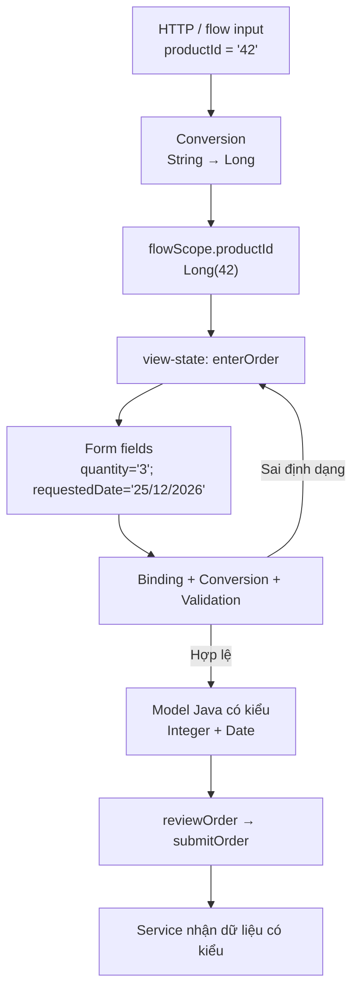

# Vai trò của ConversionService trong input, binding và biểu thức

Trong **Spring Web Flow**, một hành trình web có thể kéo dài qua nhiều request: mở luồng bằng mã sản phẩm trên URL, nhập biểu mẫu, xác nhận, gọi dịch vụ nghiệp vụ và quay lại chỉnh sửa nếu có lỗi. Dữ liệu trong HTTP thường xuất hiện dưới dạng **chuỗi**, còn mô hình Java cần các kiểu như `Long`, `Integer`, `BigDecimal`, `Date`, `Enum` hoặc một kiểu nghiệp vụ tùy chỉnh. **ConversionService** cung cấp cơ chế chuyển đổi giá trị theo kiểu đích để dữ liệu đi qua các bước đó một cách nhất quán.

Trong chương **Chuyển đổi và định dạng**, điều quan trọng là hiểu ConversionService tham gia vào ba ngữ cảnh liên quan nhưng khác nhau: **flow input** (đầu vào khi mở flow), **form binding** (gán dữ liệu từ request vào model của `view-state`) và **đánh giá biểu thức** (sử dụng dữ liệu có kiểu trong `evaluate`, `set`, điều kiện và lời gọi service). Việc tách bạch chúng giúp xây dựng Spring Web Flow theo **state, event, transition và subflow** thay vì xử lý chuyển kiểu và điều hướng rải rác ở controller.

## 1. Vì sao chuyển đổi kiểu quan trọng trong một flow nhiều bước?

Xét một quy trình đặt hàng:

1. URL khởi động flow chứa `productId=42`.
2. Trang nhập đơn gửi `quantity=3` và `requestedDate=25/12/2026`.
3. Trang xác nhận hiển thị số lượng, ngày giao và tổng tiền đúng định dạng theo người dùng.
4. Một `action-state` gọi service với `Long`, `Integer`, `Date` và `BigDecimal` thay vì các chuỗi thô.

Ở bước đầu, giá trị `"42"` cần thành `Long`. Khi binding, `"3"` phải thành `Integer` và chuỗi ngày phải thành `Date` theo quy ước định dạng. Nếu ngày nhập sai, flow cần báo lỗi ngay ở màn hình nhập. Ở bước cuối, giá trị đã được chuyển kiểu mới thích hợp để áp dụng quy tắc nghiệp vụ.



**Conversion không đồng nghĩa validation.** Conversion trả lời câu hỏi “chuỗi này có biểu diễn được giá trị thuộc kiểu đích không?”; validation trả lời “giá trị đã chuyển kiểu có hợp lệ theo quy tắc biểu mẫu/nghiệp vụ không?”. Ví dụ `"-3"` có thể chuyển thành số nguyên nhưng không hợp lệ cho số lượng đặt hàng. Ngược lại `"abc"` không thể chuyển thành số nguyên, nên lỗi xuất hiện trước cả kiểm tra `quantity > 0`.

## 2. Phân biệt hai ConversionService dễ bị nhầm lẫn

Hệ sinh thái Spring có nhiều API cùng tên **ConversionService**. Khi tích hợp Web Flow với Spring MVC, cần hiểu rõ API mà từng thành phần đang nhận:

| Ngữ cảnh | API liên quan | Mục đích |
| --- | --- | --- |
| Spring Framework và Spring MVC | `org.springframework.core.convert.ConversionService` | Chuyển kiểu thông dụng trong hệ sinh thái Spring Core/MVC; thường đi kèm `Converter`, `ConverterFactory`, `GenericConverter` và `Formatter` |
| Spring Web Flow / Spring Binding ở các phiên bản 2.x | `org.springframework.binding.convert.service.ConversionService` | Hạ tầng chuyển đổi của Spring Binding, được Web Flow dùng trong những điểm tích hợp binding và input của flow |
| Spring Web Flow biểu thức | Bộ đánh giá biểu thức được cấu hình (thường dùng SpEL) | Truy cập biến, gọi phương thức, đánh giá điều kiện; việc ép kiểu tham số và kết quả còn tùy cơ chế đánh giá biểu thức |

**Hai interface cùng tên không mặc nhiên hoán đổi cho nhau.** Việc ứng dụng đã cấu hình một `FormattingConversionService` cho Spring MVC không đảm bảo flow sử dụng nguyên cấu hình đó. Cần kiểm tra phiên bản Spring Web Flow, kiểu của thuộc tính `conversion-service` trên `flow-builder-services` và cách adapter/tích hợp mà dự án đang dùng. Tránh tự gán trực tiếp bean có kiểu Spring Core vào một thuộc tính yêu cầu Spring Binding nếu không có cơ chế tương thích.

Tương tự, đừng hiểu rằng một ConversionService duy nhất sẽ tự động chuyển đổi mọi đối số và kết quả của mọi biểu thức SpEL. Cơ chế **binding dữ liệu của flow** và **đánh giá biểu thức** có điểm giao nhau, nhưng là hai công đoạn kỹ thuật cần được cấu hình và kiểm thử theo đúng phiên bản thư viện.

## 3. ConversionService và flow input

**Flow input** là dữ liệu được cung cấp khi một flow bắt đầu, chẳng hạn tham số request hoặc input map khi flow được gọi từ mã ứng dụng/flow khác. Spring Web Flow cho phép khai báo tên, kiểu dự kiến và tính bắt buộc của input:

```xml
<input name="productId"
       type="java.lang.Long"
       required="true" />
```

Khi flow được khởi tạo với một giá trị chuỗi như `"42"`, hạ tầng input mapping sử dụng khả năng chuyển đổi để đưa giá trị về kiểu đã khai báo. Giá trị input hợp lệ sau đó có thể được dùng qua `flowScope.productId`, ví dụ:

```xml
<on-start>
    <evaluate expression="catalogService.findById(flowScope.productId)"
              result="flowScope.product" />
</on-start>
```

Trong tình huống này, phương thức `catalogService.findById(...)` nên nhận `Long`, đúng với hợp đồng input, thay vì phải tự viết `Long.parseLong(...)` ở từng nơi. `required="true"` diễn đạt yêu cầu phải cung cấp input; nó **không** tự chứng minh rằng sản phẩm có tồn tại hoặc người dùng có quyền truy cập sản phẩm đó. Các quy tắc này vẫn do service kiểm tra.

Những trường hợp cần xem xét riêng:

| Input nhận được | Kiểu yêu cầu | Kết quả mong đợi |
| --- | --- | --- |
| `"42"` | `Long` | Chuyển thành `42L` |
| `"abc"` | `Long` | Báo lỗi chuyển đổi input; không tiếp tục với giá trị `Long` giả |
| Không có `productId` | `Long` và `required=true` | Báo thiếu đầu vào khi bắt đầu flow |
| `"-1"` | `Long` | Chuyển kiểu có thể thành công; service cần kiểm tra tính hợp lệ |
| Object `Long` có sẵn trong input map | `Long` | Có thể sử dụng trực tiếp, không cần parse chuỗi |

**Lỗi khởi động flow** khác với lỗi nhập biểu mẫu: trước khi có màn hình đang chờ người dùng, hệ thống có thể chưa có một `view-state` thích hợp để hiển thị lỗi bên cạnh trường nhập liệu. Thiết kế cần xác định đường xử lý khi thiếu/sai input (chẳng hạn đưa về trang bắt đầu hợp lệ hoặc báo yêu cầu không hợp lệ) ở tầng tích hợp phù hợp.

## 4. ConversionService và binding dữ liệu biểu mẫu

Khi request gửi dữ liệu từ một `view-state` có model, Spring Web Flow thực hiện **data binding**: tìm property được phép bind, chuyển giá trị gửi lên sang kiểu property Java, sau đó gán giá trị cho model và xử lý validation theo cấu hình.

Ví dụ lớp model:

```java
package com.example.checkout;

import java.io.Serializable;
import java.util.Date;

public class OrderForm implements Serializable {
    private Integer quantity;
    private Date requestedDate;

    public Integer getQuantity() { return quantity; }
    public void setQuantity(Integer quantity) { this.quantity = quantity; }

    public Date getRequestedDate() { return requestedDate; }
    public void setRequestedDate(Date requestedDate) {
        this.requestedDate = requestedDate;
    }
}
```

Định nghĩa state nhập đơn:

```xml
<var name="orderForm" class="com.example.checkout.OrderForm" />

<view-state id="enterOrder" view="checkout/enter"
            model="orderForm">
    <binder>
        <binding property="quantity" required="true" />
        <binding property="requestedDate"
                 converter="shortDate"
                 required="true" />
    </binder>

    <transition on="next" to="reviewOrder" />
</view-state>
```

Các giá trị `quantity` và `requestedDate` được gửi từ form như chuỗi. Binder dựa vào kiểu đích trong `OrderForm` và converter được cấu hình để chuyển thành `Integer` và `Date`. Thuộc tính `converter="shortDate"` minh họa cách chọn một converter theo tên trong cấu hình binding của Spring Web Flow; tên/kiểu converter thực tế phải được kiểm tra theo ConversionService và phiên bản sử dụng. **Định dạng chuỗi ngày đầu vào phải khớp với cấu hình converter và locale**; không nên tự mặc định mọi hệ thống đều hiểu `dd/MM/yyyy`.

Khối `<binder>` cũng tạo **danh sách property được phép bind** tại state này. Đó là một lợi ích bảo mật quan trọng: client không thể mặc nhiên thay đổi các field nội bộ như `approved`, `price`, `role` hoặc `paid` chỉ bằng cách thêm tham số vào request nếu các field đó không được phép bind.

### Đường xử lý của một lần submit

```text
Request từ form: quantity="3", requestedDate="25/12/2026"
         │
         ├─ Xác định các field được bind tại view-state
         ├─ Chuyển chuỗi sang kiểu Java của property
         ├─ Gán giá trị hợp lệ vào model
         ├─ Kiểm tra required, validation và ghi nhận thông báo lỗi
         └─ Có lỗi? → tiếp tục view-state hiện tại
                     → nếu hợp lệ, xử lý transition "next"
```

Thứ tự cụ thể của các bước và cơ chế nhận thông báo lỗi phụ thuộc cấu hình binding/validation của phiên bản Web Flow, nhưng nguyên tắc thực hành là **chỉ cho transition tiếp tục khi form đã được kiểm tra hợp lệ**. Nếu `"abc"` không thành `Integer`, không được tiếp tục sang `reviewOrder` như thể đó là số lượng hợp lệ.

## 5. Chuyển đổi dữ liệu và định dạng để hiển thị

**Chuyển đổi** (conversion) và **định dạng** (formatting) liên quan hai chiều dữ liệu:

- **Parse:** chuyển biểu diễn văn bản thành đối tượng có kiểu, chẳng hạn `"1.250,50"` thành `BigDecimal` dưới locale có dấu phẩy thập phân.
- **Print/format:** chuyển đối tượng có kiểu thành chuỗi hiển thị phù hợp với locale và quy ước giao diện, chẳng hạn `BigDecimal(1250.50)` thành chuỗi tiền tệ hoặc số có phân nhóm hàng nghìn.

Một formatter có thể cung cấp cả hai chiều parse và print trong Spring Formatting, nhưng **không nên mặc định mọi converter của Spring Binding đều là formatter hai chiều**. Ngoài ra, phần view có thể định dạng qua tag của MVC, template engine hoặc formatter riêng; việc định dạng hiển thị không nhất thiết đi qua đúng converter đã dùng trong input mapping.

| Dữ liệu | Ví dụ chuỗi đầu vào | Kiểu Java nên dùng | Lưu ý |
| --- | --- | --- | --- |
| Mã định danh | `"42"` | `Long` | Kiểm tra tồn tại và quyền truy cập riêng |
| Số lượng | `"3"` | `Integer` | Sau parse vẫn cần điều kiện `> 0` |
| Số tiền | `"1.250,50"` | `BigDecimal` | Locale và dấu phân tách có thể làm đổi ý nghĩa |
| Ngày giao | `"25/12/2026"` | `Date` hoặc kiểu thời gian phù hợp | Quy ước ngày/tháng và timezone phải được thống nhất |
| Trạng thái | `"EXPRESS"` | `Enum` | Chỉ cho phép tập giá trị hợp lệ trong nghiệp vụ |
| Mã nghiệp vụ | `"CUS-009"` | `CustomerId` (tùy chỉnh) | Cần converter riêng nếu muốn bind trực tiếp vào value object |

Ví dụ: `01/02/2026` có thể được hiểu là **1 tháng 2** hoặc **2 tháng 1**; nếu form và converter không thống nhất locale/pattern, việc parse thành công vẫn có thể tạo dữ liệu sai. Với tiền tệ, nên giữ `BigDecimal` trong model và chỉ định dạng ở biên hiển thị, tránh lưu tiền dưới dạng chuỗi có dấu phân tách.

Đối với Java Time (`LocalDate`, `LocalDateTime`, `ZonedDateTime`), mức hỗ trợ mặc định phụ thuộc phiên bản và cấu hình. Không mặc định converter xử lý `java.util.Date` cũng áp dụng trực tiếp cho mọi kiểu `java.time`.

## 6. Vai trò trong biểu thức Web Flow

Web Flow dùng biểu thức để **đọc dữ liệu, gọi bean, đánh giá điều kiện và gán kết quả**. Khi dữ liệu đã được convert tại đầu vào và binding, biểu thức làm việc với các object Java có kiểu:

```xml
<evaluate expression="pricingService.calculateTotal(flowScope.orderForm)"
          result="flowScope.total" />

<decision-state id="checkQuantity">
    <if test="flowScope.orderForm.quantity > 0"
        then="reviewOrder" else="enterOrder" />
</decision-state>

<set name="flowScope.displayStage" value="'REVIEW'" />
```

Ở đây:

1. `flowScope.orderForm.quantity` đã có kiểu `Integer` sau binding; điều kiện `> 0` không cần tự `parseInt`.
2. `pricingService.calculateTotal(...)` trả về giá trị nghiệp vụ (ví dụ `BigDecimal`), được lưu vào `flowScope.total` bằng thuộc tính `result`.
3. Biểu thức `value="'REVIEW'"` tạo hằng chuỗi để lưu vào scope.

**Điểm cần phân biệt:** ConversionService của Web Flow phục vụ những nơi framework cần chuyển một giá trị sang kiểu đích (ví dụ input và binding); còn **SpEL** có hệ thống đánh giá biểu thức, giải quyết method overload và có cơ chế chuyển kiểu riêng. Vì vậy, việc đăng ký một custom converter cho form **không tự bảo đảm** biểu thức SpEL có thể gọi được mọi method nhận kiểu nghiệp vụ đó. Nếu cần truyền kiểu cụ thể cho một lời gọi service, tốt nhất để model đã có đúng kiểu hoặc chuyển đổi tường minh tại ranh giới rõ ràng, rồi kiểm thử cả hai đường.

Một lỗi thường gặp là so sánh chuỗi với số ngay trong biểu thức, ví dụ `quantityText > 10`. Đừng dựa vào ép kiểu ngầm; hãy bind vào property số trước, xác thực giá trị và sau đó mới đánh giá điều kiện với object đã có kiểu.

## 7. Ví dụ kết hợp input, binding và xử lý qua state

Ví dụ dưới đây thể hiện cách dữ liệu đã chuyển kiểu di chuyển qua nhiều state. Các bean `catalogService`, `pricingService`, `orderAction`, lớp `OrderForm` và các view là thành phần của ứng dụng minh họa:

```xml
<?xml version="1.0" encoding="UTF-8"?>
<flow xmlns="http://www.springframework.org/schema/webflow"
      xmlns:xsi="http://www.w3.org/2001/XMLSchema-instance"
      xsi:schemaLocation="http://www.springframework.org/schema/webflow
          http://www.springframework.org/schema/webflow/spring-webflow.xsd">

    <input name="productId" type="java.lang.Long" required="true" />
    <var name="orderForm" class="com.example.checkout.OrderForm" />

    <on-start>
        <evaluate expression="catalogService.findById(flowScope.productId)"
                  result="flowScope.product" />
    </on-start>

    <view-state id="enterOrder" view="checkout/enter" model="orderForm">
        <binder>
            <binding property="quantity" required="true" />
            <binding property="requestedDate"
                     converter="shortDate" required="true" />
        </binder>
        <transition on="next" to="calculateTotal" />
    </view-state>

    <action-state id="calculateTotal">
        <evaluate expression="pricingService.calculateTotal(flowScope.orderForm)"
                  result="flowScope.total" />
        <transition on="success" to="reviewOrder" />
    </action-state>

    <view-state id="reviewOrder" view="checkout/review">
        <transition on="back" to="enterOrder" />
        <transition on="confirm" to="submitOrder" />
    </view-state>

    <action-state id="submitOrder">
        <evaluate expression="orderAction.submit(flowScope.productId,
                                                    flowScope.orderForm)" />
        <transition on="success" to="completed" />
        <transition on="invalid" to="enterOrder" />
        <transition on="failed" to="submitError" />
    </action-state>

    <view-state id="submitError" view="checkout/error">
        <transition on="retry" to="submitOrder" />
        <transition on="back" to="reviewOrder" />
    </view-state>

    <end-state id="completed" view="checkout/completed" />
</flow>
```

Đọc hành trình theo thời gian:

| Bước | Vai trò của chuyển đổi | Vai trò state/event/transition |
| --- | --- | --- |
| Mở flow với `productId` | Đưa chuỗi ID về `Long` | Input mapping cấp dữ liệu ban đầu cho flow |
| `enterOrder` | Bind `quantity` và `requestedDate` vào `OrderForm` | Người dùng nhập, submit event `next` |
| `calculateTotal` | Service nhận object đã có kiểu; kết quả có kiểu lưu vào scope | `action-state` tự chạy, theo `success` sang view kế |
| `reviewOrder` | View định dạng giá trị để hiển thị | Người dùng chọn `back` hoặc `confirm` |
| `submitOrder` | Gọi service với `Long` và `OrderForm` | Event nghiệp vụ quyết định kết thúc hay quay lại sửa |

**Hợp đồng minh họa:** `orderAction.submit(...)` được giả định trả event như `success`, `invalid` hoặc `failed`; các tên event phải khớp với transition. Nếu action ném ngoại lệ không được xử lý, Web Flow không mặc nhiên đổi nó thành event `failed`. Đồng thời thao tác submit đơn cần có chính sách chống gửi trùng khi người dùng retry, chẳng hạn idempotency key ở tầng service.

Phần ví dụ tập trung vào đường đi dữ liệu; ứng dụng thật vẫn cần cấu hình validation của model, quyền truy cập sản phẩm, template view và xử lý các lỗi hệ thống phù hợp.

## 8. Cấu hình ConversionService riêng cho Spring Web Flow

Trong cấu hình XML của các dự án Spring Web Flow 2.x, điểm tích hợp thường là `flow-builder-services`. Ví dụ:

```xml
<webflow:flow-builder-services id="flowBuilderServices"
    conversion-service="flowConversionService" />

<bean id="flowConversionService"
      class="org.springframework.binding.convert.service.DefaultConversionService" />
```

Giả định namespace `webflow` đã được khai báo và `flowBuilderServices` được flow registry sử dụng. Cấu hình này minh họa cách gắn **Spring Binding ConversionService** với hạ tầng tạo flow; các thư viện/namespace XML thực tế phải khớp phiên bản đang chạy. Một bean conversion của Spring MVC có thể tồn tại đồng thời và cần cấu hình riêng.

Để hỗ trợ một kiểu miền như `CustomerId`, một cách tiếp cận là mở rộng ConversionService của Spring Binding và đăng ký converter theo API của phiên bản dự án:

```text
HTTP: customerId = "CUS-009"
          ↓
Custom converter String -> CustomerId
          ↓
CustomerId("CUS-009") trong model của flow
          ↓
Service nhận CustomerId, không nhận chuỗi tự parse
```

Một custom converter đúng phải có các thuộc tính:

- **Rõ kiểu nguồn và kiểu đích:** chẳng hạn `String → CustomerId`, chỉ nhận định dạng ID được hỗ trợ.
- **Quy tắc lỗi xác định:** chuỗi trống, sai tiền tố hoặc ký tự không hợp lệ tạo lỗi chuyển đổi có thể hiểu được; không âm thầm tạo ID mặc định.
- **Không chứa nghiệp vụ nặng:** converter chỉ tạo value object; tra cứu khách hàng và kiểm tra quyền truy cập nên ở service.
- **Có hướng ngược khi cần hiển thị:** nếu view phải render `CustomerId` ra biểu mẫu, thiết kế hướng đối xứng hoặc formatter tương ứng.
- **Không phụ thuộc request ngẫu nhiên:** converter xử lý nhất quán cùng một dữ liệu, với locale/timezone được xác định rõ khi chúng thực sự ảnh hưởng.

Do API đăng ký và các converter/formatter được hỗ trợ có thể thay đổi theo phiên bản Web Flow, hãy kiểm tra signature của `DefaultConversionService`/interface converter thực tế trước khi viết lớp cài đặt. **Không sao chép trực tiếp ví dụ `Converter<S,T>` của Spring Core** vào Spring Binding nếu hai API trong dự án khác nhau.

## 9. Binding, validation và thông báo lỗi

Một flow tốt phân biệt ít nhất ba lớp lỗi:

| Loại lỗi | Ví dụ | Nơi phát hiện | Hành vi mong đợi |
| --- | --- | --- | --- |
| Thiếu đầu vào | Flow bắt đầu không có `productId` bắt buộc | Input mapping | Xử lý lỗi khởi động flow rõ ràng |
| Lỗi chuyển kiểu | `quantity="three"` hoặc ngày sai pattern | Input mapping / binder | Không gán giá trị sai kiểu; hiển thị thông báo tại form hoặc trang lỗi phù hợp |
| Lỗi validation | `quantity=-3`, ngày nằm trong quá khứ | Validator của view/model hoặc service | Giữ dữ liệu đã nhập, yêu cầu sửa giá trị |
| Lỗi nghiệp vụ | Hết hàng dù số lượng hợp lệ | Service / `action-state` | Chuyển theo event nghiệp vụ, ví dụ quay lại màn hình chọn hàng |

Khi một trường bị lỗi chuyển kiểu, binding framework thường cung cấp thông tin lỗi cho cơ chế thông báo của view. View cần hiển thị tên trường, giá trị nhập và thông điệp thân thiện (ví dụ “Số lượng phải là số nguyên”) thay vì lộ class Java hay stack trace. Cũng cần giữ thông báo theo ngôn ngữ người dùng và nhất quán qua các lần render.

Không nên “chữa” lỗi convert bằng cách mặc định thay `"abc"` thành `0`: giá trị thay thế có thể vượt qua một số bước và gây hậu quả ở `action-state`. Nếu cần giá trị mặc định, phải có quy tắc nghiệp vụ minh bạch và phân biệt rõ **không nhập** với **nhập sai**.

## 10. Scope, vòng đời flow và việc giữ kiểu dữ liệu

Các state của Web Flow chia sẻ dữ liệu qua scope theo vòng đời:

| Scope | Cách dùng liên quan conversion | Cảnh báo |
| --- | --- | --- |
| `requestScope` | Giá trị tạm trong một lượt xử lý request | Không dựa vào nó để lưu kết quả qua nhiều request |
| `viewScope` | Dữ liệu riêng của một `view-state` đang hoạt động | Có thể không còn khi rời view rồi quay lại |
| `flowScope` | Model đã bind, ID đã convert, tổng tiền, dữ liệu xuyên các bước | Cân nhắc kích thước/khả năng lưu và khôi phục flow |
| `flashScope` | Thông báo hoặc dữ liệu ngắn hạn cho bước hiển thị kế tiếp | Không phải kho dữ liệu nghiệp vụ lâu dài |
| `conversationScope` | Thông tin dùng chung trong conversation và subflow liên quan | Tránh lưu dữ liệu nhạy cảm hoặc quá lớn không cần thiết |

Trong ví dụ, `flowScope.productId` có kiểu `Long` và `flowScope.orderForm.quantity` có kiểu `Integer`; không cần ép lại thành chuỗi khi chuyển giữa các state. Mỗi lần form được render, dữ liệu được **định dạng để hiển thị**; khi submit, dữ liệu được **parse/bind lại** theo cấu hình. Đây là hai chiều giao tiếp với giao diện, không có nghĩa model phải lưu chuỗi.

Việc flow có thể được phục hồi sau request phụ thuộc cách `FlowExecutionRepository` lưu execution; dữ liệu đặt trong flow cần phù hợp với cơ chế lưu/khôi phục được cấu hình. Nếu dùng kiểu tùy chỉnh, cũng cần kiểm tra khả năng tuần tự hóa hoặc lưu state theo yêu cầu thực tế của repository.

## 11. Kiểm thử chuyển đổi và format trong flow

Nên kiểm thử **từng converter** và **tích hợp trong flow**. Chỉ unit test `Long.parseLong("42")` không đủ để khẳng định Web Flow đang dùng đúng service đã cấu hình.

### Những trường hợp tối thiểu cần bao phủ

| Trường hợp kiểm thử | Kỳ vọng |
| --- | --- |
| Input `productId="42"` | Flow bắt đầu, ID được chuyển thành `Long` |
| Input `productId="xyz"` | Lỗi input rõ ràng, không gọi service bằng ID tùy tiện |
| Thiếu `productId` bắt buộc | Hệ thống báo lỗi hợp lệ theo luồng khởi động |
| Form `quantity="3"` | Property `Integer` nhận giá trị 3 |
| Form `quantity="abc"` | Lỗi binding, state nhập vẫn cho người dùng sửa |
| Form `quantity="-3"` | Chuyển kiểu có thể thành công nhưng validation bác bỏ |
| Ngày theo đúng locale/pattern | Parse ra giá trị ngày dự kiến; format ngược cho ra chuỗi tương ứng |
| Ngày không hợp lệ như `31/02/2026` | Báo lỗi, không tự biến thành một ngày khác ngoài dự kiến |
| Locale khác hoặc dấu thập phân khác | Kết quả chính xác theo quy ước; dữ liệu mơ hồ bị xử lý rõ ràng |
| Custom `CustomerId` hợp lệ/không hợp lệ | Chuyển đổi đúng hoặc báo lỗi; flow không phụ thuộc parse thủ công |
| Nút quay lại từ `reviewOrder` | Dữ liệu model có kiểu vẫn còn trong scope |
| Gửi lại request hoặc retry | Không làm mất dữ liệu; nghiệp vụ gửi đơn không bị thực thi trùng |

Nếu dùng Spring Web Flow Test support, có thể mô phỏng external context, đưa input map vào lúc khởi động flow, submit request parameters ở `view-state` và xác nhận active state cùng thông báo binding. Kiểm thử cũng cần chạy với **đúng bean ConversionService mà ứng dụng thực tế dùng**. Với locale, đặt locale cụ thể cho case kiểm thử để tránh máy phát triển và CI hiểu ngày/số khác nhau.

### Các lỗi thiết kế thường gặp

1. **Tự parse trong controller hoặc action:** nhiều nơi gọi `Integer.parseInt` và tự xử lý lỗi không thống nhất. Hãy để input mapping/binder xử lý chuyển kiểu ở biên dữ liệu.
2. **Nhầm Spring Core với Spring Binding ConversionService:** bean đăng ký cho MVC không tự nhiên áp dụng cho Web Flow. Xác nhận đúng interface và điểm tích hợp.
3. **Nhét kiểm tra database vào converter:** lỗi hiệu năng và trộn chuyển đổi định dạng với nghiệp vụ. Converter nên nhẹ, logic truy vấn nằm ở service.
4. **Xem parse thành công là hợp lệ:** số lượng âm, ngày quá hạn hoặc ID không có quyền vẫn phải qua validation/nghiệp vụ.
5. **Không thống nhất locale/timezone:** ngày, số tiền có thể được hiểu khác nhau theo máy và trình duyệt. Cấu hình rõ quy ước nhập và hiển thị.
6. **Bind mọi property của domain entity:** có thể cho phép client sửa các field không được phép. Khai báo danh sách field bind hoặc dùng form model chuyên dụng.
7. **Cho rằng mọi biểu thức tự dùng converter đã đăng ký:** SpEL và Web Flow binding có cơ chế chuyển kiểu khác nhau. Kiểm thử riêng đoạn expression cần ép kiểu.
8. **Lưu giá trị đã format vào flowScope làm dữ liệu nghiệp vụ:** dễ mất tính chính xác hoặc gây lỗi khi parse ngược. Lưu object có kiểu, format khi hiển thị.

## 12. Quy tắc vận dụng

Khi thiết kế conversion cho Spring Web Flow, hãy bắt đầu từ **hợp đồng kiểu dữ liệu** của từng đầu vào (`<input>`), từng property trong form model (`<binder>`) và từng lời gọi service (`<evaluate>`). Cấu hình converter ở đúng biên cần chuyển kiểu, xác định rõ locale/pattern khi định dạng, kiểm tra validation sau conversion và xử lý lỗi trước khi transition sang bước tiếp theo.

Nhờ vậy, Web Flow có thể lưu và truyền dữ liệu **đúng kiểu qua nhiều state**, còn flow XML thể hiện rõ event, transition và các đường phục hồi khi người dùng nhập sai hoặc hệ thống gặp lỗi. Spring MVC đảm nhiệm phần tiếp nhận/hiển thị HTTP, các service đảm nhiệm nghiệp vụ; ConversionService làm cầu nối giữa biểu diễn dữ liệu ở bên ngoài và model Java mà flow sử dụng.
