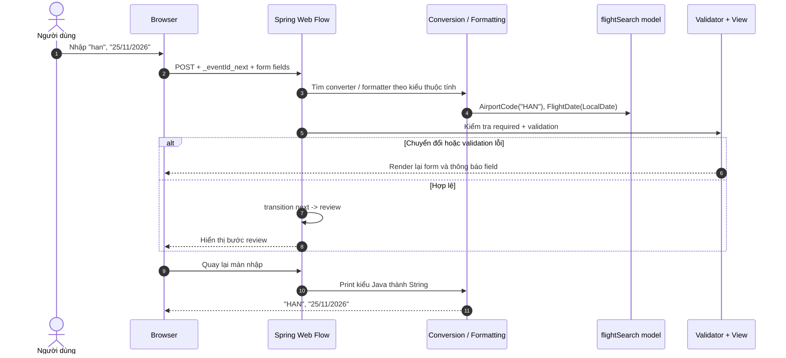

# Converter và Formatter tùy chỉnh trong Spring Web Flow

## 1. Bài toán và mục tiêu học tập

Trong **Spring Web Flow (SWF)**, hành trình web nhiều bước được mô hình hóa bằng `state`, `event`, `transition` và `subflow`. Các màn hình `view-state` có thể bind dữ liệu biểu mẫu vào model, xác thực đầu vào rồi giữ model trong `flowScope` để đi qua các bước tiếp theo. Tuy nhiên, trình duyệt thường gửi **chuỗi ký tự**, trong khi domain model sử dụng `Integer`, `LocalDate`, enum hoặc các kiểu riêng như `AirportCode` và `FlightDate`.

Ví dụ: người dùng nhập mã sân bay `han` và ngày đi `25/11/2026`. Model có hai thuộc tính:

```java
private AirportCode origin;
private FlightDate departureDate;
```

Nếu chưa khai báo chuyển đổi phù hợp, binder không thể tự biết rằng `"han"` phải trở thành `AirportCode("HAN")`, hoặc định dạng ngày nào cần được áp dụng cho ngôn ngữ hiện tại. Hệ thống cũng cần đi **chiều ngược lại**: từ object Java sang chuỗi để hiển thị lại form khi có lỗi validation hoặc khi người dùng quay về bước trước.

Bài thuộc chương **Chuyển đổi và định dạng**, tập trung vào cách triển khai **Converter và Formatter tùy chỉnh** trong Spring Web Flow, sử dụng hạ tầng Spring Conversion/Formatting và kết nối đúng với Web Flow.

Sau bài này, bạn có thể:

1. Phân biệt vai trò của `Converter<S, T>`, `Formatter<T>`, `Printer<T>`, `Parser<T>` và `ConversionService`.
2. Viết converter cho value object và formatter có xét `Locale`, kiểm tra hai chiều parse/print.
3. Cấu hình một `FormattingConversionService` dùng chung với Spring MVC, sau đó **bọc nó bằng** `DefaultConversionService` của Spring Binding cho Web Flow.
4. Phân biệt conversion error, field-required error và Bean Validation error trong vòng đời postback.
5. Hiểu giới hạn của `<binding converter="...">` kiểu cũ và xử lý migration hợp lý.
6. Kiểm thử unit, integration, nhiều locale, form postback và các tình huống lỗi dữ liệu.

## 2. Chuyển đổi nằm ở đâu trong vòng đời postback?

Giả sử flow `flightSearch` dừng tại `view-state id="enterFlight"` với `model="flightSearch"`. Giao diện có `<form:input path="origin" />` và `<form:input path="departureDate" />`.



Từng bước:

- **Trước khi bind:** Web Flow nhận request cùng event; thuộc tính `model` chỉ ra đối tượng form trong scope.
- **Trong binding:** Web Flow tìm đường dẫn thuộc tính được phép sửa. Dữ liệu request dạng `String` được chuyển thành kiểu Java tương ứng thông qua dịch vụ conversion.
- **Khi parse thất bại:** Binder ghi nhận lỗi; transition yêu cầu binding thành công thường không diễn ra và form được render lại với thông báo để người dùng sửa.
- **Khi parse thành công:** Model nhận giá trị đã được chuyển kiểu. Validation được cấu hình kiểm tra nội dung, chẳng hạn ngày có ở tương lai hay không.
- **Khi render:** Giá trị model cần được format/print thành String cho các trường text, đúng locale và định dạng mong muốn.

Không nên coi **conversion** và **validation** là cùng một việc:

| Tầng | Câu hỏi | Ví dụ lỗi |
|---|---|---|
| Binding/property | Field có được phép gán vào model không? | Request gửi `admin=true` nhưng binder không cho phép `admin`. |
| Conversion/parsing | Văn bản này có chuyển được thành kiểu đích không? | `departureDate=ngay-mai` không đúng định dạng. |
| Required check | Field cần thiết có được gửi và có giá trị phù hợp không? | `origin=` hoặc thiếu `origin`. |
| Validation | Giá trị đã có đúng quy tắc nghiệp vụ không? | Ngày đi hợp lệ về cú pháp nhưng nằm trong quá khứ. |
| Transition/action | Event có được tiếp tục qua nhánh đó không? | Event `next` không được đi tới `review` khi form sai. |

`@NotNull`, `@Future` hoặc custom validator không thể thay thế parser cho ngày hoặc value object. Ngược lại, parser chấp nhận `25/11/2020` không có nghĩa ngày này được phép đặt vé.

## 3. Chọn Converter hay Formatter?

Hai cơ chế đều nằm trong hạ tầng **Spring Type Conversion and Formatting**, nhưng chúng giải quyết các vấn đề khác nhau.

| API | Package | Đầu vào/đầu ra | Sử dụng khi |
|---|---|---|---|
| `Converter<S, T>` | `org.springframework.core.convert.converter` | Một object nguồn → một object đích | Đổi kiểu có quy tắc cố định: String → AirportCode, String → enum riêng, Entity ID → value object. |
| `ConverterFactory<S, R>` | Cùng package | Factory cung cấp converter cho họ kiểu đích | Một logic chung áp dụng cho nhiều kiểu con của một base type. |
| `GenericConverter` | `org.springframework.core.convert.converter` | Nhiều cặp kiểu, có type descriptor | Khi cần xử lý generic type, collection hoặc các quy tắc chuyển đổi phức tạp. |
| `Printer<T>` | `org.springframework.format` | T + Locale → String | Cần hiển thị object theo locale. |
| `Parser<T>` | `org.springframework.format` | String + Locale → T | Cần đọc dữ liệu form theo locale. |
| `Formatter<T>` | `org.springframework.format` | Kết hợp Printer và Parser | Form có cả chiều hiển thị và nhập liệu, nhất là ngày, số, tiền hoặc kiểu trình bày đặc biệt. |

### Khi nào chọn từng loại?

- **Converter** phù hợp khi biểu diễn không phụ thuộc locale và được định nghĩa rõ. Ví dụ mã sân bay `HAN` luôn là `HAN`, bất kể trình duyệt dùng tiếng Việt hay tiếng Anh.
- **Formatter** phù hợp khi **chuỗi hiển thị có thể thay đổi theo Locale**, hoặc hai chiều parse/print của cùng một kiểu cần được quản lý cùng nhau. Ví dụ ngày `25/11/2026` theo giao diện Việt Nam và `2026-11-25` theo định dạng ISO của giao diện khác.
- Với `Converter<String, AirportCode>`, nếu form còn cần render một `AirportCode` thành chuỗi, hãy cung cấp **converter chiều ngược lại** hoặc một formatter thay thế. Converter mặc định chỉ mô tả **một chiều**.
- Với các field chuẩn như `LocalDate` hoặc `BigDecimal`, cân nhắc `@DateTimeFormat`/`@NumberFormat` hoặc formatter có sẵn trước khi viết mã mới. Một custom formatter gắn **toàn bộ type** có thể ảnh hưởng nhiều màn hình.

Một `Formatter<T>` thường cũng được đăng ký vào `FormattingConversionService` để ứng dụng có thể dùng trong cơ chế conversion; người phát triển không cần gọi `parse()`/`print()` thủ công trên mỗi postback.

## 4. Thiết kế model và value object cho ví dụ đặt chuyến bay

Giả sử model chứa mã sân bay đi và ngày đi. Thay vì để cả hai là String, chúng ta dùng hai value object để tập trung quy tắc kiểu dữ liệu.

### 4.1. Kiểu `AirportCode`

```java
package com.example.flight;

import java.io.Serializable;

public record AirportCode(String value) implements Serializable {
    public AirportCode {
        if (value == null || !value.matches("[A-Z]{3}")) {
            throw new IllegalArgumentException("Mã sân bay phải có đúng ba chữ A-Z");
        }
    }
}
```

- Record giúp đối tượng bất biến; ở Spring Web Flow 3.x/4.x, Java 17 trở lên là baseline phù hợp cho ví dụ.
- Cấu trúc `[A-Z]{3}` chỉ kiểm tra **cú pháp**. Mã `ZZZ` có thể hợp lệ theo regex nhưng không phải sân bay được phép đặt vé. Việc kiểm tra tồn tại/quyền sử dụng cần ở service/validator.
- Nếu flow execution được lưu vào session/snapshot, nên dùng object nhẹ và có khả năng serialize, tránh giữ các tài nguyên nặng.

### 4.2. Kiểu `FlightDate`

```java
package com.example.flight;

import java.io.Serializable;
import java.time.LocalDate;
import java.util.Objects;

public record FlightDate(LocalDate value) implements Serializable {
    public FlightDate {
        Objects.requireNonNull(value, "Ngày đi không được null");
    }
}
```

Dùng `LocalDate` vì bài toán là **ngày trên lịch**, không phải thời điểm có múi giờ. Nếu nghiệp vụ cần giờ cất cánh, múi giờ hoặc instant, nên chọn kiểu Java khác như `ZonedDateTime`/`Instant` và xác định rõ timezone thay vì trộn các khái niệm.

### 4.3. Java bean để binding

```java
package com.example.flight;

import java.io.Serializable;
import jakarta.validation.constraints.NotNull;

public class FlightSearchForm implements Serializable {
    private static final long serialVersionUID = 1L;

    @NotNull
    private AirportCode origin;

    @NotNull
    private FlightDate departureDate;

    public AirportCode getOrigin() {
        return origin;
    }

    public void setOrigin(AirportCode origin) {
        this.origin = origin;
    }

    public FlightDate getDepartureDate() {
        return departureDate;
    }

    public void setDepartureDate(FlightDate departureDate) {
        this.departureDate = departureDate;
    }
}
```

Mã ví dụ giả định Spring Web Flow 3.x/4.x và Jakarta Bean Validation. Để `@NotNull` được thực thi, flow phải được kết nối đúng tới một validator; chỉ đặt annotation trên model không đảm bảo mọi cấu hình đều tự gọi validation.

## 5. Tạo Converter tùy chỉnh cho mã sân bay

### 5.1. Converter từ chuỗi HTTP đến object

```java
package com.example.flight;

import java.util.Locale;
import org.springframework.core.convert.converter.Converter;

public final class StringToAirportCodeConverter
        implements Converter<String, AirportCode> {

    @Override
    public AirportCode convert(String source) {
        if (source == null || source.isBlank()) {
            return null;
        }
        String normalized = source.trim().toUpperCase(Locale.ROOT);
        return new AirportCode(normalized);
    }
}
```

Cách đọc:

1. `source` là giá trị do browser gửi, chẳng hạn `han` hoặc ` HAN `.
2. `trim()` bỏ khoảng trắng thừa; `toUpperCase(Locale.ROOT)` giúp chuẩn hóa mã kỹ thuật nhất quán, không phụ thuộc locale của người dùng.
3. `new AirportCode(normalized)` buộc chuỗi phải đúng ba chữ cái. Nếu không, `IllegalArgumentException` được lớp conversion/binding bao quanh thành lỗi chuyển kiểu phù hợp.
4. Trả `null` khi đầu vào trống để tầng required/validation xử lý việc thiếu giá trị. Đây là **chính sách của ví dụ**; trong hệ thống khác có thể chọn từ chối chuỗi rỗng ngay ở converter.

Không tìm kiếm database ở converter chỉ để xác định một mã có hợp lệ về nghiệp vụ không. Converter nên đơn giản, thuần, dễ cache và không có side effect. Nếu mã được dùng để truy cập tài nguyên có kiểm soát quyền, service/validator phải kiểm tra quyền trước khi thực hiện thao tác.

### 5.2. Converter từ object về chuỗi

```java
package com.example.flight;

import org.springframework.core.convert.converter.Converter;

public final class AirportCodeToStringConverter
        implements Converter<AirportCode, String> {

    @Override
    public String convert(AirportCode source) {
        return source == null ? "" : source.value();
    }
}
```

Converter này quan trọng khi view cần hiển thị lại `AirportCode("HAN")` thành `"HAN"`. Thiếu chiều in ra, ứng dụng có thể hiển thị kết quả `toString()` không mong muốn, hoặc không tìm được đường chuyển đổi phù hợp.

### 5.3. Một số quy tắc thiết kế converter

- Với mã định danh, chuẩn hóa ở một chỗ và có test; đừng để controller A chấp nhận `han` nhưng flow B chỉ chấp nhận `HAN`.
- Nếu một converter được đăng ký toàn ứng dụng, hãy xác định rõ input contract. Không tự “sửa” dữ liệu sai thành giá trị khác (ví dụ cắt bớt mã bốn ký tự thành ba ký tự) vì có thể che lỗi người dùng.
- Đừng đưa thông tin bảo mật hoặc service có trạng thái request vào singleton converter nếu không có lý do/thiết kế rõ.
- Đầu vào có thể do người dùng tự dựng, nên cần tránh regex tốn kém, số quá lớn, parse không giới hạn và thông báo lỗi tiết lộ nội bộ.
- Chỉ khi business có quy tắc chuyển đổi **không phụ thuộc locale** mới nên giữ Converter; nếu cách người dùng nhập/đọc thay đổi theo ngôn ngữ, dùng Formatter.

## 6. Tạo Formatter tùy chỉnh theo Locale

### 6.1. Vì sao Formatter khác Converter?

Form có thể hiển thị ngày đi là `25/11/2026` tại giao diện tiếng Việt, nhưng dùng `2026-11-25` trong giao diện khác. Với cùng `FlightDate(LocalDate.of(2026, 11, 25))`, **hai chuỗi có thể khác nhau** tùy `Locale`; nếu chỉ chuyển String ↔ object bằng converter thông thường, chúng ta không có tham số Locale ở API `convert(String)`.

`Formatter<T>` có hai phương thức:

```java
String print(T object, Locale locale);
T parse(String text, Locale locale) throws ParseException;
```

- `print` phục vụ chiều model → String khi render.
- `parse` phục vụ chiều String → model khi postback.
- `Locale` biểu diễn ngôn ngữ/khu vực được hạ tầng web cung cấp khi format; không nên tự đọc một biến static mutable để quyết định locale.

### 6.2. Formatter minh họa cho `FlightDate`

Để dễ kiểm chứng, ví dụ đưa ra hai định dạng có chủ đích: locale tiếng Việt dùng `dd/MM/yyyy`, locale còn lại dùng ISO `yyyy-MM-dd`. Đây là **quy ước ứng dụng minh họa**, không có nghĩa mọi locale ngoài Việt Nam bắt buộc dùng ISO.

```java
package com.example.flight;

import java.text.ParseException;
import java.time.LocalDate;
import java.time.format.DateTimeFormatter;
import java.time.format.DateTimeParseException;
import java.time.format.ResolverStyle;
import java.util.Locale;
import org.springframework.format.Formatter;

public final class FlightDateFormatter implements Formatter<FlightDate> {

    @Override
    public String print(FlightDate object, Locale locale) {
        return dateFormatter(locale).format(object.value());
    }

    @Override
    public FlightDate parse(String text, Locale locale) throws ParseException {
        if (text == null || text.isBlank()) {
            return null;
        }
        try {
            LocalDate date = LocalDate.parse(text.trim(), dateFormatter(locale));
            return new FlightDate(date);
        } catch (DateTimeParseException ex) {
            ParseException parseException = new ParseException(
                "Ngày không hợp lệ hoặc sai định dạng",
                Math.max(0, ex.getErrorIndex())
            );
            parseException.initCause(ex);
            throw parseException;
        }
    }

    private DateTimeFormatter dateFormatter(Locale locale) {
        String pattern = "vi".equals(locale.getLanguage())
                ? "dd/MM/uuuu"
                : "uuuu-MM-dd";

        return DateTimeFormatter.ofPattern(pattern, locale)
                .withResolverStyle(ResolverStyle.STRICT);
    }
}
```

**Giải thích các lựa chọn:**

- `DateTimeFormatter` là immutable/thread-safe, phù hợp singleton formatter dùng bởi nhiều request.
- `uuuu` là năm trong lịch ISO, thích hợp với strict resolver; dùng `yyyy` trong một pattern strict có thể yêu cầu bổ sung thông tin era. Nhãn hiển thị cho người dùng vẫn có thể nói `dd/MM/yyyy`.
- `ResolverStyle.STRICT` chặn ngày vô nghĩa như `31/02/2026`.
- Parse lỗi được chuyển thành `ParseException` có cause, giúp tầng binding nhận biết sai định dạng mà không lẫn với lỗi nghiệp vụ.
- `Locale.ROOT` được dùng cho mã sân bay vì đó là mã kỹ thuật; Formatter ngày lại nhận `locale` riêng vì chính sách hiển thị muốn khác theo ngôn ngữ.
- `parse("")` trả `null` theo chính sách ví dụ; việc field có bắt buộc hay không phải do binder/validator quyết định.

Ví dụ format ngày chỉ dùng `LocalDate`, nên **không chuyển timezone**. Nếu model thực sự lưu ngày/giờ như `Instant`, cần xác định time zone của người dùng trước khi print/parse, đồng thời xử lý các ngày chuyển DST nếu có.

### 6.3. Cần cẩn trọng với input HTML có định dạng cố định

`<input type="date">` trong HTML submit theo định dạng ISO `yyyy-MM-dd`, bất kể cách browser hiển thị ngày theo ngôn ngữ. Vì vậy, formatter ví dụ dùng `dd/MM/uuuu` cho tiếng Việt **không phù hợp nếu gắn trực tiếp** với `type="date"` mà không xử lý lại parse contract.

Với HTML date/time input, nên dùng định dạng chuẩn của browser, có thể cấu hình `@DateTimeFormat(iso = DateTimeFormat.ISO.DATE)` cho field `LocalDate` hoặc custom formatter tuân thủ ISO ở tầng submit. Formatter minh họa ở đây được dùng cho **trường text** chấp nhận format địa phương.

Đây là một nguyên nhân thực tế khiến form “nhìn đúng ngày nhưng server báo sai định dạng”: format hiển thị mà người phát triển tưởng browser gửi khác với giá trị thực trong request payload.

## 7. Đăng ký Converter và Formatter trong Spring

### 7.1. `FormattingConversionService` của Spring Framework

Spring cung cấp interface `org.springframework.core.convert.ConversionService` và `FormatterRegistry`. Một implementation như `DefaultFormattingConversionService` hoặc bean tạo bởi `FormattingConversionServiceFactoryBean` có thể đăng ký các `Converter` và `Formatter` dùng chung.

Ví dụ Java thuần để kiểm thử:

```java
import org.springframework.format.support.DefaultFormattingConversionService;

DefaultFormattingConversionService applicationConversionService =
        new DefaultFormattingConversionService();

applicationConversionService.addConverter(
        new StringToAirportCodeConverter());
applicationConversionService.addConverter(
        new AirportCodeToStringConverter());
applicationConversionService.addFormatterForFieldType(
        FlightDate.class, new FlightDateFormatter());
```

Việc gọi `addFormatterForFieldType(FlightDate.class, ...)` khiến formatter áp dụng cho thuộc tính kiểu `FlightDate` trong conversion service này. Với converter, Spring chọn cặp kiểu nguồn/đích phù hợp.

Có thể đăng ký qua `FormattingConversionServiceFactoryBean` trong XML, hoặc qua `FormatterRegistry`/`FormatterRegistrar` khi cấu hình Java. Quan trọng nhất là **dùng cùng registration logic ở đúng conversion service mà MVC và Web Flow thực sự sử dụng**.

### 7.2. Điểm quan trọng riêng của Web Flow: có hai interface ConversionService

Cần phân biệt:

```text
org.springframework.core.convert.ConversionService
    ↳ ConversionService của Spring Framework
    ↳ FormatterRegistry / FormattingConversionService đăng ký Formatter

org.springframework.binding.convert.ConversionService
    ↳ ConversionService của Spring Binding / Web Flow
    ↳ org.springframework.binding.convert.service.DefaultConversionService
         ↳ có thể nhận Spring ConversionService làm delegate
```

Thuộc tính `conversion-service` của **Web Flow `flow-builder-services`** nhận abstraction thuộc **Spring Binding**. Vì vậy việc tạo bean `FormattingConversionServiceFactoryBean` rồi trỏ **trực tiếp** nó vào `<webflow:flow-builder-services conversion-service="...">` là một lỗi cấu hình kiểu dữ liệu trong các phiên bản mô tả tại bài này.

Cách dùng theo reference guide là:

1. Đăng ký converter/formatter vào **Spring `FormattingConversionService`**.
2. Tạo **Web Flow `DefaultConversionService`** với Spring conversion service làm delegate.
3. Đưa **Web Flow `DefaultConversionService`** vào `flow-builder-services`.
4. Gắn `flow-builder-services` với `flow-registry` đang xây các flow cần dùng converter/formatter.
5. Nếu dùng Spring MVC controller khác, cấu hình `mvc:annotation-driven` cùng Spring conversion service.

**Đây là mấu chốt của bài học.** Hai tên `ConversionService` gần giống nhau nhưng khác interface và mục đích. Một bean chỉ “có tên conversionService” chưa đủ chứng minh ứng dụng dùng đúng hệ.

### 7.3. Spring XML: dùng một Spring FormattingConversionService ở cả MVC và Web Flow

Đoạn XML dưới đây là **mảnh cấu hình Spring application context**. File hoàn chỉnh phải có `beans`, `mvc`, `webflow` namespace và `xsi:schemaLocation` phù hợp với version đã chọn.

```xml
<!-- 1) Spring Framework conversion + formatting -->
<bean id="applicationConversionService"
      class="org.springframework.format.support.FormattingConversionServiceFactoryBean">
    <property name="converters">
        <set>
            <bean class="com.example.flight.StringToAirportCodeConverter" />
            <bean class="com.example.flight.AirportCodeToStringConverter" />
        </set>
    </property>
    <property name="formatters">
        <set>
            <bean class="com.example.flight.FlightDateFormatter" />
        </set>
    </property>
</bean>

<!-- 2) Spring MVC sử dụng cùng converter/formatter -->
<mvc:annotation-driven conversion-service="applicationConversionService" />

<!-- 3) Adapter thuộc Spring Binding: KHÔNG trỏ trực tiếp bean Spring vào Web Flow -->
<bean id="webFlowConversionService"
      class="org.springframework.binding.convert.service.DefaultConversionService">
    <constructor-arg ref="applicationConversionService" />
</bean>

<!-- 4) FlowBuilderServices nhận adapter Web Flow -->
<webflow:flow-builder-services id="flowBuilderServices"
                               conversion-service="webFlowConversionService" />

<!-- 5) Registry sử dụng đúng builder services này -->
<webflow:flow-registry id="flowRegistry"
                       flow-builder-services="flowBuilderServices">
    <webflow:flow-location
        id="flight-search"
        path="/WEB-INF/flows/flight-search/flight-search.xml" />
</webflow:flow-registry>
```

**Hai lỗi hay xảy ra:**

- Chỉ cấu hình `<mvc:annotation-driven conversion-service="applicationConversionService" />` rồi cho rằng Web Flow tự dùng cùng bean. Theo reference SWF, Web Flow mặc định có conversion service riêng; cần nối rõ qua adapter như trên.
- Định nghĩa một `webFlowConversionService` mới nhưng `flowRegistry` thực tế được xây bằng `flowBuilderServices` khác. Converter không hoạt động là do wiring, không phải do code `parse()`.

Nếu Spring MVC config nằm ở **child WebApplicationContext** của `DispatcherServlet` còn flow registry được tạo ở **root ApplicationContext**, cần kiểm tra bean visibility. Root context thường không nhìn thấy bean chỉ khai báo trong child context. Chọn vị trí khai báo conversion service để registry và MVC cùng truy cập, hoặc chia sẻ registration logic qua các bean được cấu hình đúng.

### 7.4. Java configuration: cùng nguyên tắc, khác cách tạo bean

Ở Spring Java config có thể tạo Spring conversion service bằng `DefaultFormattingConversionService`:

```java
@Bean("applicationConversionService")
public DefaultFormattingConversionService applicationConversionService() {
    DefaultFormattingConversionService service =
            new DefaultFormattingConversionService();

    service.addConverter(new StringToAirportCodeConverter());
    service.addConverter(new AirportCodeToStringConverter());
    service.addFormatterForFieldType(
            FlightDate.class, new FlightDateFormatter());

    return service;
}

@Bean("webFlowConversionService")
public org.springframework.binding.convert.ConversionService
webFlowConversionService(
        @Qualifier("applicationConversionService")
        org.springframework.core.convert.ConversionService springConversionService) {
    return new org.springframework.binding.convert.service.DefaultConversionService(
            springConversionService);
}
```

Đây là **mảnh method trong class `@Configuration`**, cần import các annotation `@Bean`, `@Qualifier` và những kiểu Spring liên quan. Có thể import `org.springframework.binding.convert.service.DefaultConversionService` rồi dùng tên class ngắn hơn; cần phân biệt với `org.springframework.format.support.DefaultFormattingConversionService` của Spring Framework.

Với builder của Spring Web Flow, cần nối `webFlowConversionService` vào `FlowBuilderServices`, rồi nối `FlowBuilderServices` vào `FlowDefinitionRegistry`. Cách gọi API cụ thể phụ thuộc việc dự án dùng `AbstractFlowConfiguration`, builder riêng hay XML config. Ví dụ khái niệm theo reference:

```java
@Bean
public FlowBuilderServices flowBuilderServices(
        org.springframework.binding.convert.ConversionService webFlowConversionService) {
    return getFlowBuilderServicesBuilder()
            .setConversionService(webFlowConversionService)
            .build();
}
```

Phương thức `getFlowBuilderServicesBuilder()` ở đây giả định class cấu hình đang sử dụng bộ builder do SWF cung cấp, ví dụ kế thừa `AbstractFlowConfiguration`. Khi dùng nhiều `FlowDefinitionRegistry`, phải nối đúng builder services cho registry phục vụ flow có form. Đừng thêm bean mới mà không có consumer.

### 7.5. Khi nào dùng `WebMvcConfigurer.addFormatters`?

Trong ứng dụng Spring MVC hiện đại, `WebMvcConfigurer.addFormatters(FormatterRegistry)` là cách phổ biến để đăng ký formatter cho **MVC**. Nhưng callback đó **không tự động chứng minh** Web Flow đang sử dụng đúng cùng một conversion service.

Nếu định dùng chung MVC và Web Flow, hãy:

- Xác định Spring ConversionService thật mà MVC sử dụng.
- Tái sử dụng cùng instance (hoặc cùng registration logic được cấu hình rõ) để tạo Web Flow `DefaultConversionService`.
- Kiểm tra hành vi chuyển đổi trong một flow test, không chỉ controller test.

## 8. Flow XML và form thực hành

### 8.1. Flow definition

```xml
<?xml version="1.0" encoding="UTF-8"?>
<flow xmlns="http://www.springframework.org/schema/webflow"
      start-state="enterFlight">

    <var name="flightSearch" class="com.example.flight.FlightSearchForm" />

    <view-state id="enterFlight"
                view="flight/enterFlight"
                model="flightSearch">
        <binder>
            <binding property="origin" required="true" />
            <binding property="departureDate" required="true" />
        </binder>

        <transition on="next" to="review" />
        <transition on="cancel" to="cancelled" bind="false" />
    </view-state>

    <view-state id="review" view="flight/review">
        <transition on="back" to="enterFlight" />
        <transition on="confirm" to="completed" />
    </view-state>

    <end-state id="completed" />
    <end-state id="cancelled" />
</flow>
```

Điểm cần đọc:

- `model="flightSearch"` trỏ đến Java bean đã được khởi tạo bằng `<var>` và giữ trong `flowScope` để màn review có thể đọc lại.
- `<binder>` là allowlist cho hai thuộc tính được phép bind ở màn này; converter/formatter được tìm theo **kiểu thuộc tính** qua conversion service đã kết nối.
- `required="true"` kiểm tra giá trị bắt buộc trong quá trình binding; `@NotNull` cần validator chạy đúng để thực hiện đầy đủ ràng buộc.
- `transition on="next"` mặc định thực hiện binding/validation nếu được cấu hình, trước khi chuyển state.
- `bind="false"` ở `cancel` cho phép rời form mà không bị lỗi conversion/validation cản lại.
- `review` không cần nhận form values mới; nó hiển thị typed model đã có, có event `back` để người dùng sửa.

Lưu ý: ví dụ `confirm -> completed` chỉ mô tả điều hướng. Trong ứng dụng đặt vé thực, nghiệp vụ xác nhận phải kiểm tra giá/availability/quyền truy cập, chống gửi lặp và ghi dữ liệu trong service có transaction phù hợp.

### 8.2. Giao diện JSP với Spring MVC form tags

Giả định ứng dụng đã tích hợp Spring MVC, cấu hình view resolver đến template và có `flowExecutionUrl` trong view context:

```jsp
<%@ taglib prefix="form" uri="http://www.springframework.org/tags/form" %>

<form:form method="post"
           modelAttribute="flightSearch"
           action="${flowExecutionUrl}">

    <label for="origin">Sân bay đi (3 chữ)</label>
    <form:input path="origin" id="origin" />
    <form:errors path="origin" cssClass="error" />

    <label for="departureDate">Ngày đi</label>
    <form:input path="departureDate" id="departureDate" type="text" />
    <form:errors path="departureDate" cssClass="error" />

    <button type="submit" name="_eventId_next">Tiếp tục</button>
    <button type="submit" name="_eventId_cancel" formnovalidate>Hủy</button>
</form:form>
```

Với locale tiếng Việt, formatter minh họa render ngày theo `dd/MM/yyyy`; với locale khác, theo ISO. Input kiểu `text` được chọn có chủ đích vì ứng dụng kiểm soát format chuỗi. Nếu đổi sang `type="date"`, phải sửa formatter để tuân theo contract ISO do trình duyệt submit.

Phần form thực tế nên có token CSRF khi bảo mật ứng dụng yêu cầu, cấu hình `FlowHandlerMapping`/`FlowHandlerAdapter` và cơ chế locale resolution rõ ràng.

### 8.3. Kết quả mong đợi của một postback

```text
HTTP POST (locale=vi-VN)
    _eventId_next=
    origin=han
    departureDate=25/11/2026

Spring ConversionService
    "han"        -> AirportCode("HAN")
    "25/11/2026" -> FlightDate(LocalDate(2026, 11, 25))

flowScope.flightSearch
    origin        = AirportCode("HAN")
    departureDate = FlightDate(2026-11-25)

Next event
    bind OK -> validate OK -> review
```

Nếu người dùng gửi `origin=HAN1` hoặc `departureDate=31/02/2026`, parser/converter từ chối và view hiển thị lỗi; không nên tự đặt `flightSearch` về object mới mỗi lần `on-render`, vì sẽ làm mất phần người dùng đã nhập.

## 9. Kiểm thử Converter và Formatter độc lập

### 9.1. Test converter mã sân bay

```java
import static org.junit.jupiter.api.Assertions.*;
import org.junit.jupiter.api.Test;

class AirportCodeConverterTest {
    private final StringToAirportCodeConverter toCode =
            new StringToAirportCodeConverter();
    private final AirportCodeToStringConverter toText =
            new AirportCodeToStringConverter();

    @Test
    void normalizeAndRoundTrip() {
        AirportCode code = toCode.convert(" han ");
        assertEquals(new AirportCode("HAN"), code);
        assertEquals("HAN", toText.convert(code));
    }

    @Test
    void rejectsInvalidCode() {
        assertThrows(IllegalArgumentException.class,
                () -> toCode.convert("HANOI"));
    }

    @Test
    void blankValueIsMissing() {
        assertNull(toCode.convert(" "));
    }
}
```

Bộ test này chứng minh **logic riêng của converter**. Nó chưa chứng minh Spring đã chọn đúng converter trong flow; cần một test conversion registry và một test web/flow ở các mục sau.

### 9.2. Test formatter với hai Locale

```java
import static org.junit.jupiter.api.Assertions.*;
import java.time.LocalDate;
import java.text.ParseException;
import java.util.Locale;
import org.junit.jupiter.api.Test;

class FlightDateFormatterTest {
    private final FlightDateFormatter formatter = new FlightDateFormatter();

    @Test
    void vietnameseRoundTrip() throws ParseException {
        Locale vi = Locale.forLanguageTag("vi-VN");
        FlightDate date = new FlightDate(LocalDate.of(2026, 11, 25));

        assertEquals("25/11/2026", formatter.print(date, vi));
        assertEquals(date, formatter.parse("25/11/2026", vi));
    }

    @Test
    void otherLocaleUsesIsoFormat() throws ParseException {
        FlightDate date = new FlightDate(LocalDate.of(2026, 11, 25));

        assertEquals("2026-11-25", formatter.print(date, Locale.US));
        assertEquals(date, formatter.parse("2026-11-25", Locale.US));
    }

    @Test
    void rejectsInvalidCalendarDate() {
        Locale vi = Locale.forLanguageTag("vi-VN");

        assertThrows(ParseException.class,
                () -> formatter.parse("31/02/2026", vi));
    }
}
```

Test nhiều locale là bắt buộc vì Formatter nhận tham số `Locale`. Nếu chỉ test tiếng Việt, lỗi của fallback ISO hoặc trường hợp locale không có dữ liệu có thể lọt qua. Đối với format tiền tệ, còn cần test separators, ký hiệu tiền, độ chính xác `BigDecimal` và chính sách rounding.

### 9.3. Test Spring ConversionService thật

```java
import static org.junit.jupiter.api.Assertions.*;
import java.time.LocalDate;
import java.util.Locale;
import org.junit.jupiter.api.Test;
import org.springframework.context.i18n.LocaleContextHolder;
import org.springframework.format.support.DefaultFormattingConversionService;

class FlightConversionRegistrationTest {

    @Test
    void registryConvertsBothDirections() {
        var service = new DefaultFormattingConversionService();
        service.addConverter(new StringToAirportCodeConverter());
        service.addConverter(new AirportCodeToStringConverter());
        service.addFormatterForFieldType(
                FlightDate.class, new FlightDateFormatter());

        LocaleContextHolder.setLocale(Locale.forLanguageTag("vi-VN"));
        try {
            assertEquals(new AirportCode("HAN"),
                    service.convert("han", AirportCode.class));
            assertEquals("HAN",
                    service.convert(new AirportCode("HAN"), String.class));

            FlightDate date =
                    new FlightDate(LocalDate.of(2026, 11, 25));
            assertEquals(date,
                    service.convert("25/11/2026", FlightDate.class));
            assertEquals("25/11/2026",
                    service.convert(date, String.class));
        } finally {
            LocaleContextHolder.resetLocaleContext();
        }
    }
}
```

Đây là test **Spring Framework FormattingConversionService**, không phải toàn bộ SWF. Nó giúp xác nhận registration, kiểu đích và locale. Cần tránh dùng `LocaleContextHolder.setLocale(...)` mà quên reset vì test khác chạy cùng thread có thể bị ảnh hưởng.

### 9.4. Test adapter của Web Flow

Với cùng Spring conversion service:

```java
import org.springframework.binding.convert.service.DefaultConversionService;
import org.springframework.format.support.DefaultFormattingConversionService;

DefaultFormattingConversionService springService =
        new DefaultFormattingConversionService();
springService.addConverter(new StringToAirportCodeConverter());
springService.addConverter(new AirportCodeToStringConverter());
springService.addFormatterForFieldType(
        FlightDate.class, new FlightDateFormatter());

DefaultConversionService webFlowService =
        new DefaultConversionService(springService);

// Một phép chuyển đổi tối thiểu qua abstraction Web Flow:
AirportCode code = (AirportCode) webFlowService.executeConversion(
        "han", AirportCode.class);
```

Kỳ vọng là `code.value()` bằng `"HAN"`. Tùy phiên bản và cấu hình, API có thể có nhiều overload; ví dụ dựa trên interface Spring Binding `executeConversion(Object, Class<?>)`. Test này cần chạy với **chính các JAR được project sử dụng**.

Tiếp theo, kiểm tra `FlowBuilderServices` của application context thực sự tham chiếu `webFlowConversionService` và `flowRegistry` thực tế dùng builder đó. Nếu chỉ tạo adapter mới trong unit test rồi không wire nó vào flow, postback thực vẫn có thể báo conversion error.

## 10. Test tích hợp Web Flow và tình huống sai dữ liệu

Một bài test flow/web đủ ý nghĩa nên khởi chạy flow, lấy URL execution thực, gửi POST cùng session và quan sát model/state/validation.

| Ca | Request / thao tác | Kết quả mong đợi |
|---|---|---|
| C01 | `origin=han` | Trở thành `AirportCode("HAN")`. |
| C02 | `origin= HAN ` | Bỏ khoảng trắng, chuẩn hóa `HAN`. |
| C03 | `origin=HANOI` | Lỗi conversion; vẫn ở màn nhập. |
| C04 | `departureDate=25/11/2026`, locale vi-VN | Trở thành `FlightDate(2026-11-25)`. |
| C05 | `departureDate=2026-11-25`, locale vi-VN | Theo formatter mẫu, lỗi định dạng, không qua review. |
| C06 | `departureDate=31/02/2026`, locale vi-VN | Lỗi parse ngày không tồn tại. |
| C07 | `departureDate=25/11/2020`, locale vi-VN | Parse thành công; quy tắc nghiệp vụ ngày trong tương lai mới từ chối nếu được cấu hình. |
| C08 | `origin=` hoặc bỏ trống field | Required/Bean Validation có lỗi nếu được cấu hình; không chuyển state. |
| C09 | Gửi kèm `role=ADMIN` | Property ngoài `<binder>` không được bind. |
| C10 | Event `cancel` với ngày sai | Vẫn chuyển đến `cancelled` vì `bind="false"`. |
| C11 | Vào `review` rồi `back` | Hiển thị lại `HAN` và ngày đúng locale; `flowScope` giữ typed object. |
| C12 | Hai session với locale khác nhau | Formatter áp dụng đúng locale từng request, không rò trạng thái dùng chung. |

Thêm test end-to-end khi người dùng nhập form hợp lệ, đi qua review, quay lại để sửa ngày và tiếp tục. Test đó chứng minh **Converter/Formatter, binding, scope và transition** phối hợp với nhau; unit test của `convert()` đơn lẻ không đủ.

### 10.1. Cách nhận biết lỗi chuyển đổi

Khi parse thất bại:

- Framework có thể ghi field error như `typeMismatch` hoặc message code khác tùy binder/version/validator.
- Với JSP Spring form tags, `<form:errors path="departureDate" />` giúp hiển thị lỗi cạnh field nếu view được tích hợp đúng.
- Không được mặc định setter của model đã nhận giá trị sai; object typed có thể giữ giá trị cũ hoặc null.
- Khi render lại, cần kiểm tra **giá trị người dùng vừa nhập** có được giữ qua binding error context hay không, thay vì chỉ đọc getter của typed object.
- Kết quả không nên là stack trace lộ cho người dùng; log server cần đủ cause/context để chẩn đoán.

Mẫu bảng phân loại lỗi:

| Triệu chứng | Lớp cần kiểm tra | Nguyên nhân khả dĩ |
|---|---|---|
| `ConverterNotFoundException` hoặc `ConverterNotFound` | Registration / target type | Chưa đăng ký đúng cặp kiểu, hoặc flow dùng conversion service khác. |
| `ConversionFailedException` | Converter/formatter | Input không đạt pattern, enum sai, giá trị ngoài range. |
| Form hiển thị `AirportCode[value=HAN]` | Chiều print / converter ngược | Chỉ có String → AirportCode, thiếu AirportCode → String. |
| Ngày hiển thị theo định dạng khác | Locale resolution / formatter registration | MVC và Web Flow dùng hai service khác nhau, locale sai hoặc formatter mặc định ghi đè. |
| Validation không chạy | Validator / flow transition | Bean Validation chưa được tích hợp, hoặc event dùng `validate="false"`. |
| Nút Hủy bị chặn khi nhập sai | Binding policy | Transition hủy chưa dùng `bind="false"` trong view-state model. |
| Unit test pass nhưng web postback lỗi | Wiring/JSF/MVC integration | Test không nạp flow registry hoặc handler/view thực tế. |

## 11. Formatter cho ngày, số và tiền: các lưu ý nghiệp vụ

### 11.1. Ngày và giờ

- `LocalDate` biểu diễn ngày lịch, không có múi giờ; phù hợp ngày sinh, ngày đặt chỗ theo lịch.
- `Instant` biểu diễn thời điểm tuyệt đối; khi in ra cho người dùng cần xác định `ZoneId`.
- `LocalDateTime` không chứa time zone nên không đủ để mô tả một thời điểm duy nhất khi có nhiều quốc gia.
- `DateTimeFormatter` là immutable và thread-safe. Tránh chia sẻ `SimpleDateFormat` mutable giữa các request mà không bảo vệ đồng bộ.
- Khi dùng `@DateTimeFormat(iso = DateTimeFormat.ISO.DATE)` trên `LocalDate`, phải kiểm tra annotation formatter đã được đăng ký ở conversion service đang dùng. Annotation và formatter toàn cục có thể tạo ưu tiên khác nhau theo ngữ cảnh; cần test trên phiên bản Spring thật.

### 11.2. Số và tiền tệ

- Giá trị số hiển thị có thể là `1,234.50` hoặc `1.234,50` tùy locale.
- Với tiền, nên dùng `BigDecimal` cho phép tính cần độ chính xác thập phân; không dùng `double` rồi kỳ vọng không có sai số.
- Locale giúp chọn ký hiệu và dấu phân cách, nhưng **không tự quyết định đồng tiền nghiệp vụ**. Có thể cùng locale nhưng người dùng chọn USD, VND hoặc EUR; currency code nên có trong model.
- Formatter không được tự quyết định giá cuối cùng hoặc tỷ giá; service nghiệp vụ phải xác minh số tiền và thông tin tài chính.
- Với `@NumberFormat`, kiểm tra pattern/style và locale; không áp dụng một pattern có group separator cho giá trị browser gửi trong input type number nếu HTML kỳ vọng định dạng chuẩn.
- Với số nguyên rất lớn, độ dài input phải được giới hạn để tránh tốn tài nguyên parse và hiển thị.

### 11.3. Format message phải tách khỏi logic

Converter/formatter chỉ nên có nhiệm vụ chuyển kiểu, không ghi database, gửi email hoặc cập nhật trạng thái booking. Nếu việc chuyển đổi yêu cầu truy cập service (ví dụ ID → entity), cần cân nhắc rõ cách tra cứu, authorization, transaction, cache và lỗi “không tìm thấy”. Nhiều ứng dụng chọn **bind ID/value object rồi gọi service trong action** sau validation để giảm tác dụng phụ và xử lý quyền truy cập đúng chỗ.

## 12. Legacy named converter và migration

Trong tài liệu các dòng Spring Web Flow trước đây, bạn có thể thấy:

```xml
<view-state id="enterBookingDetails" model="booking">
    <binder>
        <binding property="checkinDate"
                 converter="shortDate"
                 required="true" />
    </binder>
</view-state>
```

Cơ chế **named converter** sử dụng converter ID trong `<binding>` thuộc **Spring Binding ConversionService** đời cũ. Tài liệu SWF 3.x/4.x vẫn giải thích nó để hỗ trợ kiến thức/migration nhưng gọi rõ cơ chế này là **deprecated**, và khuyến nghị dùng Spring type conversion/formatting.

Đặc biệt:

- `<binding converter="shortDate">` **không phải** cách trỏ tên bean Formatter thuộc Spring Framework ConversionService mới.
- Named converter trong Spring Binding không được tự động chuyển thành converter của `org.springframework.core.convert.ConversionService`.
- Những converter kế thừa từ interface `org.springframework.binding.convert.converters.Converter` có thể được thích ứng trong một số đường chuyển đổi, nhưng named converter có xử lý riêng. Khi nâng cấp, phải kiểm tra bytecode/API và bản Web Flow đang chạy.
- Không nên copy mã `addConverter("shortDate", ...)` từ sách cũ vào service Spring hiện đại rồi coi là tương đương với `FormatterRegistry.addFormatterForFieldType(...)`.
- Với một kiểu ngày cụ thể, ưu tiên `@DateTimeFormat` hoặc `Formatter<LocalDate>` / `Formatter<ValueObject>` được đăng ký đúng; với value object mã kỹ thuật, ưu tiên `Converter<String, T>` và chiều ngược lại.

Một chiến lược migration:

1. Lập danh sách named converter đang được tham chiếu trong mọi `view-state`.
2. Xác định **kiểu model** và **định dạng** của từng binding, gồm locale và chiều hiển thị.
3. Viết converter/formatter Spring tương đương, nhưng không tự ý thay đổi quy tắc của dữ liệu cũ.
4. Đăng ký vào `FormattingConversionService`, tạo Web Flow adapter và nối đúng `flowBuilderServices`.
5. Chạy regression test với cùng bộ input đúng/sai, nhiều locale và kịch bản back/refresh.
6. Chỉ bỏ cơ chế converter cũ sau khi flow thực chạy đã đạt kết quả mong muốn.

**Chú ý khi dùng JSF:** trong tích hợp Spring Faces/JSF, `Faces lifecycle` có conversion/validation và JSF `Converter` riêng (package `jakarta.faces.convert` ở thế hệ Jakarta). Đừng tự động áp dụng cấu hình Spring MVC formatter cho component `h:inputText` hay PrimeFaces rồi giả định JSF sẽ dùng nó. Cần phân biệt conversion của **JSF component tree** và conversion của **Web Flow action/model binding**.

## 13. Các quyết định an toàn khi viết converter/formatter

### 13.1. Không biến converter thành nơi xử lý quyền truy cập

Giả sử browser gửi `accountId=123`. Một converter `String → Account` đi thẳng tới database có thể tạo cảm giác “đã có account nên hợp lệ”. Thực tế:

- Client có thể tự sửa ID.
- Account tồn tại không đồng nghĩa user được phép truy cập.
- Mỗi lần bind có thể gọi database và tạo N+1/latency không cần thiết.
- Khi lỗi, UI khó phân biệt parse không hợp lệ và quyền truy cập bị từ chối.

Thường sẽ an toàn và dễ bảo trì hơn nếu bind value object/ID hợp lệ về cú pháp, rồi dùng service kiểm tra authorization/ownership trước khi lấy account hoặc thực hiện giao dịch.

### 13.2. Cẩn thận với global formatter

Một `Formatter<LocalDate>` đăng ký toàn application sẽ ảnh hưởng **mọi field LocalDate** sử dụng conversion service đó, trừ khi có cấu hình field-level/annotation ưu tiên khác. Nếu chỉ một field có định dạng `dd/MM/yyyy`, có thể chọn:

- Annotation `@DateTimeFormat(pattern = "dd/MM/yyyy")` cho field cụ thể.
- Một value object riêng như `FlightDate` và đăng ký `Formatter<FlightDate>` như bài này.
- Annotation formatter tùy chỉnh với `AnnotationFormatterFactory` nếu nhiều field cần format đặc thù nhưng không muốn đổi kiểu Java.

Hãy giữ quy tắc chuyển đổi nhất quán giữa form, REST API và batch import, hoặc tách conversion service theo ngữ cảnh có chủ đích để tránh phá contract của các endpoint không liên quan.

### 13.3. Conversion và validation phải có hai hàng rào

- **Conversion:** chuỗi có thể biến thành kiểu cần dùng hay không.
- **Validation:** dữ liệu typed có đáp ứng nghiệp vụ, khoảng giá trị và quyền truy cập hay không.
- **Binder allowlist:** client được phép cập nhật thuộc tính nào.
- **Security/CSRF:** request có đáng tin là từ phiên hợp lệ và được phép thực hiện hành động không.
- **Service transaction/idempotency:** thao tác ghi có đúng, nhất quán và tránh bị lặp không.

Một converter trả về object hợp lệ về cú pháp không thể bảo đảm đủ những tầng còn lại.

## 14. Bài tập thực hành

### Đề bài

Thiết kế flow đăng ký lịch tư vấn với model:

```java
class ConsultationForm {
    private ConsultantCode consultantCode;
    private ConsultationDate consultationDate;
    private BigDecimal estimatedBudget;
    // getters, setters
}
```

Yêu cầu:

1. Tạo `ConsultantCode` bất biến với cú pháp `CT-1234`, không phân biệt chữ thường/chữ hoa ở request. Viết `Converter<String, ConsultantCode>` và `Converter<ConsultantCode, String>`.
2. Tạo `ConsultationDate` bọc `LocalDate`. Viết `Formatter<ConsultationDate>` có hai Locale: `vi-VN` nhập `dd/MM/yyyy` và một locale khác nhập `yyyy-MM-dd`.
3. Khởi tạo một Spring `FormattingConversionService` chứa các converter và formatter; viết test chứng minh round-trip String → object → String.
4. Tạo Web Flow `DefaultConversionService` nhận Spring conversion service làm delegate; nối vào `flow-builder-services` và registry.
5. Tạo `view-state id="enterConsultation" model="consultationForm"` với `<binder>` chỉ cho phép ba field, event `next` và `cancel bind="false"`.
6. Viết JSP `<form:input>` cho ba field, có `<form:errors>` và nút `_eventId_next`.
7. Gửi giá trị mã tư vấn sai, ngày không tồn tại, ngân sách dưới 0 và field lạ `approved=true` để phân biệt conversion, validation, binder allowlist.
8. Đi từ bước nhập sang review rồi quay lại; xác minh String đã print đúng locale và typed model vẫn nguyên vẹn.

### Câu hỏi tự đánh giá

- Vì sao `Converter<S, T>` chỉ mô tả một chiều, còn `Formatter<T>` có cả parse và print?
- Vì sao Web Flow cần `org.springframework.binding.convert.ConversionService` dù Spring đã có `org.springframework.core.convert.ConversionService`?
- Vì sao cấu hình converter ở Spring MVC có thể hoạt động với controller nhưng không hoạt động trong flow?
- Khi nào không nên đăng ký `Formatter<LocalDate>` cho mọi field?
- Vì sao parser trả về `null` khi field trống không làm thay công việc của required/validation?
- Tại sao `<binding converter="custom">` từ tài liệu cũ không tương đương với bean Spring `Converter` mới?
- Đâu là sự khác nhau giữa `type="date"` và `type="text"` về định dạng browser submit?

Một lời giải đạt yêu cầu phải có chứng cứ **unit test + conversion registry test + flow/web postback test**. Test class converter riêng không đủ để chứng minh application context thật đã wire đúng conversion service.

## 15. Checklist triển khai và ghi nhớ

| Kiểm tra | Trạng thái mong đợi |
|---|---|
| Model sử dụng type rõ ràng, không giữ mọi thứ dưới dạng String | DTO/value object có constructor và getter/setter phù hợp |
| Converter đúng một chiều và có chiều ngược khi cần render | Đã test String → T và T → String |
| Formatter có chính sách locale rõ ràng | Test print/parse ở ít nhất hai locale và dữ liệu sai |
| Registration ở Spring FormattingConversionService | Test conversion service nhận đúng cặp type |
| Web Flow DefaultConversionService có delegate là Spring service | Đã xác minh wiring ở Spring context |
| FlowRegistry sử dụng FlowBuilderServices này | Test flow XML thực, không chỉ unit test |
| Binder chỉ cho phép field dự kiến | Test tham số thừa không thể sửa model |
| Conversion error được render cạnh field | Có test invalid text và giữ dữ liệu người dùng |
| Validation hoạt động sau conversion | Có test ngày quá khứ/giá trị business không hợp lệ |
| Giao diện và browser gửi format nhất quán | Kiểm tra `type="text"`/`type="date"` |
| Spring MVC và JSF dùng đúng lớp conversion tương ứng | Có test integration theo view stack |
| Test back/cancel/locale/session đúng | Không mất flow/model hoặc chặn Hủy vì conversion |

**Ý chính:** Với Spring Web Flow, custom conversion cần ba lớp rõ ràng: **Java `Converter/Formatter` → Spring `FormattingConversionService` → Web Flow `DefaultConversionService`**. Khi thêm Spring MVC, hãy đưa cùng Spring conversion service vào MVC và nối nó với `FlowBuilderServices` mà flow registry thực dùng. Sử dụng Formatter khi chuỗi phụ thuộc locale; sử dụng Converter cho ánh xạ kiểu có quy tắc ổn định. Đo lường bằng test cả hai chiều và postback thực giúp tránh tình trạng form hiển thị đúng nhưng bind sai hoặc mất dữ liệu khi quay lại.

## 16. Tài liệu tham khảo

1. [Spring Web Flow 3.0.x Reference Guide — Performing Type Conversion](https://docs.spring.io/spring-webflow/docs/3.0.x/reference/#_performing_type_conversion) — conversion/formatting, cách nối service Web Flow với Spring MVC, named converter legacy.
2. [Spring Web Flow 4.0.x Reference Guide — Performing Type Conversion](https://docs.spring.io/spring-webflow/docs/4.0.x/reference/#_performing_type_conversion) — những khái niệm chuyển đổi và cấu hình ở dòng SWF 4.
3. [Spring Web Flow 3.0.1 Javadoc — DefaultConversionService](https://docs.spring.io/spring-webflow/docs/3.0.1/api/org/springframework/binding/convert/service/DefaultConversionService.html) — constructor nhận Spring ConversionService làm delegate.
4. [Spring Web Flow Current Javadoc — DefaultConversionService](https://docs.spring.io/spring-webflow/docs/current/api/org/springframework/binding/convert/service/DefaultConversionService.html) — abstraction Spring Binding conversion và delegate.
5. [Spring Framework Reference — Type Conversion](https://docs.spring.io/spring-framework/reference/core/validation/convert.html) — `Converter`, `ConverterFactory`, `GenericConverter` và `ConversionService`.
6. [Spring Framework Reference — Field Formatting](https://docs.spring.io/spring-framework/reference/core/validation/format.html) — `Printer`, `Parser`, `Formatter`, registry và `Locale`.
7. [Spring Framework Reference — MVC Type Conversion](https://docs.spring.io/spring-framework/reference/web/webmvc/mvc-config/conversion.html) — cấu hình conversion service, formatters/converters và xử lý HTML date inputs.
