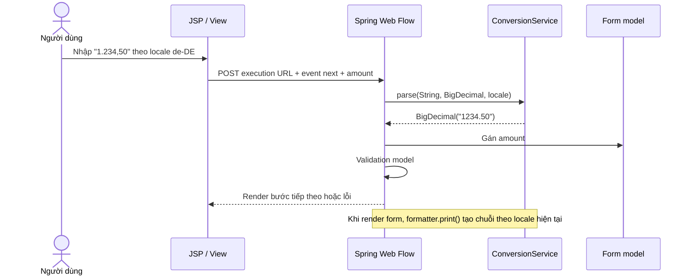

# Định dạng số theo locale trong Spring Web Flow

Một biểu mẫu báo giá có thể giữ giá trị `1234567.89` trong model Java. Nhưng người dùng ở Hoa Kỳ thường đọc số đó là `1,234,567.89`, người dùng ở Đức quen với `1.234.567,89`, còn giao diện tiếng Việt thường dùng dấu chấm phân nhóm và dấu phẩy thập phân. Nếu ứng dụng luôn hiển thị cùng một chuỗi số cho mọi người, biểu mẫu trở nên khó đọc; nếu parse chuỗi theo locale sai, số tiền có thể bị hiểu thành một giá trị hoàn toàn khác.

Trong Spring Web Flow (`SPRING_WEB_FLOW`), dữ liệu form đi qua **data binding**: request gửi chuỗi, Web Flow chuyển chuỗi thành kiểu Java của model; khi render, model lại được chuyển thành chuỗi để hiển thị. **Định dạng số theo locale** quyết định dấu thập phân, dấu phân nhóm, kiểu tiền tệ và phần trăm trong hai chiều đó. Web Flow sử dụng hệ thống **Spring Conversion và Formatting**, nên ta có thể dùng `@NumberFormat`, các formatter có sẵn hoặc formatter riêng, đồng thời chia sẻ cấu hình với Spring MVC.

Bài học thuộc chương **Chuyển đổi và định dạng**. Sau khi hoàn thành, bạn có thể:

- Phân biệt `Locale`, giá trị số trong model và chuỗi số hiển thị trên form.
- Giải thích cách dấu thập phân và dấu phân nhóm thay đổi giữa các locale.
- Dùng `@NumberFormat` với kiểu số, tiền tệ và phần trăm.
- Chọn `NumberStyleFormatter`, `CurrencyStyleFormatter`, `PercentStyleFormatter` hoặc pattern phù hợp.
- Cấu hình `ConversionService` để Spring MVC và Spring Web Flow dùng chung formatter.
- Chọn `LocaleResolver`, hiểu vai trò của `LocaleContextHolder` và thay đổi ngôn ngữ theo người dùng.
- Xử lý lỗi parse, precision của `BigDecimal`, nhập liệu HTML và kiểm thử nhiều locale.

## 1. Locale quyết định cách đọc số, không thay đổi giá trị số

`Locale` mô tả quy ước ngôn ngữ và vùng lãnh thổ mà ứng dụng dùng khi trình bày dữ liệu. Với số, locale có thể quyết định:

- Dấu thập phân: dấu chấm `.` hoặc dấu phẩy `,`.
- Dấu phân nhóm hàng nghìn: dấu phẩy, dấu chấm, khoảng trắng hoặc ký tự khoảng trắng đặc biệt.
- Cách đặt ký hiệu tiền tệ trước hay sau số.
- Số chữ số thập phân thường dùng cho kiểu hiển thị.
- Dấu cách giữa số và ký hiệu phần trăm/tiền tệ.

Ví dụ, cùng một giá trị `BigDecimal("1234567.89")` có thể được hiển thị theo những quy ước thường gặp như sau:

| Locale | Ví dụ hiển thị | Quy ước |
| --- | --- | --- |
| `en-US` | `1,234,567.89` | Phẩy phân nhóm, chấm thập phân |
| `de-DE` | `1.234.567,89` | Chấm phân nhóm, phẩy thập phân |
| `vi-VN` | `1.234.567,89` | Thường gặp trong giao diện tiếng Việt |
| `fr-FR` | `1 234 567,89` | Có thể dùng khoảng trắng hẹp không ngắt dòng để phân nhóm |

Các chuỗi trên là **ví dụ minh họa**. Kết quả thực tế còn phụ thuộc dữ liệu locale của JDK/CLDR, phiên bản runtime và kiểu formatter. Không nên dùng một chuỗi hiển thị làm định dạng trao đổi dữ liệu cố định giữa các hệ thống.

### Giá trị trong model và chuỗi hiển thị là hai lớp khác nhau

```text
Model Java
  amount = BigDecimal("1234567.89")
           |
           | Formatter.print(value, locale)
           v
View cho en-US: "1,234,567.89"
View cho de-DE: "1.234.567,89"
View cho vi-VN: "1.234.567,89"

Request từ form
  amount = chuỗi người dùng nhập theo quy ước đã chọn
           |
           | Formatter.parse(text, locale)
           v
Model Java
  amount = BigDecimal("1234567.89")
```

Locale không biến `BigDecimal` thành một giá trị khác. Nó chỉ điều khiển cách **in** và **đọc** chuỗi ở biên giao diện. Giá trị nghiệp vụ vẫn phải được lưu dưới kiểu số phù hợp, không lưu chuỗi đã thêm dấu phân nhóm chỉ để hiển thị.

### Vì sao chuỗi `1,234` có thể nguy hiểm?

- Theo `en-US`, `1,234` thường có nghĩa là một nghìn hai trăm ba mươi bốn.
- Theo locale dùng dấu phẩy thập phân như `de-DE`, dấu phẩy có thể biểu thị phần thập phân; cùng chuỗi đó có thể được hiểu thành một phẩy hai ba bốn.

Nếu người dùng nhập theo một locale nhưng server parse theo locale khác, ứng dụng có thể nhận một giá trị hợp lệ về mặt cú pháp nhưng sai nghiệp vụ. Vì vậy, **locale dùng để render form và locale dùng để parse postback phải nhất quán**.

## 2. Web Flow chuyển đổi số ở đâu trong lifecycle?

Một `view-state` có thể khai báo model:

```xml
<view-state id="enterQuote"
            view="quote/edit"
            model="quoteForm">
    <binder>
        <binding property="amount" required="true" />
    </binder>
    <transition on="next" to="review" />
</view-state>
```

Khi người dùng gửi event `next`, Web Flow thực hiện binding các tham số request vào thuộc tính model. Nếu thuộc tính Java là `BigDecimal` nhưng request gửi một chuỗi, framework cần **type conversion** để chuyển chuỗi đó thành số. Khi render view, chiều chuyển đổi ngược biến giá trị trong model thành chuỗi để hiển thị.



Quá trình có hai hướng:

| Hướng | Đầu vào | Kết quả | Thành phần liên quan |
| --- | --- | --- | --- |
| Parse/binding | Chuỗi request | Giá trị Java như `BigDecimal`, `Integer` | `Parser`, `Formatter`, `ConversionService` |
| Print/render | Giá trị Java | Chuỗi theo locale để view hiển thị | `Printer`, `Formatter`, `ConversionService` |

Nếu parse thất bại, binding không hoàn tất; Web Flow có thể render lại view để người dùng sửa. Event không đi tiếp như khi binding thành công. Đây là lỗi **chuyển đổi kiểu**, khác với lỗi validation như số âm hoặc vượt giới hạn cho phép.

## 3. Chọn đúng công cụ: Converter hay Formatter?

Spring cung cấp hai SPI có mục đích gần nhau nhưng không giống nhau:

| SPI | Trách nhiệm | Ví dụ |
| --- | --- | --- |
| `Converter<S, T>` | Chuyển một kiểu đối tượng sang kiểu khác | `String → CurrencyCode`, `Long → CustomerId` |
| `Formatter<T>` | In một đối tượng thành chuỗi và parse chuỗi theo locale | `BigDecimal ↔ "1.234,50"` |

`Formatter<T>` kết hợp hai hợp đồng:

```java
public interface Printer<T> {
    String print(T fieldValue, Locale locale);
}

public interface Parser<T> {
    T parse(String clientValue, Locale locale) throws ParseException;
}

public interface Formatter<T> extends Printer<T>, Parser<T> {
}
```

Đối với biểu mẫu web, `Formatter` thường phù hợp hơn khi chuỗi người dùng nhập phải được đọc theo locale. `ConversionService` cung cấp một API chung để Web Flow và Spring MVC sử dụng các converter/formatter đã đăng ký.

### Các formatter số có sẵn

| Formatter | Cách tạo định dạng | Trường hợp dùng |
| --- | --- | --- |
| `NumberStyleFormatter` | Dựa trên `NumberFormat.getNumberInstance(locale)` | Số lượng, trọng lượng, giá trị thập phân thông thường |
| `CurrencyStyleFormatter` | Dựa trên `NumberFormat.getCurrencyInstance(locale)` | Hiển thị tiền tệ theo locale |
| `PercentStyleFormatter` | Dựa trên `NumberFormat.getPercentInstance(locale)` | Tỷ lệ và phần trăm |

Các formatter số của Spring hỗ trợ parse `BigDecimal` để giữ độ chính xác thập phân, thay vì buộc giá trị qua `double`. Đây là lựa chọn phù hợp cho giá tiền và số thập phân nghiệp vụ khi cấu hình đúng.

## 4. Dùng `@NumberFormat` trên form model

`@NumberFormat` cho phép khai báo cách hiển thị/parse ngay trên thuộc tính số của model. Annotation nằm trong package `org.springframework.format.annotation`.

```java
package com.example.quote;

import java.io.Serializable;
import java.math.BigDecimal;

import org.springframework.format.annotation.NumberFormat;

public class QuoteForm implements Serializable {

    @NumberFormat(style = NumberFormat.Style.NUMBER)
    private BigDecimal quantity;

    @NumberFormat(pattern = "#,##0.00")
    private BigDecimal unitPrice;

    @NumberFormat(style = NumberFormat.Style.PERCENT)
    private BigDecimal discountRate;

    public BigDecimal getQuantity() {
        return quantity;
    }

    public void setQuantity(BigDecimal quantity) {
        this.quantity = quantity;
    }

    public BigDecimal getUnitPrice() {
        return unitPrice;
    }

    public void setUnitPrice(BigDecimal unitPrice) {
        this.unitPrice = unitPrice;
    }

    public BigDecimal getDiscountRate() {
        return discountRate;
    }

    public void setDiscountRate(BigDecimal discountRate) {
        this.discountRate = discountRate;
    }
}
```

Ý nghĩa:

- `quantity` dùng kiểu số thông thường theo locale.
- `unitPrice` dùng pattern `#,##0.00`: hiển thị tối thiểu hai chữ số thập phân, có nhóm hàng nghìn.
- `discountRate` dùng kiểu phần trăm. Giá trị model `0.125` thường hiển thị là `12.5%` trong locale dùng dấu chấm thập phân, hoặc `12,5 %` theo quy ước khác.

### Chọn style hay pattern?

`@NumberFormat` hỗ trợ style và pattern:

```java
@NumberFormat(style = NumberFormat.Style.NUMBER)
private BigDecimal quantity;

@NumberFormat(style = NumberFormat.Style.CURRENCY)
private BigDecimal displayAmount;

@NumberFormat(style = NumberFormat.Style.PERCENT)
private BigDecimal ratio;

@NumberFormat(pattern = "#,##0.00")
private BigDecimal unitPrice;
```

| Cấu hình | Kết quả mong muốn |
| --- | --- |
| `Style.NUMBER` | Định dạng số thông thường của locale |
| `Style.CURRENCY` | Định dạng tiền tệ gắn với locale |
| `Style.PERCENT` | Định dạng phần trăm của locale |
| `pattern = "#,##0.00"` | Kiểm soát số chữ số và cấu trúc nhóm, còn ký hiệu thập phân/phân nhóm theo locale |

Chọn một trong hai `style` hoặc `pattern` cho một annotation. Khi khai báo pattern, pattern được ưu tiên. Pattern `#,##0.00` dùng dấu chấm và dấu phẩy như ký hiệu cú pháp của `DecimalFormat`; khi hiển thị, ký hiệu thực tế được thay theo locale.

### Lưu ý về Expression Language của Web Flow

Web Flow hỗ trợ cả **Spring EL** và **Unified EL**. Theo tài liệu Web Flow, khả năng tự phát hiện kiểu generic và sử dụng formatting annotations như `@NumberFormat` được hỗ trợ **chỉ với Spring EL**. Nếu ứng dụng chủ động thay expression parser mặc định bằng Unified EL, hãy kiểm tra lại việc nhận annotation định dạng; không suy ra rằng biểu thức flow vẫn chạy được thì annotation cũng chắc chắn được áp dụng. Khi cần dùng formatting annotations, ưu tiên Spring EL theo cấu hình được tài liệu Web Flow khuyến nghị.

Đây là một điểm dễ bị bỏ sót khi nâng cấp ứng dụng cũ: form có thể vẫn render, nhưng formatter theo annotation không được áp dụng như mong muốn do expression parser đã được thay đổi từ trước.

### Đừng nhầm phần trăm với số phần trăm đã nhân

Với `PercentStyleFormatter`, model thường giữ tỷ lệ ở dạng phân số:

| Giá trị trong model | Chuỗi hiển thị thường gặp |
| --- | --- |
| `0.05` | `5%` |
| `0.125` | `12.5%` |
| `1.0` | `100%` |

Nếu model đã lưu `12.5` để đại diện cho 12,5%, rồi tiếp tục dùng `Style.PERCENT`, giao diện có thể hiển thị `1,250%`. Hãy thống nhất hợp đồng dữ liệu: **lưu tỷ lệ hay lưu số phần trăm**, rồi chỉ dùng một quy ước xuyên suốt.

## 5. Tiền tệ: locale không quyết định đồng tiền nghiệp vụ

`Style.CURRENCY` dùng quy ước tiền tệ của locale hiện tại. Điều này hữu ích cho giao diện cá nhân hóa, nhưng cần cẩn trọng trong hệ thống có nhiều loại tiền:

- Người dùng chọn giao diện `en-US` không có nghĩa mọi số tiền của họ đều là USD.
- Một đơn hàng có thể được định giá bằng VND, trong khi người xem chọn giao diện tiếng Anh.
- Đổi locale không được tự ý đổi giá trị hoặc mã tiền tệ của giao dịch.

Với nghiệp vụ tiền tệ, nên lưu **giá trị số và mã tiền tệ riêng biệt**, ví dụ `BigDecimal amount` và `currencyCode = "VND"`. Nếu cần hiển thị theo đồng tiền đã xác định, hãy dùng formatter biết rõ mã tiền tệ đó hoặc một kiểu `Money` chứa cả amount và currency; không chỉ dựa vào `Locale` để đoán tiền tệ.

Ví dụ minh họa mô hình:

```java
public class MoneyValue {
    private BigDecimal amount;
    private String currencyCode; // Ví dụ: VND, USD, EUR

    // Getter/setter và kiểm tra mã tiền tệ theo nghiệp vụ.
}
```

Không dùng `double` cho tiền cần độ chính xác thập phân. Dùng `BigDecimal`, xác định scale/rounding rule ở tầng nghiệp vụ và kiểm tra lại khi commit. Formatter chỉ kiểm soát cách parse/print; nó không thay thế quy tắc làm tròn kế toán hoặc chính sách quy đổi ngoại tệ.

## 6. Locale được lấy từ đâu?

Trong ứng dụng Spring MVC, `DispatcherServlet` sử dụng một **`LocaleResolver`** để xác định locale của request. Spring đưa locale hiện hành vào ngữ cảnh của request; các formatter có thể nhận `Locale` trực tiếp trong `print`/`parse`, hoặc một số factory của Web Flow dùng `LocaleContextHolder.getLocale()` khi không được gán locale riêng.

Các lựa chọn thường gặp:

| Cơ chế | Nguồn locale | Khi phù hợp |
| --- | --- | --- |
| `AcceptHeaderLocaleResolver` | Header `Accept-Language` của browser | Muốn dùng ngôn ngữ trình duyệt làm mặc định |
| `CookieLocaleResolver` | Cookie do ứng dụng lưu | Người dùng có thể chọn ngôn ngữ và muốn giữ lựa chọn |
| `SessionLocaleResolver` | Thuộc tính trong `HttpSession` | Lựa chọn ngôn ngữ chỉ cần giữ trong phiên đăng nhập |
| `LocaleChangeInterceptor` | Tham số request như `?lang=vi-VN` | Cho phép thay locale qua một thao tác trong giao diện |

Ví dụ, khi người dùng chọn tiếng Đức, request tiếp theo được giải quyết thành `de-DE`; khi submit form Web Flow, formatter phải parse chuỗi theo cùng locale đó. Nếu giao diện hiển thị bằng `de-DE` nhưng postback parse bằng `en-US`, các dấu chấm/phẩy có thể bị hiểu sai.

### Ví dụ cấu hình locale bằng Java

```java
@Configuration
public class WebLocaleConfiguration implements WebMvcConfigurer {

    @Bean
    public LocaleResolver localeResolver() {
        CookieLocaleResolver resolver = new CookieLocaleResolver();
        resolver.setDefaultLocale(Locale.forLanguageTag("vi-VN"));
        return resolver;
    }

    @Bean
    public LocaleChangeInterceptor localeChangeInterceptor() {
        LocaleChangeInterceptor interceptor = new LocaleChangeInterceptor();
        interceptor.setParamName("lang");
        return interceptor;
    }

    @Override
    public void addInterceptors(InterceptorRegistry registry) {
        registry.addInterceptor(localeChangeInterceptor());
    }
}
```

Đây là cấu hình minh họa cho ứng dụng dùng Spring MVC. Interceptor phải được gắn vào handler mapping xử lý request của flow; kiểm tra cấu hình mapping thực tế nếu URL Web Flow đi qua một handler mapping riêng. Với `AcceptHeaderLocaleResolver`, người dùng không thể thay locale bằng `setLocale` như resolver dựa trên cookie/session; hãy chọn resolver phù hợp với UX mong muốn.

### Vai trò của `LocaleContextHolder`

Một số formatter/factory có thể lấy locale từ `LocaleContextHolder` khi không truyền locale cố định. Ví dụ `org.springframework.binding.format.AbstractNumberFormatFactory` của Web Flow dùng locale gắn với thread hiện tại nếu thuộc tính locale riêng chưa được đặt.

Điều đó giúp formatter hoạt động theo locale của request mà không cần hardcode `Locale.US` hoặc `Locale.forLanguageTag("vi-VN")` trong mọi lần format. Tuy nhiên, khi chạy xử lý ngoài request hoặc trên thread bất đồng bộ, không nên giả định ngữ cảnh locale của request vẫn tồn tại; hãy truyền locale một cách tường minh nếu công việc cần phụ thuộc nó.

## 7. Nối ConversionService của Spring MVC và Spring Web Flow

Một điểm quan trọng trong kiến trúc: Spring MVC và Web Flow có thể được tạo với **các ConversionService khác nhau**. Khi ứng dụng chỉ dùng formatter mặc định, khác biệt này có thể chưa dễ nhận thấy. Khi đăng ký formatter riêng, MVC có thể parse đúng nhưng form Web Flow lại báo `typeMismatch` nếu hai nơi không dùng cùng cấu hình.

Spring Web Flow cho phép cấu hình `DefaultConversionService` của flow builder và delegate tới một Spring `FormattingConversionService`. Nhờ đó, cùng formatter có thể được sử dụng ở cả controller MVC và view-state của flow.

### 7.1. Tạo formatter riêng khi quy tắc cần dùng chung

Ví dụ formatter cho `BigDecimal` dùng pattern có nhóm hàng nghìn và hai chữ số thập phân:

```java
package com.example.config;

import java.math.BigDecimal;
import java.text.ParseException;
import java.util.Locale;

import org.springframework.format.Formatter;
import org.springframework.format.number.NumberStyleFormatter;

public final class AmountFormatter implements Formatter<BigDecimal> {

    private final NumberStyleFormatter delegate =
            new NumberStyleFormatter("#,##0.00");

    public AmountFormatter() {
        delegate.setLenient(false);
    }

    @Override
    public String print(BigDecimal value, Locale locale) {
        return delegate.print(value, locale);
    }

    @Override
    public BigDecimal parse(String text, Locale locale) throws ParseException {
        if (text == null || text.isBlank()) {
            return null;
        }
        return (BigDecimal) delegate.parse(text.trim(), locale);
    }
}
```

`NumberStyleFormatter` parse giá trị số thành `BigDecimal`, giúp tránh mất độ chính xác do chuyển qua `double`. Formatter trên chỉ là ví dụ cho một kiểu dữ liệu có quy ước hiển thị riêng; nếu muốn để từng thuộc tính tự chọn style/pattern, `@NumberFormat` thường gọn hơn.

### 7.2. Đăng ký formatter trong FormattingConversionService

```java
package com.example.config;

import org.springframework.format.FormatterRegistry;
import org.springframework.format.support.FormattingConversionServiceFactoryBean;

public class ApplicationConversionServiceFactoryBean
        extends FormattingConversionServiceFactoryBean {

    @Override
    protected void installFormatters(FormatterRegistry registry) {
        registry.addFormatter(new AmountFormatter());
    }
}
```

Lớp này là factory bean đăng ký formatter. Nếu đăng ký formatter theo kiểu `BigDecimal` toàn cục, nó sẽ ảnh hưởng mọi thuộc tính `BigDecimal` phù hợp với formatter đó. Với ứng dụng có nhiều quy tắc số khác nhau, hãy cân nhắc `@NumberFormat`, custom annotation hoặc kiểu domain riêng thay vì áp một pattern cho mọi trường.

### 7.3. Cấu hình dùng chung cho MVC và Web Flow

```xml
<bean id="applicationConversionService"
      class="com.example.config.ApplicationConversionServiceFactoryBean" />

<!-- Spring MVC dùng FormattingConversionService này -->
<mvc:annotation-driven
        conversion-service="applicationConversionService" />

<!-- Web Flow dùng DefaultConversionService delegate tới cùng service -->
<bean id="flowConversionService"
      class="org.springframework.binding.convert.service.DefaultConversionService">
    <constructor-arg ref="applicationConversionService" />
</bean>

<webflow:flow-builder-services
        id="flowBuilderServices"
        conversion-service="flowConversionService" />
```

Flow registry phải tham chiếu `flowBuilderServices` này, ví dụ thông qua thuộc tính `flow-builder-services` theo cấu hình registry của ứng dụng. Đoạn XML trên là phần cấu hình cốt lõi, không phải toàn bộ file Spring context; cần có namespace/schema của `mvc`, `webflow` và bean flow registry/executor phù hợp.

Nếu ứng dụng đã dùng Java configuration, Web Flow cũng cho phép gán `ConversionService` vào `FlowBuilderServices` qua builder API. Hãy cấu hình **một nguồn quy tắc định dạng nhất quán** để form MVC và form Web Flow không diễn giải cùng chuỗi theo hai cách khác nhau.

## 8. Gắn formatter với form trong một flow

Ví dụ flow báo giá:

```xml
<?xml version="1.0" encoding="UTF-8"?>
<flow xmlns="http://www.springframework.org/schema/webflow"
      xmlns:xsi="http://www.w3.org/2001/XMLSchema-instance"
      xsi:schemaLocation="http://www.springframework.org/schema/webflow
                          https://www.springframework.org/schema/webflow/spring-webflow.xsd">

    <var name="quoteForm" class="com.example.quote.QuoteForm" />

    <view-state id="enterQuote"
                view="quote/edit"
                model="quoteForm">
        <binder>
            <binding property="quantity" required="true" />
            <binding property="unitPrice" required="true" />
        </binder>
        <transition on="next" to="review" />
    </view-state>

    <view-state id="review" view="quote/review">
        <transition on="back" to="enterQuote" />
        <transition on="confirm" to="completed" />
    </view-state>

    <end-state id="completed" view="quote/completed" />
</flow>
```

Trong `QuoteForm`, các field `quantity` và `unitPrice` có thể dùng `@NumberFormat`. Khi view render, Spring form tag đọc model và formatter để tạo giá trị hiển thị. Khi postback, Web Flow dùng ConversionService để parse giá trị theo locale request và cập nhật model trước khi transition.

Ví dụ JSP:

```jsp
<form:form method="post"
           modelAttribute="quoteForm"
           action="${flowExecutionUrl}">
    <label for="quantity">Số lượng</label>
    <form:input path="quantity" id="quantity" type="text" />
    <form:errors path="quantity" />

    <label for="unitPrice">Đơn giá</label>
    <form:input path="unitPrice" id="unitPrice"
                type="text" inputmode="decimal" />
    <form:errors path="unitPrice" />

    <button type="submit" name="_eventId_next" value="1">
        Xem lại
    </button>
</form:form>
```

`flowExecutionUrl` gửi form về đúng execution đang chạy. Với trường nhập theo định dạng locale, `type="text"` cùng `inputmode="decimal"` thường phù hợp hơn khi server mong nhận chuỗi như `1.234,50` hoặc `1,234.50`. Đây vẫn là đầu vào không đáng tin cậy: cần parse, validation và kiểm tra nghiệp vụ ở server.

### Input type number có phải luôn dùng formatter locale không?

Không nên mặc định như vậy. Theo HTML Standard, định dạng trình bày trong giao diện của điều khiển số có thể được bản địa hóa, nhưng **giá trị dùng trong markup và gửi lên server được chuẩn hóa theo cú pháp số của HTML**, độc lập với locale. Trình duyệt có thể cho người dùng nhập theo dấu thập phân địa phương rồi chuẩn hóa thành chuỗi có dấu chấm trước khi submit.

Điều này có thể không khớp với formatter đang mong đợi chuỗi locale đầy đủ. Hãy chọn rõ một trong hai hợp đồng:

- **Chuỗi đã bản địa hóa:** dùng text input, cho formatter Spring parse theo locale request.
- **Giá trị số chuẩn hóa theo HTML:** dùng `type="number"`, cấu hình server nhận cú pháp số chuẩn hóa phù hợp; không giả định request chứa dấu phân nhóm và dấu thập phân theo locale.

Không tự nối chuỗi, thay dấu phẩy bằng dấu chấm hoặc xóa dấu phân nhóm bằng JavaScript mà không hiểu locale. Ví dụ `1,234` có thể là một nghìn hai trăm ba mươi bốn hoặc một phẩy hai ba bốn tùy locale.

## 9. Phân biệt lỗi chuyển đổi với lỗi validation

Khi người dùng gửi một form số, có hai nhóm lỗi thường gặp:

| Nhóm lỗi | Ví dụ | Kết quả |
| --- | --- | --- |
| Binding/type conversion | Nhập `abc` vào trường `BigDecimal` | Chuỗi không parse được thành số; binding error `typeMismatch` |
| Validation | Nhập `-10` trong trường chỉ cho phép số dương | Parse thành công, nhưng constraint/nghiệp vụ từ chối giá trị |
| Business validation | Đơn giá parse được nhưng vượt hạn mức được phép | Service/domain từ chối theo quy tắc nghiệp vụ |

**Conversion xảy ra trước validation model.** Nếu chuỗi không parse được, validator không thể xử lý nó như một `BigDecimal` hợp lệ. Web Flow giữ view-state và hiển thị lỗi binding để người dùng sửa.

### Thông điệp lỗi typeMismatch

Web Flow ánh xạ lỗi chuyển đổi sang message code. Có thể khai báo thông điệp chung trong message bundle:

```properties
typeMismatch=Vui lòng nhập một số theo định dạng đang hiển thị.
typeMismatch.java.math.BigDecimal=Giá trị phải là số thập phân hợp lệ.
```

Ứng dụng có thể khai báo message cụ thể hơn cho model/property theo quy ước message code mà Web Flow tạo ra. Ví dụ tài liệu Web Flow minh họa khóa dạng `booking.checkinDate.typeMismatch`; hãy xác minh tên model/property thực tế và thứ tự lookup khi cấu hình message bundle.

### Kiểm tra miền giá trị sau khi parse

Với form báo giá, ngoài định dạng số có thể dùng Bean Validation:

```java
@DecimalMin("0.01")
@Digits(integer = 12, fraction = 2)
@NumberFormat(pattern = "#,##0.00")
private BigDecimal unitPrice;
```

Các annotation validation cần import namespace tương ứng với phiên bản ứng dụng (`jakarta.validation` ở stack Jakarta mới, hoặc `javax.validation` ở stack cũ). `@NumberFormat` không thay thế `@DecimalMin`/`@Digits`; ngược lại, validation cũng không quyết định dấu phân nhóm hoặc cách hiển thị số.

## 10. Độ chính xác, làm tròn và an toàn dữ liệu

Định dạng số chỉ nên tác động đến **chuỗi giao diện**. Không dùng số đã làm tròn để ghi đè giá trị nghiệp vụ nếu chưa có quy tắc làm tròn được xác định.

### Dùng BigDecimal cho tiền và số thập phân cần độ chính xác

- Dùng `BigDecimal` cho số tiền, tỷ lệ tính toán hoặc đại lượng cần giữ chính xác thập phân.
- Tránh khởi tạo từ `double` khi cần biểu diễn số thập phân chính xác; ưu tiên chuỗi thập phân hoặc dữ liệu đã parse an toàn.
- Xác định `scale` và `RoundingMode` ở tầng nghiệp vụ khi tính toán/ghi dữ liệu.
- Chỉ định formatter để hiển thị số chữ số thập phân; không nhầm số chữ số hiển thị với độ chính xác được lưu.

Ví dụ, model có `BigDecimal("12.3456")` nhưng view dùng pattern hai chữ số thập phân có thể hiển thị `12,35` ở locale dùng dấu phẩy. Điều đó **không có nghĩa** model đã đổi thành `12.35`. Nếu nghiệp vụ yêu cầu làm tròn thành hai chữ số, service phải thực hiện phép tính và quy tắc làm tròn rõ ràng.

### Kiểm soát lenient parsing

Một parser quá dễ dãi có thể chấp nhận chuỗi có dấu phân nhóm sai hoặc phần thừa mà người dùng không dự kiến. Với các trường quan trọng, cân nhắc formatter có chế độ parse nghiêm ngặt, kiểm tra toàn bộ chuỗi và kiểm thử những dạng đầu vào bất thường. `NumberStyleFormatter` có hỗ trợ cấu hình `setLenient(false)`.

Không tự viết parser bằng cách xóa tất cả dấu chấm, dấu phẩy hoặc khoảng trắng: ký tự đó có thể là dấu thập phân của locale hiện tại. Cũng không cho phép ký tự định dạng ẩn, dấu âm hoặc ký hiệu tiền tệ ngoài hợp đồng nhập liệu nếu nghiệp vụ không chấp nhận.

## 11. Những điểm cần chú ý khi triển khai đa locale

| Vấn đề | Rủi ro | Hướng xử lý |
| --- | --- | --- |
| Locale khác nhau giữa GET và POST | Parse sai dấu thập phân/phân nhóm | Dùng LocaleResolver ổn định và giữ lựa chọn locale nhất quán |
| Currency style theo locale | Hiển thị sai đồng tiền nghiệp vụ | Lưu mã tiền tệ riêng, format theo currency thực |
| Dùng `double` cho tiền | Sai số nhị phân | Dùng `BigDecimal` |
| Pattern không thống nhất | MVC và Web Flow render khác nhau | Chia sẻ ConversionService/FormatterRegistry |
| `type="number"` và formatter locale | Chuỗi gửi lên có thể theo chuẩn HTML chứ không theo chuỗi hiển thị | Chọn hợp đồng nhập liệu rõ ràng và kiểm tra request thực tế |
| Pattern quá cứng | Không thích nghi locale | Pattern kiểm soát cấu trúc; để locale quyết định ký hiệu thập phân/phân nhóm |
| JDK/CLDR thay đổi | Style-based output có thể đổi giữa runtime | Test trên JDK đích; dùng pattern có kiểm soát khi cần ổn định |
| Formatter giữ NumberFormat dùng chung | `NumberFormat` không thread-safe | Tạo formatter/NumberFormat an toàn theo từng lần gọi; không chia sẻ instance mutable |
| Thay locale trong khi wizard đang mở | Giá trị form cũ có thể khác quy ước postback mới | Xác định rõ locale áp dụng cho mỗi request và kiểm thử chuyển locale giữa các bước |

### Lưu ý JDK 20 trở lên

Spring ghi nhận các formatter dựa trên style của locale có thể có thay đổi khi chạy trên JDK 20 trở lên do dữ liệu locale/CLDR. Nếu giao diện phụ thuộc chính xác vào một pattern đã thống nhất, hãy khai báo pattern cụ thể và kiểm thử trên JDK triển khai. Pattern vẫn sử dụng ký hiệu thập phân/phân nhóm theo locale; nếu cần định dạng trao đổi hoàn toàn bất biến, hãy dùng một định dạng máy đọc được riêng thay vì chuỗi giao diện.

## 12. Kiểm thử định dạng số theo locale

Không chỉ test `print()` mà cần test cả chiều `parse()`, form postback và lỗi binding.

| Ca kiểm thử | Locale / dữ liệu | Kỳ vọng |
| --- | --- | --- |
| Số nguyên | `en-US`, `1234567` | Hiển thị có phân nhóm theo locale |
| Số thập phân | `en-US`, `1234.50` | Parse thành `BigDecimal("1234.50")` |
| Dấu thập phân phẩy | `de-DE`, `1.234,50` | Parse thành cùng giá trị `1234.50` |
| Dấu nhóm khoảng trắng | `fr-FR`, chuỗi có khoảng trắng hẹp | Parser nhận đúng ký tự phân nhóm được locale dùng |
| Locale Việt | `vi-VN` | Hiển thị/parse theo dữ liệu locale của JDK triển khai |
| Tiền tệ | `en-US`, `de-DE`, `vi-VN` | Kiểm tra vị trí ký hiệu, chữ số thập phân và mã tiền tệ |
| Phần trăm | `0.125` với percent style | Hiển thị khoảng 12,5% theo locale |
| Chuỗi sai | `abc`, `12,3,4` | Binding error; không đi tiếp transition |
| Dữ liệu âm | `-10` | Parse có thể thành công, validation nghiệp vụ từ chối |
| Vượt precision | Số có nhiều chữ số thập phân | Không âm thầm mất precision; kiểm tra quy tắc scale |
| Đổi locale giữa bước | GET bằng `vi-VN`, POST bằng `en-US` | Hành vi đúng chính sách; không parse theo locale không rõ ràng |
| MVC và Web Flow | Cùng form model, cùng locale | Hai nơi hiển thị/parse nhất quán khi dùng chung service |
| HTML number input | Browser hiển thị địa phương hóa | Server nhận chuỗi số chuẩn hóa theo HTML |
| Nhiều người dùng đồng thời | Hai request với hai locale | Formatter không rò rỉ locale giữa các request |

### Kiểm thử round-trip

Với một giá trị `BigDecimal`, kiểm tra:

1. `print(value, locale)` tạo chuỗi phù hợp locale.
2. `parse(renderedText, locale)` trả về giá trị bằng giá trị ban đầu theo precision yêu cầu.
3. Locale khác nhau tạo chuỗi khác nhau nhưng vẫn biểu diễn cùng giá trị.
4. Chuỗi sai hoặc locale không khớp tạo binding error, không bị biến thành một số khác hợp lệ.

Trong test Web Flow, launch flow, gửi event ở `view-state`, kiểm tra model và message context; không chỉ unit test formatter độc lập. Trong kiểm thử tích hợp MVC, xác minh `LocaleResolver` thật sự áp dụng locale cho request.

## 13. Bài tập thực hành: wizard báo giá đa ngôn ngữ

Xây dựng flow `quote` có các bước `enterItems`, `review`, `confirm`:

1. Tạo `QuoteForm` với `quantity`, `unitPrice`, `discountRate` dùng `BigDecimal`.
2. Gắn `@NumberFormat` phù hợp: số lượng kiểu NUMBER, đơn giá theo pattern hai chữ số thập phân, tỷ lệ giảm giá kiểu PERCENT.
3. Cấu hình locale mặc định `vi-VN`, cho người dùng đổi sang `en-US` hoặc `de-DE` qua cookie/session và locale change interceptor.
4. Cấu hình một `FormattingConversionService` dùng chung giữa Spring MVC và Web Flow qua `flow-builder-services`.
5. Tạo form nhập số có hiển thị lỗi parse; thử nhập `1.234,50` ở locale `de-DE` và `1,234.50` ở locale `en-US`.
6. So sánh `input type="text" inputmode="decimal"` với `input type="number"`; xem dữ liệu thực tế trong Network Form Data.
7. Kiểm tra `unitPrice` không âm, giới hạn số chữ số và chính sách làm tròn bằng validation/service.
8. Nếu báo giá có thể bằng VND hoặc USD, lưu mã tiền tệ tách biệt với locale giao diện; chứng minh đổi ngôn ngữ không đổi đồng tiền giao dịch.
9. Viết test round-trip cho ít nhất ba locale, test lỗi parse, hai người dùng đồng thời và postback sau khi locale được đổi.

**Câu hỏi tự đánh giá:**

- Vì sao cùng `BigDecimal("1234.50")` có thể được render thành hai chuỗi khác nhau?
- `NumberStyleFormatter` khác `Converter<String, BigDecimal>` ở điểm nào?
- `@NumberFormat(style = CURRENCY)` lấy quy ước tiền tệ từ đâu? Vì sao không luôn phù hợp cho giao dịch đa tiền tệ?
- Tại sao cần cấu hình Web Flow dùng cùng ConversionService với Spring MVC khi có formatter tùy chỉnh?
- Khi parse thất bại, Web Flow có thể hiển thị lỗi gì và transition có đi tiếp không?
- Tại sao `type="number"` có thể không phù hợp nếu server đang mong chuỗi đã bản địa hóa?
- Vì sao dùng `BigDecimal` và quy tắc làm tròn nghiệp vụ quan trọng hơn chỉ định dạng hai chữ số?
- Điều gì có thể thay đổi khi JDK cập nhật dữ liệu locale/CLDR?

## 14. Tài liệu tham khảo

- [Spring Web Flow 4.0.2 Reference — Performing Type Conversion](https://docs.spring.io/spring-webflow/docs/current/reference/): cách Web Flow dùng Spring type conversion/formatting, cấu hình `flow-builder-services` và liên kết với Spring MVC.
- [Spring Web Flow 2.5.1 Reference — Performing Type Conversion](https://docs.spring.io/spring-webflow/docs/2.5.1.RELEASE/reference/htmlsingle/): lịch sử tích hợp Conversion/Formatting từ Web Flow 2.1 và cách cấu hình legacy.
- [Spring Framework — Spring Field Formatting](https://docs.spring.io/spring/reference/core/validation/format.html): `Formatter`, `NumberStyleFormatter`, `CurrencyStyleFormatter`, `PercentStyleFormatter`, `@NumberFormat`.
- [Spring Framework — NumberFormat API](https://docs.spring.io/spring-framework/docs/current/javadoc-api/org/springframework/format/annotation/NumberFormat.html): style và pattern của annotation.
- [Spring Framework — Locale trong Spring MVC](https://docs.spring.io/spring/reference/7.0/web/webmvc/mvc-servlet/localeresolver.html): `LocaleResolver`, cookie/session resolver và `LocaleChangeInterceptor`.
- [HTML Standard — Number state và localization](https://html.spec.whatwg.org/multipage/input.html#number-state-(type=number)): khác biệt giữa cách browser trình bày số và giá trị số được gửi.

## Ghi nhớ

Định dạng số theo locale là quá trình **parse chuỗi request thành số trong model và print số thành chuỗi phù hợp người dùng**. Spring Web Flow dùng hệ thống Spring Conversion/Formatting; `@NumberFormat` và các formatter số có sẵn đáp ứng phần lớn nhu cầu. Để form MVC và Web Flow nhất quán, hãy chia sẻ cấu hình `ConversionService`, dùng LocaleResolver ổn định và kiểm thử cả hai chiều parse/print. Giữ số tiền bằng `BigDecimal`, tách mã tiền tệ khỏi locale, phân biệt chuỗi nhập đã bản địa hóa với giá trị chuẩn hóa của HTML và để tầng nghiệp vụ quyết định precision, rounding và tính hợp lệ của giao dịch.
