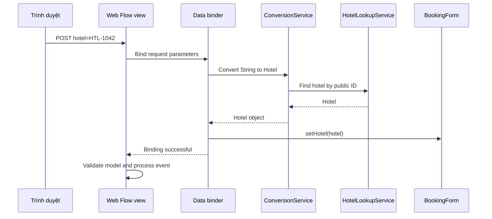
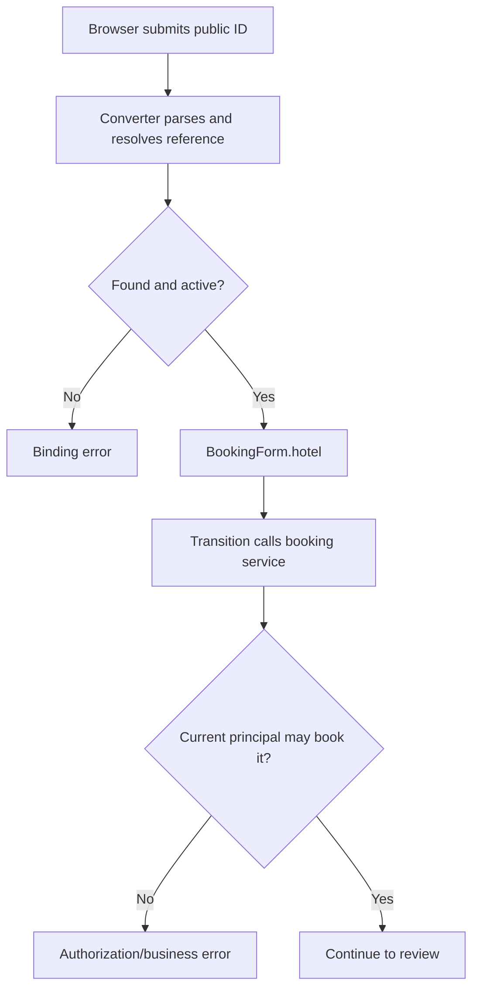

# Chuyển định danh thành đối tượng qua bộ chuyển đổi trong Spring Web Flow

## 1. Bài toán: từ mã do trình duyệt gửi đến đối tượng nghiệp vụ

Trong một flow nhiều bước, biểu mẫu thường gửi về một giá trị định danh dưới dạng chuỗi. Ví dụ, trang chọn khách sạn gửi HTL-1042, trang chọn tài khoản gửi ACC-8f31, hoặc trang chọn phương thức giao hàng gửi EXPRESS. Trong model của flow, ứng dụng có thể muốn làm việc với đối tượng Hotel, Account hoặc DeliveryMethod thay vì xử lý chuỗi ở mọi bước.

Đây là nhiệm vụ của **type conversion**: chuyển giá trị nguồn sang kiểu đích theo một quy tắc có thể tái sử dụng. Với định danh miền nghiệp vụ, converter có thể làm nhiều hơn việc parse cú pháp. Nó có thể tra cứu kho dữ liệu để chuyển HTL-1042 thành một đối tượng Hotel.

Spring Web Flow (SWF) sử dụng hệ thống chuyển đổi kiểu của Spring trong quá trình data binding. Khi một view-state bind request parameter vào model, Web Flow nhận chuỗi từ request, xác định kiểu của thuộc tính đích, rồi yêu cầu ConversionService chuyển giá trị. Nếu có converter phù hợp, model nhận được đối tượng đúng kiểu. Nếu conversion thất bại, binding có lỗi và flow thường render lại view để người dùng sửa dữ liệu.

Ví dụ: BookingForm.hotel có kiểu Hotel, trong khi HTML gửi chuỗi HTL-1042. Một converter/formatter tra cứu mã này, trả về Hotel tương ứng, giúp các bước sau truy cập bookingForm.hotel.name hoặc chuyển đối tượng cho service nghiệp vụ.

Sau bài này, bạn có thể:

1. Giải thích conversion diễn ra ở đâu trong quá trình binding của view-state.
2. Phân biệt parse định danh thành value object với tra cứu định danh thành entity.
3. Viết Converter<String, Hotel> và Formatter<Hotel> theo Spring type conversion hiện đại.
4. Đăng ký converter/formatter vào conversion service được Spring MVC và Web Flow sử dụng.
5. Cấu hình flow-builder-services để flow registry dùng đúng conversion service.
6. Khai báo binder cho thuộc tính cần bind và xử lý input rỗng, sai định dạng, không tồn tại.
7. Kiểm tra quyền truy cập, transaction, hiệu năng và vòng đời entity khi converter tra cứu dữ liệu.
8. Viết unit test cho converter và integration test cho quá trình form binding trong flow.

## 2. Các bước chuyển đổi từ request parameter đến model

Giả sử view có một danh sách khách sạn. Trình duyệt gửi:

```text
hotel=HTL-1042
_eventId_continue=
```

Model của flow:

```java
public class BookingForm {
    private Hotel hotel;

    public Hotel getHotel() {
        return hotel;
    }

    public void setHotel(Hotel hotel) {
        this.hotel = hotel;
    }
}
```

Khi view-state bind model, quá trình khái quát diễn ra như sau:



Các bước quan trọng:

1. Browser chỉ gửi dữ liệu dạng chuỗi; không gửi một Java object Hotel.
2. Binder xác định thuộc tính đích hotel có kiểu Hotel.
3. Conversion service tìm converter/formatter có thể chuyển String sang Hotel.
4. Converter chuẩn hóa và kiểm tra định dạng mã, sau đó gọi lookup service nếu cần.
5. Kết quả được gán vào model.
6. Nếu conversion hoặc validation thất bại, transition không được xử lý như một lần submit hợp lệ; view được render lại kèm lỗi binding/validation.

**Conversion và validation có liên quan nhưng khác nhau.** Conversion trả lời “chuỗi này có thể trở thành giá trị kiểu Hotel không?”. Validation trả lời “giá trị đã bind có hợp lệ trong nghiệp vụ hiện tại không?”, ví dụ khách sạn còn nhận đặt phòng, thuộc tenant hiện tại hoặc có phòng trống.

## 3. Phân biệt ba loại chuyển đổi định danh

Không phải mọi định danh đều cần converter gọi database. Hãy xác định kiểu đích và trách nhiệm trước khi viết mã.

| Kiểu chuyển đổi | Ví dụ | Công việc | Khi phù hợp |
|---|---|---|---|
| Chuỗi sang kiểu ID | HTL-1042 → HotelId | Parse, chuẩn hóa, kiểm tra cú pháp | Form chỉ cần giữ định danh; service sẽ tra cứu sau. |
| Chuỗi sang entity | HTL-1042 → Hotel | Parse và tra cứu dữ liệu | View/model thực sự cần entity hoặc object tham chiếu. |
| Chuỗi sang enum/value | EXPRESS → DeliveryMode.EXPRESS | Ánh xạ token sang một tập giá trị cố định | Giá trị có miền hữu hạn, không cần truy vấn dữ liệu. |

### 3.1. Chuyển sang value object trước

Nếu model chỉ cần giữ định danh, hãy dùng một kiểu ID riêng:

```java
public record HotelId(String value) {

    public HotelId {
        if (value == null || !value.matches("HTL-[A-Z0-9]{4,12}")) {
            throw new IllegalArgumentException("Mã khách sạn không hợp lệ");
        }
    }
}
```

Converter chỉ parse chuỗi, không truy vấn database:

```java
import java.util.Locale;
import org.springframework.core.convert.converter.Converter;

public class StringToHotelIdConverter
        implements Converter<String, HotelId> {

    @Override
    public HotelId convert(String source) {
        if (source == null || source.isBlank()) {
            return null;
        }
        return new HotelId(source.trim().toUpperCase(Locale.ROOT));
    }
}
```

Ở transition/service, ứng dụng mới tải đối tượng và kiểm tra quyền:

```java
Hotel hotel = hotelService.getBookableHotel(
        bookingForm.getHotelId(),
        currentUser.id()
);
```

Ưu điểm là conversion nhẹ, không truy vấn database trong lúc bind và không đưa entity vào flow scope quá sớm. Đây thường là lựa chọn tốt khi form chỉ chọn một mã để gửi sang use case.

### 3.2. Chuyển trực tiếp sang entity

Nếu model thực sự cần đối tượng Hotel, converter có thể tra cứu qua service. Ví dụ dưới đây dùng HotelLookupService để tách logic truy vấn khỏi converter.

```java
public interface HotelLookupService {
    Optional<Hotel> findActiveByPublicId(String publicId);
}
```

Converter một chiều:

```java
import java.util.Locale;
import org.springframework.core.convert.converter.Converter;
import org.springframework.util.StringUtils;

public class StringToHotelConverter implements Converter<String, Hotel> {

    private final HotelLookupService hotelLookupService;

    public StringToHotelConverter(HotelLookupService hotelLookupService) {
        this.hotelLookupService = hotelLookupService;
    }

    @Override
    public Hotel convert(String source) {
        if (!StringUtils.hasText(source)) {
            return null;
        }

        String publicId = source.trim().toUpperCase(Locale.ROOT);
        if (!publicId.matches("HTL-[A-Z0-9]{4,12}")) {
            throw new IllegalArgumentException("Mã khách sạn không đúng định dạng");
        }

        return hotelLookupService.findActiveByPublicId(publicId)
                .orElseThrow(() ->
                        new IllegalArgumentException(
                                "Khách sạn không tồn tại hoặc không khả dụng"));
    }
}
```

Converter không nên tự viết SQL hoặc chứa quy tắc đặt phòng. Nó chỉ chuẩn hóa token, gọi lookup service và trả object. Service chịu trách nhiệm transaction/read policy và truy vấn phù hợp.

### 3.3. Khi nào nên dùng Formatter thay cho Converter?

Converter<S, T> trong Spring core thực hiện chuyển đổi một chiều từ kiểu nguồn sang kiểu đích. Ví dụ Converter<String, Hotel> xử lý chiều parse từ form vào model.

Khi hiển thị lại model trong form, framework cũng cần biểu diễn Hotel thành chuỗi. Nếu chỉ có converter một chiều, chiều ngược lại có thể không có quy tắc phù hợp. Có thể đăng ký thêm Converter<Hotel, String>, nhưng với giao diện web, Formatter<T> thường tự nhiên hơn vì nó định nghĩa cả:

- parse(String, Locale): chuyển chuỗi người dùng gửi thành object.
- print(T, Locale): biểu diễn object thành chuỗi để render.

Ví dụ formatter cho Hotel:

```java
import java.text.ParseException;
import java.util.Locale;
import org.springframework.format.Formatter;
import org.springframework.util.StringUtils;

public class HotelFormatter implements Formatter<Hotel> {

    private final HotelLookupService hotelLookupService;

    public HotelFormatter(HotelLookupService hotelLookupService) {
        this.hotelLookupService = hotelLookupService;
    }

    @Override
    public Hotel parse(String text, Locale locale) throws ParseException {
        if (!StringUtils.hasText(text)) {
            return null;
        }

        String publicId = text.trim().toUpperCase(Locale.ROOT);
        if (!publicId.matches("HTL-[A-Z0-9]{4,12}")) {
            throw new ParseException("Mã khách sạn không đúng định dạng", 0);
        }

        return hotelLookupService.findActiveByPublicId(publicId)
                .orElseThrow(() ->
                        new ParseException(
                                "Khách sạn không tồn tại hoặc không khả dụng", 0));
    }

    @Override
    public String print(Hotel hotel, Locale locale) {
        return hotel == null ? "" : hotel.getPublicId();
    }
}
```

Ở đây print trả public ID ổn định để form giữ lựa chọn hiện tại; parse dùng cùng định dạng để tra cứu khi người dùng submit. Không dùng tên hiển thị làm định danh vì tên có thể trùng hoặc thay đổi theo ngôn ngữ.

## 4. Đăng ký converter vào Spring ConversionService

Từ Spring Web Flow 2.1, Web Flow sử dụng hệ thống type conversion/formatting của Spring cho hầu hết nhu cầu chuyển đổi. Vì vậy, với ứng dụng hiện đại, hãy ưu tiên org.springframework.core.convert.converter.Converter, ConverterFactory, GenericConverter hoặc org.springframework.format.Formatter.

### 4.1. Đăng ký Formatter trong Spring MVC

Có thể khai báo một FormattingConversionServiceFactoryBean để cài đặt formatter:

```xml
<bean id="applicationConversionService"
      class="org.springframework.format.support.FormattingConversionServiceFactoryBean">
    <property name="formatters">
        <set>
            <bean class="com.example.booking.web.HotelFormatter">
                <constructor-arg ref="hotelLookupService" />
            </bean>
        </set>
    </property>
</bean>

<mvc:annotation-driven
        conversion-service="applicationConversionService" />
```

Nếu dùng converter một chiều thay vì formatter, đăng ký qua property converters:

```xml
<bean id="applicationConversionService"
      class="org.springframework.format.support.FormattingConversionServiceFactoryBean">
    <property name="converters">
        <set>
            <bean class="com.example.booking.web.StringToHotelConverter">
                <constructor-arg ref="hotelLookupService" />
            </bean>
        </set>
    </property>
</bean>
```

Chỉ dùng một định nghĩa bean cho applicationConversionService trong ứng dụng; hai đoạn trên là hai lựa chọn đăng ký khác nhau. Không khai báo hai bean trùng ID.

### 4.2. Kết nối cùng conversion service với Spring Web Flow

flow-builder-services là nơi cấu hình conversion service mà flow builder sử dụng. Spring Binding có một adapter org.springframework.binding.convert.service.DefaultConversionService nhận một Spring core ConversionService làm delegate.

Ví dụ XML:

```xml
<bean id="flowConversionService"
      class="org.springframework.binding.convert.service.DefaultConversionService">
    <constructor-arg ref="applicationConversionService" />
</bean>

<webflow:flow-builder-services
        id="flowBuilderServices"
        conversion-service="flowConversionService" />

<webflow:flow-registry
        id="flowRegistry"
        flow-builder-services="flowBuilderServices">
    <webflow:flow-location id="booking"
                           path="/WEB-INF/flows/booking/booking-flow.xml" />
</webflow:flow-registry>
```

Điểm cần nhớ:

- applicationConversionService là Spring core formatting/conversion service.
- flowConversionService là adapter thuộc Spring Binding, delegate sang service phía trên.
- flow-builder-services nhận adapter này để chuyển đổi trong quá trình xây và thực thi flow.
- Spring MVC và Web Flow giờ dùng cùng tập converter/formatter, tránh tình trạng controller parse được mã nhưng form của flow lại báo không có converter.

Trong ứng dụng Java configuration, ý tưởng tương đương:

```java
@Configuration
public class BookingFlowConfiguration extends AbstractFlowConfiguration {

    @Bean
    public FormattingConversionService applicationConversionService(
            HotelLookupService hotelLookupService) {
        DefaultFormattingConversionService service =
                new DefaultFormattingConversionService();
        service.addFormatter(new HotelFormatter(hotelLookupService));
        return service;
    }

    @Bean
    public org.springframework.binding.convert.ConversionService flowConversionService(
            org.springframework.core.convert.ConversionService applicationConversionService) {
        return new org.springframework.binding.convert.service.DefaultConversionService(
                applicationConversionService);
    }

    @Bean
    public FlowBuilderServices flowBuilderServices(
            org.springframework.binding.convert.ConversionService flowConversionService) {
        return getFlowBuilderServicesBuilder()
                .setConversionService(flowConversionService)
                .build();
    }

    @Bean
    public FlowDefinitionRegistry flowRegistry(FlowBuilderServices flowBuilderServices) {
        return getFlowDefinitionRegistryBuilder(flowBuilderServices)
                .addFlowLocation("/WEB-INF/flows/booking/booking-flow.xml")
                .build();
    }
}
```

Các import cần thiết gồm AbstractFlowConfiguration, FlowBuilderServices, FlowDefinitionRegistry, FormattingConversionService và DefaultFormattingConversionService. Quan trọng là setConversionService nhận org.springframework.binding.convert.ConversionService, còn formatter được đăng ký vào Spring core service. Flow registry phải được tạo bằng builder nhận FlowBuilderServices này; nếu registry dùng builder mặc định, converter tùy chỉnh sẽ không được áp dụng cho flow.

## 5. Khai báo model và binder trong flow

Giả sử flow đặt phòng có model BookingForm với thuộc tính hotel kiểu Hotel:

```xml
<flow xmlns="http://www.springframework.org/schema/webflow"
      start-state="chooseHotel">

    <var name="bookingForm"
         class="com.example.booking.BookingForm" />

    <view-state id="chooseHotel"
                view="booking/chooseHotel"
                model="bookingForm">

        <binder>
            <binding property="hotel" required="true" />
        </binder>

        <on-render>
            <evaluate expression="hotelCatalogService.listActiveHotels()"
                      result="viewScope.availableHotels" />
        </on-render>

        <transition on="continue" to="review">
            <evaluate expression="bookingService.assertBookable(
                        bookingForm.hotel, currentUser.id)" />
        </transition>
    </view-state>

    <view-state id="review" view="booking/review">
        <transition on="back" to="chooseHotel" />
        <transition on="confirm" to="completed" />
    </view-state>

    <end-state id="completed" />
</flow>
```

binding property hotel required true cho phép binder nhận field hotel và yêu cầu giá trị. Khi browser gửi chuỗi public ID, conversion service tìm formatter/converter để chuyển nó sang Hotel.

Binder tường minh rất quan trọng. Nếu không khai báo binder, Web Flow có thể cho phép binding vào tất cả public properties của model. Với form nhận dữ liệu từ client, hãy allowlist các thuộc tính thật sự cần chỉnh sửa. Không cho client bind trực tiếp các field như approved, ownerId, tenantId, price, status hoặc createdAt.

### 5.1. Form JSP gửi public ID

Ví dụ view JSP dùng Spring form tags:

```jsp
<form:form modelAttribute="bookingForm" method="post">
    <form:label path="hotel">Khách sạn</form:label>

    <form:select path="hotel">
        <form:option value="" label="-- Chọn khách sạn --" />
        <form:options items="${viewScope.availableHotels}"
                      itemValue="publicId"
                      itemLabel="name" />
    </form:select>

    <form:errors path="hotel" cssClass="field-error" />

    <button type="submit" name="_eventId_continue">Tiếp tục</button>
</form:form>
```

itemValue publicId khiến option gửi mã định danh dạng chuỗi. itemLabel name chỉ là nội dung người dùng nhìn thấy. Khi render lại, formatter HotelFormatter.print(...) chuyển object đang được chọn về public ID để Spring form tag đánh dấu đúng option. Khi postback, parse(...) chuyển public ID trở lại Hotel.

Tên model attribute và cách khai báo form phải khớp với view technology, resolver và cấu hình flow của ứng dụng. Đoạn JSP trên minh họa Spring MVC form tags; nếu dùng Thymeleaf, JSF hoặc template engine khác, cách khai báo HTML khác nhưng conversion service vẫn là nơi chịu trách nhiệm chuyển kiểu.

### 5.2. Không để converter quyết định transition

Converter chỉ đảm nhiệm việc biến đổi dữ liệu. Flow vẫn quyết định event và transition:

- Nếu mã sai định dạng hoặc không tìm thấy đối tượng, binding thất bại và view được render lại.
- Nếu conversion thành công nhưng người dùng không có quyền đặt khách sạn đó, service từ chối ở bước nghiệp vụ.
- Nếu object hợp lệ và user có quyền, transition continue mới đi tới state review.

Không viết converter tự chuyển flow, tự gọi FlowExecutor hoặc tự điều hướng. Làm vậy trộn data binding với điều khiển hành trình.

## 6. Phân biệt converter tra cứu entity và authorization

Đây là điểm quan trọng khi chuyển public ID thành entity.

Giả sử trình duyệt gửi hotel=HTL-1042. Converter có thể chứng minh rằng:

- Chuỗi có định dạng hợp lệ.
- Có một bản ghi khách sạn mang public ID đó.
- Bản ghi không bị xóa hoặc không ở trạng thái inactive nếu lookup service lọc như vậy.

Converter **không thể tự chứng minh** rằng user hiện tại có quyền sử dụng khách sạn này. Cùng một mã có thể được nhiều user nhìn thấy hoặc chỉ thuộc về một tenant cụ thể. Không lấy tenantId, ownerId hoặc userId từ form để quyết định quyền.

Luồng an toàn:



Service nên nhận principal/identity đã xác thực từ security context hoặc từ lớp gọi được tin cậy, rồi kiểm tra quyền theo dữ liệu hiện hành. Ví dụ:

```java
public void assertBookable(Hotel hotel, UserId userId) {
    if (hotel == null || !hotelAccessPolicy.canBook(userId, hotel.getId())) {
        throw new AccessDeniedException("Không có quyền đặt khách sạn này");
    }
}
```

Đối với dữ liệu nhạy cảm, có thể dùng lookup có giới hạn theo principal ở service, nhưng không biến request parameter thành nguồn xác thực. Nếu muốn ẩn sự tồn tại của tài nguyên, trả cùng một thông báo chung cho trường hợp không tồn tại và không được phép truy cập.

## 7. Giới hạn và rủi ro khi converter gọi database

Converter có thể được gọi trong quá trình bind form, nhưng nó là thành phần của hệ thống conversion chung. Trong ứng dụng Spring, converter/formatter thường là singleton và được gọi từ nhiều request/thread. Vì vậy:

- Không lưu RequestContext, HttpServletRequest, user hiện tại hoặc giá trị form vào field mutable của converter.
- Chỉ inject repository/service thread-safe; không lưu entity của request trước để tái sử dụng.
- Không ghi database, gửi email, phát message hoặc tạo booking trong convert/parse.
- Giữ truy vấn nhỏ và có giới hạn; không tải toàn bộ object graph chỉ để bind một field.
- Không giả định converter luôn chạy đúng một lần. Framework có thể cần conversion khi bind, render hoặc so sánh giá trị.
- Không ném stack trace hoặc thông tin SQL ra UI.

### 7.1. Tránh N+1 và lookup lặp

Nếu một form có 30 dòng, mỗi dòng chứa một mã đối tượng và mỗi field kích hoạt một query, conversion có thể tạo nhiều truy vấn. Cân nhắc:

- Dùng một truy vấn batch khi form có nhiều ID.
- Đưa danh sách lựa chọn đã lọc vào view model để render option.
- Chỉ convert một ID đại diện khi có thể.
- Dùng cache có TTL/invalidations rõ ràng cho dữ liệu tham chiếu ít thay đổi, nếu đo đạc cho thấy cần.
- Tránh cache entity ORM hoặc dữ liệu phụ thuộc quyền theo user trong singleton converter.

Không thêm cache chỉ để che một query chậm. Đo số lần converter được gọi và thời gian lookup trước khi tối ưu.

### 7.2. Transaction và lazy loading

Converter thường gọi lookup service trong quá trình data binding. Hãy để service/repository quản lý transaction đọc, thay vì mở transaction trong converter. Nếu entity trả về có quan hệ lazy, view render sau đó có thể truy cập thuộc tính khi persistence context đã đóng.

Có ba cách xử lý:

1. Query fetch đúng các thuộc tính view cần dùng.
2. Trả DTO/reference object nhẹ thay cho entity ORM đầy đủ.
3. Lưu ID vào form model rồi tải entity trong service ở transition.

Nếu flow giữ entity qua nhiều state hoặc nhiều request, hãy cân nhắc serialization, stale state và optimistic locking. Một entity ORM sống lâu trong flow scope có thể không còn phản ánh dữ liệu mới nhất.

## 8. Input rỗng, sai định dạng và không tìm thấy

Converter cần phân biệt các trường hợp để form hiển thị lỗi đúng.

| Input | Kết quả conversion mong muốn | Xử lý tiếp |
|---|---|---|
| null | null | Binder/validator xử lý required. |
| Chuỗi rỗng hoặc chỉ có khoảng trắng | null | required="true" hoặc validator báo cần chọn. |
| HTL-1042 hợp lệ và tồn tại | Trả Hotel | Tiếp tục model validation và authorization. |
| htl-1042 | Chuẩn hóa theo quy tắc công bố | Không tự ý đổi chữ hoa/thường nếu ID phân biệt hoa thường. |
| bad-code | Conversion error | Hiển thị lỗi định dạng thân thiện. |
| ID hợp lệ nhưng không tồn tại | Conversion error | Hiển thị thông báo không tìm thấy/không khả dụng. |
| ID tồn tại nhưng đã inactive | Không trả object khả dụng | Hiển thị thông báo phù hợp, không tiếp tục. |
| ID tồn tại nhưng user không có quyền | Conversion có thể thành công | Service từ chối ở bước authorization. |

Không dùng null để biểu diễn tất cả lỗi. null phù hợp với giá trị vắng mặt/rỗng; sai cú pháp và không tìm thấy cần tạo conversion error để người dùng biết lựa chọn không hợp lệ.

### 8.1. Thông báo lỗi từ Formatter

Với Formatter, có thể ném ParseException khi input không thể parse hoặc không resolve được:

```java
@Override
public Hotel parse(String text, Locale locale) throws ParseException {
    if (!StringUtils.hasText(text)) {
        return null;
    }

    String id = text.trim();
    if (!id.matches("HTL-[A-Z0-9]{4,12}")) {
        throw new ParseException("Mã khách sạn không hợp lệ", 0);
    }

    return hotelLookupService.findActiveByPublicId(id)
            .orElseThrow(() ->
                    new ParseException("Khách sạn không tồn tại hoặc không khả dụng", 0));
}
```

Spring binding sẽ chuyển lỗi conversion thành binding error để view hiển thị. Hãy cung cấp message code hoặc thông báo người dùng đã được chuẩn hóa. Không trả chi tiết query, tên bảng hoặc exception nội bộ.

## 9. Converter một chiều và named converter kiểu cũ

Một số ứng dụng Web Flow cũ dùng org.springframework.binding.convert.converters.Converter và DefaultConversionService của Spring Binding. Từ khi Web Flow chuyển sang Spring type conversion, converter cũ có thể tiếp tục được adapter đăng ký, nhưng nên phân biệt hai cơ chế.

### 9.1. Spring core Converter — hướng được khuyến nghị

```java
import org.springframework.core.convert.converter.Converter;

public class StringToHotelConverter implements Converter<String, Hotel> {
    @Override
    public Hotel convert(String source) {
        // Parse public ID và gọi lookup service.
        return ...;
    }
}
```

Đăng ký converter với Spring core ConversionService hoặc FormattingConversionService. Web Flow có thể dùng cùng conversion service qua flow-builder-services.

### 9.2. Spring Binding Converter — dành cho tương thích

API cũ có interface trong package:

```java
org.springframework.binding.convert.converters.Converter
```

Converter kiểu này khai báo source class, target class và phương thức chuyển đổi source sang target. Ứng dụng cũ có thể đăng ký qua subclass của Spring Binding DefaultConversionService.

Một cơ chế cũ khác là đặt converter có tên rồi tham chiếu trong binding converter. Cơ chế named converter không tham gia Spring type conversion service và đã deprecated trong tài liệu Web Flow. Với code mới, ưu tiên converter/formatter của Spring core thay vì phụ thuộc vào tên converter trong binder.

Không nhầm hai class cùng tên DefaultConversionService:

| Class | Vai trò |
|---|---|
| org.springframework.core.convert.support.DefaultConversionService | Conversion service của Spring Framework. |
| org.springframework.binding.convert.service.DefaultConversionService | Adapter/service thuộc Spring Binding, có thể delegate sang Spring core conversion service. |

Khi đọc lỗi NoSuchMethodError hoặc ClassCastException, hãy kiểm tra import và dependency version. Dùng sai DefaultConversionService có thể khiến cấu hình compile nhưng không khớp API mà Web Flow yêu cầu.

## 10. Kiểm thử converter và flow binding

Một converter tốt cần được test độc lập, sau đó kiểm thử ở đúng đường đi qua Web Flow.

### 10.1. Unit test cho Formatter

Ví dụ với JUnit 5 và Mockito:

```java
@ExtendWith(MockitoExtension.class)
class HotelFormatterTest {

    @Mock
    HotelLookupService lookupService;

    HotelFormatter formatter;

    @BeforeEach
    void setUp() {
        formatter = new HotelFormatter(lookupService);
    }

    @Test
    void parsesPublicIdIntoHotel() throws Exception {
        Hotel hotel = new Hotel("HTL-1042", "Sông Xanh");
        when(lookupService.findActiveByPublicId("HTL-1042"))
                .thenReturn(Optional.of(hotel));

        assertSame(hotel, formatter.parse("HTL-1042", Locale.ROOT));
    }

    @Test
    void printsHotelAsStablePublicId() {
        Hotel hotel = new Hotel("HTL-1042", "Sông Xanh");

        assertEquals("HTL-1042", formatter.print(hotel, Locale.ROOT));
    }

    @Test
    void returnsNullForBlankInput() throws Exception {
        assertNull(formatter.parse("   ", Locale.ROOT));
        verifyNoInteractions(lookupService);
    }

    @Test
    void rejectsMalformedId() {
        assertThrows(ParseException.class,
                () -> formatter.parse("hotel??", Locale.ROOT));
        verifyNoInteractions(lookupService);
    }

    @Test
    void rejectsUnknownHotel() {
        when(lookupService.findActiveByPublicId("HTL-9999"))
                .thenReturn(Optional.empty());

        assertThrows(ParseException.class,
                () -> formatter.parse("HTL-9999", Locale.ROOT));
    }
}
```

Các test này kiểm tra parse, print, blank, format sai và lookup không có kết quả. Với converter có chuẩn hóa chữ hoa/thường, thêm test để khóa quy tắc đó.

### 10.2. Test ConversionService

Kiểm tra converter/formatter đã được đăng ký:

```java
@Test
void conversionServiceConvertsPublicIdToHotel() {
    Hotel hotel = new Hotel("HTL-1042", "Sông Xanh");
    when(lookupService.findActiveByPublicId("HTL-1042"))
            .thenReturn(Optional.of(hotel));

    Hotel converted = applicationConversionService.convert(
            "HTL-1042", Hotel.class);

    assertSame(hotel, converted);
}
```

Test này xác nhận service nhận được converter. Nếu unit test Formatter pass nhưng conversion service không tìm thấy converter, lỗi nằm ở đăng ký bean hoặc cấu hình conversion service.

### 10.3. Integration test cho view-state

Một test flow cần xác minh:

1. Khởi chạy flow và vào state chooseHotel.
2. Gửi event tiếp tục với request parameter hotel=HTL-1042.
3. Xác minh binder gọi conversion service.
4. Xác minh bookingForm.hotel là object Hotel, không còn là chuỗi.
5. Xác minh service authorization nhận đúng hotel và principal hiện tại.
6. Gửi mã sai định dạng; view-state được render lại với binding error.
7. Gửi mã hợp lệ nhưng không tồn tại; transition không chạy.
8. Gửi mã tồn tại nhưng user không được phép; service từ chối.
9. Gửi field giả mạo như approved=true; binder không bind field ngoài allowlist.
10. Gửi event cancel nếu transition khai báo bind=false; xác minh binder không cố parse các field không cần thiết cho cancel.

Đừng chỉ unit test converter rồi kết luận flow đã dùng nó. Một integration test qua FlowExecutor/test support cần kiểm tra flow registry thực sự dùng đúng flow-builder-services.

### 10.4. Ma trận test

| ID | Input | Kết quả mong đợi |
|---|---|---|
| CV01 | HTL-1042 tồn tại | Chuyển thành Hotel đúng ID. |
| CV02 | Chuỗi rỗng | null; required validator xử lý. |
| CV03 | HTL-@@@ | Conversion error; không gọi repository. |
| CV04 | HTL-9999 không tồn tại | Conversion error có thông báo chung. |
| CV05 | Khách sạn inactive | Không trả entity khả dụng. |
| CV06 | Hotel object render ra form | Formatter in đúng public ID. |
| CV07 | MVC conversion | Controller/form dùng cùng converter. |
| CV08 | Web Flow conversion | flow-builder-services dùng service đã đăng ký. |
| CV09 | User khác tenant | Authorization từ chối dù conversion thành công. |
| CV10 | Field approved giả mạo | Binder allowlist loại bỏ field. |
| CV11 | Submit hai lần | Converter không gây side effect hoặc tạo booking trùng. |
| CV12 | Entity có quan hệ lazy | View không truy cập dữ liệu ngoài transaction ngoài dự kiến. |

## 11. Lỗi thường gặp và cách chẩn đoán

| Triệu chứng | Nguyên nhân có thể | Cách kiểm tra |
|---|---|---|
| No converter found capable of converting from String to Hotel | Converter chưa đăng ký hoặc flow dùng conversion service khác | Kiểm tra bean, flow-builder-services và target type. |
| MVC hoạt động nhưng Web Flow lỗi conversion | MVC và flow đang dùng hai service khác nhau | Dùng cùng Spring core service và adapter cho flow. |
| Chỉ parse được, render select không chọn lại option | Có chiều String sang Hotel nhưng thiếu Hotel sang String | Dùng Formatter<Hotel> hoặc đăng ký converter chiều ngược. |
| null được bind dù field bắt buộc | Blank được converter đổi thành null nhưng binder không khai báo required | Đặt required=true và thêm validation model. |
| Mã đúng định dạng nhưng không tìm thấy | ID không tồn tại, sai tenant, inactive hoặc query lọc khác | Kiểm tra lookup service và quy tắc chuẩn hóa. |
| Query chạy nhiều lần | Converter được gọi ở nhiều bước bind/render hoặc form có nhiều field | Đo số lần gọi, batch lookup nếu cần. |
| LazyInitializationException khi render | Converter trả entity có quan hệ lazy sau khi transaction kết thúc | Dùng DTO, fetch đúng field hoặc resolve entity trong service. |
| Converter thấy user sai | Lưu user/request state trong field singleton hoặc lấy identity từ request parameter | Giữ converter stateless; authorization qua security/service. |
| Field ngoài ý muốn bị thay đổi | Binder mặc định cho phép quá nhiều public properties | Khai báo binder allowlist. |
| ClassCastException liên quan ConversionService | Import nhầm Spring core và Spring Binding class cùng tên | Kiểm tra fully-qualified class và adapter. |
| Named converter không được gọi | Đang dùng Spring type conversion, nhưng binder tham chiếu cơ chế named converter cũ | Chuyển sang đăng ký Spring core converter/formatter. |
| Test pass nhưng production không convert | Test dùng service tự tạo, flow registry không dùng bean đó | Kiểm thử qua flow context và builder services thật. |

Khi điều tra, ghi lại source type, target type, field path, flow ID, state ID và lỗi gốc. Không log toàn bộ form payload hoặc dữ liệu nhạy cảm chỉ để tìm converter.

## 12. Bài tập thực hành

### Bối cảnh

Flow booking cho phép người dùng chọn khách sạn và tiếp tục tới bước xem lại. Model BookingForm có thuộc tính hotel kiểu Hotel. Browser gửi public ID dưới dạng chuỗi.

### Yêu cầu

1. Tạo HotelFormatter có parse và print.
2. Chuẩn hóa public ID theo quy tắc được công bố; từ chối chuỗi sai định dạng.
3. Tạo HotelLookupService chỉ trả khách sạn active.
4. Đăng ký formatter vào applicationConversionService.
5. Tạo adapter org.springframework.binding.convert.service.DefaultConversionService delegate sang Spring core service.
6. Cấu hình flow-builder-services sử dụng adapter và gắn builder services vào flow registry.
7. Khai báo BookingForm trong flow, bind riêng property hotel.
8. Tạo view select gửi publicId, hiển thị name.
9. Trong transition, gọi service xác minh user hiện tại được phép đặt khách sạn.
10. Viết unit test cho input rỗng, sai định dạng, không tồn tại, inactive và render object thành public ID.
11. Viết integration test chứng minh string request được bind thành Hotel và binding error giữ người dùng ở view hiện tại.
12. Thử bỏ formatter khỏi flow conversion service nhưng giữ formatter trong MVC; ghi nhận khác biệt và nguyên nhân.
13. Thử gửi thêm approved=true; chứng minh binder không cập nhật field đó.
14. So sánh thiết kế bind Hotel trực tiếp với bind HotelId rồi lookup ở service; nêu trade-off về query, authorization và vòng đời entity.

### Câu hỏi tự đánh giá

- Conversion diễn ra ở pha nào của view-to-model binding?
- Vì sao String sang HotelId khác String sang Hotel?
- Khi nào nên dùng Converter, khi nào nên dùng Formatter?
- Vì sao Formatter có cả parse và print?
- Spring Web Flow lấy conversion service từ đâu?
- Vì sao nên dùng chung conversion service cho Spring MVC và Web Flow?
- org.springframework.binding.convert.service.DefaultConversionService khác class cùng tên của Spring core như thế nào?
- Vì sao converter tra cứu entity không thay thế authorization?
- Tại sao converter không nên ghi database hoặc gửi email?
- Khi nào nên lưu ID/DTO thay vì entity ORM trong flow model?
- Vì sao cần khai báo binder allowlist?
- Named converter trong Spring Binding có còn là lựa chọn ưu tiên cho code mới không?

## 13. Checklist trước khi đưa converter vào flow

| Kiểm tra | Kết quả cần có |
|---|---|
| Source và target type rõ ràng | String → Hotel hoặc String → HotelId |
| Quy tắc ID ổn định | Trim/normalization/case/format được định nghĩa |
| Blank được xử lý riêng | null và required validation không bị nhập nhằng |
| Not-found có lỗi rõ ràng | Binding error thân thiện, không lộ SQL |
| Formatter có chiều print | Form render lại được object hiện tại |
| Converter không có side effect | Chỉ parse/lookup, không ghi nghiệp vụ |
| Converter stateless | Không giữ request/user/entity mutable trong field |
| Lookup service có transaction phù hợp | Không để converter tự quản lý transaction |
| Authorization nằm ở service/security | ID hợp lệ không đồng nghĩa được phép truy cập |
| Flow builder dùng đúng service | flow-builder-services được nối conversion adapter |
| MVC và flow thống nhất | Cùng converter/formatter registry |
| Binder giới hạn field | Chỉ bind thuộc tính cần thiết |
| Entity lifecycle được kiểm soát | DTO/ID nếu entity không phù hợp sống qua nhiều request |
| Unit test đủ trường hợp | Valid, blank, malformed, not-found, inactive |
| Integration test có flow thật | Request string trở thành model object |
| Hiệu năng được đo | Không query lặp hoặc N+1 không cần thiết |

## 14. Ghi nhớ và tài liệu tham khảo

Một định danh gửi từ trình duyệt luôn bắt đầu dưới dạng dữ liệu không đáng tin. Trong quá trình binding của Spring Web Flow, ConversionService có thể chuyển chuỗi thành value object hoặc entity để model làm việc với kiểu dữ liệu rõ ràng. Converter phù hợp cho chuyển đổi một chiều; Formatter phù hợp với biểu mẫu vì vừa parse chuỗi thành object vừa in object thành chuỗi.

Từ Spring Web Flow 2.1, Web Flow dựa chủ yếu trên hệ thống type conversion và formatting của Spring. Hãy đăng ký converter/formatter vào Spring core conversion service, nối service đó với flow-builder-services, và dùng cùng registry với Spring MVC nếu ứng dụng có cả hai. Với converter tra cứu entity, giữ logic lookup nhỏ và không có side effect; để service nghiệp vụ kiểm tra quyền, transaction và trạng thái mới nhất. Nếu form chỉ cần một ID, cân nhắc bind value object ID rồi resolve entity tại transition để giảm query và tránh giữ entity ORM lâu trong flow.

### Tài liệu chính thức

1. [Spring Web Flow 3.0.x Reference Guide — Performing Type Conversion](https://docs.spring.io/spring-webflow/docs/3.0.x/reference/) — data binding, type conversion, formatting và cấu hình conversion service cho flow builder.
2. [Spring Web Flow 3.0.1 API — DefaultConversionService](https://docs.spring.io/spring-webflow/docs/3.0.1/api/org/springframework/binding/convert/service/DefaultConversionService.html) — adapter Spring Binding và constructor nhận Spring core ConversionService.
3. [Spring Web Flow 3.0.1 API — GenericConversionService](https://docs.spring.io/spring-webflow/docs/3.0.1/api/org/springframework/binding/convert/service/GenericConversionService.html) — đăng ký converter và thực thi conversion.
4. [Spring Framework Reference — Type Conversion](https://docs.spring.io/spring-framework/reference/core/validation/convert.html) — Converter, ConverterFactory, GenericConverter và ConversionService.
5. [Spring Framework Reference — Field Formatting](https://docs.spring.io/spring-framework/reference/core/validation/format.html) — Formatter, Printer, Parser và định dạng dữ liệu trong ứng dụng web.
