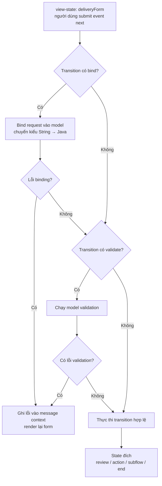
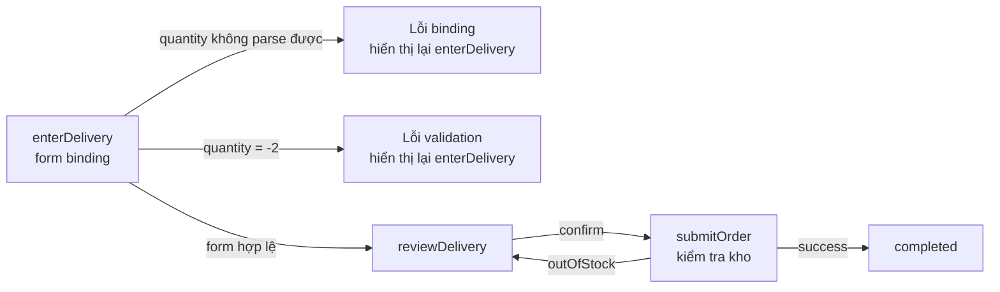

# Thời điểm validation sau liên kết model

Trong **Spring Web Flow**, một biểu mẫu thường chỉ là một bước trong hành trình gồm nhiều màn hình và thao tác tự động. Người dùng nhập thông tin ở `view-state`, nhấn một nút tạo **event**, rồi flow chọn **transition** để sang state kế tiếp. Giữa lúc nhận request và lúc thực thi transition có hai công việc quyết định chất lượng dữ liệu: **binding** dữ liệu đầu vào vào model và **validation** model vừa được bind.

Chủ đề của chương **Kiểm tra dữ liệu** là **thời điểm validation sau liên kết model**: dữ liệu được chuyển kiểu, gán vào model và kiểm tra ở đâu; lỗi nào khiến người dùng phải ở lại màn hình hiện tại; và khi nào mới an toàn để sang bước tiếp theo, gọi `action-state` hoặc `subflow`. Hiểu trình tự này giúp cấu hình luồng Spring Web Flow rõ ràng và tránh viết lại xử lý form trong nhiều controller của Spring MVC.

## 1. Validation diễn ra ở đâu trong vòng đời view-state?

Hãy xét màn hình nhập thông tin giao hàng. Người dùng gửi:

```text
_eventId_next=...
quantity=3
addressLine=12 Nguyen Hue
deliveryMethod=EXPRESS
```

Ở đây `_eventId_next` là một cách gửi event `next` theo quy ước của Web Flow; cơ chế truyền event cụ thể còn tùy view technology và cách tạo nút. Với một `view-state` có model, luồng xử lý thông thường là:

1. Web Flow nhận request phục hồi **flow execution** hiện tại và xác định event được gửi từ view.
2. Với transition cho phép binding, framework thực hiện **model binding**: lấy các field được phép gán, chuyển kiểu giá trị HTTP và đưa chúng vào model.
3. Các lỗi chuyển kiểu hoặc binding được ghi nhận; nếu không thể tiếp tục hợp lệ, người dùng được đưa trở lại view để sửa.
4. Với transition bật validation, Web Flow thực hiện **model validation** dựa trên validator hoặc cơ chế validation đã cấu hình.
5. Nếu còn lỗi binding/validation cần sửa, flow giữ người dùng ở màn hình form và hiển thị thông báo.
6. Khi dữ liệu hợp lệ, các thao tác chuyển trạng thái được thực thi theo transition, flow sang `view-state`, `action-state`, `subflow-state` hoặc `end-state` đích.



Sơ đồ mô tả **đường xử lý chuẩn về mặt ý nghĩa**. Chi tiết nội bộ và thứ tự hook có thể khác theo phiên bản, cấu hình binding, transition và validation. Điều cốt lõi là: **đối với bước tiếp tục bình thường, phải kiểm tra model sau khi dữ liệu mới đã được bind**, rồi mới cho phép chuyển sang xử lý nghiệp vụ phụ thuộc dữ liệu đó.

### Vì sao không validate model trước khi binding?

Giả sử model trước đó có `quantity = 2`. Người dùng sửa trường thành `quantity = -5` rồi nhấn **Tiếp tục**. Nếu kiểm tra trước binding, validator sẽ nhìn thấy giá trị cũ `2`, báo hợp lệ và bỏ qua dữ liệu mới. Sau khi binding, model chứa `-5`; validation lúc này mới phát hiện số lượng không được âm.

Ngược lại, khi người dùng nhập `quantity = abc`, chuyển chuỗi `abc` thành `Integer` thất bại. Đây là **lỗi conversion/binding**; không nên giả định model luôn chứa giá trị số hợp lệ để validator gọi phép so sánh mà không kiểm tra `null`.

## 2. Phân biệt conversion, binding, validation và business rule

| Bước | Câu hỏi cần trả lời | Ví dụ | Hành vi phù hợp |
| --- | --- | --- | --- |
| Conversion | Chuỗi đầu vào có chuyển thành kiểu Java đích được không? | `"abc" → Integer` | Ghi lỗi chuyển kiểu và yêu cầu nhập lại |
| Binding | Field có được phép gán và gán thành công vào property model không? | `quantity` có setter và nằm trong binder | Cập nhật model hoặc báo lỗi binding |
| Field validation | Giá trị đã có kiểu có đạt ràng buộc của trường không? | `quantity > 0` | Giữ tại form nếu không đạt |
| Cross-field validation | Các trường có nhất quán với nhau không? | Giao nhanh chỉ cho phép tối đa 10 sản phẩm | Gắn lỗi vào trường liên quan hoặc toàn form |
| Business validation | Trạng thái hệ thống có cho phép thao tác không? | Tồn kho còn đủ hàng, địa chỉ nằm trong vùng phục vụ | Kiểm tra tại service/action phù hợp |

**Không dùng validation để thay thế conversion.** Một chuỗi không parse được thành số cần được giải quyết tại bước chuyển kiểu; một số nguyên âm có thể chuyển kiểu thành công nhưng vẫn bị validator từ chối.

**Không coi binding hợp lệ là giao dịch hợp lệ.** Một form có `quantity = 3` có thể vượt qua kiểm tra định dạng và giá trị dương, trong khi kho chỉ còn hai sản phẩm. Điều kiện tồn kho nên được xác minh ở tầng nghiệp vụ, nhất là khi dữ liệu thay đổi giữa các request.

## 3. Ví dụ một view-state có model và binder

Tạo model phục vụ form giao hàng:

```java
package com.example.checkout;

import java.io.Serializable;

public class DeliveryForm implements Serializable {
    private Integer quantity;
    private String addressLine;
    private String deliveryMethod;

    public Integer getQuantity() {
        return quantity;
    }

    public void setQuantity(Integer quantity) {
        this.quantity = quantity;
    }

    public String getAddressLine() {
        return addressLine;
    }

    public void setAddressLine(String addressLine) {
        this.addressLine = addressLine;
    }

    public String getDeliveryMethod() {
        return deliveryMethod;
    }

    public void setDeliveryMethod(String deliveryMethod) {
        this.deliveryMethod = deliveryMethod;
    }
}
```

Định nghĩa một phần flow XML:

```xml
<flow xmlns="http://www.springframework.org/schema/webflow"
      xmlns:xsi="http://www.w3.org/2001/XMLSchema-instance"
      xsi:schemaLocation="http://www.springframework.org/schema/webflow
        http://www.springframework.org/schema/webflow/spring-webflow.xsd">

    <var name="deliveryForm"
         class="com.example.checkout.DeliveryForm" />

    <view-state id="enterDelivery"
                view="checkout/delivery"
                model="deliveryForm">
        <binder>
            <binding property="quantity" required="true" />
            <binding property="addressLine" required="true" />
            <binding property="deliveryMethod" required="true" />
        </binder>

        <transition on="next" to="reviewDelivery" />

        <transition on="back" to="cart"
                    bind="false" validate="false" />

        <transition on="cancel" to="cancelled"
                    bind="false" validate="false" />
    </view-state>

    <view-state id="cart" view="checkout/cart">
        <transition on="delivery" to="enterDelivery" />
    </view-state>

    <view-state id="reviewDelivery" view="checkout/review">
        <transition on="edit" to="enterDelivery" />
        <transition on="confirm" to="submitOrder" />
    </view-state>

    <action-state id="submitOrder">
        <evaluate expression="orderAction.submit(flowScope.deliveryForm)" />
        <transition on="success" to="completed" />
        <transition on="outOfStock" to="reviewDelivery" />
        <transition on="failed" to="submitError" />
    </action-state>

    <view-state id="submitError" view="checkout/error">
        <transition on="retry" to="submitOrder" />
        <transition on="back" to="reviewDelivery" />
    </view-state>

    <end-state id="completed" />
    <end-state id="cancelled" />
</flow>
```

Trong ví dụ, event `next` dùng binding và validation mặc định của `view-state`. Khi người dùng nhập `quantity` không hợp lệ, họ vẫn ở `enterDelivery` để sửa. Event `back` và `cancel` là lựa chọn điều hướng, nên được cấu hình bỏ qua cả binding và validation.

Các lớp, view và bean nghiệp vụ trong ví dụ là thành phần minh họa cần có trong ứng dụng. Tên event do `orderAction.submit` trả về phải khớp với các transition; ngoại lệ Java không tự động trở thành event `failed`.

### Bản chất của `<binder>`

`<binder>` giới hạn các property mà người dùng được cập nhật từ form; chỉ khai báo `quantity`, `addressLine` và `deliveryMethod`. Nếu model có thuộc tính nội bộ như `price`, `approved` hoặc `paymentStatus` thì không nên mở chúng cho request tự do ghi đè. `required="true"` mô tả yêu cầu binding, nhưng vẫn cần quy tắc validation riêng về nội dung, chẳng hạn chuỗi chỉ gồm dấu cách hay giới hạn chiều dài địa chỉ.

## 4. Viết validator sau khi model đã được bind

Spring Web Flow hỗ trợ tích hợp cơ chế validation của Spring và các quy ước validator tùy phiên bản. Một cách thể hiện các quy tắc kiểm tra là dùng `org.springframework.validation.Validator`:

```java
package com.example.checkout;

import org.springframework.stereotype.Component;
import org.springframework.validation.Errors;
import org.springframework.validation.Validator;

@Component("deliveryFormValidator")
public class DeliveryFormValidator implements Validator {

    @Override
    public boolean supports(Class<?> type) {
        return DeliveryForm.class.isAssignableFrom(type);
    }

    @Override
    public void validate(Object target, Errors errors) {
        DeliveryForm form = (DeliveryForm) target;

        if (form.getQuantity() == null) {
            errors.rejectValue("quantity", "delivery.quantity.required",
                "Cần nhập số lượng.");
        } else if (form.getQuantity() <= 0) {
            errors.rejectValue("quantity", "delivery.quantity.positive",
                "Số lượng phải lớn hơn 0.");
        }

        String address = form.getAddressLine();
        if (address == null || address.trim().isEmpty()) {
            errors.rejectValue("addressLine", "delivery.address.required",
                "Cần nhập địa chỉ giao hàng.");
        }

        String method = form.getDeliveryMethod();
        if (!"STANDARD".equals(method) && !"EXPRESS".equals(method)) {
            errors.rejectValue("deliveryMethod", "delivery.method.invalid",
                "Phương thức giao hàng không hợp lệ.");
        }

        // Ví dụ kiểm tra tính nhất quán giữa hai trường.
        if ("EXPRESS".equals(method)
                && form.getQuantity() != null
                && form.getQuantity() > 10) {
            errors.rejectValue("quantity", "delivery.express.limit",
                "Giao nhanh chỉ hỗ trợ tối đa 10 sản phẩm.");
        }
    }
}
```

Tên `deliveryFormValidator` minh họa convention đặt validator theo tên model. **Cần cấu hình hoặc xác nhận Web Flow thực tế tìm thấy validator này** theo phiên bản đang sử dụng; chỉ đặt một class lên classpath không đảm bảo bean sẽ được gọi. Trong cấu hình cụ thể có thể dùng validator Spring, phương thức validation theo quy ước hoặc Bean Validation nếu hạ tầng tương ứng đã được thiết lập.

Điểm chính của ví dụ là **validator nhận đối tượng model đã có kiểu**, nên `quantity` là `Integer`. Validator kiểm tra được quy tắc số dương, địa chỉ không trống và phụ thuộc giữa `quantity` với `deliveryMethod`. Khi chuyển kiểu thất bại, mã validator cần chịu được giá trị `null` hoặc trường chưa được bind; phần lỗi chuyển kiểu vẫn thuộc trách nhiệm binder.

### Validation từng trường và validation liên trường

Ràng buộc `quantity > 0` là **field validation**. Ràng buộc “`deliveryMethod == EXPRESS` thì `quantity <= 10`” là **cross-field validation** vì phụ thuộc đồng thời vào hai trường. Cả hai có thể được thực hiện khi người dùng bấm `next`, nhưng kết quả cần gắn với trường đúng để giao diện hiển thị thông báo dễ hiểu.

Khi cần kiểm tra điều kiện của hệ thống bên ngoài, chẳng hạn kho hàng thực tế, nên gọi service trong một bước thích hợp sau khi form đã hợp lệ; không biến mỗi lần người dùng gõ một ký tự thành truy vấn kho hoặc thao tác ghi cơ sở dữ liệu.

## 5. Bean Validation và việc lựa chọn cơ chế kiểm tra

Một model Java cũng có thể mô tả ràng buộc bằng annotation Bean Validation, ví dụ `@NotNull` hoặc `@Min(1)`:

```java
// Cú pháp minh họa; import từ javax.validation hoặc
// jakarta.validation tùy phiên bản Spring và Bean Validation.
public class DeliveryForm {

    @NotNull
    @Min(1)
    private Integer quantity;

    @NotBlank
    private String addressLine;

    // Getter và setter như thông thường.
}
```

Annotation giúp gom các ràng buộc cơ bản gần model, nhưng **chỉ có tác dụng khi Bean Validation provider và tích hợp validation được cấu hình và kích hoạt**. Không nên mặc định thêm annotation là đủ để mọi transition Web Flow tự kiểm tra nó. Tùy phiên bản ứng dụng, `javax.validation.*` và `jakarta.validation.*` còn là hai hệ sinh thái gói khác nhau; kiểm tra tương thích trước khi đưa mã vào dự án.

| Cách viết validation | Điểm mạnh | Khi cần thận trọng |
| --- | --- | --- |
| Spring `Validator` | Dễ viết kiểm tra nhiều trường và mã lỗi có cấu trúc | Đảm bảo Web Flow thực sự gọi đúng bean |
| Bean Validation annotation | Tái sử dụng ràng buộc đơn giản, nhóm validation | Provider, package và integration phải tương thích |
| Phương thức validation theo quy ước Web Flow | Gắn logic kiểm tra với model hoặc đối tượng validator theo cơ chế của flow | Tên và chữ ký phương thức phụ thuộc API hỗ trợ |
| Service nghiệp vụ | Kiểm tra tồn kho, quyền truy cập, trạng thái giao dịch | Không thay thế binding và validation biểu mẫu |

Không cần kích hoạt mọi cơ chế cho cùng một điều kiện. Nếu một ràng buộc vừa nằm ở annotation vừa nằm trong Spring Validator, người dùng có thể nhận **hai thông báo lỗi** cho cùng một trường.

## 6. Khi một event không nên kích hoạt validation

Không phải mọi transition đều biểu thị ý định chấp nhận thông tin nhập:

| Event | Ý định của người dùng | Binding | Validation | Lý do |
| --- | --- | --- | --- | --- |
| `next` | Lưu thông tin và tiếp tục | Có | Có | Bước kế tiếp phải nhận dữ liệu hợp lệ |
| `saveDraft` | Lưu bản nháp chưa hoàn chỉnh | Tùy yêu cầu | Có thể chỉ kiểm tra tập quy tắc tối thiểu | Không ép người dùng hoàn tất mọi trường |
| `back` | Quay lại bước trước | Thường không | Thường không | Dữ liệu chưa hoàn chỉnh không nên chặn điều hướng |
| `cancel` | Hủy hành trình | Không | Không | Không có lý do xác thực form trước khi hủy |
| `confirm` | Xác nhận thao tác nghiệp vụ | Tùy state hiện tại | Có nếu state chứa form cần kiểm tra | Ngăn action xử lý dữ liệu không hợp lệ |

Trong XML ở trên:

```xml
<transition on="next" to="reviewDelivery" />
<transition on="back" to="cart"
            bind="false" validate="false" />
<transition on="cancel" to="cancelled"
            bind="false" validate="false" />
```

**`bind="false"` và `validate="false"` giải quyết hai vấn đề khác nhau.** Bỏ validation nhưng vẫn binding có thể tiếp tục gặp lỗi chuyển kiểu hoặc cập nhật model từ một form chưa hoàn chỉnh. Nếu mục đích là quay lại hoặc hủy mà không cần xử lý dữ liệu nhập mới, tắt cả hai thường rõ ràng hơn.

Ngược lại, `validate="false"` trên một transition đi tới bước ghi dữ liệu có thể khiến service nhận form thiếu hoặc sai quy tắc. Chỉ dùng sau khi đã xác định có một cơ chế kiểm tra tương đương hoặc một nghiệp vụ thực sự cho phép dữ liệu chưa hoàn chỉnh.

## 7. Đường đi khi binding hoặc validation thất bại

### Trường hợp A: sai kiểu dữ liệu

Người dùng gửi `quantity=abc`. Thuộc tính `DeliveryForm.quantity` là `Integer`, nên hạ tầng conversion không tạo được giá trị hợp lệ từ chuỗi này. Binding ghi nhận lỗi gắn với `quantity`; flow cần tiếp tục hiển thị `enterDelivery` để sửa. Validator không nên suy luận `abc` là số 0 hoặc tự thay thế bằng giá trị hợp lệ giả.

### Trường hợp B: chuyển kiểu thành công nhưng không hợp lệ

Người dùng gửi `quantity=-2`. Binding có thể tạo ra `Integer(-2)`, rồi validator phát hiện số lượng phải lớn hơn 0. Việc gắn lỗi vào field `quantity` giúp template hiển thị chính xác nơi cần sửa.

### Trường hợp C: dữ liệu riêng lẻ hợp lệ, kết hợp không hợp lệ

Người dùng gửi `quantity=15` và `deliveryMethod=EXPRESS`. Hai field đều chuyển kiểu được; điều kiện giao nhanh chỉ hỗ trợ tối đa 10 sản phẩm bị vi phạm. Validator báo lỗi liên trường, nên `reviewDelivery` chưa được mở.

### Trường hợp D: đã qua form nhưng thất bại ở service

Người dùng gửi `quantity=3` hợp lệ. Ở `submitOrder`, service phát hiện kho không đủ hàng và action trả event `outOfStock`. Lỗi này xảy ra **sau validation của form**, do thay đổi dữ liệu nghiệp vụ. Flow có thể trở về `reviewDelivery` với thông báo hết hàng hoặc chuyển tới một màn hình điều chỉnh giỏ hàng.



**Lỗi validation không phải event nghiệp vụ tự sinh.** Việc trở lại view do lỗi binding/validation xảy ra trong chu trình xử lý form của `view-state`; không nên giả định framework sẽ tạo một transition `on="validationError"` nếu chưa có cấu hình chuyên biệt.

## 8. Message context và hiển thị thông báo

Spring Web Flow có hạ tầng thông điệp của Spring Binding, thường qua **`MessageContext`**, để ghi nhận thông báo liên quan đến form hoặc flow. Validator và binder có thể cung cấp các thông tin mà view dùng để hiển thị lỗi.

Ví dụ minh họa dùng API message của Web Flow khi ứng dụng thực thi validation theo `ValidationContext`:

```java
import org.springframework.binding.message.MessageBuilder;
import org.springframework.binding.validation.ValidationContext;

public void validateDeliveryForm(
        DeliveryForm form, ValidationContext context) {

    if (form.getQuantity() == null || form.getQuantity() <= 0) {
        context.getMessageContext().addMessage(
            new MessageBuilder()
                .error()
                .source("quantity")
                .code("delivery.quantity.positive")
                .defaultText("Số lượng phải lớn hơn 0.")
                .build());
    }
}
```

Đây là ví dụ về **thân phương thức validation** theo API Spring Binding; cách đăng ký/đặt tên phương thức để Web Flow gọi phải theo quy ước của phiên bản và mô hình validation được lựa chọn. Không nên dùng đồng thời đoạn này và Spring `Validator` ở mục trước cho đúng một lỗi mà không có mục đích rõ ràng.

Khi hiển thị lỗi, nên bảo đảm:

- **Chỉ rõ trường**: gắn lỗi vào `quantity`, `addressLine` hoặc thông báo mức toàn form khi không thuộc một field cụ thể.
- **Giữ lại dữ liệu người dùng đã nhập**: nếu một field lỗi chuyển kiểu, form vẫn nên hiển thị giá trị lỗi để người dùng sửa; kiểm tra cách view/binder bảo tồn rejected value.
- **Thông điệp có thể dịch**: dùng mã message như `delivery.quantity.positive` cùng bundle ngôn ngữ thay vì hard-code toàn bộ nội dung trong view.
- **Không lộ chi tiết kỹ thuật**: không đưa stack trace, class name hay exception nội bộ lên giao diện.
- **Phân biệt lỗi form và lỗi service**: thông báo “Số lượng phải lớn hơn 0” khác với “Kho chỉ còn 2 sản phẩm”.

Nếu người dùng bấm **Quay lại** rồi tiếp tục, hãy kiểm tra vòng đời của message context và dữ liệu model. Thông báo của lần submit trước không nên tồn tại dai dẳng khi giá trị đã được sửa và validation lại thành công.

## 9. Validation khi chuyển giữa view-state, action-state và subflow

Thời điểm validation cần được quyết định theo **ranh giới trạng thái**:

**Trước khi rời form.** Nếu transition `next` dẫn từ `enterDelivery` sang `reviewDelivery`, hãy kiểm tra các field mà người dùng vừa nhập. Việc kiểm tra ở đây giúp màn hình xác nhận không hiển thị dữ liệu không hợp lệ.

**Trước khi thực thi nghiệp vụ có tác dụng phụ.** Nếu transition `confirm` dẫn tới `action-state` tạo đơn, dữ liệu nên đã hợp lệ ở bước form; tại service vẫn cần kiểm tra các bất biến và quyền truy cập, nhất là khi dữ liệu có thể thay đổi hoặc đã qua nhiều request.

**Khi vào subflow.** Flow cha nên chuyển dữ liệu có kiểu và đáp ứng điều kiện đầu vào của flow con. Flow con có thể có validation riêng cho các form nó quản lý. Không giả định validation của form ở flow cha tự bao phủ mọi điều kiện mới phát sinh bên trong subflow.

**Khi quay lại một bước đã hoàn tất.** Nếu người dùng sửa địa chỉ sau khi tính phí, dữ liệu phụ thuộc như phí giao hàng hoặc lựa chọn kho có thể cần được **tính lại**. Binding và validation thành công cho địa chỉ mới không đồng nghĩa tổng tiền tính từ địa chỉ cũ còn hợp lệ.

Vì vậy nên phân chia trách nhiệm:

| Thành phần | Trách nhiệm |
| --- | --- |
| Spring MVC + bộ điều hợp Web Flow | Nhận HTTP request, đưa request tới flow execution và render view |
| `view-state` + binder | Xác định model, các field được phép bind và event người dùng |
| Validator của form | Kiểm tra dữ liệu đã bind và tạo thông báo lỗi |
| Flow transition | Quyết định state tiếp theo khi điều kiện chuyển trạng thái đạt yêu cầu |
| `action-state` / service | Thực thi nghiệp vụ, kiểm tra điều kiện hệ thống và trả event nghiệp vụ |
| `subflow-state` | Chuyển sang quy trình con có hợp đồng input/output và validation riêng |

Không nên để controller tự so sánh tên button, parse field rồi trả view cho từng bước nếu Web Flow đã được dùng để quản lý hành trình. Định nghĩa flow phải là nơi người đọc nhìn thấy những đường đi chính và đường phục hồi khi lỗi.

## 10. Scope, dữ liệu form và các yêu cầu về phiên

Model được khai báo bằng `<var name="deliveryForm" ... />` thuộc phạm vi flow; dữ liệu đã bind tiếp tục có thể được dùng ở các state về sau dưới `flowScope.deliveryForm`. Đây là một khác biệt lớn so với xử lý form rời rạc: flow duy trì dữ liệu cần cho nhiều bước, cho phép người dùng quay lại sửa rồi tiếp tục.

| Scope | Mục đích thường gặp | Lưu ý với validation |
| --- | --- | --- |
| `requestScope` | Dữ liệu tạm trong một request | Không trông đợi field tạm tồn tại ở lần submit sau |
| `viewScope` | Trạng thái riêng của màn hình hiện tại | Có thể mất khi rời view, tùy vòng đời view-state |
| `flowScope` | Model dùng chung các bước của flow | Cẩn thận khi sửa dữ liệu làm những kết quả phụ thuộc trở nên cũ |
| `flashScope` | Thông báo ngắn hạn cho một lần render liên quan | Phù hợp cho thông báo chuyển màn hình nếu cấu hình hỗ trợ |
| `conversationScope` | Dữ liệu dùng chung ở phạm vi conversation/subflow | Không đưa dữ liệu nhạy cảm hoặc object lớn vào nếu không cần thiết |

**Scope không thay thế kiểm tra hợp lệ.** Một object có mặt trong `flowScope` không chứng minh nó còn đáp ứng ràng buộc hiện tại; người dùng có thể đã sửa field, hoặc dữ liệu hệ thống đã thay đổi sau khi validation trước đó thành công.

Nếu ứng dụng hỗ trợ phục hồi flow qua nhiều request, model cần tương thích với cơ chế lưu trữ và phục hồi flow execution. Tùy `FlowExecutionRepository` và cấu hình triển khai, việc giữ object không serializable hoặc quá lớn trong flow có thể gây lỗi hoặc tăng chi phí lưu session.

## 11. Kiểm thử thời điểm validation và hành vi transition

Kiểm thử nên bao gồm **unit test cho validator** và **integration test cho flow**. Chỉ kiểm tra validator trả về lỗi với `quantity=-2` là chưa đủ: cần khẳng định người dùng không đi sang `reviewDelivery` sau khi submit lỗi.

### Unit test validator

Một phép thử bằng Spring `Errors`:

```java
import static org.junit.jupiter.api.Assertions.*;
import org.junit.jupiter.api.Test;
import org.springframework.validation.BeanPropertyBindingResult;
import org.springframework.validation.Errors;

class DeliveryFormValidatorTest {

    @Test
    void invalidQuantityBlocksForm() {
        DeliveryForm form = new DeliveryForm();
        form.setQuantity(-2);
        form.setAddressLine("12 Nguyen Hue");
        form.setDeliveryMethod("STANDARD");

        Errors errors = new BeanPropertyBindingResult(form, "deliveryForm");
        new DeliveryFormValidator().validate(form, errors);

        assertTrue(errors.hasFieldErrors("quantity"));
    }
}
```

Test này xác nhận quy tắc field validation; nó **chưa** chứng minh Web Flow đã phát hiện bean validator hoặc đang chạy validation đúng thời điểm.

### Kiểm thử tích hợp flow

Với công cụ hỗ trợ kiểm thử của Spring Web Flow hoặc test tích hợp MVC/Web Flow của dự án, hãy khởi động flow, gửi event `next` và các tham số biểu mẫu, sau đó xác nhận active state, message context và số lần service được gọi.

| Đầu vào / event | Kết quả cần xác nhận |
| --- | --- |
| `next`, `quantity=3`, các field hợp lệ | Đến `reviewDelivery` |
| `next`, `quantity=-2` | Ở `enterDelivery`, có lỗi `quantity` |
| `next`, `quantity=abc` | Ở `enterDelivery`, có lỗi binding/convert; không gọi service tạo đơn |
| `next`, `quantity=15`, `deliveryMethod=EXPRESS` | Ở `enterDelivery`, có lỗi cross-field |
| `next`, thiếu `addressLine` | Ở `enterDelivery`, có thông báo cần địa chỉ |
| `back` với form chưa hợp lệ | Đi về `cart`, không bị validation của form chặn |
| `cancel` với trường có giá trị không parse được | Đi tới `cancelled` nếu cấu hình bỏ binding/validation như ví dụ |
| `confirm` từ `reviewDelivery` với dữ liệu hợp lệ | Gọi `orderAction.submit` đúng một lần theo flow |
| `confirm` khi tồn kho thay đổi | Service trả event phù hợp; flow tới state xử lý thiếu hàng |
| Quay lại sửa form rồi submit lại | Validation chạy trên **giá trị mới** và tổng tiền phụ thuộc được tính lại nếu cần |

Một trường hợp đặc biệt quan trọng: nếu `next` đến `reviewDelivery` nhưng **không có thông báo lỗi dù form âm**, hãy kiểm tra validator có thực sự được gắn vào flow. Nếu validator đã được gọi nhưng flow vẫn chuyển state, cần xem cách lỗi được đưa vào message context và cấu hình xử lý transition. Đừng chỉ kiểm tra log xác nhận phương thức validator chạy.

## 12. Các sai lầm hay gặp và cách khắc phục

| Sai lầm | Hệ quả | Cách xử lý |
| --- | --- | --- |
| Validate model trước khi bind giá trị request mới | Kiểm tra dữ liệu cũ, bỏ sót giá trị mới | Dùng lifecycle binding rồi validation của view-state |
| Cho rằng `Integer` nhận được thì luôn hợp lệ | `-2` vẫn lọt qua | Kiểm tra ràng buộc nghiệp vụ sau conversion |
| Viết validator nhưng không đăng ký/tích hợp | Flow chuyển tiếp dù form sai | Kiểm tra cơ chế tìm validator và test tích hợp |
| Không phân biệt lỗi convert và lỗi validation | Thông báo mơ hồ hoặc validator xử lý `null` sai | Thiết kế thông báo theo loại lỗi và bảo vệ giá trị thiếu |
| Bật validation cho nút `cancel` | Không hủy được khi form đang sai | Sử dụng `bind="false" validate="false"` khi phù hợp |
| Tắt validation cho nút ghi dữ liệu | Action có thể nhận model sai | Giữ validation hoặc có cơ chế bắt buộc tương đương |
| Chỉ validate ở UI, bỏ qua service | Dữ liệu có thể thay đổi hoặc bị thao tác ngoài flow | Service bảo vệ bất biến và quyền truy cập |
| Bind toàn bộ entity trực tiếp từ request | Khách có thể sửa property nội bộ | Form model riêng, whitelist field trong binder |
| Để lỗi cũ tồn tại sau khi sửa | Người dùng thấy thông báo không còn đúng | Xem vòng đời message context và kiểm thử submit lại |
| Không xét retry và nhiều request | Thao tác ghi có thể bị thực hiện hai lần | Service dùng giao dịch, khóa idempotency hoặc cơ chế chống gửi trùng |

## 13. Bài thực hành: kiểm tra giao hàng trước khi tạo đơn

Hãy tạo một flow nhỏ gồm ba bước: `enterDelivery`, `reviewDelivery` và `submitOrder`. Model có `quantity`, `addressLine` và `deliveryMethod`. Yêu cầu của bài thực hành:

1. Chỉ cho event `next` sang màn hình xác nhận khi `quantity` là số nguyên dương, địa chỉ không trống và `deliveryMethod` thuộc `STANDARD` hoặc `EXPRESS`.
2. Nếu chọn `EXPRESS` với số lượng lớn hơn 10, hiển thị lỗi ngay ở `enterDelivery`.
3. Cho phép `back` và `cancel` hoạt động dù người dùng đang nhập dữ liệu không hợp lệ.
4. Ở `submitOrder`, giả lập một service đôi lúc trả event `outOfStock`; bảo đảm đó là lỗi nghiệp vụ sau form validation.
5. Viết kiểm thử cho cả `quantity=abc` (lỗi conversion) và `quantity=-2` (lỗi validation); so sánh state sau submit.
6. Quay lại `enterDelivery`, sửa dữ liệu và xác nhận validator chạy trên giá trị mới, không dùng kết quả kiểm tra cũ.

Nếu cả sáu tình huống hoạt động đúng, bạn đã kiểm tra được ranh giới quan trọng nhất của validation trong Web Flow: **nhận request → bind và chuyển kiểu → validate model → quyết định có thực hiện transition và nghiệp vụ tiếp theo hay không**.

Trong một hành trình Spring Web Flow nhiều bước, validation đúng thời điểm giúp flow giữ lại biểu mẫu khi dữ liệu chưa đạt yêu cầu, đồng thời bảo vệ các `action-state` và `subflow` khỏi đầu vào không phù hợp. Phối hợp binder, validator, message context và transition rõ ràng sẽ khiến các nhánh thành công, sửa lỗi và phục hồi đều có thể theo dõi và kiểm thử mà không cần rải logic điều hướng qua nhiều controller.
