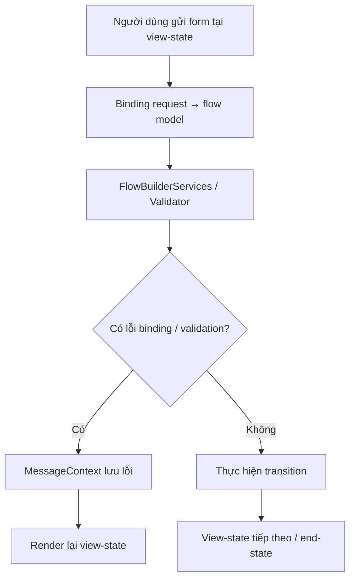
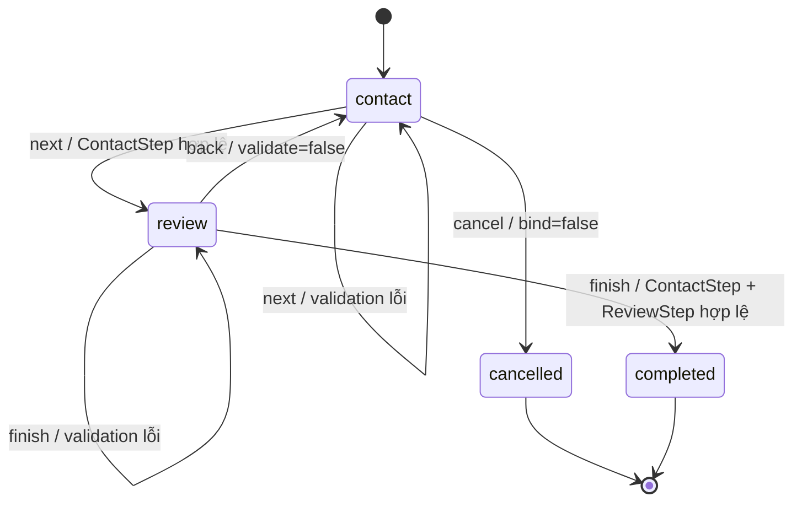

# Cấu hình Bean Validation và LocalValidatorFactoryBean

## 1. Bài toán: kiểm tra dữ liệu ở mỗi bước của flow

Trong **Spring Web Flow**, một hành trình đăng ký có thể gồm các bước nhập thông tin liên hệ, xem lại và xác nhận. Mỗi bước là một `view-state`; khi người dùng gửi form, Web Flow **binding dữ liệu vào model**, kiểm tra tính hợp lệ rồi mới thực hiện `transition` sang state kế tiếp. Nếu dữ liệu không hợp lệ, flow có thể ở lại màn hình hiện tại và hiển thị lỗi để người dùng sửa.

**Bean Validation** cho phép đặt quy tắc kiểm tra ngay trên thuộc tính của model qua annotation như `@NotBlank`, `@Size`, `@Email` và `@AssertTrue`. **`LocalValidatorFactoryBean`** là cầu nối của Spring: khởi tạo một Bean Validation provider (ví dụ Hibernate Validator) và cung cấp cả API `jakarta.validation.Validator` lẫn `org.springframework.validation.Validator`. Spring Web Flow nhận validator kiểu Spring thông qua `FlowBuilderServices`.

Điểm cần nhớ trong chương **Kiểm tra dữ liệu**: cấu hình validator cho Spring MVC controller bằng `@Valid` chưa có nghĩa mọi `view-state` trong Web Flow chắc chắn dùng đúng bean đó. Để quy tắc áp dụng cho flow, hãy gắn validator vào **`FlowBuilderServices` mà `FlowDefinitionRegistry` thực sự sử dụng**.



Bài sử dụng **Spring Web Flow 3.x kết hợp Spring Framework 6.x, Jakarta Validation và Servlet Jakarta** làm ví dụ. Nếu dự án sử dụng Spring Web Flow 2.x cùng Spring Framework 5.x, annotation thường thuộc `javax.validation.*`; cần dùng đúng bộ thư viện tương thích thay vì trộn `javax` và `jakarta`.

## 2. Các thành phần tham gia validation

| Thành phần | Trách nhiệm | Phạm vi sử dụng |
| --- | --- | --- |
| `jakarta.validation.*` | Annotation constraint và hợp đồng kiểm tra model | Định nghĩa quy tắc trên Java bean |
| Hibernate Validator hoặc provider khác | Thực thi các constraint của Bean Validation | Runtime classpath |
| `LocalValidatorFactoryBean` | Khởi tạo provider và chuyển `ConstraintViolation` sang lỗi của Spring | Bean trong ApplicationContext |
| `FlowBuilderServices` | Cung cấp `org.springframework.validation.Validator` khi xây dựng flow definition | Hạ tầng Spring Web Flow |
| `FlowDefinitionRegistry` | Nạp flow với builder services đã cấu hình | Lúc đăng ký định nghĩa flow |
| `view-state model="..."` | Chỉ rõ đối tượng form được binding và validation sau sự kiện | Từng bước của flow |
| `validation-hints` | Chọn nhóm constraint được áp dụng theo state hoặc transition | Quy trình nhiều bước |
| `MessageContext` | Chứa thông báo lỗi binding/validation của flow | Render kết quả cho người dùng |

Trong quá trình binding, lỗi chuyển đổi kiểu cũng có thể xuất hiện trước khi provider kiểm tra annotation. Ví dụ, chuỗi `abc` không chuyển được thành số nguyên sẽ gây lỗi binding; thêm `@Min(18)` không thay thế được bước chuyển đổi kiểu.

## 3. Chuẩn bị dependency cho Bean Validation

Để `LocalValidatorFactoryBean` hoạt động, ứng dụng cần **Bean Validation API** và **ít nhất một provider** tương thích. Với ứng dụng Spring Boot 3.x, starter validation thông dụng là:

```kotlin
// build.gradle.kts — ví dụ cho Spring Boot 3.x.
dependencies {
    implementation("org.springframework.boot:spring-boot-starter-validation")
    implementation("org.springframework.webflow:spring-webflow")
}
```

Với một ứng dụng Spring MVC không dùng starter, cần khai báo `jakarta.validation:jakarta.validation-api` và provider tương thích, chẳng hạn `org.hibernate.validator:hibernate-validator`, với phiên bản được quản lý bởi BOM hoặc hệ thống dependency của dự án. Ví dụ bên dưới chỉ minh họa cấu trúc, không cố định phiên bản:

```kotlin
dependencies {
    implementation("jakarta.validation:jakarta.validation-api")
    implementation("org.hibernate.validator:hibernate-validator")
}
```

Lưu ý:

- `jakarta.validation-api` chỉ định nghĩa API; nếu **không có provider**, quá trình khởi tạo validator có thể thất bại.
- Dòng Spring Framework 5.x thường dùng `javax.validation`; Spring Framework 6.x dùng `jakarta.validation`. Annotation, provider và Web Flow phải cùng hệ sinh thái tương thích.
- Nếu không có BOM/plugin quản lý version thì ví dụ Gradle ở trên cần khai báo version cụ thể trước khi build.
- `LocalValidatorFactoryBean` của Spring có thể sử dụng `MessageSource` và `ConstraintValidatorFactory` để quốc tế hóa thông báo và hỗ trợ inject dependency vào custom constraint validator.

## 4. Tạo LocalValidatorFactoryBean bằng Java configuration

Bean tối thiểu:

```java
import org.springframework.context.annotation.Bean;
import org.springframework.context.annotation.Configuration;
import org.springframework.validation.beanvalidation.LocalValidatorFactoryBean;

@Configuration
public class ValidationConfig {

    @Bean
    public LocalValidatorFactoryBean webFlowValidator() {
        return new LocalValidatorFactoryBean();
    }
}
```

Khi Spring khởi tạo bean, `LocalValidatorFactoryBean` tìm Bean Validation provider trên classpath, xây dựng `ValidatorFactory` và sẵn sàng kiểm tra các constraint. Bản thân `new LocalValidatorFactoryBean()` **chưa tự gắn** bean này vào registry của Spring Web Flow.

Lý do có thể truyền nó vào Web Flow là `LocalValidatorFactoryBean` triển khai cả hai hợp đồng:

```text
jakarta.validation.Validator
    └── API Bean Validation: validate(model, groups...)

org.springframework.validation.Validator
    └── API Spring: supports(type), validate(model, Errors)

LocalValidatorFactoryBean
    └── adapter nối hai API trên
```

`FlowBuilderServicesBuilder.setValidator(...)` nhận `org.springframework.validation.Validator`, vì vậy bean `LocalValidatorFactoryBean` sử dụng được trực tiếp. Không nên nhầm `jakarta.validation.Validator` và `org.springframework.validation.Validator` chỉ vì chúng có cùng tên đơn giản.

### 4.1. Gắn bean vào FlowBuilderServices và FlowDefinitionRegistry

Giả sử ứng dụng Spring MVC đã cấu hình `DispatcherServlet` và dùng JSP. Lớp Java config sau minh họa toàn bộ wiring quan trọng để theo dõi luồng validation. Có thể thay `InternalResourceViewResolver` bằng resolver thực tế của ứng dụng.

```java
package com.example.config;

import java.util.Collections;

import org.springframework.beans.factory.annotation.Qualifier;
import org.springframework.context.annotation.Bean;
import org.springframework.context.annotation.Configuration;
import org.springframework.validation.beanvalidation.LocalValidatorFactoryBean;
import org.springframework.web.servlet.ViewResolver;
import org.springframework.web.servlet.view.InternalResourceViewResolver;
import org.springframework.webflow.config.AbstractFlowConfiguration;
import org.springframework.webflow.definition.registry.FlowDefinitionRegistry;
import org.springframework.webflow.engine.builder.support.FlowBuilderServices;
import org.springframework.webflow.executor.FlowExecutor;
import org.springframework.webflow.mvc.builder.MvcViewFactoryCreator;
import org.springframework.webflow.mvc.servlet.FlowHandlerAdapter;
import org.springframework.webflow.mvc.servlet.FlowHandlerMapping;

@Configuration
public class WebFlowConfig extends AbstractFlowConfiguration {

    @Bean
    public LocalValidatorFactoryBean webFlowValidator() {
        return new LocalValidatorFactoryBean();
    }

    @Bean
    public ViewResolver jspViewResolver() {
        InternalResourceViewResolver resolver = new InternalResourceViewResolver();
        resolver.setPrefix("/WEB-INF/views/");
        resolver.setSuffix(".jsp");
        return resolver;
    }

    @Bean
    public MvcViewFactoryCreator mvcViewFactoryCreator(
            @Qualifier("jspViewResolver") ViewResolver viewResolver) {
        MvcViewFactoryCreator creator = new MvcViewFactoryCreator();
        creator.setViewResolvers(Collections.singletonList(viewResolver));
        return creator;
    }

    @Bean
    public FlowBuilderServices flowBuilderServices(
            @Qualifier("webFlowValidator") LocalValidatorFactoryBean validator,
            MvcViewFactoryCreator mvcViewFactoryCreator) {
        return getFlowBuilderServicesBuilder()
                .setViewFactoryCreator(mvcViewFactoryCreator)
                .setValidator(validator) // Kết nối Bean Validation với Web Flow.
                .build();
    }

    @Bean
    public FlowDefinitionRegistry flowRegistry(
            FlowBuilderServices flowBuilderServices) {
        return getFlowDefinitionRegistryBuilder(flowBuilderServices)
                .addFlowLocation("/WEB-INF/flows/signup/signup-flow.xml",
                                 "signup")
                .build();
    }

    @Bean
    public FlowExecutor flowExecutor(FlowDefinitionRegistry flowRegistry) {
        return getFlowExecutorBuilder(flowRegistry).build();
    }

    @Bean
    public FlowHandlerMapping flowHandlerMapping(
            FlowDefinitionRegistry flowRegistry) {
        FlowHandlerMapping mapping = new FlowHandlerMapping();
        mapping.setFlowRegistry(flowRegistry);
        mapping.setOrder(0);
        return mapping;
    }

    @Bean
    public FlowHandlerAdapter flowHandlerAdapter(FlowExecutor flowExecutor) {
        FlowHandlerAdapter adapter = new FlowHandlerAdapter();
        adapter.setFlowExecutor(flowExecutor);
        return adapter;
    }
}
```

**Hai điểm nối bắt buộc của ví dụ:**

```java
// Validator thực sự được giao cho FlowBuilderServices.
.setValidator(validator)

// Registry phải dùng FlowBuilderServices vừa cấu hình.
getFlowDefinitionRegistryBuilder(flowBuilderServices)
```

Nếu tạo bean `webFlowValidator` nhưng gọi `getFlowDefinitionRegistryBuilder()` không truyền services, bạn có thể vô tình sử dụng cấu hình validation khác với bean đã tạo. Một số phiên bản builder tự bật Bean Validation mặc định khi provider hiện diện; **truyền bean tường minh** giúp chủ động về message source, custom validator và cách cấu hình trong dự án.

Các bean `FlowHandlerMapping` và `FlowHandlerAdapter` phải nằm trong context mà `DispatcherServlet` xử lý URL flow nhìn thấy được. Nếu ứng dụng đã có bean `LocalValidatorFactoryBean` dùng chung cho MVC, có thể inject và tái sử dụng bean đó thay vì đăng ký bản trùng; lúc có nhiều bean `Validator` nên dùng `@Qualifier` hoặc cấu hình tên rõ ràng.

### 4.2. Cấu hình XML tương đương

Nếu dự án dùng XML config, hợp đồng cơ bản tương đương:

```xml
<bean id="webFlowValidator"
      class="org.springframework.validation.beanvalidation.LocalValidatorFactoryBean"/>

<webflow:flow-builder-services id="flowBuilderServices"
                               validator="webFlowValidator"/>

<webflow:flow-registry id="flowRegistry"
                       flow-builder-services="flowBuilderServices">
    <webflow:flow-location id="signup"
                           path="/WEB-INF/flows/signup/signup-flow.xml"/>
</webflow:flow-registry>
```

Đây là **trích đoạn** phải đặt trong file Spring beans XML có khai báo namespace `webflow` và schema phù hợp; chưa bao gồm `flow-executor`, handler mapping/adapter và cấu hình view. Ý nghĩa chính là liên kết `validator → flow-builder-services → flow-registry`.

## 5. Model form sử dụng annotation Bean Validation

Ví dụ flow đăng ký gồm hai bước:

1. **`contact`:** nhập họ tên và email; chỉ kiểm tra các constraint thuộc nhóm `ContactStep`.
2. **`review`:** xác nhận điều khoản; ở lần hoàn tất cần kiểm tra lại cả nhóm `ContactStep` và `ReviewStep`.

Model `RegistrationForm` dùng hai interface rỗng để đánh dấu validation group:

```java
package com.example.flow;

import jakarta.validation.constraints.AssertTrue;
import jakarta.validation.constraints.Email;
import jakarta.validation.constraints.NotBlank;
import jakarta.validation.constraints.Size;

public class RegistrationForm {

    public interface ContactStep {}
    public interface ReviewStep {}

    @NotBlank(groups = ContactStep.class,
              message = "Họ tên không được để trống")
    @Size(min = 2, max = 80, groups = ContactStep.class,
          message = "Họ tên phải có từ 2 đến 80 ký tự")
    private String fullName;

    @NotBlank(groups = ContactStep.class,
              message = "Email không được để trống")
    @Email(groups = ContactStep.class,
           message = "Email chưa đúng định dạng")
    private String email;

    @AssertTrue(groups = ReviewStep.class,
                message = "Bạn cần đồng ý với điều khoản")
    private boolean acceptedTerms;

    public String getFullName() {
        return fullName;
    }

    public void setFullName(String fullName) {
        this.fullName = fullName;
    }

    public String getEmail() {
        return email;
    }

    public void setEmail(String email) {
        this.email = email;
    }

    public boolean isAcceptedTerms() {
        return acceptedTerms;
    }

    public void setAcceptedTerms(boolean acceptedTerms) {
        this.acceptedTerms = acceptedTerms;
    }
}
```

Giải thích:

- `@NotBlank` kiểm tra chuỗi không phải `null`, rỗng hoặc chỉ gồm khoảng trắng. `@Size` giới hạn độ dài; `@Email` kiểm tra định dạng email theo provider.
- `@AssertTrue` áp dụng lên boolean `acceptedTerms`; mặc định `false` khi người dùng chưa xác nhận.
- Tham số `groups` cho phép **chọn tập constraint theo bước**, thay vì ngay ở bước nhập email đã bắt người dùng đồng ý điều khoản của bước xác nhận.
- Nếu một constraint **không khai báo `groups`**, nó thuộc nhóm `Default`. Khi chỉ yêu cầu group `ContactStep`, các constraint thuộc `Default` không tự động được chạy như một phần của `ContactStep`. Cần phân nhóm và kiểm thử có chủ đích.

## 6. Kết nối model với view-state và validation-hints

**`/WEB-INF/flows/signup/signup-flow.xml`**:

```xml
<?xml version="1.0" encoding="UTF-8"?>
<flow xmlns="http://www.springframework.org/schema/webflow"
      xmlns:xsi="http://www.w3.org/2001/XMLSchema-instance"
      xsi:schemaLocation="
        http://www.springframework.org/schema/webflow
        http://www.springframework.org/schema/webflow/spring-webflow-2.0.xsd">

    <var name="registration" class="com.example.flow.RegistrationForm"/>

    <view-state id="contact"
                view="signup/contact"
                model="registration"
                validation-hints="'ContactStep'">
        <transition on="next" to="review"/>
        <transition on="cancel" to="cancelled" bind="false"/>
    </view-state>

    <view-state id="review"
                view="signup/review"
                model="registration"
                validation-hints="'ContactStep,ReviewStep'">
        <transition on="back" to="contact" validate="false"/>
        <transition on="finish" to="completed"/>
    </view-state>

    <end-state id="cancelled"/>
    <end-state id="completed" view="signup/completed"/>
</flow>
```

**Cách hoạt động:**

1. `<var>` tạo model `registration` trong phạm vi flow; các state cùng thao tác trên đối tượng đó.
2. `model="registration"` kích hoạt binding và validation trong lifecycle của `view-state` khi có postback/event phù hợp.
3. `validation-hints="'ContactStep'"` là **biểu thức trả về một chuỗi** chứa tên group; `BeanValidationHintResolver` mặc định của Web Flow phân giải tên thành inner interface `RegistrationForm.ContactStep`.
4. Khi người dùng gửi event `next`, dữ liệu được binding; nếu họ tên/email sai, thông báo lỗi được giữ trong `MessageContext` và state `contact` được render lại.
5. Ở `review`, event `finish` kiểm tra cả hai group để đảm bảo dữ liệu liên hệ vẫn hợp lệ và điều khoản đã được đồng ý trước khi sang `completed`.
6. Event `back` dùng `validate="false"` để có thể quay lại bước nhập mà không cần xác nhận điều khoản. **Binding vẫn có thể xảy ra** với `validate="false"`; nếu muốn tắt cả binding trên một transition, dùng `bind="false"`.



Thuộc tính `validation-hints` cũng có thể gắn ở transition theo nhu cầu. Cú pháp minh họa sử dụng chuỗi nằm trong biểu thức SpEL; viết `validation-hints="ContactStep"` không tương đương với `validation-hints="'ContactStep'"` nếu parser hiểu nội dung không có dấu nháy là biểu thức truy cập biến. Nếu ứng dụng sử dụng nhóm ở package ngoài, có thể ghi tên class đầy đủ và điều chỉnh `ValidationHintResolver` khi cần.

## 7. Hiển thị lỗi trong JSP

Với `MvcViewFactoryCreator` và Spring MVC JSP form tags, view có thể hiển thị lỗi ở field tương ứng. Đặt file dưới `/WEB-INF/views/signup/contact.jsp`:

```jsp
<%@ taglib prefix="form" uri="http://www.springframework.org/tags/form" %>

<h1>Đăng ký - thông tin liên hệ</h1>

<form:form modelAttribute="registration"
           method="post"
           action="${flowExecutionUrl}">

    <label for="fullName">Họ tên</label>
    <form:input path="fullName" id="fullName"/>
    <form:errors path="fullName" cssClass="field-error"/>

    <label for="email">Email</label>
    <form:input path="email" id="email"/>
    <form:errors path="email" cssClass="field-error"/>

    <button type="submit" name="_eventId_next">Tiếp tục</button>
    <button type="submit" name="_eventId_cancel">Hủy</button>
</form:form>
```

Ở `/WEB-INF/views/signup/review.jsp`, ví dụ:

```jsp
<%@ taglib prefix="form" uri="http://www.springframework.org/tags/form" %>

<h1>Xác nhận đăng ký</h1>
<p>Kiểm tra thông tin trước khi hoàn tất.</p>

<form:form modelAttribute="registration"
           method="post"
           action="${flowExecutionUrl}">
    <label>
        <form:checkbox path="acceptedTerms"/>
        Tôi đồng ý với điều khoản
    </label>
    <form:errors path="acceptedTerms" cssClass="field-error"/>
    <form:errors path="*" element="div" cssClass="form-error"/>

    <button type="submit" name="_eventId_back">Quay lại</button>
    <button type="submit" name="_eventId_finish">Hoàn tất</button>
</form:form>
```

`flowExecutionUrl` là URL tiếp tục **lần chạy flow hiện tại**; `_eventId_next` và `_eventId_finish` khớp tên event ở XML. Spring form tags được tích hợp qua `MvcViewFactoryCreator` để đọc model và hiển thị binding/validation errors tương ứng. Khi dùng Thymeleaf, JSF hoặc view engine khác, cơ chế hiển thị lỗi sẽ khác.

Đoạn JSP tập trung vào validation; nếu dùng Spring Security, form POST phải bổ sung CSRF token theo cấu hình của ứng dụng. Trang hoàn tất `/WEB-INF/views/signup/completed.jsp` cần được tạo tương ứng nếu flow định nghĩa view `signup/completed`.

## 8. Phân biệt validation trong MVC controller và trong Web Flow

| Tình huống | Điểm kích hoạt validation | Nhận kết quả |
| --- | --- | --- |
| Spring MVC `@Controller` với `@Valid @ModelAttribute` | MVC argument binding và cơ chế validation của MVC | Thường là `BindingResult`/`Errors` của controller hoặc exception tương ứng |
| Spring Web Flow `view-state model="registration"` | Postback của view-state và event/transition | Lỗi đi vào cơ chế message/binding của Web Flow, view-state thường được render lại |
| Gọi `jakarta.validation.Validator.validate(...)` trong service/test | Lời gọi API thủ công | Tập `ConstraintViolation<?>` |
| Custom validator theo quy ước tên của Web Flow | Validation sau binding ở state thích hợp | Có thể thêm lỗi qua `ValidationContext`/`MessageContext` |

Bean Validation theo annotation và **validation theo convention của Web Flow có thể cùng hoạt động**. Chẳng hạn, một class hoặc bean validator chứa phương thức `validateContact(...)` để kiểm tra quy tắc nghiệp vụ theo state. Nếu hai cơ chế cùng báo một lỗi, người dùng có thể thấy thông báo trùng nhau; vì vậy hãy phân chia rõ trách nhiệm.

Về nguyên tắc:

- Annotation Bean Validation thích hợp cho kiểm tra **tính hợp lệ của dữ liệu**: bắt buộc nhập, độ dài, định dạng, giới hạn số.
- Validator nghiệp vụ thích hợp cho kiểm tra liên quan nhiều thuộc tính hoặc chính sách mà annotation đơn giản chưa thể biểu đạt.
- Service nghiệp vụ chịu trách nhiệm kiểm tra các điều kiện cuối cùng tại thời điểm thay đổi dữ liệu: quyền truy cập, chống cập nhật trùng, tính nhất quán database và giao dịch. Bean Validation **không thay thế** kiểm soát bảo mật hay tính toàn vẹn của hệ thống.

## 9. Cấu hình thông báo lỗi và khả năng mở rộng

### 9.1. MessageSource và nội dung theo ngôn ngữ

Trong ví dụ `RegistrationForm`, thông báo được khai báo trực tiếp bằng tiếng Việt để dễ quan sát. Ứng dụng đa ngôn ngữ thường dùng message key:

```java
@NotBlank(groups = ContactStep.class,
          message = "{registration.fullName.required}")
private String fullName;
```

Định nghĩa `registration.fullName.required` trong message bundle phù hợp. Nếu muốn `LocalValidatorFactoryBean` đọc thông báo từ Spring `MessageSource`, có thể cấu hình `setValidationMessageSource(messageSource)` trên bean validator và kiểm tra cơ chế interpolation của provider. Phần này thuộc cấu hình i18n, độc lập với việc có hay không có transition.

### 9.2. Validation group theo bước

Một số lỗi thường gặp với group:

- Constraint chỉ thuộc `Default` nhưng flow gọi riêng `ContactStep`, nên constraint không chạy.
- `validation-hints` ghi sai tên inner interface hoặc parser không nhận đúng biểu thức.
- Ở bước cuối chỉ kiểm tra `ReviewStep` mà quên kiểm tra lại `ContactStep`, trong khi dữ liệu model có thể đã thay đổi.
- Đặt quá nhiều `@NotNull` mặc định trên model khiến bước đầu bị chặn bởi các field chỉ xuất hiện ở bước sau.

Cần thiết kế group theo hành trình và luôn kiểm tra cả những event cho phép quay lại, hủy hoặc bỏ qua bước. Với `validate="false"`, validation bị tắt cho transition đó; với `bind="false"`, giá trị form mới sẽ không được binding cho transition.

### 9.3. Validator tùy chỉnh có phụ thuộc Spring

Khi annotation `@Constraint` sử dụng `ConstraintValidator` riêng và validator đó cần gọi service Spring, `LocalValidatorFactoryBean` mặc định hỗ trợ `SpringConstraintValidatorFactory` để tạo validator có khả năng inject dependency trong ApplicationContext. Không nên để validation mở transaction ghi dữ liệu hoặc gọi API chậm trên mọi lần postback; các kiểm tra phụ thuộc hệ thống bên ngoài cần thiết kế thời điểm phù hợp.

## 10. Kiểm thử theo từng tầng

Các bài kiểm thử nên phân biệt **Bean Validation hoạt động** và **Web Flow có gọi đúng validator**:

| Lớp kiểm thử | Đầu vào | Kỳ vọng |
| --- | --- | --- |
| Provider đơn lẻ | `fullName=""`, group `ContactStep` | Có violation ở `fullName` |
| Provider đơn lẻ | Email sai định dạng, group `ContactStep` | Có violation ở `email` |
| Provider đơn lẻ | `acceptedTerms=false`, group `ReviewStep` | Có violation ở `acceptedTerms` |
| Flow ở `contact` | Event `next`, thiếu họ tên | Giữ state `contact`, xuất lỗi field |
| Flow ở `contact` | Event `next`, họ tên và email hợp lệ | Chuyển đến `review` |
| Flow ở `review` | Event `finish`, chưa đồng ý | Giữ `review` và hiển thị thông báo |
| Flow ở `review` | Event `back`, chưa đồng ý | Quay về `contact` do `validate="false"` |
| Flow hoàn chỉnh | Event `finish`, dữ liệu tất cả group hợp lệ | Chuyển đến `completed` |
| Context khởi động | Provider/API không tương thích | Cần phát hiện lỗi khởi tạo validator, không coi là test thành công |

Có thể kiểm tra API Bean Validation độc lập trong một test Spring:

```java
// Giả định test đã inject bean webFlowValidator vào biến validator.
RegistrationForm form = new RegistrationForm();
form.setFullName("");
form.setEmail("khong-phai-email");

var violations = validator.validate(
        form, RegistrationForm.ContactStep.class);

// Kiểm tra violations chứa các thuộc tính fullName và email.
// Sau đó kiểm thử tích hợp việc flow đứng lại ở state contact.
```

Lời gọi `validate(form, groups...)` ở đây sử dụng API Bean Validation mà `LocalValidatorFactoryBean` triển khai; nó **không chứng minh** registry đã nhận đúng bean. Cần thêm kiểm thử tích hợp: mở URL flow, giữ cookie phiên/execution key, submit form, theo dõi state và lỗi hiển thị. Với `FlowExecutionTests` của Web Flow, có thể mô phỏng event/binding theo cơ chế test của framework; khi cần xác nhận wiring với `DispatcherServlet`, kiểm thử HTTP thực tế vẫn cần thiết.

## 11. Xử lý sự cố thường gặp

| Dấu hiệu | Nguyên nhân có thể | Cách kiểm tra |
| --- | --- | --- |
| Khởi động lỗi `NoProviderFoundException` | Chỉ có Bean Validation API, thiếu provider | Bổ sung provider tương thích và kiểm tra dependency tree |
| `ClassNotFoundException` liên quan `javax.validation` hoặc `jakarta.validation` | Trộn các dòng Spring/Servlet/Bean Validation không tương thích | Đối chiếu version Spring Web Flow, Spring Framework và provider |
| Annotation không được kiểm tra khi bấm `next` | Registry không sử dụng builder services có validator hoặc thiếu `model` | Kiểm tra `setValidator(...)`, `getFlowDefinitionRegistryBuilder(flowBuilderServices)` và `model="registration"` |
| Lỗi chỉ xảy ra ở một số bước | Group không đúng, `validation-hints` sai hoặc transition tắt validation | Kiểm tra tên group, biểu thức hint, `validate` và `bind` |
| Lỗi đã xuất hiện nhưng không thấy trên giao diện | View không hiển thị message/field error | Kiểm tra view factory, Spring form tags và error rendering |
| Validation báo trùng thông báo | Bean Validation và custom `validate...` cùng kiểm tra một quy tắc | Xem các cơ chế validation đang được gọi |
| Nhấn `back` vẫn bị chặn | Transition đang validation theo group bắt buộc | Xem `validate="false"` hoặc chính sách binding phù hợp |
| Form không chuyển bước dù annotation hợp lệ | Lỗi binding kiểu dữ liệu hoặc action/transition nghiệp vụ | Xem `MessageContext`, converter, event và action |
| MVC controller dùng `@Valid` bình thường nhưng flow bỏ qua | Validator đã cấu hình cho MVC nhưng chưa nối với Web Flow | Truyền cùng `LocalValidatorFactoryBean` vào `FlowBuilderServices` |
| Lỗi validation không còn sau refresh/Back | Execution/session đã kết thúc hoặc view/history không còn | Kiểm tra khóa execution và thiết kế luồng phục hồi |

Khi chẩn đoán, hãy kiểm tra theo thứ tự **classpath/provider → bean validator → flowBuilderServices → flowRegistry → model/view-state → group/transition → view hiển thị lỗi**. Việc kiểm tra theo đường đi của dữ liệu giúp tách lỗi hạ tầng khỏi lỗi constraint hoặc giao diện.

## 12. Bài tập vận dụng

Thiết kế flow `checkout` gồm ba màn hình: `contact`, `address` và `confirm`. Tạo các group `ContactStep`, `AddressStep` và `ConfirmStep` trên một model chung; ở `confirm` kiểm tra lại toàn bộ dữ liệu đã nhập. Sử dụng `LocalValidatorFactoryBean` và cấu hình `FlowBuilderServices.setValidator(...)` để các form được kiểm tra sau binding.

Tạo ít nhất ba trường hợp sai: email không hợp lệ, mã bưu chính rỗng và điều khoản chưa được xác nhận. Sau đó thử event quay lại không validation, event hủy không binding, và event hoàn tất chỉ thành công khi mọi group hợp lệ. Với mỗi lỗi, yêu cầu màn hình giữ đúng state và hiển thị thông báo sát trường dữ liệu liên quan.

**Kết quả mong đợi:** quy tắc nằm trên model, Web Flow chọn group theo state, validator được gọi đúng sau binding và transition chỉ thực hiện khi dữ liệu cần thiết hợp lệ. Quy trình vẫn đảm bảo quyền truy cập, tính nhất quán dữ liệu và xử lý session/exception ở các tầng thích hợp.

### Tài liệu tham khảo

- [Spring Web Flow 3.0 – Validating a Model](https://docs.spring.io/spring-webflow/docs/3.0.0/reference/index.html#validating-a-model): kết nối Bean Validation, `validation-hints`, validation theo convention và tắt validation trên transition.
- [Spring Web Flow 3.0.1 – FlowBuilderServicesBuilder](https://docs.spring.io/spring-webflow/docs/3.0.1/api/org/springframework/webflow/config/FlowBuilderServicesBuilder.html): phương thức `setValidator(Validator)`, `setViewFactoryCreator(...)` và `build()`.
- [Spring Framework – Java Bean Validation](https://docs.spring.io/spring-framework/reference/core/validation/beanvalidation.html): `LocalValidatorFactoryBean`, `ConstraintValidator`, Spring Validator và Bean Validation provider.
- [Spring MVC – Validation](https://docs.spring.io/spring-framework/reference/web/webmvc/mvc-config/validation.html): cấu hình validator ở controller và mối quan hệ với `@Valid`/`@Validated`.
