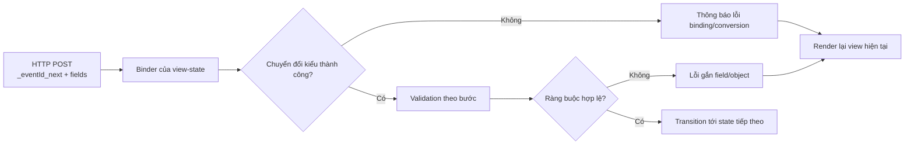
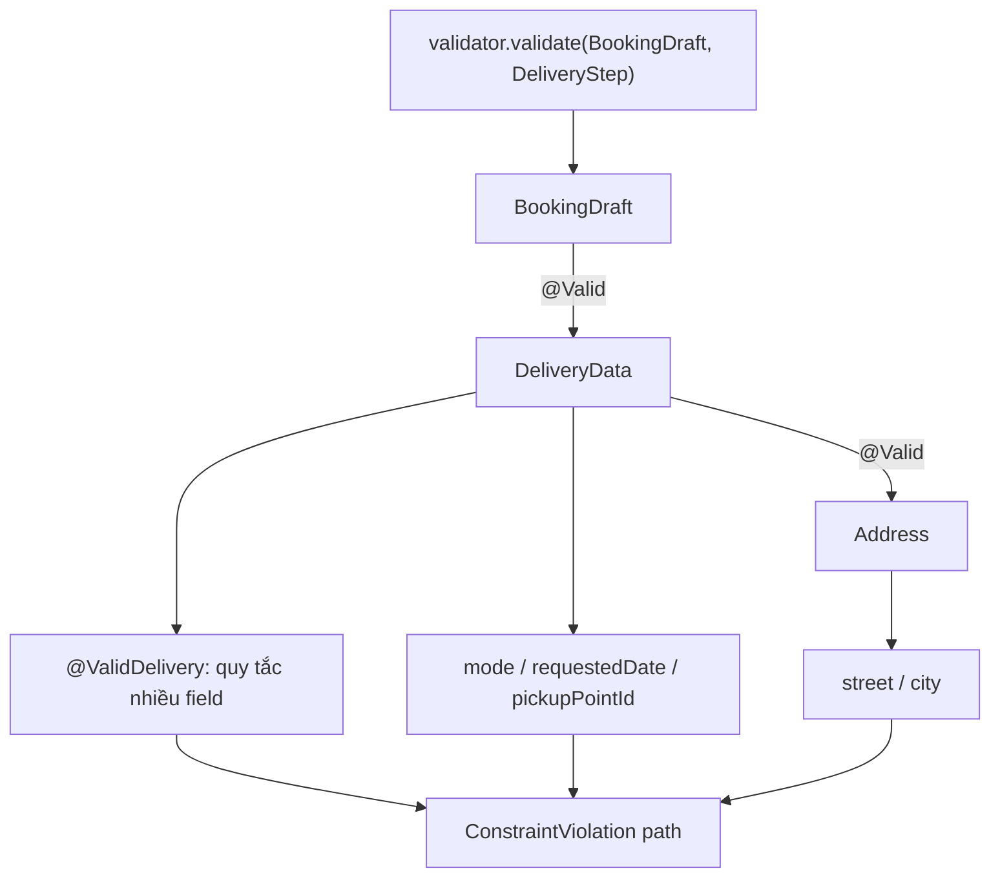

# Ràng buộc trên trường, đối tượng và dữ liệu lồng nhau trong Spring Web Flow

Trong một biểu mẫu nhiều bước, dữ liệu không chỉ sai ở một ô nhập. Một địa chỉ email có thể sai định dạng; một đối tượng đặt lịch có thể không thỏa mãn quy tắc “nếu chọn giao tại nhà thì phải có địa chỉ”; một danh sách người tham gia có thể chứa một phần tử thiếu họ tên. Các lỗi này có **phạm vi khác nhau**, nên cần xác định ràng buộc ở cấp trường, cấp đối tượng hay cấp dữ liệu lồng nhau, rồi hiển thị thông báo đúng bước của **Spring Web Flow (SWF)**.

Bài thuộc chương **Kiểm tra dữ liệu** của module **SPRING_WEB_FLOW**. SWF mô hình hóa hành trình web qua **state, event, transition và subflow**, giữ bản nháp qua nhiều màn hình bằng các scope phù hợp, đồng thời phối hợp với Spring MVC để thực hiện **form binding** và **validation**. Trong bài này, ta thiết kế một mô hình dữ liệu thực tế, khai báo ràng buộc với Bean Validation, chỉ kiểm tra những điều kiện cần thiết ở từng bước, kiểm tra toàn bộ lần cuối trước khi ghi dữ liệu và kiểm thử cả lỗi có cấu trúc lồng nhau.

## 1. Ba phạm vi của một ràng buộc

Hãy xét biểu mẫu đặt lịch tư vấn:

- Bước **contact**: nhập họ tên và email.
- Bước **delivery**: chọn hình thức nhận tài liệu (gửi tới địa chỉ hoặc nhận tại điểm hẹn), ngày dự kiến và thông tin liên quan.
- Bước **review**: xem lại, quay về sửa hoặc xác nhận gửi yêu cầu.

Mô hình dữ liệu:

```text
BookingDraft
├── contact: ContactData
│   ├── fullName
│   └── email
└── delivery: DeliveryData
    ├── mode: DELIVERY | PICKUP
    ├── requestedDate
    ├── pickupPointId
    └── address: Address
        ├── street
        └── city
```

Ba phạm vi cần phân biệt:

| Phạm vi | Câu hỏi được trả lời | Ví dụ |
|---|---|---|
| **Trường (field/property)** | Giá trị riêng của trường có hợp lệ không? | `email` đúng định dạng, `fullName` không rỗng, ngày ở tương lai |
| **Đối tượng (object/class)** | Nhiều trường của **cùng đối tượng** có nhất quán không? | Chọn `DELIVERY` thì phải có địa chỉ; chọn `PICKUP` thì phải có điểm nhận |
| **Dữ liệu lồng nhau (nested/graph)** | Đã kiểm tra đúng các đối tượng con trong toàn bộ bản nháp chưa? | `contact.email`, `delivery.address.city` và từng phần tử của danh sách người tham gia |

Khi một trường không hợp lệ, nên gắn lỗi với **property path** cụ thể để người dùng biết phải sửa ở đâu. Một quy tắc bao trùm nhiều trường có thể tạo lỗi cấp đối tượng hoặc chủ động gắn vào trường phù hợp. Trong mô hình lồng nhau, đường dẫn tới trường là một phần quan trọng của hợp đồng giữa **validator**, **SWF message context** và **view**.

## 2. Phân biệt chuyển đổi kiểu, binding và validation

Trước khi ràng buộc nghiệp vụ được kiểm tra, dữ liệu từ HTTP phải được đưa vào model.



Ví dụ `requestedDate=not-a-date` không thể chuyển thành `LocalDate`; đây là lỗi **conversion/binding**. Giá trị `requestedDate=2020-01-01` có thể chuyển sang `LocalDate` thành công nhưng vi phạm quy tắc **ngày phải trong tương lai**.

Một trường hợp khác: request tự thêm `adminApproved=true` dù biểu mẫu không có ô đó. Đây là vấn đề **trường được phép bind và kiểm soát quyền**, không thể giải quyết bằng annotation `@NotNull` hay `@Email`. SWF có thể dùng `<binder>` để giới hạn các property được phép thay đổi theo từng view-state; service vẫn phải kiểm tra quyền khi lưu.

| Tầng | Ví dụ lỗi | Cách xử lý |
|---|---|---|
| Binding/conversion | `requestedDate=abc` | Báo lỗi kiểu dữ liệu, giữ view |
| Field validation | `contact.email=abc` | Báo lỗi định dạng ngay cạnh email |
| Object validation | Chọn `DELIVERY` nhưng không có `address.street` | Báo lỗi có ngữ cảnh, ưu tiên chỉ ra trường cần sửa |
| Nested validation | `contact.email` của object con không hợp lệ | Đưa lỗi về đúng đường dẫn thuộc tính |
| Authorization/business | Người dùng không có quyền chọn một điểm nhận | Kiểm tra ở service, trả lỗi nghiệp vụ an toàn |

**Đừng cho rằng binding thành công đồng nghĩa dữ liệu hợp lệ**, và cũng đừng cho rằng validation ở view-state có thể thay thế kiểm tra quyền hoặc bất biến nghiệp vụ trước khi lưu.

## 3. Dựng model nhiều bước có đối tượng lồng nhau

Ví dụ sử dụng **Jakarta Bean Validation** (`jakarta.validation.*`), phù hợp với hệ sinh thái Jakarta tương ứng. Với dự án sử dụng Bean Validation 2.x / Spring cũ hơn, package có thể là `javax.validation.*`. Hãy dùng **một hệ API đồng nhất**, phù hợp phiên bản Spring Framework, Spring Web Flow, Bean Validation provider và servlet API của dự án.

### 3.1. Nhóm ràng buộc theo bước

Trong một biểu mẫu nhiều bước, nếu tất cả quy tắc đều chạy ngay ở `contact`, người dùng sẽ bị chặn vì chưa nhập địa chỉ ở bước sau. Ta định nghĩa **validation groups**:

```java
package com.example.booking.validation;

public final class ValidationSteps {
    private ValidationSteps() {}

    public interface ContactStep {}
    public interface DeliveryStep {}
}
```

`ContactStep` dành cho bước thông tin liên hệ, `DeliveryStep` dành cho bước phương thức nhận tài liệu. Đây là các **marker interfaces** do ứng dụng định nghĩa; bản thân chúng không tự được SWF chạy. Ta cần cấu hình một validator để gọi đúng group ở từng state.

### 3.2. Model gốc BookingDraft

```java
package com.example.booking;

import com.example.booking.validation.ValidationSteps;
import jakarta.validation.Valid;
import jakarta.validation.constraints.NotNull;

import java.io.Serializable;

public class BookingDraft implements Serializable {
    private static final long serialVersionUID = 1L;

    @NotNull(groups = ValidationSteps.ContactStep.class)
    @Valid
    private ContactData contact = new ContactData();

    @NotNull(groups = ValidationSteps.DeliveryStep.class)
    @Valid
    private DeliveryData delivery = new DeliveryData();

    public ContactData getContact() { return contact; }
    public void setContact(ContactData contact) { this.contact = contact; }

    public DeliveryData getDelivery() { return delivery; }
    public void setDelivery(DeliveryData delivery) { this.delivery = delivery; }
}
```

Hai đối tượng con được khởi tạo sẵn, giúp binder đi theo đường dẫn như `contact.email` hoặc `delivery.address.street`. `@Valid` có vai trò **kích hoạt kiểm tra lan truyền xuống object con**. Chỉ đặt `@Email` trong `ContactData` mà không có cơ chế cascading thì việc validate **chỉ model gốc** có thể không kiểm tra email.

`@NotNull` có nhiệm vụ khác: yêu cầu đối tượng con tồn tại. **`@Valid` không coi `null` là lỗi**; một giá trị `null` sẽ không được đi sâu để validate. Vì vậy, nếu một object con là bắt buộc, hãy quy định rõ `@NotNull` ở group thích hợp.

`Serializable` hữu ích khi cấu hình session/execution repository cần serialization. Không giữ Spring service, DB connection, request/response hoặc dữ liệu tải lên lớn bên trong draft.

### 3.3. Các ràng buộc trên ContactData

```java
package com.example.booking;

import com.example.booking.validation.ValidationSteps;
import jakarta.validation.constraints.Email;
import jakarta.validation.constraints.NotBlank;
import jakarta.validation.constraints.Size;
import java.io.Serializable;

public class ContactData implements Serializable {
    private static final long serialVersionUID = 1L;

    @NotBlank(
        message = "{booking.contact.fullName.required}",
        groups = ValidationSteps.ContactStep.class
    )
    @Size(
        max = 80,
        message = "{booking.contact.fullName.max}",
        groups = ValidationSteps.ContactStep.class
    )
    private String fullName;

    @NotBlank(
        message = "{booking.contact.email.required}",
        groups = ValidationSteps.ContactStep.class
    )
    @Email(
        message = "{booking.contact.email.invalid}",
        groups = ValidationSteps.ContactStep.class
    )
    private String email;

    public String getFullName() { return fullName; }
    public void setFullName(String fullName) { this.fullName = fullName; }

    public String getEmail() { return email; }
    public void setEmail(String email) { this.email = email; }
}
```

Các annotation khác nhau giải quyết các yêu cầu khác nhau:

- `@NotBlank` từ chối `null` và chuỗi chỉ gồm khoảng trắng; phù hợp với trường `String` bắt buộc.
- `@Size(max = 80)` giới hạn độ dài; nó **không** tự yêu cầu chuỗi phải có nội dung.
- `@Email` kiểm tra định dạng theo quy tắc của Bean Validation provider; nó **không** bảo đảm địa chỉ email tồn tại hoặc đã được xác minh.
- `message = "{...}"` trỏ đến mã thông báo có thể quốc tế hóa; validator trả về lỗi mà view có thể hiển thị theo ngôn ngữ.

Với hai annotation `@NotBlank` và `@Email`, một email rỗng nên được xử lý chủ yếu bởi `@NotBlank`; một email có nội dung nhưng sai định dạng sẽ vi phạm `@Email`.

### 3.4. Mô hình nhận tài liệu

```java
package com.example.booking;

public enum DeliveryMode {
    DELIVERY, PICKUP
}
```

```java
package com.example.booking;

import com.example.booking.validation.ValidationSteps;
import jakarta.validation.Valid;
import jakarta.validation.constraints.Future;
import jakarta.validation.constraints.NotNull;
import jakarta.validation.constraints.Size;
import java.io.Serializable;
import java.time.LocalDate;

@ValidDelivery(groups = ValidationSteps.DeliveryStep.class)
public class DeliveryData implements Serializable {
    private static final long serialVersionUID = 1L;

    @NotNull(groups = ValidationSteps.DeliveryStep.class)
    private DeliveryMode mode;

    @NotNull(groups = ValidationSteps.DeliveryStep.class)
    @Future(groups = ValidationSteps.DeliveryStep.class)
    private LocalDate requestedDate;

    @Size(max = 40, groups = ValidationSteps.DeliveryStep.class)
    private String pickupPointId;

    @Valid
    private Address address = new Address();

    public DeliveryMode getMode() { return mode; }
    public void setMode(DeliveryMode mode) { this.mode = mode; }

    public LocalDate getRequestedDate() { return requestedDate; }
    public void setRequestedDate(LocalDate requestedDate) {
        this.requestedDate = requestedDate;
    }

    public String getPickupPointId() { return pickupPointId; }
    public void setPickupPointId(String pickupPointId) {
        this.pickupPointId = pickupPointId;
    }

    public Address getAddress() { return address; }
    public void setAddress(Address address) { this.address = address; }
}
```

```java
package com.example.booking;

import com.example.booking.validation.ValidationSteps;
import jakarta.validation.constraints.Size;
import java.io.Serializable;

public class Address implements Serializable {
    private static final long serialVersionUID = 1L;

    @Size(max = 120, groups = ValidationSteps.DeliveryStep.class)
    private String street;

    @Size(max = 80, groups = ValidationSteps.DeliveryStep.class)
    private String city;

    public String getStreet() { return street; }
    public void setStreet(String street) { this.street = street; }

    public String getCity() { return city; }
    public void setCity(String city) { this.city = city; }
}
```

Ở ví dụ này, trường địa chỉ có ràng buộc độ dài nhưng **không mặc định luôn bắt buộc**: người dùng chọn `PICKUP` có thể không cần địa chỉ giao hàng. Quy tắc điều kiện “DELIVERY cần địa chỉ, PICKUP cần điểm nhận” thuộc cấp **đối tượng**, được cài đặt tiếp theo.

Lưu ý về ngày giờ: `@Future` yêu cầu ngày nằm **sau thời điểm hiện tại** theo clock/provider. Nếu nghiệp vụ cho phép cả ngày hôm nay, có thể cân nhắc `@FutureOrPresent`. Cần kiểm thử có kiểm soát clock và múi giờ khi nghiệp vụ phụ thuộc địa phương.

## 4. Ràng buộc cấp đối tượng: kiểm tra quan hệ giữa nhiều trường

Một trường có thể hợp lệ khi xét riêng nhưng tổng thể lại sai. Ví dụ:

- `mode = DELIVERY`, `address.street = null`: không biết gửi tài liệu đến đâu.
- `mode = PICKUP`, `pickupPointId = null`: chưa biết điểm nhận.
- `mode = PICKUP`, `address.street = null`: hoàn toàn hợp lệ nếu chỉ nhận tại quầy.

Không nên ép `@NotBlank` lên `address.street` cho mọi trường hợp rồi chặn người nhận tại quầy. Thay vào đó, tạo **custom class-level constraint**.

### 4.1. Định nghĩa annotation @ValidDelivery

```java
package com.example.booking;

import jakarta.validation.Constraint;
import jakarta.validation.Payload;
import java.lang.annotation.ElementType;
import java.lang.annotation.Retention;
import java.lang.annotation.RetentionPolicy;
import java.lang.annotation.Target;

@Target(ElementType.TYPE)
@Retention(RetentionPolicy.RUNTIME)
@Constraint(validatedBy = DeliveryDataConstraintValidator.class)
public @interface ValidDelivery {
    String message() default "{booking.delivery.inconsistent}";
    Class<?>[] groups() default {};
    Class<? extends Payload>[] payload() default {};
}
```

Annotation đặt trên **class `DeliveryData`** vì nó đọc nhiều field để đưa ra một quyết định. Các phần `groups` và `payload` tuân theo hợp đồng của Bean Validation; không tự đổi chữ ký khi tạo constraint.

### 4.2. Tạo ConstraintValidator

```java
package com.example.booking;

import jakarta.validation.ConstraintValidator;
import jakarta.validation.ConstraintValidatorContext;

public class DeliveryDataConstraintValidator
        implements ConstraintValidator<ValidDelivery, DeliveryData> {

    @Override
    public boolean isValid(
            DeliveryData value,
            ConstraintValidatorContext context) {

        if (value == null || value.getMode() == null) {
            // @NotNull của mode xử lý trường hợp mode chưa được chọn.
            return true;
        }

        if (value.getMode() == DeliveryMode.DELIVERY) {
            String street = value.getAddress() == null
                    ? null
                    : value.getAddress().getStreet();

            if (street == null || street.trim().isEmpty()) {
                context.disableDefaultConstraintViolation();
                context.buildConstraintViolationWithTemplate(
                        "{booking.delivery.address.street.required}")
                    .addPropertyNode("address")
                    .addPropertyNode("street")
                    .addConstraintViolation();
                return false;
            }
        }

        if (value.getMode() == DeliveryMode.PICKUP) {
            String pointId = value.getPickupPointId();

            if (pointId == null || pointId.trim().isEmpty()) {
                context.disableDefaultConstraintViolation();
                context.buildConstraintViolationWithTemplate(
                        "{booking.delivery.pickupPoint.required}")
                    .addPropertyNode("pickupPointId")
                    .addConstraintViolation();
                return false;
            }
        }

        return true;
    }
}
```

Hai lời gọi `addPropertyNode(...)` gắn lỗi vào **thuộc tính phù hợp**, dù quy tắc được kiểm tra ở cấp đối tượng. Với đường dẫn validate từ `BookingDraft`, vi phạm của `address.street` sẽ mang property path tương ứng `delivery.address.street`; ở trường hợp PICKUP, path tương ứng `delivery.pickupPointId`.

**Nếu bỏ `addPropertyNode(...)`**, một vi phạm class-level thường được gắn với path của đối tượng `delivery` thay vì một ô nhập cụ thể. Đây vẫn là một lỗi hợp lệ và có thể hiển thị ở khu vực thông báo chung. Chọn nơi đặt lỗi dựa trên khả năng người dùng sửa được trường nào, không gắn bừa một lỗi nghiệp vụ vào `email` hoặc một trường không liên quan.

### 4.3. Quy tắc nhiều trường có nên đặt ở entity?

Với form nhiều bước, có hai dạng kiểm tra:

1. **Ràng buộc đầu vào của bản nháp**: dữ liệu đang nhập có nhất quán và đủ để chuyển bước không?
2. **Bất biến nghiệp vụ khi ghi**: người dùng có quyền dùng điểm nhận này không, lịch có còn trống không, trạng thái yêu cầu có còn cho phép lưu không?

Custom constraint trong draft giúp tạo thông báo sớm và rõ ràng. Service vẫn cần kiểm tra lại các điều kiện nghiệp vụ tại lúc thực thi giao dịch. Không dựa vào validation của giao diện để bảo đảm quyền, tính toàn vẹn hoặc chống request giả mạo.

## 5. Validation lồng nhau: @Valid là mắt xích cần thiết

Khi ứng dụng gọi:

```java
Set<ConstraintViolation<BookingDraft>> violations =
        validator.validate(draft, ValidationSteps.ContactStep.class);
```

Bean Validation bắt đầu từ **`BookingDraft`**. Nhờ `@Valid` trên `contact`, nó đi tiếp tới `ContactData` và áp dụng những constraint thuộc group `ContactStep`. Lỗi email xuất hiện với path **`contact.email`**.

Tương tự:

```java
Set<ConstraintViolation<BookingDraft>> violations =
        validator.validate(draft, ValidationSteps.DeliveryStep.class);
```

`@Valid` trên `delivery` đưa quá trình kiểm tra xuống `DeliveryData`. `@Valid` trên `address` tiếp tục kiểm tra `Address`. Class-level `@ValidDelivery` có thể phát hiện quy tắc phụ thuộc `mode`.



Một số lưu ý:

- `@Valid` là **cascading**. Nó không thay thế `@NotNull`, `@NotBlank` hay class-level constraint.
- Nếu property lồng nhau là `null`, cascading không đi sâu; cần `@NotNull` khi bản thân object con là bắt buộc.
- Nếu khai báo `@Valid` ở `DeliveryData.address` nhưng quên ở `BookingDraft.delivery`, việc validate từ root có thể không bao giờ đến địa chỉ.
- Mỗi constraint được khai báo với group nào thì chỉ chạy khi group đó được chọn (hoặc được bao gồm qua cơ chế nhóm/hierarchy).
- `@Valid` trên quan hệ lồng nhau truyền group đang dùng xuống object con theo quy tắc của Bean Validation. Nếu cần đổi group khi cascade, có thể nghiên cứu `@ConvertGroup` trong trường hợp thực sự có lý do thiết kế.

### 5.1. Ràng buộc trên danh sách đối tượng con

Khi flow cho phép đăng ký nhiều người tham gia:

```java
import jakarta.validation.Valid;
import jakarta.validation.constraints.Size;
import java.util.ArrayList;
import java.util.List;

public class BookingDraft {
    @Size(min = 1, groups = ValidationSteps.DeliveryStep.class)
    private List<@Valid AttendeeData> attendees =
            new ArrayList<>();

    // Các field và getter/setter khác...
}
```

Nếu `AttendeeData` có `@NotBlank(groups = DeliveryStep.class)` trên `name`, lỗi của một phần tử sẽ mang path chứa chỉ số phần tử, ví dụ gần với **`attendees[0].name`** tùy provider và cách biểu diễn `PropertyPath`. Khi đưa vào Spring form binding, cần đối chiếu **tên field thực tế được binder nhận** và cách view hiển thị lỗi để không trỏ nhầm hàng.

`@Size(min=1)` bảo đảm danh sách có phần tử, còn `@Valid` kiểm tra **từng đối tượng con**. Hai mục đích này khác nhau. Với list mutable được bind từ request, cần giới hạn kích thước/số phần tử, kiểm soát chỉ số, tránh để client tạo mảng quá lớn hoặc dùng index không hợp lệ.

### 5.2. Lồng nhau nhiều tầng và vòng tham chiếu

Mô hình có thể sâu hơn một cấp, nhưng càng sâu càng khó xác định đường dẫn và vòng đời. Nếu object graph có tham chiếu vòng, hãy thiết kế rõ ranh giới dữ liệu và dùng khả năng kiểm soát chu trình của Bean Validation provider phù hợp; đừng đưa cả graph entity JPA vào flow scope chỉ để tiện bind.

Một **draft/DTO nhỏ, có cấu trúc** thường giúp kiểm thử và bảo vệ đầu vào dễ hơn một entity với nhiều quan hệ hai chiều.

## 6. Vì sao cần validation theo từng bước?

Giả sử người dùng mới nhập họ tên và email ở `contact`. Địa chỉ và ngày nhận dự kiến còn trống vì họ chưa tới bước `delivery`. Nếu validate toàn bộ ràng buộc vào lúc bấm `next` ở `contact`, người dùng có thể bị báo lỗi `delivery.requestedDate` mặc dù ô ngày còn chưa xuất hiện.

Với groups đã định nghĩa, ta có thể chủ động:

| View-state / thao tác | Group hoặc quy tắc cần chạy | Không cần chặn bởi |
|---|---|---|
| `contact` + `next` | `ContactStep` | Dữ liệu thuộc `DeliveryStep` |
| `delivery` + `next` | `DeliveryStep` | Việc chưa xác nhận cuối cùng |
| `delivery` + `back` | Thường bỏ binding/validation để điều hướng | Các trường delivery còn dang dở |
| `review` + `confirm` | Kiểm tra lại **cả ContactStep và DeliveryStep**, cộng bất biến nghiệp vụ | Không bỏ qua dữ liệu đã nhập ở bước trước |

Lưu ý rằng **Bean Validation groups không tự được kích hoạt chỉ vì chúng có tên giống tên state**. SWF phải được cấu hình với validator/hook hoặc hành động rõ ràng để chọn group tại đúng bước. Tránh giả định chỉ thêm `groups=...` lên annotation là flow sẽ tự suy ra group từ URL.

### 6.1. Ví dụ view-state với binder whitelist

```xml
<flow xmlns="http://www.springframework.org/schema/webflow"
      xmlns:xsi="http://www.w3.org/2001/XMLSchema-instance"
      xsi:schemaLocation="
        http://www.springframework.org/schema/webflow
        http://www.springframework.org/schema/webflow/spring-webflow.xsd">

    <var name="bookingDraft"
         class="com.example.booking.BookingDraft"/>

    <view-state id="contact"
                view="booking/contact"
                model="bookingDraft">
        <binder>
            <binding property="contact.fullName" required="true"/>
            <binding property="contact.email" required="true"/>
        </binder>
        <transition on="next" to="delivery"/>
        <transition on="cancel" to="cancelled"
                    bind="false" validate="false"/>
    </view-state>

    <view-state id="delivery"
                view="booking/delivery"
                model="bookingDraft">
        <binder>
            <binding property="delivery.mode" required="true"/>
            <binding property="delivery.requestedDate" required="true"/>
            <binding property="delivery.pickupPointId"/>
            <binding property="delivery.address.street"/>
            <binding property="delivery.address.city"/>
        </binder>
        <transition on="back" to="contact"
                    bind="false" validate="false"/>
        <transition on="next" to="review"/>
    </view-state>

    <view-state id="review"
                view="booking/review"
                model="bookingDraft">
        <transition on="back" to="delivery"
                    bind="false" validate="false"/>
        <transition on="confirm" to="persist"
                    bind="false" validate="false"/>
    </view-state>

    <action-state id="persist">
        <evaluate expression="bookingService.save(bookingDraft)"
                  result="flowScope.bookingId"/>
        <transition on="success" to="completed"/>
    </action-state>

    <end-state id="completed" view="booking/completed"/>
    <end-state id="cancelled" view="booking/cancelled"/>
</flow>
```

Ở đây `<binder>` giới hạn property được phép cập nhật **theo view**. Người dùng ở `contact` không được dùng request của bước này để sửa `delivery.mode` hoặc các field nội bộ ngoài whitelist.

Tuy nhiên, XML này chỉ minh họa **phạm vi binding và transition**. Để thực thi các group `ContactStep`/`DeliveryStep`, cần đăng ký cơ chế validation tương thích với phiên bản SWF. Ngoài ra, `confirm` được cấu hình `bind="false" validate="false"`, nên **service phải kiểm tra toàn bộ draft trước khi lưu**; không được dựa vào giả định rằng `confirm` sẽ tự chạy validation của view `review`.

### 6.2. Bẫy của required binding

`required="true"` trong `<binder>` là ràng buộc ở **giai đoạn binding**. Nó không thay thế các quy tắc như chuỗi sau khi trim không được rỗng, email phải đúng định dạng hoặc một trường chỉ bắt buộc khi `mode=DELIVERY`.

Đặc biệt với trường điều kiện `delivery.pickupPointId` và `delivery.address.street`, ta không đặt cả hai thành required ở binder vì chỉ **một** trong hai cần thiết tùy `mode`. Custom object-level validator mới có đủ ngữ cảnh để quyết định.

## 7. Nối Bean Validation với MessageContext của Spring Web Flow

Bean Validation trả về tập `ConstraintViolation`. SWF cần phản ánh lỗi tới **`MessageContext`** để view có thể hiển thị và việc chuyển state có thể bị chặn khi thích hợp.

Một adapter được Spring quản lý có thể kiểm tra group và chuyển vi phạm thành message:

```java
package com.example.booking.validation;

import com.example.booking.BookingDraft;
import jakarta.validation.ConstraintViolation;
import jakarta.validation.Validator;
import org.springframework.binding.message.MessageBuilder;
import org.springframework.webflow.validation.ValidationContext;
import org.springframework.stereotype.Component;
import java.util.Set;

@Component("bookingDraftValidator")
public class BookingDraftValidator {

    private final Validator beanValidator;

    public BookingDraftValidator(Validator beanValidator) {
        this.beanValidator = beanValidator;
    }

    public void validateContact(BookingDraft draft,
                                ValidationContext context) {
        addViolations(
            beanValidator.validate(draft, ValidationSteps.ContactStep.class),
            context
        );
    }

    public void validateDelivery(BookingDraft draft,
                                 ValidationContext context) {
        addViolations(
            beanValidator.validate(draft, ValidationSteps.DeliveryStep.class),
            context
        );
    }

    public void validateAll(BookingDraft draft,
                            ValidationContext context) {
        addViolations(
            beanValidator.validate(
                draft,
                ValidationSteps.ContactStep.class,
                ValidationSteps.DeliveryStep.class
            ),
            context
        );
    }

    private void addViolations(
            Set<ConstraintViolation<BookingDraft>> violations,
            ValidationContext context) {

        for (ConstraintViolation<BookingDraft> violation : violations) {
            String propertyPath =
                    violation.getPropertyPath().toString();

            MessageBuilder message = new MessageBuilder()
                    .error()
                    .defaultText(violation.getMessage());

            if (!propertyPath.isEmpty()) {
                message.source(propertyPath);
            }

            context.getMessageContext().addMessage(message.build());
        }
    }
}
```

Đoạn code minh họa **cầu nối giữa các group Bean Validation và SWF `MessageContext`**. Cần bảo đảm thư viện đã cung cấp Bean Validation provider, `Validator` được đăng ký thành bean có thể inject, và validator của model thực sự được SWF **tìm thấy và gọi theo state**. Spring Web Flow hỗ trợ các cơ chế validation theo quy ước/tên state và validator bean; chi tiết nhận diện phương thức/bean có thể phụ thuộc phiên bản và cấu hình. Khi tích hợp, hãy kiểm tra bằng test thực rằng event `next` đi qua `validateContact` hoặc `validateDelivery`, thay vì cho rằng annotation `@Component` tự tạo ra đầy đủ kết nối.

Nếu hệ thống không dùng cơ chế bean validator theo quy ước, có thể viết validation tường minh trong model theo `ValidationContext` hoặc cấu hình một action/hook gọi adapter ở đúng thời điểm, với hợp đồng “có lỗi thì không cho chuyển tiếp”. Tránh gọi hai cơ chế cùng lúc mà không kiểm soát, vì cùng một vi phạm có thể xuất hiện hai lần.

### 7.1. Field path lồng nhau được chuyển ra sao?

Với email sai, `ConstraintViolation#getPropertyPath()` cho kết quả tương ứng `contact.email`. Adapter gọi:

```java
new MessageBuilder()
    .error()
    .source("contact.email")
    .defaultText("Địa chỉ email không hợp lệ")
    .build();
```

Với phương thức nhận tài liệu là `DELIVERY` nhưng thiếu tên đường, lỗi class-level đã thêm property nodes sẽ tạo đường dẫn tương ứng `delivery.address.street`.

Với một constraint cấp đối tượng **không tạo property node**, path có thể ở mức object như `delivery`. Ứng dụng phải quyết định trình bày ở khu vực chung của bước đó, thay vì mong form tag của field `delivery.address.street` tự biết hiển thị lỗi.

### 7.2. Message code và i18n

Có thể đặt resource bundle:

```properties
# ValidationMessages_vi.properties
booking.contact.fullName.required=Vui lòng nhập họ tên.
booking.contact.fullName.max=Họ tên quá dài.
booking.contact.email.required=Vui lòng nhập email.
booking.contact.email.invalid=Địa chỉ email không hợp lệ.
booking.delivery.inconsistent=Thông tin nhận tài liệu chưa nhất quán.
booking.delivery.address.street.required=Vui lòng nhập tên đường giao tài liệu.
booking.delivery.pickupPoint.required=Vui lòng chọn điểm nhận.
```

```properties
# ValidationMessages_en.properties
booking.contact.fullName.required=Please enter your full name.
booking.contact.fullName.max=Your full name is too long.
booking.contact.email.required=Please enter an email address.
booking.contact.email.invalid=Please enter a valid email address.
booking.delivery.inconsistent=Delivery details are inconsistent.
booking.delivery.address.street.required=Please enter a delivery street.
booking.delivery.pickupPoint.required=Please select a pickup point.
```

Bean Validation provider cần biết cách tra message bundle theo cấu hình. Spring MVC/SWF cũng có thể sử dụng `MessageSource` và locale resolver riêng. Khi chuyển thông báo qua `getMessage()` như trong ví dụ, câu đã được Bean Validation nội suy trước; nếu dự án muốn giữ **message code** để SWF resolve theo locale khi render, cần thiết kế adapter giữ lại template/code và cấu hình resolver thống nhất. Không thể mặc định hai hệ message sử dụng chung một nguồn hoặc locale chỉ vì file có tên giống nhau.

## 8. Hiển thị field error, object error và lỗi lồng nhau trong view

Form của bước liên hệ có thể dùng Spring MVC form tags:

```jsp
<%@ taglib prefix="form" uri="http://www.springframework.org/tags/form" %>

<form:form id="contactForm"
           method="post"
           action="${flowExecutionUrl}"
           modelAttribute="bookingDraft">

    <label for="fullName">Họ tên</label>
    <form:input id="fullName" path="contact.fullName"/>
    <form:errors path="contact.fullName"
                 cssClass="field-error"/>

    <label for="email">Email</label>
    <form:input id="email" path="contact.email"/>
    <form:errors path="contact.email"
                 cssClass="field-error"/>

    <button type="submit" name="_eventId_next">
        Tiếp tục
    </button>
</form:form>
```

Đường dẫn ở **view** phải nhất quán với đường dẫn mà **binder** và **validator** sử dụng: `contact.email`. Với input lồng nhau `delivery.address.street`, `path` cũng phải dùng đúng tên thuộc tính theo model.

Điều kiện quan trọng: `MessageContext` và lỗi form do Spring MVC renderer sử dụng phải được **tích hợp phù hợp**. Ví dụ `<form:errors>` không có nghĩa bất cứ message nào bạn thêm vào context sẽ tự được mọi view engine hiển thị. Nếu dùng Thymeleaf hoặc renderer tùy biến, cách lấy lỗi sẽ khác; cần có integration test để xác nhận source/property path dẫn đến đúng HTML.

### Thông báo cấp đối tượng

Một quy tắc “ngày bắt đầu phải trước ngày kết thúc” có thể không chỉ ra một trường duy nhất. Trong trường hợp đó, có thể đặt lỗi cấp đối tượng và hiển thị trong vùng tổng hợp của màn hình:

```html
<div class="form-summary" role="alert">
  Ngày kết thúc phải sau ngày bắt đầu.
</div>
```

Nếu đã chỉ ra lỗi cụ thể ở `delivery.address.street`, hiển thị ngay bên input đó sẽ hữu ích hơn. Với nhiều lỗi, có thể có một summary liên kết đến field; nên tránh hiển thị trùng câu chữ liên tục gây khó đọc.

### Accessibility và dữ liệu nhạy cảm

Trường sai nên có label rõ ràng, thông báo gắn với input qua `aria-describedby`, trạng thái `aria-invalid="true"` khi thích hợp và nội dung dễ hiểu không phụ thuộc màu sắc. Khi hiển thị thông báo, escape nội dung có nguồn từ người dùng để giảm nguy cơ XSS.

Không đưa stack trace, SQL query, token, dữ liệu riêng tư hoặc giá trị bí mật vào `ConstraintViolation` hay thông báo giao diện.

## 9. Kiểm tra toàn bộ draft khi xác nhận

Validation theo bước giúp phản hồi nhanh, nhưng **không đủ** để bảo đảm dữ liệu vẫn hợp lệ tại thời điểm lưu. Người dùng có thể giữ nhiều tab, gửi lại request cũ hoặc dữ liệu nghiệp vụ có thể đã thay đổi.

Khi `review` phát event `confirm`, service nên:

1. Kiểm tra lại ràng buộc trường và đối tượng với **tất cả group cần thiết**.
2. Xác thực danh tính hiện tại và quyền đối với điểm nhận/dịch vụ.
3. Kiểm tra dữ liệu mới nhất từ hệ thống (ví dụ điểm nhận còn hoạt động hay lịch còn trống).
4. Chuẩn hóa dữ liệu, ánh xạ sang entity và ghi trong giao dịch phù hợp.
5. Bảo vệ khỏi thao tác xác nhận lặp bằng idempotency key hoặc ràng buộc duy nhất phù hợp.

Ví dụ phác thảo tầng service:

```java
@Transactional
public Long save(BookingDraft draft) {
    Set<ConstraintViolation<BookingDraft>> violations =
        beanValidator.validate(
            draft,
            ValidationSteps.ContactStep.class,
            ValidationSteps.DeliveryStep.class
        );

    if (!violations.isEmpty()) {
        throw new InvalidBookingDraftException(violations);
    }

    ensureCallerCanUseSelectedServiceAndPickupPoint(draft);
    ensureBookingStillAvailable(draft);

    Booking entity = mapAllowedFieldsToEntity(draft);
    return bookingRepository.save(entity).getId();
}
```

Các phương thức `ensureCallerCanUseSelectedServiceAndPickupPoint`, `mapAllowedFieldsToEntity` và exception là **mã minh họa hợp đồng nghiệp vụ**, cần được triển khai theo ứng dụng thực. Flow phải có nhánh xử lý lỗi đã thiết kế để đưa người dùng trở lại bước thích hợp mà không làm mất draft. Nếu service ném exception, **SWF không tự động tạo event `failure` trong mọi trường hợp**; cần action trả kết quả nghiệp vụ hoặc exception handler phù hợp.

Cũng cần lưu ý `validate(draft, ContactStep.class, DeliveryStep.class)` chỉ chạy các nhóm được nêu; constraint chỉ ở group `Default` sẽ **không tự động** được chạy nếu group đó không được bao gồm theo quy tắc Bean Validation. Hãy thiết kế group và điểm kiểm tra cuối sao cho mọi bất biến bắt buộc đều được xét.

## 10. Lỗi thiết kế thường gặp

### 10.1. Quên @Valid trên một cấp

Có `@Email` ở `ContactData.email` nhưng thiếu `@Valid` trên `BookingDraft.contact` thì validate model gốc có thể không đi đến email. Hãy kiểm tra đường cascade từ root tới mọi object cần validation.

### 10.2. Đặt @NotBlank lên một object hoặc enum

`@NotBlank` dành cho chuỗi ký tự. Với `DeliveryMode` hoặc đối tượng lồng nhau, dùng `@NotNull` khi muốn yêu cầu sự hiện diện. Với danh sách, cân nhắc `@NotEmpty` hoặc `@Size(min=...)` theo ngữ nghĩa.

### 10.3. Chạy toàn bộ constraint khi người dùng mới ở bước đầu

Điều này tạo lỗi của các trường chưa được hiển thị và làm người dùng mắc kẹt ở `contact`. Dùng state-specific validation hoặc groups có kiểm soát, rồi chạy tất cả kiểm tra cần thiết trước khi lưu.

### 10.4. Đặt tất cả thông báo thành lỗi toàn màn hình

Nếu `contact.email` sai, message nên giữ property path để hiển thị sát email. Lỗi toàn màn hình phù hợp với quy tắc toàn form hoặc lỗi nghiệp vụ không gắn một field cụ thể.

### 10.5. Gắn lỗi class-level vào trường bất kỳ

Ràng buộc phụ thuộc hai trường có thể tạo lỗi chung hoặc chỉ rõ trường thực sự cần sửa. Không gắn lỗi “không chọn điểm nhận” vào `contact.email` chỉ vì ô email có sẵn.

### 10.6. Tưởng @Valid tự bắt buộc object khác null

Cascading không thể đi sâu vào một tham chiếu `null`. Nếu `delivery` phải tồn tại, thêm `@NotNull` theo group thích hợp; nếu có thể null, code object-level validator phải xử lý null an toàn.

### 10.7. Tin rằng dữ liệu hợp lệ vì người dùng đã qua các bước

Request có thể bị sửa, trạng thái phiên thay đổi, hoặc quy tắc nghiệp vụ đổi. Kiểm tra lại trên server trước khi commit và kiểm soát quyền với dữ liệu được lấy từ người dùng đã xác thực.

### 10.8. Tạo validator có side effect

Validation nên **quan sát và báo lỗi**, không ghi database, không chỉnh draft ở những cách khó dự đoán và không gửi email/thanh toán. Side effect đặt ở service/action đúng thời điểm để có giao dịch, rollback và khả năng kiểm thử.

### 10.9. Không giới hạn danh sách lồng nhau

Với `List<@Valid AttendeeData>`, hãy hạn chế số phần tử và trường có thể bind. Không cho client gửi hàng nghìn index hoặc làm phát sinh object graph quá lớn qua binder.

## 11. Kiểm thử field, object và nested constraints

Một bộ test tốt cần xác nhận **nội dung lỗi, property path và group được chọn**, ngoài việc kiểm tra có lỗi hay không.

| Test | Đầu vào | Kỳ vọng |
|---|---|---|
| T01 | `contact.email=""` | Có lỗi `contact.email` thuộc `ContactStep` |
| T02 | `contact.email="abc"` | Có lỗi định dạng email tại `contact.email` |
| T03 | `contact.email` đúng, delivery trống, validate ContactStep | ContactStep PASS; delivery chưa bị bắt lỗi |
| T04 | `delivery.mode=DELIVERY`, street trống | Lỗi `delivery.address.street` |
| T05 | `delivery.mode=PICKUP`, pickupPointId trống | Lỗi `delivery.pickupPointId` |
| T06 | PICKUP hợp lệ, address trống | Không phát lỗi bắt buộc street từ quy tắc DELIVERY |
| T07 | `delivery.requestedDate` là ngày quá khứ | Lỗi field `delivery.requestedDate` |
| T08 | `delivery=null` trong group DeliveryStep | Lỗi `delivery` do `@NotNull` |
| T09 | Nested `attendees[0].name` rỗng | Lỗi đúng phần tử và trường tương ứng |
| T10 | POST `next` từ contact với email sai | SWF ở lại contact, hiển thị lỗi, giữ họ tên |
| T11 | POST `back` ở delivery chưa hoàn chỉnh | Quay về contact nếu transition tắt binding/validation |
| T12 | Xác nhận sau khi dữ liệu nghiệp vụ đổi | Service từ chối có kiểm soát, không tạo bản ghi sai |

### 11.1. Unit test Bean Validation

Ví dụ dùng JUnit 5 với Bean Validation provider đã được cấu hình:

```java
import static org.junit.jupiter.api.Assertions.*;
import java.util.Set;
import jakarta.validation.Validation;
import jakarta.validation.Validator;
import jakarta.validation.ConstraintViolation;
import org.junit.jupiter.api.Test;

class BookingDraftValidationTest {

    private final Validator validator =
        Validation.buildDefaultValidatorFactory().getValidator();

    @Test
    void missingStreetIsReportedAtNestedPath() {
        BookingDraft draft = new BookingDraft();
        draft.getDelivery().setMode(DeliveryMode.DELIVERY);
        draft.getDelivery().setRequestedDate(
            java.time.LocalDate.now().plusDays(2)
        );
        draft.getDelivery().getAddress().setStreet("");

        Set<ConstraintViolation<BookingDraft>> errors =
            validator.validate(
                draft, ValidationSteps.DeliveryStep.class
            );

        assertTrue(errors.stream()
            .anyMatch(error -> error.getPropertyPath()
                .toString().equals("delivery.address.street")));
    }

    @Test
    void contactStepDoesNotRequireDeliveryData() {
        BookingDraft draft = new BookingDraft();
        draft.getContact().setFullName("Linh");
        draft.getContact().setEmail("linh@example.test");

        Set<ConstraintViolation<BookingDraft>> errors =
            validator.validate(
                draft, ValidationSteps.ContactStep.class
            );

        assertTrue(errors.isEmpty());
    }
}
```

Test trên minh họa hành vi validator, chưa mô phỏng binding/request của SWF. Để kiểm tra đúng event/state, cần thêm **flow execution test**; để chứng minh view hiển thị thông báo bên input đúng và session giữ draft, cần **HTTP integration test** qua Spring MVC.

Ở dự án thực, nên quản lý vòng đời `ValidatorFactory` hợp lý (ví dụ tạo dùng chung trong test fixture và đóng khi teardown), kiểm soát `ClockProvider` khi kiểm thử thời gian và xác nhận Bean Validation provider được cung cấp bởi dependency phù hợp.

### 11.2. Kiểm thử có đi qua flow

Một test chỉ gọi `beanValidator.validate(draft, ...)` **không chứng minh** SWF đã gọi validator khi người dùng nhấn `next`. Hãy bổ sung các kịch bản:

1. Bắt đầu flow tại `contact`, gửi email sai qua request parameters; xác nhận vẫn ở `contact`, có lỗi source `contact.email`.
2. Sửa email rồi `next`; xác nhận sang `delivery`, giá trị `contact` vẫn còn.
3. Chọn `DELIVERY` nhưng bỏ trống street; `next` phải ở lại `delivery`, lỗi gắn với `delivery.address.street`.
4. Nhấn `back`; không bị validation của bước delivery còn dang dở chặn, các giá trị đã nhập vẫn còn trong flow scope.
5. Chọn `PICKUP` và điểm nhận hợp lệ; không xuất hiện lỗi street không cần thiết.
6. Ở `review`, xác nhận khi trạng thái hệ thống thay đổi; service từ chối an toàn, không tự động coi đó là lỗi của một field tùy ý.

### 11.3. Kiểm thử qua HTTP

Với `MockMvc` hoặc môi trường servlet tích hợp đầy đủ:

- Gửi `_eventId_next` cùng dữ liệu form tới **flow execution URL do SWF sinh ra**, không hardcode execution key.
- Giữ session/cookie và CSRF token nếu security yêu cầu.
- Kiểm tra form field path, thông báo sau render, dữ liệu không bị xóa và state chuyển đúng.
- Thử request thêm field ngoài whitelist để phát hiện over-posting.
- Nếu dùng JSP với `MockMvc`, nhớ rằng MockMvc có thể chỉ kiểm tra forward đến JSP mà không render hoàn chỉnh HTML; dùng môi trường phù hợp khi cần xác nhận HTML thực tế.

## 12. Bài tập thực hành mở rộng

Xây dựng flow **đăng ký khóa học** gồm ba bước:

- **student**: họ tên, email, số điện thoại.
- **course**: hình thức tham gia `ONLINE` hoặc `OFFLINE`; nếu OFFLINE phải chọn cơ sở; nếu ONLINE phải cung cấp email liên hệ.
- **review**: tổng hợp dữ liệu và xác nhận.

Yêu cầu:

1. Tạo một `EnrollmentDraft` với hai object con `StudentData` và `CourseSelection`.
2. Đặt field constraint cho họ tên, email, số điện thoại và ngày bắt đầu học.
3. Tạo class-level constraint để kiểm tra phụ thuộc vào `ONLINE/OFFLINE`.
4. Thêm `@Valid` ở các cấp cần thiết; chủ động thử bỏ một `@Valid` để quan sát khác biệt.
5. Chia validation theo bước bằng groups hoặc cơ chế state-specific SWF phù hợp.
6. Gắn thông báo đến đường dẫn `student.email` hoặc `course.campusId` khi biết trường nào cần sửa.
7. Cấu hình binder whitelist theo từng view-state.
8. Kiểm tra lại toàn bộ draft và quyền nghiệp vụ trong service trước khi lưu.
9. Viết ít nhất ba unit test validator, hai flow tests và một đường đi HTTP thành công có một ca lỗi.

### Câu hỏi ôn tập

**1. Vì sao `@NotNull` trên `BookingDraft.contact` không thay thế được `@Valid`?** Vì `@NotNull` chỉ kiểm tra tham chiếu có tồn tại; `@Valid` mới chỉ dẫn Bean Validation kiểm tra tiếp các ràng buộc của `ContactData`.

**2. Khi nào dùng ràng buộc cấp đối tượng?** Khi tính hợp lệ phụ thuộc quan hệ giữa nhiều trường, ví dụ `DELIVERY` bắt buộc có địa chỉ còn `PICKUP` cần điểm nhận.

**3. Tại sao không kiểm tra DeliveryStep ngay từ contact?** Vì người dùng chưa có cơ hội nhập dữ liệu ở bước delivery; mỗi view-state nên kiểm tra những ràng buộc phù hợp thời điểm đó.

**4. Làm sao để lỗi từ class-level constraint hiện ở trường `delivery.address.street`?** Dùng API `ConstraintValidatorContext` tạo property nodes tương ứng, rồi giữ nguyên property path khi chuyển lỗi sang message/view.

**5. `@Valid` có kiểm tra object con `null` như lỗi không?** Không. Nếu object con bắt buộc, khai báo thêm `@NotNull`.

**6. Có thể kết thúc việc kiểm tra dữ liệu chỉ tại bước review không?** Không nên. Mỗi bước cần phản hồi sớm để người dùng sửa, nhưng service vẫn phải kiểm tra lại toàn bộ dữ liệu và bất biến nghiệp vụ tại thời điểm lưu.

## 13. Checklist áp dụng trong dự án

- [ ] Draft là DTO phù hợp cho form nhiều bước, không expose entity nội bộ.
- [ ] Ràng buộc field chọn đúng loại (`@NotBlank`, `@Email`, `@NotNull`, `@Size`, `@Future`).
- [ ] Quan hệ nhiều field được kiểm tra bằng quy tắc object-level rõ ràng.
- [ ] `@Valid` được đặt ở đủ các cạnh của object graph cần kiểm tra.
- [ ] Object con bắt buộc có ràng buộc null riêng nếu cần.
- [ ] Group validation được áp dụng đúng state và có bước kiểm tra toàn bộ trước lưu.
- [ ] `<binder>` chỉ cho phép cập nhật các trường của view-state hiện tại.
- [ ] Error source/property path trùng với field path thực tế của form.
- [ ] Thông báo lỗi được quốc tế hóa và hiển thị đúng vị trí.
- [ ] Điều hướng `back`/`cancel` không bị validation không cần thiết chặn.
- [ ] Service kiểm tra quyền, nghiệp vụ và dữ liệu mới nhất trước khi ghi.
- [ ] Test bao phủ field, object, nested path, conversion, scope, HTTP binding và hành vi lưu.

**Ghi nhớ:** Ràng buộc **trên trường** kiểm tra từng giá trị; ràng buộc **trên đối tượng** kiểm tra các quan hệ giữa nhiều trường; `@Valid` dẫn quá trình validation đi qua **dữ liệu lồng nhau**. Khi kết hợp chúng với group theo bước, binder của view-state và `MessageContext` của Spring Web Flow, người dùng nhận được lỗi đúng lúc và đúng nơi, còn service giữ trách nhiệm cuối cùng đối với dữ liệu nghiệp vụ.

