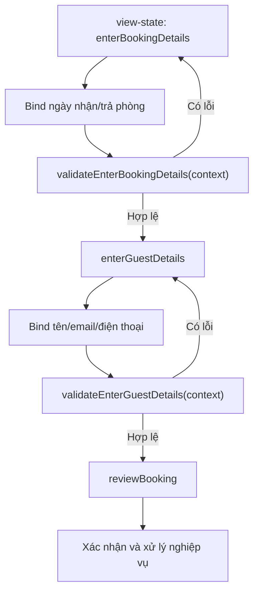
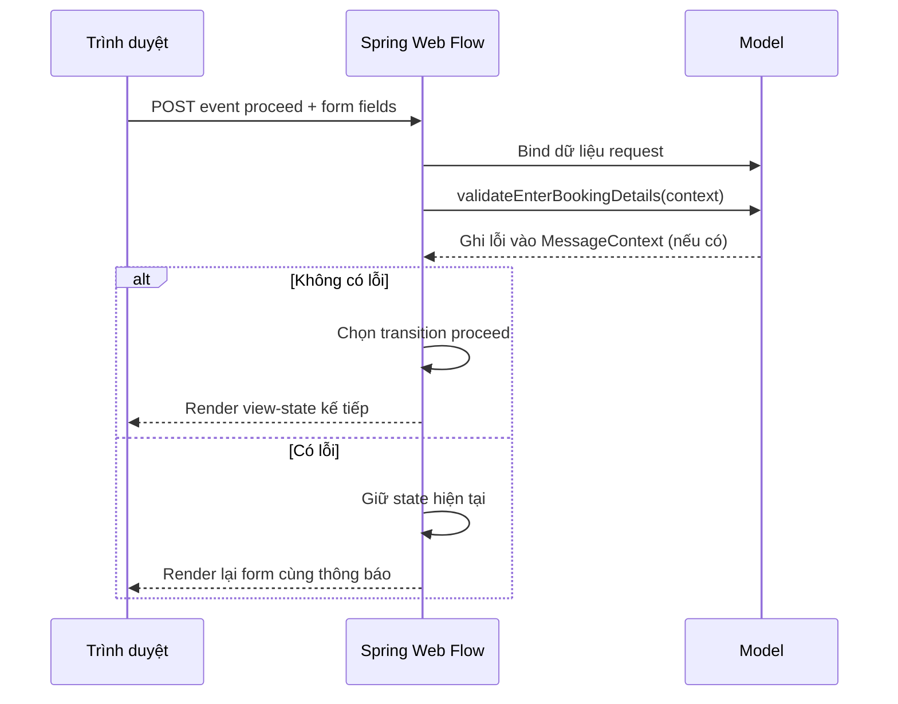

# Phương thức `validate` theo tên `view-state` trên model

## Mục tiêu bài học

Trong Spring Web Flow, một `view-state` có thể gắn với một model để nhận dữ liệu form, chuyển kiểu và kiểm tra dữ liệu trước khi flow đi tiếp. Khi một model được chỉnh sửa ở nhiều màn hình, mỗi màn hình thường chỉ cho phép sửa **một phần thuộc tính** và có **quy tắc hợp lệ riêng**.

Spring Web Flow hỗ trợ một quy ước tiện dụng: đặt phương thức validation ngay trên model, với tên được tạo từ ID của `view-state`. Ví dụ, state `enterBookingDetails` có thể gọi tự động:

```java
public void validateEnterBookingDetails(ValidationContext context)
```

Bài này giải thích cách đặt tên, chữ ký phương thức, thời điểm được gọi và cách gửi lỗi về view. Sau khi học, bạn có thể:

- Ánh xạ `view-state id` sang tên phương thức `validate...` chính xác.
- Viết validation cho một bước mà không cần gọi thủ công trong XML.
- Thêm lỗi cấp field hoặc lỗi chung qua `MessageContext` và `MessageBuilder`.
- Tách validation theo từng màn hình trong một flow nhiều bước.
- Phân biệt phương thức validate trên model với validator bean và Bean Validation.
- Điều khiển việc bỏ qua validation bằng `validate="false"` và phân biệt với `bind="false"`.
- Kiểm thử đường đi khi dữ liệu đúng, sai, chuyển kiểu thất bại hoặc người dùng quay lại.

## 1. Vì sao validation cần gắn với từng `view-state`?

Giả sử một flow đặt phòng khách sạn có ba màn hình:

1. **Thông tin đặt phòng**: ngày nhận phòng và ngày trả phòng.
2. **Thông tin khách**: tên, email và số điện thoại.
3. **Xem lại**: tóm tắt để người dùng xác nhận.

Model `booking` có thể chứa tất cả dữ liệu, nhưng mỗi màn hình chỉ chỉnh sửa một nhóm thuộc tính:

| `view-state` | Thuộc tính được nhập | Quy tắc phù hợp |
| --- | --- | --- |
| `enterBookingDetails` | `checkinDate`, `checkoutDate` | Ngày nhận phòng phải ở tương lai; ngày trả phòng phải sau ngày nhận phòng |
| `enterGuestDetails` | `guestName`, `guestEmail`, `phone` | Tên bắt buộc; email đúng định dạng; số điện thoại theo quy tắc ứng dụng |
| `reviewBooking` | Thường chỉ đọc | Hiển thị lại thông tin; không cần chạy validation form nếu không có model được bind |

Nếu dồn tất cả quy tắc vào một hàm `validate()` tổng quát, người dùng có thể bị yêu cầu điền email ngay cả khi họ còn đang ở bước chọn ngày. Validation theo tên state giúp **chỉ kiểm tra phần dữ liệu thuộc màn hình hiện tại**, đúng với thứ tự của hành trình.



## 2. Quy ước đặt tên: `validate` + ID của `view-state`

Giả sử flow khai báo:

```xml
<view-state id="enterBookingDetails" model="booking">
    <transition on="proceed" to="enterGuestDetails" />
</view-state>
```

Spring Web Flow tìm phương thức validation theo quy ước:

```text
view-state id: enterBookingDetails
method name:   validateEnterBookingDetails
```

Mẫu tổng quát:

```text
validate${StateId}
```

Trong đó `${StateId}` là ID của `view-state` cần kiểm tra. Ví dụ:

| ID trong XML | Tên phương thức trên model |
| --- | --- |
| `enterBookingDetails` | `validateEnterBookingDetails(...)` |
| `enterGuestDetails` | `validateEnterGuestDetails(...)` |
| `reviewBooking` | `validateReviewBooking(...)` |
| `confirmAddress` | `validateConfirmAddress(...)` |
| `editProfile` | `validateEditProfile(...)` |

**Hãy dùng ID theo camelCase** như `enterBookingDetails`, `editProfile`. Tên phương thức Java phải là một identifier hợp lệ; không nên đặt state ID có dấu gạch nối rồi tự giả định Web Flow sẽ chuyển nó thành camelCase.

### Những điều kiện cần có

1. `view-state` phải khai báo `model`, ví dụ `model="booking"`.
2. Model expression phải trỏ tới object có thể truy cập trong scope của flow, chẳng hạn `flowScope.booking`.
3. Model phải có phương thức **public** với đúng tên theo state ID.
4. Chữ ký thông dụng của phương thức trên model là `void` và nhận một tham số `ValidationContext`.
5. Validation được gọi trong vòng đời postback của `view-state` khi transition xử lý event, trừ khi validation bị tắt cho transition đó.

Phương thức không cần được gọi bằng `<evaluate>` trong XML. Cơ chế nhận diện theo tên là một **quy ước tự động** của Web Flow.

## 3. Chữ ký phương thức validate trên model

Ví dụ tối thiểu:

```java
import java.time.LocalDate;
import org.springframework.binding.validation.ValidationContext;
import org.springframework.binding.message.MessageContext;
import org.springframework.binding.message.MessageBuilder;

public class Booking {
    private LocalDate checkinDate;
    private LocalDate checkoutDate;

    public void validateEnterBookingDetails(ValidationContext context) {
        MessageContext messages = context.getMessageContext();

        if (checkinDate == null) {
            messages.addMessage(new MessageBuilder()
                    .error()
                    .source("checkinDate")
                    .defaultText("Vui lòng chọn ngày nhận phòng")
                    .build());
        }

        if (checkoutDate == null) {
            messages.addMessage(new MessageBuilder()
                    .error()
                    .source("checkoutDate")
                    .defaultText("Vui lòng chọn ngày trả phòng")
                    .build());
        }
    }
}
```

Ở đây:

- `Booking` là model object mà view-state đang chỉnh sửa.
- `ValidationContext` được Web Flow truyền vào khi gọi phương thức.
- `context.getMessageContext()` lấy nơi ghi các thông báo validation.
- `.error()` tạo thông báo lỗi.
- `.source("checkinDate")` gắn lỗi với thuộc tính model tương ứng để view có thể hiển thị gần trường nhập.
- `.defaultText(...)` cung cấp nội dung mặc định nếu không dùng message code.
- `.build()` tạo message được thêm vào `MessageContext`.

Các import trong ví dụ dùng API Spring Web Flow 3.x:

```java
org.springframework.binding.validation.ValidationContext
org.springframework.binding.message.MessageContext
org.springframework.binding.message.MessageBuilder
```

Không nhầm `ValidationContext` với `jakarta.validation.Validator` hoặc `org.springframework.validation.Errors`. Chúng thuộc các cơ chế validation khác nhau, dù có thể được tích hợp trong cùng một ứng dụng.

## 4. Ví dụ đầy đủ: kiểm tra ngày nhận và ngày trả phòng

### 4.1. Model có phương thức theo ID state

```java
import java.io.Serializable;
import java.time.LocalDate;

import org.springframework.binding.message.MessageBuilder;
import org.springframework.binding.message.MessageContext;
import org.springframework.binding.validation.ValidationContext;

public class Booking implements Serializable {
    private static final long serialVersionUID = 1L;

    private LocalDate checkinDate;
    private LocalDate checkoutDate;

    public LocalDate getCheckinDate() {
        return checkinDate;
    }

    public void setCheckinDate(LocalDate checkinDate) {
        this.checkinDate = checkinDate;
    }

    public LocalDate getCheckoutDate() {
        return checkoutDate;
    }

    public void setCheckoutDate(LocalDate checkoutDate) {
        this.checkoutDate = checkoutDate;
    }

    public void validateEnterBookingDetails(ValidationContext context) {
        MessageContext messages = context.getMessageContext();
        LocalDate today = LocalDate.now();

        if (checkinDate == null) {
            messages.addMessage(new MessageBuilder()
                    .error()
                    .source("checkinDate")
                    .defaultText("Ngày nhận phòng là bắt buộc")
                    .build());
        } else if (!checkinDate.isAfter(today)) {
            messages.addMessage(new MessageBuilder()
                    .error()
                    .source("checkinDate")
                    .defaultText("Ngày nhận phòng phải sau ngày hiện tại")
                    .build());
        }

        if (checkoutDate == null) {
            messages.addMessage(new MessageBuilder()
                    .error()
                    .source("checkoutDate")
                    .defaultText("Ngày trả phòng là bắt buộc")
                    .build());
        } else if (checkinDate != null
                && !checkoutDate.isAfter(checkinDate)) {
            messages.addMessage(new MessageBuilder()
                    .error()
                    .source("checkoutDate")
                    .defaultText("Ngày trả phòng phải sau ngày nhận phòng")
                    .build());
        }
    }
}
```

Các phép kiểm tra được viết có xét `null`, vì người dùng có thể gửi form thiếu trường. Không gọi `checkinDate.isBefore(...)` trước khi kiểm tra ngày nhận phòng có tồn tại; nếu không, validation có thể ném `NullPointerException` thay vì tạo thông báo dễ hiểu.

Quy tắc dùng `LocalDate.now()` chỉ là ví dụ đơn giản. Trong hệ thống thật, hãy cân nhắc múi giờ nghiệp vụ, ngày hiện tại theo khách sạn, ngày đóng bán và chính sách nhận/trả phòng. Những điều kiện phụ thuộc database hoặc chính sách động có thể cần một validator/service riêng.

### 4.2. Flow XML kích hoạt phương thức tự động

```xml
<?xml version="1.0" encoding="UTF-8"?>
<flow xmlns="http://www.springframework.org/schema/webflow"
      xmlns:xsi="http://www.w3.org/2001/XMLSchema-instance"
      xsi:schemaLocation="http://www.springframework.org/schema/webflow
                          https://www.springframework.org/schema/webflow/spring-webflow.xsd">

    <on-start>
        <evaluate expression="bookingDraftFactory.newBooking()"
                  result="flowScope.booking" />
    </on-start>

    <view-state id="enterBookingDetails"
                view="booking/details"
                model="booking">
        <binder>
            <binding property="checkinDate" required="true" />
            <binding property="checkoutDate" required="true" />
        </binder>
        <transition on="proceed" to="enterGuestDetails" />
        <transition on="cancel" to="cancelled" bind="false" />
    </view-state>

    <view-state id="enterGuestDetails"
                view="booking/guest"
                model="booking">
        <transition on="review" to="reviewBooking" />
        <transition on="back" to="enterBookingDetails"
                    validate="false" />
    </view-state>

    <view-state id="reviewBooking" view="booking/review">
        <transition on="revise" to="enterBookingDetails" bind="false" />
        <transition on="confirm" to="persistBooking" bind="false" />
    </view-state>

    <action-state id="persistBooking">
        <evaluate expression="bookingService.confirm(booking)" />
        <transition on="success" to="bookingConfirmed" />
    </action-state>

    <end-state id="bookingConfirmed" />
    <end-state id="cancelled" />
</flow>
```

`bookingDraftFactory` và `bookingService` là Spring bean do ứng dụng cung cấp; `booking/ details`, `booking/guest` và `booking/review` là view logic cần được resolver cấu hình. Đoạn XML tập trung minh họa model binding và validation; flow thực tế cần bổ sung validator cho thông tin khách, nhánh lỗi lưu và kiểm tra nghiệp vụ trước khi xác nhận.

Khi event `proceed` xảy ra tại `enterBookingDetails`, Web Flow:

1. Lấy dữ liệu form và bind vào `booking`.
2. Chuyển đổi kiểu dữ liệu theo cấu hình conversion service.
3. Gọi `validateEnterBookingDetails(ValidationContext)` nếu validation được bật.
4. Nếu không có lỗi validation, tiếp tục transition tới `enterGuestDetails`.
5. Nếu có lỗi, giữ flow ở state hiện tại và render lại view để người dùng sửa.

Không có dòng XML nào gọi trực tiếp `booking.validateEnterBookingDetails(...)`: Web Flow tìm phương thức dựa trên **ID `enterBookingDetails` và model `booking`**.

### 4.3. Tách validation cho từng bước

Model có thể có nhiều phương thức:

```java
public void validateEnterBookingDetails(ValidationContext context) {
    // Kiểm tra checkinDate và checkoutDate.
}

public void validateEnterGuestDetails(ValidationContext context) {
    MessageContext messages = context.getMessageContext();

    if (guestName == null || guestName.isBlank()) {
        messages.addMessage(new MessageBuilder()
                .error()
                .source("guestName")
                .defaultText("Vui lòng nhập tên người lưu trú")
                .build());
    }

    if (guestEmail == null || !isValidEmail(guestEmail)) {
        messages.addMessage(new MessageBuilder()
                .error()
                .source("guestEmail")
                .defaultText("Địa chỉ email không hợp lệ")
                .build());
    }
}
```

Hai phương thức trên là phần bổ sung cho cùng model; `guestName`, `guestEmail` và `isValidEmail(...)` cần được khai báo/triển khai trong class. Khi state `enterGuestDetails` xử lý event, Web Flow tìm `validateEnterGuestDetails(...)`, không gọi phương thức của bước ngày phòng.

Điều này hữu ích khi một model được chỉnh sửa qua nhiều view-state: mỗi phương thức chỉ kiểm tra phần dữ liệu cần hợp lệ để đi tiếp từ bước đó.

## 5. Validation chạy vào thời điểm nào?

Với `view-state` có khai báo `model`, Web Flow thực hiện binding và validation trong **vòng đời postback** khi nhận event từ view.



### Binding diễn ra trước validation

Đây là thứ tự rất quan trọng:

| Giai đoạn | Ví dụ | Loại lỗi |
| --- | --- | --- |
| Binding | Chuỗi `"abc"` được gửi vào thuộc tính `LocalDate checkinDate` | Lỗi chuyển kiểu (`typeMismatch`) |
| Validation theo model | Ngày đã chuyển thành `LocalDate` nhưng nằm trong quá khứ | Lỗi quy tắc dữ liệu |
| Transition | Chọn state đích sau khi binding và validation hợp lệ | Điều hướng flow |

Nếu conversion thất bại, không nên kỳ vọng phương thức validate có thể “sửa” chuỗi đầu vào không chuyển được. Web Flow có thể tạo thông báo binding riêng, render lại view và không thực hiện transition.

### Validation chỉ có khi model được gắn với view-state

Ví dụ:

```xml
<view-state id="enterBookingDetails" model="booking">
    <transition on="proceed" to="reviewBooking" />
</view-state>
```

`model="booking"` là điểm nối để Web Flow biết object cần bind và validate. Nếu view-state chỉ hiển thị dữ liệu mà không khai báo model, đừng mặc định phương thức `validateEnterBookingDetails(...)` trên một object bất kỳ sẽ được gọi.

## 6. Dùng `ValidationContext` để tạo thông báo

`ValidationContext` cung cấp `MessageContext` để thêm lỗi và thông tin về event/người dùng hiện tại.

| Phương thức | Công dụng |
| --- | --- |
| `getMessageContext()` | Lấy nơi ghi error, warning và info message |
| `getUserEvent()` | Lấy event người dùng vừa gửi, ví dụ `proceed` hoặc `saveDraft` |
| `getUserPrincipal()` | Lấy `Principal` của người dùng hiện tại nếu có |
| `getUserValue("property")` | Đọc giá trị người dùng gửi cho thuộc tính đã bind |

### 6.1. Gắn lỗi vào một field

```java
messages.addMessage(new MessageBuilder()
        .error()
        .source("guestEmail")
        .defaultText("Email không đúng định dạng")
        .build());
```

`source("guestEmail")` phải khớp tên thuộc tính của model để view có thể gắn thông báo với trường tương ứng.

### 6.2. Dùng message code để hỗ trợ đa ngôn ngữ

```java
messages.addMessage(new MessageBuilder()
        .error()
        .source("checkinDate")
        .code("booking.checkin.notFuture")
        .build());
```

Trong message bundle, ví dụ:

```properties
booking.checkin.notFuture=Ngày nhận phòng phải sau ngày hiện tại
booking.checkout.afterCheckin=Ngày trả phòng phải sau ngày nhận phòng
```

`MessageSource` của Spring được dùng để phân giải mã thông báo theo locale. Có thể cung cấp `defaultText(...)` làm nội dung dự phòng khi phù hợp.

### 6.3. Lỗi cấp field và lỗi chung

Lỗi cấp field nên có `source` là tên thuộc tính. Với lỗi liên quan nhiều trường, ví dụ “ngày trả phòng phải sau ngày nhận phòng”, có thể gắn lỗi vào trường `checkoutDate` vì người dùng cần sửa trường đó. Nếu thông báo không thuộc một field cụ thể, có thể thêm message không chỉ định source:

```java
messages.addMessage(new MessageBuilder()
        .error()
        .defaultText("Thông tin đặt phòng chưa hợp lệ")
        .build());
```

View phải hiển thị cả thông báo chung và lỗi theo trường. Việc ghi message vào `MessageContext` không tự bảo đảm template sẽ hiển thị nếu giao diện không có vùng thông báo tương ứng.

## 7. Dùng event hiện tại để điều chỉnh validation

`ValidationContext` cung cấp `getUserEvent()`. Có thể dùng để biết người dùng vừa nhấn nút nào:

```java
public void validateEnterBookingDetails(ValidationContext context) {
    String event = context.getUserEvent();

    if ("saveDraft".equals(event)) {
        // Chỉ kiểm tra tối thiểu cần thiết để lưu bản nháp.
        return;
    }

    // Với proceed/confirm, kiểm tra đầy đủ điều kiện của bước.
    validateDates(context.getMessageContext());
}
```

Ví dụ này giả định flow có event `saveDraft`. Nếu yêu cầu của từng event khác nhau, cần xác định rõ quy tắc nào là bắt buộc và dữ liệu nào có thể để trống. Không nên bỏ qua validation chỉ vì event đến từ một nút có tên “Save”.

Thông thường, nếu event không cần bind hoặc validate dữ liệu hiện tại, hãy khai báo rõ ở transition thay vì dựa vào nhánh điều kiện bên trong model.

## 8. Bỏ qua validation: `validate="false"` khác `bind="false"`

Spring Web Flow cho phép điều chỉnh binding/validation theo từng transition.

### `validate="false"`: vẫn bind, bỏ qua model validation

```xml
<view-state id="enterBookingDetails" model="booking">
    <transition on="proceed" to="reviewBooking" />
    <transition on="back"
                to="previousStep"
                validate="false" />
</view-state>
```

Với event `back`, dữ liệu form vẫn được bind vào model, nhưng các bước model validation được bỏ qua. Cách này hữu ích khi người dùng muốn quay lại bước trước dù dữ liệu của bước hiện tại chưa hoàn chỉnh.

### `bind="false"`: bỏ cả binding và validation

```xml
<view-state id="enterBookingDetails" model="booking">
    <transition on="cancel"
                to="bookingCancelled"
                bind="false" />
</view-state>
```

Khi hủy, thường không cần đưa những giá trị đang nhập dở vào model. `bind="false"` ngăn việc binding và validation trên transition đó.

| Cấu hình | Binding | Validation |
| --- | --- | --- |
| Mặc định | Có | Có |
| `validate="false"` | Có | Không |
| `bind="false"` | Không | Không |

Chọn theo ý nghĩa thao tác:

- **Next/Proceed:** thường cần bind và validate.
- **Back:** có thể cần giữ giá trị người dùng vừa nhập nhưng không bắt buộc hoàn tất mọi trường; cân nhắc `validate="false"`.
- **Cancel:** thường không cần cập nhật model; cân nhắc `bind="false"`.

Không tắt validation trên event `proceed` hoặc `confirm` chỉ để tránh hiển thị lỗi. Các quy tắc quan trọng vẫn phải được kiểm tra trước khi thực hiện nghiệp vụ.

## 9. Chỉ cho phép bind những thuộc tính cần thiết

Nếu không khai báo `<binder>`, theo mặc định mọi public property phù hợp của model có thể đủ điều kiện để nhận dữ liệu từ view. Điều này có thể tạo rủi ro **mass assignment**: người dùng tự gửi thêm trường mà giao diện không hiển thị.

Ví dụ:

```xml
<view-state id="enterBookingDetails"
            model="booking">
    <binder>
        <binding property="checkinDate" required="true" />
        <binding property="checkoutDate" required="true" />
    </binder>
    <transition on="proceed" to="reviewBooking" />
</view-state>
```

Chỉ hai thuộc tính được khai báo mới được bind từ form ở view-state này. Những field như `bookingId`, `customerId`, `approved`, `price` hoặc `status` cần được kiểm soát bởi server/service, không nên mở cho client tự ghi.

Validation method chỉ kiểm tra dữ liệu; **nó không phải hàng rào phân quyền cho binding**. Hãy kết hợp binder whitelist, DTO/model phù hợp và kiểm tra quyền trong service nghiệp vụ.

## 10. Phân biệt model validate method, external Validator và Bean Validation

Spring Web Flow hỗ trợ nhiều cách validation. Chúng có thể phối hợp, nhưng mỗi cách có vai trò khác nhau.

| Cách làm | Vị trí logic | Cách nhận diện | Khi phù hợp |
| --- | --- | --- | --- |
| **Model validate method** | Trực tiếp trên model object | `validate${state}(ValidationContext)` | Quy tắc gắn chặt với model và bước chỉnh sửa |
| **External Validator** | Spring bean riêng | Bean tên `${model}Validator`, có `validate${state}(Model, ValidationContext)` | Muốn tách model khỏi logic validation hoặc dùng dependency |
| **JSR-303/Jakarta Bean Validation** | Annotation trên thuộc tính/class | `@NotNull`, `@Email`, `@Size`, custom constraint | Quy tắc khai báo, tái sử dụng giữa nhiều tầng |
| **Spring `Validator`** | Bean thực thi `org.springframework.validation.Validator` | `supports(...)` và `validate(..., Errors)` | Tích hợp validator Spring hiện có |

### 10.1. Model validate method

```java
public class Booking {
    public void validateEnterBookingDetails(ValidationContext context) {
        // Web Flow tìm phương thức theo state ID trên chính model.
    }
}
```

Không cần đăng ký `Booking` như validator bean chỉ để sử dụng quy ước này; object đang được dùng làm model là nơi Web Flow tìm phương thức.

### 10.2. External Validator bean

Nếu muốn đặt logic validation ngoài model, có thể tạo bean theo tên `${model}Validator`. Với `model="booking"`, bean convention có tên `bookingValidator`:

```java
import org.springframework.stereotype.Component;
import org.springframework.binding.validation.ValidationContext;
import org.springframework.binding.message.MessageBuilder;
import org.springframework.binding.message.MessageContext;

@Component
public class BookingValidator {

    public void validateEnterBookingDetails(
            Booking booking,
            ValidationContext context) {

        MessageContext messages = context.getMessageContext();
        if (booking.getCheckinDate() != null
                && booking.getCheckoutDate() != null
                && !booking.getCheckoutDate()
                        .isAfter(booking.getCheckinDate())) {
            messages.addMessage(new MessageBuilder()
                    .error()
                    .source("checkoutDate")
                    .defaultText("Ngày trả phòng phải sau ngày nhận phòng")
                    .build());
        }
    }
}
```

Web Flow tự phát hiện validator bean theo quy ước tên. Phương thức external validator nhận thêm tham số model trước `ValidationContext`, khác với phương thức nằm trực tiếp trên model.

External validator cũng có thể nhận `org.springframework.validation.Errors` khi cần tích hợp Spring Validator hiện có.

### 10.3. Phương thức `validate(...)` mặc định trong external Validator

Một external validator có thể định nghĩa:

```java
public void validate(Booking booking, ValidationContext context) {
    // Quy tắc chung chạy mỗi khi model Booking được validate.
}
```

Phương thức mặc định `validate(...)` không gắn với một state cụ thể. Nếu cùng bean có cả phương thức state-specific và `validate(...)`, Web Flow gọi phương thức state-specific trước, rồi gọi phương thức mặc định.

Điều này hữu ích cho các quy tắc chung, nhưng tránh lặp cùng một điều kiện ở cả hai nơi để không tạo nhiều thông báo giống nhau.

### 10.4. Bean Validation (Jakarta Validation)

Có thể khai báo quy tắc trên model:

```java
import jakarta.validation.constraints.Email;
import jakarta.validation.constraints.NotBlank;
import jakarta.validation.constraints.NotNull;
import jakarta.validation.constraints.Size;

public class GuestDetails {
    @NotBlank
    @Size(max = 100)
    private String guestName;

    @NotBlank
    @Email
    private String guestEmail;

    @NotNull
    private Long sessionId;

    // Getter/setter
}
```

Để Web Flow sử dụng `LocalValidatorFactoryBean`, cấu hình `flow-builder-services`:

```xml
<webflow:flow-registry id="flowRegistry"
                       flow-builder-services="flowBuilderServices">
    <!-- Đăng ký các flow location của ứng dụng -->
</webflow:flow-registry>

<webflow:flow-builder-services id="flowBuilderServices"
                               validator="validator" />

<bean id="validator"
      class="org.springframework.validation.beanvalidation.LocalValidatorFactoryBean" />
```

Khi được cấu hình, validator được áp dụng cho model sau data binding. Bean Validation **không loại trừ** validation theo quy ước của Web Flow; các cơ chế có thể cùng tham gia. Với form nhiều bước, validation groups và `validation-hints` có thể giới hạn nhóm constraint phù hợp cho từng bước.

Ví dụ:

```xml
<view-state id="enterGuestDetails"
            model="guestDetails"
            validation-hints="'GuestStep'">
    <transition on="proceed" to="reviewBooking" />
</view-state>
```

`GuestStep` cần là validation group được định nghĩa trong model hoặc được phân giải qua `ValidationHintResolver`. Đừng chỉ ghi tên group trong XML mà quên định nghĩa/configure group tương ứng.

## 11. Chọn nơi đặt quy tắc để model không phình to

Quy ước validate trên model rất tiện, nhưng không có nghĩa mọi quy tắc nghiệp vụ nên được đặt trong class model.

| Loại quy tắc | Nơi nên cân nhắc |
| --- | --- |
| Trường bắt buộc, độ dài, định dạng email | Bean Validation hoặc model validator |
| Ngày trả phòng sau ngày nhận phòng | Model validate method hoặc validator theo state |
| Nhiều field phải nhất quán với nhau trong form | Model validate method hoặc external validator |
| Kiểm tra mã đặt chỗ đã tồn tại trong database | Service/validator có dependency, tùy cách tổ chức |
| Kiểm tra quyền người dùng với một bản ghi | Security/policy service ở server |
| Còn phòng tại thời điểm Confirm | Service giao dịch và cơ chế đồng thời ở database |
| Ghi booking, gửi thanh toán | Service nghiệp vụ có transaction/idempotency |

Validation của form thường hướng tới **phản hồi sớm cho người dùng**. Nó không thay thế kiểm tra cuối cùng khi service thực hiện hành động quan trọng. Ví dụ phòng có thể còn khi người dùng mở form nhưng đã được người khác đặt trước lúc Confirm; chỉ service ghi mới có thể quyết định đặt thành công.

Nếu model là DTO trong `flowScope`, model validate method nên tập trung vào dữ liệu form. Tránh đưa `EntityManager`, connection, service ghi hoặc side effect vào DTO chỉ để thuận tiện gọi từ validation.

## 12. Các lỗi thường gặp

### 12.1. Sai tên phương thức

XML:

```xml
<view-state id="enterGuestDetails" model="booking">
```

Nhưng Java lại viết:

```java
public void validateGuestDetails(ValidationContext context) {
    // ...
}
```

Tên này không theo convention của state. Hãy đổi thành:

```java
public void validateEnterGuestDetails(ValidationContext context) {
    // ...
}
```

### 12.2. Quên `model` trong view-state

Nếu state không khai báo `model="booking"`, Web Flow không biết model nào cần bind/validate. Kiểm tra cả model expression và scope mà object đang nằm trong đó.

### 12.3. Nhầm chữ ký model method với external validator

Model method:

```java
validateEnterGuestDetails(ValidationContext context)
```

External bean:

```java
validateEnterGuestDetails(Booking booking, ValidationContext context)
```

Không trộn hai chữ ký với nhau. Với external validator, bean còn phải được đăng ký đúng tên theo model expression.

### 12.4. Dùng `getMessages()` thay cho API hiện tại

Với API Spring Web Flow 3.x, lấy message context bằng:

```java
MessageContext messages = context.getMessageContext();
```

Đừng sao chép ví dụ từ phiên bản cũ hoặc tài liệu không cùng phiên bản mà không kiểm tra import/chữ ký API.

### 12.5. Ném exception khi dữ liệu trống

Validation cần xử lý `null` trước khi gọi method trên giá trị. Nếu không, người dùng có thể nhận lỗi server thay vì message gắn với field.

### 12.6. Message có `source` không khớp tên property

Nếu model là `guestEmail` nhưng message dùng `source("email")`, view có thể không gắn lỗi đúng trường. Hãy dùng chính xác tên thuộc tính model mà form bind.

### 12.7. Chuyển kiểu thất bại rồi mong validation method xử lý

Nếu chuỗi ngày không thể chuyển thành `LocalDate`, lỗi xuất hiện ở binding/conversion trước model validation. Hãy cấu hình formatter/converter và message code phù hợp; không dùng validation method để phân tích lại một kiểu dữ liệu đã không bind được.

### 12.8. Bỏ qua validation trên mọi transition

`validate="false"` có thể hữu ích cho Back, nhưng nếu đặt trên Proceed/Confirm, flow có thể đi tiếp với model chưa thỏa điều kiện. Chỉ tắt validation khi event có ý nghĩa rõ ràng và dữ liệu được xử lý an toàn ở bước sau.

### 12.9. Binder cho phép cập nhật quá nhiều field

Nếu không giới hạn binder, public property ngoài ý muốn có thể được bind. Khai báo `<binder>` cho các field được phép sửa và kiểm tra quyền tại service.

### 12.10. Validation truy cập database hoặc gây tác dụng phụ

Validation có thể chạy nhiều lần khi người dùng gửi lại form. Không tạo booking, trừ tồn kho, gửi email hay ghi audit nghiệp vụ không thể lặp trong method validate. Với quy tắc phụ thuộc trạng thái database, dùng truy vấn đọc phù hợp và vẫn kiểm tra lại trong transaction ghi.

## 13. Kiểm thử phương thức validate theo state

Đừng chỉ kiểm tra method Java chạy khi gọi thủ công. Cần xác nhận **Web Flow tự gọi đúng method** theo state ID và model được khai báo.

| Kịch bản | Event | Kết quả mong đợi |
| --- | --- | --- |
| Ngày nhận/trả phòng hợp lệ | `proceed` tại `enterBookingDetails` | Validation không thêm error; flow đi tới state kế tiếp |
| Ngày nhận phòng trong quá khứ | `proceed` | Có lỗi gắn với `checkinDate`; vẫn ở state hiện tại |
| Ngày trả phòng trước ngày nhận | `proceed` | Có lỗi gắn với `checkoutDate`; không chuyển state |
| Ngày bị bỏ trống | `proceed` | Có message required phù hợp |
| Dữ liệu ngày sai định dạng | `proceed` | Binding/conversion báo lỗi; không giả định model method xử lý được |
| Event `back` với `validate="false"` | `back` | Vẫn bind dữ liệu, bỏ qua model validation và chuyển về state trước |
| Event `cancel` với `bind="false"` | `cancel` | Không bind và không validate dữ liệu dở dang |
| State khác cùng model | `review` hoặc state khác | Phương thức validation được chọn theo ID state tương ứng |
| External validator được cấu hình | Event postback | Bean đúng tên được phát hiện; method có đúng chữ ký |
| Bean Validation được bật | Event postback | Constraint annotation được áp dụng sau binding |
| User event khác nhau | `saveDraft`/`proceed` | `getUserEvent()` trả event hiện tại để áp dụng logic phù hợp |

### Kiểm thử model method riêng

Có thể unit test quy tắc bằng cách mock `ValidationContext` và `MessageContext`:

```java
// Mã minh họa với Mockito; fixture và assertion tùy test framework.
ValidationContext context = mock(ValidationContext.class);
MessageContext messages = mock(MessageContext.class);

when(context.getMessageContext()).thenReturn(messages);

Booking booking = new Booking();
booking.setCheckinDate(LocalDate.now().minusDays(1));
booking.setCheckoutDate(LocalDate.now().plusDays(1));

booking.validateEnterBookingDetails(context);

verify(messages).addMessage(any());
```

Đây là phác thảo test: cần import Mockito, tạo fixture phù hợp và kiểm tra cụ thể `source`/message code trong dự án. Có thể dùng `any()` với kiểu tham số được suy ra từ `addMessage(...)` nếu không muốn import kiểu message. Unit test này xác nhận **quy tắc của method**, nhưng chưa chứng minh Web Flow gọi nó tự động.

### Kiểm thử tích hợp flow

Với test flow, hãy:

1. Khởi chạy flow và xác nhận state `enterBookingDetails`.
2. Gửi event `proceed` với ngày hợp lệ; xác nhận state kế tiếp.
3. Khởi động execution khác, gửi ngày sai; xác nhận flow vẫn ở `enterBookingDetails` và có message lỗi.
4. Gửi event `back` với `validate="false"`; xác nhận transition xảy ra dù dữ liệu chưa đủ.
5. Gửi event `cancel` với `bind="false"`; xác nhận dữ liệu form dở dang không bị bind trước khi kết thúc.
6. Xác nhận state `enterGuestDetails` kích hoạt `validateEnterGuestDetails`, không gọi nhầm phương thức của state trước.

Spring Web Flow cung cấp các tiện ích như `AbstractXmlFlowExecutionTests` để kiểm thử flow definition. API cụ thể phụ thuộc phiên bản và cấu hình test; ngoài việc assert state, hãy kiểm tra cả `MessageContext`/lỗi binding.

## 14. Bài tập thực hành

Bạn đang xây dựng flow đăng ký khóa học:

```text
enterStudentDetails → enterCourseDetails → reviewEnrollment
```

Model `EnrollmentDraft` có:

```text
studentName
studentEmail
courseId
startDate
endDate
```

Yêu cầu:

1. `enterStudentDetails` kiểm tra `studentName` bắt buộc và `studentEmail` đúng định dạng.
2. `enterCourseDetails` kiểm tra `courseId` tồn tại trong dữ liệu đã chọn, `startDate` không ở quá khứ và `endDate` sau `startDate`.
3. Cả hai state dùng `model="enrollmentDraft"`.
4. Khi quay lại bước trước, người dùng vẫn giữ được dữ liệu đã nhập dù chưa hoàn tất validation của bước hiện tại.
5. Khi Confirm, service phải kiểm tra khóa học còn mở đăng ký và ghi enrollment trong transaction.

**Nhiệm vụ:**

- Viết `validateEnterStudentDetails(ValidationContext)` trên model.
- Viết `validateEnterCourseDetails(ValidationContext)` trên model.
- Khai báo hai view-state với `model` và binder chỉ cho phép các trường cần nhập.
- Khai báo transition Back với `validate="false"` nếu vẫn muốn bind dữ liệu; dùng `bind="false"` nếu không muốn nhận thay đổi ở event đó.
- Xác định những điều kiện nào thuộc validation form và điều kiện nào phải kiểm tra lại trong service lúc commit.
- Viết test cho trường hợp email sai, ngày kết thúc sai và khóa học đóng đăng ký trước Confirm.

**Câu hỏi tự kiểm tra:** Nếu `enterCourseDetails` có ID đúng nhưng phương thức Java đặt tên `validateCourseDetails(...)`, Web Flow có tự gọi nó theo convention không? Vì sao kiểm tra “khóa học còn mở đăng ký” trong validate method vẫn chưa đủ để bảo đảm việc Confirm thành công?

## 15. Ghi nhớ

- Với `view-state id="enterBookingDetails" model="booking"`, Web Flow tự tìm **`booking.validateEnterBookingDetails(ValidationContext)`** khi xử lý postback và validation được bật.
- Tên method được tạo từ **ID của state**, không phải từ tên view template, transition event hay tên flow.
- Phương thức trên model thường có dạng `public void validate${StateId}(ValidationContext context)`.
- Ghi lỗi vào `context.getMessageContext()` bằng `MessageBuilder`; `source(...)` nên khớp tên thuộc tính model.
- Binding xảy ra trước validation. Lỗi chuyển kiểu và lỗi required có thể được tạo ngay ở bước binding.
- `validate="false"` vẫn cho phép binding nhưng bỏ model validation; `bind="false"` bỏ cả binding và validation.
- Model validate method có thể kết hợp với Bean Validation; external `${model}Validator` là lựa chọn tách logic ra bean riêng.
- Validation form giúp phản hồi sớm, còn quyền truy cập và điều kiện ghi dữ liệu quan trọng vẫn phải được kiểm tra ở tầng service khi thực hiện nghiệp vụ.

### Tài liệu tham khảo

- [Spring Web Flow 3.0.2 Reference Guide — Validating a Model](https://docs.spring.io/spring-webflow/docs/3.0.2/reference/#validating-a-model): quy ước `validate${state}`, model validation, external validator và `ValidationContext`.
- [Spring Web Flow 3.0.2 Reference Guide — Binding to a Model](https://docs.spring.io/spring-webflow/docs/3.0.2/reference/#binding-to-a-model): `model`, binding và validation trong postback lifecycle.
- [Spring Web Flow 3.0.2 Reference Guide — Suppressing Binding and Validation](https://docs.spring.io/spring-webflow/docs/3.0.2/reference/#suppressing-binding): khác biệt `validate="false"` và `bind="false"`.
- [Spring Web Flow 3.0.1 API — `ValidationContext`](https://docs.spring.io/spring-webflow/docs/3.0.1/api/org/springframework/binding/validation/ValidationContext.html): `getMessageContext`, `getUserEvent`, `getUserPrincipal` và `getUserValue`.
