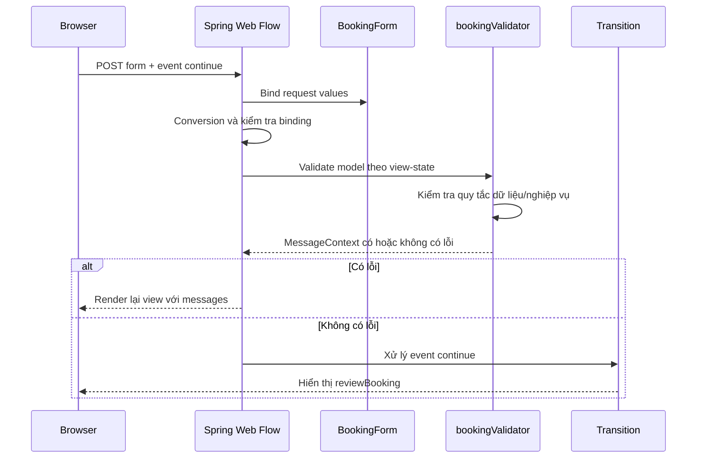

# Validator tách riêng và quy ước tìm bean trong Spring Web Flow

Trong **Spring Web Flow** (`SPRING_WEB_FLOW`), một `view-state` thường nhận dữ liệu từ form, bind vào model rồi kiểm tra trước khi cho phép người dùng chuyển sang bước tiếp theo. Khi quy tắc kiểm tra chỉ có vài dòng, có thể đặt logic validation ngay trên model. Nhưng khi quy tắc nghiệp vụ dài, cần dùng lại ở nhiều màn hình hoặc phụ thuộc service/repository, tách validator thành một bean riêng sẽ giúp code dễ kiểm thử và bảo trì hơn.

Spring Web Flow hỗ trợ cách xác định validator theo **quy ước tên bean dựa trên model**. Ví dụ view-state dùng model `booking` thì validator tương ứng được đặt tên `bookingValidator`. Nhờ quy ước này, flow có thể tìm validator dành cho model mà không phải viết lại lời gọi validator ở mọi transition. Bài cũng trình bày cách gọi validation theo quy ước trên model, cách ghi lỗi vào `MessageContext` và cách phân biệt validation với binding/conversion.

## 1. Vì sao nên tách validator khỏi model?

Giả sử flow đặt phòng có model `booking` với các trường tên khách, email, ngày nhận phòng và số khách. Quy tắc kiểm tra ban đầu có thể chỉ là “tên khách không được trống”. Sau đó yêu cầu tăng lên:

- Email phải đúng định dạng và chưa được dùng cho một booking đang hoạt động.
- Ngày nhận phòng phải trong tương lai và nằm trong thời gian khách sạn mở bán.
- Số khách không vượt sức chứa của loại phòng.
- Mã khuyến mại còn hiệu lực tại ngày nhận phòng.
- Người dùng hiện tại có quyền sửa booking được truyền vào flow.

Nếu đặt toàn bộ logic này trong JavaBean `BookingForm`, model sẽ vừa chứa dữ liệu, vừa truy cập service, vừa biết cách tạo thông báo. Điều đó làm model khó tái sử dụng và khó kiểm thử độc lập.

Có thể tách trách nhiệm:

| Thành phần | Trách nhiệm |
| --- | --- |
| `BookingForm` | Chứa dữ liệu người dùng nhập và các getter/setter |
| `BookingValidator` | Kiểm tra tính hợp lệ của dữ liệu booking |
| `BookingPolicyService` | Thực hiện quy tắc nghiệp vụ cần truy cập dữ liệu hoặc hệ thống bên ngoài |
| Spring Web Flow | Gọi validation theo vòng đời view-state và quyết định có cho transition tiếp tục không |
| `MessageContext` | Chứa lỗi/thông báo để view hiển thị |

Validator tách riêng giúp model nhẹ hơn, dễ dùng lại trong nhiều flow và dễ viết unit test. Tuy nhiên, validator vẫn nên tập trung vào **kiểm tra**; thao tác ghi database, đặt phòng hoặc thanh toán thuộc service nghiệp vụ.

## 2. Hai cách tổ chức validation thường gặp

Spring Web Flow hỗ trợ validation theo quy ước trên model và validation bằng một validator tách riêng.

| Cách | Nơi đặt logic | Quy ước |
| --- | --- | --- |
| Validation by convention trên model | Method trên model có tên theo state | `validate` + state ID, ví dụ `validateEnterBookingDetails(ValidationContext)` |
| Validator bean riêng | Spring bean triển khai `org.springframework.binding.validation.Validator` | Tên model + hậu tố `Validator`, ví dụ `bookingValidator` |

Hai cách cùng có thể đưa lỗi vào `MessageContext`. Khi chọn validator riêng, Web Flow tìm bean theo quy ước tên dựa trên model. Một số ví dụ:

```text
Model name:       booking
Validator bean:   bookingValidator

Model name:       registration
Validator bean:   registrationValidator

Model name:       payment
Validator bean:   paymentValidator
```

Quy ước này cần được giữ nhất quán trong application context. Nếu dùng nhiều validator cho cùng một model hoặc muốn thay đổi cách phân giải validator, hãy cấu hình rõ theo API của phiên bản Web Flow đang chạy.

## 3. Model và view-state làm cơ sở cho việc tìm validator

Giả sử flow có model tên `booking`:

```java
package com.example.booking;

public class BookingForm {
    private String guestName;
    private String email;
    private Integer guestCount;

    public BookingForm() {
    }

    public String getGuestName() {
        return guestName;
    }

    public void setGuestName(String guestName) {
        this.guestName = guestName;
    }

    public String getEmail() {
        return email;
    }

    public void setEmail(String email) {
        this.email = email;
    }

    public Integer getGuestCount() {
        return guestCount;
    }

    public void setGuestCount(Integer guestCount) {
        this.guestCount = guestCount;
    }
}
```

Trong flow XML:

```xml
<var name="booking" class="com.example.booking.BookingForm" />

<view-state id="enterBookingDetails"
            view="booking/details"
            model="booking">
    <binder>
        <binding property="guestName" required="true" />
        <binding property="email" required="true" />
        <binding property="guestCount" required="true" />
    </binder>

    <transition on="continue" to="reviewBooking" />
</view-state>
```

Thuộc tính `model="booking"` xác định object được bind ở view-state. Tên model này cũng là cơ sở cho quy ước tìm validator tương ứng `bookingValidator`.

Cần phân biệt hai tên:

- `enterBookingDetails` là **ID của view-state**; nó được dùng trong quy ước tìm method validation trên model.
- `booking` là **tên model**; nó được dùng trong quy ước tìm validator bean tách riêng.

Vì vậy, đổi state ID có thể ảnh hưởng tên method `validateEnterBookingDetails`, trong khi đổi model name có thể ảnh hưởng tên bean `bookingValidator`. Khi refactor flow XML, hãy rà cả hai quy ước.

## 4. Tạo validator bean riêng

Validator riêng triển khai interface `org.springframework.binding.validation.Validator`. Interface này nhận model cần kiểm tra và `ValidationContext` để ghi lỗi.

Ví dụ:

```java
package com.example.booking;

import org.springframework.binding.message.MessageBuilder;
import org.springframework.binding.message.MessageContext;
import org.springframework.binding.validation.ValidationContext;
import org.springframework.binding.validation.Validator;

public class BookingValidator implements Validator {

    private BookingPolicyService bookingPolicyService;

    public void setBookingPolicyService(
            BookingPolicyService bookingPolicyService) {
        this.bookingPolicyService = bookingPolicyService;
    }

    @Override
    public void validate(Object model, ValidationContext context) {
        BookingForm booking = (BookingForm) model;
        MessageContext messages = context.getMessageContext();

        if (booking.getGuestName() == null
                || booking.getGuestName().trim().isEmpty()) {
            messages.addMessage(new MessageBuilder()
                    .error()
                    .source("guestName")
                    .defaultText("Vui lòng nhập tên khách.")
                    .build());
        }

        if (booking.getEmail() == null
                || !booking.getEmail().contains("@")) {
            messages.addMessage(new MessageBuilder()
                    .error()
                    .source("email")
                    .defaultText("Vui lòng nhập email hợp lệ.")
                    .build());
        }

        if (booking.getGuestCount() == null
                || booking.getGuestCount() < 1) {
            messages.addMessage(new MessageBuilder()
                    .error()
                    .source("guestCount")
                    .defaultText("Số khách phải lớn hơn 0.")
                    .build());
        } else if (!bookingPolicyService
                .isGuestCountAllowed(booking.getGuestCount())) {
            messages.addMessage(new MessageBuilder()
                    .error()
                    .source("guestCount")
                    .defaultText("Số khách vượt sức chứa của phòng.")
                    .build());
        }
    }
}
```

Các điểm quan trọng:

- `validate(Object model, ValidationContext context)` nhận model mà view-state đang sử dụng.
- `context.getMessageContext()` trả về nơi ghi các lỗi validation.
- `MessageBuilder.error()` tạo thông báo lỗi.
- `source("email")` liên kết lỗi với field `email` để view có thể hiển thị đúng vị trí.
- `BookingPolicyService` được inject để kiểm tra quy tắc phụ thuộc nghiệp vụ.

Đoạn kiểm tra email dùng `contains("@")` chỉ để minh họa luồng tạo lỗi. Ứng dụng thật nên dùng validator định dạng email phù hợp, chuẩn hóa input và tránh tự viết regex quá đơn giản. Việc kiểm tra email đã tồn tại cũng cần xử lý race condition ở database/service khi tạo booking.

## 5. Đăng ký bean theo quy ước tên

Trong Spring application context, khai báo bean với tên theo model cộng hậu tố `Validator`:

```xml
<bean id="bookingValidator"
      class="com.example.booking.BookingValidator">
    <property name="bookingPolicyService"
              ref="bookingPolicyService" />
</bean>
```

Với model `booking`, bean có tên `bookingValidator` là validator tương ứng theo quy ước. Nếu model trong view-state đổi thành `registration`, tên validator theo cùng quy ước sẽ là `registrationValidator`.

Cấu hình flow:

```xml
<var name="booking" class="com.example.booking.BookingForm" />

<view-state id="enterBookingDetails"
            view="booking/details"
            model="booking">
    <binder>
        <binding property="guestName" required="true" />
        <binding property="email" required="true" />
        <binding property="guestCount" required="true" />
    </binder>

    <transition on="continue" to="reviewBooking" />
</view-state>
```

Khi validation của view-state được thực hiện, Web Flow có thể phân giải validator bean theo tên model. Không cần đặt một lời gọi service ghi dữ liệu trong binder; validator chỉ kiểm tra và ghi message.

Nếu ứng dụng có custom validation resolver hoặc cấu hình flow builder services riêng, hãy xác nhận bean được phân giải theo quy tắc nào. Không tạo hai bean trùng tên trong cùng context hoặc đổi tên bean mà quên cập nhật nơi tham chiếu.

## 6. Method validation theo state và bean validator khác nhau thế nào?

Khi không cần validator riêng, có thể đặt method trên model với tên dựa theo state ID:

```java
package com.example.booking;

import org.springframework.binding.message.MessageBuilder;
import org.springframework.binding.validation.ValidationContext;

public class BookingForm {

    private String guestName;
    private String email;

    // Getter/setter

    public void validateEnterBookingDetails(
            ValidationContext context) {

        if (guestName == null || guestName.trim().isEmpty()) {
            context.getMessageContext().addMessage(
                    new MessageBuilder()
                            .error()
                            .source("guestName")
                            .defaultText("Vui lòng nhập tên khách.")
                            .build());
        }
    }
}
```

Khi view-state có ID `enterBookingDetails` và model `booking`, method theo quy ước là `validateEnterBookingDetails(ValidationContext)`.

So sánh:

| Tiêu chí | Method trên model | Validator bean |
| --- | --- | --- |
| Tên theo quy ước | `validate` + state ID | Tên model + `Validator` |
| Tham số | `ValidationContext` | `Object model` và `ValidationContext` |
| Có thể dùng service | Có thể, nhưng model phải nhận dependency | Có thể inject dependency qua Spring |
| Tái sử dụng | Thường gắn với model/state | Dễ dùng lại cho nhiều view/flow |
| Mức độ tách biệt | Model kiêm validation | Validation nằm trong bean riêng |
| Phù hợp | Quy tắc đơn giản, đặc thù một state | Quy tắc nghiệp vụ phức tạp hoặc cần dùng lại |

Không nên triển khai cả hai cách cùng kiểm tra một quy tắc nếu không có chủ đích. Nếu cả model convention và bean validator cùng chạy, người dùng có thể nhận thông báo trùng lặp hoặc cùng một lỗi được kiểm tra hai lần.

## 7. Khi nào validator được gọi?

Validation thường diễn ra khi người dùng gửi một event từ `view-state` có binding model và transition cần kiểm tra dữ liệu. Trình tự khái quát:



Nếu binding/conversion đã thất bại, model có thể chưa ở trạng thái phù hợp để validator thực hiện toàn bộ kiểm tra. Do đó cần đọc lỗi theo thứ tự: request field → binding → conversion → validation → transition.

Các transition có thể điều chỉnh việc binding/validation:

```xml
<view-state id="enterBookingDetails"
            view="booking/details"
            model="booking">
    <transition on="continue" to="reviewBooking" />

    <transition on="cancel"
                to="bookingCancelled"
                bind="false" />
</view-state>
```

`bind="false"` bỏ qua binding và validation gắn với việc bind model cho event Hủy. Điều này hữu ích khi form đang trống nhưng người dùng vẫn cần thoát.

Nếu muốn vẫn bind dữ liệu nhưng bỏ qua validation cho một transition cụ thể, có thể dùng thuộc tính `validate="false"` theo cú pháp mà phiên bản Web Flow hỗ trợ. Chỉ dùng khi event đó không thực hiện hành động nghiệp vụ đòi hỏi dữ liệu hợp lệ.

## 8. Gọi validator tường minh khi cần kiểm soát thứ tự

Quy ước tìm validator bean phù hợp cho validation gắn với model/view-state. Có trường hợp ứng dụng cần gọi một validator ở **một thời điểm cụ thể**, hoặc kiểm tra một phần dữ liệu trước khi chuyển sang action khác. Khi đó có thể tham chiếu bean tường minh trong flow expression hoặc thông qua một action wrapper.

Nếu gọi validator trực tiếp, phải truyền đúng kiểu `ValidationContext` mà hợp đồng của validator yêu cầu. `RequestContext` của flow không phải là `ValidationContext` và không thể thay thế trực tiếp cho nó. Với phần lớn flow, hãy để Web Flow gọi validator theo convention; chỉ tạo wrapper/action riêng khi thật sự cần một bước validation có thứ tự riêng và đã dùng đúng API context của phiên bản đang triển khai.

**Không gọi validator tường minh và đồng thời để convention tự gọi cùng validator cho cùng một event** nếu không muốn kiểm tra hai lần. Hãy chọn một cơ chế cho mỗi điểm validation và test thứ tự.

## 9. Thông báo lỗi theo field và lỗi toàn cục

Validator có thể thêm lỗi gắn với một field hoặc lỗi không gắn với field cụ thể.

Lỗi theo field:

```java
messages.addMessage(new MessageBuilder()
        .error()
        .source("email")
        .defaultText("Email đã được sử dụng.")
        .build());
```

Lỗi toàn cục:

```java
messages.addMessage(new MessageBuilder()
        .error()
        .defaultText("Không thể hoàn tất đặt phòng với thông tin hiện tại.")
        .build());
```

Lỗi theo field giúp view hiển thị cạnh input. Lỗi toàn cục phù hợp khi nhiều field kết hợp tạo thành một vi phạm, ví dụ ngày trả phòng trước ngày nhận phòng.

Với JSP/Spring form tags, view có thể hiển thị:

```jsp
<form:form modelAttribute="booking"
           method="post"
           action="${flowExecutionUrl}">
    <form:input path="guestName" />
    <form:errors path="guestName" cssClass="error" />

    <form:input path="email" />
    <form:errors path="email" cssClass="error" />

    <form:errors cssClass="global-error" />

    <button type="submit" name="_eventId_continue" value="1">
        Tiếp tục
    </button>
</form:form>
```

Với JSF hoặc Thymeleaf, cách render message khác nhau nhưng vẫn cần giữ nguyên source/error code để gắn thông báo đúng vị trí.

## 10. Validator cần phối hợp với validation framework nào?

Spring Web Flow có thể sử dụng hạ tầng validation của Spring Binding và tích hợp với Bean Validation tùy cấu hình. Cần phân biệt:

| Cơ chế | Vai trò |
| --- | --- |
| `org.springframework.binding.validation.Validator` | Validator theo hợp đồng của Spring Binding, nhận model và `ValidationContext` |
| Method `validate${stateId}` | Validation by convention trên model |
| Bean Validation (`@NotNull`, `@Size`, `@Email`, ...) | Khai báo constraint trên thuộc tính/đối tượng |
| Spring `org.springframework.validation.Validator` | Hợp đồng validator phổ biến của Spring Framework, nhận object và `Errors` |
| Service nghiệp vụ | Kiểm tra điều kiện cần truy cập repository, quyền hoặc hệ thống khác |

Không được nhầm `org.springframework.binding.validation.Validator` với `org.springframework.validation.Validator`. Hai interface có package và chữ ký khác nhau. Nếu muốn dùng validator của Spring Framework, cần adapter/wrapper hoặc cấu hình tích hợp được phiên bản Web Flow hỗ trợ.

Bean Validation annotation cũng không tự đảm bảo mọi quy tắc được chạy. Cần có provider, validator factory và flow builder services/cấu hình phù hợp. Hãy kiểm thử annotation thật sự được kích hoạt khi submit view-state.

## 11. Phân biệt lỗi binding, conversion và validator bean

| Hiện tượng | Lớp chịu trách nhiệm | Cách xử lý |
| --- | --- | --- |
| Field không có trong request hoặc tên sai | Binding | Kiểm tra path/name, model và binder |
| Chuỗi không chuyển thành kiểu Java | Conversion | Cấu hình converter/formatter và hiển thị lỗi chuyển kiểu |
| Trường bắt buộc rỗng | Required binding | Khai báo `required="true"` ở binding |
| Email sai định dạng | Validator | Thêm constraint hoặc logic kiểm tra định dạng |
| Số khách vượt sức chứa | Validator/service nghiệp vụ | Kiểm tra policy từ server |
| Booking không thuộc người dùng | Authorization/service | Kiểm tra quyền; không coi đây chỉ là lỗi form |
| Phòng vừa bị người khác đặt | Nghiệp vụ đồng thời | Kiểm tra lại khi xác nhận và xử lý conflict |

Validator không thể sửa một field đã không được bind đúng hoặc converter đã thất bại. Ngược lại, binding thành công không có nghĩa dữ liệu hợp lệ. Chẩn đoán theo từng lớp giúp tránh thêm validator bean để giải quyết nhầm lỗi input mapping.

## 12. Vòng đời bean và an toàn khi nhiều flow chạy đồng thời

Spring bean mặc định thường là singleton. Một `bookingValidator` singleton có thể được nhiều người dùng gọi đồng thời. Vì vậy:

- Không lưu model hiện tại, user ID hoặc lỗi của một lần validate vào instance field.
- Dùng biến local trong method `validate`.
- Dependency service được inject nên an toàn theo thiết kế của chính service.
- Không giữ `ValidationContext` hoặc `MessageContext` sau khi method kết thúc.
- Nếu validator cần cache, phải kiểm soát thread-safety và không trộn dữ liệu giữa các flow execution.

Ví dụ không an toàn:

```java
public class UnsafeBookingValidator implements Validator {
    private BookingForm currentBooking;

    @Override
    public void validate(Object model, ValidationContext context) {
        currentBooking = (BookingForm) model;
        // Hai request đồng thời có thể ghi đè currentBooking.
    }
}
```

Ví dụ an toàn hơn:

```java
public class BookingValidator implements Validator {

    @Override
    public void validate(Object model, ValidationContext context) {
        BookingForm booking = (BookingForm) model;
        // Chỉ dùng biến local trong lần gọi hiện tại.
    }
}
```

Đối tượng model và context thuộc request/flow execution cụ thể; không giữ chúng trong validator singleton hoặc chia sẻ sang thread khác.

## 13. Kiểm thử validator riêng và quy ước tìm bean

Nên kiểm thử ở hai cấp độ:

**Unit test validator:** gọi trực tiếp `validate(model, context)` với model hợp lệ và không hợp lệ; xác nhận lỗi field/global được tạo đúng. Cấp này kiểm tra logic validator mà không cần chạy flow.

**Integration test Web Flow:** khởi tạo flow với view-state dùng model `booking`, đăng ký bean `bookingValidator` trong Spring context, gửi event submit và xác nhận validator được gọi. Kiểm tra cả trường hợp bean sai tên hoặc thiếu bean nếu cơ chế lookup theo convention được sử dụng.

Ma trận test:

| Kịch bản | Điều cần xác nhận |
| --- | --- |
| Model `booking`, bean `bookingValidator` tồn tại | Validator được phân giải và thực thi theo cấu hình/convention |
| Bean bị đổi tên thành `reservationValidator` | Không còn khớp model `booking`; test phải phát hiện cấu hình sai |
| Tên model đổi từ `booking` sang `reservation` | Quy ước validator cần được cập nhật đồng bộ |
| Tên state đổi | Method `validate${stateId}` theo convention cần được rà soát |
| Email sai | Có field error gắn với `email` |
| Số khách vượt sức chứa | Validator/service thêm lỗi nghiệp vụ phù hợp |
| Dữ liệu hợp lệ | Transition sang `reviewBooking` |
| Event Hủy | Không gọi validation nếu transition dùng `bind="false"` |
| Hai request đồng thời | Không có dữ liệu/context bị rò giữa validator calls |
| Lỗi repository | Được xử lý theo policy; không biến lỗi hạ tầng thành validation success |

Trong integration test, đừng chỉ assert validator mock được gọi. Hãy xác nhận **state cuối**, message context và model sau binding, bởi mục tiêu là chứng minh Web Flow thật sự chặn transition khi có lỗi.

## 14. Lỗi thường gặp khi tách validator

| Triệu chứng | Nguyên nhân có thể | Cách khắc phục |
| --- | --- | --- |
| Validator không được gọi | Bean name không khớp model convention hoặc cấu hình validation chưa dùng bean đó | Kiểm tra tên model, bean và cách cấu hình resolver |
| `NoSuchBeanDefinitionException` | Bean không được đăng ký hoặc nằm ngoài application context được dùng bởi flow | Kiểm tra component scan/XML context |
| Validator chạy hai lần | Vừa gọi explicit evaluate vừa bật convention validation | Chọn một đường gọi và xác nhận thứ tự |
| Lỗi không hiện cạnh field | Message source không có `source` đúng hoặc view không render errors | Gắn source property và thêm error component |
| Validator nhận sai model type | View-state model khác với validator mong đợi | Kiểm tra `model` và cast an toàn |
| Lỗi dữ liệu đã được báo nhưng vẫn chuyển state | Transition/action chạy trước hoặc validation bị tắt | Kiểm tra event, bind/validate flags và thứ tự action |
| Validator singleton giữ dữ liệu request | Lưu context/model vào field | Chỉ dùng biến local, không giữ request state |
| Repository lỗi nhưng bị báo như dữ liệu sai | Bắt mọi exception rồi thêm validation message | Phân biệt lỗi nghiệp vụ với lỗi hạ tầng, dùng exception handling phù hợp |

Khi debug, bật log Web Flow và Spring Binding ở mức phù hợp:

```properties
logging.level.org.springframework.webflow=DEBUG
logging.level.org.springframework.binding=DEBUG
```

Tên logger cụ thể có thể thay đổi theo phiên bản. Theo dõi flow ID, state ID, model name, bean validator được chọn, event và message errors. Không ghi toàn bộ dữ liệu cá nhân vào log.

## 15. Bài thực hành: đổi tên model làm validator không được tìm thấy

Một flow có cấu hình:

```xml
<var name="booking" class="com.example.booking.BookingForm" />

<view-state id="enterBookingDetails"
            model="booking"
            view="booking/details">
    <transition on="continue" to="reviewBooking" />
</view-state>
```

Spring context đăng ký:

```xml
<bean id="bookingValidator"
      class="com.example.booking.BookingValidator" />
```

Sau một lần refactor, developer đổi model trong flow thành `reservation` nhưng quên đổi tên bean. Validation không còn được thực hiện theo cấu hình convention như dự kiến.

**Câu hỏi:**

1. Quy ước tên validator được tạo từ tên model nào?
2. Với model `reservation`, bean name tương ứng là gì?
3. State ID `enterBookingDetails` ảnh hưởng đến quy ước method validation nào?
4. Vì sao không nên đặt validator hiện tại trong instance field của singleton?
5. Cần viết integration test nào để phát hiện lỗi đổi tên?

**Gợi ý lời giải:**

- Model `booking` tương ứng bean `bookingValidator`.
- Khi đổi model thành `reservation`, quy ước bean là `reservationValidator`.
- Nếu dùng validation by convention trên model, state ID tạo tên method `validateEnterBookingDetails(ValidationContext)`.
- Validator singleton được gọi đồng thời; instance field chứa model/context có thể bị request khác ghi đè.
- Test nên khởi chạy flow với model name mới, đăng ký đúng bean, gửi dữ liệu lỗi và xác nhận view-state vẫn ở màn hình nhập cùng message error. Thêm ca bean name sai để kiểm tra wiring/convention.

**Điểm cần nhớ:** Tách validator thành Spring bean giúp giữ model gọn và gom quy tắc kiểm tra vào một nơi. Với model `booking`, quy ước tên bean `bookingValidator` giúp Web Flow xác định validator tương ứng; method `validate${stateId}` là một quy ước khác, gắn với ID của view-state. Giữ hai quy ước này rõ ràng, ghi lỗi qua `MessageContext` và kiểm thử ở cả cấp validator lẫn flow execution sẽ giúp validation nhiều bước dễ bảo trì và đáng tin cậy hơn.

## Tài liệu tham khảo

- [Spring Web Flow 2.5.x Reference Guide — Validation](https://docs.spring.io/spring-webflow/docs/2.5.x/reference/html/views.html)
- [Spring Web Flow API — ValidationContext](https://docs.spring.io/spring-webflow/docs/2.5.x/api/org/springframework/binding/validation/ValidationContext.html)
- [Spring Binding API — Validator](https://docs.spring.io/spring-webflow/docs/2.5.x/api/org/springframework/binding/validation/Validator.html)
- [Spring Binding API — MessageBuilder](https://docs.spring.io/spring-webflow/docs/2.5.x/api/org/springframework/binding/message/MessageBuilder.html)

Đối chiếu đúng phiên bản Web Flow đang dùng, nhất là khi ứng dụng có validator tùy chỉnh, Bean Validation hoặc flow builder services riêng.
