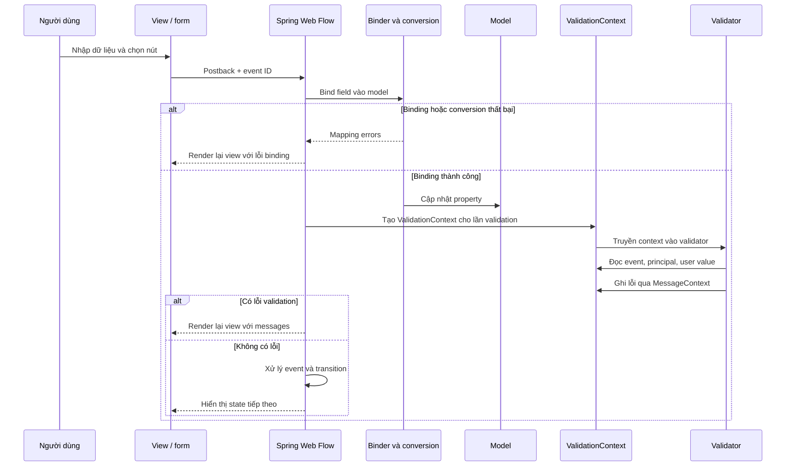

# ValidationContext, sự kiện người dùng và dữ liệu nhập gốc trong Spring Web Flow

Trong **Spring Web Flow** (`SPRING_WEB_FLOW`), validation thường diễn ra khi người dùng gửi một biểu mẫu từ `view-state`. Validator cần biết nhiều hơn các giá trị hiện đang có trong model: người dùng vừa bấm nút nào, ai đang thực hiện flow và họ đã nhập gì vào một field cụ thể. Đó là lý do framework cung cấp **`ValidationContext`**.

`ValidationContext` là ngữ cảnh được truyền vào các phương thức validation theo quy ước trên model hoặc validator bean. Nó cung cấp bốn khả năng: truy cập `MessageContext` để ghi lỗi, đọc event đã kích hoạt validation, lấy `Principal` của người dùng hiện tại và đọc giá trị người dùng nhập cho một property đã bind.

Bài thuộc chương **Kiểm tra dữ liệu** trình bày cách sử dụng bốn API này trong một flow đặt phòng nhiều bước. Ta sẽ phân biệt giá trị đang nằm trong model với giá trị người dùng vừa nhập, dùng event để chọn nhóm quy tắc phù hợp, sử dụng danh tính người dùng đúng cách và kiểm thử validation theo từng thao tác.

## 1. ValidationContext nằm ở đâu trong vòng đời view-state?

Một `view-state` có thể khai báo model để Web Flow tự động binding dữ liệu form và chạy validation khi nhận user event. Luồng xử lý khái quát:



Ví dụ flow:

```xml
<flow xmlns="http://www.springframework.org/schema/webflow"
      xmlns:xsi="http://www.w3.org/2001/XMLSchema-instance"
      xsi:schemaLocation="
          http://www.springframework.org/schema/webflow
          http://www.springframework.org/schema/webflow/spring-webflow-2.0.xsd"
      start-state="editBooking">

    <var name="booking"
         class="com.example.booking.BookingForm" />

    <view-state id="editBooking"
                view="booking/edit"
                model="booking">
        <binder>
            <binding property="guestName" required="true" />
            <binding property="email" required="true" />
            <binding property="couponCode" />
        </binder>

        <transition on="applyCoupon" />
        <transition on="continue" to="reviewBooking" />
        <transition on="saveDraft" to="draftSaved" validate="false" />
        <transition on="cancel" to="bookingCancelled" bind="false" />
    </view-state>

    <view-state id="reviewBooking" view="booking/review" />
    <end-state id="draftSaved" />
    <end-state id="bookingCancelled" />
</flow>
```

Ở đây:

- `model="booking"` yêu cầu Web Flow bind form vào model `booking`.
- `applyCoupon` là event xử lý trong cùng view-state; sau khi xử lý, view có thể được render lại.
- `continue` yêu cầu validation trước khi chuyển sang bước xem lại.
- `saveDraft` có `validate="false"` nên binding vẫn diễn ra nhưng model validation bị bỏ qua cho event này.
- `cancel` có `bind="false"` nên bỏ qua cả binding lẫn validation.

ValidationContext được tạo cho một lần validation cụ thể. Không lưu nó vào field của model, validator singleton hoặc session.

## 2. Bốn phương thức của ValidationContext

Interface `org.springframework.binding.validation.ValidationContext` có bốn phương thức:

| Phương thức | Kiểu trả về | Mục đích |
| --- | --- | --- |
| `getMessageContext()` | `MessageContext` | Ghi thông báo lỗi để view hiển thị |
| `getUserEvent()` | `String` | Đọc event người dùng đã kích hoạt validation |
| `getUserPrincipal()` | `Principal` | Lấy danh tính người dùng hiện tại |
| `getUserValue(String property)` | `Object` | Lấy giá trị người dùng nhập cho field được bind vào property |

Package import:

```java
import org.springframework.binding.validation.ValidationContext;
import org.springframework.binding.message.MessageContext;
import org.springframework.binding.message.MessageBuilder;

import java.security.Principal;
```

Điểm cần nhớ:

- `ValidationContext` là API dành cho validation; không phải `RequestContext` của toàn bộ flow.
- `getUserValue` chỉ nhận **tên property đã bind**, không nhận tên nút hay tên parameter tùy ý.
- Giá trị trả về là `Object`. Không giả định mọi field đều trả về `String`.
- `getUserEvent` trả event ID đã kích hoạt lần validation, ví dụ `continue` hoặc `applyCoupon`.
- `getUserPrincipal` cung cấp `Principal` của request hiện tại; không thay thế bước kiểm tra quyền ở service.

## 3. getUserEvent(): biết người dùng đang thực hiện thao tác nào

Một form có thể có nhiều nút, mỗi nút biểu thị một ý định khác nhau:

- `applyCoupon`: áp dụng mã khuyến mại.
- `continue`: xác nhận dữ liệu và đi tiếp.
- `saveDraft`: lưu bản nháp.
- `cancel`: hủy quy trình.

Nếu tất cả các thao tác đều gọi cùng một phương thức validation, quy tắc cần kiểm tra có thể khác nhau. `getUserEvent()` giúp validator biết event nào đang được xử lý.

Ví dụ JSP:

```jsp
<form:form modelAttribute="booking"
           method="post"
           action="${flowExecutionUrl}">

    <form:input path="guestName" />
    <form:input path="email" />
    <form:input path="couponCode" />

    <button type="submit" name="_eventId_applyCoupon" value="1">
        Áp dụng mã
    </button>

    <button type="submit" name="_eventId_continue" value="1">
        Tiếp tục
    </button>

    <button type="submit" name="_eventId_saveDraft" value="1">
        Lưu bản nháp
    </button>
</form:form>
```

Tên event được gửi trong request phải khớp với transition của flow. Khi event `applyCoupon` kích hoạt validation, `context.getUserEvent()` trả về ID `applyCoupon`. Khi người dùng bấm Tiếp tục, giá trị tương ứng là `continue`.

Không dùng nhãn hiển thị của nút như “Áp dụng mã” để so sánh trong Java. Hãy dùng event ID ổn định đã khai báo trong flow.

## 4. Validation theo event: mỗi thao tác có một hợp đồng dữ liệu

Một màn hình có thể hỗ trợ cả thao tác từng phần và thao tác hoàn tất. Ví dụ:

| Event | Mục đích | Quy tắc phù hợp |
| --- | --- | --- |
| `applyCoupon` | Kiểm tra mã khuyến mại | Mã không rỗng, tồn tại, còn hiệu lực |
| `continue` | Đi đến bước xem lại | Tên khách, email và các dữ liệu bắt buộc hợp lệ |
| `saveDraft` | Lưu tiến độ chưa hoàn tất | Có thể bỏ qua model validation bằng `validate="false"` nếu chính sách cho phép |
| `cancel` | Rời flow | Có thể bỏ qua binding và validation bằng `bind="false"` |

Phương thức validation theo quy ước của state:

```java
public void validateEditBooking(ValidationContext context) {
    String event = context.getUserEvent();
    MessageContext messages = context.getMessageContext();

    if ("applyCoupon".equals(event)) {
        validateCouponInput(context, messages);
        return;
    }

    if ("continue".equals(event)) {
        validateGuestDetails(messages);
        validateCouponIfPresent(messages);
    }
}
```

Phương thức `validateEditBooking` được Web Flow gọi theo quy ước vì ID của view-state là `editBooking`. Event cho phép method chọn tập quy tắc phù hợp.

Lưu ý: `validate="false"` làm Web Flow bỏ qua model validation cho transition đó. Do vậy validator không được gọi để kiểm tra event `saveDraft` trong cấu hình ví dụ. Nếu cần xác thực dữ liệu tối thiểu trước khi lưu draft, hãy thực hiện quy tắc đó trong action/service lưu draft hoặc cấu hình validation phù hợp.

## 5. getUserValue(property): đọc giá trị người dùng nhập cho field đã bind

`getUserValue(String property)` trả về giá trị người dùng nhập trong UI field được bind vào property tương ứng. Ví dụ:

```java
Object enteredCoupon = context.getUserValue("couponCode");
Object enteredEmail = context.getUserValue("email");
```

Giá trị này hữu ích khi cần xem **input của lần submit hiện tại**. Model có thể đã được chuẩn hóa, chuyển kiểu hoặc xử lý bởi setter; trong khi validator cần biết người dùng đã nhập gì cho field đó.

Ví dụ field `couponCode` là input text. Validator có thể đọc giá trị vừa gửi, chuẩn hóa khoảng trắng và kiểm tra:

```java
private void validateCouponInput(
        ValidationContext context,
        MessageContext messages) {

    Object userValue = context.getUserValue("couponCode");

    String code = userValue instanceof String
            ? ((String) userValue).trim()
            : null;

    if (code == null || code.isEmpty()) {
        messages.addMessage(new MessageBuilder()
                .error()
                .source("couponCode")
                .defaultText("Vui lòng nhập mã khuyến mại.")
                .build());
    }
}
```

Một số điểm cần hiểu chính xác:

- Tham số `property` phải là tên property trong binder, ví dụ `couponCode`.
- `getUserValue` trả `Object`; kiểu cụ thể phụ thuộc field/view và mapping. Input text thường là chuỗi, nhưng không được mặc định như vậy cho mọi component.
- Đây là giá trị nhập cho **một property đã bind**, không phải toàn bộ HTTP request parameter map hoặc raw request body.
- Nếu property không nằm trong binder hoặc field không được gửi, không nên giả định sẽ nhận được giá trị mong muốn.
- Không dùng giá trị này làm nguồn tin cậy cho quyền, giá, trạng thái thanh toán hoặc định danh tài khoản.

### Giá trị người dùng nhập và giá trị model có thể khác nhau

Ví dụ model chuẩn hóa mã khuyến mại thành chữ hoa:

```java
public class BookingForm {
    private String couponCode;

    public String getCouponCode() {
        return couponCode;
    }

    public void setCouponCode(String couponCode) {
        this.couponCode = couponCode == null
                ? null
                : couponCode.trim().toUpperCase();
    }
}
```

Nếu người dùng nhập ` spring10 `, model sau setter có thể giữ `SPRING10`. `getUserValue("couponCode")` giúp validator xem giá trị nhập của lần postback theo mapping context, còn `booking.getCouponCode()` là trạng thái hiện tại của model.

Hai giá trị phục vụ hai mục đích khác nhau:

| Nguồn | Câu hỏi được trả lời |
| --- | --- |
| `booking.getCouponCode()` | Model hiện đang giữ mã nào sau binding/chuẩn hóa? |
| `context.getUserValue("couponCode")` | Người dùng đã nhập giá trị nào cho field này ở lần submit hiện tại? |

Đừng tự tạo biến “raw input” trong model nếu chỉ cần đọc giá trị người dùng nhập cho một property trong lần validation. Tuy nhiên, cũng không nên coi `getUserValue` là bản sao byte-for-byte của request HTTP; API công bố giá trị field dưới dạng `Object` theo mapping của Web Flow.

## 6. Dữ liệu nhập gốc không thay thế xử lý lỗi conversion

Giả sử model có property `guestCount` kiểu `Integer` nhưng người dùng nhập `many`. Đây là lỗi chuyển kiểu, không phải lỗi quy tắc nghiệp vụ.

| Tình huống | Lớp xử lý chính |
| --- | --- |
| `guestCount=3` | Binding và conversion chuyển chuỗi thành Integer |
| `guestCount=many` | Conversion tạo lỗi kiểu dữ liệu |
| `guestCount=0` | Conversion thành công; validator kiểm tra số khách phải lớn hơn 0 |
| `guestCount` không được gửi | Binding xử lý parameter thiếu theo cấu hình và trạng thái model |
| `guestCount` hợp lệ nhưng vượt sức chứa phòng | Validator/service kiểm tra quy tắc nghiệp vụ |

Web Flow thực hiện binding trước model validation. Nếu binding không hoàn tất thành công, flow event không được tạo để điều khiển transition và view được render lại để người dùng sửa dữ liệu.

Vì vậy:

- Dùng lỗi binding/conversion và message tương ứng để xử lý input không chuyển được kiểu.
- Dùng `ValidationContext` để kiểm tra quy tắc trên model và dữ liệu nhập khi validation được gọi.
- Không giả định validator luôn được chạy sau một conversion error.
- Không dùng `getUserValue` để thay converter hoặc để ép một chuỗi sai kiểu thành giá trị hợp lệ.

Ví dụ `guestCount=many` cần một thông báo chuyển kiểu rõ ràng tại field. Còn `guestCount=0` có thể bind thành công nhưng validator phải báo lỗi nghiệp vụ.

## 7. getUserPrincipal(): biết danh tính người dùng hiện tại

`getUserPrincipal()` trả về `java.security.Principal` của người dùng hiện tại. Validator có thể sử dụng thông tin này để chọn quy tắc phù hợp, ví dụ kiểm tra booking thuộc về người dùng đang thao tác.

Ví dụ:

```java
private void validateBookingOwner(
        BookingForm booking,
        ValidationContext context,
        MessageContext messages) {

    Principal principal = context.getUserPrincipal();

    if (principal == null) {
        messages.addMessage(new MessageBuilder()
                .error()
                .defaultText("Bạn cần đăng nhập để tiếp tục.")
                .build());
        return;
    }

    if (!bookingAccessService.canEdit(
            principal.getName(), booking.getBookingId())) {
        messages.addMessage(new MessageBuilder()
                .error()
                .defaultText("Bạn không có quyền chỉnh sửa đặt phòng này.")
                .build());
    }
}
```

`Principal` cung cấp danh tính, thường có thể đọc qua `getName()`. Nó không nhất thiết là đối tượng `Authentication` của Spring Security và không tự cung cấp mọi role/authority.

Quyền truy cập phải được kiểm tra ở server:

- Dùng service hoặc cơ chế authorization đã cấu hình để xác minh quyền sở hữu.
- Không lấy account ID từ hidden field làm bằng chứng người dùng sở hữu booking.
- Không chỉ dựa vào việc form hiển thị nút Chỉnh sửa.
- Không bỏ qua authorization ở bước cuối chỉ vì đã kiểm tra ở bước validation trước; quyền có thể thay đổi giữa các request.

`ValidationContext` cung cấp principal để validator có ngữ cảnh người dùng. Nó không thay thế Spring Security hoặc kiểm tra quyền ở service.

## 8. getMessageContext(): ghi lỗi gắn với field và lỗi toàn cục

`getMessageContext()` trả về nơi validator ghi các thông báo. Dùng `MessageBuilder` để tạo lỗi:

Lỗi gắn với field:

```java
context.getMessageContext().addMessage(
        new MessageBuilder()
                .error()
                .source("email")
                .defaultText("Vui lòng nhập địa chỉ email hợp lệ.")
                .build());
```

Lỗi toàn cục:

```java
context.getMessageContext().addMessage(
        new MessageBuilder()
                .error()
                .defaultText("Không thể xác nhận đặt phòng với thông tin hiện tại.")
                .build());
```

`source("email")` gắn message với property để view có thể hiển thị cạnh field. Không có `source` thì message là lỗi chung của form.

Với JSP/Spring form tags:

```jsp
<form:form modelAttribute="booking"
           method="post"
           action="${flowExecutionUrl}">

    <form:input path="email" />
    <form:errors path="email" cssClass="error" />

    <form:errors cssClass="global-error" />

    <button type="submit" name="_eventId_continue" value="1">
        Tiếp tục
    </button>
</form:form>
```

Với Thymeleaf, JSF hoặc view technology khác, cách render message khác nhau. Tuy nhiên validator vẫn ghi lỗi vào `MessageContext` của Web Flow; view adapter chịu trách nhiệm hiển thị theo cơ chế của nó.

## 9. Ví dụ đầy đủ: validation khác nhau theo nút và input người dùng

Model:

```java
package com.example.booking;

public class BookingForm {
    private String guestName;
    private String email;
    private String couponCode;

    public String getGuestName() {
        return guestName;
    }

    public void setGuestName(String guestName) {
        this.guestName = guestName;
    }

    public String getEmail() {
        return email;
    }

    public void setEmail(String email) {
        this.email = email;
    }

    public String getCouponCode() {
        return couponCode;
    }

    public void setCouponCode(String couponCode) {
        this.couponCode = couponCode;
    }
}
```

Phương thức validation đặt trong model `BookingForm`:

```java
import org.springframework.binding.message.MessageBuilder;
import org.springframework.binding.message.MessageContext;
import org.springframework.binding.validation.ValidationContext;

// Đặt các phương thức này trong BookingForm đã khai báo ở trên.
public void validateEditBooking(ValidationContext context) {
        MessageContext messages = context.getMessageContext();
        String event = context.getUserEvent();

        if ("applyCoupon".equals(event)) {
            validateCoupon(context, messages);
            return;
        }

        if ("continue".equals(event)) {
            validateGuestDetails(messages);
            validateCouponIfProvided(context, messages);
        }
    }

    private void validateCoupon(
            ValidationContext context,
            MessageContext messages) {

        Object entered = context.getUserValue("couponCode");
        String code = entered instanceof String
                ? ((String) entered).trim()
                : null;

        if (code == null || code.isEmpty()) {
            messages.addMessage(new MessageBuilder()
                    .error()
                    .source("couponCode")
                    .defaultText("Vui lòng nhập mã khuyến mại.")
                    .build());
        }
    }

    private void validateGuestDetails(MessageContext messages) {
        if (guestName == null || guestName.trim().isEmpty()) {
            messages.addMessage(new MessageBuilder()
                    .error()
                    .source("guestName")
                    .defaultText("Vui lòng nhập tên khách.")
                    .build());
        }

        if (email == null || !email.contains("@")) {
            messages.addMessage(new MessageBuilder()
                    .error()
                    .source("email")
                    .defaultText("Vui lòng nhập email hợp lệ.")
                    .build());
        }
    }

    private void validateCouponIfProvided(
            ValidationContext context,
            MessageContext messages) {

        Object entered = context.getUserValue("couponCode");
        String code = entered instanceof String
                ? ((String) entered).trim().toUpperCase()
                : null;

        if (code != null && !code.isEmpty()
                && !code.matches("[A-Z0-9]{4,12}")) {
            messages.addMessage(new MessageBuilder()
                    .error()
                    .source("couponCode")
                    .defaultText("Mã khuyến mại có định dạng không hợp lệ.")
                    .build());
        }
}
```

Các phương thức trên sử dụng field của `BookingForm` và `ValidationContext`; ví dụ chỉ kiểm tra định dạng mã. Nếu quy tắc cần repository hoặc service như `couponService`, hãy dùng validator bean riêng thay vì đưa dependency vào model.

Bản validator bean tương ứng:

```java
import org.springframework.stereotype.Component;
import org.springframework.binding.message.MessageBuilder;
import org.springframework.binding.message.MessageContext;
import org.springframework.binding.validation.ValidationContext;

@Component
public class BookingValidator {

    private final CouponService couponService;

    public BookingValidator(CouponService couponService) {
        this.couponService = couponService;
    }

    public void validateEditBooking(
            BookingForm booking,
            ValidationContext context) {

        MessageContext messages = context.getMessageContext();
        String event = context.getUserEvent();

        if ("applyCoupon".equals(event)) {
            Object entered = context.getUserValue("couponCode");
            String code = entered instanceof String
                    ? ((String) entered).trim()
                    : null;

            if (code == null || code.isEmpty()
                    || !couponService.isValid(code)) {
                messages.addMessage(new MessageBuilder()
                        .error()
                        .source("couponCode")
                        .defaultText("Mã khuyến mại không hợp lệ.")
                        .build());
            }
            return;
        }

        if ("continue".equals(event)) {
            if (booking.getGuestName() == null
                    || booking.getGuestName().trim().isEmpty()) {
                messages.addMessage(new MessageBuilder()
                        .error()
                        .source("guestName")
                        .defaultText("Vui lòng nhập tên khách.")
                        .build());
            }

            if (booking.getEmail() == null
                    || !booking.getEmail().contains("@")) {
                messages.addMessage(new MessageBuilder()
                        .error()
                        .source("email")
                        .defaultText("Vui lòng nhập email hợp lệ.")
                        .build());
            }

            Object entered = context.getUserValue("couponCode");
            String code = entered instanceof String
                    ? ((String) entered).trim()
                    : null;
            if (code != null && !code.isEmpty()
                    && !couponService.isValid(code)) {
                messages.addMessage(new MessageBuilder()
                        .error()
                        .source("couponCode")
                        .defaultText("Mã khuyến mại không hợp lệ.")
                        .build());
            }
        }
    }
}
```

Khi dùng validator bean, tên bean theo quy ước của model `booking` là `bookingValidator`. Cần bảo đảm method state-specific có chữ ký phù hợp với API Web Flow của phiên bản đang sử dụng.

## 10. State-specific validation và default validation

Validation theo quy ước cho phép viết method gắn với ID view-state:

```java
public void validateEditBooking(ValidationContext context) {
    // Quy tắc riêng cho view-state editBooking.
}
```

Một validator bean cũng có thể khai báo method mặc định `validate` không gắn với một state cụ thể:

```java
@Component
public class BookingValidator {

    public void validateEditBooking(
            Booking booking, ValidationContext context) {
        // Quy tắc chỉ dành cho state editBooking.
    }

    public void validate(
            Booking booking, ValidationContext context) {
        // Quy tắc chung mỗi khi model Booking được validate.
    }
}
```

Theo quy ước Web Flow:

1. Method state-specific như `validateEditBooking` được gọi trước.
2. Method mặc định `validate` được gọi tiếp theo nếu được khai báo.
3. Nếu transition tắt validation bằng `validate="false"`, các phương thức model validation theo cơ chế này không được gọi.

Điều này giúp tách quy tắc theo từng màn hình khỏi quy tắc chung. Tuy nhiên, tránh lặp lại cùng một kiểm tra trong cả hai method vì người dùng có thể nhận thông báo trùng lặp.

## 11. Phân biệt ValidationContext với RequestContext và currentEvent

Các API có tên gần nhau nhưng phạm vi khác nhau:

| API | Nơi sử dụng | Mục đích |
| --- | --- | --- |
| `ValidationContext.getUserEvent()` | Method validation | Event đã kích hoạt lần validation |
| `ValidationContext.getUserValue(property)` | Method validation | Giá trị nhập của một property đã bind |
| `ValidationContext.getUserPrincipal()` | Method validation | Principal của người dùng hiện tại |
| `ValidationContext.getMessageContext()` | Method validation | Ghi lỗi/thông báo |
| `RequestContext.getCurrentEvent()` | Action/flow execution | Event hiện tại trong request context |
| EL `currentEvent` | Flow/view expression | Truy cập event hiện tại theo EL |

Không truyền `RequestContext` vào method cần `ValidationContext` và kỳ vọng gọi được `getUserValue`. Hai interface phục vụ mục đích khác nhau.

Tương tự, `requestParameters` là cách truy cập request parameter trong EL/RequestContext; `getUserValue` là API được thiết kế để validator đọc input gắn với một property trong lần binding hiện tại. Ưu tiên dùng API đúng phạm vi để code thể hiện rõ ý định.

## 12. Khi nào ValidationContext không được gọi?

Không phải mọi request đến view-state đều tạo một lần model validation.

| Tình huống | Model binding | Model validation |
| --- | --- | --- |
| Submit event bình thường, binding hợp lệ | Thực hiện | Thực hiện nếu được bật |
| Transition có `validate="false"` | Vẫn thực hiện | Bỏ qua |
| Transition có `bind="false"` | Bỏ qua | Bỏ qua |
| Request chỉ render lại view, không có user event | Không có postback binding mới | Không chạy validation do event đó |
| Binding/conversion thất bại | Mapping không hoàn tất thành công | Không nên giả định validator nghiệp vụ vẫn chạy; view được render lại với binding error |

Điểm này rất quan trọng khi debug: nếu breakpoint trong `validateEditBooking` không được gọi, hãy kiểm tra event có thực sự được gửi, transition có `validate="false"` hay không và binding có hoàn tất không.

Nếu mục tiêu là kiểm tra dữ liệu khi lưu draft nhưng transition dùng `validate="false"`, cần đặt kiểm tra phù hợp trong action/service lưu draft. Không trông chờ `ValidationContext` được gọi trong một nhánh đã chủ động tắt validation.

## 13. Dùng principal và user value an toàn

ValidationContext cung cấp dữ liệu người dùng để hỗ trợ validation, nhưng không biến input thành dữ liệu đáng tin cậy.

**Đối với user value:**

- Chỉ đọc property đã khai báo binding.
- Chuẩn hóa input trước khi so sánh theo quy tắc nghiệp vụ.
- Không dùng giá trị nhập để quyết định giá cuối cùng hoặc trạng thái thanh toán.
- Không ghi toàn bộ dữ liệu nhập vào log; có thể chứa email, số điện thoại hoặc thông tin cá nhân.

**Đối với principal:**

- Kiểm tra null nếu ứng dụng có thể cho phép anonymous request.
- Dùng principal để xác định danh tính, sau đó gọi authorization/service để xác minh quyền.
- Không lấy username do client gửi làm principal.
- Kiểm tra quyền ở thời điểm thực hiện hành động nhạy cảm, không chỉ ở màn hình trước đó.

Validator có thể đưa ra lỗi thân thiện cho người dùng. Service và security layer vẫn phải bảo vệ bất biến nghiệp vụ ngay cả khi flow bị gọi bằng request trực tiếp.

## 14. Kiểm thử ValidationContext

Nên kiểm thử cả phương thức validation lẫn toàn bộ view-state postback.

### Unit test cho validator

Kiểm tra các trường hợp:

| Input/context | Kết quả mong đợi |
| --- | --- |
| Event `applyCoupon`, coupon rỗng | Lỗi gắn với `couponCode` |
| Event `applyCoupon`, coupon hợp lệ | Không có lỗi coupon |
| Event `continue`, thiếu guest name | Lỗi gắn với `guestName` |
| Event `continue`, email sai | Lỗi gắn với `email` |
| Principal không tồn tại | Không được mặc định coi người dùng đã đăng nhập |
| Principal không có quyền sửa booking | Service authorization từ chối |
| User value là kiểu không phải String | Validator xử lý kiểu an toàn, không cast mù |

Có thể dùng mock/stub cho `ValidationContext` trong unit test. Ví dụ minh họa với Mockito:

```java
import static org.mockito.Mockito.mock;
import static org.mockito.Mockito.when;

ValidationContext context = mock(ValidationContext.class);
MessageContext messages = mock(MessageContext.class);

when(context.getUserEvent()).thenReturn("applyCoupon");
when(context.getUserValue("couponCode")).thenReturn("SPRING10");
when(context.getMessageContext()).thenReturn(messages);

bookingValidator.validateEditBooking(booking, context);
```

Tên constructor và cách tạo `MessageContext` cụ thể cần đối chiếu dependency version trong dự án; test có thể mock `MessageContext` thay vì tạo implementation thật nếu chỉ cần xác nhận lời gọi.

### Integration test cho flow

Một flow test cần chứng minh:

1. Flow vào đúng view-state có model.
2. Request gửi đúng event ID.
3. Binder cập nhật các property được khai báo.
4. `ValidationContext` nhận đúng event và user value.
5. Lỗi được ghi vào message context.
6. Flow ở lại view-state khi validation lỗi.
7. Flow chuyển state khi dữ liệu hợp lệ.
8. Event có `validate="false"` vẫn binding nhưng không gọi validator.
9. Event có `bind="false"` bỏ qua cả binding và validation.

Không chỉ kiểm tra validator được gọi một lần. Hãy xác nhận **state cuối, message và dữ liệu model** để chứng minh toàn bộ hành vi.

## 15. Chẩn đoán lỗi thường gặp

| Triệu chứng | Nguyên nhân cần kiểm tra | Hướng xử lý |
| --- | --- | --- |
| `getUserEvent()` trả event không như mong đợi | Nút submit gửi sai event ID hoặc flow transition dùng tên khác | Kiểm tra request parameter và `on` |
| `getUserValue("couponCode")` trả null | Property chưa được bind, field không gửi hoặc tên property sai | Kiểm tra binder, tên input và request payload |
| Không vào breakpoint validator | Validation bị tắt hoặc binding chưa hoàn tất | Kiểm tra `validate`, `bind`, event và mapping error |
| Model có giá trị khác user value | Setter/converter chuẩn hóa dữ liệu | Xem mục đích của từng giá trị; không mặc định đó là lỗi |
| Principal null | Request không có danh tính xác thực hoặc context chưa được tích hợp | Kiểm tra security chain và loại request |
| Principal có tên nhưng user vẫn sửa được booking khác | Chỉ kiểm tra identity, chưa kiểm tra quyền sở hữu | Gọi authorization service với principal và resource ID |
| Message không hiện trên view | View không render errors hoặc source không khớp property | Kiểm tra error tag/message component |
| Validation chạy hai lần | Quy tắc bị lặp ở state-specific và default validate | Rà method validation và test message |
| Input sai kiểu nhưng validator không chạy | Binding/conversion thất bại trước model validation | Xử lý binding error và converter riêng |

Khi cần bật log trong môi trường phát triển:

```properties
logging.level.org.springframework.webflow=DEBUG
logging.level.org.springframework.binding=DEBUG
```

Không bật log dữ liệu form nhạy cảm ở môi trường dùng chung. Ghi nhận flow ID, state ID, event ID, property bị lỗi và loại mapping error là đủ để khoanh vùng trong đa số trường hợp.

## 16. Bài thực hành: phân biệt event, user value và model value

Một view-state có model `booking` và các binding:

```xml
<view-state id="editBooking"
            view="booking/edit"
            model="booking">
    <binder>
        <binding property="guestName" />
        <binding property="couponCode" />
    </binder>

    <transition on="applyCoupon" />
    <transition on="continue" to="reviewBooking" />
    <transition on="saveDraft" to="draftSaved" validate="false" />
</view-state>
```

Model chuẩn hóa mã coupon trong setter:

```java
public void setCouponCode(String couponCode) {
    this.couponCode = couponCode == null
            ? null
            : couponCode.trim().toUpperCase();
}
```

Người dùng nhập ` spring10 ` rồi bấm **Áp dụng mã**. Giả sử validator được gọi với event `applyCoupon`.

**Câu hỏi:**

1. `context.getUserEvent()` trả về gì?
2. `context.getUserValue("couponCode")` dùng để đọc dữ liệu nào?
3. `booking.getCouponCode()` có thể chứa giá trị gì sau setter?
4. Nếu người dùng bấm `saveDraft` với `validate="false"`, method validation có được gọi không?
5. Nếu request không gửi `couponCode`, validator có nên mặc định mã là chuỗi rỗng không?
6. Principal có thể dùng thay thế kiểm tra quyền sở hữu booking không?

**Gợi ý lời giải:**

- Event là `applyCoupon` vì đó là ID nút đã phát.
- `getUserValue("couponCode")` trả giá trị người dùng nhập cho property đã bind, kiểu trả về là `Object`; với input text thường là String.
- Model có thể giữ `SPRING10` do setter trim và uppercase.
- Event `saveDraft` bỏ qua model validation vì `validate="false"`, dù binding vẫn diễn ra.
- Nếu field không được gửi, cần xử lý trạng thái thiếu dữ liệu theo chính sách form; không tự coi mọi trường hợp null là chuỗi rỗng.
- Principal chỉ xác định danh tính; service authorization vẫn phải xác minh người dùng có quyền chỉnh sửa booking.

## Tài liệu tham khảo chính thức

- [Spring Web Flow 2.5.1 Reference Guide — ValidationContext](https://docs.spring.io/spring-webflow/docs/2.5.x/reference/html/views.html#view-validation-context)
- [ValidationContext API — Spring Web Flow 2.5.1](https://docs.spring.io/spring-webflow/docs/2.5.1.RELEASE/api/org/springframework/binding/validation/ValidationContext.html)
- [ValidationContext API — Spring Web Flow 3.0.1](https://docs.spring.io/spring-webflow/docs/3.0.1/api/org/springframework/binding/validation/ValidationContext.html)
- [DefaultValidationContext API — Spring Web Flow 3.0.1](https://docs.spring.io/spring-webflow/docs/3.0.1/api/org/springframework/webflow/validation/DefaultValidationContext.html)
- [MappingResults API — Spring Web Flow 3.0.1](https://docs.spring.io/spring-webflow/docs/3.0.1/api/org/springframework/binding/mapping/MappingResults.html)

Đối chiếu tài liệu của đúng phiên bản Web Flow đang sử dụng, đặc biệt khi ứng dụng tùy biến binder, converter, validator hoặc tích hợp Spring Security.
